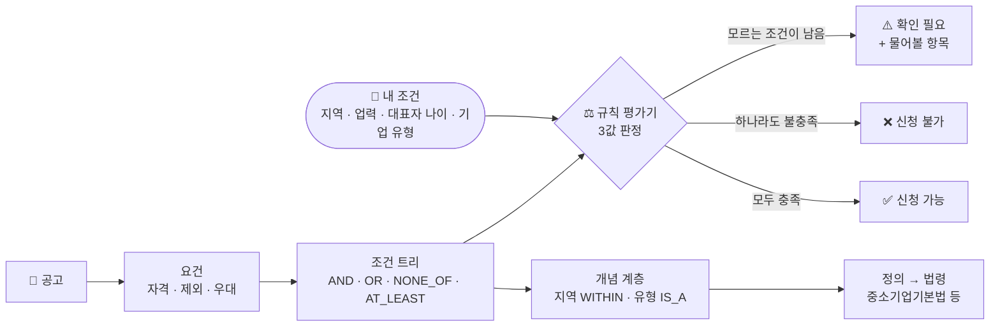
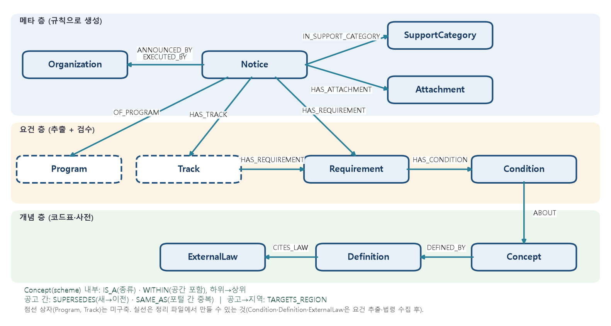
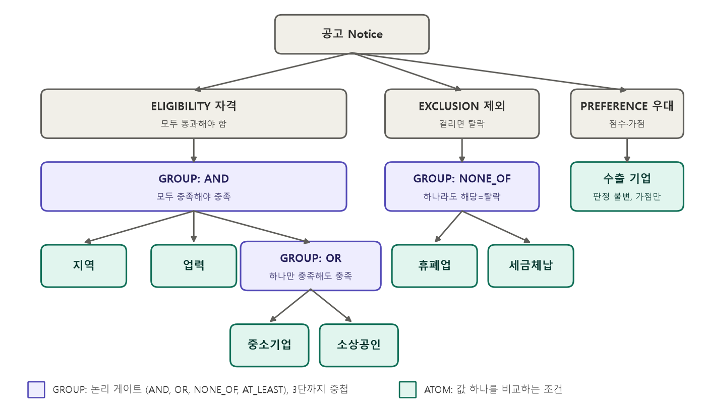
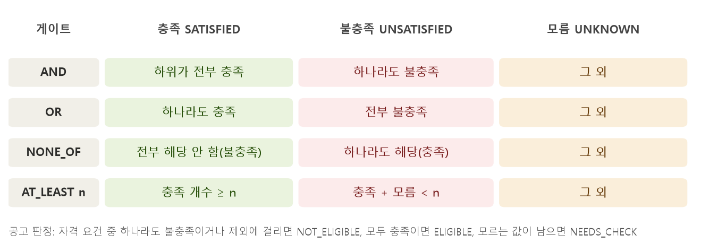
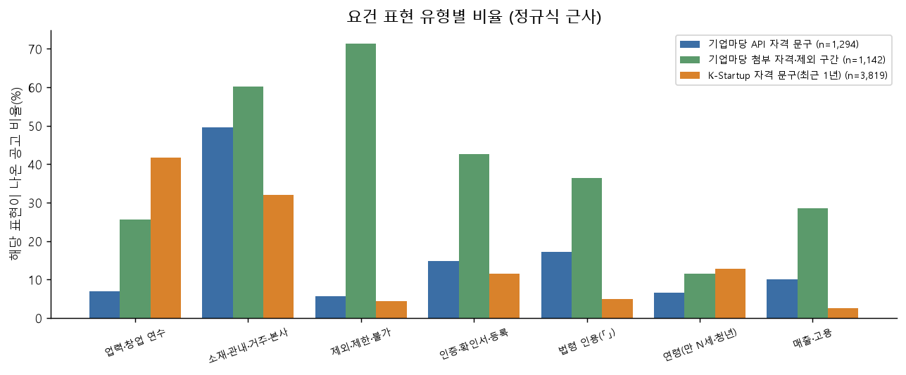
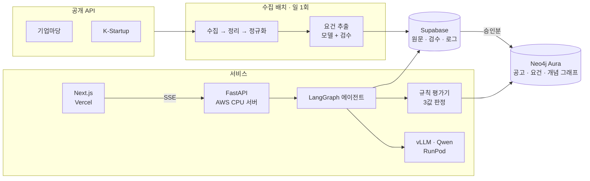

<div align="center">

# 🧭 지원각

### 내 조건으로 이 지원사업에 신청할 수 있을까?

정부·지자체 지원사업 공고의 **신청 요건을 온톨로지로 정규화**하고,<br/>
**신청 가능 · 신청 불가 · 확인 필요**를 공고 원문 근거와 함께 알려 주는 자격 판정 서비스

<br/>


[문제](#-왜-필요한가) · [판정 방식](#-어떻게-판정하나) · [진행 현황](#-진행-현황) · [데이터](#-데이터) · [아키텍처](#-아키텍처-설계) · [빠른 시작](#-빠른-시작) · [문서](#-문서)

</div>

---

> [!NOTE]
> 엔코아 AI 캠퍼스 MLE 1기 최종 프로젝트입니다. 공개 API 데이터를 쓰는 **교육용 서비스**이며 실제 신청·접수 시스템이 아닙니다. 판정 결과는 참고용이고, 최종 자격은 공고 원문과 주관 기관 안내를 따릅니다.

## 💡 왜 필요한가

| 지금의 불편 | 지원각이 하는 일 |
| --- | --- |
| 공고가 **기업마당 · K-Startup** 등 여러 포털에 흩어져 있다 | 두 포털 공고를 **하나의 공통 스키마**로 모은다 |
| 자격 요건이 **첨부 공고문**(HWP·PDF) 안에 길게 적혀 있다 | 첨부에서 자격·제외 구간을 읽어 **요건 → 조건 트리**로 정규화한다 |
| "업력 7년 이내", "관내 소재", "중소기업" 같은 말의 **기준이 공고마다 다르다** | 기준일 · 지역 기준 · 법령 정의를 **표준 용어와 개념 계층**으로 맞춘다 |
| 결국 공고를 하나씩 열어 직접 읽어야 한다 | 내 조건을 넣으면 공고별로 **3값 판정 + 근거 문장 + 추론 경로**를 보여 준다 |

## 🔍 어떻게 판정하나

**판정은 모델이 아니라 규칙 평가기(코드)가 합니다.** 모델은 요건 추출과 설명만 맡고, 모르는 것은 억지로 채우지 않고 `확인 필요`로 둡니다.



<details>
<summary><b>예시: 광주 남구 소상공인이 "[광주] 소상공인 홍보지원"에 신청할 수 있을까?</b></summary>

<br/>

| 조건 | 판정 | 근거 |
| --- | --- | --- |
| 지역: 광주광역시 관내 | ✅ 충족 | 남구 → 광주(구) 묶음. 2026-07 개편으로 사라진 "광주광역시"를 지역 사전이 연결 |
| 소상공인 | ✅ 충족 (정의 확인 필요) | 소상공인기본법 정의 연결 대상 |
| 중소기업확인서 상 소상공인 | ❔ 미확인 | 확인서 보유 여부를 입력하지 않음 |
| **공고 판정** | **⚠️ 확인 필요** | 불충족은 없지만 확인할 조건이 남음 → "중소기업확인서를 갖고 계신가요?" |

평가는 손으로 계산한 설계 예시입니다(도메인 온톨로지 설계서 §7 시나리오 1).

</details>



<details>
<summary><b>조건 트리와 3값 합성 규칙 그림</b></summary>

<br/>





</details>

## 📊 진행 현황

| 영역 | 상태 | 내용 |
| --- | :---: | --- |
| 공고 수집 (기업마당 · K-Startup) | ✅ | 공식 API 실호출. 기업마당 1,294건, K-Startup 전체 30,632건 |
| 첨부 공고문 텍스트 추출 | ✅ | 기업마당 본문출력파일 1,292 / 1,294건 (OCR 126건 포함) |
| 정리층 · 공통 스키마 v1 | ✅ | 공고 5,116건, 검색 청크 32,947개 |
| 값 정규화 후보 | ✅ | 업력 · 연령 · 지역 · 규모 · 인증 · 법령 인용 · 제외 17,211건 (검수 전) |
| EDA · 용어 표준화 | ✅ | 결측 · 중복 · 요건 유형, 신청자 유형 24종, 기준일 · 지역 기준 표준 |
| 지역 사전 | ✅ | 코드표 318행, 별칭 639개, 지역 표기 정확 연결 96.0% |
| 판정용 법령 | ✅ | 법률 13 + 시행령 13 = 26문서, 조문 1,286개 |
| 그래프 RAG 최소 구현 (1~3단계) | ✅ | 구조 조건 평가 · 지역 계층 확장 · 청크 검색 · 근거 출력 |
| Neo4j Aura 적재 | ✅ | 노드 31,506 · 관계 55,903 · 유일 제약 10 (구조화 필드 요건까지, 본문 조건은 검수 후) |
| SQL 대 그래프 비교 측정 | ✅ | 336,600쌍에서 판정 불일치 0, 속도는 SQL이 빠름 |
| 조건 추출 · 논리 구조 파이프라인 | 🔄 | 조건 스키마 v1, 2-1 ~ 2-5단계 진행, 검수 정답 대기 |
| API 뼈대 (FastAPI) | 🔄 | `GET /health`, `POST /api/eligibility` |
| 도메인 온톨로지 설계 | 🔄 | 클래스 계층 · 조건 트리 · 3값 규칙 · Multi-hop 경로, 팀 검토 중 |
| 정답셋 파일럿 | 🔄 | 후보 50건 선정, 파일럿 10건 수기 정규화 진행([수기 정규화 도우미](tools/labeler/)) |
| 요건 추출 모델 (Qwen · QLoRA) | ⬜ | 정답셋 확정 후 |
| 에이전트 · 웹 · 배포 | ⬜ | LangGraph · Next.js · AWS |
| 나라장터 입찰공고 | ⏸️ | 1년치 수집 완료. 판정 범위 포함 여부는 추후 결정 |

> [!IMPORTANT]
> **그래프가 SQL보다 낫다고 주장하지 않습니다.** 모집 중 공고 1,122건 × 가상 프로필 300개(336,600쌍)로 지역 판정을 비교했더니 SQL(폐쇄 테이블 · 재귀 CTE)과 Neo4j가 기준 구현과 **한 쌍도 다르지 않았고**, 속도는 SQL이 빨랐습니다(중앙값 0.37ms 대 9.0ms). 확인된 것은 **계층 사전이 꼭 필요하다**는 점입니다. 계층 없는 SQL 필터는 상위 지역으로 올라가야 충족되는 24,759쌍을 하나도 찾지 못했습니다. → [비교 측정 결과](docs/BASELINE_SQL_그래프_비교측정결과_v0.1.md)

## 🗂️ 데이터

| 데이터 | 규모 | 위치 |
| --- | --- | --- |
| 기업마당 지원사업 공고 | 1,294건 (2026-11-24 모집 중 스냅샷) + 첨부 텍스트 | [`data/bizinfo/`](data/bizinfo/) |
| K-Startup 공고 | 3,822건 (최근 1년 3,819 + 모집 중 3) | [`data/kstartup/`](data/kstartup/) |
| 정리층 | 공고 5,116 · 청크 32,947 | [`data/cleaned/`](data/cleaned/) |
| 값 정규화층 | 후보 17,211건 | [`data/normalized/`](data/normalized/) |
| 지역 사전 | 코드표 318 · 별칭 639 · 묶음 5종 | [`data/사전/`](data/사전/) |
| 판정용 법령 | 26문서 · 조문 1,286 · 별표 40 · 공고 인용 543건 | [`data/지원사업_법령/`](data/지원사업_법령/) |
| 정답셋 후보 | 50건 (기업마당 25 · K-Startup 25) | [`data/goldset/`](data/goldset/) |
| 나라장터 용역 공고 | 월별 분할 | [`data/g2b_monthly/`](data/g2b_monthly/) |

<details>
<summary><b>EDA로 확인한 것</b></summary>

<br/>



- 기업마당은 API 자격 문구가 짧고(평균 83자) **요건이 첨부에 몰려 있습니다.** 제외 표현은 API 문구 6% → 첨부 71%.
- K-Startup은 업력 · 연령 · 지역이 구조화 필드로 오지만 **제외 · 우대 필드는 전부 비어 있습니다.**
- 업력 옵션을 전부 고른 공고 중 9.7%는 본문에 업력 상한이 있어, "전부 선택 = 제한 없음"으로 보지 않습니다.

</details>

## 🏗️ 아키텍처 (설계)



| 구성 | 선택 |
| --- | --- |
| 판정 | 규칙 평가기(코드) · 3값 판정 · 근거 문장과 경로 출력 |
| 지식 그래프 | Neo4j Aura (Supabase 원문에서 다시 만들 수 있는 파생물) |
| 시스템 기록 | Supabase (원문 · 버전 · 검수 큐 · 대화 · 감사 로그 · 평가) |
| 모델 | Qwen 소형 + QLoRA · 양자화 → RunPod vLLM 직접 서빙 |
| 서비스 | Next.js(Vercel) · FastAPI(AWS CPU 서버, Docker) · LangGraph |
| 평가 · 관측 | 정답셋 · RAGAS · Langfuse, SQL · 벡터 RAG 베이스라인 비교 |

## 🚀 빠른 시작

```bash
python -m venv .venv && .venv\Scripts\activate   # macOS·Linux: source .venv/bin/activate
pip install -r requirements-dev.txt                  # 서버 + 도구 + 시험
# .env 를 직접 만들어 채운다: BIZINFO_API_KEY · KSTARTUP_SERVICE_KEY · NEO4J_* · SUPABASE_* (커밋 금지)
```

```bash
# 1) 수집
python tools/collect_bizinfo.py                 # 기업마당 전체
python tools/collect_kstartup_full.py           # K-Startup 전체 + 최근 1년

# 2) 정리 · 정규화
python tools/preprocess_notices.py              # 정리층  → data/cleaned/<날짜>/
python tools/normalize_values.py                # 값 정규화 → data/normalized/<날짜>/

# 3) 분석 · 그래프
python tools/eda_domain.py                      # EDA 집계와 그림
python tools/graphrag/build.py export           # Neo4j 적재용 노드 · 관계 파일
python tools/graphrag/build.py compare          # 그래프 평가기 vs SQL 비교

# 4) API 서버
uvicorn api.main:app --reload                   # http://localhost:8000/docs
```

> [!WARNING]
> API 키와 `.env`는 저장소에 올리지 않습니다(`.gitignore`). 공유 Neo4j Aura에는 함부로 쓰지 말고, 실험은 로컬 Neo4j에서 합니다.

## 📚 문서

| 구분 | 문서 |
| --- | --- |
| 기획 | [기획 보고서](docs/[기획설계]%20MLE_기획보고서_2팀.md) · [기초 설계서](docs/MLE_2팀_기초%20설계.md) · [KPI 초안](docs/KPI_DRAFT.md) |
| 기획 · 화면 | [화면설계서 v3.5](docs/design/MLE_2팀_화면설계서_v3.5_와이어프레임.pdf) · [WBS](docs/design/MLE_2팀_WBS.xlsx) |
| 온톨로지 | [도메인 온톨로지 설계서](docs/[도메인온톨로지]%20MLE_도메인_온톨로지_설계서_2팀.md) · [온톨로지 필요성](docs/ONTOLOGY_NECESSITY.md) · [제출 파일](docs/submission/ontology/) |
| 데이터 | [기업마당 명세서](docs/DATA_SPEC_기업마당_v0.1.md) · [EDA · 용어 표준화](docs/DOMAIN_ANALYSIS_EDA_용어표준화_v0.1.md) · [정리층](docs/PREPROCESS_정리층_설계와_결과_v0.1.md) · [값 정규화](docs/NORMALIZE_값정규화층과_첨부_읽기_v0.1.md) · [공통 스키마 v1](docs/SUPPORT_DATA_NORMALIZATION_V1.md) |
| 그래프 · 평가 | [그래프 RAG 1~3단계 결과](docs/GRAPHRAG_구성가능성과_1-3단계_결과_v0.1.md) · [Neo4j 적재 기록](docs/LOAD_Neo4j_적재기록_v0.1.md) · [SQL 대 그래프 비교 결과](docs/BASELINE_SQL_그래프_비교측정결과_v0.1.md) · [베이스라인 측정 방법](docs/BASELINE_SQL_벡터RAG_측정방법_KPI산정근거_v0.1.md) |
| 조건 추출 | [조건 스키마 v1](docs/CONDITION_SCHEMA_V1.md) · [조건 평가기 v1](docs/CONDITION_EVALUATION_PROGRAM_V1.md) · [작업 기록](docs/WORKLOG_20261125_CONDITION_PIPELINE.md) |
| API | [API 뼈대 안내](api/README.md) |
| 정답셋 | [라벨링 가이드](docs/GOLDSET_라벨링_가이드_v0.1.md) · [수기 정규화 작업 안내](docs/PILOT_수기정규화_작업안내_v0.1.md) · [첨부 공고문 추출 가이드](docs/GUIDE_첨부_공고문_추출_가이드_v0.1.md) |

## 🗺️ 저장소 구조

```
data/
  bizinfo/ · kstartup/        # 포털별 원본 수집본
  cleaned/ · normalized/      # 정리층 · 값 정규화층
  사전/                        # 지역 코드표 · 별칭 · 묶음 사전
  지원사업_법령/                # 판정용 법령 조문 · 별표
  goldset/                    # 정답셋 후보 · 파일럿
  g2b_monthly/                # 나라장터 용역 공고(월별)
api/                          # FastAPI 서버 (routers · schemas · services)
docs/                         # 기획 · 설계 · 데이터 · 평가 문서, design/ · diagrams/ · figures/ · submission/
tests/                        # API · 조건 스키마 · 정규화 시험
tools/
  collect_* · preprocess_* · normalize_*   # 수집 · 정리 · 정규화
  graphrag/                   # 조건 생성 · 지역 계층 · 평가기 · 검색 · SQL 비교
  *condition*                 # 조건 추출 · 논리 구조 · 정답 검수 파이프라인
  load_graph_neo4j.py         # Neo4j 적재 (MERGE, 기본 dry-run)
  labeler/                    # 파일럿 수기 정규화 도우미 (브라우저 HTML)
  test_*.py                   # 단위 시험
```

## 📅 일정

| 기간 | 단계 |
| --- | --- |
| 11.17 ~ 11.20 | 기획 |
| 11.23 ~ 11.27 | 데이터 수집 · 정리, 도메인 온톨로지 설계 |
| 3 ~ 4주차 | 요건 추출 · 적재, PoC · 중간 발표 |
| 5 ~ 6주차 | 검색 · 추론 엔진, 서비스 화면 |
| 7 ~ 8주차 | 평가 · 배포 |
| 2027.01.11 | 최종 발표 |

## ⚖️ 데이터 출처와 고지

- 기업마당 지원사업정보 API, K-Startup 조회 서비스(공공데이터포털), 법제처 국가법령정보 OPEN API, 행정안전부 법정동코드.
- K-Startup 공고 페이지와 첨부는 robots.txt가 수집을 금지해 받지 않습니다. 기업마당 첨부 원본은 로컬에만 두고 저장소에 올리지 않습니다.
- 판정 결과는 참고용입니다. 법적 · 세무 자문이나 선정 가능성 예측을 하지 않습니다.

<div align="center">
<sub>근거it · 엔코아 AI 캠퍼스 MLE 1기 2팀</sub>
</div>
