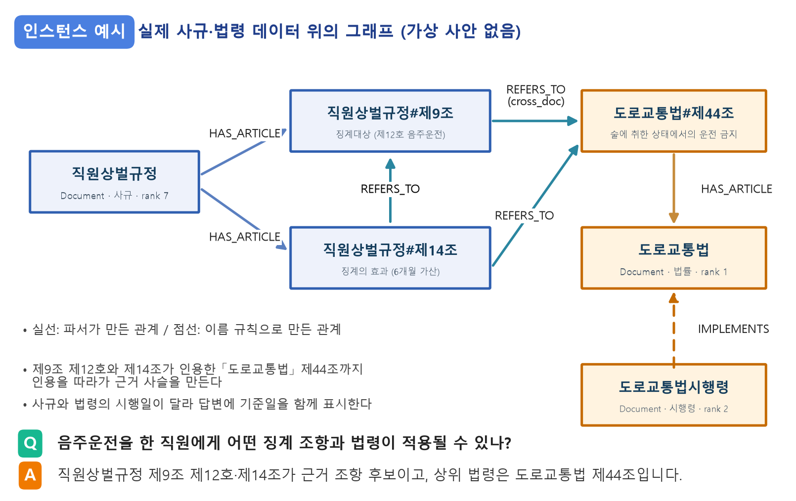
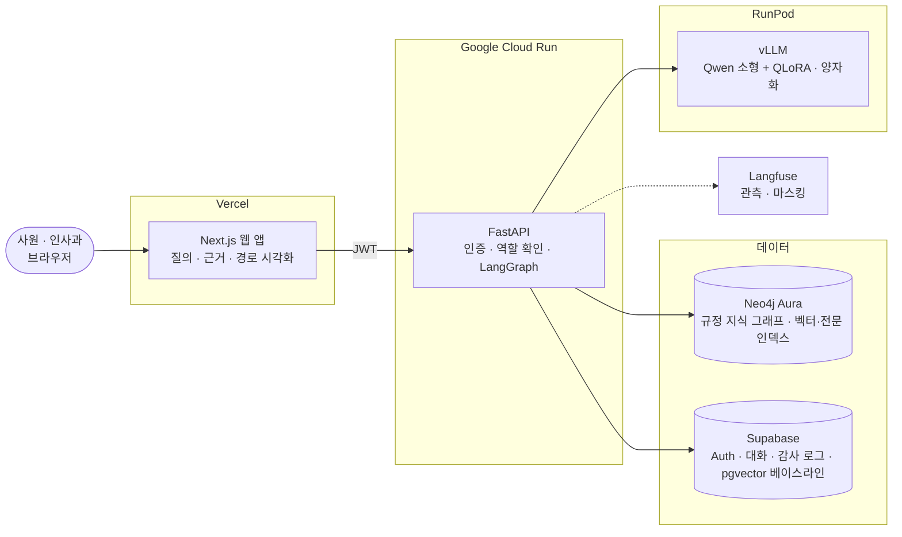
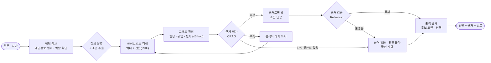

# 📜 사규 준수 검토 서비스 (가칭)

> 기업 내부 규정(사규)과 그 상위 국가 법령을 **지식 그래프**로 구조화해, "이 행동·사안이 어느 규정의 어느 조항에 해당하는가"를 **근거 조문과 인용·위임·예외를 따라간 추론 경로**와 함께 알려 주는 검토 보조 서비스입니다. 근거가 없으면 지어내지 않고 **"근거 없음"** 또는 `판단 불가`로 답합니다. ALIO에 공개된 IBK기업은행 사규 148종과 법제처 상위 법령 275건을 데이터로 씁니다.

- **현재 상태:** **기획·설계 단계**입니다. 데이터 수집·변환과 설계 문서는 끝났고, 그래프 적재·검색·에이전트·서비스는 **아직 구현하지 않았습니다.** 아래 성능·동작은 모두 설계이며 측정값이 아닙니다([구현 현황](#구현-현황)).
- **문서:** [기초 설계서](docs/MLE_2팀_기초%20설계.md) · [기획서](docs/PROJECT_PLAN.md) · [기획 보고서](docs/[기획설계]%20MLE_기획보고서_2팀.md) · [온톨로지 설계서](docs/ONTOLOGY_DESIGN.md) · [도메인 온톨로지 설계서(양식)](docs/[도메인온톨로지]%20MLE_도메인_온톨로지_설계서_2팀.md) · [KPI 초안](docs/KPI_DRAFT.md) · [데이터 명세서](data/데이터_명세서.md) · [상위 법령 데이터 명세서](data/상위법령_데이터명세서.md) · [법령 수집 목록](docs/LAW_COLLECTION_LIST.md) · [아키텍처(확대·이동 가능)](docs/architecture.html) · [프로젝트 가이드 요약](docs/PROJECT_GUIDE_SUMMARY.md)
- 엔코아 AI 캠퍼스 MLE 1기 최종 프로젝트 2팀. 실제 IBK 사내 시스템이 아닌 **공개 규정을 쓰는 교육 프로젝트**이며, 징계·법적 판단을 대신하지 않습니다.

## 서비스 방식

같은 지식 그래프 위에서 **두 가지 모드**를 역할에 따라 제공합니다(설계).

| | **사원 모드** | **인사 모드** |
| --- | --- | --- |
| 대상 | 신입 사원을 비롯한 일반 사원 | 인사과 직원 |
| 목적 | 내 행동·업무가 규정에 어긋나는지 확인·예방 | 사안이 어떤 조항에 해당할 수 있는지 검토 |
| 출력 | 판정 + 근거 조문 + 예외 + 쉬운 설명 + 문의처 안내 | 조항 후보 + 요건별 충족 여부 + 상위 법령 + 징계·절차 규정 + 추가 확인 사항 |
| 접근 | 로그인한 모든 사용자(Google) | 관리자가 지정한 인사과 역할만 |
| 저장 | 대화·사용자 맥락(본인만 열람·삭제) | **사안 본문은 저장하지 않음**, 조회 이력만 감사 로그 |

"다른 사원의 법규 위반 검색"은 **사안 기반 검토**로 한정합니다. 직원 근태·메일 등을 연계한 자동 탐지는 데이터가 없고 개인정보·근로자 감시 문제가 있어 범위에서 제외했습니다. 결과는 "위반 가능성이 있는 조항 후보"로 표현하며 징계 여부·수위는 사람과 정해진 절차가 정합니다.

## 설계된 동작 (예시)

실제 데이터(직원상벌규정 · 도로교통법)에서 확인한 구조를 바탕으로 한 **설계 예시**입니다. 구현 전이라 서비스로 실행되지는 않습니다.

| 이렇게 물으면 | 이렇게 동작하도록 설계 |
| --- | --- |
| (인사) 음주운전을 한 직원에게 어떤 징계 조항과 법령이 적용될 수 있나? | 직원상벌규정 제9조(제12호)와 제14조를 근거 **조항 후보**로 제시하고, 인용을 따라 도로교통법 제44조까지 연결. 징계 수위가 적힌 [별표]는 수집하지 않아 `판단 불가`로 두고 확인을 안내 |
| (사원) 거래처에서 받은 선물을 받아도 되나요? | 행동강령·이해충돌방지 조항과 예외, 상위 법령을 근거와 함께 제시 |
| 규정에 없는 내용을 질문 | 지어내지 않고 **"근거 없음"**, 찾아본 것과 없던 것을 알려 줌 |
| 정보가 부족한 사안 | 결론 대신 `판단 불가`와 추가 확인 사항 |
| 일반 사원이 인사 모드 접근 | 역할 확인(DB·API 이중)에서 차단 |



## 30초 요약

| | |
| --- | --- |
| **문제** | 사규는 여러 문서에 흩어져 있고, 한 조문이 다른 규정·법령을 인용하거나 세부를 위임하며 단서(예외)가 붙는다. 키워드 검색이나 벡터 검색만으로는 조항 사이의 관계를 따라가지 못한다. 틀린 규정 안내는 답하지 않는 것보다 해롭다 |
| **접근** | 사규·법령을 문서·조·항·참조·위임·단서·의무의 **온톨로지 그래프**(Neo4j)로 만들고, 하이브리드 검색 → 그래프 확장(Multi-hop) → 근거 평가(CRAG) → 근거 검증을 거쳐 답한다. 근거가 없으면 보류 |
| **차별점** | 조문 하나가 아니라 **조문들 사이의 관계(인용·위임·예외)** 를 따라 근거 사슬을 보여준다. 자체 호스팅 소형 모델(QLoRA·양자화)로 규정·질의를 외부에 보내지 않는다 |
| **안전** | 인사 모드 역할 접근·감사 로그·사안 비저장, "후보" 표현 강제, 개인정보 입력 필터, 판정 전용 NeMo Guardrails |
| **현재 상태** | 데이터 수집·변환 완료, 설계 문서 완료. 적재·검색·에이전트·서비스는 구현 전 |

## 구현 현황

| 영역 | 상태 | 비고 |
| --- | --- | --- |
| IBK 사규 수집·변환 | ✅ 완료 | 148종 전체 변환 성공 ([tools/convert_ibk.py](tools/convert_ibk.py)) |
| 상위 국가 법령 수집·변환 | ✅ 완료 | 275건(동료 수집). 가이드라인 3건은 수집 불가 |
| 법령 수집 목록·인용 집계 | ✅ 완료 | [tools/make_law_list.py](tools/make_law_list.py) |
| 기획서·설계서·온톨로지 설계·KPI·데이터 명세 | ✅ 초안 | 위 문서. 목표값은 모두 잠정 |
| 온톨로지 샘플 적재·질의 검증 | ⬜ 예정 | 동료 담당. 설계는 [온톨로지 설계서 §15](docs/ONTOLOGY_DESIGN.md) 인수인계 목록 |
| 의무·예외 추출(모델 + 검수) | ⬜ 예정 | 핵심 문서 16개부터 |
| 임베딩·하이브리드 검색·그래프 확장 | ⬜ 예정 | 모델 선정(KURE-v1 / bge-m3 / e5) 전 |
| LangGraph 에이전트·가드레일 | ⬜ 예정 | |
| QLoRA 학습·양자화·vLLM 서빙(RunPod) | ⬜ 예정 | 모델 크기·GPU는 학원 예산 확정 후 |
| 웹 앱(Next.js)·API(FastAPI)·배포 | ⬜ 예정 | Vercel + Cloud Run |
| 평가셋·RAGAS·회귀 게이트 | ⬜ 예정 | 60문항 이상 |
| Hugging Face 공개(필수 KPI) | ⬜ 예정 | 라이선스 점검 후 |

## 현재 확인된 데이터 수치

2026-11-17에 파일을 직접 읽어 센 값입니다. 모델 성능 지표는 아직 없습니다.

| 항목 | 값 |
| --- | --- |
| 사규 | 148종(HWP 140, PDF 8), 조문 3,532(삭제 127 포함), 항 6,878, 개정일 2005-01 ~ 2026-10 |
| 상위 법령 | 275건(법률 105, 시행령 100, 시행규칙·부령 60, 고시 7, 세칙 3), 조문 25,945(삭제 1,832 포함) |
| 사규의 외부 인용(「…」) | 1,012건. 사규 문서로 연결 293건(29%), 법령 정식명칭 일치 417건(41%), 나머지 302건은 약칭·ALIO에 없는 내규 |
| 조 번호까지 적은 법령 인용 | 대상 조문이 실제로 존재하는 비율 97/104 (93%) |
| 시행령·시행규칙 → 모법 | 157/157 이름 규칙으로 연결 가능 |
| 미해결 참조 | 사규 323건, 법령 31,509건. ⚠ `to`의 문서 접두가 항상 출발 문서와 같아 **재해소가 필요** |
| 시점 | 법령은 수집일(2026-11-17) 현행본이며 시행일이 그 이후인 문서 4건. 사규 개정일은 `YYYY-MM` 22건·없음 17건 |

자세한 규칙과 알려진 문제: [데이터 명세서](data/데이터_명세서.md), [온톨로지 설계서 §2](docs/ONTOLOGY_DESIGN.md).

## 데이터와 전처리

| 항목 | 내용 |
| --- | --- |
| 사규 | [ALIO](https://www.alio.go.kr) 공시 IBK기업은행 규정을 수동 다운로드 → HWP5(olefile)·PDF(pymupdf)에서 원문 추출 → 조·항·호 구조, 내부·외부 참조, 단서·위임 후보 문장으로 구조화 |
| 상위 법령 | 사규가 인용한 법령·감독규정을 법제처 국가법령정보센터 OPEN API로 수집(인용 집계 + 팀 요청 목록)해 사규와 같은 JSON 구조로 변환. 별표·서식은 미수집 |
| 학습·평가 데이터(예정) | Hugging Face 한국어 법률 데이터를 SFT 형식으로 변환(근거 id·수치 대조·오염 점검·원문 단위 분할). 후보와 라이선스: [DATA_SOURCES.md](data/DATA_SOURCES.md) |
| 샘플 | [sample_data/](sample_data/): 가상 법령 기반 합성 그래프·질의응답(실제 조문과 무관) |
| 이용 조건 | 법령은 저작권법 제7조상 보호 대상이 아니며, ALIO 공개본의 재배포 조건과 HF 데이터셋 라이선스는 **확인 전**입니다. 외부 공개 전에 점검합니다 |

## 온톨로지


- **결정 층(파서가 만든다):** `Document`(사규·법령 공통) → `Chapter` → `Article` → `Clause`, 조문 참조(`REFERS_TO`), 문서 인용(`CITES`), 상하위 법령(`IMPLEMENTS`), 위임(`DELEGATES_TO`), 제정 근거(`BASED_ON`). 코퍼스에 없는 인용 대상은 `ExternalLaw` 스텁으로 두고 "미보유"로 표시합니다.
- **추출 층(모델 + 검수):** `Obligation`(의무), `Exception`(단서), `Role`, `Concept`과 `STATES`·`EXCEPTS`·`APPLIES_TO`·`ABOUT`·`CONFLICTS_WITH`·`SANCTIONED_BY`. 추출 결과는 `staging → 검수 → 적재`를 거치고 모든 관계에 원문 근거(`evidence`)를 붙입니다.
- **위계 통일:** 법령 `level`(1~5)과 사규를 하나의 `authority_rank`(법률 1 … 사규 세칙·지침 8)로 맞춰 "하위가 상위보다 완화적인가"를 판단합니다.
- 설계 상세(식별자, 외부 참조 해소 규칙, 적재 단계, 임베딩, 검증): [온톨로지 설계서](docs/ONTOLOGY_DESIGN.md), 양식 버전: [도메인 온톨로지 설계서](docs/[도메인온톨로지]%20MLE_도메인_온톨로지_설계서_2팀.md)

## 아키텍처 (설계)



- **저장소 역할:** Neo4j는 질의용 그래프(원본에서 재생성 가능한 파생물), Supabase는 시스템 기록(검수·대화·감사 로그·평가). pgvector는 "벡터 단독 RAG" 베이스라인용으로만 쓰고 GraphRAG 이득을 비교합니다.
- **모델:** 상용 API 대신 Qwen 소형 모델에 법령 데이터로 QLoRA를 학습해 양자화하고 RunPod vLLM으로 서빙합니다. 규정과 질의가 외부 서비스로 나가지 않습니다. 모델 크기·GPU는 학원 예산 확정 후 정합니다.
- **인증:** Supabase Auth(Google 로그인). 인사과 역할은 관리자가 지정하며 사용자가 스스로 고를 수 없습니다. API가 요청마다 JWT의 역할을 확인합니다.
- 전체 구성과 결정 기록(ADR): [기초 설계서 §3](docs/MLE_2팀_기초%20설계.md), [architecture.html](docs/architecture.html)

## 에이전트 구조 (설계)



- 질의 유형(조회 / 조건 비교 / 충돌 점검 / 통계 / 사안 검토)에 따라 도구를 고르는 Planner/Supervisor 에이전트가 `hybrid_search`, `graph_expand`, `obligation_compare`, `analytics_query`, `law_lookup`을 호출합니다.
- 수치·기한 비교는 모델이 옮기지 않고 규칙 코드가 합니다. 근거가 부족하면 억지 결론 대신 `판단 불가`와 확인 사항을 제시합니다.
- 가드레일은 NeMo Guardrails를 **판정 전용**(`check_async`)으로 쓰고 답 생성은 LangGraph가 맡습니다. 상세: [기초 설계서 §7·§9](docs/MLE_2팀_기초%20설계.md)

## 평가 계획과 KPI

| 영역 | 지표(잠정 목표) |
| --- | --- |
| 답변 품질 | Task Success Rate(사원 80% · 인사 70%), 근거 인용 포함률 95%, 범위 밖 거절률 90%·과잉 거절률 10%, RAGAS Faithfulness 0.85 |
| 검색·추론 | 조항 후보 Recall@5 85%, 벡터 단독 대비 GraphRAG +10%p(Multi-hop 유형), Multi-hop 성공률 70% |
| 온톨로지 | 외부 인용 연결률 75%, 조 지정 인용 연결 93% 유지, 구조 점검 0건, 적재 멱등성 |
| 안전 | 비인가 접근 차단 100%, 확정적 징계 표현 0건 |
| 모델 | `base` vs `qlora` vs `qlora_awq` 품질·지연·비용, 일반 능력 퇴행, MLflow 회귀 게이트 |
| 성능 | 첫 토큰 p95 3초, 전체 p95 15초, 오류율 2% 이하 |

**목표값은 모두 측정 전의 잠정값**입니다. `base` 모델과 벡터 단독 검색으로 베이스라인을 먼저 재고 중간 발표 전에 확정합니다. 평가셋은 60문항 이상(최적화용 / 최종 확인용 분리), 인사 모드는 **가상 사안**만 씁니다. 전체 표와 근거: [KPI 초안](docs/KPI_DRAFT.md)

## 프로젝트 구조

```
README.md
data/
  ibk기업/                   # IBK 사규 원본(HWP 140 · PDF 8)
  ibk_converted/             # 사규 변환본: parsed/(JSON) · text/ · manifest
  상위법령_변환/              # 상위 법령 변환본: 구조화/(JSON) · 텍스트/ · 목록
  데이터_명세서.md            # 통합 데이터 명세서
  상위법령_데이터명세서.md     # 상위 법령 세부 명세서
  DATA_SOURCES.md            # 데이터 출처 탐색 기록(법령·HF·AI Hub)
  law_collection_list.csv    # 코퍼스 밖 인용 대상 분류
  상위법령_인용집계.csv · 팀_법령수집목록.txt
sample_data/                 # 합성 샘플 그래프·질의응답·Cypher
docs/
  MLE_2팀_기초 설계.md        # 기초 설계서(아키텍처·데이터·AI·평가·요구사항·ADR)
  PROJECT_PLAN.md            # 기획서(두 모드·요구사항·위험)
  ONTOLOGY_DESIGN.md         # 온톨로지 상세 설계(적재 규칙·임베딩·검증)
  KPI_DRAFT.md               # KPI 초안
  [기획설계] ... / [도메인온톨로지] ...  # 양식 버전(md · docx)
  diagrams/                  # 온톨로지 그림
  architecture.html          # 아키텍처 확대·이동 보기
tools/
  convert_ibk.py             # 사규 HWP/PDF → JSON·텍스트
  make_law_list.py           # 코퍼스 밖 인용 대상 집계
  build_architecture_html.py # 설계서의 mermaid → architecture.html
  requirements.txt
```

## 실행 방법

현재 실행 가능한 것은 데이터 변환·집계 도구입니다(서비스는 구현 전).

```bash
pip install -r tools/requirements.txt

# 사규 HWP/PDF 변환 (data/ibk기업 → data/ibk_converted)
python tools/convert_ibk.py
python tools/convert_ibk.py --src data/ibk기업 --out data/ibk_converted --force

# 코퍼스 밖 인용 대상 목록 (docs/LAW_COLLECTION_LIST.md, data/law_collection_list.csv)
python tools/make_law_list.py

# 설계서의 다이어그램 보기 파일 다시 만들기
python tools/build_architecture_html.py
```

- HWP 5.x는 한컴 오피스 없이 `olefile`로 직접 읽습니다. 암호화·배포용 문서와 스캔 PDF는 실패로 기록하고 건너뜁니다(현재 실패 0건).
- 상위 법령 수집 도구(`tools/upper_docs_collector.py`, `tools/convert_law.py`)와 수집 원본은 [상위 법령 데이터 명세서](data/상위법령_데이터명세서.md)에 설명되어 있으나 **이 저장소에는 아직 없습니다**. 법제처 인증값은 `.env` 또는 환경변수로만 쓰고 커밋하지 않습니다.
- 환경변수(예정): `LLM_BASE_URL`, `LLM_API_KEY`, `LLM_MODEL`, `EMBED_MODEL`, `HF_TOKEN`, `NEO4J_URI`, `NEO4J_USERNAME`, `NEO4J_PASSWORD`, `SUPABASE_URL`, `SUPABASE_KEY`

## 기술 스택 (설계)

- **LLM·RAG:** Qwen 소형 모델(QLoRA, AWQ/GPTQ 양자화 후보), vLLM(RunPod), LangGraph, 한국어 임베딩(KURE-v1 / bge-m3 / multilingual-e5 비교 후 선정), 벡터 + 전문(Kiwi 토큰) 하이브리드, Neo4j GraphRAG
- **데이터·저장소:** Neo4j Aura, Supabase(Postgres, pgvector, Auth, RLS)
- **프론트엔드·백엔드:** Next.js(Vercel), FastAPI(Docker, Google Cloud Run)
- **가드레일·관측·평가:** NeMo Guardrails(판정 전용), Langfuse, RAGAS, MLflow
- **CI/CD:** GitHub Actions(PR = CI, main = CD), Artifact Registry, Secret Manager
- **현재 사용 중인 도구:** Python, `olefile`, `pymupdf`

## 한계

- **구현 전:** 이 저장소에는 아직 서비스도, 측정한 성능도 없습니다. 목표값은 모두 잠정입니다.
- **데이터:** 사규는 버전 1개(개정 이력 비교 불가)이고 일부 개정일이 없습니다. 법령은 현행본뿐이라 오래된 사규와 비교하면 위반처럼 보일 수 있어 답변에 기준일을 표시합니다. 별표(징계 수위 등)와 가이드라인 3건은 수집하지 못했습니다. 코퍼스 밖 인용(사규 인용의 약 30%)은 "미보유"로 표시합니다.
- **소형 모델:** 긴 규정 판정과 정밀 추출은 상용 대형 모델보다 약할 수 있어, 규칙 비교·사람 검수·근거 검증·`판단 불가`로 보완합니다. LoRA로 "판단" 능력이 크게 오르지 않을 수 있다는 점을 전제로 합니다.
- **평가:** 인사 모드 평가셋은 가상 사안이라 실제 난이도를 대표하지 못할 수 있고, 60문항에서는 1문항이 1.7%p입니다.
- **법적 판단 아님:** 위계 해석(감독규정과 시행규칙의 우열 등)과 개인정보·근로자 권리 문제는 법률 검토가 필요하며 멘토 확인 대상입니다.
- 전체 위험과 미결 항목: [기초 설계서 §10·§12](docs/MLE_2팀_기초%20설계.md), [기획서 §10](docs/PROJECT_PLAN.md)

## 일정

| 단계 | 기간 | 내용 |
| --- | --- | --- |
| 1주차 | 2026.11.17.~11.20. | 기획(기획 보고서) |
| 2주차 | 2026.11.23.~11.27. | 온톨로지 설계 |
| 3~4주차 | | 추출·적재, PoC·중간 발표(사원 모드 기본 질의응답) |
| 5~6주차 | | 검색·추론 엔진, 인사 모드 |
| 7~8주차 | | 평가·배포 |
| 최종 발표 | 2027.01.11. | 사원·인사 모드 통합 시연 |

세부 일정과 담당은 발표일·인원 확정 후 채웁니다.

## 팀과 역할

| 팀원 | 담당 |
| --- | --- |
| [ ] | PM·기획·설계 |
| [ ] | 상위 법령 수집·변환 |
| [ ] | 온톨로지 적재·검증 |
| [ ] | 모델·에이전트·백엔드 |
| [ ] | 프론트·평가·배포 |

역할 분담은 팀 확정 후 채웁니다([기획 보고서 §7](docs/[기획설계]%20MLE_기획보고서_2팀.md)). 문서와 일부 코드는 AI 코딩 도구(Claude Code)와 함께 작성했고, 수치는 데이터 파일을 직접 읽어 확인했습니다.

## 데이터 출처와 라이선스

- 사규: [ALIO](https://www.alio.go.kr) 공시 IBK기업은행 규정(수동 다운로드). 재배포 조건은 **확인 전**입니다.
- 상위 법령: [법제처 국가법령정보센터 OPEN API](https://open.law.go.kr). 법령·고시 등은 저작권법 제7조상 보호 대상이 아니며, API 이용약관은 공개 전에 확인합니다.
- 학습 후보 데이터: Hugging Face 공개 데이터셋(각 라이선스를 선정 후 개별 확인, 비상업 라이선스 포함 — [DATA_SOURCES.md](data/DATA_SOURCES.md)).
- 저장소에는 API 키와 `.env`가 없습니다(`.gitignore`). 코드 라이선스 파일은 아직 정하지 않았습니다.
