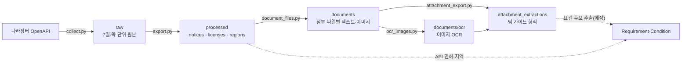

# 나라장터 데이터 명세서 (v0.3)

> **이 폴더(`data/g2b_monthly/`)는 Git 공유본이다.** `data/g2b/processed/`의 파일 4개를 공고 게시월(`notice_at`)별로 나눴다.
> 면허·지역 행은 해당 공고의 게시월 폴더에 들어간다. 월별 행 수와 크기는 `manifest.csv`에 있다.
> 이 문서는 `data/나라장터_데이터명세서.md`의 사본이며 `python tools/g2b/split_monthly.py`를 실행할 때 다시 복사된다. 고칠 때는 원본을 고친다.
> 여러 달을 함께 쓸 때는 월 폴더의 같은 이름 파일을 이어 붙이면 `processed/`와 같아진다 (CSV는 각 파일의 첫 줄이 헤더).

> 2팀 · 작성 2026-11-24 · v0.2 갱신 2026-11-24 · v0.3 갱신 2026-11-25 (면허 1년 완료, 담당자 포함 재수집) · 대상: `tools/g2b/`로 수집하는 조달청 나라장터 입찰공고
> 건수는 **2026-11-25 수집 완료분 실측값**이고, 원본 컬럼 측정값(§5~7)은 2026-11-16~22 1주 수집분 기준이다. 확인하지 못한 항목은 "미확인"으로 표시했다.

---

## 1. 요약

| 항목 | 값 |
|---|---|
| 데이터 ID | **DS-10** 나라장터 입찰공고 |
| 수집 범위 | **용역** + 면허 제한 + 참가 가능 지역. 물품·공사는 같은 수집기로 추가 가능, 외자·기타는 제외 |
| 수집 기간 | 2025-11-24 ~ 2026-11-22 (7일 구간 52개) |
| 측정 표본 | 용역 4,774행, 면허 13,033행, 지역 11,682행 |
| 1주 용역 공고 | API 4,774행 → 최신 차수 4,357건 → 취소 제외 **4,045건** |
| 1년 용역 (실측) | API 216,797행 → 최신 차수 192,028건 → 취소 제외 **179,382건** (협상계약 63,398건) |
| 1년 면허 | 원본 556,082행 (52/52 구간 완료) → `licenses.csv` 용역 262,870행 |
| 1년 지역 | 원본 381,961행 (52/52 구간 완료) → `regions.csv` 용역 109,111행 |
| 담당자 | 2026-11-25 용역 1년치 재수집 완료. 담당자명 100.0%, 전화 97.6%, 이메일 0% (API가 값을 주지 않음) |
| 원본 컬럼 | 용역 109개, 면허 9개, 지역 6개 |
| 정리 결과 | `notices.jsonl` 35개 컬럼, `notices.csv` 34개, `licenses.csv` 14개, `regions.csv` 10개 |
| 첨부 | 모집 중 용역 약 4,100건의 첨부를 파일별 추출 완료: 15,628줄 (§4.4) |
| 저장소 | `data/g2b/`는 **Git 제외**. 공유용으로 `processed/`를 게시월별로 나눈 `data/g2b_monthly/`(13개 월, 파일당 50MB 이하)를 Git에 올린다 |

면허는 기능별 일일 호출 상한(900회) 때문에 2026-11-24에 41개 구간, 2026-11-25에 남은 11개 구간을 받았다.

---

## 2. 출처와 이용 조건

| 항목 | 내용 |
|---|---|
| 제공 기관 | 조달청 |
| 서비스 | 나라장터 입찰공고정보서비스 ([공공데이터포털 15129394](https://www.data.go.kr/data/15129394/openapi.do)) |
| End Point | `https://apis.data.go.kr/1230000/ad/BidPublicInfoService02` |
| 비용·이용허락 | 무료, 이용허락범위 제한 없음 |
| 트래픽 | 개발계정 **상세기능별 하루 1,000회**. 수집기는 기능별 900회에서 멈춤 |
| 조회 제한 | 한 번에 **최대 7일** (8일 이상은 결과 코드 07) |
| 인증 | `.env`의 `DATA_GO_KR_API_KEY`. 키는 문서·코드·로그에 쓰지 않음 |

| 이름 | 오퍼레이션 | 1년 수집 호출 |
|---|---|---|
| 용역 | `getBidPblancListInfoServc02` | 459회 (완료) |
| 면허 | `getBidPblancListInfoLicenseLimit02` | 900회 + 238회 (완료) |
| 지역 | `getBidPblancListInfoPrtcptPsblRgn02` | 794회 (완료) |

공통 요청값: `type=json`, `numOfRows=500`, `inqryDiv=1`, `inqryBgnDt`, `inqryEndDt` (`YYYYMMDDHHMM`).

---

## 3. 데이터 흐름과 폴더



```
data/g2b/
├─ .gitignore                 폴더 전체를 Git에서 제외
├─ _calls.json                날짜·기능별 호출 수
├─ raw/<항목>/<시작일>_<종료일>/
│  ├─ p00001.json.gz          쪽 단위 응답 (담당자 필드 포함)
│  ├─ _state.json             구간 전체 건수
│  └─ _done.json              구간 완료 표시
├─ processed/
│  ├─ notices.jsonl           공고당 1행 (구조 포함)
│  ├─ notices.csv             공고 표 확인용
│  ├─ licenses.csv            면허 제한 1행당 1줄 (§4.2)
│  └─ regions.csv             참가 가능 지역 1행당 1줄 (§4.3)
├─ documents/
│  ├─ files/<url해시>_<nn>.txt    첨부 파일별 텍스트 (PDF는 쪽 구분선 포함)
│  ├─ images/<sha256>.<확장자>     OCR 대상 내부 이미지
│  ├─ ocr/<sha256>.json            이미지 OCR 결과
│  ├─ files_index.jsonl            첨부 파일별 처리 결과
│  ├─ notice_files.jsonl           공고 → 첨부 파일 목록
│  └─ text/, index.jsonl           초기 버전(공고당 대표 문서 1개, 연락처 가림). 새 작업에는 쓰지 않음
├─ attachment_extractions/<날짜>/attachment_extractions.jsonl   팀 추출 가이드 형식 (§4.4)
└─ .venv-ocr/                 OCR 전용 가상환경

data/g2b_monthly/             Git 공유본 (split_monthly.py가 생성)
├─ 데이터명세서.md            이 문서의 사본
├─ manifest.csv               월별 행 수·파일 크기
└─ <YYYY-MM>/                 공고 게시월(notice_at). processed/와 같은 파일 4개
   ├─ notices.jsonl, notices.csv
   └─ licenses.csv, regions.csv   해당 공고의 게시월을 따라감
```

실행 방법은 [tools/g2b/README.md](../../tools/g2b/README.md)를 따른다.

---

## 4. 정리 결과 스키마 (`processed/notices.jsonl`)

기본 키는 `notice_id`이며 형식은 `<공고번호>-<3자리 차수>`이다.

| 컬럼 | 타입 | 원본 | 설명 |
|---|---|---|---|
| `notice_id` | string | `bidNtceNo`+`bidNtceOrd` | 공고 ID |
| `source_system` | string | 고정값 | `G2B` |
| `bid_notice_no` | string | `bidNtceNo` | 공고번호 |
| `bid_notice_ord` | string | `bidNtceOrd` | 3자리 차수 |
| `category` | string | 수집 항목 | 용역·물품·공사 |
| `notice_kind` | string | `ntceKindNm` | 등록·변경·재·취소공고 |
| `service_division` | string 또는 null | `srvceDivNm` | 일반용역·기술용역·일반용역(리스) (용역만) |
| `procurement_large` | string 또는 null | `pubPrcrmntLrgClsfcNm` | 공공조달 대분류 11개 (용역만) |
| `procurement_mid` | string 또는 null | `pubPrcrmntMidClsfcNm` | 공공조달 중분류 (용역만) |
| `procurement_detail` | string 또는 null | `pubPrcrmntClsfcNm` | 공공조달 세부분류 (용역만) |
| `industry_limit_yn` | `Y`/`N`/null | `indstrytyLmtYn` | 업종 제한 여부 |
| `participation_limit_yn` | `Y`/`N`/null | `bidPrtcptLmtYn` | 입찰 참가 제한 여부 |
| `title` | string | `bidNtceNm` | 공고명 |
| `notice_org` | string | `ntceInsttNm` | 공고기관 |
| `demand_org` | string | `dminsttNm` | 수요기관 |
| `notice_at` | datetime 문자열 | `bidNtceDt` | 공고일시 |
| `close_at` | datetime 문자열 또는 null | `bidClseDt` | 입찰 마감 (용역 11.7% 비어 있음) |
| `open_at` | datetime 문자열 | `opengDt` | 개찰일시 |
| `contract_method` | string | `cntrctCnclsMthdNm` | 계약방법 |
| `award_method` | string | `sucsfbidMthdNm` | 낙찰방법 |
| `estimated_price` | 숫자 문자열 | `presmptPrce` | 추정가격(원) |
| `is_negotiated` | boolean | `sucsfbidMthdNm` | `협상에의한계약`으로 시작하면 true |
| `is_cancelled` | boolean | `ntceKindNm` | 취소공고면 true |
| `license_status` | enum | 면허 API | `observed` 또는 `unknown` |
| `licenses` | array | 면허 API | `group`, `name`, `permitted_industries` |
| `region_status` | enum | 지역 API | `observed` 또는 `unknown` |
| `regions` | string[] | 지역 API | 참가 가능 지역 |
| `region_basis` | string 또는 null | `rgnLmtBidLocplcJdgmBssNm` | 지역 판단 기준: `본사소재지` 또는 `본사또는참여지사소재지` |
| `contact_name` | string | `ntceInsttOfclNm` | 공고기관 담당자 이름 (채움률 100.0%) |
| `contact_phone` | string | `ntceInsttOfclTelNo` | 담당자 전화 (97.6%) |
| `contact_email` | string | `ntceInsttOfclEmailAdrs` | 담당자 이메일. API가 값을 주지 않아 0% |
| `demand_contact_email` | string | `dminsttOfclEmailAdrs` | 수요기관 담당자 이메일. 0% |
| `executor_name` | string | `exctvNm` | 집행관 이름 (100.0%) |
| `documents` | array | 공고 문서 필드 | `name`, `url`, `source` |
| `detail_url` | string | `bidNtceDtlUrl` | 공고 상세 URL |

`notices.csv`는 `source_system`, `licenses`, `regions`, `documents` 대신 `license_names`, `region_names`, `document_count`를 둔다. 분류 값은 앞뒤 공백을 제거해 저장한다.

### 4.1 공고와의 관계

```
notices (1) ──< licenses (N)   공고 1건에 면허 0개 이상
notices (1) ──< regions  (N)   공고 1건에 참가 가능 지역 0개 이상
연결 키: notice_id = <공고번호>-<3자리 차수>  (팀 적재 ID는 G2B:<공고번호>:<차수>)
```

두 CSV 모두 공고와 연결되지 않는 행 0건, 같은 키 중복 0건을 확인했다. 취소공고 행도 `is_cancelled`로 표시해 남겨 두므로 판정 전에 걸러야 한다. `notices.jsonl`에는 시험 수집한 물품 21건·공사 15건도 들어 있으므로 `category`로 구분한다.

### 4.2 면허 제한 (`processed/licenses.csv`, 14개 컬럼)

| 컬럼 | 원본 | 설명 |
|---|---|---|
| `notice_id`, `bid_notice_no`, `bid_notice_ord` | 공고 | 연결 키 |
| `category`, `title`, `is_cancelled` | 공고 | 확인용 공고 정보 |
| `group` | `lmtGrpNo` | 제한 그룹 번호 |
| `seq` | `lmtSno` | 제한 순번 |
| `license_name` | `lcnsLmtNm` 앞부분 | 면허·업종 이름 (`/코드` 제거) |
| `license_code` | `lcnsLmtNm` 끝 코드 | 업종 코드. **앞자리 0 보존** (`0041`) |
| `permitted_industries` | `permsnIndstrytyList` | 대신 인정되는 것으로 보이는 업종, ` \| `로 구분 |
| `permitted_count` | 계산 | 허용 업종 개수 |
| `main_fields` | `indstrytyMfrcFldList` | 업종 주력분야 |
| `registered_at` | `rgstDt` | 등록일시 |

| 현황 (용역, 1년 완료) | 값 |
|---|---:|
| 면허 행 | 262,870 |
| 면허가 있는 공고 | 125,524 |
| 그룹이 2개 이상인 공고 | 41,880 |
| 허용 업종이 있는 행 | 68,051 |
| 취소 제외 용역 중 업종 제한 `N` | 61,171 |
| 업종 제한 `Y`인데 면허 행 없음 | 3 |

**그룹 해석 (검증 전 규칙).** 모집 중 공고문과 대조한 결과, 그룹이 다른 811건은 "또는" 계열 표현 485건·"모두·및" 계열 4건으로 **OR 가능성이 높다.** 같은 그룹 706건은 "모두·및" 47건·"또는" 44건·표현 없음 555건이라 **AND로 보이지만 예외가 있다.** 정규식 근사치이므로 판정에서는 다른 그룹=OR, 같은 그룹=AND로 두되 공고문에 "또는"이 있으면 확인 필요로 처리한다. 허용 업종만으로 충족하는 경우도 확인 필요로 둔다.

### 4.3 참가 가능 지역 (`processed/regions.csv`, 10개 컬럼)

| 컬럼 | 원본 | 설명 |
|---|---|---|
| `notice_id`, `bid_notice_no`, `bid_notice_ord` | 공고 | 연결 키 |
| `category`, `title`, `is_cancelled` | 공고 | 확인용 공고 정보 |
| `seq` | `lmtSno` | 순번 |
| `region_name` | `prtcptPsblRgnNm` | 참가 가능 지역 (시도 또는 `시도 시군구`) |
| `region_basis` | 공고 `rgnLmtBidLocplcJdgmBssNm` | 본사 기준인지, 본사 또는 참여 지사 기준인지 |
| `registered_at` | `rgstDt` | 등록일시 |

| 현황 (용역, 1년 완료) | 값 |
|---|---:|
| 지역 행 | 109,111 |
| 지역이 있는 공고 | 77,329 |
| 고유 지역명 | 400 (시군구 포함 382) |
| 취소 제외 용역 중 판단 기준 `본사소재지` | 945 |
| 취소 제외 용역 중 판단 기준 `본사또는참여지사소재지` | 38,148 |

지역명에는 개편 전 이름(`광주광역시`, `전라남도`)과 개편 후 이름(`전남광주통합특별시 여수시`)이 함께 있다. 팀 지역 코드표(시도 16·시군구 217)에 연결하려면 별칭 사전이 필요하다. 한 공고의 여러 지역은 그중 한 곳에 소재하면 되는 목록으로 보이지만 **검증 전**이다.

### 4.4 첨부 추출 (`attachment_extractions/<날짜>/attachment_extractions.jsonl`)

팀 「첨부 공고문 추출 가이드 v0.1」 형식을 따른다. **파일 1개당 1줄**(압축 파일 안 문서는 문서별)이며, 요건 후보 `items`는 다음 단계에서 채우므로 비어 있다.

| 필드 | 내용 |
|---|---|
| `notice_id` | 팀 적재 ID `G2B:<공고번호>:<차수>` |
| `source_file`, `parent_file` | 파일명, 압축 파일 안 문서면 압축 파일명 |
| `doc_type` | 파일명 기준 분류: 공고문, 제안요청서, 과업지시서, 내역서, 서식, 규격서, 기타 |
| `format`, `status` | pdf·hwp·hwpx·docx / `OK`, `NEEDS_OCR`, `OCR_DONE`, `DISTRIBUTION_DOC_UNSUPPORTED`, `ENCRYPTED_DOC_UNSUPPORTED`, `SKIPPED_TYPE`, `TOO_BIG`, `HTTP_403` 등 |
| `pages`, `chars` | PDF 쪽 수(`=== p.N ===` 구분선 기준), 글자 수 |
| `has_eligibility_heading` | 참가자격 관련 문구 존재 여부 (정확도 아님) |
| `text_file` | 추출 텍스트 경로 |
| `text_extraction` | 도구·버전, OCR 여부·엔진, 이미지 수, 저신뢰 줄 수, 경고(`TABLE_STRUCTURE_LOST`, `OCR_LOW_TRUST`, `OCR_PENDING`) |
| `items`, `items_status` | `[]`, `NOT_EXTRACTED` |

OCR은 로컬 RapidOCR(PP-OCRv5 한국어)로 하고, 방향 보정은 숫자 줄을 뒤집어 인식해 끈다. 표·본문일 가능성이 있는 크기(300×120 이상)의 이미지와 글자가 30자 미만인 스캔 쪽만 OCR한다. OCR 결과는 모두 `review_required=true`이며 확정 근거로 쓰지 않는다.

---

## 5. 원본 컬럼: 용역 (109개)

활용 구분은 **핵심**(서비스·판정에 직접 사용), **보조**(참고·확장), **미사용**(현재 쓰지 않음)이다. 측정 기준은 11/16~22 용역 4,774행이다.
한글 의미는 필드명과 응답값으로 해석했으며, **공식 참고문서와 항목별 대조는 아직 하지 않았다.**

**식별**

| 컬럼 | 의미 | 활용 | 채움률 | 고유값 | 예시 |
|---|---|---|---:|---:|---|
| `bidNtceNo` | 입찰공고번호 | 핵심 | 100.0% | 4,357 | `R26BK01831877` |
| `bidNtceOrd` | 입찰공고 차수 | 핵심 | 100.0% | 6 | `000` |
| `untyNtceNo` | 통합공고번호 | 보조 | 100.0% | 4,357 | `R26BM01047293` |
| `befBidBbancNo` | 이전 입찰공고번호 | 보조 | 15.2% | 700 | `R26BK01799180` |
| `bfSpecRgstNo` | 사전규격 등록번호 | 보조 | 65.8% | 2,623 | `R26BD00298435` |
| `orderPlanUntyNo` | 발주계획 통합번호 | 보조 | 80.9% | 3,226 | `R26DD20925889` |
| `refNo` | 참조번호 | 보조 | 89.0% | 3,598 | (자유 텍스트·URL) |

**공고**

| 컬럼 | 의미 | 활용 | 채움률 | 고유값 | 예시 |
|---|---|---|---:|---:|---|
| `bidNtceNm` | 공고명 | 핵심 | 100.0% | 4,126 | (자유 텍스트·URL) |
| `ntceKindNm` | 공고 종류(등록·변경·재·취소) | 핵심 | 100.0% | 4 | `등록공고` |
| `reNtceYn` | 재공고 여부 | 보조 | 100.0% | 2 | `N` |
| `rgstTyNm` | 등록 유형 | 미사용 | 100.0% | 1 | `조달청 또는 나라장터 자체 공고건` |
| `chgNtceRsn` | 변경공고 사유 | 보조 | 11.1% | 486 | (자유 텍스트·URL) |
| `chgDt` | 변경일시 | 보조 | 0.1% | 4 | `2026-11-16 13:10:31` |
| `rgstDt` | 등록일시 | 보조 | 100.0% | 4,709 | `2026-11-16 09:40:29` |

**기관**

| 컬럼 | 의미 | 활용 | 채움률 | 고유값 | 예시 |
|---|---|---|---:|---:|---|
| `ntceInsttCd` | 공고기관 코드 | 보조 | 100.0% | 1,448 | `1230000` |
| `ntceInsttNm` | 공고기관명 | 핵심 | 100.0% | 1,448 | `조달청` |
| `dminsttCd` | 수요기관 코드 | 보조 | 100.0% | 1,592 | `6110000` |
| `dminsttNm` | 수요기관명 | 핵심 | 100.0% | 1,591 | `서울특별시` |
| `crdtrNm` | 채권자명 | 미사용 | 99.9% | 1,423 | `조달청장` |

**일정**

| 컬럼 | 의미 | 활용 | 채움률 | 고유값 | 예시 |
|---|---|---|---:|---:|---|
| `bidNtceDt` | 공고일시 | 핵심 | 100.0% | 4,710 | `2026-11-16 09:40:29` |
| `bidBeginDt` | 입찰 시작일시 | 보조 | 88.3% | 289 | `2026-11-20 10:00:00` |
| `bidClseDt` | 입찰 마감일시 | 핵심 | 88.3% | 233 | `2026-12-01 10:00:00` |
| `opengDt` | 개찰일시 | 핵심 | 100.0% | 366 | `2026-12-01 11:00:00` |
| `opengPlce` | 개찰 장소 | 미사용 | 88.8% | 243 | (자유 텍스트·URL) |
| `rbidOpengDt` | 재입찰 개찰일시 | 미사용 | 100.0% | 369 | `2026-12-01 11:00:00` |
| `bidQlfctRgstDt` | 입찰참가자격 등록 마감일시 | 핵심 | 88.3% | 191 | `2026-11-30 18:00` |
| `dcmtgOprtnDt` | 설명회 일시 | 보조 | 1.0% | 34 | `2026-11-27 14:00:00` |
| `dcmtgOprtnPlce` | 설명회 장소 | 보조 | 1.7% | 65 | (자유 텍스트·URL) |
| `bidWgrnteeRcptClseDt` | 입찰보증서 접수 마감일시 | 미사용 | 0.0% | 0 | — |

**분류**

| 컬럼 | 의미 | 활용 | 채움률 | 고유값 | 예시 |
|---|---|---|---:|---:|---|
| `srvceDivNm` | 용역 구분(일반·기술) | 핵심 | 100.0% | 2 | `일반용역` |
| `pubPrcrmntLrgClsfcNm` | 공공조달분류 대분류 | 핵심 | 100.0% | 11 | `기술용역` |
| `pubPrcrmntMidClsfcNm` | 공공조달분류 중분류 | 핵심 | 100.0% | 40 | `기타` |
| `pubPrcrmntClsfcNm` | 공공조달분류 세부명 | 핵심 | 100.0% | 157 | `정보시스템유지관리서비스` |
| `pubPrcrmntClsfcNo` | 공공조달분류 번호 | 보조 | 100.0% | 157 | `81111899` |
| `purchsObjPrdctList` | 구매대상 물품 목록 | 보조 | 10.4% | 65 | (자유 텍스트·URL) |
| `infoBizYn` | 정보화사업 여부 | 보조 | 10.0% | 2 | `Y` |
| `ppswGnrlSrvceYn` | 조달청 일반용역 여부 | 미사용 | 100.0% | 2 | `N` |
| `mnfctYn` | 제조 여부 | 미사용 | 0.0% | 0 | — |

**계약**

| 컬럼 | 의미 | 활용 | 채움률 | 고유값 | 예시 |
|---|---|---|---:|---:|---|
| `cntrctCnclsMthdNm` | 계약체결방법 | 핵심 | 100.0% | 4 | `제한경쟁` |
| `bidMethdNm` | 입찰방식 | 보조 | 100.0% | 7 | `전자입찰` |
| `sucsfbidMthdCd` | 낙찰방법 코드 | 보조 | 100.0% | 12 | `낙030005` |
| `sucsfbidMthdNm` | 낙찰방법(협상계약 판별 기준) | 핵심 | 100.0% | 72 | `협상에의한계약-협상에 의한 낙찰자 결정` |
| `sucsfbidMthdAppStd` | 낙찰방법 적용 기준 | 보조 | 22.0% | 9 | `관리규정외(기타)` |
| `sucsfbidLwltRate` | 낙찰 하한율 | 보조 | 46.2% | 36 | `88` |
| `techAbltEvlRt` | 기술능력 평가 비율 | 보조 | 38.4% | 8 | `90` |
| `bidPrceEvlRt` | 입찰가격 평가 비율 | 보조 | 38.4% | 8 | `10` |
| `intrbidYn` | 국제입찰 여부 | 보조 | 99.6% | 2 | `N` |
| `dsgntCmptYn` | 지명경쟁 여부 | 보조 | 100.0% | 2 | `N` |
| `dtlsBidYn` | 내역입찰 여부 | 미사용 | 0.0% | 0 | — |
| `rbidPermsnYn` | 재입찰 허용 여부 | 미사용 | 62.5% | 2 | `Y` |
| `brffcBidprcPermsnYn` | 지사 투찰 허용 여부 | 미사용 | 0.0% | 0 | — |

**금액**

| 컬럼 | 의미 | 활용 | 채움률 | 고유값 | 예시 |
|---|---|---|---:|---:|---|
| `presmptPrce` | 추정가격 | 핵심 | 100.0% | 3,228 | `45454545` |
| `VAT` | 부가가치세 | 보조 | 100.0% | 3,017 | `0` |
| `indutyVAT` | 업종 부가가치세 | 미사용 | 0.0% | 0 | — |
| `asignBdgtAmt` | 배정예산 | 핵심 | 100.0% | 3,265 | `50000000` |
| `bidPrtcptFee` | 입찰 참가 수수료 | 보조 | 79.6% | 571 | `0` |
| `bidPrtcptFeePaymntYn` | 참가 수수료 납부 여부 | 미사용 | 0.0% | 0 | — |
| `bidGrntymnyPaymntYn` | 입찰보증금 납부 여부 | 미사용 | 0.0% | 0 | — |
| `prearngPrceDcsnMthdNm` | 예정가격 결정 방법 | 미사용 | 100.0% | 3 | `복수예가` |
| `rsrvtnPrceReMkngMthdNm` | 예비가격 재작성 방법 | 미사용 | 40.2% | 1 | `재입찰시 예비가격을 다시 생성하여 예정가격이 산정됩니다.` |
| `drwtPrdprcNum` | 추첨 예비가격 수 | 미사용 | 63.4% | 4 | `4` |
| `totPrdprcNum` | 총 예비가격 수 | 미사용 | 63.4% | 2 | `15` |

**자격**

| 컬럼 | 의미 | 활용 | 채움률 | 고유값 | 예시 |
|---|---|---|---:|---:|---|
| `bidPrtcptLmtYn` | 입찰 참가 제한 여부 | 핵심 | 99.6% | 2 | `N` |
| `indstrytyLmtYn` | 업종 제한 여부 | 핵심 | 99.6% | 2 | `Y` |
| `prdctClsfcLmtYn` | 물품분류 제한 여부 | 보조 | 100.0% | 2 | `N` |
| `rgnLmtBidLocplcJdgmBssCd` | 지역제한 소재지 판단 기준 코드 | 보조 | 17.1% | 2 | `N` |
| `rgnLmtBidLocplcJdgmBssNm` | 지역제한 소재지 판단 기준 | 핵심 | 17.1% | 2 | `본사또는참여지사소재지` |
| `pqEvalYn` | PQ 심사 여부 | 핵심 | 7.1% | 2 | `Y` |
| `pqApplDocRcptDt` | PQ 신청서 접수일시 | 보조 | 4.1% | 59 | `2026-11-30 17:00:00` |
| `pqApplDocRcptMthdNm` | PQ 신청서 접수 방법 | 보조 | 4.1% | 2 | `수기` |
| `tpEvalYn` | TP 평가 여부 | 보조 | 22.0% | 2 | `N` |
| `tpEvalApplClseDt` | TP 평가 신청 마감일시 | 미사용 | 0.0% | 0 | — |
| `tpEvalApplMthdNm` | TP 평가 신청 방법 | 미사용 | 0.0% | 0 | — |
| `arsltCmptYn` | 실적 경쟁 여부 | 핵심 | 100.0% | 2 | `N` |
| `arsltApplDocRcptMthdNm` | 실적 신청서 접수 방법 | 보조 | 21.7% | 3 | `없음` |
| `arsltReqstdocRcptDt` | 실적 신청서 접수일시 | 보조 | 1.9% | 47 | `2026-11-27 17:00:00` |

**공동수급**

| 컬럼 | 의미 | 활용 | 채움률 | 고유값 | 예시 |
|---|---|---|---:|---:|---|
| `cmmnSpldmdMethdCd` | 공동수급 방식 코드 | 보조 | 29.5% | 4 | `공500001` |
| `cmmnSpldmdMethdNm` | 공동수급 방식 | 핵심 | 100.0% | 10 | `(없음)공동수급불허` |
| `cmmnSpldmdCorpRgnLmtYn` | 공동수급체 지역 제한 여부 | 보조 | 100.0% | 2 | `N` |
| `cmmnSpldmdAgrmntClseDt` | 공동수급 협정 마감일시 | 보조 | 27.2% | 77 | `2026-11-30 18:00:00` |
| `cmmnSpldmdAgrmntRcptdocMethd` | 공동수급 협정서 접수 방법 | 미사용 | 100.0% | 4 | `없음` |
| `rgnDutyJntcontrctRt` | 지역의무 공동도급 비율 | 미사용 | 0.0% | 0 | — |
| `jntcontrctDutyRgnNm1` | 공동도급 의무지역 1 | 미사용 | 0.0% | 0 | — |
| `jntcontrctDutyRgnNm2` | 공동도급 의무지역 2 | 미사용 | 0.0% | 0 | — |
| `jntcontrctDutyRgnNm3` | 공동도급 의무지역 3 | 미사용 | 0.0% | 0 | — |

**문서·링크**

| 컬럼 | 의미 | 활용 | 채움률 | 고유값 | 예시 |
|---|---|---|---:|---:|---|
| `bidNtceDtlUrl` | 공고 상세 URL | 핵심 | 100.0% | 4,774 | (URL) |
| `bidNtceUrl` | 공고 URL | 보조 | 100.0% | 4,774 | (URL) |
| `stdNtceDocUrl` | 표준공고서 URL | 핵심 | 86.8% | 4,144 | (URL) |
| `ntceDscrptYn` | 공고 설명 여부 | 미사용 | 0.0% | 0 | — |
| `ntceSpecDocUrl1~10` | 공고 규격 문서 URL (10개 컬럼) | 핵심 | 0.3~90.9% | — | (URL) |
| `ntceSpecFileNm1~10` | 공고 규격 파일명 (10개 컬럼) | 핵심 | 0.3~90.9% | — | (파일명) |

---

## 6. 원본 컬럼: 면허 제한 (9개)

11/16~22 용역·물품·공사 전체 13,033행 기준이다. 조인 키는 `bidNtceNo` + `bidNtceOrd`이다.

| 컬럼 | 의미 | 채움률 | 고유값 | 예시 |
|---|---|---:|---:|---|
| `bidNtceNo` | 입찰공고번호 | 100.0% | 7,051 | `R26BK01837177` |
| `bidNtceOrd` | 공고 차수 | 100.0% | 6 | `000` |
| `bsnsDivNm` | 업무 구분(용역·물품·공사) | 100.0% | 3 | `용역` |
| `lmtGrpNo` | 제한 그룹 번호 | 100.0% | 18 | `1` |
| `lmtSno` | 제한 순번 | 100.0% | 90 | `1` |
| `lcnsLmtNm` | 면허 제한명 | 100.0% | 487 | `소프트웨어사업자(컴퓨터관련서비스사업)/1468` |
| `permsnIndstrytyList` | 허용 업종 목록 | 26.2% | 51 | `[토목건축공사업/0003]` |
| `indstrytyMfrcFldList` | 업종 주력분야 목록 | 8.0% | 27 | `[1^기계설비공사]` |
| `rgstDt` | 등록일시 | 100.0% | 7,486 | `2026-11-18 13:57:59` |

## 7. 원본 컬럼: 참가 가능 지역 (6개)

11/16~22 용역·물품·공사 전체 11,682행 기준이다. 조인 키는 `bidNtceNo` + `bidNtceOrd`이다.

| 컬럼 | 의미 | 채움률 | 고유값 | 예시 |
|---|---|---:|---:|---|
| `bidNtceNo` | 입찰공고번호 | 100.0% | 5,902 | `R26BK01843450` |
| `bidNtceOrd` | 공고 차수 | 100.0% | 8 | `000` |
| `bsnsDivNm` | 업무 구분(용역·물품·공사) | 100.0% | 3 | `공사` |
| `lmtSno` | 제한 순번 | 100.0% | 91 | `1` |
| `prtcptPsblRgnNm` | 참가 가능 지역명 | 100.0% | 351 | `경기도` |
| `rgstDt` | 등록일시 | 100.0% | 6,309 | `2026-11-16 08:37:08` |

---

## 8. 처리 규칙

| 규칙 | 내용 |
|---|---|
| 최신 차수 | 공고번호별로 차수가 가장 큰 행만 사용 |
| 조인 | 면허·지역은 공고번호와 **같은 차수**끼리만 연결 |
| 취소공고 | 삭제하지 않고 `is_cancelled=true`로 표시. 추천·판정 대상에서는 제외 |
| 협상계약 | `contract_method`가 아니라 **`sucsfbidMthdNm`** 으로 판별 |
| 빈 제한값 | 면허·지역 목록이 비면 `unknown`. "제한 없음"으로 해석하지 않음. 단 업종 제한 `N`은 API가 제한 없음으로 표시한 것이므로 판정 단계에서 구분 |
| 면허 그룹 | 다른 그룹=OR, 같은 그룹=AND로 두고 공고문에 "또는"이 있으면 확인 필요 (§4.2, 검증 전) |
| 개인정보 | 공공기관 공개 데이터이므로 **가리지 않는다** (팀 결정, 2026-11-24). API의 담당자 필드(`ntceInsttOfclNm`·`TelNo`·`EmailAdrs`, `dminsttOfclEmailAdrs`)와 집행관 `exctvNm`, 첨부 텍스트·OCR의 문의처를 그대로 저장한다. 용역 1년치는 2026-11-25에 담당자 필드를 포함해 다시 받았다. 이전 수집분은 `data/g2b/backup/`에 있다 |
| 보호 문서 | 배포용·암호 HWP는 복호화하지 않고 상태만 기록. 서버가 거부한 파일은 우회하지 않음 |
| 완전성 | 받은 행 수와 `totalCount`가 같아야 구간 완료 처리 |
| 이어받기 | 완료 구간은 건너뛰고, 중간 건수가 바뀐 구간은 처음부터 다시 받음 |

---

## 9. 조건 추출 대상

과거 공고 전체를 LLM에 넣지 않는다. 1년치 메타데이터는 검색·통계·평가용으로 두고, 조건 추출은 아래 순서로 제한한다.

| 단계 | 대상 | 방법 | LLM |
|---|---|---|---|
| 1 | 전체 공고 | API의 면허·지역·제한 여부 사용 | 불필요 |
| 2 | **모집 중 용역** (2026-11-24 기준 약 4,100건, 첨부 약 14,600개) | 첨부에서 참가자격 절만 규칙으로 잘라냄 | 불필요 |
| 3 | 2단계 중 규칙으로 구조화되지 않는 조건 | 참가자격 절만 입력 | **필요** |
| 4 | 매일 신규 용역 (약 580건, 협상계약 약 230건) | 2~3단계 반복 | 일부 |
| 5 | 평가용 표본 | 수작업 정답과 비교 | 평가 시 |

모집 중 용역 4,165건의 대표 공고문 중 4,136건(99.3%)에서 참가자격 관련 문구를 찾았다. 문구가 있다는 뜻이며 조건 추출 정확도는 아니다. 취소 제외 용역 중 17,250건은 마감일이 비어 있어 모집 여부를 판단할 수 없으므로 대상에서 뺀다.

---

## 10. 알려진 한계와 미확인 사항

- 면허 그룹의 AND/OR는 공고문 문장 패턴으로 추정한 것이며 **공식 정의와 대조하지 않았다.** 지역 목록의 OR 의미도 검증 전이다.
- 지역명은 개편 전후 이름이 섞여 있어 팀 지역 코드표 연결에 별칭 사전이 필요하다.
- 공고서 본문 속 **사람 이름은 자동으로 지우지 못한다.** 문의처 연락처는 팀 가이드에 따라 남긴다.
- HWP·HWPX는 표의 행·열 구조가 사라진다. 15MB를 넘는 첨부는 건너뛰고 `TOO_BIG`으로 기록한다.
- OCR은 글자 조각·오인식이 있다. 시험 문장은 정확히 읽었지만 실제 이미지의 정확도는 측정하지 않았다.
- e발주 첨부 API는 이번 1년 수집에서 제외했다. 1주 표본에서 첨부에만 공고서가 있는 공고는 0건이었지만 추가 파일은 누락될 수 있다.
- 원본 컬럼 채움률과 값 분포(§5~7)는 1주 기준이다.
