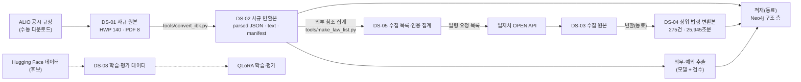

# 데이터 명세서 (통합본, v0.1)

> 2팀 · 작성 2026-11-17 · 대상: 이 저장소의 `data/`, `sample_data/` 및 앞으로 만들 데이터
> 수치는 2026-11-17 시점에 파일을 직접 열어 센 값이다. **확인하지 못한 항목은 "미확인"으로 표시했다.**
> 세부 명세가 이미 있는 데이터는 이 문서가 **요약 + 링크**로 묶는다: [상위법령_데이터명세서.md](상위법령_데이터명세서.md)(동료 작성), [DATA_SOURCES.md](DATA_SOURCES.md)(출처 탐색 기록), [온톨로지 설계서 §2](../docs/ONTOLOGY_DESIGN.md)(적재 전 데이터 특성)

---

## 1. 데이터 자산 요약

| ID | 이름 | 위치 | 유형·규모 | 출처 | 생성 방법 | 저장소 |
|---|---|---|---|---|---|---|
| **DS-01** | IBK 사규 원본 | `data/ibk기업/`, `data/ibk기업.zip` | HWP 140 + PDF 8 = **148개**, 9.96MB (zip 7.3MB) | ALIO(공공기관 경영정보 공개시스템) IBK기업은행 공시 규정 | **수동 다운로드** | 추적됨(148개 + zip) |
| **DS-02** | IBK 사규 변환본 | `data/ibk_converted/` | `parsed/` JSON 148(8.25MB), `text/` TXT 148(2.7MB), `manifest.csv·json` | DS-01 | `tools/convert_ibk.py` | 추적됨 |
| **DS-03** | 상위 법령 수집 원본 | `data/상위법령_수집원본/`(명세서 기준) | 법제처 API 응답 JSON, `수집결과.csv`, `조문.jsonl` | 법제처 국가법령정보센터 OPEN API | 수집 스크립트(동료) | **이 저장소에 없음**(§7) |
| **DS-04** | 상위 법령 변환본 | `data/상위법령_변환/` | `구조화/` JSON 275(106MB), `텍스트/` TXT 275(29.6MB), `목록.csv·json` | DS-03 | 변환 스크립트(동료) | 추적됨(553개 파일) |
| **DS-05** | 법령 수집 목록·인용 집계 | `data/팀_법령수집목록.txt`, `data/상위법령_인용집계.csv`, `data/law_collection_list.csv`, `docs/LAW_COLLECTION_LIST.md` | 목록 118줄 / 집계 482행 / 인용 대상 274행 | DS-02의 외부 참조 집계 + 팀 요청 | `tools/make_law_list.py` + 동료 편집 | 추적됨 |
| **DS-06** | 수집하지 못한 가이드라인 | (파일 없음) | 3건: 금융분야 인공지능 가이드라인, 금융분야 인공지능 위험관리 프레임워크, 공공기관 임원 사고책임 강화 가이드라인 | 소관 기관 홈페이지(법제처에 없음) | **미수집** | — |
| **DS-07** | 합성·샘플 데이터 | `sample_data/` | `compliance_graph.json`, `qa_cases.jsonl`, `load_sample.cypher`, `real_law_search_sample.json` (4개 파일, 약 20KB) | 합성 + 법제처 검색 응답 구조 확인용 | 수작업·스크립트 | 추적됨 |
| **DS-08** | Hugging Face 학습·평가 데이터 | (아직 내려받지 않음) | 후보 목록만 있음(§4.8) | Hugging Face Hub | **미선정** | — |
| **DS-09** | 앞으로 만들 데이터 | `data/ontology/` 등(예정) | 약칭 사전, 평가셋, 골드셋, 추출 staging, 임베딩 | 팀 작성·모델 추출 | §6 | — |

---

## 2. 데이터 계보 (어디서 와서 어디로 가는가)



- 점선은 아직 진행하지 않은 단계다.
- 사규 변환본의 JSON 파일명은 **원본 파일명**(`(170131)출근시간 선택근무 운용기준.json`), 상위 법령 변환본의 파일명은 **문서 ID**(`가상자산이용자보호등에관한법률.json`)다. 적재기는 파일명이 아니라 `doc.id`를 키로 쓴다.

---

## 3. 출처와 이용 조건

| ID | 출처(URL·기관) | 취득 방법 | 시점 | 이용 조건·라이선스 | 상태 |
|---|---|---|---|---|---|
| DS-01 | ALIO(alio.go.kr)의 IBK기업은행 공시 규정 | 화면에서 파일 수동 다운로드 | 개정일 2005-01 ~ 2026-10 (§4.1) | **미확인.** 공공데이터 이용 조건·재배포 가능 여부를 확인한 기록이 없다 | 사용 중, **외부 공개 전 확인 필요** |
| DS-03·04 | 법제처 국가법령정보센터 OPEN API(`law.go.kr/DRF`) | API 호출(법령 `law`, 행정규칙 `admrul`), 인증값(OC) 필요 | **수집일 2026-11-17 현행본**(시행일 2027년 문서 4건 포함) | 동료 명세서: 법령·고시 등은 저작권법 제7조상 보호 대상이 아님. **API 이용약관은 공개 전 확인** | 사용 중 |
| DS-06 | 금융위원회·금융감독원 등 소관 기관 홈페이지 | 직접 다운로드(예정) | — | 공개 문서이나 **미확인** | 미수집 |
| DS-07 | 합성 데이터(가상 법령) + 법제처 검색 응답 구조 | 직접 작성 | 2026-11-17 | 팀 작성물. 가상 법령은 실제 조문과 무관 | 샘플용 |
| DS-08 | Hugging Face Hub | 다운로드(예정) | — | 데이터셋마다 다름(§4.8). **선정 후 라이선스·상업/비상업·재배포를 개별 확인** | 미선정 |

**공통 주의**
- 법제처 인증값(OC)과 모든 API 키는 `.env` 또는 환경변수로만 쓰고 **저장소·문서에 쓰지 않는다**(`.env`는 `.gitignore`에 있다).
- 이 프로젝트는 ALIO 공개 규정을 쓰는 교육 프로젝트이며 실제 IBK 사내 시스템·직원 데이터를 다루지 않는다. 사규 원문 전체를 개인정보 관점에서 전수 점검하지는 않았다(담당 부서·직책 수준의 표기는 있을 수 있음, **미확인**). 시연에는 가상 질문·사안만 쓴다.
- **Hugging Face에 데이터·모델을 공개하기 전에** 사규 원문과 파생 데이터(조문·트리플·임베딩)의 재배포 가능 여부를 먼저 확인한다(기획서 §8.1).

---

## 4. 데이터별 상세

### 4.1 DS-01 사규 원본

| 항목 | 값 |
|---|---|
| 파일 수 | 148 (HWP 140, PDF 8). `data/ibk기업/`의 문서 파일 148개(폴더 안의 `.omc`는 도구가 만든 항목이며 추적되지 않음) |
| 용량 | 9.96MB (`ibk기업.zip` 7.3MB) |
| 파일명 규칙 | 규정명 또는 `(YYMMDD)규정명.hwp`, `규정명(YYYY년도 M월 개정).hwp` 등 **일정하지 않음**(개정일 정보가 파일명에 섞임) |
| 개정일 범위 | 2005-01 ~ 2026-10-27, 2026년 68개 · 2025년 24개 · 2023년 11개 · 2024년 10개 · 2018년 5개 · 2017년 2개 등 |
| 문서 유형 | 규정 81, 운용기준 14, 지침 13, 업무규정 8, 기준 8, 운영기준 7, 운영규정 5, 세칙·강령 등 |
| 한계 | 버전 1개만 보유(개정 이력 비교 불가), 날짜 없는 문서 17개, 암호화·스캔 PDF는 변환 대상에서 실패로 처리(현재 실패 0건) |

### 4.2 DS-02 사규 변환본

생성: `python tools/convert_ibk.py`(옵션 `--src`, `--out`, `--force`). HWP 5.x는 `olefile`로 BodyText 스트림을 직접 읽고 PDF는 `pymupdf`를 쓴다. 의존성은 `tools/requirements.txt`(`olefile>=0.47`, `pymupdf>=1.24`).

| 산출물 | 내용 |
|---|---|
| `parsed/<원본파일명>.json` | 조문 단위 구조화 + 참조·단서·위임 후보 (스키마는 §5) |
| `text/<원본파일명>.txt` | 추출 원문(UTF-8). **참고:** 폴더 안에 도구가 만든 `.omc` 폴더가 있어 항목 수가 149로 보인다(추적되지 않음, 실제 파일은 148개) |
| `manifest.csv·json` | 파일별 결과: `file, format, title, date, action, status, error, chars, articles, external_refs, internal_refs, exceptions` |

**규모**: 148개 모두 성공(status `ok` 148건), 총 1,214,609자, 조문 3,532개(삭제 127 포함), 항 6,878개, 호 4,999개, 편·장·절 727개.

| 추출 항목 | 건수 |
|---|---|
| 외부 참조(`external_refs`, 「…」 인용) | 1,012 (고유 대상 376) |
| 내부 참조(`internal_refs`, 확정) | 778 |
| 미해결 참조(`unresolved_refs`) | 323 |
| 단서 후보 문장(`exception_sentences`) | 759 |
| 위임 후보 문장(`delegation_candidates`) | 704 |

### 4.3 DS-03·04 상위 법령 (요약)

전체 명세는 [상위법령_데이터명세서.md](상위법령_데이터명세서.md)를 따른다. 여기에는 통합에 필요한 것만 적는다.

| 항목 | 값 |
|---|---|
| 문서 | 275건: 법률 105, 대통령령 100, 총리령·부령·감사원규칙 60, 고시 7, 세칙 3 |
| 조문 | 25,945개(삭제·이동 1,832 포함), 항 66,963개, 호 62,142개, 편·장·절 2,700개 |
| 용량 | `구조화/` 106MB, `텍스트/` 29.6MB, 글자 수 약 1,270만 |
| 주요 소관 | 금융위원회 68, 법무부 27, 고용노동부 25, 행정안전부 19, 재정경제부 17, 지식재산처 12 등 |
| 시점 | 수집일 현행본. 시행일이 수집일 이후인 문서 **4건**(2027-01-01, 2027-04-14, 2027-04-28 등) |
| 외부 참조 / 내부 참조 / 미해결 참조 | 29,875 / 29,872 / 31,509 |
| 수집하지 못한 것 | 가이드라인 3건(DS-06). 별표·서식은 수집하지 않음. `addenda`는 최신 부칙 1건만 |
| 사규와의 연결 | 사규의 코퍼스 밖 외부 참조 718건 중 463건(64%)이 이 데이터로 연결(동료 측정, 약칭 반영) |

### 4.4 DS-05 법령 수집 목록·인용 집계

| 파일 | 행 수 | 열 | 용도 |
|---|---|---|---|
| `팀_법령수집목록.txt` | 118줄(주석 포함) | `우선순위 | 법제처 정식 명칭 | 사규 내 표기(참고)` | 동료가 정한 수집 요청 목록(1·2순위). 개칭 법령은 새 이름으로 표기 |
| `상위법령_인용집계.csv` | 482 | `문서명, 종류, 인용한_IBK규정_수, 인용_횟수, 받을_곳, 인용한_IBK규정_예시` | 사규 본문 「」 인용을 집계한 목록(수집 근거) |
| `law_collection_list.csv` | 274 | `우선순위, 구분, 법령명(대표 표기), (예비), 총 인용 수, 핵심문서 인용 수, 인용 조문 번호, 인용한 사규(상위 3), 문서 내 표기 변형` | **코퍼스 밖 인용 대상** 274건 분류: 법령 111, 내규(국가 법령 아님) 88, 분류 불명 68, 감독규정·고시·가이드라인 7. 약칭 대응의 출처 |

### 4.5 DS-07 샘플·합성 데이터

| 파일 | 내용 | 주의 |
|---|---|---|
| `compliance_graph.json` | 문서 3, 조문 14, 관계 13, 의무 7, 충돌 링크 3 | **가상 법령**. 실제 조문과 무관 |
| `qa_cases.jsonl` | Multi-hop 질의응답 6건(위반 3, 준수 3), 추론 경로·판정 포함 | 평가셋 형식 참고용. 실제 평가셋 아님 |
| `load_sample.cypher` | Neo4j 제약, APOC 적재, 질의 예시 | 초기 설계 기준이며 온톨로지 설계서 v1과 관계 이름이 다르다(예: `EXCEPTION_REFERS_TO`, `CHECKED_AGAINST`) |
| `real_law_search_sample.json` | 법제처 법령 검색 응답 구조 확인 샘플 | 응답 구조 참고용 |

### 4.6 DS-08 Hugging Face 후보 (학습·평가용, 미선정)

출처 탐색 기록은 [DATA_SOURCES.md](DATA_SOURCES.md)에 있다. 아래 라이선스는 **검색 결과·HF 태그 기준이며 데이터를 열어 확인하지 않았다.**

| 데이터셋 | 내용 | 라이선스(태그) | 용도 후보 |
|---|---|---|---|
| `Yeeachan/korleg` | 법제처 수집 법령 | Apache-2.0 | 법령 문장 학습 |
| `woalsdnd/law.go.kr` | 판례 검색용 파일 | MIT | 참고 |
| `Rootpye/korean-lawdata1~4` | 법령 원문 | Apache-2.0 | 학습 후보 |
| `Wookhyeon/korean-law-articles` | 법령 조문 | CC0-1.0 | 학습 후보 |
| `chaannwooff/Korean_law`, `mosshoon/korean-laws` | 법령 원문 | CC-BY-4.0 | 학습 후보 |
| `ggh5454/korean-legal-qa-dataset` | 법률 QA | CC-BY-4.0 | SFT 후보 |
| `JusWis/korean-legal-terminology` | 법률 용어 | CC-BY-4.0 | 용어·정규화 참고 |
| `lbox/kcl` | 법률 추론 벤치마크(283문항) | **CC BY-NC 4.0(비상업)** | 평가 참고만, 학습·공개 활용 주의 |
| `GyuHyeonWkdWkdMan/lawdata`, `scvcoder/korean-privacy-law-corpus`, `wellsa-ai/treaty-kr`, `gyung/…-sft-1000`, `neuralfoundry-coder/…-sample` | 법령 CSV·개인정보·조약·SFT 샘플 | 확인 필요 / other | 선정 시 개별 확인 |

**선정 시 확인할 것**: 라이선스(상업·재배포), 수집 시점(최신 개정 누락 가능), 평가 데이터와의 겹침(오염 점검), 규정 준수 판단 과제에 맞는지. 우리 학습 데이터는 설계서 §6.2의 변환·필터·분할 규칙을 따른다.

**그 밖의 후보(전부 미확인)**: AI Hub 법률 데이터, 개인정보보호위원회 결정례·가이드라인, 공정위 약관 심사 결과, 금융법령정보포털. 판결문은 비실명화·이용 규제 이슈가 있어 우선순위가 낮다.

---

## 5. 데이터 사전 (변환본 JSON 공통 구조)

사규(DS-02)와 법령(DS-04) JSON은 같은 최상위 키를 쓴다: `doc, preamble, chapters, articles, addenda, external_refs, internal_refs, unresolved_refs, exception_sentences, delegation_candidates, stats`.

### 5.1 `doc`

| 필드 | 형식 | 사규 | 법령 | 설명 |
|---|---|---|---|---|
| `id` | str | ✓ | ✓ | 문서 ID(제목에서 공백 제거). 사규·법령 간 **충돌 없음**(동료 확인) |
| `title` | str | ✓ | ✓ | 문서 제목 |
| `doc_type` | str | 일부 비어 있음(3개) | ✓ | 규정·지침·운용기준… / 법률·대통령령·부령·고시·세칙 |
| `date` | str | `YYYY-MM-DD` 109건, **`YYYY-MM` 22건, 없음 17건** | `YYYY-MM-DD` 275건 | 사규는 개정일, 법령은 **시행일** |
| `action` | str | 비어 있는 문서 있음(38개) | ✓ | 제정·개정·일부개정·전부개정·타법개정 |
| `source`, `file`, `format` | str | ✓ | ✓ | 출처, 원본 파일명, `hwp`·`pdf` / `api-json` |
| `level` | int | ✗ | ✓ | 법령 위계 1~5(사규는 없음) |
| `promulgated`, `ministry`, `law_id`, `api`, `priority`, `why` | str | ✗ | ✓ | 법령 전용. `law_id`는 개정돼도 유지되는 법제처 ID |

### 5.2 `chapters[]`, `articles[]`

| 필드 | 설명 |
|---|---|
| `chapters[].no/title/kind/part` | 편·장·절 번호, 제목, 종류(편·장·절·관), 소속 편 |
| `articles[].id` | `<문서ID>#<조>`. 편마다 조 번호가 반복되면 `#제1편-제1조` |
| `articles[].no/title/part/chapter` | 조 번호, 조 제목(빌 수 있음), 소속 편·장 |
| `articles[].deleted` | 삭제·이동된 조(번호만 남음). 사규 127, 법령 1,832 |
| `articles[].head_text` | 조 제목 뒤 첫 문장 |
| `articles[].paragraphs[]` | 항: `{no: "①", text, items: [{no: "1", text, subitems: [{no: "가", text}]}]}` |
| `articles[].text` | 항·호·목을 합친 본문 |

### 5.3 참조·후보 목록

| 키 | 필드 | 설명 |
|---|---|---|
| `external_refs` | `from, target_name, (target_article, paragraph)` | 「」로 인용한 다른 문서. 조 번호가 붙으면 `target_article` |
| `internal_refs` | `from, to, paragraph, item` | 같은 문서 안의 조문 참조(대상 존재 확인됨) |
| `unresolved_refs` | `from, to, paragraph, item, context` | 대상을 확정하지 못한 참조. ⚠ **`to`의 문서 접두는 항상 `from`과 같다**(법령 31,509건, 사규 323건 전부) → `to`를 믿지 말고 `context`로 재해소(온톨로지 설계서 §8.4) |
| `exception_sentences` | `article, text` | "다만"이 들어간 문장(단서 후보, 경계가 거칠다) |
| `delegation_candidates` | `article, text` | "정한다" 등이 들어간 문장(위임 후보) |
| `stats` | `chars, has_articles` | 글자 수, 조문 유무 |

---

## 6. 앞으로 만들 데이터 (DS-09)

| 이름 | 위치(제안) | 내용 | 담당 | 근거 |
|---|---|---|---|---|
| 약칭 사전 | `data/ontology/aliases.csv` | `alias, canonical_title, source, confirmed` | 동료 | 온톨로지 설계서 §8.2 |
| 핵심 문서 목록 | `data/ontology/core_docs.csv` | 의무 추출 대상(`core_tier`) | 팀 확정 | 기획서 부록 B |
| 추출 staging | Supabase `extracted_triples`, 파일 JSONL | 의무·예외·관계 + `evidence`, `review_status` | 동료 | 온톨로지 설계서 §6.3 |
| 골드셋 | `data/eval/gold.jsonl` | 추출 결과를 보지 않고 직접 작성한 정답 | 팀 | KPI D-03 |
| 평가셋 | `data/eval/eval_cases.jsonl` (+ Supabase `eval_cases`) | 사원·인사 질문 60문항 이상, 가상 사안, `gold_chunks` | 팀 | KPI D-02 |
| 임베딩 | Neo4j `Article.embedding`, 후보 비교용 파일, pgvector `baseline_chunks` | 1,024차원 가정, `embed_hash` | 동료 | 온톨로지 설계서 §12 |
| SFT 학습 데이터 | `data/sft/` + 데이터 카드 | HF 데이터 변환본, 분할·오염 점검 기록 | 팀 | 기초 설계서 §6.2 |

모든 새 데이터는 **이 문서의 §1 표에 한 줄 추가하고, 출처·생성 방법·라이선스를 적는다.**

---

## 7. 알려진 품질 문제 요약

| # | 내용 | 영향 | 상세 |
|---|---|---|---|
| Q1 | 사규 개정일 형식이 섞임(`YYYY-MM` 22, 없음 17), 개정본이 2005~2026 혼재 | 기준일 표시·최신성 판단 | 온톨로지 설계서 §9.3 |
| Q2 | 법령은 **현행본만** 있고 시행일이 수집일 이후인 문서 4건(도로교통법 2027-04-14 등) | 시행 예정 조항이 섞일 수 있음 | 답변에 기준일·경고 |
| Q3 | `unresolved_refs`의 `to` 문서 접두 신뢰 불가 | 오연결 위험 | §5.3 |
| Q4 | 사규 인용 1,012건 중 사규 연결 29%, 법령 정식명칭 일치 41% | 약칭 사전 필요 | 온톨로지 설계서 §8 |
| Q5 | 별표·서식 미수집(징계 수위가 별표에 있는 경우 등) | 수치 판정 불가 → `판단 불가` | 온톨로지 설계서 D11 |
| Q6 | 단서·위임 후보 문장 경계가 거칠다(정의 조문 등) | 후보로만 사용 | D10 |
| Q7 | 법령 조문 길이 편차(최대 23,622자, 3,000자 초과 327개) | 임베딩 입력 한도 | 온톨로지 설계서 §12.3 |
| Q8 | 변환본 파일명 규칙이 다름(사규=원본 파일명, 법령=문서 ID) | 적재기가 `doc.id`를 키로 써야 함 | §2 |
| Q9 | `data/ibk기업/`, `data/ibk_converted/text/`, `sample_data/`에 도구가 만든 `.omc` 폴더 | 파일 수를 셀 때 1개씩 더 잡힘 | 추적되지 않음, 무시·정리 가능 |

---

## 8. 재생성과 저장소 관리

**사규 변환(재현 가능)**
```bash
pip install -r tools/requirements.txt
python tools/convert_ibk.py --src data/ibk기업 --out data/ibk_converted --force
```

**법령 수집·변환**: 동료 명세서는 `tools/upper_docs_collector.py`(수집)와 `tools/convert_law.py`(변환), 그리고 `data/상위법령_수집원본/`을 설명하지만 **이 저장소 상태에서는 두 스크립트와 수집원본 폴더를 찾지 못했다.** 동료 로컬에만 있을 수 있으므로 **저장소에 추가해야 재현할 수 있다**(미확인). 인증값은 환경변수로만 준다.

**저장소 관리**
- 추적 중: 사규 원본·변환본, 법령 변환본(`상위법령_변환` 553개 파일, 구조화 JSON만 106MB), 목록·집계 파일. 변환본은 원본에서 재생성할 수 있는 파생물이지만 **저장소가 커지고 있다.** 대용량·재생성 가능 데이터를 계속 추적할지(Git LFS, 릴리스 첨부, 또는 `.gitignore`)는 팀 결정이 필요하다.
- `.gitignore`: `.env`, `.omc/`.
- 파일을 추가·삭제하면 이 문서의 수치를 같이 갱신한다(수치는 위 표의 기준 시점 값이다).

---

## 9. 변경 이력

| 일자 | 버전 | 내용 | 작성 |
|---|---|---|---|
| 2026-11-17 | v0.1 | 통합 명세서 초안(사규·법령·목록·샘플·HF 후보·예정 데이터) | [ ] |
