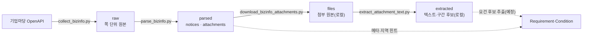

# 기업마당 데이터 명세서 (v0.1)

> 2팀 · 작성 2026-11-24 · 대상: `tools/collect_bizinfo.py`로 수집하고 `tools/parse_bizinfo.py`로 정리한 기업마당 지원사업 공고
> 모든 건수와 비율은 **2026-11-24 09:16 수집분(run `20261124_091601`)을 직접 센 실측값**이다. 확인하지 못한 항목은 "미확인"으로 적었다.
> 나라장터 명세서(v0.2) 형식을 따랐다.

---

## 1. 요약

| 항목 | 값 |
|---|---|
| 데이터 ID | **BIZINFO** 기업마당 지원사업 공고 |
| 수집 범위 | 수집 시점에 **마감되지 않은 공고**만. 공식 API가 마감 공고를 제공하지 않는다 |
| 수집 시점 | 2026-11-24 (1회, 스냅샷). 정기 수집은 아직 없음 |
| 공고 | **1,294건** (API가 알린 `totCnt` 1,294 = 받은 행 1,294 = 고유 `pblancId` 1,294, 중복 0) |
| 공고 등록일 범위 | 2023-11-03 ~ 2026-11-23. 2026년 1,276건, 2025년 17건, 2023년 1건 (상시 공고가 오래 남아 있음) |
| 원본 컬럼 | 22개 (모든 공고에 있는 19개 + 일부에만 있는 3개, §5) |
| 정리 결과 | `notices.jsonl` 47개 필드, `attachments.jsonl` 12개 필드 |
| 첨부 | 2,654개 = 본문출력파일 1,294 + 일반 첨부 1,360 (§4.2) |
| 첨부 원본 내려받기 | 본문출력파일 **1,294개 전부 성공**, 일반 첨부는 내려받지 않음 |
| 첨부 텍스트 추출 | 1,294개 중 1,292개 성공(99.8%), 그중 126개는 OCR. 배포용 hwp 2개 제외 (§4.3) |
| 저장소 | `data/bizinfo/raw`, `data/bizinfo/parsed`는 **Git 포함**(약 10MB). `files/`(약 500MB)와 `extracted/`(26MB)는 **Git 제외** |

기업마당 API는 공고당 요약(평균 285자)과 짧은 자격 문구(평균 83자)만 준다. 신청 자격과 제외 요건의 자세한 문장은 **첨부 공고문**(추출 텍스트 평균 6,205자)에 있다.

---

## 2. 출처와 이용 조건

| 항목 | 내용 |
|---|---|
| 제공 기관 | 중소벤처기업부 기업마당 (bizinfo.go.kr) |
| End Point | `https://www.bizinfo.go.kr/uss/rss/bizinfoApi.do` |
| 인증 | `.env`의 인증키(`crtfcKey`). 키는 문서·코드·로그·저장 파일에 쓰지 않음. 확인한 결과 `raw`와 `parsed`에 `crtfcKey`는 없다 |
| 요청값 | `dataType=json`, `pageUnit`, `pageIndex`. 필터는 `searchLclasId`(분야), `hashtags` |
| 수집 호출 | 13쪽 (`page_001`~`page_013`), 한 번의 수집 실행 |
| 첨부 다운로드 | 일회용 `downloadToken`이 필요하고 **API를 호출할 때마다 새로 발급**된다. 토큰은 메모리에서만 쓰고 저장하지 않는다 (`raw`에는 `[REDACTED]`) |
| 이용 범위 | 교육용·비상업 프로젝트. 첨부 원본은 용량과 저작권 때문에 로컬에만 보관한다 |

**이용약관 확인:** 첨부 이용 조건은 수집 전에 확인했다. 다만 이 문서에는 약관 조항을 옮겨 적지 않았다. 외부 공개나 상업 이용을 하게 되면 그때 다시 확인해야 한다.

**API의 제약 (실측):**
- 마감된 공고는 받을 수 없다. 모르는 파라미터는 무시되고, `pblancId` 필터만 동작한다.
- 따라서 **과거 공고를 쌓으려면 정기 수집(스냅샷)이 필요**하다. 지금은 1회분뿐이다.

---

## 3. 데이터 흐름과 폴더



```
data/bizinfo/
├─ raw/<run>/
│  ├─ page_001.json … page_013.json   API 응답 원본 (downloadToken은 [REDACTED])
│  └─ manifest.json                   수집 조건, 건수, 완전성(complete=true)
├─ raw/LATEST                         가장 최근 run 이름
├─ parsed/<run>/
│  ├─ notices.jsonl                   공고당 1행 (47개 필드)
│  ├─ attachments.jsonl               첨부당 1행 (12개 필드)
│  └─ parse_report.json               파싱 요약과 경고
├─ files/<download_run>/              [Git 제외] 첨부 원본 + manifest.json (토큰 없음)
└─ extracted/<extract_run>/           [Git 제외] *.txt, *.search.txt, extraction_report.json
data/goldset/                         정답셋 후보와 비교 시트 (Git 포함)
```

| 단계 | 스크립트 | 비고 |
|---|---|---|
| 수집 | `tools/collect_bizinfo.py` | 표준 라이브러리만 사용. 재시도 포함. `manifest.json`에 `complete` 기록 |
| 정리 | `tools/parse_bizinfo.py` (+ `test_parse_bizinfo.py` 14개) | 원본 해시 기록 |
| 다운로드 | `tools/download_bizinfo_attachments.py` | `--n/--all/--role/--notice/--resume/--refresh-every/--sleep` |
| 추출 | `tools/extract_attachment_text.py` (+ 테스트 22개) | PyMuPDF, HWP5 직접 해석, HWPX XML, Tesseract OCR |

---

## 4. 정리 결과 스키마

### 4.1 공고 (`parsed/<run>/notices.jsonl`, 47개 필드)

기본 키는 `notice_id`이며 형식은 `BIZINFO:<pblancId>`이다.

**식별·버전**

| 필드 | 타입 | 원본 | 설명 |
|---|---|---|---|
| `notice_id` | string | `pblancId` | `BIZINFO:PBLN_000000000128083` |
| `source_system` | string | 고정값 | `BIZINFO` |
| `source_id` | string | `pblancId` | 원본 공고 ID |
| `notice_kind` | string | 고정값 | `SUPPORT` (1,294건 모두) |
| `title` | string | `pblancNm` | 공고명. 제목이 같은 공고가 4건 있음(ID는 다름) |
| `detail_url` | string | `pblancUrl` | 상세 페이지 URL |
| `published_at` | datetime | `creatPnttm` | 등록일시 (+09:00) |
| `source_updated_at` | datetime | `updtPnttm` | 수정일시 |
| `fetched_at` | datetime | 수집 시각 | |
| `version`, `is_latest` | int, bool | 계산 | 현재는 모두 1, true. 재수집 시 변경 추적용 |
| `content_hash`, `raw_hash` | string | 계산 | 내용·원본 변경 감지 |

**기간**

| 필드 | 타입 | 원본 | 설명 |
|---|---|---|---|
| `deadline_raw` | string | `reqstBeginEndDe` | 원문 그대로 (292가지 값) |
| `apply_status_kind` | enum | 계산 | 아래 표 |
| `application_start_date`, `application_end_date` | date 또는 null | 계산 | `DATE_RANGE`일 때만 (29.3%) |
| `deadline_at` | datetime 또는 null | 계산 | 마감일 23:59:59+09:00 (`DATE_RANGE`일 때만) |

| `apply_status_kind` | 건수 | 의미 |
|---|---:|---|
| `UNTIL_BUDGET_EXHAUSTED` | 646 | 예산 소진 시까지 |
| `DATE_RANGE` | 379 | 시작일~마감일 |
| `ALWAYS_OPEN` | 143 | 상시 |
| `UNTIL_FILLED` | 54 | 모집 인원 충족 시까지 |
| `FIRST_COME` | 35 | 선착순 |
| `VARIES_OR_TBD` | 35 | 별도 공지·미정 |
| `UNPARSED` | 2 | 해석하지 못함 (경고 `PERIOD_UNPARSED`) |

마감일을 알 수 있는 공고는 **29.3%**뿐이다. 나머지는 마감 여부를 날짜로 판단할 수 없다.

**본문·자격**

| 필드 | 타입 | 원본 | 설명 |
|---|---|---|---|
| `summary` | string | `bsnsSumryCn` | HTML을 텍스트로 바꾼 사업 개요 (평균 285자) |
| `target_group_text` | string | `trgetNm` | 7가지: 중소기업 1,000, 소상공인 177, 창업벤처 78, 사회적기업 25, 장애인기업 7, 제조업 4, 여성기업 3 |
| `eligibility_criteria_text` | string | `bsnsSumryCn`에서 규칙으로 추출 | 첫 번째 ☞ 블록. 평균 83자. **정확도 미검증** |
| `eligibility_basis` | string | 계산 | 추출 방식 (`first_bullet_block`) |
| `bullet_blocks`, `intro_lines`, `notes` | list | `bsnsSumryCn` | ☞ 블록별 제목·항목, 도입 문장, ※ 주석 |
| `apply_method_text` | string | `reqstMthPapersCn` | 신청 방법·서류 (99.9%) |
| `apply_url` | string 또는 null | `rceptEngnHmpgUrl` | 온라인 접수 주소 (43.0%) |
| `contact_text` | string | `refrncNm` | 문의처. 공공기관 정보라 **가리지 않는다** |

**분류·기관**

| 필드 | 타입 | 원본 | 설명 |
|---|---|---|---|
| `support_category_major`, `support_category_medium` | string | `pldirSportRealmLclasCodeNm`, `...MlsfcCodeNm` | 대분류 8가지, 중분류 37가지 |
| `jurisdiction_org_name` | string | `jrsdInsttNm` | 소관 기관 (36곳). 중앙부처와 시도가 섞여 있음 |
| `jurisdiction_sido_code` | string 또는 null | 계산 | 소관 기관이 시도일 때 행정 코드 (74.5%, 16가지). 중앙부처 330건은 null |
| `executor_kind` | enum | `excInsttNm` | 아래 표 |
| `executor_org_name`, `executor_org_normalized`, `executor_raw` | string | `excInsttNm` | 수행 기관 (320곳). 현재 `normalized`는 `name`과 같은 값 |
| `executor_role_title` | null | | 사용하지 않음 (0%) |

| `executor_kind` | 건수 | 설명 |
|---|---:|---|
| `ORG` | 947 | 기관명이 있음 |
| `LOCAL_GOVERNMENT_UNSPECIFIED` | 295 | "기초자치단체" 같은 값. 구체 기관을 알 수 없음 |
| `SELF_OPERATED` | 52 | "직접수행" |

**해시태그**

| 필드 | 타입 | 설명 |
|---|---|---|
| `hashtags_raw` | list | 원본 태그 전체 |
| `region_tags`, `region_sido_codes_from_tags` | list | 태그 중 시도 이름과 변환한 코드 (30가지) |
| `region_scope_hint` | enum | `ALL_SIDO_TAGGED` 347 / `SPECIFIC_SIDO_TAGGED` 947. **힌트이지 사실이 아니다** |
| `field_tags`, `year_tags`, `keyword_tags` | list | 분야·연도·키워드 태그 |

**참조·기타**: `attachment_ids`(첨부 ID 목록, 모든 공고에 있음), `view_count`(조회수), `parse_warnings`(경고가 붙은 공고 2건. 경고 종류는 `APPLY_URL_NOT_HTTP` 1건, `PERIOD_UNPARSED` 2건).

### 4.2 첨부 (`parsed/<run>/attachments.jsonl`, 12개 필드)

| 필드 | 설명 |
|---|---|
| `attachment_id` | `ATT:<해시>` |
| `notice_id` | 공고 연결 키 |
| `source_system` | `BIZINFO` |
| `role` | `PRINT_BODY`(본문출력파일, 공고마다 1개) / `ATTACHMENT`(일반 첨부) |
| `file_name`, `file_extension` | 파일명, 확장자 |
| `atch_file_id`, `file_sn` | 원본 첨부 ID, 파일 순번 |
| `source_url` | 내려받을 주소. **토큰 없는 주소**. 실제 다운로드에는 새 토큰이 필요 |
| `download_requires_token` | 모두 true |
| `source_field`, `source_url_field` | 어느 원본 필드에서 왔는지 |

| 확장자 | 개수 | | 확장자 | 개수 |
|---|---:|---|---|---:|
| hwp | 955 | | png | 56 |
| pdf | 841 | | jpg | 44 |
| hwpx | 624 | | xlsx | 40 |
| zip | 90 | | docx 2, doc 1, pptx 1 | 4 |

공고당 첨부는 1개 448건, 2개 512건, 3개 202건, 4개 93건, 5개 30건, 6개 9건이다. 본문출력파일은 PDF 606, HWP 368, HWPX 267이고 이미지(png·jpg)가 53개 있다.

### 4.3 첨부 텍스트 추출 (`extracted/<run>/`, Git 제외)

대상은 **본문출력파일 1,294개**다. 일반 첨부 1,360개는 아직 내려받지 않았다.

| 상태 | 건수 | 설명 |
|---|---:|---|
| `OK` | 1,166 | 텍스트를 바로 추출 (HWP 371, PDF 533, HWPX 262) |
| `OK_OCR` | 126 | 이미지·스캔이라 OCR로 추출 (PDF 73, PNG 37, JPG 16) |
| `DISTRIBUTION_DOC_UNSUPPORTED` | 2 | 배포용 HWP. **복호화하지 않음** |

| 지표 | 값 |
|---|---|
| 추출 글자 수 | 평균 6,205자, 중앙값 약 3,920자, 최대 191,944자, 합계 약 802만자 |
| 파일 크기 | 중앙값 약 0.17MB, 최대 약 9.7MB. PDF 쪽 수 중앙값 5, 최대 200 |
| 자격 구간 후보가 있는 파일 | 1,102개 |
| 제외 구간 후보가 있는 파일 | 623개 |

구간 후보는 제목 모양(정규식)으로 찾은 것이라 **위치 후보일 뿐 정확도가 아니다.** 구간 라벨별 후보 수: ELIGIBILITY 2,755, BENEFIT 3,659, DOCUMENT 2,474, CONTACT 1,527, METHOD 1,703, PERIOD 1,357, CRITERION 982, EXCLUSION 951.

내려받기 결과: 본문출력파일 1,294개 모두 성공(재시도 0). 별도 시험에서 일반 첨부 3개 중 2개 성공, 1개는 서버가 거부(HTTP 403)해 **우회하지 않았다.**

---

## 5. 원본 컬럼 (22개)

활용 구분은 **핵심**(판정·서비스에 직접 사용), **보조**(참고·확장), **미사용**이다. 한글 의미는 필드명과 응답값으로 해석했으며 **공식 문서와 항목별로 대조하지는 않았다.** 채움률은 1,294건 기준이다.

| 컬럼 | 의미 | 활용 | 채움률 | 고유값 | 예시 |
|---|---|---|---:|---:|---|
| `pblancId` | 공고 ID | 핵심 | 100.0% | 1,294 | `PBLN_000000000128083` |
| `pblancNm` | 공고명 | 핵심 | 100.0% | 1,290 | (자유 텍스트) |
| `pblancUrl` | 상세 페이지 URL | 핵심 | 100.0% | 1,294 | (URL) |
| `creatPnttm` | 등록일시 | 핵심 | 100.0% | 1,293 | `2026-11-23 15:05:41` |
| `updtPnttm` | 수정일시 | 보조 | 100.0% | 462 | `2026-11-23 15:29:54` |
| `reqstBeginEndDe` | 신청 기간 (날짜 범위 또는 문구) | 핵심 | 100.0% | 292 | `2026-11-23 ~ 2026-11-30` |
| `bsnsSumryCn` | 사업 개요 (HTML) | 핵심 | 100.0% | 1,292 | (HTML, ☞ 블록 구조) |
| `trgetNm` | 지원 대상 유형 | 핵심 | 100.0% | 7 | `중소기업` |
| `pldirSportRealmLclasCodeNm` | 지원 분야 대분류 | 핵심 | 100.0% | 8 | `기술` (경영 404, 금융 226, 기술 225, 인력 154, 수출 137, 내수 81, 창업 62, 기타 5) |
| `pldirSportRealmMlsfcCodeNm` | 지원 분야 중분류 | 보조 | 100.0% | 37 | `기술사업화/이전/지도` |
| `jrsdInsttNm` | 소관 기관 | 핵심 | 100.0% | 36 | `중소벤처기업부` |
| `excInsttNm` | 수행 기관 | 핵심 | 100.0% | 322 | `대중소기업농어업협력재단` |
| `reqstMthPapersCn` | 신청 방법·서류 | 보조 | 99.9% | 1,145 | `이메일 접수 (…)` |
| `rceptEngnHmpgUrl` | 온라인 접수 주소 | 보조 | 43.0% | 475 | (URL) |
| `refrncNm` | 문의처 | 보조 | 100.0% | 1,214 | (기관명·전화) |
| `hashtags` | 해시태그 (쉼표 구분) | 보조 | 100.0% | 1,289 | `기술,서울,부산,…` |
| `inqireCo` | 조회수 | 미사용 | 100.0% | 1,235 | `2758` |
| `printFileNm` | 본문출력파일명 | 핵심 | 100.0% | 1,287 | (파일명) |
| `printFlpthNm` | 본문출력파일 주소 | 핵심 | 100.0% | 1,294 | (URL, 토큰 `[REDACTED]`) |
| `fileNm` | 일반 첨부 파일명 (`@`로 구분) | 핵심 | 65.4% | — | (파일명 목록) |
| `flpthNm` | 일반 첨부 주소 (`fileSn=N&downloadToken=…` 반복) | 핵심 | 65.4% | — | (URL, 토큰 `[REDACTED]`) |
| `totCnt` | 전체 건수 | 미사용 | 100.0% | 1 | `1294` |

본문출력파일은 모든 공고에 있고(100%), 일반 첨부는 846건(65.4%)에만 있다.

---

## 6. 이 데이터로 알 수 있는 것과 없는 것

| 구분 | 내용 |
|---|---|
| **알 수 있는 것** | 공고 메타데이터(제목, 기관, 분야, 대상 유형), 신청 기간 유형, 신청 방법, 첨부 목록과 본문출력파일의 텍스트 |
| **API만으로는 알 수 없는 것** | 업력·연령·업종·소재지 같은 **자격 요건의 구체적 값**, 제외 요건, 우대, 평가 기준. 이 정보는 첨부 공고문에 있다 |
| **정규화되지 않은 것** | 지역 코드, 업종, 나이·업력 값, 신청자 유형. 파싱까지만 했고 요건 층(`Requirement`/`Condition`) 추출은 시작하지 않았다 |
| **그래프의 근거가 되지 못하는 것** | 메타데이터 층(공고, 기관, 지역 태그, 분야)은 SQL로도 같은 일을 한다. 그래프가 필요하다는 근거는 요건 층에서 나와야 하고, 아직 **입증하지 않았다** |

---

## 7. 처리 규칙

| 규칙 | 내용 |
|---|---|
| 중복 | `pblancId` 기준. 이번 수집에서 중복 0 |
| 완전성 | `rows_retrieved == totCnt_reported`이면 `complete=true` (이번 수집 true) |
| 해시태그 | **전 시도 태그가 달린 공고가 347건(27%)이고, 지역 공고도 포함된다.** 그래서 태그로 지역을 확정하지 않고 `region_scope_hint`만 남긴다 |
| 신청 기간 | 날짜 범위만 `deadline_at`을 계산한다. 예산 소진·상시·선착순 등은 마감일을 만들지 않고 유형만 기록한다 |
| 토큰·키 | `downloadToken`은 저장 전 `[REDACTED]`로 바꾼다. 인증키는 저장하지 않는다 |
| 연락처 | 공공기관 공고의 담당자 연락처는 **가리지 않고** 문서에도 넣지 않는다(팀 결정) |
| 보호 문서 | 배포용 HWP는 복호화하지 않고 상태만 기록한다. 서버가 거부한 파일은 우회하지 않는다 |
| OCR | OCR 결과는 낮은 신뢰로 취급하며 확정 근거로 쓰지 않는다 |
| 원본 보관 | 첨부 원본과 추출 텍스트는 로컬 전용, Git에 올리지 않는다 |

---

## 8. 알려진 한계와 미확인 사항

- **스냅샷 1회분이다.** 마감 공고를 받을 수 없어서 과거 이력은 없다. 공고가 바뀌었는지는 정기 수집을 해야 `version`·해시로 추적할 수 있다.
- **마감일은 29.3%만 안다.** 모집 중인지 판단하려면 `apply_status_kind`를 함께 봐야 한다.
- **`eligibility_criteria_text`는 첫 ☞ 블록을 규칙으로 잘라낸 것**이다(평균 83자). 자격 전체를 담았는지 **검증하지 않았다.**
- **해시태그 지역은 신뢰할 수 없다.** 위 §7 참고. 전 시도 태그가 달린 공고(347건)가 모두 전국 대상이라는 근거는 없다.
- **광주·전남 통합**: 소관 기관명에 `전남광주통합특별시`(113건)가 있다. 개편 전후 이름과 코드를 잇는 처리(H11)는 팀 결정(D-3)을 기다린다.
- **첨부 텍스트**는 본문출력파일 1,294개만 있고 일반 첨부 1,360개는 없다. 공고문 본문이 일반 첨부에만 있는 경우는 **확인하지 않았다.**
- HWP·HWPX는 표의 행·열 구조가 사라지고, OCR 126개는 오인식이 있을 수 있다. 정확도는 측정하지 않았다.
- 배포용 HWP 2개는 읽지 못한다. 일반 첨부 1개는 403이라 받지 못했다.
- 컬럼 의미는 응답값으로 해석했고 공식 문서와 대조하지 않았다(§5).
- 정답셋 후보 50건(`data/goldset/candidates_v0.1.csv`)은 이 데이터에서 시드 고정으로 뽑았지만, 아직 라벨링을 시작하지 않았다.
