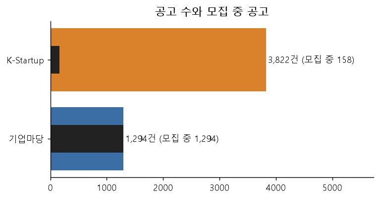
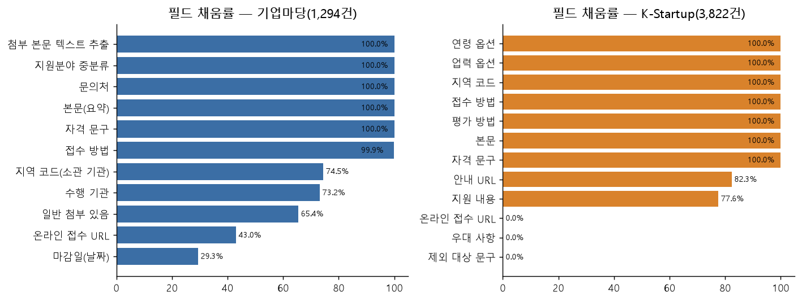
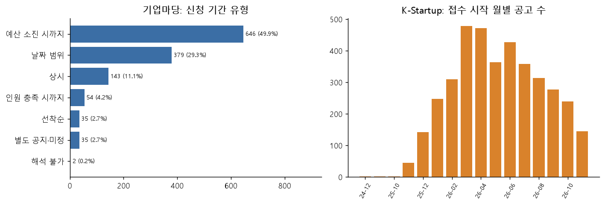
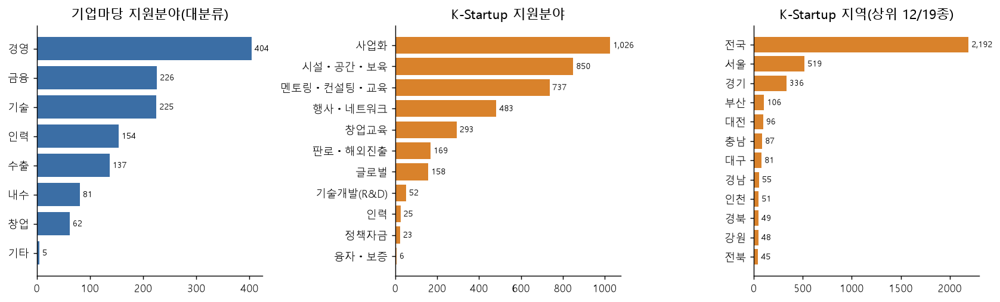
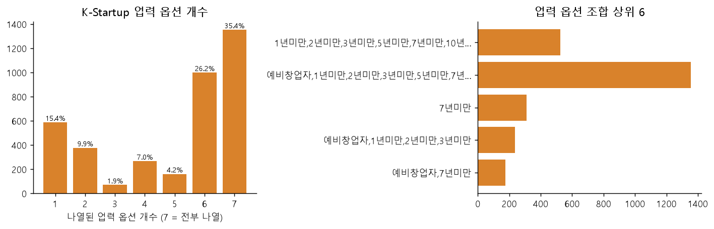
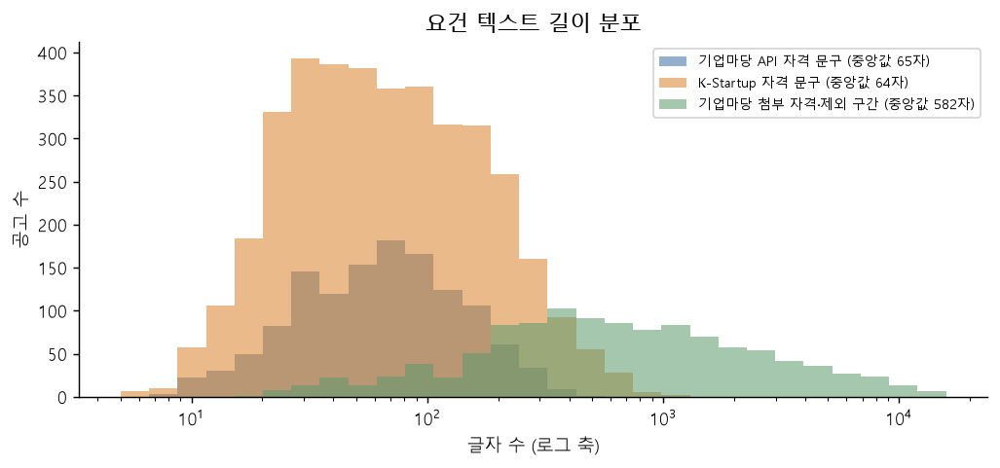
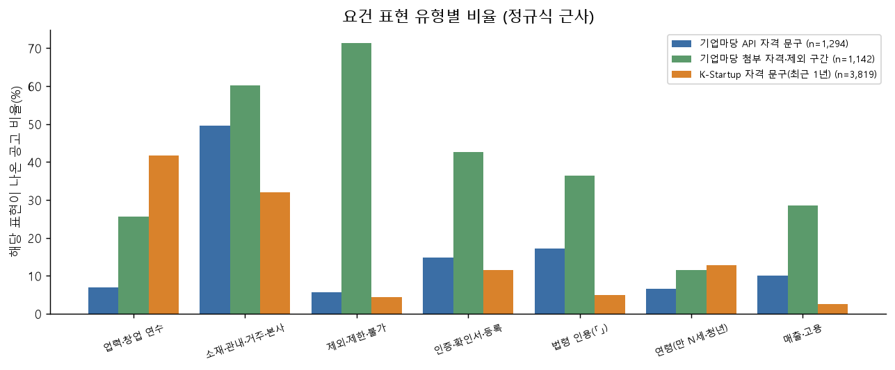
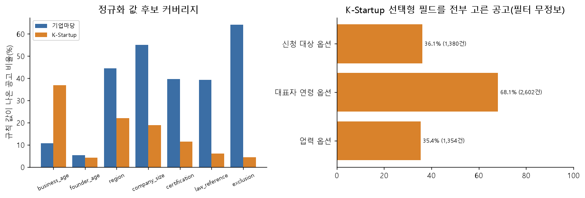

# 도메인 분석: EDA와 용어 표준화 (v0.1)

> 2팀 · 2026-11-24 · 대상: 기업마당 1,294건(모집 중 스냅샷), K-Startup 3,822건(최근 1년 3,819건 + 모집 중 3건)
> 수치는 `tools/eda_domain.py`, `tools/term_standard.py`를 실행해 센 값이다. 정규식으로 센 값은 **근사치**(공고별로 한 번이라도 나오면 1건, 오탐 포함)이며 정확도 지표가 아니다. 요건 정규화·법령 기준은 검수 전이다.
> 이 문서는 강사 피드백(2026-11-24) ① "EDA: 결측·중복·요건 유형 분석"과 ③ "개념 계층과 용어 표준화"에 대응한다.

## 1. 요약

| 구분 | 핵심 결과 |
|---|---|
| 결측 | 기업마당은 **마감일이 날짜로 있는 공고가 29.3%**뿐이고 온라인 접수 URL은 43.0%다. K-Startup은 **제외 대상·우대 사항·온라인 접수 URL 필드가 3,822건 모두 비어 있다** |
| 중복 | 공고 ID 중복 0. 제목이 같은 공고가 기업마당 4개 제목(8건), K-Startup 88개 제목(239건). 제목·기관이 비슷한 재공고·연장 **후보** 묶음에 1,062건 |
| 요건 유형 | 기업마당은 API 자격 문구(평균 83자)보다 **첨부 자격·제외 구간(평균 1,493자)**에 요건 표현이 2~13배 많다. K-Startup은 업력 표현이 많고(42%) 제외·법령 표현은 적다 |
| 용어 | 같은 개념이 여러 표현으로 쓰인다. 업력의 기산점(창업·설립·사업개시·사업자등록), 기준일(공고일·마감일·신청일·전년도), 지역 기준(소재·관내·거주·본사·주소). 표준 용어 사전 24개 신청자 유형과 업력·연령·지역 기준 표준을 제안했다 |
| 법령 정의 | 로컬 법령 원문이 있는 정의는 **중소기업·창업기업·예비창업자·초기창업기업·청년창업기업·중장년창업기업**이다. 소상공인·중견기업·사회적기업·여성기업 등은 원문이 없어 정의를 비워 두었다 |

## 2. 데이터와 분석 단위

| 항목 | 기업마당 | K-Startup |
|---|---|---|
| 수집 | 공식 API 1회(2026-11-24), 모집 중 공고만 | API 전체 30,632건 중 접수 시작일 2025-11-24 이후 3,819건 + 모집 중 3건 |
| 분석 공고 수 | 1,294건 | 3,822건 (요건 표현·텍스트 길이는 최근 1년 3,819건 기준) |
| 모집 중 | 1,294건 | 158건 |
| 요건이 있는 곳 | API 자격 문구 + 첨부 공고문(자격·제외 구간) | API 자격 문구뿐(첨부 정보 없음, 제외 요건 필드 비어 있음) |
| 분석 입력 | 정리 층 `data/cleaned/20261124/`(첨부 본문은 정리 층 청크, 보충 첨부 4건·OCR 포함), 정규화 층 `data/normalized/20261124/`(3.8) | 같음(원본 전체 수집본에서 재정리) |



분석 단위는 공고(`notice_id`)다. 요건 표현 비율은 "그 표현이 한 번이라도 나온 공고 수 ÷ 분모"다. 같은 사업이 반복해서 게시되므로(위 3.2) 공고를 서로 독립인 관측으로 보기 어렵다는 점을 통계 검정의 한계로 둔다.

## 3. EDA

### 3.1 결측 (필드 채움률)



- **기업마당**: 자격 문구·본문·문의처·지원분야는 모두 채워져 있지만 **마감일을 날짜로 알 수 있는 공고는 29.3%**이다(나머지는 예산 소진 시까지·상시·선착순 등 유형). 수행 기관 73.2%, 소관 기관에서 얻는 지역 코드 74.5%, 온라인 접수 URL 43.0%다. 첨부 본문 텍스트는 99.8%를 추출했다.
- **K-Startup**: 업력·연령·지역·접수 방법·평가 방법은 모두 채워져 있다. **제외 대상 문구, 우대 사항, 온라인 접수 URL은 0%**, 지원 내용은 77.6%, 안내 URL은 82.3%다.
- **해석**: 기업마당은 "날짜 필터로 모집 여부를 판단"할 수 없고, K-Startup은 "제외 요건과 우대 요건을 구조화 필드로 얻을 수 없다". 두 경우 모두 값이 없다고 해서 제한이 없다는 뜻이 아니므로 `UNKNOWN`으로 둔다.

### 3.2 중복

| 점검 | 결과 |
|---|---|
| 공고 ID 중복 | 0건 |
| 제목이 같은 공고(기업마당) | 4개 제목, 8건 |
| 제목이 같은 공고(K-Startup) | 88개 제목, 239건 (회차·반복 사업으로 보이며 같은 공고라는 뜻이 아님) |
| 재공고·연장 후보 묶음(제목·기관 유사) | 기업마당 58건, K-Startup 1,004건. 제목에 연장·재공고 신호가 있는 것 111건 |
| 두 포털의 제목 키가 같은 후보 | 15건 (`SAME_AS` 후보, 확정 아님) |

**해석**: ID는 안전하지만 같은 사업이 회차·연장으로 반복 게시된다. `SUPERSEDES`(새 버전이 이전을 대체)와 `SAME_AS`(포털 간 중복)는 제목 유사도만으로 확정하지 않고 후보로 두며, 정정·재공고 빈도는 스냅샷 1회라 측정하지 못했다.

### 3.3 신청 기간과 시기



| 기업마당 신청 기간 유형 | 공고 수 | 비율 |
|---|---|---|
| 예산 소진 시까지 | 646 | 50% |
| 날짜 범위 | 379 | 29% |
| 상시 | 143 | 11% |
| 인원 충족 시까지 | 54 | 4% |
| 선착순 | 35 | 3% |
| 별도 공지·미정 | 35 | 3% |
| 해석 불가 | 2 | 0% |

K-Startup은 접수 시작 월별로 2026년 3~4월이 가장 많다(각 479건, 472건). 기업마당에서 날짜 범위로 모집 중인지 판단할 수 있는 공고는 29%뿐이므로 모집 상태는 날짜가 아니라 유형(`apply_status_kind`)과 함께 본다.

### 3.4 지원 분야·기관·지역



| 기업마당 지원분야(대분류) | 공고 수 | 비율 |
|---|---|---|
| 경영 | 404 | 31% |
| 금융 | 226 | 17% |
| 기술 | 225 | 17% |
| 인력 | 154 | 12% |
| 수출 | 137 | 11% |
| 내수 | 81 | 6% |
| 창업 | 62 | 5% |
| 기타 | 5 | 0% |

| K-Startup 지원분야 | 공고 수 | 비율 |
|---|---|---|
| 사업화 | 1,026 | 27% |
| 시설ㆍ공간ㆍ보육 | 850 | 22% |
| 멘토링ㆍ컨설팅ㆍ교육 | 737 | 19% |
| 행사ㆍ네트워크 | 483 | 13% |
| 창업교육 | 293 | 8% |
| 판로ㆍ해외진출 | 169 | 4% |
| 글로벌 | 158 | 4% |
| 기술개발(R&D) | 52 | 1% |
| 인력 | 25 | 1% |
| 정책자금 | 23 | 1% |
| 융자ㆍ보증 | 6 | 0% |

- 기업마당 중분류는 37종이고 상위는 디자인/상품화/사업화(171), 융자(163), 컨설팅(118), 기술사업화/이전/지도(110), 시설/입지지원(101), 시험/인증(70), 해외진출(70), 고용유지(55)이다.
- K-Startup 주관 기관 유형은 공공기관 1,794, 민간 1,327, 교육기관 510, 지자체 191이다.
- **지역**: K-Startup 지역은 시도 약칭 19종이며 `전국`이 2,192건(57%)이다. 개편 전 명칭(`광주` 39건, `전남` 9건)과 개편 후 명칭(`전남광주` 20건)이 섞여 있다. 기업마당은 해시태그에 전 시도가 달린 공고가 347건(27%)이라 지역 근거로 쓰지 않고, 소관 기관이 시도인 74.5%만 지역 코드를 얻는다.
- 두 포털의 분류 체계가 달라 통합 매핑이 필요하다(4.6).

### 3.5 K-Startup 구조화 옵션



| 나열된 업력 옵션 수 | 공고 수 | 비율 |
|---|---|---|
| 1개 | 589 | 15% |
| 2개 | 378 | 10% |
| 3개 | 71 | 2% |
| 4개 | 268 | 7% |
| 5개 | 162 | 4% |
| 6개 | 1,000 | 26% |
| 7개(전부) | 1,354 | 35% |

업력 옵션을 7개 전부 나열한 공고가 35%다. 이 경우 "제한 없음"인지 "10년 미만까지"인지 모호해서 판정에서는 `UNKNOWN`으로 두는 규칙을 쓴다(미검증). 대표자 연령은 3구간 중 3개를 모두 나열한 공고가 2,602건이다.

### 3.6 요건 텍스트의 길이



| 텍스트 | 공고 수 | 평균 | 중앙값 | 95% | 20자 미만 |
|---|---|---|---|---|---|
| 기업마당 API 자격 문구 | 1,294 | 83자 | 65자 | 215자 | 98 |
| K-Startup 자격 문구(최근 1년) | 3,819 | 104자 | 64자 | 316자 | 340 |
| 기업마당 첨부 자격·제외 구간 | 1,142 | 1,493자 | 582자 | 6,347자 | 0 |

API 자격 문구는 두 포털 모두 중앙값이 약 65자의 짧은 문장이다. 기업마당은 첨부 구간이 약 9배 길다(중앙값 기준). 요건 추출의 입력 설계(문장 단위 vs 구간 단위)가 포털마다 달라야 한다.

### 3.7 요건 유형 분석 (정규식 근사)



| 요건 표현 | 기업마당 API (1,294) | 기업마당 첨부 (1,142) | K-Startup API (3,819) | API 간 χ² p값 | φ(효과크기) |
|---|---|---|---|---|---|
| 업력·창업 연수 | 90 (7%) | 292 (26%) | 1,592 (42%) | <0.001 | 0.321 |
| 소재·관내·거주·본사 | 642 (50%) | 688 (60%) | 1,221 (32%) | <0.001 | 0.159 |
| 제외·제한·불가 | 73 (6%) | 814 (71%) | 163 (4%) | 0.042 | 0.028 |
| 인증·확인서·등록 | 193 (15%) | 487 (43%) | 438 (11%) | 0.001 | 0.046 |
| 법령 인용(「」) | 223 (17%) | 416 (36%) | 191 (5%) | <0.001 | 0.195 |
| 연령(만 N세·청년) | 84 (6%) | 132 (12%) | 488 (13%) | <0.001 | 0.087 |
| 매출·고용 | 131 (10%) | 325 (28%) | 101 (3%) | <0.001 | 0.156 |

- **기업마당은 요건 표현이 첨부에 몰려 있다.** 제외·제한 표현은 API 문구의 6%에서 첨부 구간의 72%로, 법령 인용은 17%에서 36%로 늘어난다.
- **K-Startup은 업력 표현이 많다**(42%, 기업마당 API 7%).
- **통계 검정**: 두 포털 API 자격 문구의 표현 비율 차이를 2×2 카이제곱(df=1)으로 검정했다. 표본이 커서 거의 모든 p값이 0.001 미만이지만, **효과크기 φ가 중간 이상인 것은 업력 표현(0.32)과 법령 인용(0.20)뿐**이다. 제외·제한 표현은 차이가 사실상 없다(φ=0.03, p=0.042). 검정은 공고가 독립이라는 가정을 쓰는데 반복 게시 사업이 있어 p값을 과대평가할 수 있다.
- 이 비율은 표현이 나온 공고의 비율이며 요건의 정확한 개수·논리 구조를 뜻하지 않는다. 첨부 구간에는 신청 자격이 아닌 의무·서류 맥락의 표현이 섞인다.

### 3.8 정규화 층(값 후보) 현황



정리 층 위에 만든 정규화 값 후보(`tools/normalize_values.py`, 전부 검수 전)의 커버리지다. 값이 한 번이라도 나온 공고 비율이며 정확도가 아니다.

| 속성 | 기업마당(1,294) | K-Startup(3,822) |
|---|---|---|
| 하나라도 값이 나온 공고 | 90.2% | 64.2% |
| 업력 | 10.7% | 36.8% |
| 대표자 연령 | 5.4% | 4.2% |
| 지역(본문) | 44.5% | 22.1% |
| 기업 규모 | 55.0% | 18.9% |
| 인증·확인서 | 39.6% | 11.4% |
| 법령 인용 | 39.2% | 6.1% |
| 제외 문구 | 64.1% | 4.3% |
| 신청자 유형 용어 일치 | 71.0% | 72.1% |

- 값 17,211건 중 OCR 출처가 67건이다(낮은 신뢰 표시). 기업마당 지역 개념 ID가 없는 공고 330건은 광역 소관이 없는 중앙부처 공고다.
- 신청자 유형 용어는 예비창업자(1,362), 중소기업(1,307), 창업기업(854), 법인(755), 소상공인(529), 청년(505) 순이다.
- **K-Startup 선택형 필드는 필터 체크박스일 수 있다.** 전부 고른 공고는 업력 35.4%(1,354건), 대표자 연령 68.1%(2,602건), 신청 대상 36.1%(1,380건)이고 이 값은 조건으로 쓰지 않는다. 그래서 위 3.5의 옵션 분포는 "제한 분포"가 아니라 "필터 선택 분포"로 읽어야 한다.
- 업력 필터가 정보를 주는 1,269건에서 본문 업력 상한과 필터 상한은 일치 1,169, 본문이 더 좁음 78, 더 넓음 22다(출처가 충돌하는 후보 100건).

### 3.9 EDA 결론과 설계 반영

| 발견 | 설계 반영 |
|---|---|
| 기업마당 요건은 첨부에 있고 API 문구는 얕다 | 요건 층 입력은 첨부 구간. `Condition.evidence_source`(API/ATTACHMENT)로 근거 수준을 구분 |
| K-Startup은 구조화 필드가 풍부하지만 제외·우대가 비어 있다 | 업력·연령·지역은 규칙 정규화, 제외·우대는 본문 추출. 제외 필드가 비었다고 "제외 없음"으로 해석하지 않음 |
| 마감일이 날짜인 기업마당 공고는 29.3% | 모집 여부는 `apply_status_kind`와 함께 판단하고 날짜 없는 공고를 버리지 않음 |
| 지역 기준·값이 두 포털에서 시도 단위, 개편 전후 명칭 혼재 | 약칭→코드 사전, 광주(구)·전남(구)·권역 묶음 사전(H11·H12) |
| K-Startup 선택형 필드는 필터일 수 있다(전부 선택 35~68%) | `all_options`를 조건으로 쓰지 않고 본문 값을 우선, 충돌 100건은 `source_conflicts` 후보 |
| 같은 사업이 반복 게시 | `SUPERSEDES`·`SAME_AS`는 후보로만 두고 재수집 후 확정 |
| 표현이 다양(4장) | 용어 표준화 사전과 `ref_date_kind`·`region_basis` 필드 |

## 4. 용어 표준화

### 4.1 원칙
1. **법령이 정의한 용어는 로컬 법령 원문을 그대로 인용**하고, 원문이 없으면 정의를 비운다(`definition_source: missing`). 기억으로 정의를 쓰지 않는다.
2. 표준 용어는 개념 ID(`APPLICANT_TYPE:중소기업` 등), 별칭, 근거(법령 원문·공고 문장·API 값)를 가진다.
3. 계층(`IS_A`)은 **법령 원문이 직접 근거인 것만** 확정 표시한다. 나머지는 가설이다.
4. 숫자 판정 기준(업종별 매출 기준 등)은 대통령령(시행령)에 있어 사전에 값을 넣지 않고 "시행령 원문 확인 필요"로 둔다.

### 4.2 신청자 유형 표준 사전

| 개념 ID | 구분 | 별칭 | 기업마당 공고 수 | K-Startup 공고 수 | 정의 근거 | 상위 개념 |
|---|---|---|---|---|---|---|
| APPLICANT_TYPE:중소기업 | ORGANIZATION | 중소기업자, 중소 기업 | 533 | 502 | 로컬 법령 원문 | - |
| APPLICANT_TYPE:소기업 | ORGANIZATION | 小企業 | 105 | 39 | 원문 없음 | 중소기업 (법령 원문) |
| APPLICANT_TYPE:중기업 | ORGANIZATION | 中企業 | 12 | 4 | 원문 없음 | 중소기업 (법령 원문) |
| APPLICANT_TYPE:소상공인 | ORGANIZATION | 소공인 | 252 | 105 | 원문 없음 | - |
| APPLICANT_TYPE:중견기업 | ORGANIZATION | - | 133 | 64 | 원문 없음 | - |
| APPLICANT_TYPE:창업기업 | ORGANIZATION | 창업 기업, 창업기업(법인·개인사업자) | 73 | 778 | 로컬 법령 원문 | - |
| APPLICANT_TYPE:초기창업기업 | ORGANIZATION | 초기창업자, 초기 창업 | 8 | 289 | 로컬 법령 원문 | - |
| APPLICANT_TYPE:예비창업자 | PERSON | 예비 창업자, (예비)창업자, 예비창업팀 | 39 | 1,219 | 로컬 법령 원문 | - |
| APPLICANT_TYPE:재창업기업 | ORGANIZATION | 재창업자 | 36 | 18 | 원문 없음 | - |
| APPLICANT_TYPE:벤처기업 | CERTIFICATION | 벤처 기업 | 164 | 175 | 원문 없음 | - |
| APPLICANT_TYPE:사회적기업 | ORGANIZATION | 사회적 기업 | 52 | 53 | 원문 없음 | - |
| APPLICANT_TYPE:협동조합 | ORGANIZATION | 사회적협동조합 | 52 | 39 | 원문 없음 | - |
| APPLICANT_TYPE:여성기업 | ORGANIZATION | - | 24 | 39 | 원문 없음 | - |
| APPLICANT_TYPE:장애인기업 | ORGANIZATION | - | 27 | 12 | 원문 없음 | - |
| APPLICANT_TYPE:1인 창조기업 | ORGANIZATION | 1인 창업기업 | 2 | 39 | 원문 없음 | - |
| APPLICANT_TYPE:개인사업자 | ORGANIZATION | - | 86 | 132 | 원문 없음 | - |
| APPLICANT_TYPE:법인 | ORGANIZATION | 법인사업자 | 337 | 410 | 원문 없음 | - |
| SPECIAL_GROUP:청년 | PERSON | - | 110 | 380 | 원문 없음 | - |
| SPECIAL_GROUP:중장년 | PERSON | - | 8 | 35 | 원문 없음 | - |
| APPLICANT_TYPE:일반인 | PERSON | - | - | - | 원문 없음 | - |
| APPLICANT_TYPE:대학생 | PERSON | - | 4 | 46 | 원문 없음 | - |
| APPLICANT_TYPE:청소년 | PERSON | - | 10 | 6 | 원문 없음 | - |
| APPLICANT_TYPE:대학 | INSTITUTION | - | - | - | 원문 없음 | - |
| APPLICANT_TYPE:연구기관 | INSTITUTION | - | - | - | 원문 없음 | - |

공고 수는 정규식으로 센 근사치이며 `-`는 법령용어가 아닌 K-Startup 신청 대상 값이라 세지 않은 것이다. `벤처기업`은 신청자 유형이 아니라 확인 제도(`certification`)로 다룬다. `예비창업자`와 `창업기업`은 K-Startup 업력 옵션에서 별개 항목이다.

### 4.3 법령 정의 원문 (로컬 법령 원문 그대로)

**중소기업** — 중소기업기본법 제2조 제1항·제2항

> 제2조(중소기업자의 범위)
> ①중소기업을 육성하기 위한 시책(이하 "중소기업시책"이라 한다)의 대상이 되는 중소기업자는 다음 각 호의 어느 하나에 해당하는 기업 또는 조합 등(이하 "중소기업"이라 한다)을 영위하는 자로 한다. 다만, 「독점규제 및 공정거래에 관한 법률」 제31조제1항에 따른 공시대상기업집단에 속하는 회사 또는 같은 법 제33조에 따라 공시대상기업집단의 소속회사로 편입ㆍ통지된 것으로 보는 회사는 제외한다. <개정 2011.7.25, 2014.1.14, 2015.2.3, 2016.1.27, 2018.8.14, 2019.12.10, 2020.10.20, 2020.12.8, 2020.12.29>
> [중략]
> ②중소기업은 대통령령으로 정하는 구분기준에 따라 소기업(小企業)과 중기업(中企業)으로 구분한다.

**창업기업** — 중소기업창업 지원법 제2조 제3호

> 3. "창업기업"이란 중소기업을 창업하여 사업을 개시한 날부터 7년이 지나지 아니한 기업(법인과 개인사업자를 포함한다)을 말한다. 이 경우 사업 개시에 관한 사항 등 창업기업의 범위에 관한 세부사항은 대통령령으로 정한다.

**예비창업자** — 중소기업창업 지원법 제2조 제4호

> 4. "예비창업자"란 창업을 하려는 개인 등을 말한다.

**초기창업기업** — 중소기업창업 지원법 제2조 제10호

> 10. "초기창업기업"이란 창업하여 대통령령으로 정하는 기준에 따른 사업을 개시한 날부터 3년이 지나지 아니한 창업기업을 말한다.

**청년창업기업** — 중소기업창업 지원법 제2조 제11호

> 11. "청년창업기업"이란 창업기업 대표자의 연령이 39세 이하인 창업기업을 말한다.

**중장년창업기업** — 중소기업창업 지원법 제2조 제13호

> 13. "중장년창업기업"이란 창업기업 대표자의 연령이 40세 이상인 창업기업을 말한다.

**표준화에 주는 의미**
- **계층(법령 원문 근거):** `소기업`과 `중기업`은 `중소기업`의 하위다(중소기업기본법 제2조 제2항). `사회적기업`·`협동조합`은 대통령령이 정하는 경우에만 중소기업에 포함되므로 단순 `IS_A`가 아니라 조건부 관계로 둔다.
- **업력의 기산점은 "사업 개시일"이다.** 창업기업은 "사업을 개시한 날부터 7년이 지나지 아니한 기업"이라 업력 7년 미만(`LT 7`)과 같다. 그런데 공고는 설립일·창업일·사업자등록일을 섞어 쓴다(4.4).
- **연령 기준이 법령에 있다.** 청년창업기업은 대표자 39세 이하, 중장년창업기업은 40세 이상이다. K-Startup 연령 구간(만 39세 이하 / 만 40세 이상)과 같은 경계다.
- **소상공인·중견기업·사회적기업·여성기업·장애인기업의 정의 원문은 로컬에 없다.** 소상공인과 소기업의 포함 관계는 가설이며 확인 전이다.

### 4.4 업력·연령·기준일 표준

| 업력 표현(접두) | 기업마당 공고 수 | K-Startup 공고 수 | 합계 |
|---|---|---|---|
| 업력 | 47 | 356 | 403 |
| 창업 N년·창업 후·창업한지 | 66 | 795 | 861 |
| 설립 N년·설립 후 | 20 | 84 | 104 |
| 사업개시(일) | 33 | 47 | 80 |
| 사업자등록(일) 기준 | 25 | 33 | 58 |

| 연산 표현 | 기업마당 공고 수 | K-Startup 공고 수 | 합계 |
|---|---|---|---|
| N년 이내 | 225 | 1,081 | 1,306 |
| N년 이하 | 37 | 51 | 88 |
| N년 미만 | 68 | 416 | 484 |
| N년 초과 | 4 | 20 | 24 |
| N년 이상 | 113 | 113 | 226 |

| 기준일 표현 | 기업마당 공고 수 | K-Startup 공고 수 | 합계 |
|---|---|---|---|
| 공고일 기준·현재 | 145 | 535 | 680 |
| 접수(신청) 마감일 기준 | 64 | 52 | 116 |
| 신청일·접수일 기준 | 346 | 79 | 425 |
| 전년도·직전 연도 | 135 | 16 | 151 |
| 협약(선정)일 기준 | 2 | 8 | 10 |

| 표준 항목 | 표준 값 | 매핑 |
|---|---|---|
| 속성명 | `business_age`(업력) | 업력, 창업 N년, 창업 후, 설립 후, 사업개시 후 → 같은 속성. 기산점은 `ref_start_kind`(표준: `BUSINESS_START_DATE`=사업 개시일, 법령 근거)로 구분 |
| 연산자 | `LTE` / `LT` / `GTE` / `GT` | 이내→LTE, 이하→LTE, 미만→LT, 초과→GT, 이상→GTE, 지나지 아니한→LT |
| 기준일 `ref_date_kind` | `NOTICE_DATE` / `DEADLINE` / `APPLICATION_DATE` / `PREV_YEAR` / `AGREEMENT_DATE` | 공고일 기준·현재, 접수(신청) 마감일 기준, 신청일·접수일 기준, 전년도·직전 연도, 협약(선정)일 기준 |
| 대표자 연령 | `founder_age`, 만 나이 | K-Startup 구간 `만 20세 미만`=[0,20), `만 20세 이상 ~ 만 39세 이하`=[20,40), `만 40세 이상`=[40,∞) |
| K-Startup 업력 옵션 | 예비창업자 + `N년미만`(N=1,2,3,5,7,10) | 허용 구간의 합집합. 전부 나열은 제한 없음 **(미검증, 판정에서는 `UNKNOWN`)** |

"N년 이내"(1,306건)와 "N년 미만"(484건)은 경계 값(정확히 N년)에서 결과가 달라진다. 표현을 `LTE`와 `LT`로 구분해 보존하고 하나로 합치지 않는다.

### 4.5 지역 기준 표준

| 지역 기준 표현 | 기업마당 공고 수 | K-Startup 공고 수 | 합계 |
|---|---|---|---|
| 소재(지) | 609 | 912 | 1,521 |
| 관내 | 181 | 74 | 255 |
| 거주 | 93 | 189 | 282 |
| 본사 | 234 | 350 | 584 |
| 주소(지) | 159 | 147 | 306 |
| 사업장 | 405 | 215 | 620 |
| 사업자등록 상 소재 | 79 | 47 | 126 |

| 표준 `region_basis` | 대표 표현 |
|---|---|
| `BUSINESS_LOCATION` | 소재, 소재지, 사업장 소재 |
| `JURISDICTION` | 관내 |
| `RESIDENCE` | 거주, 전입 |
| `HEADQUARTERS` | 본사, 본점 |
| `REGISTERED_ADDRESS` | 사업자등록 상 주소(소재) |

같은 "지역 요건"이라도 기준이 소재지·거주지·본사로 달라서 `Condition.value`에 기준 종류를 기록한다. 지역 값은 행정안전부 코드표(`data/ref/regions_jscode20260701.json`, 234개)와 약칭 사전, 개편 묶음(`광주(구)`·`전남(구)`)·권역 묶음 사전(`data/ref/region_groups.json`, 검수 전)으로 표준화한다. 공고 본문이 정의한 권역은 공고마다 구성이 다르다(예: 수도권=서울·경기·인천, 동남권=부산·울산·경남, 경상권=부산·대구·울산·경남·경북).

### 4.6 지원 분야 통합 매핑 (제안)

기업마당 대분류 8개(경영·금융·기술·인력·수출·내수·창업·기타)를 표준 기준으로 삼고 K-Startup 11개를 대응시킨 **제안**이다.

| K-Startup 분류 | 표준 분류 | 신뢰 |
|---|---|---|
| 사업화 | 창업 | 낮음(이름만으로 정함) |
| 시설ㆍ공간ㆍ보육 | 창업 | 낮음(이름만으로 정함) |
| 멘토링ㆍ컨설팅ㆍ교육 | 경영 | 낮음(이름만으로 정함) |
| 행사ㆍ네트워크 | 경영 | 낮음(이름만으로 정함) |
| 창업교육 | 창업 | 낮음(이름만으로 정함) |
| 판로ㆍ해외진출 | 내수 / 수출 | 낮음(이름만으로 정함) |
| 글로벌 | 수출 | 높음 |
| 기술개발(R&D) | 기술 | 높음 |
| 인력 | 인력 | 높음 |
| 정책자금 | 금융 | 높음 |
| 융자ㆍ보증 | 금융 | 높음 |

신뢰가 낮은 항목은 분류명만 보고 정한 것이라 팀 검토가 필요하다. 기업마당 중분류 37종은 대분류 아래에 그대로 둔다.

### 4.7 원천 값 매핑

| 원천 | 값 | 표준 |
|---|---|---|
| K-Startup 신청 대상 | 청소년·대학생·일반인·대학·연구기관 | `APPLICANT_TYPE:` 같은 이름(개인 유형과 기관 유형 구분) |
| K-Startup 신청 대상 | 일반기업 | 미정. 기업 일반을 뜻하며 중소기업과 동일시하지 않음 |
| K-Startup 신청 대상 | 1인 창조기업 | `APPLICANT_TYPE:1인 창조기업` |
| 기업마당 `trgetNm` | 중소기업·소상공인·사회적기업·장애인기업·여성기업 | `APPLICANT_TYPE:` 같은 이름 |
| 기업마당 `trgetNm` | 창업벤처 | 복합 값(창업기업 + 벤처기업). 판정에 쓰지 않음 |
| 기업마당 `trgetNm` | **제조업** | **업종이므로 신청자 유형이 아님**(`INDUSTRY:제조업`). 4건 |

### 4.8 개념 계층 현황

| scheme | 상태 | 근거·비고 |
|---|---|---|
| `REGION` | **구축** | 코드표 234개, 약칭 사전, 개편·권역 묶음(검수 전) |
| `APPLICANT_TYPE` | **부분(제안)** | 표준명·별칭 24개. 확정 계층은 소기업·중기업→중소기업뿐(법령 원문). 소상공인 등은 정의 원문 필요 |
| `SUPPORT_FIELD` | **제안** | 기업마당 8개 기준 통합 매핑(4.6) |
| `SPECIAL_GROUP` | 부분 | 청년·중장년. 연령은 개념이 아니라 `founder_age` 조건 |
| `INDUSTRY` | **미구축** | 업종 표현이 K-Startup 후보의 0.4%뿐이라 우선순위 낮음. 표준산업분류 필요 |

## 5. 한계
- 표현 빈도와 요건 유형 비율은 정규식 근사치이고, 첨부 구간에는 신청 자격이 아닌 맥락의 표현이 섞인다.
- 카이제곱 검정은 공고가 독립이라고 가정하지만 반복 게시 사업이 있어 p값을 과대평가할 수 있다. 효과크기를 함께 본다.
- 기업마당은 모집 중 스냅샷이며 K-Startup 종료 공고 3,664건은 모집 상태와 무관한 분포 분석에만 포함된다.
- 법령 정의는 로컬 법령 원문(동료 수집분, 금융 중심 275건) 안에 있는 것만 인용했다. 소상공인기본법 등은 원문이 없다. 법령 API 호출은 아직 성공하지 못했다.
- 업종 계층, 지원분야 통합 매핑의 낮은 신뢰 항목, 신청자 유형의 가설 관계는 검수 전이다.
- 용어 표준화는 데이터에서 보인 표현 기준이며 모든 표현 변이를 포함하지 않는다.

## 6. 산출물과 실행

```powershell
python tools/preprocess_notices.py      # 정리 층(선행)
python tools/normalize_values.py        # 정규화 층(EDA 3.8의 입력)
python tools/eda_domain.py              # data/eda/eda_results.json, docs/figures/eda_*.png
python tools/term_standard.py           # data/ref/term_standard_v0.1.json, data/eda/term_variants.json
```

| 산출물 | 위치 |
|---|---|
| EDA 집계 | `data/eda/eda_results.json`, `data/eda/term_variants.json` |
| 그림 8개 | `docs/figures/eda_*.png` |
| 용어 표준 사전 | `data/ref/term_standard_v0.1.json` |
| 지역 코드표·묶음 사전 | `data/ref/regions_jscode20260701.json`, `data/ref/region_groups.json` |
