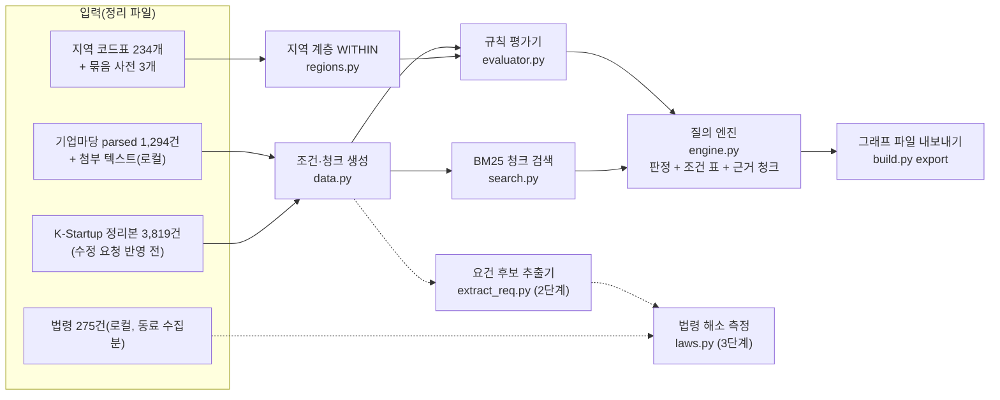

# 그래프 RAG 구성 가능성과 1~3단계 진행 결과 (v0.1)

> 2팀 · 2026-11-24 · 대상: 기업마당 1,294건, K-Startup 3,819건(API 30,632건 중 최근 1년)
> 수치는 2026-11-24에 코드를 실행해 센 값이다. 정규식·규칙으로 만든 값은 **검수 전 후보**이며 정확도를 측정하지 않았다. 확인하지 못한 것은 "미확인"으로 적었다.

---

## 1. 결론

| 질문 | 답 |
|---|---|
| 지금 데이터로 그래프 RAG를 구성할 수 있는가 | **최소 버전은 만들었고 동작한다.** 구조화 조건 평가 + 지역 계층 확장 + 청크 검색 + 근거 출력까지다. 본문에서 뽑은 요건과 정의→법령 경로는 아직 평가에 연결하지 못했다 |
| 그래프가 SQL보다 낫다는 근거가 나왔는가 | **아니다.** 같은 구조 조건을 SQL로 평가해 300개 가상 프로필로 비교했더니 결과가 완전히 일치했다(불일치 0). 구조화 층에서는 그래프가 SQL 이상의 일을 하지 않는다 |
| 사람 없이 끝낼 수 있는가 | **끝낼 수 없다.** 정답 라벨(두 검수자), 권역·개편 사전 검수, 법령 수집 승인은 사람이 해야 한다 |
| 가장 큰 막힘 | ① 정답 라벨 0건이라 추출 정확도를 모른다 ② 법령 API가 응답하지 않아 신청자 유형 정의 법령을 새로 받지 못했다 ③ K-Startup은 본문 요건이 API 문구뿐이다 |

---

## 2. 구성



실선은 평가·검색에 연결된 부분이고, 점선은 후보를 만들거나 측정만 하는 부분이다. **추출된 요건 후보는 아직 판정에 쓰지 않는다**(검수 전).

| 모듈 | 하는 일 |
|---|---|
| `tools/graphrag/regions.py` | 지역 계층(하위→상위, 최대 3 hop), 묶음 개념(광주(구)·전남(구)·경상권), K-Startup 지역 약칭 → 개념 ID |
| `tools/graphrag/evaluator.py` | 조건별 `SATISFIED`/`UNSATISFIED`/`UNKNOWN`, 공고별 `ELIGIBLE`/`NOT_ELIGIBLE`/`NEEDS_CHECK`. 본문 요건이 없는 공고는 `ELIGIBLE`을 만들지 않음(`REQ_UNPARSED`) |
| `tools/graphrag/data.py` | 두 포털의 정리 파일 → 공고·구조화 조건·검색 청크 |
| `tools/graphrag/search.py` | 문자 bigram BM25(임베딩 모델 없음) |
| `tools/graphrag/engine.py` | 프로필 + 질문 → 후보 공고 순위, 조건별 근거 경로, 근거 청크 |
| `tools/graphrag/build.py` | 그래프 파일(nodes·edges) 내보내기, SQL 베이스라인 비교 |
| `tools/graphrag/extract_req.py` | 규칙 기반 요건 후보 추출(2단계) |
| `tools/graphrag/laws.py` | 법령 노드·인용 해소 측정, 권역 후보 스캔(3단계) |
| `tools/test_graphrag.py` | 단위 시험 21개(전부 통과) |
| `tools/make_pilot_templates.py` | 정답셋 파일럿 10건의 **빈** 라벨 템플릿 |

---

## 3. 1단계: 구조화 조건 + 지역 계층 + 검색 (구현·실행 완료)

### 3.1 만든 것과 규모

| 항목 | 값 |
|---|---|
| 공고 | 5,113건(기업마당 1,294 + K-Startup 3,819). 모집 중 1,449건(1,294 + 155) |
| 구조화 조건 | 16,240개: 지역 4,783(K-Startup 3,819 + 기업마당 964), 업력 3,819, 대표자 연령 3,819, 신청 대상 3,819 |
| 검색 청크 | 28,060개: K-Startup API 13,282, 기업마당 API 2,490, 기업마당 첨부 12,057(OCR 231 포함). 20자 미만과 `[REDACTED…]`만 있는 청크는 만들지 않음 |
| 그래프 파일 | 노드 Concept 237·Notice 5,113·Requirement 4,783·Condition 16,240·Organization 1,434·SupportCategory 19, 관계 WITHIN 268·ANNOUNCED_BY 5,113·EXECUTED_BY 947·IN_SUPPORT_CATEGORY 5,113·HAS_REQUIREMENT 4,783·HAS_CONDITION 16,240·ABOUT 4,783. `data/graph/`에 있고 **Neo4j에는 적재하지 않았다**(2026-11-24 당시. 2026-11-25에 다시 만들어 적재했다: [적재 기록](LOAD_Neo4j_적재기록_v0.1.md)) |
| 처리 시간 | 로드+색인 약 4.5초, 질의 1회 약 0.04초 |

### 3.2 평가 규칙과 **가정**(검증 전)

| 조건 | 강도 | 규칙 | 가정·한계 |
|---|---|---|---|
| 업력(K-Startup `biz_enyy`) | hard | 옵션의 최대 `N년미만`이 상한. `예비창업자`가 옵션에 있어야 예비창업자 허용. 임계값 ±0.5년은 `UNKNOWN`(기준일 불명) | 옵션을 7개 전부 나열한 공고는 "제한 없음"이 아니라 상한을 넘으면 `UNKNOWN`으로 둠(규칙 미검증) |
| 지역(두 포털) | soft | 입력 지역에서 위로 3 hop 이내에 조건 지역이 있으면 충족, 입력이 조건보다 상위면 `UNKNOWN`(H3), 다른 가지면 불충족 | K-Startup `supt_regin`이 "지원 지역"인지 "신청자 소재지 요건"인지 불명이라 soft로 둠. 기업마당은 소관 기관이 시도일 때만 조건을 만들고 **해시태그는 쓰지 않음** |
| 대표자 연령 | soft | 옵션 3구간의 합집합 | 트랙별로 연령 조건이 다른 공고(예: 학생창업)는 공고 단위 필드로 오판할 수 있어 soft |
| 신청 대상 | soft | 7종 옵션 중 사용자 유형이 있으면 충족 | 사용자 유형과 옵션의 대응이 거침 |

hard 조건만 `NOT_ELIGIBLE`을 만들고 soft 불충족은 `NEEDS_CHECK`로 둔다. **hard/soft 배정은 설계자의 가정이며 정답셋으로 보정해야 한다.**

### 3.3 가상 프로필 시연(결과는 판정 후보일 뿐 신청 가능 여부가 아니다)

| 프로필(가상) | 모집 중 1,449건의 판정 | K-Startup 3,819건(종료 포함)의 판정 |
|---|---|---|
| 서울 성동구·업력 2년·만 35세·일반기업 | `NEEDS_CHECK` 1,446, `NOT_ELIGIBLE` 3 | `NOT_ELIGIBLE` 182, 구조 조건 통과 2,485 |
| 광주 남구·업력 5년·만 45세·일반기업 | `NEEDS_CHECK` 1,430, `NOT_ELIGIBLE` 19 | `NOT_ELIGIBLE` 562, 구조 조건 통과 1,810 |
| 대구 달서구·예비창업자·만 28세·일반인 | `NEEDS_CHECK` 1,409, `NOT_ELIGIBLE` 40 | `NOT_ELIGIBLE` 1,216, 구조 조건 통과 1,309 |
| 아무것도 입력하지 않음 | `NEEDS_CHECK` 1,449 | `NEEDS_CHECK` 3,819(구조 조건 통과 0) |

**`ELIGIBLE`은 한 건도 나오지 않는다.** 본문·첨부의 요건을 아직 평가에 연결하지 않았기 때문이며 의도된 동작이다. 광주 남구 프로필은 "광주광역시 관내" 공고에서 `남구 → 전남광주통합특별시`로 충족을 확인한다. 다만 기업마당 조건은 통합시 수준이라 목포 같은 전남 지역 사용자도 "[광주]" 공고에서 충족으로 나온다(묶음 사전을 기업마당 조건에는 적용하지 못함).

### 3.4 SQL 베이스라인 비교(그래프의 몫)

같은 구조 조건을 SQLite(지역 폐쇄 테이블 + 업력 필터)로 평가해 가상 프로필 300개(시드 고정)로 그래프 평가기와 비교했다.

| 항목 | 결과 |
|---|---|
| 비교한 프로필·모집 중 공고 | 300개 × 1,449건 |
| `NOT_ELIGIBLE`(hard 불충족) 집합 불일치 프로필 | **0** |
| 지역 조건 상태 불일치 | **0 / 335,700** |
| 전체 평가 시간 | 그래프 평가기(파이썬) 6.4~7.0초, SQL 0.7초(두 번 실행한 값, 부록 A-2는 두 번째) |

**해석:** 지역 계층·업력 같은 구조 조건에서는 SQL이 같은 결과를 더 빠르게 낸다. 그래프가 필요하다는 주장은 이 층에서는 서지 않는다. 시험 대상으로 남는 것은 (a) 본문에서 추출한 요건과 정의→법령 경로, (b) 권역·개편 묶음 사전이 늘어나 경로가 길어지는 경우이며, 이것도 같은 사전을 SQL 테이블로 만들어 비교해야 한다.

---

## 4. 2단계: 요건 후보 추출과 라벨링 준비 (후보 생성 완료, 정답은 없음)

### 4.1 추출 결과

규칙(정규식 + 지역·법령 사전)으로 기업마당 API 자격 문구, 첨부 자격·제외 구간, K-Startup 자격 문구에서 후보를 뽑았다. 후보마다 **원문 문장(수정 없이 복사)**과 위치를 붙이고, 추출 직후 원문에 그대로 있는지 검사했다.

| 항목 | 값 |
|---|---|
| 후보 수 | 18,021개(기업마당 13,119, K-Startup 4,902) |
| 원문 일치 검사 | **불일치 0**(전부 원문에 그대로 있음) |
| 후보가 1개 이상인 공고 | 기업마당 1,170/1,294(90%), K-Startup 2,451/3,819(64%) |
| 속성별(기업마당 / K-Startup) | 업력 248 / 1,620, 지역 1,380 / 1,129, 대표자 연령 189 / 209, 법령 인용 2,466 / 324, 제외 문장 3,365 / 193, 인증·확인서 2,251 / 559, 규모 용어 3,220 / 868 |
| 지역 후보 중 모호(동명 등)해 개념을 정하지 않은 것 | 44 |

**정밀도·재현율은 모른다.** 정답 라벨이 없다. 무작위 20건을 눈으로 훑은 인상으로는 대체로 맞지만 오탐이 섞여 있다(예: "사업개시일로부터 … 3년 미만인 기업의 경우는 적용하지 아니한다"는 예외 문장인데 업력 후보로 잡힘). 이 결과를 정답으로 쓰면 안 된다.

### 4.2 구조화 필드와 본문의 충돌(CQ-13 후보)

K-Startup 업력 옵션의 최대값과 본문에서 뽑은 업력 상한을 비교했다.

| 구분 | 공고 수 |
|---|---:|
| 비교 가능(양쪽에 상한 있음) | 1,400 |
| 일치 | 1,233 |
| **본문이 더 좁음**(구조화는 M년미만까지, 본문은 N<M) | 145 |
| **본문이 더 넓음** | 22 |
| 본문에 업력 상한이 없거나 구조화 필드를 읽지 못함 | 2,419 |

비교 가능한 공고의 약 12%(167/1,400건)에서 구조화 필드와 본문이 어긋난다. 이 건들은 구조화 필드만으로 거르면 틀릴 수 있다. 목록은 `data/graph/conflicts_kstartup_business_age.csv`이며 일치 판정이 느슨(상한이 하나라도 같으면 일치)해서 실제 어긋남은 더 많을 수 있다.

### 4.3 파일럿 라벨링 준비

- `data/goldset/pilot/templates/`에 파일럿 10건(기업마당 5, K-Startup 5)의 **빈** 라벨 A 템플릿, `pilot_assignment.csv`에 배정표를 만들었다.
- 템플릿에는 자동 추출 후보를 넣지 않았다. 라벨러가 기계 결과에 끌리지 않게 하기 위해서다(가이드 원칙).
- **라벨링 자체는 사람(두 검수자)이 해야 하며 시작하지 않았다.** 라벨러 지정, 합격선, 결정 G-1~G-6이 먼저 필요하다.

---

## 5. 3단계: 법령·권역 사전 (일부 진행, 막힌 부분 있음)

### 5.1 법령 API 시험 호출은 실패했다

`.env`의 법제처 엔드포인트(`apis.data.go.kr/1170000/law/lawSearchList.do`)와 키로 파라미터를 바꿔 여러 번 호출했다. `target=law`는 게이트웨이 오류(`HTTP_ERROR` 04), 다른 `target` 값은 "요청 파라메터를 확인"(03)이 나왔다. 서비스 명세(필수 파라미터)를 확인하지 못했고 더 시도하지 않았다. **새 법령은 수집하지 못했다.** 필요한 일: 공공데이터포털의 해당 서비스 활용 가이드로 파라미터를 확인하거나 키 발급 상태를 점검.

### 5.2 대안: 로컬 법령 275건으로 해소율 측정

동료가 이미 수집한 법령 275건(`data/old/상위법령_변환`, 금융 중심)을 `ExternalLaw`로 쓰고, 공고가 인용한 법령이 그 안에 있는지 측정했다.

| 항목 | 값 |
|---|---|
| 법령 인용 후보 | 2,790개. 종류: 법률 2,066, 시행령·규칙 144, 조례 69, 고시·지침 71, 기타(사업명 등) 440 |
| 법령·시행령 인용 2,210개 중 로컬 원문이 있는 것 | **805개(36%)** |
| 조문 번호가 있는 인용 545개 중 조문을 찾은 것 | 471개(86%), 못 찾음 74개 |
| 가장 많이 인용되지만 **로컬에 없는 법령** | 관광진흥법 95, 소상공인기본법 80, 수산업법 57, 국가연구개발혁신법 54, 농어업경영체 육성 및 지원에 관한 법률 44, 보조금 관리에 관한 법률 44, 내수면어업법 26, 중견기업 성장촉진 및 경쟁력 강화에 관한 특별법 24, 사회적기업 육성법 22, 협동조합 기본법 21 |
| 가장 많이 인용되는 법령 | 중소기업기본법 372(로컬에 있음), 중소기업창업 지원법 74(있음) |

### 5.3 정의→법령 사슬이 실제로 닫히는 비율

"중소기업·소상공인·중견기업·사회적기업" 같은 규모·유형 용어가 나온 문장 4,069개를 기준으로 봤다.

| 사슬 상태 | 문장 수 | 비율 |
|---|---:|---:|
| 같은 문장에 법령 인용 없음 | 3,197 | 79% |
| 법령과 조문 원문까지 확보 | 318 | 8% |
| 인용한 법령이 로컬에 없음 | 366 | 9% |
| 법령은 있으나 조문을 알 수 없음 | 188 | 5% |

**의미:** 규모·유형 용어가 나온 문장 중 법령을 함께 인용하는 것은 약 21%(872/4,069)이고, 그중에서도 조문 원문까지 확보한 것은 8%다. 대부분의 규모 요건은 법령을 인용하지 않고 용어만 쓴다. 정의→법령 경로가 가치가 있는지는 이 비율과 정답셋으로 판단해야 한다.

- `Definition` 후보 12개(`data/graph/definitions_text_only.jsonl`)는 **같은 문장에 함께 나온 것**일 뿐 정의로 확인하지 않았다. 조문 원문만 담고 판정 기준(`rule_json`)은 비웠다. 용어가 법령 이름에 들어 있는 것은 7개이고 나머지(예: 중소기업 ← 상법 제169조)는 오연결이다. 사람이 걸러야 한다.
- 법령 내용을 기억에 의존해 쓰지 않았다.

### 5.4 권역 묶음 후보

공고 텍스트에서 "○○권"이 3개 이상 공고에 나온 지역형 후보 9개를 `data/ref/region_group_candidates.json`에 담았다(검수 전, 활성 사전에는 넣지 않음).

| 권역 | 공고 수 | 공고 본문의 정의 문장 |
|---|---:|---|
| 수도권 | 26 | "수도권: 서울, 경기, 인천 지역" |
| 동남권 | 25 | "동남권: 부산, 울산, 경남 지역" |
| 충청권·호남권 | 각 12 | 없음 |
| 전북권 | 9 | 없음 |
| 동부권·대경권·영남권 | 각 4 | 없음 |
| 강원권 | 3 | 없음 |

권역 정의는 공고마다 다르다(예: 경상권은 `KSTARTUP:179834`에서 부산·대구·울산·경북·경남, 동남권은 부산·울산·경남). 따라서 권역은 공고별로 정의를 보존해야 하고 하나의 전국 사전으로 합치면 틀릴 수 있다.

활성 사전(`data/ref/region_groups.json`)의 `광주(구)`(동·서·남·북·광산구)·`전남(구)`(나머지 22개 시군)·`경상권`은 **코드표의 하위 지역 이름으로 추정한 값이며 검수 전**이다. 판정 근거에 `unreviewed_group` 표시가 붙는다.

---

## 6. 하지 못한 것

| 항목 | 이유 | 필요한 것 |
|---|---|---|
| 정답 라벨, 추출 정확도 측정 | 라벨 0건. 사람이 두 명 필요 | 라벨러 지정, 합격선 결정, 파일럿 10건 |
| 요건 후보를 평가에 연결 | 검수 전 후보를 판정에 쓰면 오판 위험 | 정답셋으로 규칙 보정 후 승인된 후보만 연결 |
| Neo4j 적재 | 팀 공용 Aura 인스턴스(기존 데이터 확인 전). 이 저장소의 `tools/load_neo4j.py`는 IBK 규정용으로 보임 | 적재 대상 인스턴스 합의와 승인 |
| 임베딩(의미) 검색 | 모델 선택·다운로드 전 | 모델 결정(D-10), 평가셋으로 BM25와 비교 |
| 답변 생성(LLM) | 모델 서버 없음 | 근거 인용을 강제하는 출력 검사 단계 |
| 새 법령 수집 | 법령 API 응답 실패 | 서비스 명세 확인 또는 키 점검 |
| K-Startup 제외 요건·첨부 | API 필드가 비어 있고 첨부는 `robots.txt`로 금지 | 비교 시트 10건을 사람이 확인 |
| 기업마당의 정확한 지역 | 해시태그는 못 쓰고 소관 기관만 근거 | 본문·첨부 추출 지역 조건 검수 |

---

## 7. 판단과 제안

1. **지금 시연할 수 있는 것:** 프로필을 넣으면 모집 중 공고를 구조 조건으로 거르고, 지역 경로와 근거 문장을 보여 주는 화면. 이 구간은 SQL과 같은 결과라는 점을 함께 말해야 한다.
2. **그래프가 이길 수 있는 곳은 둘이다.** 본문 요건의 계층 확장(권역·개편)과 정의→법령 경로. 둘 다 사람이 검수한 데이터가 있어야 SQL과 공정하게 비교할 수 있다.
3. **우선순위(제안):** ① 파일럿 10건 라벨링(두 명) → ② 후보 추출 규칙의 정밀도·재현율 측정 → ③ 승인된 규칙으로 요건 층을 평가에 연결 → ④ 부족한 법령(소상공인기본법·관광진흥법·중견기업법 등) 확보 → ⑤ Neo4j 적재와 SQL 베이스라인 비교 재실행.
4. **지금 필요한 팀 결정:** 라벨러 2명과 합격선, K-Startup 정리본 수정 요청 반영, Neo4j 적재 대상 인스턴스, 법령 API 점검 담당.

---

## 8. 실행 방법과 산출 파일

```powershell
python tools/test_graphrag.py                       # 단위 시험 21개
python tools/graphrag/build.py stats                # 공고·조건·청크 건수
python tools/graphrag/build.py export               # data/graph/nodes.jsonl, edges.jsonl, manifest.json
python tools/graphrag/build.py compare              # SQL 베이스라인 비교
python tools/graphrag/extract_req.py                # 요건 후보, 충돌 목록
python tools/graphrag/laws.py                       # 법령 해소 측정, 권역 후보
python tools/make_pilot_templates.py                # 파일럿 빈 템플릿
```

| 산출물 | 위치 | Git |
|---|---|---|
| 지역 코드표·묶음 사전·권역 후보 | `data/ref/` | 포함 가능 |
| 그래프 파일 | `data/graph/nodes.jsonl`, `edges.jsonl`, `manifest.json` | nodes·edges는 재생성 가능해 제외 권장 |
| 요건 후보(원문 문장 포함) | `data/graph/requirement_candidates*.jsonl` | **제외**(첨부 원문의 파생물) |
| 충돌 목록·법령 측정 결과 | `data/graph/conflicts_kstartup_business_age.csv`, `law_chain_report.json`, `external_laws.jsonl`, `definitions_text_only.jsonl` | 포함 가능 |
| 파일럿 템플릿·배정표 | `data/goldset/pilot/` | 포함 가능 |

질의 예(파이썬):

```python
import sys; sys.path.insert(0, "tools")
from graphrag.engine import Engine
from graphrag.evaluator import Profile
e = Engine()
p = Profile(region=e.rg.find_by_name("성동구")[0], business_age_years=2, pre_founder=False, founder_age=35, applicant_type="일반기업")
print(e.show(e.query(p, "창업 7년 이내 사업화 지원", top=5)))
```

## 9. 한계

- 평가 규칙의 hard/soft 배정, 업력 경계(±0.5년), 옵션 전체 나열의 해석은 **정답셋으로 검증하지 않은 가정**이다.
- K-Startup 3,819건은 동료 정리본이며 연락처 마스킹, 모집 중 3건 누락, 규칙 필드 없음 등 수정 요청 사항이 남아 있다. 청크 검색 결과에 `[REDACTED…]` 대체 문자열이 섞일 수 있다.
- 기업마당은 모집 중 스냅샷 1회분이고 K-Startup 종료 공고는 평가 시연에만 쓴다.
- BM25는 어휘가 겹쳐야 찾으며 의미 검색이 아니다.
- 요건 후보의 정밀도·재현율, 권역 사전의 구성원, `Definition` 연결은 모두 미검증이다.

---

## 부록 A. 실행 결과 원문

위 본문의 수치가 나온 실행 출력이다. 2026-11-24에 같은 코드를 다시 실행해 붙였다(질의 출력은 앞부분만).

### A-1. 단위 시험 (`python tools/test_graphrag.py`)

```
Ran 21 tests in 0.003s
OK
```

### A-2. SQL 베이스라인 비교 (`python tools/graphrag/build.py compare`)

```json
{
 "profiles": 300,
 "open_notices": 1449,
 "hard_fail_set_mismatch_profiles": 0,
 "region_condition_checked": 335700,
 "region_status_mismatch": 0,
 "graph_evaluator_sec_total": 6.98,
 "sql_sec_total": 0.74,
 "mismatch_examples": []
}
```

### A-3. 그래프 파일 내보내기 (`data/graph/manifest.json`)

```json
{
 "built": "2026-11-24",
 "nodes": {
  "Concept": 237,
  "Notice": 5113,
  "Requirement": 4783,
  "Condition": 16240,
  "Organization": 1434,
  "SupportCategory": 19
 },
 "edges": {
  "WITHIN": 268,
  "ANNOUNCED_BY": 5113,
  "EXECUTED_BY": 947,
  "IN_SUPPORT_CATEGORY": 5113,
  "HAS_REQUIREMENT": 4783,
  "HAS_CONDITION": 16240,
  "ABOUT": 4783
 },
 "skipped": {
  "bizinfo_no_region_condition": 330
 },
 "note": "구조화 조건만 포함(본문 요건 미추출). Neo4j에는 적재하지 않았다."  // 2026-11-24 출력. 2026-11-25에 적재함
}
```

### A-4. 요건 후보 추출 리포트 (`data/graph/requirement_candidates_report.json`)

```json
{
 "candidates": 18021,
 "evidence_not_found": 0,
 "notices": {
  "BIZINFO": 1294,
  "KSTARTUP": 3819
 },
 "notices_with_candidate": {
  "BIZINFO": 1170,
  "KSTARTUP": 2451
 },
 "by_source_attribute": {
  "BIZINFO:business_age": 248,
  "BIZINFO:certification": 2251,
  "BIZINFO:company_size": 3220,
  "BIZINFO:exclusion": 3365,
  "BIZINFO:founder_age": 189,
  "BIZINFO:law_reference": 2466,
  "BIZINFO:region": 1380,
  "KSTARTUP:business_age": 1620,
  "KSTARTUP:certification": 559,
  "KSTARTUP:company_size": 868,
  "KSTARTUP:exclusion": 193,
  "KSTARTUP:founder_age": 209,
  "KSTARTUP:law_reference": 324,
  "KSTARTUP:region": 1129
 },
 "ambiguous_region_candidates": 44,
 "unresolved_region_candidates": 44,
 "kstartup_business_age_conflict": {
  "consistent": 1233,
  "no_text_or_unparsed": 2414,
  "text_narrower": 145,
  "text_wider": 22,
  "no_upper_bound_in_text": 5
 }
}
```

### A-5. 법령·권역 측정 리포트 (`data/graph/law_chain_report.json`, 일부)

```json
{
 "external_laws_local": 275,
 "citations": 2790,
 "citation_resolution": {
  "type_law": 2066,
  "law_missing": 1405,
  "type_decree": 144,
  "resolved_law": 805,
  "article_given": 545,
  "article_not_found": 74,
  "type_other": 440,
  "article_found": 471,
  "type_ordinance": 69,
  "type_notice_or_guideline": 71
 },
 "top_missing_laws": [
  [
   "관광진흥법",
   95
  ],
  [
   "소상공인기본법",
   80
  ],
  [
   "수산업법",
   57
  ],
  [
   "국가연구개발혁신법",
   54
  ],
  [
   "농어업경영체 육성 및 지원에 관한 법률",
   44
  ],
  [
   "보조금 관리에 관한 법률",
   44
  ],
  [
   "내수면어업법",
   26
  ],
  [
   "중견기업 성장촉진 및 경쟁력 강화에 관한 특별법",
   24
  ],
  [
   "사회적기업 육성법",
   22
  ],
  [
   "협동조합 기본법",
   21
  ],
  [
   "대기환경보전법",
   21
  ],
  [
   "소상공인 보호 및 지원에 관한 법률",
   21
  ],
  [
   "농어업경영체법",
   20
  ],
  [
   "벤처투자 촉진에 관한 법률",
   20
  ],
  [
   "부가가치세법",
   19
  ]
 ],
 "chain_company_size_sentences": {
  "no_citation_in_sentence": 3197,
  "resolved_text": 318,
  "law_missing": 366,
  "law_found_article_unknown": 43,
  "law_found_no_article": 145
 },
 "definitions_text_only": 12,
 "definitions_with_term_in_law_name": 7,
 "term_law_pairs_top": [
  [
   "중소기업 ← 중소기업기본법",
   357
  ],
  [
   "소상공인 ← 소상공인기본법",
   76
  ],
  [
   "중소기업 ← 중소기업창업 지원법",
   72
  ],
  [
   "중소기업 ← 중소기업창업지원법",
   27
  ],
  [
   "소상공인 ← 소상공인 보호 및 지원에 관한 법률",
   20
  ],
  [
   "중소기업 ← 중소기업기본법 시행령",
   18
  ],
  [
   "중소기업 ← 중소기업협동조합법",
   16
  ],
  [
   "사회적기업 ← 사회적기업 육성법",
   16
  ],
  [
   "중견기업 ← 중견기업 성장촉진 및 경쟁력 강화에 관한 특별법",
   13
  ],
  [
   "중소기업 ← 중견기업 성장촉진 및 경쟁력 강화에 관한 특별법",
   11
  ],
  [
   "여성기업 ← 여성기업지원에관한법률",
   9
  ],
  [
   "중소기업 ← 중소기업 기본법",
   8
  ]
 ]
}
```

### A-6. K-Startup 업력 충돌 목록의 앞부분 (`data/graph/conflicts_kstartup_business_age.csv`)

```
notice_id,title,structured_max_years,structured_raw,text_bounds,kind,evidence
KSTARTUP:179832,「Next OI 기술 커넥트(Pre-meetup)」 참여 스타트업 모집,10,"7년미만,10년미만",7,text_narrower,"수요기업과 기술협력을 희망하는 업력 7년 이내 스타트업 (신산업 분야 10년 이내, 지역 제한 없음)"
KSTARTUP:179813,2026년 하반기 서울창업허브 창동 입주기업 모집,10,"7년미만,10년미만",7,text_narrower,- 창업 7년 이내 창업기업
KSTARTUP:179733,NEST G밸리 4기 입주기업 모집,3,"예비창업자,1년미만,2년미만,3년미만",4,text_wider,창업 4년 이내 기업 중 혁신 스타트업*(예비창업자 포함)
KSTARTUP:179656,[대전창조경제혁신센터] 2026년 웰컴 스테이 지원사업 참여기업 모집 재공고,10,"1년미만,2년미만,3년미만,5년미만,7년미만,10년미만",7,text_narrower,② 2026년 창업도시 조성 프로젝트 자금지원 선정 또는 Pool기업에 등록되어있는 창업 7년 이내 창업기업
KSTARTUP:179626,세종창업키움센터 운영 민간위탁 수탁기관 모집 재공고,10,"예비창업자,1년미만,2년미만,3년미만,5년미만,7년미만,10년미만",3,text_narrower,◦ 공고일 기준 최근 3년 이내에 창업 기업 보육시설의 운영 실적 또는 창업기업 육성(액셀러레이팅) 프로그램 운영 실적이 있는 법인 또는 단체
```

### A-7. 질의 출력 예 1: 서울 성동구·업력 2년·만 35세·일반기업(가상), 질문 "창업 7년 이내 사업화 지원"

```
평가 1449건 → NEEDS_CHECK 1446, NOT_ELIGIBLE 3 | 후보 1446건

1. [BIZINFO] 2026년 팁스(TIPS) 창업기업 지원계획 수정 공고  (NEEDS_CHECK, 구조조건 PASS, 사유 REQ_UNPARSED)
   https://www.bizinfo.go.kr/sii/siia/selectSIIA200Detail.do?pblancId=PBLN_000000000119754  | 수집 2026-11-24  | 마감 VARIES_OR_TBD
   근거 청크[eligibility_api/API]: (R&D일반트랙) 창업 7년 이내 기업 (신산업 분야기업은 10년 이내까지 인정) - (R&D딥테크트랙) 팁스(일반트랙)를 수행하여 ’완료‘판정을 받은 기업 - (팁스 비R&D 연계사업 창업사업화ㆍ해외마케팅) 2025년까지 팁스 R&D(일반ㆍ딥테크ㆍ글…

2. [BIZINFO] 2026년 중앙부처 및 지자체 창업지원사업 통합 공고  (NEEDS_CHECK, 구조조건 PASS, 사유 REQ_UNPARSED)
   https://www.bizinfo.go.kr/sii/siia/selectSIIA200Detail.do?pblancId=PBLN_000000000116904  | 수집 2026-11-24  | 마감 VARIES_OR_TBD
   근거 청크[att_method/ATTACHMENT]: 17 인천 교육 예비 및 창업 7년 1.7 청년 기업 육성사업 위한 청년들의 참신한 아 월 (창업벤처과) 혁신센터 ②사업화 자금 이내 기업 이디어 활용 및 창업지원 관내 창업기업과 대·중견 ㆍ대·중견기업 협업 기업 간의 오픈이노베이션 관내 창업 7년 …

3. [BIZINFO] 2026년 창업도시 조성 프로젝트 창업도시 모집 공고  (NEEDS_CHECK, 구조조건 PASS, 사유 REQ_UNPARSED)
   https://www.bizinfo.go.kr/sii/siia/selectSIIA200Detail.do?pblancId=PBLN_000000000127435  | 수집 2026-11-24  | 마감 2026-11-30
   근거 청크[att_benefit/ATTACHMENT]: - (지원규모) 지역에소재하거나, 이전을희망하는창업기업을대상 으로연간최대6억원의지역사업화자금지원 구분 지원대상 정부지원사업비 규모 지역 · 대표·협력도시 내 본사가 소재한 창업 7년 이내 신산업 · 최대 4억원(평균 3.5억원) 성장 창업기업(신산업 …
```

### A-8. 질의 출력 예 2: 광주 남구·업력 5년·만 45세(가상), 기업마당만, 질문 "광주 소상공인"

```
평가 1294건 → NEEDS_CHECK 1294 | 후보 1294건

1. [BIZINFO] [광주] 2026년 소상공인 SNSㆍ블로그 홍보지원 참여업체 모집 공고(디지털콘텐츠 홍보지원사업)  (NEEDS_CHECK, 구조조건 PASS, 사유 REQ_UNPARSED)
   https://www.bizinfo.go.kr/sii/siia/selectSIIA200Detail.do?pblancId=PBLN_000000000121231  | 수집 2026-11-24  | 마감 UNTIL_FILLED
   - region(soft) SATISFIED: 남구 → 전남광주통합특별시 (1 hop) 남구 → 전남광주통합특별시  [소관 기관 전남광주통합특별시]
   근거 청크[eligibility_api/API]: 광주광역시 관내 소상공인 - 중소기업확인서 상 소상공인 - 사업자등록증 상 광주광역시 소재 사업장 보유 소상공인…

2. [BIZINFO] [전남광주] 2026년 2차 우수 소상공인 기획전 참여 업체 모집 공고  (NEEDS_CHECK, 구조조건 PASS, 사유 REQ_UNPARSED)
   https://www.bizinfo.go.kr/sii/siia/selectSIIA200Detail.do?pblancId=PBLN_000000000125699  | 수집 2026-11-24  | 마감 UNTIL_FILLED
   - region(soft) SATISFIED: 남구 → 전남광주통합특별시 (1 hop) 남구 → 전남광주통합특별시  [소관 기관 전남광주통합특별시]
   근거 청크[title_summary/API]: [전남광주] 2026년 2차 우수 소상공인 기획전 참여 업체 모집 공고 전남광주통합특별시와 (재)광주경제진흥상생일자리재단에서는 지역 소상공인의 상품 판매 활성화 및 홍보를 위해 e-커머스 플랫폼사를 통한 우수 소상공인 기획전을 추진하오니, 많은 참여 …
```
