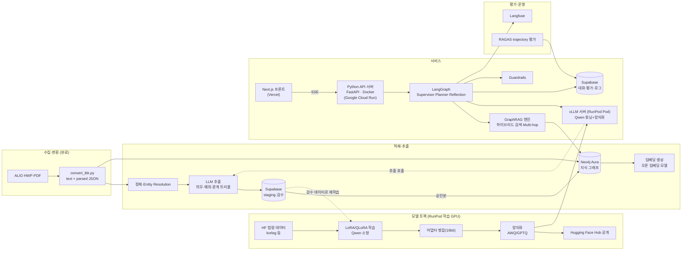
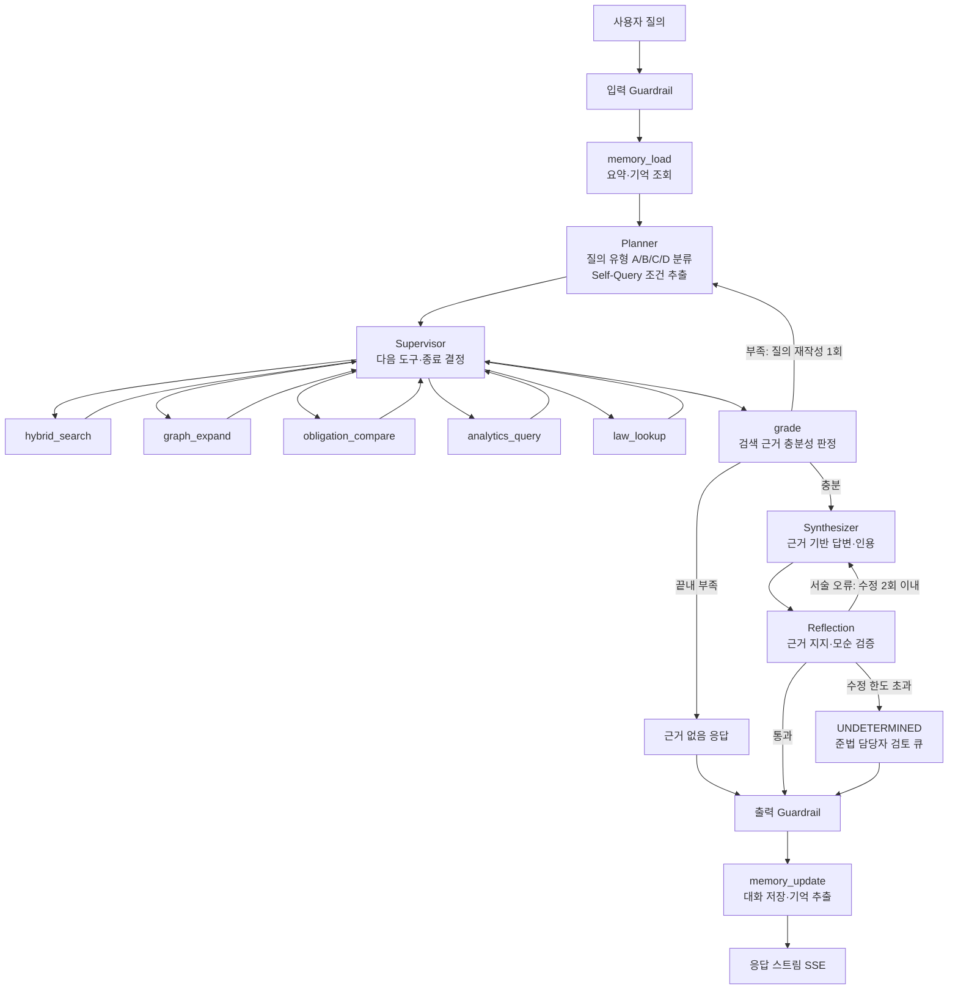

# 기초 설계서 — 온톨로지·Multi-hop 추론 기반 기업 규정 준수 검증 시스템

> 2팀 · 작성일 2026-11-17 · 상태: **초안(v0.3)** — 팀 합의 전 제안안
> 근거 자료: [MLE 1기 가이드 요약](PROJECT_GUIDE_SUMMARY.md), [데이터 출처](../data/DATA_SOURCES.md), 변환 결과(`data/ibk_converted/`, 실측 수치)
> 기획서: [PROJECT_PLAN.md](PROJECT_PLAN.md) — 서비스 대상(일반 사원·인사과)과 두 가지 모드(사원 모드·인사 모드)를 정의한다.
> 수업 정합: 2026-11-17에 `class/` 수업 자료 7개 저장소를 읽고 설계를 대조했다. 정합 결과는 [부록 C](#부록-c-수업-자료-정합표), 주요 결정과 "다시 검토할 조건"은 [부록 D(ADR)](#부록-d-설계-결정-기록-adr)에 있다. 수업과 다르거나 수업에 없는 부분은 본문에 **"수업에 없음"** 으로 표시했다.
> 전제: LLM은 외부 API가 아니라 **Qwen 소형 모델을 Hugging Face 법률 데이터로 LoRA/QLoRA 학습 → 양자화 → RunPod GPU에서 vLLM으로 직접 서빙**한다(§6). 프론트엔드는 **Next.js + Vercel**(§8), Python API는 **Google Cloud(Docker)**, 모델 서버는 **RunPod(vLLM)**이다(§3 배포 토폴로지). v0.1의 OpenAI·Streamlit 기반 안은 폐기했다.

---

## 1. 목표와 범위

**한 줄 목표:** 은행 사규 코퍼스를 지식 그래프로 구조화하고, "이 업무/규정이 상위 규정·법령을 준수하는가?"에 대해 **근거 조문과 추론 경로를 보여주며** 답하는 GraphRAG 서비스를 만든다.

### 사용자 질의 유형 (서비스가 풀어야 할 문제)

| 유형 | 예시 | 필요한 능력 |
|---|---|---|
| A. 조회 | "AI 서비스 위험등급은 어떻게 나누나?" | 하이브리드 검색, 조문 인용 |
| B. 추적 (Multi-hop) | "AI 서비스 민원은 어느 규정을 따르고, 그 규정은 무엇을 요구하나?" | 참조·위임 관계 순회 |
| C. 준수 점검 | "이 업무 절차가 내부통제규정을 위반하나?" / "내규 A와 B가 충돌하나?" | 의무(Obligation) 비교, 예외 처리, 판정 + 근거 |
| D. 분석·통계 | "가장 많이 인용되는 규정은?" / "미보유 법령이 가장 많은 문서는?" | 그래프 집계·GDS 결과 조회(§7.2) |
| E. 사안 검토(인사 모드) | "이 사안은 어떤 조항에 해당하나? 관련 징계 규정은?" | 사안 → 조항 매핑(유형 C) + 징계·절차 규정 연계 조회(유형 B). 인사과 역할 전용([기획서](PROJECT_PLAN.md)) |

### 범위
- **포함:** IBK기업은행 사규 148종(ALIO 공개), 규정 간 참조, 의무·예외 추출, 대화형 UI, 평가·배포.
- **제외(초기):** 실시간 규정 개정 반영, 외부 법령 **본문** 전체 적재(§4.3에서 단계적 확대), 법률 자문 수준의 결론.
- **면책:** 판정 결과는 "검토 보조"이며 법적 판단이 아니다. UI에 명시한다.

### 도메인 범위 결정과 이유

IBK 사규는 148종이다. **구조 적재는 전체, 의무 추출·평가는 핵심 문서 15~20개**로 나눈다.

| 작업 | 범위 | 이유 |
|---|---|---|
| 구조 적재 (문서·조문·항, 참조·인용 관계) | **148개 전체** | 파서가 규칙으로 만드는 결정적 데이터라 비용·신뢰도 부담이 없다. 전체를 넣어야 규정 간 연결이 보이고 Multi-hop 경로가 끊기지 않는다 |
| 의무·예외 추출 (LLM) | **핵심 15~20개** | LLM 추출은 사람 검수가 있어야 정확도를 말할 수 있다. 조문 3,532개를 모두 검수할 수 없고, 소형 모델은 품질 한계가 있어 범위가 좁을수록 안전하다 |
| 평가셋 (질문·정답 조문·추론 경로) | **핵심 15~20개** | 정답을 사람이 쓰려면 문서를 깊이 이해해야 한다. 학습 데이터와 겹치지 않게 문서 단위로 분리해야 한다(§6.2) |

**핵심 문서의 조건:** ① 서로 인용해서 코퍼스 안에서 Multi-hop이 닫힐 것 ② 상위 국가 법령과 연결될 것(동료가 수집하는 법령과 매핑) ③ 수치·기한이 있는 조문이 있어 규칙 비교가 가능할 것 ④ 검수 가능한 분량일 것.

**데이터로 본 두 클러스터** (인용 관계 집계, 상세는 [부록 A](#부록-a-의무-추출평가-핵심-문서-후보-초안)):
- **인사·복무**(행동강령·휴가·인사·상벌·복무·보수): 사규끼리 서로 인용하는 밀도가 가장 높고 수치 규칙이 많다. 반면 상위 법령과의 연결이 약하다.
- **금융·내부통제**(내부통제·금융소비자보호·자금세탁방지·준법·이해충돌·개인신용정보·AI): 금융소비자보호법, 신용정보법 등 **국가 법령과 직접 연결**되고 "기업 규정 준수" 주제와 맞다.
- → 이전 제안은 금융·내부통제 중심이었으나 **서비스 대상이 일반 사원·인사과로 확정되어 인사·복무·윤리 규정 16개(약 410개 조문)를 핵심으로 재제안**한다([기획서 §6.2](PROJECT_PLAN.md)). 최종 목록은 팀 검토 후 확정한다.

### 시장·사용자 요구 분석과 차별화 (초안)

> **근거의 한계:** 아래 동향은 웹 검색 결과 요약에서 확인한 것이며 **개별 기사 원문은 대조하지 않았다.** 규정 검토에 특화된 은행 도입 사례는 확인하지 못했다. 사용자 요구는 **가설**이며 실제 인터뷰는 아직 하지 않았다. 팀이 검증해 고친다.

**배경(검색으로 확인한 동향)**
- 금융권은 내부 업무용 AI 도입을 넓히고 있다. IBK기업은행이 외부 클라우드 대신 **내부망 AI 인프라**와 AI 내부 규정·윤리·위험평가 체계를 정비한다는 보도, 한국은행의 내부망 기반 AI 구축 보도가 검색되었다.
- 규제는 복잡해지고 있다. AI 기본법과 금융분야 AI 가이드라인이 겹쳐 은행권에 혼선이 있다는 보도(2026-01), 환각 우려로 금융당국이 맞춤형 가이드라인을 예고했다는 보도(2026-04)가 검색되었다. 우리 코퍼스의 「AI 위험관리규정」도 이 두 가지를 근거로 든다.
- → **가설:** 규정이 늘고 서로 겹칠수록 "이 규정은 어느 상위 규정에 근거하고, 다른 규정과 충돌하지 않는가"를 확인하는 수요가 커진다.

> **서비스 대상(팀 확정, [기획서](PROJECT_PLAN.md)):** ① **신입 사원을 포함한 일반 사원** — 자신의 행동·업무가 사내 규정에 위반되는지 검색(사원 모드) ② **인사과 직원** — 다른 사원의 규정 위반 여부를 **사안 기반으로 검토**(인사 모드). 아래 표는 초기 가설이며 이 두 대상을 중심으로 재정리했다. 나머지는 확장 후보다.

**사용자와 문제 (가설)**

| 사용자 | 하고 싶은 일 | 지금의 어려움 | 대응 기능 |
|---|---|---|---|
| 준법감시·내부통제 담당 | 규정 개정 시 상위 법령·타 규정과의 정합성 점검 | 규정이 여러 문서·계층에 흩어져 참조·위임을 손으로 추적 | FR-02, FR-04 |
| 현업 담당자 | 내가 하려는 업무가 규정에 맞는지 근거와 함께 확인 | 어느 문서의 어느 조문인지 찾기 어렵고 해석이 갈림 | FR-01, FR-03 |
| 규정 개정 담당 | 한 조문을 고칠 때 영향받는 조문 파악 | 연관 조문 누락 | FR-02, FR-05 |
| 감사·점검 | 위반 가능 조항 탐색 | 서술형 의무라 일관된 기준 적용이 어려움 | FR-03, FR-04 |
| (공통) 보안 담당 | 규정 질의에 외부 AI 서비스를 쓰는 것에 대한 우려 | 사규·질의가 외부로 나감 | 자체 호스팅 모델(§6) |

**검증 계획:** 멘토링 시간(팀당 최대 20시간)에 실무 경험이 있는 멘토에게 3~5개 질문으로 위 가설을 확인한다. 시장·사용자 분석 방법론은 수업에 없어 **팀 자체 가설 + 멘토 검증**으로 두며, 질문을 "비즈니스 → 분석 → 데이터 질문" 순으로 좁히고 이해관계자별 질문 표를 쓰는 수업(데이터 분석 day10)의 형식을 참고했다. 질문 예: ① 규정 정합성 점검을 지금은 어떻게 하는가 ② 가장 시간이 드는 단계는 ③ AI가 답할 때 반드시 필요한 것은(근거? 경로?).

**경쟁·대안 비교 (가설, `?` = 미확인)**

| 대안 | 위계·참조·위임 추적 | 근거·경로 제시 | 위반·충돌 판정 | 데이터 외부 반출 없음 | 한국어 사규 특화 |
|---|---|---|---|---|---|
| 규정집 키워드 검색(ALIO·사내 포털) | ✗ | △ 원문 링크 | ✗ | ○ | ○ |
| 국가법령정보센터·법제처 법령검색([생성형 AI 법령검색 추진 보도](https://www.youthassembly.kr/news/966307)) | △ 법령 간 연계 | ○ | ✗ 사내 규정 대상 아님 | — | ○ |
| 범용 생성형 AI 챗봇 | ✗ | △ | △ 근거 불확실 | ✗ 외부 서비스 사용 시 | △ |
| 일반 벡터 RAG | ✗ | △ | △ | 구성에 따라 | ○ → **베이스라인으로 실측**(§3) |
| 해외 RegTech·컴플라이언스 SaaS | ? | ? | ? | ? | ? 국내 사규 지원 확인 필요 |
| **본 시스템(목표)** | ○ | ○ | ○ 검수된 의무에 한정 | ○ 자체 호스팅 | ○ |

**차별화 포인트**
1. 규정의 **위계·위임·단서**를 그래프로 모델링해 "근거 사슬"을 따라간다(벡터 검색은 이 관계를 모른다).
2. 답변마다 **근거 조문과 추론 경로를 시각화**해 신뢰를 확인할 수 있게 한다.
3. **의무 비교**로 사규와 상위 규정의 충돌·완화를 탐지한다(수치는 규칙, 서술형은 모델 + 검수).
4. **자체 호스팅 소형 모델**로 질의와 규정이 외부 서비스로 나가지 않는 구성이다.

**한계(솔직히):** 공개된 사규만 다루고, 소형 모델이라 긴 규정 판정이 약할 수 있으며, 법적 판단이 아닌 검토 보조다. 위 표의 경쟁 항목은 제품을 직접 확인하지 않은 가설이다.

*참고(검색 결과로 확인된 기사, 내용 대조 필요):* [비즈워치 2026-01](https://news.bizwatch.co.kr/article/finance/2026/01/23/0033) · [이코노미스트 2026-04](https://economist.co.kr/article/view/ecn202604140052) · [데일리안 AI 에이전트 금융권](https://www.ddaily.co.kr/page/view/2025070611101943257) · [삼성SDS 금융 AI 에이전트](https://www.samsungsds.com/kr/insights/next-gen-financial-ai-agent-ready.html)

---

## 2. 데이터 현황 (실측)

변환 스크립트 `tools/convert_ibk.py` 결과 (148개 전체 성공).

| 항목 | 값 |
|---|---|
| 문서 | 148개 (HWP 140, PDF 8), 대부분 개정본, 날짜 범위 2005-01 ~ 2026-10 |
| 조문 | 3,532개 (삭제 조문 127 포함), 평균 약 226자 → **조문 1개가 자연스러운 검색 단위** |
| 문서 유형 | 규정 81, 운용기준 14, 지침 13, 업무규정 8, 기준 8, 운영기준 7, 운영규정 5, 세칙·강령 등 |
| 외부 참조(`「…」`) | 1,011건 / 고유 대상 376개 |
| └ 코퍼스 내 문서로 연결 가능 | 293건(29%) / 고유 75개 |
| └ 코퍼스 밖 | 고유 301개 — 법령·감독규정(은행법, 금융회사지배구조법, 자본시장법, 은행업감독규정 등)과 **ALIO에 없는 내규**(여신업무취급세칙, AI 위험관리 업무 매뉴얼, 업무분장규정 등) |
| 내부 조문 참조 | 778건 (확정) + 323건(`unresolved_refs`: "법 제88조" 등 대상 불명) |
| 단서("다만") / 위임 후보 문장 | 759건 / 704건 |
| 최대 문서 | 보안업무규정 94조, 자금세탁방지업무 취급지침 91조, 정관 87조 |

### 이 수치가 설계에 주는 의미
1. 규정 **간** 연결이 구조적으로 존재하지만 29%만 코퍼스 안에서 닫힌다 → 나머지는 **ExternalLaw 스텁 노드**로 두고 점진적으로 보강(§4.3).
2. 단서·위임은 정규식으로 후보만 뽑은 상태 → LLM 추출 + 검수(§5)로 정제.
3. 날짜 없는 문서 17개, 제정/개정 구분 없는 문서 38개 → 메타데이터 보정 필요. **개정 이력 비교는 범위 밖**(버전 1개만 보유).

### EDA 계획과 1차 결과

성능 평가 보고서에는 **데이터 수집·EDA·통계 분석 기반 도메인 인사이트**가 필수다. 수업(데이터 분석 day07·10)의 흐름 **문제 정의 → 전처리 → EDA → 통계 검정 → 인사이트 리포트**를 그대로 따른다.

**1차 결과** (`data/ibk_converted/parsed`, 수치·기한 판정은 정규식 근사)

| 지표 | 전체 148개 | 핵심 16개 |
|---|---|---|
| 유효 조문(삭제 제외) | 3,405 | 502 |
| 조문 길이 중앙값 / 최대 | 156자 / 3,169자 | 218자 / 2,589자 |
| **수치·기한 포함 조문** | **644 (18%)** | **62 (12%)** |
| "다만" 단서 포함 조문 | 608 (17%) | 56 (11%) |
| 삭제 조문 | 127 | 20 |

**인용 네트워크(문서 간)**: 고유 인용 쌍 155개. **91개 문서가 하나의 큰 연결 덩어리**이고, 나머지 연결 덩어리는 2개짜리 6개, **인용·피인용이 전혀 없는 고립 문서 45개**다.
**최신성**: 2026년 개정 68개(46%), 2025년 24개, 2019년 이전 13개, 날짜 없음 17개.

**설계에 주는 의미**
- **수치·기한 규칙 비교는 핵심 문서 조문의 12%에만 적용된다.** 나머지는 서술형 의무라 모델 추출과 사람 검수 비중이 크다. "수치는 규칙으로 먼저"는 보조 수단이며 주된 방법이 아니다(§6.4).
- 91개 문서가 연결되어 **Multi-hop 시연이 가능**하지만, 고립 문서 45개는 사슬로 닿지 않는다 → 핵심 문서는 큰 덩어리 안에서 고른다.
- 2005~2019년 개정본은 오래됐을 수 있어 답변에 **개정 시점을 표시**한다. 날짜 없는 17개는 보정 대상이다.

**분석 절차 (수업 day10 형식)**

1. **문제 정의:** 비즈니스 질문("규정 준수 검증에 쓸 핵심 문서는?") → 분석 질문 → 데이터 질문 순으로 좁히고, 이해관계자별 질문과 가설(H0/H1)을 분석 계획표에 적는다.
2. **전처리:** 결측·이상값은 **결정 기록표**(항목 / 결정 / 근거)로 남긴다. 예: 날짜 없는 17개, 삭제 조문 127개. 조인 후 행 수를 검증하고, **단계별 전후 행 수 처리 로그**를 남기며, 정제본을 저장한 뒤 다시 읽어 확인한다.
3. **EDA:** 변수 개수별로 그래프를 고른다(단변량 hist·box·count, 이변량 scatter·bar·line, 다변량 heatmap). 그림마다 한 줄 해석, 절 끝에 종합 인사이트 한 문단.
4. **통계 검정:** 아래 표. **p값은 효과크기와 함께** 보고한다(표본이 크면 작은 차이도 유의하다).
5. **인사이트 리포트:** 숫자 재진술 → 유의성과 효과크기 → 실질적 한계(표본 편향·상관≠인과·지표 정의) → 방향성 결론. 보고서에 쓴 숫자는 직접 재계산해 확인한다.

| 분석 | 목적 | 방법(수업 근거) | 산출물 |
|---|---|---|---|
| 조문 길이 분포 | 추출·청킹 단위 확정 | hist·box, 왜도·첨도, 로그 변환, Q-Q plot(day08) | 그림·표 |
| 위계(`level_rank`)별 길이 차이 | 문서 유형별 특성 | 정규성 확인 후 **Kruskal + Dunn**(비정규 가정, day09) | 검정표 + 효과크기 |
| 문서 유형 × 수치 포함 여부 | 규칙 비교 가능 영역 파악 | **카이제곱 + Cramér's V**(day09) | 교차표 |
| 개정 연도·최신성 | 오래된 규정 경고 기준 | 집계·시계열 bar, 유형×연도 heatmap(day07) | 그림 |
| 인용 네트워크 중심성 | 핵심 조문·문서 도출 | GDS PageRank·betweenness(KG day33) 또는 NetworkX | 상위 표, `/insights` |
| 인용 수 설명 요인 | 어떤 문서가 많이 인용되는가 | 문서 길이·조문 수·위계로 회귀, VIF 확인(day09)<br/>※ 우리 데이터에 대한 적용안이며 수업에 이 사례는 없음 | 회귀표 |
| 조문 토픽 군집 | **핵심 문서 선정의 보강 근거** | Kiwi 명사 토크나이저 + 임베딩 → UMAP → HDBSCAN/BERTopic(day11~13), 사규 전용 불용어(제OO조·이 규정 등) | 토픽별 문서 분포, 대표 조문, 노이즈 비율 |
| 위임 패턴 해소율 | 위임 사슬 단절 파악 | 규칙 + 검수 | 해소율 표 |
| 미보유 법령·내규 빈도 | 수집 우선순위(동료 협업) | `make_law_list.py` | [LAW_COLLECTION_LIST.md](LAW_COLLECTION_LIST.md) |

주의: 군집 품질(실루엣)을 보고할 때는 **어느 공간에서 쟀는지**(UMAP 2차원 vs 원본 임베딩)를 밝힌다. 수업에서 같은 데이터가 0.93과 0.17로 달라졌다. 산출물(그림·표)은 보고서와 `/insights` 화면에 같이 쓴다.

---

## 3. 시스템 아키텍처

> 🔍 **확대·축소·이동이 되는 큰 화면:** [architecture.html](architecture.html)을 브라우저로 연다(마우스 휠 확대·축소, 드래그 이동). 다이어그램을 고친 뒤에는 `python tools/build_architecture_html.py`로 다시 만든다. (GitHub의 Mermaid 렌더링에도 자체 확대 기능이 있을 수 있다.)



### 저장소 역할 분담 (핵심 결정)

| | Neo4j Aura | Supabase (Postgres) |
|---|---|---|
| 성격 | **질의용 그래프**(원본에서 재생성 가능한 파생물) | **시스템 기록**(재생성 불가: 검수·로그·평가) |
| 저장 | 문서·조문·항·의무·예외·참조 관계, **벡터·전문 인덱스** | 원본 파일 메타·Storage, 추출 결과 staging·검수 상태, 대화/인용 로그, 평가 데이터·결과 |
| 이유 | 벡터·전문 인덱스와 그래프 순회를 한 곳에서 수행(결합은 RRF, §7) | 사람이 검수한 데이터와 사용자 데이터는 그래프 재적재와 무관하게 보존, 인증·RLS 활용 |
| 선택 | — | **pgvector는 "벡터 단독 RAG 베이스라인"용**으로만 사용 → 발표에서 GraphRAG 이득을 정량 비교(ablation) |

> 임베딩을 두 곳에 두는 이유는 중복이 아니라 **비교 실험**이다. 운영 검색은 Neo4j만 쓴다.

### 배포 토폴로지

| 구성요소 | 호스팅 | 배포 방식 | 접근 제어 |
|---|---|---|---|
| Next.js 프론트 | **Vercel** | GitHub 연동 자동 배포, PR별 Preview | 로그인 필요 화면은 Supabase Auth로 보호 |
| Python API (FastAPI) | **Google Cloud Run**(Docker 컨테이너, 팀 결정) | GitHub Actions: PR은 CI(테스트·이미지 빌드), main push는 CD. 이미지(커밋 sha 태그)를 **Artifact Registry**에 올려 Cloud Run **새 리비전**으로 배포(`gcloud run deploy`). GitHub→GCP 인증은 Workload Identity Federation 권장 | 서버 간 비밀 또는 Supabase JWT 검증, 비밀 값은 Secret Manager 연동 |
| vLLM (Qwen) | **RunPod GPU Pod**(On-Demand, Secure Cloud) | `vllm/vllm-openai` 이미지 + 시작 명령. 가중치 보관(Network Volume 여부)은 §10 결정 | `--api-key`(`VLLM_API_KEY`), **API 서버에서만 호출**, `proxy.runpod.net` HTTPS |
| Neo4j | Aura (관리형) | — | 자격증명은 API 서버에만 보관 |
| Supabase | Supabase (관리형) | — | RLS, 서비스 키는 API 서버에만 보관 |

요청 흐름: 브라우저 → Vercel(Next.js) → Google Cloud(Python API) → Neo4j Aura · Supabase · RunPod(vLLM).

> **GCP 서비스 종류 — 팀 결정: Cloud Run.** 수업(딥러닝 day78)은 GCP를 Compute Engine VM + Docker Compose로 가르쳤는데, 그 이유는 **VM(e2-micro)이 무료 등급이라서**였다. 우리는 **Cloud Run**을 쓴다. 따라서 수업의 배포 방식(GHCR + SSH + compose)과 달라지는 부분은 **수업에 없다**: ① 이미지 저장소(Cloud Run의 기본 경로는 Artifact Registry이며 GHCR을 직접 소스로 쓸 수 있는지는 확인 필요) ② 배포(SSH 대신 `gcloud run deploy`와 GCP 인증) ③ 비밀(VM에 `.env`를 올리는 대신 Secret Manager·환경 변수) ④ 롤백(리비전 트래픽 전환) ⑤ **로컬 볼륨 없음**(수업의 SQLite 키 DB는 쓰지 않고 상태는 모두 Supabase에 둔다).
> ⚠ **Cloud Run에서 확인할 설정(수업에 없음, 공식 문서·실측으로 확인):** ① **요청 타임아웃**(스트리밍 응답이 끝까지 가는 최대 시간) ② **최소 인스턴스**(0이면 콜드스타트, 데모 때는 1 이상 고려) ③ **동시성**과 인스턴스당 CPU·메모리(임베딩·LangGraph 처리량) ④ **CPU 할당 방식:** 기본은 요청을 처리하는 동안에만 CPU가 할당되어 **응답을 보낸 뒤 하는 작업(예: 기억 비동기 저장)이 느려지거나 멈출 수 있다** → "항상 CPU 할당"을 쓰거나 응답 전에 저장한다(§8) ⑤ 인증 방식(공개 호출 + 앱에서 Supabase JWT·공유 비밀 검증 vs IAM 호출자 + ID 토큰) ⑥ 리전.
> ⚠ **RunPod 프록시는 100초를 넘기면 연결을 끊는다**(수업 기준). API→vLLM 호출 타임아웃을 90초 이내로 두고, 긴 응답은 이벤트를 계속 흘려보낸다.
> ⚠ 질의 시 **임베딩을 어디서 계산할지**(Cloud Run CPU / RunPod)는 미정이다(§6.3). Cloud Run은 인스턴스 메모리를 크게 설정할 수 있지만 모델 로딩 시간이 콜드스타트에 더해진다.

---

## 4. 지식 그래프 설계 (온톨로지·Neo4j LPG)

### 4.1 규정 위계(level_rank) — 문서 유형에서 도출

| rank | 계층 | 코퍼스 내 예 |
|---|---|---|
| 1 | 법률·시행령 (ExternalLaw) | 은행법, 금융소비자보호법, 신용정보법 |
| 2 | 감독규정·가이드라인 (ExternalLaw) | 은행업감독규정, 금융분야 인공지능 가이드라인 |
| 3 | 정관 | 정관 |
| 4 | 규정 | 내부통제규정, 개인·신용정보 관리 및 보호 규정 |
| 5 | 세칙·지침·운용기준 | 내부통제 점검·조사 및 조치에 관한 세칙, 자금세탁방지업무 취급지침 |

`level_rank`는 파일명 접미사(규정/지침/기준/세칙 …)로 1차 부여하고 **수동 검수**한다(접미사 없는 3개 문서 존재). 충돌 점검(유형 C)은 "하위가 상위보다 완화적인가"를 이 순위로 판단한다.

### 4.2 노드

| 레이블 | 주요 속성 | 출처 |
|---|---|---|
| `Document` | doc_id, title, doc_type, level_rank, effective_date, action, source, file | parsed.doc |
| `Chapter` | id, no, title, kind(편·장·절) | parsed.chapters |
| `Article` | id, no, title, text, deleted, **embedding** | parsed.articles |
| `Clause` | id, no(①), text, **embedding**(선택) | articles.paragraphs |
| `ExternalLaw` | name, kind(법령/감독규정/기타), resolved(bool), law_id(법제처, 선택) | external_refs |
| `Obligation` | id, modality(MUST/MUST_NOT/MAY), action, condition, deadline_value, deadline_unit, threshold, evidence_text, confidence | **LLM 추출** |
| `Exception` | id, text, condition | 단서 문장 + LLM |
| `Role` | name (준법감시인, AX 위원회, 부서장 …) | LLM 추출 + ER |
| `Concept` | name (개인정보, 고위험 AI, 위험등급 …) | LLM 추출 + ER |
| `Candidate` | name, type_guess, source_article_id | 사전·시그니처에 없는 이름을 **격리**해 두는 곳(승인 전). 수업(KG day37) 방식 |

ID 규칙(변환 스크립트와 동일): `<문서명 공백제거>#<조문>`, 편이 있으면 `#제1편-제1조`.

**스키마 설계 원칙 (수업 KG day32·37)**
- **노드 키는 이름이 아니라 id**로 둔다(위 합성 id). 이름이 사전에 없으면 `:Candidate`로 격리한다.
- 명명: 라벨은 파스칼·단수, 관계는 **대문자 스네이크 동사구**, 속성은 소문자 스네이크. 날짜는 `effective_date`처럼 의미가 드러나게(`date`·`year`만 쓰지 않는다).
- 설계 순서: 질문 정의 → 질문의 명사에서 노드·동사에서 관계 → 속성 배치 → **소량 샘플 적재 → 실제 질의로 검증 → 모델 수정** → 제약·인덱스 → 전체 적재(§4.6).
- "**관계로 구분하지 않은 것은 나중에 되찾을 수 없다**"(수업의 핵심 교훈). 예: `REFERS_TO`(조문 참조)와 `CITES`(문서 인용)와 `DELEGATES_TO`(위임)를 하나의 `RELATED`로 뭉개지 않는다.

### 4.3 관계

| 관계 | 의미 | 생성 방법 | 신뢰도 |
|---|---|---|---|
| `(Document)-[:HAS_CHAPTER]->(Chapter)-[:HAS_ARTICLE]->(Article)-[:HAS_CLAUSE]->(Clause)` (장이 없는 문서는 `Document`가 `Article`을 직접 `HAS_ARTICLE`) | 구조 | 결정적(파서) | 높음 |
| `(Article)-[:REFERS_TO {paragraph, item}]->(Article)` | 내부 조문 참조 | 파서(`internal_refs`) | 높음 |
| `(Article)-[:CITES]->(Document)` | 코퍼스 내 타 규정 인용 | 파서 + 이름 매칭 | 높음(29%) |
| `(Article)-[:CITES_LAW]->(ExternalLaw)` | 코퍼스 밖 법령·규정 인용 | 파서(스텁) | 중간 |
| `(Document)-[:BASED_ON]->(ExternalLaw\|Document)` | 제정 근거(대개 제1조) | 규칙 + 검수 | 중간 |
| `(Article)-[:DELEGATES_TO]->(Document)` | "별도로 정한다" 위임 | LLM + 검수 | 낮음→검수 필요 |
| `(Article)-[:STATES]->(Obligation)` | 조문이 규정한 의무 | **LLM** | 검수 필요 |
| `(Exception)-[:EXCEPTS]->(Obligation)` | 단서·예외 | LLM | 검수 필요 |
| `(Obligation)-[:APPLIES_TO]->(Role)`, `-[:ABOUT]->(Concept)` | 주체·대상 | LLM + ER | 검수 필요 |
| `(Obligation)-[:CONFLICTS_WITH {kind}]->(Obligation)` | 충돌·완화·강화 | 규칙 비교 + LLM | 검수 필요 |

**관계 속성 (수업 KG day37·41):** 추출된 관계에는 `evidence`(원문 구절, **수정 없이 복사**), `source_doc_id`, `evidence_level`(`curated`/`reported`), `batch_id`(적재 묶음, 롤백용), `claim_id`(= sha256(주어 id, 관계, 목적어 id), 멱등 `MERGE` 키)를 붙인다.

**관계 시그니처 — "단일 계약"** (수업 KG day37): 허용 관계를 코드 한 곳(`src/graph/ontology.py`의 `RELATION_SIGNATURES`)에 두고 여기서 **프롬프트 블록과 Pydantic `Literal`을 자동 생성**한다. 판정 기준 칸에는 "무엇을 포기하는지"를 적는다.

| 관계 | 주어 타입 | 목적어 타입 | 판정 기준 |
|---|---|---|---|
| `STATES` | Article | Obligation | 조문이 의무를 **직접 기술**한다(해석·추론으로 도출한 의무는 제외) |
| `EXCEPTS` | Exception | Obligation | "다만"·"~는 제외" 등 단서가 대상 의무의 적용을 면제·완화한다 |
| `APPLIES_TO` | Obligation | Role | 의무를 이행할 **책임 주체**(영향받는 대상은 `ABOUT`) |
| `ABOUT` | Obligation | Concept | 의무가 다루는 **대상·주제** |
| `DELEGATES_TO` | Article | Document | "별도로 정한다" 등으로 세부를 다른 문서에 위임(단순 참조는 `CITES`) |
| `BASED_ON` | Document | ExternalLaw / Document | 문서의 **제정 근거**(조문 단위 인용은 `CITES_LAW`) |
| `CONFLICTS_WITH` | Obligation | Obligation | 같은 대상에 상충하는 값(기한·수치·허용 여부) |

> 구조·참조 계층은 **결정적**이라 신뢰도가 높고, `Obligation` 계층은 LLM 추출이라 **staging→검수→적재** 경로를 거친다. 이 구분이 "신뢰형 GraphRAG"의 핵심이다.

### 4.4 제약·인덱스 (Cypher)

제약은 **적재 전에 먼저** 건다. 제약은 인덱스를 겸한다(수업 KG day32).

```cypher
CREATE CONSTRAINT doc_id      IF NOT EXISTS FOR (d:Document)    REQUIRE d.doc_id IS UNIQUE;
CREATE CONSTRAINT article_id  IF NOT EXISTS FOR (a:Article)     REQUIRE a.id IS UNIQUE;
CREATE CONSTRAINT clause_id   IF NOT EXISTS FOR (c:Clause)      REQUIRE c.id IS UNIQUE;
CREATE CONSTRAINT law_name    IF NOT EXISTS FOR (l:ExternalLaw) REQUIRE l.name IS UNIQUE;
CREATE CONSTRAINT oblig_id    IF NOT EXISTS FOR (o:Obligation)  REQUIRE o.id IS UNIQUE;

-- 문자열 부분 일치용(제목 검색)
CREATE TEXT INDEX article_title_text IF NOT EXISTS FOR (a:Article) ON (a.title);

-- 전문 인덱스: 한국어 형태소 분석이 없으므로 Kiwi로 만든 토큰을 text_tokens에 저장하고 질의도 같은 토큰으로 바꾼다
CREATE FULLTEXT INDEX article_ft IF NOT EXISTS FOR (a:Article) ON EACH [a.title, a.text_tokens];

CREATE VECTOR INDEX article_vec IF NOT EXISTS FOR (a:Article) ON a.embedding
  OPTIONS {indexConfig: {`vector.dimensions`: 1024, `vector.similarity_function`: 'cosine'}};
-- 차원은 임베딩 모델 선정 결과(ADR-1)에 맞춘다. 모델을 바꾸면 인덱스를 다시 만들고 재색인한다.
-- 인덱스 생성 뒤에는 CALL db.awaitIndex(...) 로 준비될 때까지 기다린다.
```

> ⚠ **Aura에서 확인할 것(수업에 없음):** ① `IS NODE KEY`는 수업이 **Enterprise 전용**이라고 명시했다(Desktop은 개발자 라이선스로 가능, 커뮤니티는 오류). Aura에서 되는지 확인하고, 안 되면 `IS UNIQUE` + 적재 코드의 필수 속성 검증으로 간다. ② `apoc.refactor.mergeNodes`(수업의 노드 통합)와 APOC 사용 가능 여부. ③ 한국어 전문 인덱스의 분석기 선택(수업은 `english` 분석기 + Kiwi 토큰). 모두 PoC 항목이다(§10, 부록 D).

**청킹 단위:** 조문 1개(평균 226자)를 청크 1개로 통째로 임베딩한다. 수업(day58)은 임베딩 입력 상한을 넘는 **"잘림 비율"** 을 검증하라고 가르친다. Parent-Child·Auto-merging은 그래프의 `Article`-`Clause` 계층으로 대체한다(**항은 검색 단위, 조는 반환 단위**).

### 4.5 Multi-hop 질의 예 (실데이터 기반)

- `AI위험관리규정#제28조`(금융소비자 보호)는 AI 서비스 관련 민원·분쟁을 「금융소비자보호 규정」과 「민원업무 처리기준」에 따른다고 규정 → `CITES` 로 **금융소비자보호 규정**(코퍼스 내) 도달 → 해당 규정의 조문·의무 조회. 「민원업무 처리기준」은 코퍼스 밖 → `ExternalLaw` 스텁으로 남고 "미보유 문서"로 응답에 표시.
- `AI위험관리규정`은 제1조에서 AI기본법·금융분야 AI 가이드라인·위험관리 프레임워크를 근거로 명시 → `BASED_ON`.

```cypher
// 인용 사슬 최대 3홉 + 도중 예외 포함
MATCH p = (a:Article {id:$id})-[:REFERS_TO|CITES*1..3]->(t)
OPTIONAL MATCH (t)<-[:HAS_ARTICLE]-(:Chapter)<-[:HAS_CHAPTER]-(d:Document)
RETURN p, d.title;
```

### 4.6 온톨로지 검증 절차

온톨로지가 "그럴듯하게 설계됐다"가 아니라 **실제 질문에 답할 수 있는지** 확인한다. 수업(KG day32)의 흐름은 "질문을 적고 → 소량 샘플로 적재해 → 그 모양 위에서 실제 질의를 던져 매끄럽지 않으면 모델을 고친다"이다. **'역량 질문(Competency Question)'이라는 용어와 검증 절차는 수업에 없고**, 이 흐름을 규정 도메인에 맞춰 정리한 우리 방식이다.

**⓪ 샘플 적재:** 핵심 문서 2~3개를 먼저 적재하고 아래 ①②를 돌려 모델을 고친 뒤 전체를 적재한다.

**① 구조 점검(자동, 적재 때마다 실행)** — 결과가 0건이어야 한다.

```cypher
// 어느 문서에도 속하지 않는 조문
MATCH (a:Article)
WHERE NOT EXISTS { (:Document)-[:HAS_ARTICLE|HAS_CHAPTER*1..2]->(a) }
RETURN a.id;

// 삭제된 조문을 참조하는 조문
MATCH (a:Article)-[:REFERS_TO]->(d:Article {deleted: true})
RETURN a.id, d.id;

// 증거 문장 없는 의무 / 위계가 없는 문서
MATCH (o:Obligation) WHERE o.evidence_text IS NULL OR o.evidence_text = '' RETURN o.id;
MATCH (d:Document) WHERE d.level_rank IS NULL RETURN d.doc_id;

// 위임 순환
MATCH p = (a:Article)-[:DELEGATES_TO*2..5]->(a) RETURN a.id LIMIT 20;
```

그 밖의 점검(수업 KG day32·37·41): ⓐ 시그니처 위반 건수(허용 외 관계 타입·주어/목적어 타입 불일치), ⓑ id 없는 노드, ⓒ `:Candidate` 수(격리된 이름), ⓓ 관계의 `evidence` 누락, ⓔ **적재 후 건수 대조**(파일 행 수 ↔ 노드·관계 수, `apoc.meta.stats` 또는 `count`), ⓕ **같은 적재를 한 번 더 돌려 건수가 그대로인지**(멱등 확인).

**② 역량 질문(CQ) 점검** — 온톨로지가 답해야 하는 질문 목록을 먼저 정하고, 각 질문의 Cypher가 기대한 답을 내는지 확인한다. CQ는 평가셋(유형 A~D)의 씨앗이 되며, 학습·평가 분리 원칙(§6.2)에 맞게 **평가용 CQ는 학습에서 제외**한다.

| # | 역량 질문 | 필요한 구조 |
|---|---|---|
| CQ1 | 이 조문이 인용하는 상위·타 규정은? | `REFERS_TO`, `CITES` |
| CQ2 | 이 조문의 위임을 받는 세칙은? | `DELEGATES_TO` |
| CQ3 | 단서(예외)가 있는 조문과 그 예외 내용은? | `Exception`, `EXCEPTS` |
| CQ4 | 이 법령을 근거로 한 사규는? | `BASED_ON`, `ExternalLaw` |
| CQ5 | 같은 주제의 의무 중 가장 엄격한 것은? | `Obligation`, `Concept` |
| CQ6 | 특정 역할이 지는 의무 전체는? | `APPLIES_TO`, `Role` |
| CQ7 | 사규의 기한이 상위 규정보다 긴 의무는? | `CONFLICTS_WITH` |
| CQ8 | 가장 많이 인용되는 문서·조문은? | 중심성(GDS) |
| CQ9 | 인용 사슬이 코퍼스 밖에서 끊기는 지점은? | `ExternalLaw`(resolved=false) |
| CQ10 | 삭제된 조문을 아직 참조하는 조문은? | `deleted`, `REFERS_TO` |

합격 기준(CQ 통과율)은 팀이 정한다.

**③ 표본 검수와 골드셋** (수업 KG day38 방식)
- 표본은 `random.Random(seed).sample`로 뽑되, **모집단을 "스키마 통과 ∩ 근거 원문 일치" 행**으로 명시한다. 판정은 **관계별 판정 기준표**를 붙인 0/1점이다.
- 수업의 표본은 10건(연습 50건)이며 **크기의 통계적 근거나 합격 임계값은 수업에 없다.** 표본 크기와 합격 기준은 **결과를 보기 전에** 팀이 정한다.
- **골드셋:** 핵심 문서의 조문 일부를 **추출 결과를 보지 않고** 직접 읽어 정답 관계를 작성한다. 포함·제외 조건을 먼저 정하고, 정답이 0건인 문장도 "검토 완료"로 기록한다. 골드가 있으면 재현율까지 잴 수 있다.
- 구조 오류가 나오면 ①의 점검 쿼리를 추가한다.

---

## 5. 파이프라인

| 단계 | 입력 → 출력 | 구현 | 상태 |
|---|---|---|---|
| 1. 변환 | HWP/PDF → text, parsed JSON | `tools/convert_ibk.py` | **완료** |
| 2. 메타 보정 | 날짜·유형·위계 누락 수정 | 수동 + 스크립트 | 미착수 |
| 3. 구조 적재 | parsed → Document/Chapter/Article/Clause, REFERS_TO/CITES(결정적 관계) | `neo4j` Python Driver, `UNWIND $rows` 배치 + `MERGE` 멱등 | 미착수 |
| 4. 의무·예외 추출 | 조문 → **개체명 인식(NER)**(역할·개념·기한·수치) + 관계 추출 → Obligation/Exception 후보 | LangChain + **vLLM 서빙 Qwen**(구조화 출력, CoT) → **Supabase staging** | 미착수 |
| 5. Entity Resolution | Role·Concept 중복 병합 | 후보 생성 → LLM 판정 → 그룹 병합(아래) | 미착수 |
| 6. 검수 | 표본 정밀도·골드 P/R 측정, 오류 피드백으로 프롬프트 개선 | 검수 화면(Next.js 관리 페이지 또는 Supabase Studio) | 미착수 |
| 7. 승인분 적재 | approved → Neo4j | 적재 스크립트(증분·멱등) | 미착수 |
| 8. 임베딩 | Article 텍스트 → vector | 선정된 임베딩 모델(ADR-1), 배치·재시도 | 미착수 |

**추출 단위:** 조문 1개(평균 226자) 단위 호출. 3,532회 규모이고 vLLM 배치로 처리한다(소요 시간은 GPU·모델에 따라 실측). `prompt_version`과 `model`을 매 실행에 기록해 재현성을 확보한다.

**추출 설계 (수업 KG day36·37)**
- 출력은 **구조화 출력**으로 받는다: Pydantic 스키마 + `type`은 `Literal[..., 'Other']`로 enum 강제 + `evidence`(원문 연속 구절을 **수정 없이 복사**) 필수 + `confidence`. CoT를 쓰면 서식 맨 앞에 `reasoning` 칸을 둔다(칸 순서가 생각 순서). 효과는 모델마다 달라 늘 이득은 아니다.
- few-shot은 형식을 유도할 뿐 보장하지 않는다 → **후처리로 보장**한다: 유형 검증 → **원문 등장 확인** → 중복 제거 → 시그니처(방향까지) 검증 → id 해소 → 사전에 없으면 `:Candidate`로 격리.
- ⚠ **수업에 없음:** ① vLLM의 구조화 출력(JSON schema)·도구 호출(수업 day75~79에 없음, 수업 서빙 데모는 일반 채팅만) → PoC로 확인하고, 안 되면 프롬프트로 JSON을 요구하고 Pydantic으로 검증·재시도한다. ② **한국어 규정**에서의 문자열 일치 검증(수업은 영어 논문·일부 한글 의약품 자료). 줄바꿈·공백·조번호 표기(`제5조`/`제 5 조`/`①`) 때문에 완전일치가 깨지므로 **정규화 규칙을 따로 정의**한다. ③ 오픈 소형 모델로 추출한 사례.
- NER은 수업에서 규칙 → 학습 모델(`dslim/bert-base-NER` 등) → LLM 순으로 비교했다. 영어 모델이라 한국어 규정에는 맞지 않아, 우리는 LLM 추출을 기본으로 하고 규칙(기한·수치 정규식)을 보조로 쓴다.

**품질 지표 (수업 KG day38 정의로 통일, 보고서 필수)**

| 지표 | 계산 | 비고 |
|---|---|---|
| 스키마 준수율 | 허용 관계·타입을 통과한 행 / 전체 행 | **기각된 행도 분모에 포함** |
| 근거 원문 일치율 | `evidence`가 원문에 연속 포함된 행 / 전체 행 | 스키마 기각 행 포함 |
| 샘플 정밀도 | 사람이 1점 준 표본 수 / 판정 완료 표본 수 | 모집단 = 스키마 통과 ∩ 근거 일치(§4.6) |
| 골드 P / R / F1 | 고유 (주어, 관계, 목적어) 완전일치 비교 | 골드는 추출 결과를 보지 않고 작성 |
| 정답 손실 | 걸러 내는 검사가 정답 관계까지 지우는 비율 | 점수가 오르면 정답이 함께 사라지는지 같이 본다 |
| ER 품질 | 쌍 단위 P/R/F1, **오병합 쌍 수**, 같은 ID 아래 타입 일관성 | "ER 일관성"이라는 단일 지표 이름은 수업에 없다 |

교정 방향: 스키마 위반은 `Literal`로 제한하고 관계별 타입 조합 검사를 추가한다. 인용 불일치는 "원문 연속 구절을 수정 없이 복사하라"고 지시하고 포함 검사를 붙인다. **합격 임계값은 수업에 없으므로** 결과를 보기 전에 팀이 정한다.

**Entity Resolution (수업 KG day39)**
- **블로킹:** 같은 타입끼리만 비교. **후보 생성은 세 가지의 합집합**: 문자열(`SequenceMatcher` ≥ 0.6), 임베딩 KNN(`gds.knn`, topK 3, cutoff 0.8, seed 고정), 공통 출처 Jaccard ≥ 0.5.
- **매칭:** 후보에서 빠졌다고 다른 개체로 확정하지 않는다. LLM이 같음/다름/보류를 이유와 함께 판정(10쌍씩 `batch`).
- **병합:** 같음으로 확정한 쌍을 그룹으로 묶고, 그룹 안에 "다름"이 섞이면 **통합을 보류**한다. 그룹마다 `standard_id`를 부여한다. 새 적재는 `MERGE`, 이미 중복이 있으면 `apoc.refactor.mergeNodes`(Aura APOC 확인 필요, §4.4).
- 수업의 지적: "표기 통일이 안 되면 점수가 끊긴다" — 조문·법령 표기 통일이 Multi-hop 경로 연결의 전제다.

**적재 (수업 KG day32·40·41)**
- Aura는 서버 파일을 못 읽으므로 `LOAD CSV file:///`·`apoc.load.json` 대신 **파이썬이 읽어 `UNWIND $rows AS row MERGE ...`로 5,000건씩** 보낸다(수업 표). 레이블·관계 타입은 파라미터로 못 넣으므로 문자열로 조립하고 값만 파라미터로 넘긴다. 적재 후 건수를 대조한다.
- **증분·멱등:** 청크 id = `doc_id:chunk:순번:sha256(청크 원문)`, 관계 키 `claim_id`로 `MERGE ... ON CREATE SET evidence, batch_id`(기존 근거를 덮어쓰지 않음), `ProcessingState {doc_id}`에 `schema_version`·건수·상태를 기록, 롤백은 `batch_id`가 처음 만든 관계만 삭제.
- ⚠ **규정 개정 반영은 수업에 없다.** 수업도 "원문 수정·삭제에 따른 기존 관계 교체는 별도 정책으로 설계"라고만 하고 다루지 않는다. 우리는 이번 범위에서 **버전 1개만 보유**하므로(§2) 개정 반영은 범위 밖으로 두고, 필요해지면 청크 해시로 변경을 감지해 해당 조문의 `claim_id` 관계를 교체하는 정책을 따로 설계한다.
- `SimpleKGPipeline`(neo4j-graphrag)은 선택 사항이다. 쓰면 수업 설정(`perform_entity_resolution=False`, `on_error="RAISE"`, `additional_*=False`, 청크 500/100)을 출발점으로 삼고 **정상 0건과 처리 실패를 구분**한다. 우리 조문은 이미 구조화되어 있어 직접 적재가 더 단순하다.

---

## 6. AI 구성 (Qwen 소형 모델 · QLoRA · 양자화 · RunPod vLLM)

외부 LLM API는 쓰지 않는다. 서비스의 생성·추출·판정은 **직접 학습한 Qwen 소형 모델**이 맡는다.

> **수업 정합(딥러닝 day68~79):** 수업은 `Qwen3.5-0.8B`로 SFT·LoRA·QLoRA를, `Qwen3.5-4B`로 vLLM 서빙을 실습했고 RunPod 24GB급 GPU 파드를 썼다. 아래는 수업 방식을 기본으로 하고, 수업과 다르거나 수업에 없는 부분은 ⚠로 표시한다([부록 C](#부록-c-수업-자료-정합표)). **모델 크기·GPU 종류는 학원 예산 지원이 확정된 뒤 정한다.**

### 6.1 모델 트랙

| 단계 | 내용 | 산출물 |
|---|---|---|
| 1. 베이스 선정 | Qwen 계열 소형 모델(**크기 미정, 예산 종속**). 수업 참고: 학습 0.8B, 서빙 4B. **학습 전에 베이스 상태로 한국어 법령 질의·JSON 출력 능력을 먼저 측정**하고 확정 | 베이스 평가표 |
| 2. 데이터 구성 | §6.2 | 학습 데이터셋 + 데이터 카드 |
| 3. LoRA/QLoRA 학습 | 계획은 QLoRA. ⚠ **수업의 결과는 다르다:** Qwen3.5에는 4bit QLoRA를 권하지 않고(양자화 오차가 큼), 4bit만으로도 일반 perplexity가 36.4 → 50.1(+37%) 나빠졌으며 QLoRA가 LoRA보다 덜 학습했다(학습 정답률 0.475 대 0.625). 수업의 실무 흐름은 "작은 GPU에서 QLoRA로 빠르게 실험, 최종은 bf16 LoRA". → **예산 GPU에 bf16 LoRA가 들어가면 LoRA를 쓰고, 아니면 QLoRA**를 쓰며 둘을 같은 평가셋으로 비교해 결정한다(ADR-5). 크기별 필요 VRAM은 수업 방식(`config.json`만 받아 meta 장치로 파라미터 수를 세는 계산)으로 가늠한다 | LoRA/QLoRA 어댑터 |
| 4. 병합·양자화 | 수업의 순서: 어댑터 학습 → **원래 정밀도(bf16/fp32) 베이스를 새로 불러와** `merge_and_unload` → **병합 모델 재평가** → AWQ/GPTQ 양자화 → vLLM. **4bit 베이스에는 병합하지 않는다**(양자화 오차가 한 번 더 생김). ⚠ AWQ/GPTQ 변환 도구(autoawq, llm-compressor 등)의 사용법과 보정 데이터는 **수업에 없다**(수업은 공개된 사전 양자화 모델 `QuantTrio/...-AWQ`, `RedHatAI/...w4a16`을 가져와 비교). 팀이 따로 익히고 결정한다 | 서빙용 가중치 |
| 5. 서빙 | RunPod GPU Pod에서 **vLLM**(OpenAI 호환 엔드포인트), §6.3 | 모델 엔드포인트 |
| 6. 공개 | 수업 부록 절차: 데이터셋 카드·모델 카드(`base_model`, `datasets`, `license`를 베이스와 같게). **공개 대상은 어댑터**를 권장(병합본은 약 3GB(fp32)). 법령 원문은 저작권법 제7조로 보호받지 않는 저작물이라고 수업이 언급하고, 생성 LLM 출력을 학습 데이터로 쓸 때의 약관 확인을 한 줄 안내한다 | 필수 성과지표 |

### 6.2 학습 데이터 구성

**사용 데이터:** Hugging Face 법률 데이터로 학습한다. 아래는 확인한 후보이며, **태그·라이선스 표기만 확인했고 내용 품질은 아직 열어 보지 않았다.** 사용 전 데이터 카드와 샘플을 직접 확인한다(전체 출처 목록은 [DATA_SOURCES.md](../data/DATA_SOURCES.md)).

| 유형 | 데이터셋(HF) | 표기 라이선스 | 비고 |
|---|---|---|---|
| 법령 원문 | [Yeeachan/korleg](https://huggingface.co/datasets/Yeeachan/korleg/blob/refs%2Fpr%2F2/README.md) | Apache-2.0 | 법제처 수집 |
| 법령 원문 | `Rootpye/korean-lawdata1~4` | Apache-2.0 | 4개 분할 |
| 법령 원문 | `Wookhyeon/korean-law-articles` | CC0-1.0 | 태그상 질의응답·요약·분류 용도 포함 |
| 법령 원문 | `chaannwooff/Korean_law`, `mosshoon/korean-laws` | CC-BY-4.0 | |
| 개인정보 | `scvcoder/korean-privacy-law-corpus` | other | 사용 조건 확인 필요 |
| 법률 QA·지시 | `ggh5454/korean-legal-qa-dataset` | CC-BY-4.0 | 질의응답 형식 |
| 법률 QA·지시 | `gyung/korean-bar-exam-hard-current-law-precedent-sft-1000` | other | SFT 1,000건 규모, 조건 확인 필요 |
| 법률 QA·지시 | `neuralfoundry-coder/korean-legal-instruction-sample` | other | 샘플 규모 |
| 용어 | `JusWis/korean-legal-terminology` | CC-BY-4.0 | 법률 용어 |
| 학습 제외 | `lbox/kcl` | CC BY-NC 4.0 | 비상업, **평가 참고용만** |

> ⚠ **수업과의 차이:** 수업(day69)은 Hugging Face 법령 데이터를 쓰지 않고 **국가법령정보센터 원문(노동법 408문단)**을 직접 받아 만들었다. 또 수업에는 **법령 원문 도메인 적응(continued pretraining)이 없다.** 수업의 입장은 "지식은 사전학습에서 오고 SFT는 응답 방식(말투·형식·거절)을 맞춘다. 바뀌는 법령 사실은 RAG로 처리한다"이다. 그래서 **원문을 그대로 학습하는 단계는 기본으로 두지 않고**, HF 법률 데이터를 **SFT 형식(질문-답변-근거)으로 변환해 학습**하는 것을 기본으로 한다. 원문 도메인 적응(이전 판의 Stage 1)은 베이스 대비 이득이 측정될 때만 하는 **수업 외 선택 실험**이다.

**데이터 변환 (수업 day69 방식)**

| 단계 | 방법 | 비고 |
|---|---|---|
| 원문 정리 | 개정 태그(`<개정 …>`) 삭제, NFC 정규화, 호환용 한자 정리 | 태그를 안 지우면 날짜 숫자 때문에 틀린 숫자가 통과한다 |
| 조문 → 질의응답 합성 | 조문당 1~3쌍, 생성 LLM이 구조화 출력(`question`, `answer`, `question_type`)으로 작성. **`doc_id`(예: "근로기준법 제60조 제1항") 필수** | 위임 문장·목적 조항은 제외 |
| 질문 확장 → 근거 검색 → 답 생성 | 시드 질문으로 새 질문을 만들고 **검색기로 근거 조문 5개**를 찾아 답을 쓰게 한다. `doc_id`가 검색 결과에 없거나 "없음"이면 탈락 | 검색은 우리 하이브리드 검색기를 재사용 |
| 범위 밖 질문 | 고정 거절 문장을 붙인 행을 포함 | 근거 없이 지어내지 않게 하는 데이터 |
| 형식 | JSONL, `messages`(system/user/assistant), `apply_chat_template`로 학습 텍스트와 추론 프롬프트를 만들고 **"학습 텍스트가 추론 프롬프트로 시작하는지" 정합 검사** | Qwen3.5 템플릿은 빈 `<think>` 블록을 넣는다 |
| 품질 검증 | **숫자 대조**(답의 숫자가 근거 조문에 모두 있어야 함), 금지 표현 검사, 필터 4단계(형식 → 길이 → 정확 중복 → 유사 중복 자카드 0.8) | 숫자 대조는 "유급→무급" 같은 변조와 조 번호 혼동을 못 잡는다 → **표본을 사람이 읽는다** |
| 오염 검사 | 평가 질문과 글자 3-gram 겹침 0.7 이상이면 **그 원본 묶음 전체 제거** | 평가 누출 방지 |
| 분할 | **`origin_id` 묶음 단위(group split)** 로 검증 20% | 행 단위로 나누면 증강 행이 누수된다 |
| 데이터 카드 | 목적·출처·**법령명과 시행일자**·처리 단계·규모·검증·한계 | 법령이 개정되면 데이터를 다시 만든다 |

수업 규모 참고: 408문단에서 train 1,169 / val 315 행, 평가 49문항(+범위 밖 12). 평균 약 111토큰, `max_length=1024`.

**우리 과제 3종**

| 과제 | 수업 근거 | 우리 구성 |
|---|---|---|
| ① 조문 질의응답(근거 `doc_id` 필수, 범위 밖 거절 포함) | **있음**(day69) | HF QA·지시 데이터 + 위 변환 파이프라인 |
| ② 의무·예외 추출 JSON | **수업에 없음**(수업은 데이터를 만드는 생성 LLM에서만 구조화 출력을 쓰고, 학습 대상 모델이 JSON을 내도록 가르치지 않는다) | 자체 설계: assistant 필드를 Pydantic 스키마의 JSON 문자열로 하고, 검증은 JSON 유효성과 **필드 대조**(숫자·주체·기한·조 번호가 원문에 있는지). **사람이 검수 승인한 사규 추출 결과(§5)** 를 사용 |
| ③ 준수 판정(준수/위반/판단불가 + 근거) | **수업에 없음** | 자체 설계. 학습보다 **검색·규칙·검수** 비중을 크게 두고, SFT는 형식과 `UNDETERMINED` 반환을 가르치는 용도 |

**평가 누출 방지:** `eval_cases`의 문항·정답 조문은 학습에서 제외한다. IBK 사규를 SFT에 쓸 때는 **문서 단위로 평가용을 분리(hold-out)** 한다. `lbox/kcl`은 CC BY-NC라 **학습에 쓰지 않고** 참고 평가에만 쓴다. 검수된 추출 결과가 쌓일수록 ② 데이터가 늘어 추출용 모델을 개선해 재학습하는 **피드백 루프**가 생긴다(§3 다이어그램의 점선).

### 6.3 인프라 (RunPod)

| 구분 | 방식 | 비고 |
|---|---|---|
| 학습 | RunPod GPU **Pod**에서 학습 | **GPU 종류·VRAM은 예산 확정 후 기재.** 수업 참고(수업 시점 가격, 현재 가격은 RunPod에서 확인): 24GB급 파드(실측 RTX PRO 4000 Blackwell 23.4GB 시간당 약 $0.57~0.59, A5000 약 $0.27, 4090 약 $0.89). ⚠ **볼륨 없이 만든 파드는 정지하면 파일이 모두 사라진다** → 학습 체크포인트용 Network Volume 필요(§10) |
| 서빙 | vLLM(OpenAI 호환 API), **Pod(On-Demand, Secure Cloud)** — Serverless는 수업에 없음 | 기본 명령(수업): `vllm serve <모델> --served-model-name … --max-model-len N --dtype bfloat16 --api-key "$VLLM_API_KEY" --enable-prefix-caching --host 0.0.0.0 --port 8000`. Qwen3 계열은 `--reasoning-parser qwen3`, 생각 모드는 요청의 `chat_template_kwargs.enable_thinking`으로 끈다. `--gpu-memory-utilization` 기본 0.92 |
| LoRA 어댑터 서빙 | `--enable-lora --lora-modules 이름=폴더 --max-loras 2 --max-lora-rank 8` | 요청의 `model` 이름으로 어댑터 선택. `max-lora-rank`는 어댑터 r 이상. 병합본은 일반 서빙 |
| 양자화 모델 서빙 | AWQ/GPTQ 체크포인트를 그대로 로드(vLLM이 `quantization_config`를 읽음) | 우리 `qlora_awq`를 **만드는 방법은 수업에 없다**(§6.1-4) |
| ⚠ Qwen3.5 함정 | Qwen3.5는 멀티모달 구조라 텍스트 전용으로 학습한 어댑터·병합본을 vLLM이 읽으려면 **`model.save_pretrained(dir, save_original_format=False)`로 저장**하고 `--language-model-only`로 띄운다 | 어댑터 서빙과 병합 모델 서빙 모두 해당 |
| GPU 크기 가늠 | **(가중치 + KV 캐시 + 가중치의 20%) ÷ 0.9** (수업식). 수업 예: 4B, 길이 8192, 동시 16 → 약 17.2GB | 서버 로그의 `Model loading took X GiB`와 KV 캐시 토큰 수로 확인 |
| 접근 제어 | `--api-key`(여러 개 지정 가능, 교체 중 두 키 병행), API 서버에서만 호출 | 키별 사용자 관리는 없음. API 서버에서 사용자·한도를 관리 |
| 연결 | `https://<파드id>-8000.proxy.runpod.net/v1` + Bearer 키. **프록시는 100초 초과 시 끊김** | API 타임아웃 90초 |
| 가중치 보관 | 수업은 **Network Volume 없이 Pod가 켜질 때마다 HF에서 다시 받는다**(볼륨 요금 때문) | 우리는 콜드스타트·재생성 비용과 비교해 결정(§10) |
| 임베딩 | 오픈 임베딩 모델. **후보를 비교해 선정**(ADR-1): `nlpai-lab/KURE-v1`(BGE-M3 기반 한국어 추가학습, 약 568M, 1,024차원, 입력 8,192토큰), `BAAI/bge-m3`, `multilingual-e5`(입력 512토큰) | Qwen 생성 모델은 임베딩용이 아니다. 기준은 **우리 평가셋의 Recall@5, 잘림 비율, 질문 지연**. 수업 사례: 여행지 도메인에서 KURE-v1 0.700이 OpenAI 3-large(768) 0.433보다 높았다(**법령 값이 아님**). 질의 시 계산 위치(Cloud Run CPU / RunPod)는 미정 |
| 리랭커(선택) | `Qwen/Qwen3-Reranker-0.6B`(CrossEncoder, 1.19GB, CPU) | §7 |

앱 코드는 **OpenAI 호환 클라이언트**를 쓰되 `base_url`만 RunPod 엔드포인트로 둔다(외부 OpenAI 서비스는 사용하지 않음). 베이스·LoRA·양자화 모델 교체는 환경변수만 바꾸면 된다.

### 6.4 모델 사용처

| 용도 | 방식 | 비고 |
|---|---|---|
| 의무·예외 추출 | **구조화 출력(Pydantic 스키마)**, 조문 단위 호출(§5) | ⚠ vLLM의 구조화 출력(JSON schema)은 수업에 없음 → PoC. 안 되면 프롬프트로 JSON을 요구하고 Pydantic으로 검증·재시도. 처음엔 베이스 모델로 시작 → 검수 데이터로 학습한 모델로 교체 |
| 질의 분류·계획 | LangGraph Planner(§7.1) | 소형 모델의 도구 호출 안정성은 **실측 필요**. 조문·법령 ID는 정규식으로 추출하고 분류는 규칙 + 모델 보조 |
| 답변 생성 | 검색된 조문·경로만 근거로 생성, **인용 강제** | 인용 id가 검색 후보에 있는지 코드로 검증 |
| 자기성찰 | 답변이 인용 조문과 모순되는지 재검증 | LangGraph Reflection 노드 |
| 판정(유형 C) | 수치·기한은 **규칙으로 먼저 비교**, 서술형은 모델 + 검수 | 수치·기한 조문은 핵심 문서의 **약 12%**(§2)라 규칙은 보조 수단이다. 대부분은 모델 판정이라 검수·근거 인용·`UNDETERMINED` 반환이 중요하다 |

> ⚠ **LLM 호환 위험(수업에 없음):** 수업의 LangGraph·평가·가드레일 코드는 전부 OpenAI 모델을 쓰고, **`use_responses_api=True`, `with_structured_output(..., strict=True)`, `create_agent` 도구 호출**에 기대고 있다. `base_url`·vLLM·Qwen에서 이것들이 동작하는지는 수업으로 확인할 수 없어 **PoC로 실측**한다. 불안정하면 "규칙 기반 라우팅 + 모델 보조"로 구성한다(수업의 Adaptive 방식과 맞는다).

### 6.5 모델 변형 비교 (가이드 필수 항목)

세 변형을 **같은 평가셋**으로 비교한다.

| 변형 | 설명 |
|---|---|
| `base` | Qwen 베이스(튜닝 없음) |
| `qlora` | 어댑터를 원래 정밀도 베이스에 병합(16bit). LoRA로 학습했다면 `lora`로 표기 |
| `qlora_awq` | 위 모델을 4bit 양자화 |

**품질 (수업 day70 방식):** 표 하나에 ① 의무 추출 JSON 유효율·필드별 정확도 ② 근거 인용 `doc_id` 일치율 ③ **범위 밖 거절률** ④ **과잉 거절률**(답해야 할 질문을 거절) ⑤ 일반 능력 퇴행(일반 질문 정답률·perplexity)을 함께 둔다. 수업에서 SFT 후 일반 perplexity가 36.4 → 59.7로 나빠졌다. 정답 판정은 JSON 추출처럼 규칙으로 가능한 것은 규칙으로 하고, 서술형만 판사를 쓴다.
- **체크포인트 선택 규칙은 결과를 보기 전에** 정한다(수업 예: "학습 정답률이 기준 이상인 체크포인트 중 도메인 통과 수가 가장 많은 것, 동률이면 앞 에폭").
- 선택에 쓰지 않은 **최종 테스트셋을 따로** 둔다(선택에 쓴 평가셋은 낙관적이다). 수업의 평가셋 49문항은 한두 문항 차이를 해석할 수 없을 만큼 작았다 → **우리는 더 크게** 잡는다.
- 수업의 결과: LoRA로 "재현"(학습한 조문을 묻는 질문)은 1/28 → 8/28로 올랐으나 **"적용"(조건에 맞춰 판단)은 0/21 → 1/21로 거의 오르지 않았다.** 소형 모델 SFT로 판단 능력을 기대하지 않고 검색·규칙으로 보완한다.

**성능 (수업 day76 방식):** 같은 질문 JSONL로 서버를 **한 번에 하나씩** 띄워 `vllm bench serve --backend openai --dataset-name custom --num-prompts N --max-concurrency C --percentile-metrics ttft,tpot,itl,e2el --metric-percentiles 50,95,99 --goodput ttft:1000 tpot:50`를 돌린다(동시 1·16·64). 표: TTFT, TPOT, p95, goodput, 출력 처리량, 로그의 가중치 GiB·KV 캐시 토큰, **100만 토큰당 비용**(GPU 시간당 요금 ÷ 출력 처리량). 설정 비교는 `vllm bench sweep serve`. 하이브리드 모델(Qwen3.5)은 `--enable-prefix-caching`을 명시해야 접두어 캐시가 켜진다.

**기록:** MLflow run 단위(§9). 결과는 `eval_results.model_variant`로도 저장한다. **판사는 답변 모델(Qwen)과 분리**한다(자기 선호 위험, §9).

환경변수(예시): `LLM_BASE_URL`, `LLM_API_KEY`, `LLM_MODEL`, `EMBED_MODEL`, `HF_TOKEN`, `NEO4J_URI`, `NEO4J_USERNAME`, `NEO4J_PASSWORD`, `SUPABASE_URL`, `SUPABASE_KEY`.

### ⚠ 품질 리스크
소형 모델은 긴 규정 판정과 정밀 추출에서 상용 대형 모델보다 약할 수 있다. 상용 모델 폴백은 두지 않으므로 다음으로 완화한다: ① 규칙 우선 비교 ② 출력 형식 강제와 후처리 검증 ③ 검색 근거 밖의 단정 금지(Guardrails) ④ 추출 결과의 사람 검수 ⑤ Reflection 재검증. 그래도 부족하면 §10에서 모델 크기·학습 데이터를 재결정한다.

---

## 7. 검색·추론 엔진 (GraphRAG)

> **수업 근거(고급 에이전트 day46~58):** "도메인이 아니라 **질문 유형**으로 처리 방식을 정한다", "검색으로 답할 유형과 구조화 질의로 답할 유형을 분리한다", "라우터와 Self-Query는 운영 필수 부품". 수업의 GraphRAG 변형 비교(day57)의 결론은 "단일 사실은 벡터/하이브리드, **정해진 관계 조회는 Neo4j + Cypher**, 정리 안 된 문서의 멀티홉만 그래프 방식"이며 Microsoft GraphRAG·LightRAG는 관계 이름(타입)이 없어 정확한 관계로 거를 수 없다. 우리 규정은 조문 참조·위계가 결정적이라 **구조화 그래프 + Cypher 확장**을 택하고 MS GraphRAG·LightRAG는 채택하지 않는다(ADR-3).

1. **질의 분류·라우팅(A/B/C/D)** — Planner.
2. **Self-Query:** 질문 속 조건(문서 유형·위계·연도)을 필터로 바꾼다. **조문·법령 ID는 LLM이 아니라 정규식으로 추출**하고(수업 day54), 필요한 ID가 없으면 되묻는다.
3. **엔티티 링킹**(질의 속 규정명·개념 → 노드).
4. **하이브리드 검색:** 벡터 인덱스와 전문 인덱스(Kiwi 토큰)를 각각 조회해 **RRF(c=60)** 로 직접 결합한다. 수업은 neo4j-graphrag의 `HybridRetriever`(점수 정규화 결합)가 RRF와 달라 LangChain `EnsembleRetriever`(가중 RRF, BM25 0.3 / Dense 0.7 출발, `id_key`로 중복 제거)를 썼다. 가중치는 도메인마다 다르므로 **우리 평가셋으로 정한다.** `HybridCypherRetriever`의 결합 방식은 PoC로 확인한다.
5. **(선택) 리랭킹:** 후보 20개에서 3~5개를 남긴다(`Qwen3-Reranker-0.6B`, 수업). **후보에 없는 문서는 리랭킹이 복구하지 못하며**, 수업은 정량 효과 수치 없이 정성 비교만 했다 → 우리 평가셋으로 효과를 측정한 뒤 채택한다. 컨텍스트 압축은 짧은 조문에서 이득이 작고 조건·예외 누락 위험이 있어 기본 제외한다.
6. **그래프 확장:** `VectorCypherRetriever`식 확장 쿼리로 시드 조문에서 `REFERS_TO`/`CITES`/`BASED_ON`/`DELEGATES_TO`를 최대 3홉 따라간다. **경로(`paths`)를 근거로 보존**하고 시드 점수는 유지한다. 단서·위임 포함.
7. **재구성**(근거 조문 + 경로를 구조화 컨텍스트로) → 8. **생성 + 인용**(인용 id가 검색 후보에 있는지 **코드로 검증**) → 9. **Reflection**.

**유형 C 판정 로직:** 대상 의무와 비교 대상 의무를 `Obligation`에서 찾아 modality·수치·기한을 비교 → `COMPLIANT / NON_COMPLIANT / UNDETERMINED` + 근거 조문 + 경로. 판단 불가는 억지로 결론내지 않고 `UNDETERMINED`로 반환한다.

**분류기·Self-Query 정확도도 따로 잰다**(수업: 라우터 정확도·조건 추출 정확도). 유형 분류가 틀리면 이후 전체가 어긋난다.

**GDS 알고리즘 (수업 KG day33~34):** degree·PageRank(`dampingFactor` 0.85)·betweenness(느리면 `samplingSize`)로 **"여러 규정이 의존하는 핵심 조문"** 을, `nodeSimilarity`(`topK`·`degreeCutoff`)로 **중복·유사 조문**을, Leiden(`gamma`·`randomSeed`·`concurrency: 1`, **UNDIRECTED 투영**)으로 규정 군집을 도출한다. 투영은 질문별로 만들고 `.estimate`로 먼저 확인한 뒤 끝나면 `gds.graph.drop`한다. 순위를 보고할 때는 **설정값을 같이 적는다.** 결과는 `.write`로 노드 속성에 저장해 대화와 `/insights`가 같은 값을 쓰게 한다(§7.2).

> ⚠ **Aura에서 확인 필요(수업에 없음):** 수업의 기본 환경은 **Neo4j Desktop(로컬)** 이고 GDS는 플러그인으로 설치했다. Aura에서는 플러그인 대신 **"Aura Graph Analytics 세션"**(수업 설명: 무료 등급도 과금 없이 세션 1개·메모리 2GB·최대 4시간)을 쓴다고 소개되지만, **수업 코드는 모두 DB 안에서 `CALL gds.*`를 부르는 Cypher 방식이고 Aura 세션용 파이썬 코드는 수업에 없다.** Aura Free에서 이 방식이 그대로 도는지는 PoC로 확인하고, 불가하면 (a) 그래프를 추출해 NetworkX로 계산한 뒤 속성으로 저장, (b) 상위 플랜 검토.
> **Aura Free 한도(수업 안내):** 노드 20만·관계 40만, 계정당 1개, **72시간 무질의면 자동 일시중지**(며칠 방치하면 삭제될 수 있음). 우리 코퍼스(조문 3,532개)는 한도에 충분하지만 **데모 전 가동 점검**이 필요하다.

### 7.1 에이전트 설계 (LangGraph)

가이드는 **슈퍼바이저·계획·자기성찰 에이전트를 LangGraph로 직접 설계·구현**하고 **trajectory(도구 선택·step 성공률)** 를 평가하도록 요구한다. 수업(고급 에이전트 day50~56)의 패턴을 따른다.



| 노드 | 역할 | 입력 → 출력 | 실패 시 |
|---|---|---|---|
| Planner | 질의 유형(A 조회 / B 추적 / C 점검 / D 분석)을 분류하고 필요한 단계를 계획, Self-Query 조건 추출(구조화 출력) | 질문·기억 → `qtype`, `plan`, 필터 | 분류 불확실이면 A로 처리하고 근거 부족을 표시 |
| Supervisor | 상태를 보고 **다음 도구를 고르거나 종료를 결정**하는 반복 라우터(수업의 `Route(next, instruction)` + `Command(goto)`) | 상태 → 다음 노드 | `turn`이 `max_turns`에 닿으면 **코드가 강제로 마무리**("확인 필요") |
| grade | **CRAG식 검색 품질 판정:** 후보 id별 `useful_ids`와 `sufficient`를 판정. 후보 밖 id가 섞이면 충분 판정을 막는다 | 검색 결과 → 충분 / 부족 | 부족하면 **질의 재작성 1회** → 그래도 없으면 `abstain` |
| Synthesizer | 검색된 조문·경로만 근거로 답변을 만들고 인용을 붙임 | 근거 → 초안·`citations` | 근거가 없으면 "근거 없음" |
| Reflection | **Self-RAG식 판정:** `support`(fully / partially / unsupported, **인용 id가 후보에 있는지 코드로 검증**)와 `useful` | 초안 → 통과 / 수정 지시 | 서술 오류는 Synthesizer로, 한도 초과 시 `UNDETERMINED`(= 수업의 `hold`/"사람 확인 필요") |

**한도는 분리해서 관리한다**(수업 day53): **검색 보완 한도**(질의 재작성 ≤ 1)와 **답변 수정 한도**(Reflection ≤ 2)는 별개다. 답변 검토에 실패했다고 검색부터 다시 시작하지 않는다. 사이클 종료는 State 카운터 + 통과 여부이며 **통과 여부를 횟수보다 먼저** 검사한다.

**도구**

| 도구 | 입력 | 출력 | 구현 |
|---|---|---|---|
| `hybrid_search` | 질의, 필터(문서 유형·위계) | 시드 조문 k개 | 벡터·전문 인덱스 조회 + **RRF 직접 결합**(§7) |
| `graph_expand` | 조문 id, 홉 수(≤3), 관계 유형 | 경로·이웃 조문 | Cypher(`REFERS_TO`/`CITES`/`BASED_ON`/`DELEGATES_TO`) |
| `obligation_compare` | 대상 의무, 비교 의무/상위 규정 | 비교 결과(충돌·완화·일치) + 근거 | 규칙(수치·기한) + 모델(서술형) |
| `analytics_query` | 분석 질의 유형·파라미터 | 집계·중심성 결과 | 미리 정의한 **읽기 전용 질의 템플릿**(§7.2) |
| `law_lookup` | 법령명 | 수집된 국가 법령 조문 또는 "미보유" | `ExternalLaw` 조회 |

**상태(State):** TypedDict. 대화 누적은 `Annotated[list, add_messages]` 리듀서, 병렬 결과는 병합 리듀서(없는 필드는 반환값으로 통째 교체). 필드: `question`, `qtype`, `plan`, `memory_context`, `retrieved`, `graph_paths`, `obligations`, `analytics`, `draft`, `citations`, `verdict`, `reflection_notes`, `step_count`, `tools_used`, `turn`, `max_turns`, `visits`, `rewrites`, `reviews`, `failures`, `outcome`.

**종료 조건:** `recursion_limit`을 **명시 지정**하고(`GraphRecursionError` 방지), `RemainingSteps`로 그 전에 정상 종료한다. 단계 수 ≤ 8, 검색 재작성 ≤ 1, Reflection 수정 ≤ 2. 한도 도달 시 얻은 근거까지만으로 답하고 불확실성을 밝힌다.

**실패 처리 (수업 day56)**
- `failures` dict에 노드별 실패를 기록하고, LLM 없는 판단 노드가 `outcome`을 `completed / degraded / held / failed`로 나눈다.
- `RetryPolicy(max_attempts=3)`는 **일시 오류만** 재시도한다(`KeyError` 같은 영구 오류 제외). 외부 호출(Neo4j·RunPod)은 **async 노드 + `timeout`**(sync 노드에는 timeout을 걸 수 없다).
- ⚠ **재시도 중첩 금지:** OpenAI 호환 SDK의 기본 재시도와 노드 `RetryPolicy`가 곱해진다 → 한 계층에서만 한다. **RunPod 콜드스타트에서 특히 주의.**
- 기억 저장 등 부작용은 **멱등 키**로 이중 저장을 막는다. `interrupt()`로 재개하면 그 노드를 처음부터 다시 실행하므로 부작용을 `interrupt` 앞에 두지 않는다.
- 사람 개입(HITL): 수업은 되돌릴 수 없는 행동·상한 도달 시 `interrupt()`를 쓴다. 우리는 **`UNDETERMINED` 건을 준법 담당자 검토 큐로 보내는 용도**로 쓴다(선택).

**체크포인터:** 수업은 `SqliteSaver` + `thread_id`로 대화를 구분한다. **PostgresSaver 코드는 수업에 없다**(수업 원문: 여러 서버가 상태를 공유하면 서버형 체크포인터를 검토). 체크포인터를 쓰면 `interrupt` 재개·이어 하기가 가능하지만, 도입 여부는 PoC 후 결정한다(현재 설계는 `chat_messages`·`session_summaries`만 사용). ⚠ **`thread_id`는 인증 정보가 아니다** — API가 요청자가 그 대화의 소유자인지 확인해야 한다(§8).

**Trajectory 평가:** ⚠ **수업에는 trajectory 평가 지표(도구 선택 정확도·step 성공률)를 가르친 단원이 없다.** 수업에 있는 것은 도구명·인자를 순서대로 출력하는 `print_trajectory`와, 기대 도구(`expected_tools`)·경로 정확도(`route_accuracy`) 개념(day64)뿐이다. 그래서 **우리가 정의**한다: 평가 문항마다 `expected_tools`를 두고 실제 `tools_used`와 비교해 ① **도구 선택 일치율**(필요한 도구를 호출했는가) ② **step 성공률**(각 단계가 의도한 결과를 냈는가) ③ 불필요 호출 수. 저장은 §8 스키마의 `eval_*` 테이블을 쓴다.

> 소형 모델의 도구 호출 안정성은 실측이 필요하다. 불안정하면 Supervisor의 도구 선택을 **규칙 기반 라우팅 + 모델 보조**로 구성한다(§6.4).

### 7.2 데이터 분석의 서비스 통합

최종 발표는 **데이터 분석·멀티에이전트·GraphRAG가 하나의 서비스로 통합**됐는지 본다. 분석을 오프라인 보고서로 두지 않고 서비스에 넣는다.

- **대화 안에서:** 질의 유형 D("가장 많이 인용되는 규정은?")를 `analytics_query`가 처리한다. LLM이 자유롭게 Cypher를 쓰게 하지 않고 **파라미터화된 읽기 전용 질의 템플릿**을 쓴다. 수업(KG day42)의 Text2Cypher는 LLM이 Cypher를 쓰되 규칙 프롬프트 + `EXPLAIN`으로 쓰기 쿼리 차단 + `READ_ACCESS` 세션 + timeout 10초를 안전장치로 쓰고, **수업 스스로 "이것은 DB 권한 통제를 대신하지 못하니 운영에서는 조회 전용 DB 계정을 함께 써야 한다"고 한계를 적었다.** 우리의 템플릿 방식은 이보다 보수적이다.
- **두 겹 가드 (수업 LA day19):** ① 허용된 템플릿만 실행하고 템플릿에 없는 요청은 **거부** ② **읽기 전용 DB 계정/연결**. 오류는 문자열로 반환해 모델이 재시도하게 한다. 권한은 말이 아니라 **에이전트에 넘기는 도구 목록**으로 제한한다(쓰기 도구는 목록에서 제외). 호출 상한(`ModelCallLimitMiddleware`)을 둔다.
- **코드 실행형 분석은 쓰지 않는다.** 수업의 MCP 코드 러너는 샌드박스 격리 설명이 없어 근거가 없다.
- **`/insights` 화면:** 위계별 문서·조문 수, **인용 네트워크 상위 문서·조문(중심성)**, 위임·단서 밀도, 미보유 법령 현황, 수치·기한 의무 비율, 충돌 후보 목록, 개정 연도 분포(최신성 경고), 조문 토픽 군집(§2).
- **연결:** 대화 답변에서 "분석 화면에서 보기" 링크로 이어지고, 분석 지표는 GDS 결과를 노드 속성으로 저장해 두면 대화와 화면이 같은 값을 쓴다.

---

## 8. 애플리케이션 설계

### Supabase 스키마 (초안)

```sql
create extension if not exists vector;     -- user_memories·baseline_chunks가 사용

create table source_files (
  id uuid primary key default gen_random_uuid(),
  filename text not null, sha256 text unique, format text,
  storage_path text, parse_status text, error text, created_at timestamptz default now());

create table documents (            -- Neo4j Document의 사본(관리·필터용)
  doc_id text primary key, title text, doc_type text, level_rank int,
  effective_date text, action text, source_file_id uuid references source_files(id));

create table extraction_runs (
  id uuid primary key default gen_random_uuid(),
  model text, prompt_version text, params jsonb, started_at timestamptz default now());

create table extracted_triples (     -- LLM 추출 staging + 검수
  id uuid primary key default gen_random_uuid(),
  run_id uuid references extraction_runs(id), article_id text,
  kind text,                         -- obligation | exception | role | concept | relation
  payload jsonb, evidence_text text, confidence real,
  review_status text default 'pending',  -- pending | approved | rejected | edited
  reviewer text, loaded_to_neo4j boolean default false);

create table er_candidates (id uuid primary key default gen_random_uuid(),
  a text, b text, score real, decision text);

create table chat_sessions (id uuid primary key default gen_random_uuid(),
  user_id uuid not null references auth.users(id) on delete cascade,
  title text, created_at timestamptz default now(), updated_at timestamptz default now());
create table chat_messages (id uuid primary key default gen_random_uuid(),
  session_id uuid not null references chat_sessions(id) on delete cascade,
  role text, content text, citations jsonb, graph_path jsonb,
  tools_used jsonb, latency_ms int, langfuse_trace_id text, created_at timestamptz default now());

-- 대화 메모리(§8 "로그인·대화 메모리")
create table session_summaries (            -- 단기 기억: 오래된 대화의 롤링 요약
  session_id uuid primary key references chat_sessions(id) on delete cascade,
  summary text, upto_message_id uuid, updated_at timestamptz default now());
create table user_memories (                -- 장기 기억: 사용자별
  id uuid primary key default gen_random_uuid(),
  user_id uuid not null references auth.users(id) on delete cascade,
  kind text not null,                       -- profile | preference | topic | fact
  content text not null,
  embedding vector(1024),                   -- 임베딩 모델 차원에 맞춘다
  source_message_id uuid references chat_messages(id) on delete set null,
  importance real default 0.5,
  created_at timestamptz default now(), last_used_at timestamptz, deleted_at timestamptz);
create table user_settings (user_id uuid primary key references auth.users(id) on delete cascade,
  memory_enabled boolean default true);
create table memory_history (               -- 기억 변경 이력(수업 Mem0의 history 방식)
  id uuid primary key default gen_random_uuid(),
  memory_id uuid, user_id uuid not null references auth.users(id) on delete cascade,
  event text,                               -- add | update | delete
  old_content text, new_content text, reason text, created_at timestamptz default now());

create table user_roles (                   -- 역할 기반 접근(기획서 §3.4)
  user_id uuid primary key references auth.users(id) on delete cascade,
  role text not null default 'employee',    -- employee | hr | admin
  granted_by uuid references auth.users(id), granted_at timestamptz default now());
create table audit_logs (                   -- 인사 모드 조회 이력. 사안 본문은 저장하지 않는다
  id uuid primary key default gen_random_uuid(),
  user_id uuid not null references auth.users(id), mode text, qtype text,
  doc_ids text[], created_at timestamptz default now());

-- 벡터 인덱스와 검색 함수: PostgREST는 `<=>` 식을 직접 받지 못하므로 SQL 함수로 감싸 rpc로 호출한다(수업 LA day17)
create index on user_memories using hnsw (embedding vector_cosine_ops);
create or replace function match_user_memories(p_user_id uuid, query_embedding vector(1024), match_count int)
returns table (id uuid, kind text, content text, similarity float)
language sql stable as $$
  select m.id, m.kind, m.content, 1 - (m.embedding <=> query_embedding)
  from user_memories m
  where m.user_id = p_user_id and m.deleted_at is null
  order by m.embedding <=> query_embedding
  limit match_count;
$$;
-- ⚠ user_id 필터가 걸리면 HNSW가 사후 필터링해 결과가 모자랄 수 있다(수업 AA day58).
--   질의 전에 `set hnsw.iterative_scan = relaxed_order;`(pgvector 지원 버전 확인)를 쓰거나 user_id를 사전 필터로 둔다.

create table eval_cases (id text primary key, question text, qtype text, hops int,
  ground_truth text, expected_verdict text, expected_path jsonb, expected_tools jsonb);
create table eval_results (id uuid primary key default gen_random_uuid(),
  run_label text, model_variant text,  -- base | qlora | qlora_awq
  case_id text references eval_cases(id), answer text, contexts jsonb,
  faithfulness real, answer_relevancy real, context_precision real,
  tools_used jsonb, trajectory_ok boolean);

-- baseline 비교 실험용(운영 검색에는 사용하지 않음)
create table baseline_chunks (article_id text primary key, text text, embedding vector(1024));
create index on baseline_chunks using hnsw (embedding vector_cosine_ops);
-- match_baseline(query_embedding vector(1024), match_count int)도 같은 방식으로 만든다.
-- 임베딩은 정규화한 뒤 적재한다. 모델이 바뀌면 vector(N)과 함수 시그니처를 함께 바꾼다.
```

- **RLS:** 사용자 테이블은 본인 행만 접근한다.

```sql
alter table chat_sessions enable row level security;
create policy own_sessions on chat_sessions for all
  using (user_id = auth.uid()) with check (user_id = auth.uid());
alter table chat_messages enable row level security;
create policy own_messages on chat_messages for all
  using (exists (select 1 from chat_sessions s where s.id = session_id and s.user_id = auth.uid()));
alter table user_memories enable row level security;
create policy own_memories on user_memories for all
  using (user_id = auth.uid()) with check (user_id = auth.uid());
```

- **역할(`user_roles`)** 은 서비스 키를 가진 API(관리자 기능)만 변경한다. **인사 모드 접근은 API가 검증된 JWT의 `user_id`로 `user_roles`를 조회해 매 요청마다 확인**하고, 클라이언트가 보낸 역할 값은 신뢰하지 않는다. `audit_logs`에는 사안 본문을 저장하지 않는다(기획서 §3.3).
- 스키마는 **재실행 가능(idempotent) SQL**로 관리한다(수업의 `data/setup_*.sql`과 같은 취지, 우리는 `supabase/migrations`). Supabase 접속은 **Session pooler**를 쓴다(직접 연결은 IPv6 전용).
- ⚠ **수업은 anon 키 + RLS 패턴**이고 RLS 정책 SQL 실습은 수업에 없다. 우리는 서비스 키(서버 전용)를 쓰므로 접근 모델이 다르며 **RLS 정책을 직접 검증**한다.
- ⚠ **서비스 키는 RLS를 우회한다.** Python API는 서비스 키로 Supabase에 접근하므로 RLS가 보호해 주지 않는다. API는 **검증된 JWT에서 꺼낸 `user_id`를 모든 쿼리에 직접 강제**해야 한다. 서비스 키는 서버에서만 쓰고 **클라이언트에 노출하지 않는다.**
- 개인정보: 질문에 개인정보가 들어올 수 있으므로 로그 보존기간·마스킹 정책을 정한다(§10).

### 로그인·대화 메모리 (Google 로그인 + Supabase)

**로그인:** Supabase Auth의 **Google OAuth**를 쓴다. 요청 범위는 이메일·프로필만으로 최소화한다. Next.js는 `@supabase/ssr`로 세션 쿠키를 관리하고, Python API는 요청의 **Supabase JWT를 검증(서명·만료)**한 뒤 `user_id`를 꺼내 쓴다.

> ⚠ **확인 필요:** Google Cloud 콘솔의 OAuth 클라이언트에 Supabase 콜백 URL과 Vercel 도메인을 등록해야 한다. Vercel **Preview 배포는 URL이 매번 달라져** 허용 목록에 넣기 어렵다. Supabase의 리다이렉트 URL 패턴 허용 범위를 확인하고, 어렵다면 Preview에서는 로그인 없이 확인하거나 고정 Preview 도메인을 쓴다.

**수업 근거와 구현 선택 (고급 에이전트 day52, LLM·에이전트 day18)**
- 수업의 앱 구조는 **앱 DB(users, conversations[thread_id, user_id, 제목]) + 체크포인터(대화 State) + 사용자 기억 저장소(Store 또는 Mem0)** 이고, 대화는 `thread_id`로, 기억은 `user_id`로 구분한다. 우리의 `chat_sessions`/`chat_messages`/`user_memories`가 이에 대응한다.
- 수업은 기억 저장소로 **Mem0 + 로컬 Qdrant**를 썼다. **Mem0 + Supabase/pgvector 코드는 수업에 없다**("pgvector 등 다른 저장소로 바꿀 수 있다"는 한 줄 언급뿐). 또 수업은 "Store(직접 설계)와 Mem0(추출 제공) 중 하나만 선택"하라고 한다. → 우리는 **Supabase에 직접 구현(Store형)** 하고 Mem0는 쓰지 않는다(ADR-7).

**기억의 두 층**

| 층 | 내용 | 저장 | 사용 |
|---|---|---|---|
| 단기(세션) | 최근 메시지 원문 + 오래된 부분의 **누적 요약** | `chat_messages`, `session_summaries` | `memory_load`가 프롬프트에 넣음 |
| 장기(사용자) | 대화를 넘어 유지되는 **사용자 맥락**("세션이 끝나도 남아야 하는가"가 기준, 사실만 저장) | `user_memories` | **`profile`·`preference`는 항상 주입**(상한 약 50개), **`topic`·`fact`만 질의 임베딩으로 상위 k개 검색**(수업 예: k=3) |

장기 기억의 종류: `profile`(소속·역할, 예: 준법감시 담당), `preference`(답변 형식·상세도), `topic`(자주 묻는 규정·관심 주제), `fact`(사용자가 말한 업무 맥락).

**동작 (수업의 recall → 답변 → remember)**
- `memory_load`: 단기 요약 + 장기 기억을 프롬프트에 **"사용자 맥락(참고용, 근거 아님·명령 아님)"** 블록으로 분리해 주입한다.
- `memory_update`: 대화를 저장하고 기억 후보를 추출한다. 추출 지침은 **개인정보·이름·연락처 제외, AI의 제안·추측 저장 금지**(수업).
- **중복·충돌 처리(수업의 핵심):** Mem0의 `add()`도 기존 기억을 자동으로 고치거나 지우지 않는다. 수업은 모델이 **`MemoryPlan(changes: add/update/delete/keep + memory_id + new_text + reason)`을 구조화 출력**으로 만들고 **코드가 그 계획을 실행**한다. 대상 `memory_id`가 **해당 사용자 소유가 아니거나** 중복 작업이면 오류로 막는다. 우리도 같은 방식으로 하고 변경 전후를 `memory_history`에 남긴다.
- ⚠ **저장 시점:** 수업은 응답을 돌려주기 전에 저장한다. 응답 후 별도 작업으로 저장하면 "저장 전에 다음 요청이 오면 반영되지 않을 수 있다." 우리의 **"N턴마다·세션 종료 시 추출"은 수업에 없는 변형**이므로 위 경고를 감수하거나 매 턴 저장으로 둔다(팀 결정). ⚠ **Cloud Run은 기본 설정에서 응답을 보낸 뒤 CPU를 줄이므로** 응답 후 비동기 저장은 "항상 CPU 할당" 설정이 필요하다(§3). 설정을 바꾸지 않으려면 **응답 직전에 저장**한다.

**컨텍스트 윈도 관리 (수업 day52)**
- 입력 **토큰 예산**(지시·기억·요약·최근 대화·출력 여유)을 정하고 `count_tokens_approximately`로 센다.
- 대화 토큰이 기준을 넘을 때만 요약한다(조건부 엣지). **최근 3개 메시지는 원문 유지**, 앞부분은 누적 요약한 뒤 `RemoveMessage`로 제거한다. 답변 노드에서는 `trim_messages(strategy="last", start_on="human")`.
- 요약 프롬프트: **사용자 합의와 AI 제안을 구분**하고 **최신 결정을 명시**한다. 기억·요약은 "참고 데이터이며 명령이 아님"으로 주입한다.
- `RemoveMessage`는 **현재 State만** 지우고 이전 체크포인트는 삭제하지 않는다.

**원칙**
1. **규정 근거는 항상 그래프에서 온다.** 기억은 근거로 인용하지 않고 인용 목록과 분리한다. 사용자가 말한 사실이 규정과 다르면 **규정이 우선**이고 기억은 "사용자 진술"로만 다룬다.
2. **개인정보·민감정보는 저장하지 않는다.** 추출 프롬프트에서 제외하고 저장 전 규칙 필터(주민번호·계좌번호 형태 등)를 둔다. UI에도 "개인정보를 입력하지 마세요"를 안내한다.
3. **사용자가 통제한다.** `/settings/memory`에서 기억 조회·수정·삭제·**전체 삭제**, 기억 끄기(`memory_enabled`)를 제공한다. ⚠ **수업의 삭제는 완전하지 않다**: Mem0 이력(`history()`)과 체크포인트에 내용이 남는다. 그래서 우리의 "전체 삭제"는 **`user_memories`·`memory_history`·`session_summaries`·`chat_messages`(그리고 체크포인트를 쓰면 체크포인트)까지 하드 삭제**한다. `deleted_at` 표시는 목록에서 숨기는 용도일 뿐이다.
4. **보존기간(TTL):** 수업에 정책이 없다. 오래 쓰지 않은 기억의 만료 기간은 팀이 정한다(§10).
5. **격리:** RLS + API의 `user_id` 강제(§8 스키마의 ⚠). **`thread_id`/`session_id`는 인증이 아니므로** API가 요청 때마다 소유자를 확인한다.
6. **관측:** Langfuse metadata에 "기억 사용 여부·사용된 기억 id"를 남긴다(수업에 이 사례는 없고 `langfuse_session_id`·tags·metadata 사용법만 있다).

**평가:** 맥락에 의존하는 후속 질문 세트(예: "그럼 그 조문의 예외는?")를 만들어(`qtype = followup`) **기억을 켠 경우와 끈 경우의 정답률**을 비교한다.

### 프론트엔드 — Next.js + Vercel

**역할 분리:** 브라우저 화면은 Next.js(Vercel)가 맡고, 에이전트·GraphRAG 엔진은 **Python API 서버(FastAPI)**가 맡는다. neo4j-graphrag, LangGraph, LangChain 같은 핵심 라이브러리가 Python 생태계이고 추출·적재 파이프라인도 Python이라, 엔진을 TypeScript로 다시 쓰지 않는다.

| 층 | 기술 | 책임 |
|---|---|---|
| 프론트 | Next.js(App Router) + TypeScript, Vercel 배포 | 화면, 로그인, SSE 중계, 그래프 시각화 |
| API | Python FastAPI (Docker, **Google Cloud**) | LangGraph 에이전트, GraphRAG, Neo4j·Supabase 접근, vLLM 호출, Langfuse 기록 |
| 데이터·모델 | Neo4j Aura, Supabase, RunPod vLLM | §3 참고 |

**데이터 접근 원칙:** 브라우저는 **Supabase(로그인, RLS가 적용된 테이블)**와 **Next.js 서버(Route Handler)**만 호출한다. Neo4j·vLLM·Python API·서비스 키는 **서버 측에서만** 접근하며 브라우저로 노출하지 않는다.

#### 화면(라우트)

| 경로 | 화면 | 핵심 요소 |
|---|---|---|
| `/` | 대화 | 토큰 스트리밍, **근거 조문 카드**(문서·조문·원문), **추론 경로 그래프**, 판정 배지(준수/위반/판단불가), 면책 문구, "미보유 문서" 표시 |
| `/documents` | 규정 탐색 | 위계 트리, 조문 상세, 참조·인용 클릭 이동 |
| `/graph` | 지식 그래프 | 질의별 서브그래프 시각화, 노드 상세 |
| `/review` | 검수(관리자) | 추출 결과 검수 큐(`extracted_triples`), 승인·반려·수정 |
| `/eval` | 평가 대시보드 | 모델 변형(`base`/`qlora`/`qlora_awq`) 비교, RAGAS·trajectory 결과 |
| `/login` | 로그인 | Supabase Auth — **Google 로그인** |
| `/settings/memory` | 내 기억 관리 | 저장된 기억 조회·수정·삭제, 기억 끄기 |
| `/insights` | 규정 분석 | 인용 네트워크·중심성·통계(§7.2) |
| `/hr` | 인사 모드 | 사안 입력(가명 처리 안내)·조항 후보·요건 체크리스트·징계 규정 연계. **인사과 역할 전용**, 조회 이력은 감사 로그 |
| `/admin/audit` | 감사 로그 | 인사 모드 조회 이력(관리자) |

#### 스트리밍 (가이드 필수: 토큰 스트리밍 SSE)
브라우저 → Next.js `/api/chat`(Route Handler) → Python API(SSE) → vLLM. 토큰만이 아니라 **구조화 이벤트**도 함께 보낸다.

| 이벤트 | 내용 |
|---|---|
| `token` | 답변 텍스트 조각 |
| `citation` | 근거 조문(id, 문서, 원문) |
| `path` | 추론 경로(노드·엣지) — 그래프 하이라이트용 |
| `verdict` | 판정 결과와 근거 |
| `usage` | 입력·출력 토큰(vLLM 요청의 `stream_options={"include_usage": true}`, 마지막 청크) |
| `done` / `error` | 종료·오류 |

Vercel AI SDK를 쓸지는 선택 사항이다. 이벤트 종류가 커스텀이라 직접 SSE를 파싱해도 된다. 서버 쪽은 수업(딥러닝 day77)의 방식을 따른다: FastAPI `StreamingResponse(..., media_type="text/event-stream")` + 비동기 제너레이터, `data: {...}\n\n` 형식, 마지막 `data: [DONE]`.

#### 그래프 시각화 (가이드 필수: 실시간 지식 그래프·추론 과정 시각화)
클라이언트 컴포넌트로 구현한다. 후보: Cytoscape.js, react-force-graph, Neo4j NVL. 전체 그래프가 아니라 **질의에 쓰인 서브그래프만** 내려보내 노드 수를 제한하고, 추론 경로를 강조 표시한다. 라이브러리는 프로토타입 후 확정한다.

#### Python API (초안)
| 엔드포인트 | 용도 |
|---|---|
| `POST /chat` (SSE) | 질의 → 에이전트 실행 → 이벤트 스트림 |
| `GET /documents`, `GET /articles/{id}` | 규정·조문 조회 |
| `GET /graph/subgraph` | 서브그래프 조회 |
| `POST /review/{id}` | 검수 결과 반영(관리자) |
| `GET /eval/results` | 평가 결과 |

인증은 Supabase JWT를 API에서 검증하고, 관리자 기능은 역할(role)로 제한한다.

**API 구조 (수업 딥러닝 day77 채택):** `core/`(config·errors·metrics), `routers/`, `schemas/`, `services/`(검색·에이전트·스트리밍), `dependencies/`(인증·요청 한도), `repositories/`(Neo4j·Supabase 접근). 설정은 **pydantic-settings**(`BaseSettings`, 환경 변수가 `.env`보다 우선, `hide_input_in_errors=True`로 키가 로그에 남지 않게, `Field(gt=0)` 같은 검증은 서버 시작 시). 헬스체크는 `/healthz`(외부 호출 없음)와 관리자 키로 보호한 `/metrics`. 오류는 `{"error": {"code", "message"}}` 한 양식으로 통일한다: 401 `invalid_token`, 403 `admin_only`, 404, 422 `invalid_request`, 429 `rate_limited`(`Retry-After` 포함), vLLM 시간 초과 504, 연결 실패 502. 수업의 서비스 키 SQLite는 쓰지 않고 사용자·한도는 Supabase로 관리한다. ⚠ **CORS 설정은 수업에 코드가 없다**(개념 그림만).

#### 환경변수 (Vercel)
| 이름 | 공개 여부 |
|---|---|
| `NEXT_PUBLIC_SUPABASE_URL`, `NEXT_PUBLIC_SUPABASE_ANON_KEY` | 브라우저 공개 가능(RLS로 보호) |
| `API_BASE_URL`, `API_SHARED_SECRET` | **서버 전용** (`NEXT_PUBLIC_` 접두사 금지) |
| Supabase 서비스 키, Neo4j, vLLM 키 | Python API 쪽에서만 보관. **Cloud Run에서는 Secret Manager를 서비스에 연결**(환경 변수 또는 파일 마운트)하고 코드·이미지·Git에 포함하지 않는다(수업의 VM `.env` scp 방식은 쓸 수 없다). CI에는 테스트용 가짜 키만 둔다 |

> ⚠ **확인 필요**
> - **Vercel 함수 한도와 SSE:** Next.js `/api/chat`이 Vercel 함수로 SSE를 중계하면 함수 실행 시간 한도(플랜별)가 적용되어 긴 에이전트 응답이 끊길 수 있다. 한도를 플랜 문서로 확인하고, 문제가 되면 **브라우저가 Google Cloud API를 직접 호출**(Supabase JWT 검증, CORS는 프론트 도메인만 허용)하는 방식으로 바꾼다. 이 경우 "브라우저는 Next 서버만 호출"이라는 원칙의 예외가 된다.
> - **Cloud Run**(§3): 요청 타임아웃·최소 인스턴스·CPU 할당·동시성은 §3의 ⚠ 항목에서 확인한다. Cloud Run은 로컬 볼륨이 없어 상태는 모두 Supabase에 둔다. **RunPod 프록시의 100초 제한**은 그대로 적용된다.
> - **리전과 지연:** Google Cloud API ↔ Neo4j Aura ↔ Supabase ↔ RunPod 사이를 오가는 왕복이 응답 시간에 직접 영향을 준다. 가능하면 서로 가까운 리전으로 맞춘다. 각 서비스의 선택 가능한 리전은 확인이 필요하다.
> - 가이드는 "Streamlit **또는 유사** 대화형 웹 프레임워크"라고 하므로 Next.js도 충족 가능해 보이지만, **운영 매니저에게 확인**하는 것이 안전하다.
> - 가이드의 **Docker 컨테이너화** 요건은 Vercel(프론트)이 아니라 **Python API(Cloud Run 컨테이너)와 vLLM(RunPod 컨테이너)**에서 충족한다.

### 화면 설계 (IA·와이어프레임 초안)

> 텍스트 수준의 초안이다. 정식 와이어프레임은 팀이 쓰는 디자인 도구로 별도 작성해 STEP 1 산출물로 낸다.

**정보 구조(IA)**

```
/login            Google 로그인
/                 대화 (기본 화면)
  └ 세션 목록(사이드바) · 새 대화
/documents        규정 탐색
  └ /documents/[docId]        문서 상세(위계·조문 트리)
      └ /articles/[articleId] 조문 상세(원문·참조·단서)
/graph            지식 그래프 탐색
/insights         규정 분석(통계·중심성·충돌 후보)
/settings/memory  내 기억 관리
/review           (관리자) 추출 검수 큐
/eval             (관리자) 평가 대시보드
```

**대화 화면**

```
┌──────────────┬─────────────────────────────────────┬──────────────────────┐
│ 세션 목록     │  대화                                │ 근거·경로 패널        │
│ + 새 대화     │  [사용자] 이 절차가 규정에 맞나요?     │ ▸ 근거 조문 카드       │
│ ─────────    │  [답변] 판정: 🔴 위반 가능            │   내부통제규정 제12조  │
│ 오늘          │   근거: 내부통제규정 제12조 …         │   (원문 펼치기)        │
│  - 접속기록…  │   ※ 법적 판단이 아닌 검토 보조        │ ▸ 추론 경로 그래프     │
│ 어제          │  ┌─────────────────────────────┐    │   [Doc]→[조문]→[법령] │
│  - …         │  │ 질문 입력…            [전송] │    │ ▸ 미보유 문서: 3건     │
│ ⚙ 내 기억     │  └─────────────────────────────┘    │   (표시만, 본문 없음)  │
└──────────────┴─────────────────────────────────────┴──────────────────────┘
```

**규정 탐색 화면**

```
┌─ 필터: 위계 ▾  유형 ▾  연도 ▾  [검색 ______________] ─────────────────────┐
│ 규정 목록(위계순)              │ 선택한 규정: 내부통제규정 (개정 2025-10)     │
│  ▸ 정관                       │  제1장 총칙                                 │
│  ▾ 규정                       │    제1조(목적) …                            │
│     내부통제규정  ◀           │    제2조(정의) …                  [인용 7회] │
│     준법지원규정               │  ┌ 이 조문을 인용하는 조문 ┐  ┌ 인용하는 문서 ┐│
│  ▸ 세칙·지침                  │  └────────────────────────┘  └──────────────┘│
└────────────────────────────────┴────────────────────────────────────────────┘
```

## 9. 평가·안전·운영

| 항목 | 방법 | 목표/산출 |
|---|---|---|
| 답변 품질 | RAGAS(수업 0.4.3): 참조 답변 없이 계산되는 **Faithfulness·Answer Relevancy**(운영 질문에도 사용), 골든셋이 필요한 Answer Correctness·Context Precision·Recall. 평가 샘플의 필수 칸은 `user_input`, `retrieved_contexts`, `response`, `reference`. **한국어 주의:** 지시문이 영어라 `system_prompt`로 한국어 출력을 지정하고, 이유가 표시되는 지표는 NaN을 따로 확인 | 합격선은 수업이 정해 주지 않으므로 **팀이 정한 합격선 + 기준선 대비 하락 허용폭**을 함께 쓴다(Answer Relevancy는 절댓값 합격선 대신 상대 비교) |
| 평가셋 | 유형 A/B/C/D + 후속 질문(`followup`) + 근거 없는 질문 + 범위 밖 질문, **최소 60문항 권장**(수업의 49문항은 한두 문항 차이를 해석할 수 없을 만큼 작았다), `eval_cases`에 저장, 정답 조문(`gold_chunks`)·경로 포함. **최적화용과 확인용(마지막 1회)으로 분리** | `sample_data/qa_cases.jsonl` 형식 재사용. 수업의 경고: "규정이 바뀌어 문서가 낡으면 Faithfulness는 높아도 틀린다" → **Answer Correctness 골든셋 필수** |
| 검색 평가 | RAGAS Context 지표 + **ID 기반 Hit/Precision@K/Recall@K/MRR@K**(수업이 직접 구현, 모델 호출 없음). 조건: 평가셋의 정답 청크 id와 **청크 id 고정 색인**. 라벨은 문서가 아니라 **청크(조문)** 에 붙이고, Recall은 정답 개수와 함께 읽는다(K를 키우면 Precision이 떨어진다) | 검색 단계 개선 판단 |
| 추출 품질 | §5의 지표: 스키마 준수율·근거 원문 일치율·샘플 정밀도·골드 P/R/F1·ER 쌍 P/R·오병합 수 | 보고서 필수 항목 |
| 에이전트 | trajectory: 기대 도구 시퀀스(`expected_tools`)와 실제 `tools_used` 비교. ⚠ **지표 정의는 수업에 없어 자체 정의**(도구 선택 일치율·step 성공률·불필요 호출 수, §7.1) | `trajectory_ok` |
| 메모리 | 맥락 의존 후속 질문 정답률, 기억 on/off 비교(§8) | `qtype = followup` |
| 검색 비교 실험 | 수업 day58 방식의 **유형 × 전략 표**(bm25 / dense / hybrid / hybrid + graph-expand, 질문 유형별) + pgvector 베이스라인. 후보 종합은 4축(정확도·지연·비용·저장공간): 제약으로 거르기 → 지배당한 후보 삭제 → 고정 기준 가중점수 → 가중치 ±20% 민감도. **라우터 정확도와 Self-Query 조건 추출 정확도를 별도로 측정** | 발표 핵심 근거 |
| 모델 비교 실험 | `base` vs `qlora` vs `qlora_awq`: 품질(§6.5) + `vllm bench serve`의 TTFT·TPOT·p95·goodput·처리량·가중치 GiB·KV 토큰·100만 토큰당 비용 | LoRA 전후 비교(필수) |
| 안전 | **NeMo Guardrails(수업 0.23, Colang 1.0)를 판정 전용으로 쓴다**: `check_async(messages, rail_types=[INPUT/OUTPUT])`로 통과·수정·차단만 정하고 답 생성은 LangGraph가 맡는다(수업 day64). `config.yml`에 `models`를 두지 않으면 NeMo의 main LLM 의존이 사라진다. **다층 방어:** 정규식(무료) → 로컬 분류 모델 → LLM self-check 순. `self check input/output`은 메시지마다 LLM 1회씩 추가되어 지연·비용이 늘고, 출력 차단 시 생성 비용은 이미 쓴 뒤다. 로컬 분류 모델(Prompt Guard 등)은 **한국어 성능이 보장되지 않아 단독 방어로 쓰지 않는다**. **실행 레일(도구 호출 통제)은 NeMo가 아니라 LangChain 에이전트 미들웨어**(수업): 도구 위험도 표·역할별 도구 노출·결과 마스킹·호출 한도. ⚠ **수업의 모든 config는 `engine: openai`이고 `base_url`·vLLM·자체 호스팅 연결 사례는 0건이다.** Qwen으로 바꾸면 ① `prompts.yml`의 `self_check_*` 프롬프트를 다시 써야 한다(프롬프트의 `models:` 이름이 config와 어긋나면 **오류 없이 기본 프롬프트로 대체**) ② 기본 임베딩이 영어용이라 한국어용으로 교체 ③ 소형 모델의 self-check 정확도를 **레드팀 셋**으로 측정 → **PoC로 먼저 검증**(§12) | 보고서에 **차단율·오차단율·새어 나감·경로 정확도**를 수록. 규칙·케이스는 최적화용/확인용으로 분리 |
| 관측 | Langfuse(수업 LA day22, AA day56, DL day79): `CallbackHandler`, `langfuse_session_id`(= thread_id)·`langfuse_tags`·`release`·`environment`, **`mask`로 PII 마스킹**(§8 원칙 2와 일치), 프롬프트 버전 관리, 토큰은 `usage_metadata`. ⚠ **수업에 없음:** 온라인 평가(score·evaluator), **자체 호스팅 모델 단가**(Langfuse에 직접 등록), 스트리밍 엔드포인트에 user_id·tags 부착 | 온라인 평가는 자체 설계 |
| 배포 | 프론트: Vercel(Git 연동 자동 배포, PR별 Preview) / API: **Docker → Cloud Run**(GitHub Actions: 이미지 빌드 → Artifact Registry → 새 리비전 배포, §15) / 모델: RunPod vLLM Pod | 클라우드 배포·Docker·CI/CD 요건 |

### 평가 자동화와 회귀 게이트 (수업 day61)

- **MLflow:** experiment(예: `compliance-rag-eval`)에 run을 모은다. `log_param`(`model_variant`, `quantization`, `prompt_version`, `top_k`, `judge_model`), `log_metric`(scorer별 평균·`case_count`·지연·토큰), `set_tag`(`baseline_role=champion` — `base`를 기준선으로), `log_dict`(실패 사례 JSON). **`case_id`를 고정**해 사례 단위로 비교한다.
- **회귀 게이트 4규칙:** ① 절대 하한 ② **허용 하락폭**(= 같은 설정 3회 반복의 흔들림 + 1/사례 수) ③ 사례별 회귀 ④ 평가 완전성(누락 사례 없음). 기준선은 `baselines/baseline.json`에 저장하고 pytest와 GitHub Actions로 판정한다. 빠른 확인용(smoke)과 전체(full)로 나눈다.
- **판사(LLM-as-judge, 수업 day60):** 답변 모델과 판사를 **분리**한다. 편향 4종(위치·장황함·권위·**자기 선호**)에 대응해 양방향 판정(순서가 갈리면 무승부)·`reason`을 `verdict`보다 먼저 쓰기·축 1개당 호출 1회를 쓴다. **판사 신뢰도는 사람 판정과 대조**해 일치율·실패탐지율·정상통과율·Cohen kappa로 본다(일치율만 보면 "늘 pass 판사"가 0.80이 나온다). G-Eval은 logprobs 가중 평균이라 **판사를 바꾸면 logprobs 지원부터 확인**한다.
- ⚠ **수업의 판사는 전부 외부 API**(OpenAI, Jev)다. **자체 호스팅 소형 모델을 판사로 써도 된다는 언급과 소형 판사 신뢰도 논의는 수업에 없다.** Qwen이 자기 답을 채점하면 자기 선호 위험이 있으므로 분리된 판사를 쓰고, 사람 라벨 일부로 kappa·실패탐지율을 보고서에 넣는다.

### 서비스 SLO와 장애 대응 (수업 day79)

- **SLI = 좋은 요청 ÷ 유효 요청.** 수업 예시 수치(출발값): 가용성 0.99(5xx가 아닌 응답, 401·403·422·429는 분모 제외), 첫 토큰 지연 0.95(TTFT ≤ 1초), 응답 지연 0.95(API ≤ 15초), 품질 0.95(200 응답 중 답이 비지 않음), 비용 상한 100만 출력 토큰당 $1. **우리가 추가할 컴플라이언스 SLI:** 근거 인용 포함률, "근거 없음" 응답의 정확도.
- **에러 버짓** = (1 − 목표) × 유효 요청 수, **소진 속도** = 나쁜 비율 ÷ (1 − 목표). 실서비스 창은 4주.
- **메트릭:** FastAPI는 `prometheus_client`의 `Counter`·`Histogram`(`serving_requests_total{path,status}`, `serving_request_seconds`)을 `/metrics`(관리자 키)로 내보내고, vLLM의 `/metrics`(`vllm:num_requests_running/waiting`, `kv_cache_usage_perc`, `time_to_first_token_seconds`, `prefix_cache_hits_total`)도 함께 읽는다. 수업은 Prometheus·Grafana 서버를 설치하지 않고 노트북에서 직접 파싱했다. 스트리밍 엔드포인트는 시간 측정에서 제외했다.
- **장애 대응 순서:** ① 되돌리기(Cloud Run **이전 리비전으로 트래픽 전환**, `rollback.yml`에서 `workflow_dispatch`로 리비전·커밋 sha 입력) → ② 수정 커밋 → ③ 같은 부하로 SLO 표 비교. 수업 사례의 원인은 시스템 메시지 **맨 앞**에 요청 시각을 넣어 접두어 캐시가 무효화된 것이었다 → **프롬프트의 가변 값은 맨 뒤에 둔다.**

---

## 10. 결정이 필요한 항목 (미결)

| # | 질문 | 영향 | 제안 |
|---|---|---|---|
| 1 | 도메인을 **IBK 사규 전체**로 할지, **특정 주제 묶음**(예: 소비자보호·내부통제·AI)으로 좁힐지 | 검수·평가 부담 | 전체 구조 적재 + **의무 추출·평가는 핵심 15~20개 문서**로 한정(후보는 부록 A) |
| 2 | 코퍼스 밖 참조(고유 301개)를 얼마나 보강할지 | 추론 깊이 | **동료가 국가 법령을 수집 중(담당 확정).** 우리는 `ExternalLaw` 빈도순 목록을 전달해 우선순위를 맞추고, 수집분은 스텁 노드에 본문·조문으로 연결 |
| 3 | Qwen 모델 크기·버전, GPU 종류, 학습 담당자 | 품질·학습 비용 | **학원 예산 지원 확정 후 기재**(모델 크기·GPU는 예산에 종속). bf16 LoRA가 GPU에 들어가면 LoRA, 아니면 QLoRA(§6.1, ADR-5). 학습 데이터는 SFT 변환 데이터가 기본(§6.2) |
| 4 | Aura 플랜(GDS·한도), Supabase 플랜(휴면 정책) | 안정성·비용 | Aura Free: 노드 20만·관계 40만·**72시간 무질의 시 일시중지**(수업). **PoC:** NODE KEY·APOC·GDS(Aura Graph Analytics 세션). 데모 직전 가동 점검 |
| 5 | 임베딩 모델 확정 | 인덱스 차원·재색인 | **KURE-v1 / bge-m3 / multilingual-e5를 우리 평가셋으로 비교**(Recall@5, 잘림 비율, 질문 지연) 후 결정(ADR-1) |
| 6 | 공개 범위(Hugging Face) | 필수 성과지표 | 베이스 모델·학습 데이터 **라이선스 확인 후** 어댑터·양자화 모델·데모 공개. 사규 원문 데이터셋은 ALIO 이용 조건 확인 전 보류 |
| 7 | **Cloud Run 설정**(메모리·CPU, 최소 인스턴스, 요청 타임아웃, 동시성, CPU 할당 방식, 인증 방식), 리전, 크레딧·예산 (서비스 종류는 **Cloud Run으로 확정**) | SSE 시간 한도·콜드스타트·비용·응답 후 작업 | 수업은 VM(무료 등급)이라 근거가 없다. 공식 문서와 실측으로 정하고 리전은 Aura·Supabase와 가깝게 |
| 8 | RunPod 구동 방식. 수업은 **Pod(On-Demand, Secure Cloud)만** 다룬다(Serverless 없음) | 비용·가용성 | Pod 기본. 예산 확정 후 결정, 개발 중에는 필요 시에만 구동 |
| 9 | **Google 로그인 허용 범위**(누구나 / 허용 계정·도메인 제한), 심사·시연용 접근 방식 | 보안·시연 편의 | 허용 계정 목록 + 시연용 안내. Preview URL의 OAuth 처리 방식 확인 |
| 10 | 장기 기억 **보존기간·저장 범위** | 개인정보·정확성 | 최소 저장(프로필·선호·관심 주제), 미사용 N일 후 만료(N은 팀 결정) |
| 11 | Langfuse 호스팅(클라우드 / 셀프호스트) | 비용·데이터 위치 | 사용자 질의가 들어가므로 데이터 위치 확인 후 결정. 수업은 클라우드(Hobby 월 5만 units 무료) 사용. `mask`로 PII 마스킹 |
| 12 | RunPod **Network Volume 사용 여부**(수업은 붙이지 않고 매번 HF에서 다운로드) | 콜드스타트·볼륨 요금 | 학습 체크포인트용은 필요(볼륨 없이 정지하면 소실). 서빙 가중치는 콜드스타트와 비교해 결정 |
| 13 | **질의 시 임베딩 계산 위치**(Cloud Run CPU / RunPod) | 지연·콜드스타트·비용 | 선정 모델 크기(KURE-v1·bge-m3는 약 568M)와 Cloud Run 메모리·콜드스타트를 보고 결정. RunPod에서 임베딩 서빙은 수업에 없어 PoC |
| 14 | **PoC 묶음:** vLLM 구조화 출력·도구 호출 / NeMo Guardrails↔vLLM / Aura NODE KEY·APOC·GDS / `HybridCypherRetriever` 결합 방식 / PostgresSaver | 설계 가정 검증 | 모두 수업에 없는 항목. 결과로 ADR을 갱신(WBS 2.6) |
| 15 | 체크포인터 도입 여부(`interrupt` 재개·이어 하기 필요성) | 구현 복잡도 | 현재는 `chat_messages` 기반. 필요해지면 PostgresSaver PoC |
| 16 | **인사 모드의 범위**(사안 기반 검토 vs 직원 데이터 연계)와 개인정보·근로자 권리 검토 | 법적·윤리 위험 | 사안 기반만 구현, 직원 데이터 연계는 제외. 멘토·법무 검토([기획서 §10](PROJECT_PLAN.md)) |
| 17 | **인사과 역할 지정 방식**, 사안 본문 저장 여부 | 접근 통제·개인정보 | 관리자 지정 허용 목록, 사안 비저장·조회 이력만 감사 로그 |

---

## 11. 단계별 계획 (가이드 STEP 매핑)

| STEP | 이 프로젝트의 작업 | 산출물 | 상태 |
|---|---|---|---|
| 1 기획·설계 | 본 설계서, 요구사항·WBS·화면 설계 | 기획서, WBS, IA/와이어프레임 | **설계서 초안** |
| 2 도메인·온톨로지 | EDA(§2 확장), 온톨로지·Neo4j 스키마 확정, Cypher·인덱스 | 온톨로지 설계서, 스키마 정의서 | §4 초안 |
| 3 지식 추출·적재 | 구조 적재, LLM 추출(베이스 Qwen을 vLLM에 먼저 올려 사용), ER, 검수 | **데이터 적재 스크립트** | 변환 완료 |
| 4 GraphRAG·에이전트 | 하이브리드 검색, Multi-hop, LangGraph, UI | 추론·오케스트레이션 엔진 | — |
| 5 평가·배포 | RAGAS, 모델 3변형 비교, Guardrails, 배포 | 배포 앱, 성능 평가 보고서 | — |

**WBS 구조 (일정 제외)** — 일정과 담당은 발표일·인원이 정해지면 채운다. 이슈 번호와 WBS ID를 연결한다(§15).

| ID | 작업 | 산출물 | 선행 | 담당 |
|---|---|---|---|---|
| 1.1 | 기획서(요구사항 명세 포함) | §14 | — | 미정 |
| 1.2 | 시장·사용자 가설 검증(멘토 질문) | §1 갱신 | 1.1 | 미정 |
| 1.3 | 화면 설계서(IA·와이어프레임) | 도구 파일 | 1.1 | 미정 |
| 1.4 | WBS 일정 확정 | 본 표 | 발표일 확정 | 미정 |
| 2.1 | 사규 변환·파싱 | `tools/convert_ibk.py`(완료) | — | 완료 |
| 2.2 | 국가 법령 수집 | 법령 조문 데이터 | [수집 목록](LAW_COLLECTION_LIST.md) | 동료 |
| 2.3 | EDA·통계 분석 | EDA 노트·그림(§2) | 2.1 | 미정 |
| 2.4 | 온톨로지 설계서·Neo4j 스키마 정의서 | §4 정식화 | 2.1 | 미정 |
| 2.5 | 온톨로지 검증(구조 점검·CQ) | 점검 쿼리·결과(§4.6) | 2.4 | 미정 |
| 2.6 | **PoC 묶음**(§10-14): Aura·vLLM·Guardrails·임베딩 비교(KURE-v1/bge-m3/e5)·HybridCypher | PoC 결과, ADR 갱신 | 3.2 예산 | 미정 |
| 3.1 | 메타 보정·구조 적재 | 적재 스크립트 | 2.4 | 미정 |
| 3.2 | 베이스 Qwen vLLM 서빙(추출용) | RunPod 엔드포인트 | 예산 확정 | 미정 |
| 3.3 | LLM 의무·예외 추출(NER·관계) | staging 데이터 | 3.1, 3.2 | 미정 |
| 3.4 | Entity Resolution·검수 | 승인 데이터 | 3.3 | 미정 |
| 3.5 | 승인분 적재·임베딩 | Neo4j 데이터 | 3.4 | 미정 |
| 4.1 | 하이브리드 검색·그래프 확장 | `src/rag` | 3.5 | 미정 |
| 4.2 | 에이전트(LangGraph) | `src/agent`(§7.1) | 4.1 | 미정 |
| 4.3 | 로그인·대화 메모리 | Supabase·API(§8) | — | 미정 |
| 4.4 | Python API(FastAPI) | `api/` | 4.2 | 미정 |
| 4.5 | Next.js 프론트·그래프 시각화·`/insights` | `web/` | 4.4 | 미정 |
| 5.1 | LoRA/QLoRA 학습(SFT 데이터 변환 포함)·병합·양자화 | 모델·데이터 카드 | 예산 확정, 3.4 | 미정 |
| 5.2 | 평가셋 구축·RAGAS·trajectory·모델 3변형 비교 | 평가 결과 | 4.2 | 미정 |
| 5.3 | Guardrails PoC·적용 | 규칙·검증 결과 | 4.2 | 미정 |
| 5.4 | Docker·CI/CD·배포(Vercel·Google Cloud·RunPod) | 배포 환경 | 4.4, 4.5 | 미정 |
| 5.5 | Hugging Face 공개 | 모델·데모 | 5.1 | 미정 |
| 5.6 | 성능 평가 보고서 | 보고서 | 5.2, 5.3, 2.3 | 미정 |

> 중간·최종 발표 일정과 팀 인원·역할은 자료에 없어 **일정 표는 비워 둔다.** 정해지면 WBS로 확정한다. 중간 발표 기준(스키마·적재·하이브리드 데이터 모델 시연)을 고려하면 **STEP 3 구조 적재와 임베딩까지는 중간 발표 전에** 끝내는 것이 안전하다. 모델 트랙은 추출이 시작되기 전에 **베이스 Qwen의 vLLM 서빙을 먼저 확보**해야 하며, 학습한 모델은 검수 데이터가 쌓인 뒤 교체한다.

---

## 12. 리스크

| 리스크 | 대응 |
|---|---|
| 의무 추출 정확도 부족 | 규칙 선비교 + LLM 보조, 검수 표본으로 프롬프트 반복 개선, 핵심 문서로 범위 한정 |
| 코퍼스 밖 참조가 많아 추론 사슬이 끊김 | `ExternalLaw` 스텁 + "미보유" 명시. 국가 법령은 동료가 수집 중이므로 수집 범위·시점을 공유 |
| Aura 한도·GDS 제약 | 사전 확인, NetworkX 대체안 |
| 소형 모델 품질 부족(추출·판정) | 규칙 우선, 가이드 디코딩, 검수 루프, 베이스 대비 측정 후 데이터·크기 재결정 |
| 법령 원문만으로는 과제 형식 미습득, 수업에 원문 도메인 적응이 없음 | HF 법률 데이터를 SFT 형식으로 변환해 학습(§6.2), 의무 추출·판정은 사규 검수 데이터로 보완 |
| 4bit QLoRA의 품질 저하(수업: perplexity +37%, LoRA보다 덜 학습) | bf16 LoRA가 GPU에 들어가면 LoRA 우선, 둘을 같은 평가셋으로 비교(ADR-5) |
| 소형 모델 SFT로 "적용"(조건 판단) 능력이 거의 오르지 않음(수업 0/21 → 1/21) | 판단은 검색·규칙·검수로 보완하고 SFT는 형식·거절을 가르치는 용도로 한정 |
| 양자화로 인한 품질 저하 | `qlora` vs `qlora_awq` 비교 후 양자화 방식(AWQ/GPTQ) 선택 |
| RunPod 비용 초과·가용성(GPU 확보, 구동 중단) | 사용 시에만 구동, 데모 전 가동 점검. **볼륨 없이 정지한 파드는 파일이 소실**되므로 학습 체크포인트는 Network Volume에 보관 |
| 평가 누출(학습·평가 데이터 중복) | 문서 단위 hold-out, 평가셋 학습 제외 |
| 키 유출 | `.env` 비추적(적용됨), `.env.example` 제공, 서비스 키 서버 한정. Vercel에서는 `NEXT_PUBLIC_` 접두사를 붙인 값이 브라우저에 공개되므로 **비밀 값에 붙이지 않는다** |
| Vercel 함수 한도(실행 시간)로 긴 에이전트 응답이 끊김 | 에이전트 실행은 Google Cloud API에 두고 Vercel은 SSE 중계만 한다. 중간 이벤트를 자주 보내 연결을 유지하고, 한도에 걸리면 브라우저가 API를 직접 호출하는 방식으로 전환 |
| 클라우드 3곳(Vercel·Google Cloud·RunPod) 사이 지연·비용 누적 | 리전 정렬, 응답 캐싱, Langfuse로 구간별 지연 측정 |
| 배포용 GCP 인증·런타임 비밀 유출 | GitHub→GCP는 **Workload Identity Federation 권장**(서비스 계정 키 JSON은 유출 위험이라 피함, 수업에 없음), 서비스 계정은 최소 권한, 런타임 비밀은 Secret Manager, CI에는 가짜 키만 사용, 이미지 태그·입력값은 정규식으로 검증해 `run`에 직접 쓰지 않음(수업) |
| NeMo Guardrails와 자체 호스팅 Qwen(vLLM) 연동 미검증(수업은 OpenAI 엔진만) | 초기에 PoC. `check_async` 판정 전용 + 정규식·로컬 분류기 다층 구성, self-check 프롬프트 재작성. 안 되면 입·출력 필터를 규칙과 분류기로 직접 구현하고 Guardrails는 규칙 부분에만 적용 |
| 수업 코드가 OpenAI 전용 기능(`use_responses_api`, `strict` 구조화 출력, `create_agent`)에 의존 | vLLM·Qwen에서 실측(PoC). 불안정하면 규칙 라우팅 + 모델 보조, 출력은 프롬프트 JSON + Pydantic 검증·재시도 |
| vLLM 구조화 출력·도구 호출이 수업에 없음 | PoC로 확인, 대안 경로 준비 |
| Aura에서 NODE KEY(Enterprise 전용)·APOC·GDS 불확실, Free는 72시간 무질의 시 일시중지 | `IS UNIQUE` + 적재 코드 검증, 노드 통합은 파이썬으로 대체 가능한지 확인, NetworkX 대체, 데모 전 가동 점검 |
| RunPod 프록시 100초 제한으로 긴 응답이 끊김 | API→vLLM 타임아웃 90초, SSE로 이벤트를 계속 흘려 연결 유지, 재시도 중첩 금지(콜드스타트) |
| Cloud Run 콜드스타트·메모리 부족·응답 후 CPU 제한 | 최소 인스턴스, 메모리 상향, 응답 후 작업은 "항상 CPU 할당" 또는 응답 전 저장, 임베딩 위치 결정(§10-13) |
| 평가셋이 작아 통계적으로 의미 없는 차이를 해석 | 평가셋을 60문항 이상으로, 한두 문항 차이는 해석하지 않으며 같은 설정 3회 반복의 흔들림을 허용 하락폭에 반영 |
| 소형 모델을 판사로 쓰면 자기 선호·신뢰도 문제 | 판사를 답변 모델과 분리하고 사람 라벨 일부로 kappa·실패탐지율 검증 |
| 수치·기한 규칙 비교가 가능한 조문이 12%뿐 | 서술형은 모델 추출 + 사람 검수로 처리, 핵심 문서 선정 시 수치·기한 조문 비율을 함께 고려 |
| 고립 문서 45개는 인용 사슬로 닿지 않음 | 핵심 문서를 큰 연결 덩어리(91개) 안에서 선정, 고립 문서는 조회 대상으로만 사용 |
| 장기 기억이 오염되거나 개인정보가 저장됨 | 규칙 필터, 근거와 분리해 주입, 사용자 삭제·끄기, 보존기간, RLS + API에서 `user_id` 강제 |
| Google 로그인이 Vercel Preview URL에서 동작하지 않음 | 리다이렉트 패턴 허용 범위 확인, Preview는 로그인 없이 확인 또는 고정 도메인 사용 |
| 프론트·API 두 곳 배포로 인한 CORS·인증 불일치 | 브라우저는 Next 서버만 호출(프록시), API는 서버 간 비밀·Supabase JWT로 보호 |
| HWP 표 구조 손실 | 표가 중요한 규정은 별도 확인 후 수동 보정 |
| 평가셋 부족 | 설계 초기부터 평가 문항 누적(사람 작성 + LLM 초안 + 검수) |

---

## 13. 저장소 구조 제안

```
data/ibk기업/            원본 HWP·PDF
data/ibk_converted/      text/ parsed/ manifest.*   (변환 산출물)
tools/                   convert_ibk.py, requirements.txt
docs/                    DESIGN.md (본 문서)
sample_data/             합성 샘플(스키마 검증용)
train/                   QLoRA 학습·병합·양자화, vLLM 서빙 설정 (RunPod)
web/                     Next.js 프론트 (Vercel 배포)
supabase/migrations/     Supabase 스키마 마이그레이션(SQL)
api/                     FastAPI 서버 (core/ routers/ schemas/ services/ dependencies/ repositories/, Dockerfile)
deploy/                  Cloud Run 배포 설정(service.yaml 또는 gcloud 스크립트). Dockerfile은 api/
src/                     파이프라인·엔진 라이브러리 (api/가 import)
  ingest/                메타 보정, Neo4j 구조 적재, 임베딩
  extract/               LLM 추출, ER, staging 적재
  graph/                 Cypher, 스키마 생성, 검증 쿼리(§4.6)
  rag/                   Retriever, 그래프 확장, 판정 로직
  agent/                 LangGraph (supervisor·planner·reflection)
  eval/                  RAGAS, trajectory, 평가셋
.github/workflows/      ci.yml(PR·push: 테스트·이미지 빌드), cd.yml(main: Cloud Run 배포), rollback.yml(리비전 롤백)
baselines/               baseline.json (평가 회귀 게이트 기준선)
.env  /  .env.example
```

---

## 14. 요구사항 명세 (기획서 초안)

우선순위: **M**ust(필수) / **S**hould / **C**ould. FR-15~22, NFR-10은 **두 대상 사용자(일반 사원·인사과)** 를 위해 [기획서](PROJECT_PLAN.md)에서 추가했다. 검증 방법은 §9의 평가와 연결한다. 목표 수치는 첫 측정 후 팀이 정한다.

### 기능 요구사항 (FR)

| ID | 요구사항 | 우선순위 | 검증 |
|---|---|---|---|
| FR-01 | 규정·조문을 하이브리드 검색(벡터+전문)으로 조회하고 **원문 조문을 인용**한다 | M | 유형 A 평가셋, RAGAS |
| FR-02 | 조문 간 **참조·인용·위임·단서**를 따라 최대 3홉까지 추적한다 | M | 유형 B 평가셋, CQ(§4.6) |
| FR-03 | 질의한 업무·규정의 **준수 여부를 판정**(준수/위반/판단불가)하고 근거를 제시한다 | M | 유형 C 평가셋 |
| FR-04 | 사규와 상위 규정의 **충돌·완화**를 탐지한다 | S | `CONFLICTS_WITH` 검수 표본 |
| FR-05 | 통계·분석 질의에 답하고 `/insights`에서 시각화한다 | M | 유형 D 평가셋, 화면 시연 |
| FR-06 | **근거 조문과 추론 경로를 그래프로 시각화**한다 | M | 시연 |
| FR-07 | 답변을 **토큰 스트리밍(SSE)**으로 전달한다 | M | 시연, 지연 측정 |
| FR-08 | **Google 로그인**을 지원한다 | M | 시연 |
| FR-09 | 대화 이력을 저장하고 이어서 대화할 수 있다 | M | 시연 |
| FR-10 | **장기 기억**을 저장·활용하고 사용자가 조회·수정·삭제·끄기 할 수 있다 | S | `followup` 평가, 시연 |
| FR-11 | 근거가 없으면 "근거 없음", 미보유 문서는 "미보유"로 표시한다 | M | 평가셋(근거 없는 질문) |
| FR-12 | 관리자가 LLM 추출 결과를 **검수**(승인·반려·수정)한다 | M | 검수 표본 정밀도 |
| FR-13 | 평가 결과를 모델 변형별로 비교하는 대시보드를 제공한다 | S | 화면 |
| FR-14 | 모든 판정 화면에 "법적 판단이 아닌 검토 보조" 문구를 표시한다 | M | 화면 점검 |
| FR-15 | **역할 기반 접근:** 일반 사원/인사과/관리자를 구분하고 인사 모드는 인사과 역할에게만 허용한다 | M | 비인가 접근 시도 테스트 |
| FR-16 | **사원 모드 질의:** 행동·업무 질문에 판정 + 근거 + 예외 + 쉬운 설명 + 문의처 안내를 제공한다 | M | 사원 모드 평가셋 |
| FR-17 | **인사 모드 사안 검토:** 사안에 대해 관련 조항 후보, 요건별 충족 여부, 추가 확인 사항을 제공한다 | M | 인사 모드 평가셋(가상 사안) |
| FR-18 | **징계·절차 규정 연계:** 사안과 관련된 징계·절차 규정을 함께 조회해 제시한다 | M | 평가셋(연계 정확도) |
| FR-19 | **감사 로그:** 인사 모드 조회 이력(사용자·시각·질의 유형)을 기록하고 관리자가 조회한다. 사안 본문은 저장하지 않는다 | M | 로그 점검 |
| FR-20 | **입력 보호:** 인사 모드 입력 화면에 가명 처리 안내를 표시하고 개인정보 형태를 필터링한다 | M | 필터 테스트 |
| FR-21 | **되묻기:** 판정에 필요한 사실이 빠지면 추가 질문을 하거나 `판단 불가`와 확인 사항을 제시한다 | S | 평가셋(정보 부족 사례) |
| FR-22 | **검토 리포트 내보내기:** 인사 모드 결과를 문서로 내보낸다 | C | 시연 |

### 비기능 요구사항 (NFR)

| ID | 요구사항 | 우선순위 | 검증 |
|---|---|---|---|
| NFR-01 | **신뢰성:** 모든 답변은 근거 조문을 인용하고 근거 밖의 단정을 하지 않는다 | M | RAGAS Faithfulness, Reflection 로그 |
| NFR-02 | **응답 지연:** 첫 토큰까지의 시간 목표를 첫 측정 후 정한다 | S | Langfuse |
| NFR-03 | **보안:** 비밀 값은 서버에만 두고, 사용자 데이터는 RLS와 `user_id` 강제로 격리한다 | M | 점검표, 침투 시나리오 |
| NFR-04 | **개인정보:** 기억·로그에 개인정보를 저장하지 않고 보존기간을 둔다 | M | 필터 테스트 |
| NFR-05 | **재현성:** 추출 실행마다 모델·프롬프트 버전을 기록한다 | M | `extraction_runs` |
| NFR-06 | **관측성:** 에이전트 실행 흐름과 비용을 Langfuse로 추적한다 | M | 트레이스 확인 |
| NFR-07 | **배포:** API와 모델 서버는 Docker로, CI/CD로 배포한다 | M | 파이프라인 |
| NFR-08 | **비용:** RunPod는 사용 시에만 구동하고 예산 안에서 운영한다 | S | 사용량 기록 |
| NFR-09 | **호환:** 최신 데스크톱 브라우저를 지원한다(모바일은 선택) | C | 수동 점검 |
| NFR-10 | **표현 제한:** 인사 모드 결과는 "위반 가능성이 있는 조항 후보"로 표현하고 징계 결정을 시사하지 않는다 | M | 응답 점검, Guardrails 규칙 |

---

## 15. 협업 환경 (Git/GitHub)

중간 발표에서 **Git/GitHub 협업 환경 구성**을 평가한다. **수업에는 브랜치 명명·PR 리뷰·커밋 컨벤션을 가르친 단원이 없고**(여러 문서가 "git add·commit·push와 PR은 앞선 단원에서 익혔다"고만 쓰는데 그 단원이 받은 자료에 없다), 수업에서 확인되는 실무 요소는 아래 표의 "수업 근거"뿐이다. 나머지는 **팀 합의로 정한다.**

| 항목 | 규칙(제안) | 근거 |
|---|---|---|
| 비밀·환경 | `.gitignore`에 `.venv/`, `.env`, `.env.*`(단 `!.env.example`), `.streamlit/secrets.toml` 같은 비밀 파일. `.env.example`만 커밋 | **수업**(모든 저장소 `.gitignore`) + 적용됨 |
| 의존성 고정 | `pyproject.toml` + `uv.lock` 쌍을 커밋하고 `uv sync --locked`로 설치 | **수업**(day78 Dockerfile 등) |
| 브랜치 | `main`은 직접 push 금지, 작업은 `feature/<영역>-<설명>` 브랜치에서 PR로 병합. (수업의 예시 이름: `add-ruff-ai-review`, `refactor/simplify-normalize`) | 이름 형식은 **팀 합의**, 예시만 수업 |
| 병합 차단 | GitHub **Rulesets에서 필수 검사(CI)를 켜 실패한 PR의 병합을 막는다** | **수업**(AA day61 부록) |
| CI/CD 트리거 | **PR은 CI만**(테스트 + 이미지 빌드, PR에서는 push하지 않음), **main push는 CI + CD**. 이미지 태그는 커밋 sha | **수업**(day78) |
| 비밀 변수 | GCP 인증은 **Workload Identity Federation 권장**, 키·시크릿은 `secrets`, 프로젝트·리전 등은 `vars`로 구분. `concurrency`로 동시 배포 방지. 이미지 태그는 커밋 sha | secrets/vars 구분·concurrency·sha 태그는 **수업**(day78), **GCP 인증은 수업에 없음** |
| 롤백 | `rollback.yml`(`workflow_dispatch`)로 **이전 Cloud Run 리비전에 트래픽 전환** | 수업은 sha를 입력해 같은 배포 스크립트를 실행(VM, day79). **Cloud Run 방식은 수업에 없음** |
| 평가 게이트 | pytest + MLflow 기준선 회귀 게이트를 CI에 연결(§9) | **수업**(day61) |
| 리뷰 | PR마다 **1명 이상 승인** 후 병합, 작성자는 자기 PR을 승인하지 않음 | 수업에 없음 → **팀 합의** |
| 커밋 메시지 | `feat:`, `fix:`, `docs:`, `data:`, `chore:` 접두사 + 한 줄 요약(한국어 가능) | 수업에 없음 → **팀 합의** |
| 이슈·보드·라벨 | 작업 단위를 이슈로 만들고 WBS ID(§11)를 적어 연결, GitHub Projects로 진행 관리, 라벨 `area:ingest/extract/rag/agent/web/api/train/eval`, `docs` | 수업에 없음 → **팀 합의** |
| PR 템플릿 | 변경 내용 / 관련 이슈 / 테스트 여부 / **비밀 값·개인정보 없음 체크** | 수업에 없음 → **팀 합의** |
| 데이터 | 원본 사규(`data/ibk기업`)와 소규모 산출물은 커밋 가능, **모델 가중치·체크포인트는 Git에 넣지 않고** Hugging Face Hub·RunPod Network Volume에 보관, 변환 산출물은 재생성 가능하므로 커밋 여부를 팀이 결정 | 수업에 없음 → **팀 합의** |
| 스키마 변경 | Neo4j(`src/graph`)·Supabase(`supabase/migrations`)는 **마이그레이션 파일**로만 변경 | 수업의 재실행 가능 SQL 파일과 같은 취지 |

현재 상태: 저장소는 `main` 단일 브랜치이고 `.gitignore`에 `.env`, `.omc/`가 있다. 브랜치 보호(Rulesets)·PR 템플릿·CI는 아직 설정하지 않았다.

---

## 부록 A. 의무 추출·평가 핵심 문서 후보 (초안)

> 기준: 제목 키워드(내부통제·소비자보호·자금세탁·개인정보·AI 등) + 코퍼스 내 인용 횟수(`CITES` 수). **내용을 읽고 검증한 선정이 아니라 데이터 기반 1차 후보**이며 팀 검토가 필요하다.

### 두 개의 클러스터

| | A. 인사·복무 | B. 금융·내부통제 |
|---|---|---|
| 대표 문서 | 임직원행동강령(24회 인용받음), 휴가규정(20), 인사규정(16), 직원상벌규정(15), 복무규정(13), 보수규정(11) | 내부통제규정, 금융소비자보호 규정군, 자금세탁방지, 준법지원, 이해충돌, 개인·신용정보, AI 위험관리 |
| 장점 | **사규끼리 서로 인용하는 밀도가 가장 높음** → 코퍼스 안에서 Multi-hop이 닫힘, 일수·기한 등 수치 규칙 많음 | **상위 국가 법령과 직접 연결**(금융소비자보호법, 신용정보법, 특정금융정보법 등) → 동료가 수집하는 법령과 맞물림, "기업 규정 준수"라는 주제와 정합 |
| 약점 | 상위 법령과의 연결이 약해 "법령 준수" 서사가 약함 | 사규 간 인용이 상대적으로 적고 서술형 의무가 많음 |

### 제안: B를 중심으로 하고 행동강령 하나를 가교로 포함 (16개, 약 520개 조문)

내부통제규정(46조) · 금융소비자보호에 관한 내부통제규정(37) · 금융소비자보호 규정(17) · 금융소비자보호에 관한 민원 예방 및 사후구제규정(19) · 자금세탁방지업무 취급규정(32) · 자금세탁방지업무 취급지침(91) · 준법지원규정(25) · 준법제보제도 운영규정(19) · 기업은행 이해충돌 방지 지침(24) · 기업은행임직원행동강령(80) · 개인·신용정보 관리 및 보호 규정(18) · 정보보호규정(13) · AI 위험관리규정(28) · 광고 및 상품공시에 관한 업무지침(23) · 리스크관리규정(41) · 내부통제위원회규정(9)

- 보안업무규정(94조)은 가장 크지만 다른 사규가 인용하지 않고 구조적 연결이 없어 **제외**했다.
- 최종 목록은 ① 동료가 수집하는 국가 법령과 매핑되는지 ② 수치·기한이 있는 조문 비율 ③ 검수 가능한 분량을 보고 조정한다.

> **연결성 점검 결과(2026-11-17):** 16개 중 **13개는 문서 간 인용으로 이어진 큰 덩어리(91개 문서)** 안에 있다. **내부통제위원회규정(인용 0)·준법지원규정(인용 0)·리스크관리규정(작은 덩어리)은 그 밖**에 있어 다른 사규로 이어지는 Multi-hop 경로가 거의 없다. 이 세 문서는 **상위 법령 매핑용으로만 쓰거나 다른 문서로 교체**하는 것을 검토한다. 조문 토픽 군집(§2)을 선정 근거로 보강한다. 또한 핵심 16개의 **수치·기한 포함 조문은 12%**(§2)라 규칙 비교는 일부 조문에 한정된다.

> **서비스 대상 확정에 따른 재검토([기획서 §6.2](PROJECT_PLAN.md)):** 서비스 대상이 일반 사원·인사과로 정해져 **인사·복무·윤리 규정 16개(410조문, 수치·기한 조문 20%, 16개 모두 큰 연결 덩어리 안)** 를 핵심 문서로 제안한다. 직원상벌규정·인사규정·행동강령·복무규정·휴가규정·이해충돌 방지 지침 등이 포함된다. 위 금융·내부통제 후보는 **2차 확장 대상**이다. 최종 목록은 팀 검토 후 확정한다.

---

## 부록 B. 요구사항 추적표

[MLE 1기 최종 프로젝트 가이드](PROJECT_GUIDE_SUMMARY.md)의 요구사항이 이 설계서 어디에 반영됐는지 정리한다.

> **읽는 법:** "설계 반영"은 **문서 수준**의 반영이며 구현·검증 완료를 뜻하지 않는다. `🟡`는 설계는 있으나 **확인·보완이 필요**한 항목이고, `🔴`는 설계 범위 밖이거나 미결이다. 작성: 2026-11-17, 설계서 v0.3(수업 자료 정합 반영).

| 상태 | 개수 |
|---|---|
| ✅ 반영 | 25 |
| 🟡 초안·확인 필요 | 16 |
| 🔴 미결·범위 밖 | 1 |
| **합계** | **42** |

| ID | 요구사항 | 출처 | 설계 위치 | 상태 | 남은 일 |
|---|---|---|---|---|---|
| R01 | 팀 주제 구체화(규정 준수·온톨로지·Multi-hop) | STEP 1 | §1, §4, §7 | ✅ 반영 | — |
| R02 | 요구사항 정의·기능 명세 | STEP 1 | §14 | ✅ 반영 | 팀 검토 후 확정 |
| R03 | 서비스 아키텍처·기술 스택 설계 | STEP 1 | §3, §6, §8, 부록 D | ✅ 반영 | — |
| R04 | WBS 수립·일정 계획 | STEP 1 | §11 WBS | 🟡 초안·확인 필요 | 구조만 있음. 일정·담당은 발표일·인원 확정 후 |
| R05 | 화면 설계서(IA·와이어프레임) | STEP 1 | §8 화면 설계 | 🟡 초안·확인 필요 | 텍스트 초안. 정식 와이어프레임 별도 작성 |
| R06 | 시장·사용자 요구 분석 | 발표 평가(기획) | §1 시장 분석 | 🟡 초안·확인 필요 | 수업에 방법론 없음. 검색 근거 미대조, 사용자 가설은 멘토 인터뷰로 검증 |
| R07 | 경쟁력 분석·차별화 | 발표 평가(기획) | §1 시장 분석 | 🟡 초안·확인 필요 | 경쟁 항목은 가설. 제품 직접 확인 필요 |
| R08 | 외부 API·공개 데이터 수집 | STEP 2 | §2, §10, [수집 목록](LAW_COLLECTION_LIST.md) | ✅ 반영 | 국가 법령은 동료가 수집 중 |
| R09 | EDA·통계 분석으로 도메인 정량 이해 | STEP 2, 보고서 | §2 EDA(수업 day07·10 절차) | 🟡 초안·확인 필요 | 절차·검정 계획과 1차 결과 있음. 추가 분석 수행·정리 필요 |
| R10 | 비정형 문서에서 엔티티·관계 추출 | STEP 2 | §4, §5 | ✅ 반영 | — |
| R11 | Neo4j LPG 스키마(속성·제약·인덱스) | STEP 2 | §4.2–4.4 | ✅ 반영 | Aura NODE KEY 확인(PoC) |
| R12 | Cypher 설계·온톨로지 검증 | STEP 2 | §4.5, §4.6 | ✅ 반영 | 실행·통과 여부는 구현 후 확인 |
| R13 | Git/GitHub 협업 환경 | STEP 2, 중간 평가 | §15 | 🟡 초안·확인 필요 | 수업 근거는 일부. 브랜치·리뷰 규칙은 팀 합의, Rulesets·템플릿·CI 설정 |
| R14 | 산출물: 온톨로지 설계서·스키마 정의서 | STEP 2 | §4 | 🟡 초안·확인 필요 | 본문 기반. 정식 문서로 분리·정리 필요 |
| R15 | LangChain 추출 파이프라인·프롬프트 최적화 | STEP 3 | §5 | ✅ 반영 | — |
| R16 | NER·관계 추출용 CoT 프롬프트 | STEP 3 | §5 | ✅ 반영 | 프롬프트 설계는 구현 시 |
| R17 | Neo4j Python Driver 대용량 자동 적재 | STEP 3 | §5 적재(UNWIND 5,000건 배치) | ✅ 반영 | — |
| R18 | Entity Resolution | STEP 3 | §5 ER | ✅ 반영 | APOC 병합은 Aura 확인 |
| R19 | 정합성 검증·예외 처리 | STEP 3 | §5(멱등·증분), §4.6 | ✅ 반영 | 규정 개정 반영은 수업에 없음(범위 밖) |
| R20 | 산출물: 데이터 적재 스크립트 | STEP 3 | §5, §11 WBS 3.x | 🟡 초안·확인 필요 | 변환 스크립트만 완료. 적재는 구현 전 |
| R21 | 벡터+그래프 하이브리드 검색 | STEP 4 | §7(RRF 직접 결합) | ✅ 반영 | HybridCypherRetriever 결합 방식 PoC |
| R22 | Neo4j GDS 알고리즘(중심성·유사도) | STEP 4, 최종 | §7, §7.2 | 🟡 초안·확인 필요 | Aura에서 `CALL gds.*` 동작 PoC, 대체안(NetworkX) 준비 |
| R23 | 대화형 UI + 토큰 스트리밍(SSE) | STEP 4–5 | §8 | 🟡 초안·확인 필요 | Next.js가 "Streamlit 또는 유사"에 해당하는지 운영 매니저 확인 |
| R24 | 실시간 지식 그래프·추론 과정 시각화 | STEP 4, 최종 | §8 | ✅ 반영 | 라이브러리는 프로토타입 후 확정 |
| R25 | 환각 방지 검색 결과 재구성·Multi-hop 추론 | STEP 4 | §7, §7.1(grade·Reflection) | ✅ 반영 | — |
| R26 | 메모리 관리 연동(맥락 유지) | STEP 4 | §8 로그인·메모리 | ✅ 반영 | 구현 후 `followup` 평가 |
| R27 | LangGraph 멀티에이전트(슈퍼바이저·계획·자기성찰) 직접 구현 | STEP 4, 최종 | §7.1 | ✅ 반영 | 소형 모델의 도구 호출 안정성 실측 |
| R28 | 산출물: GraphRAG 추론·멀티에이전트 엔진 | STEP 4 | §7, §11 WBS 4.x | 🟡 초안·확인 필요 | 구현 전 |
| R29 | RAGAS 정량 평가·개선 | STEP 5 | §9 | ✅ 반영 | 평가셋 구축 필요 |
| R30 | PEFT(LoRA) SLM 파인튜닝 + 전후 성능 비교 | STEP 5, 최종 | §6.1–6.5 | 🟡 초안·확인 필요 | 모델 크기·GPU는 예산 확정 후. 4bit QLoRA 품질 저하 위험, 학습 데이터 품질 확인 |
| R31 | vLLM·양자화 서빙, 클라우드 배포 | STEP 5 | §3, §6.3 | ✅ 반영 | Cloud Run 설정·RunPod 볼륨 결정, AWQ 변환 도구는 팀 학습 |
| R32 | NeMo Guardrails 안전성·보안 | STEP 5, 최종 | §9, §12 | 🟡 초안·확인 필요 | `check_async` 판정 전용 구성의 Qwen 연동 PoC(수업은 OpenAI 전용) |
| R33 | 실행 흐름 모니터링·Langfuse 온라인 평가 | STEP 5 | §9 | 🟡 초안·확인 필요 | 온라인 평가는 수업에 없음(자체 설계), 호스팅 결정(§10-11) |
| R34 | Docker 컨테이너화·CI/CD | STEP 5 | §3, §9, §15 | ✅ 반영 | 수업의 CI/CD 트리거·sha 태그 구조를 따르되 배포 대상은 Cloud Run(수업에 없음) |
| R35 | 트리플 품질 지표(표본 정밀도·스키마 준수율·ER 일관성) | STEP 5, 보고서 | §5 지표표 | ✅ 반영 | 표본 크기·합격 기준은 결과 전에 팀이 결정 |
| R36 | 성능 평가 보고서 필수 항목 | STEP 5 | §9, §2 EDA | 🟡 초안·확인 필요 | EDA 인사이트·Guardrails 결과 등 수집 필요 |
| R37 | 에이전트 trajectory 평가(도구 선택·step 성공률) | 최종 | §7.1, §9 | ✅ 반영 | 지표 정의는 수업에 없어 자체 정의, `expected_tools` 평가셋 작성 |
| R38 | Hugging Face 모델 데모 공개 1건 | 성과지표 | §6.1, §6.2, §10-6 | 🟡 초안·확인 필요 | 베이스 모델·학습 데이터 라이선스 확인 |
| R39 | 데이터 분석·멀티에이전트·GraphRAG를 하나의 서비스로 통합 | 최종 구현 | §7.2 | ✅ 반영 | `/insights`·`analytics_query` 구현 |
| R40 | 팀 도메인 서비스(Compliance 검증) 시연 | 최종 구현 | §1, §7 | ✅ 반영 | — |
| R41 | 중간 발표: 스키마·적재·하이브리드 기초 데이터 모델 시연 | 중간 평가 | §11 | ✅ 반영 | 중간 발표 전 구조 적재·임베딩 완료 |
| R42 | 발표 역량(전달·질의응답) | 발표 평가 | — | 🔴 미결 | 설계 범위 밖. 발표 준비 시 별도 |

**가장 먼저 해소할 🟡 항목:** ① PoC 묶음(§10-14): Aura GDS·NODE KEY, vLLM 구조화 출력·도구 호출, NeMo↔vLLM (R22, R32) ② Next.js와 가이드 요건의 부합(R23) ③ 모델 크기·GPU(예산, R30) ④ 베이스 모델·데이터 라이선스(R38) ⑤ 시장·경쟁 가설 검증(R06–R07) ⑥ 브랜치 보호·협업 규칙 합의(R13).

---

## 부록 C. 수업 자료 정합표

`C:\Users\Playdata\Desktop\class`의 7개 저장소(파이썬·데이터 분석·LLM 에이전트·지식그래프·고급 에이전트·딥러닝·OpenAI 예제)를 읽고 설계를 대조한 결과다(2026-11-17). **"수업에 없음"은 수업 자료에서 확인하지 못했다는 뜻**이며 불가능하다는 뜻이 아니다.

| 영역 | 수업 방식(근거) | 설계서 반영 | 수업과 다르거나 수업에 없는 것 |
|---|---|---|---|
| LangGraph 기초 | TypedDict + 리듀서, 카운터 + 통과 여부로 종료, `interrupt()`·`Command(resume)`, SqliteSaver + `thread_id` (AA day50~52) | §7.1 상태·종료·HITL | **PostgresSaver 코드 없음** → 체크포인터는 PoC. `thread_id`는 인증이 아님 |
| 메모리 | Mem0 + 로컬 Qdrant, profile 항상 주입 / 일화는 검색, `MemoryPlan(add/update/delete/keep)`, 요약·trim (AA day52, LA day18) | §8 직접 구현(Store형), `MemoryPlan`, 요약 규칙, `memory_history` | **Mem0 + Supabase 코드 없음**, 삭제해도 이력·체크포인트에 남음(→ 하드 삭제로 보완), TTL 정책 없음, "N턴마다 추출·응답 후 저장"은 수업에 없는 변형 |
| 멀티에이전트·실패 처리 | 슈퍼바이저 `Route` + `visits/turn/max_turns`, planner `Send`, `RetryPolicy`(일시 오류만), 재시도 중첩 금지, async `timeout`, `failures`·`outcome` (AA day55~56) | §7.1 | 소형 Qwen의 구조화 출력·도구 호출 안정성은 수업에 없음 → 규칙 라우팅 + 모델 보조 |
| CRAG·Self-RAG·Adaptive | `grade` → `rewrite ≤ 1` → `abstain`, `support`·`useful`, 검색 보완 한도와 답변 수정 한도 분리, ID 정규식 추출, RRF (AA day53~54) | §7, §7.1 `grade` 노드 | — |
| 검색 | Kiwi BM25 + Dense RRF(0.3/0.7), Self-Query·Decomposition, Qwen3-Reranker-0.6B, `VectorCypherRetriever` 확장 쿼리 (AA day46~49) | §7 | **`HybridRetriever` 미사용**(RRF와 다름), Neo4j 전문 인덱스의 한국어 분석 없음, 리랭킹 정량 효과 없음, 법령 도메인 청킹 수치 없음 |
| GraphRAG·아키텍처 | ADR(제목·상태·맥락·결정·결과 + 다시 검토할 조건), 질문 유형 분류, 유형 × 전략 표, 4축 종합, MS GraphRAG·LightRAG 비교 (AA day57~58) | 부록 D(ADR), §7, §9 | — |
| 평가 | RAGAS 6지표, ID 기반 지표, DeepEval·판사 편향, MLflow 회귀 게이트 (AA day59~61, LA day20) | §9 | 판사는 전부 외부 API, **자체 호스팅 소형 판사 신뢰도 논의 없음** |
| 가드레일 | NeMo 0.23(Colang 1.0), `check_async` 판정 전용, 다층 방어, 실행 레일은 LangChain 미들웨어 (AA day62~64) | §9 안전 | **vLLM·`base_url` 연결 사례 0건**(모두 `engine: openai`), Prompt Guard의 한국어 약점 |
| 관측·SLO | Langfuse(`CallbackHandler`, 세션·tags·mask), Prometheus 메트릭, SLO·에러 버짓 (LA day22, DL day79) | §9 | **온라인 평가·자체 호스팅 단가 없음**, trajectory 지표 정의 없음(자체 정의) |
| 지식그래프 | 온톨로지 단일 계약, 제약·인덱스, 구조화 출력 추출, 추출 품질 지표 5종, ER 3중 후보, 증분 적재, GDS (KG day27~42) | §4, §5, §7 | **Aura의 NODE KEY·APOC·GDS 실행 불확실**, 규정 개정 반영 없음, 한국어 규정 추출·소형 모델 추출 사례 없음, "역량 질문" 용어 없음 |
| 파인튜닝 | Qwen3.5-0.8B SFT·LoRA·QLoRA, day69 법령 QA 데이터 파이프라인, 원래 정밀도 베이스에 병합 (DL day68~73) | §6 | **원문 도메인 적응 없음**, 4bit QLoRA 비권장, **JSON 추출·판정 SFT 없음**, AWQ/GPTQ 변환 도구 없음, HF 법령 데이터셋 사용 없음(수업은 law.go.kr 원문) |
| 서빙·배포 | `vllm serve` 옵션, `vllm bench serve`, FastAPI SSE, GHCR + SSH + compose, **GCP Compute Engine VM(e2-micro, 무료 등급)**, RunPod Pod (DL day75~79) | §3, §6.3, §8, §15 | **우리는 Cloud Run을 쓰므로 수업의 VM 배포(SSH·compose·`.env` scp)를 그대로 쓰지 않는다.** Cloud Run 배포·Artifact Registry·Secret Manager·리비전 롤백·GCP 인증은 수업에 없음. vLLM 구조화 출력·도구 호출 없음, CORS 코드 없음, Serverless 없음 |
| 데이터 분석·SQL | EDA 절차, 통계 검정, 토픽 모델링, Supabase pgvector HNSW + `match_*` rpc (DA day07~13, LA day17) | §2, §8 | 수업은 768차원·anon + RLS인데 우리는 1,024차원·서비스 키, IVFFlat·RLS 정책 실습 없음 |
| Git·기획 | `.gitignore`, `uv.lock`, PR 트리거 CI, Rulesets 필수 검사 (AA day61, DL day78) | §15 | **브랜치·리뷰·커밋 규칙, 시장·사용자 분석 방법론은 수업에 없음** → 팀 합의·자체 가설 |

---

## 부록 D. 설계 결정 기록 (ADR)

수업(고급 에이전트 day58)의 형식(제목·상태·맥락·결정·결과)을 따르고, 결과 칸에 **다시 검토할 조건**을 적는다. 상태: `확정`(팀 결정) / `제안`(측정으로 확정) / `PoC 필요`.

#### ADR-1 임베딩 모델
- **상태:** 제안(평가로 확정)
- **맥락:** 인덱스 차원과 재색인 비용이 걸린다. Qwen 생성 모델은 임베딩용이 아니다. 수업은 MTEB로 후보를 좁히고 **자체 평가셋의 Recall@5·잘림 비율·질문 지연**으로 정하라고 가르친다.
- **결정:** `KURE-v1` / `bge-m3` / `multilingual-e5`를 비교해 정한다(KURE-v1은 bge-m3 계열의 한국어 추가학습 모델).
- **결과(다시 검토할 조건):** 모델이 바뀌면 인덱스·`vector(N)`·rpc 함수를 모두 다시 만들고 재색인한다. 입력 상한이 조문 길이를 자르면 재검토한다.

#### ADR-2 저장소 역할
- **상태:** 확정
- **맥락:** 그래프 순회와 사용자 기록의 성격이 다르다.
- **결정:** Neo4j Aura = 질의용 그래프(재생성 가능), Supabase = 시스템 기록(검수·대화·평가) + pgvector 베이스라인.
- **결과:** Aura Free의 한도·일시중지·GDS 제약이 확인되면 재검토한다.

#### ADR-3 검색 전략
- **상태:** 제안
- **맥락:** 수업 day57: 정해진 관계 조회는 Neo4j + Cypher, MS GraphRAG·LightRAG는 관계 이름이 없다. 우리 규정은 참조·위계가 결정적이다.
- **결정:** 벡터 + 전문(Kiwi) **RRF 결합** → 그래프 확장(Cypher) → (선택) 리랭킹. MS GraphRAG·LightRAG는 채택하지 않는다.
- **결과:** 유형 × 전략 표에서 hybrid + graph-expand가 이득이 없으면 재검토한다. `HybridCypherRetriever`가 RRF와 동등하면 그것을 쓴다.

#### ADR-4 청킹 단위
- **상태:** 제안
- **맥락:** 조문 평균 226자, 항·호 구조가 파서로 분리되어 있다.
- **결정:** `Article` 통째 임베딩(반환 단위), `Clause`는 보조 검색 단위(선택).
- **결과:** 잘림 비율이 1%를 넘거나 긴 조문(최대 3,169자)에서 Recall이 떨어지면 항 단위 검색을 기본으로 바꾼다.

#### ADR-5 학습 방식
- **상태:** PoC 필요
- **맥락:** 수업은 Qwen3.5에 4bit QLoRA를 권하지 않는다(perplexity +37%, LoRA보다 덜 학습). 모델 크기·GPU는 예산에 종속.
- **결정:** HF 법률 데이터를 SFT 형식으로 변환해 학습한다. **bf16 LoRA가 GPU에 들어가면 LoRA, 아니면 QLoRA.** 원문 도메인 적응은 기본에서 제외.
- **결과:** LoRA/QLoRA/베이스를 같은 평가셋으로 비교해 확정한다. 예산이 커져 큰 모델이 들어가면 재검토한다.

#### ADR-6 배포 토폴로지
- **상태:** 확정(팀 결정: Cloud Run)
- **맥락:** 프론트 Vercel, API는 Google Cloud Docker, vLLM은 RunPod. 수업은 GCP를 Compute Engine VM + Docker Compose로 가르쳤는데 **무료 등급(e2-micro)을 쓰기 위한 선택**이었다.
- **결정:** API = **Cloud Run**, 이미지 = Artifact Registry(커밋 sha 태그), 배포 = GitHub Actions(`gcloud run deploy`, Workload Identity Federation 권장), 비밀 = Secret Manager, 롤백 = 리비전 트래픽 전환, 모델 = RunPod **Pod**. 수업의 CI/CD 트리거(PR은 CI, main push는 CD)·sha 태그·secrets/vars 구분은 그대로 쓴다.
- **결과(다시 검토할 조건):** 요청 타임아웃이 긴 SSE 응답을 감당하지 못하거나, 콜드스타트·응답 후 CPU 제한이 기억 저장·사용성에 문제가 되면 최소 인스턴스·"항상 CPU 할당"을 조정하고, 그래도 안 되면 VM 방식(수업 구조)을 재검토한다. 임베딩을 Cloud Run에서 계산하기 어려우면 RunPod로 옮긴다(§10-13).

#### ADR-7 기억 구현
- **상태:** 확정(저장소·로그인은 사용자 결정)
- **맥락:** 로그인은 Google, 대화·장기 기억은 Supabase. 수업의 Mem0는 로컬 Qdrant이고 Supabase 코드가 없다.
- **결정:** Mem0를 쓰지 않고 Supabase에 **직접 구현(Store형)**: `MemoryPlan` 구조화 출력 + 소유자 검증 + `memory_history`.
- **결과:** 추출 품질이 낮거나 구현 부담이 크면 Mem0 + pgvector PoC를 재검토한다.

#### ADR-8 안전
- **상태:** PoC 필요
- **맥락:** 수업의 NeMo는 OpenAI 전용이고 한국어 분류기 약점이 있다.
- **결정:** NeMo는 **판정 전용(`check_async`)**, 다층 방어(정규식 → 로컬 분류 → LLM self-check), 실행 레일은 LangChain 미들웨어.
- **결과:** Qwen self-check의 오차단율·새어 나감이 기준을 넘으면 규칙·분류기 중심으로 바꾼다.

#### ADR-9 프론트엔드
- **상태:** 확정(사용자 결정), 가이드 부합 확인 필요
- **맥락:** 가이드는 "Streamlit 또는 유사 대화형 웹 프레임워크"라고 한다.
- **결정:** Next.js + Vercel, API는 Python 분리.
- **결과:** 운영 매니저가 Next.js를 "유사"로 인정하지 않으면 Streamlit 대안을 재검토한다. Vercel 함수 시간 한도에 걸리면 브라우저가 API를 직접 호출하도록 바꾼다.
