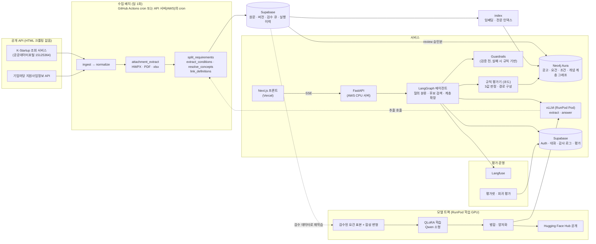
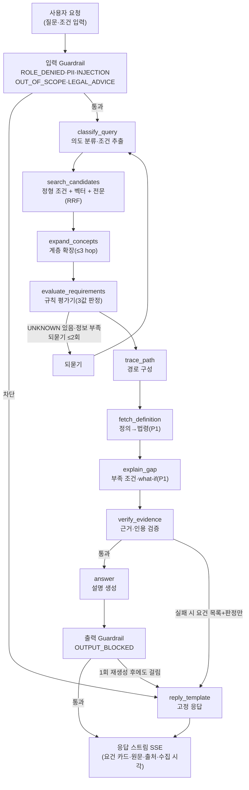

# 기초 설계서 — 온톨로지·Multi-hop 추론 기반 정부지원사업 공고 자격 판정 시스템

> 2팀 · 작성일 2026-11-23 · 갱신 2026-11-24 · 상태: **초안(v0.2, 공고 주제, 두 포털 전수 데이터 반영)** — 팀 합의 전 제안안
> 도메인 온톨로지 상세: [도메인 온톨로지 설계서 v0.2](%5B도메인온톨로지%5D%20MLE_도메인_온톨로지_설계서_2팀.md)(클래스·관계·CQ 18개·S-P-O·검증). 수집 데이터: [기업마당 데이터 명세서](DATA_SPEC_기업마당_v0.1.md). 이 문서와 다르면 §4는 이 문서가, 데이터 수치는 위 두 문서가 우선한다.
> 이 문서는 이전 주제(사규 준수 검토)의 기초 설계서(`old/MLE_2팀_기초 설계.md`)와 같은 구조(§1~§15, 부록 A~D)로 새 주제를 다시 쓴 것이다. 이전 주제 문서는 `docs/old/`에 보관했다.
> 기획서: [기획 보고서](%5B기획설계%5D%20MLE_기획보고서_2팀.md) — 서비스 정의, 사용자(지원자·운영자), 필수 준수사항(MR-N1~N5), 팀 결정 항목을 담는다.
> 근거 자료: 사전 확인 [PRECHECK_공고주제_사전확인.md](old/PRECHECK_공고주제_사전확인.md)(2026-11-23: 공공데이터포털 API 명세, 기업마당 API 명세, robots.txt, 공고 15건 표본). **사전 확인 시점에는 API를 호출하지 않았고 표본은 작고 치우쳐 있었다.** 이후 2026-11-24에 두 API를 실제로 호출해 기업마당 1,294건(모집 중 스냅샷), K-Startup 전체 30,632건(접수 시작일 기준 최근 1년 3,819건)을 수집했고, 기업마당 첨부 1,294개를 내려받아 텍스트를 추출했다(§2 "전수 수집 결과").
> 확인 상태: Cypher·SQL은 실행해 보지 않았다. 법령 내용은 원문 확인 전이다. `[ ]`는 팀 확정 또는 수집·측정 후 채운다. 모든 목표값은 `[첫 측정 후 확정]`이다.
> 전제: LLM은 외부 API가 아니라 **Qwen 소형 모델을 QLoRA로 학습 → 양자화 → RunPod GPU에서 vLLM으로 직접 서빙**하고(§6), **자격 판정은 모델이 아니라 규칙 평가기(코드)가 한다**(§7). 프론트엔드는 **Next.js + Vercel**(§8), Python API는 **AWS CPU 서버(Docker)**, 모델 서버는 **RunPod(vLLM)**이다(§3).

---

## 1. 목표와 범위

**한 줄 목표:** 여러 포털에 흩어진 정부지원사업 공고의 요건을 계층 온톨로지로 정규화해 하나의 지식 그래프로 합치고, "내 조건으로 이 공고에 신청할 수 있는가?"에 대해 **신청 가능 / 신청 불가 / 확인 필요 판정과 요건별 근거·경로를 보여주며** 답하는 자격 판정 서비스를 만든다. 판정은 규칙 평가기(코드)가 하고, 모델은 요건 추출과 설명 생성만 맡는다.

### 사용자 질의 유형 (서비스가 풀어야 할 문제)

| 유형 | 예시 | 필요한 능력 |
|---|---|---|
| A. 조회·필터형 | "창업 3년 미만이 신청할 수 있는 서울 지역 공고를 보여줘" | 정형 필드 필터, 하이브리드 검색, 공고 원문·출처 표시 |
| B. 자격 판정형 | "서울 성동구, 제조업, 법인, 업력 2년, 대표 만 35세인데 이 공고에 신청할 수 있나?" | 조건 입력, 계층 확장, 3값 평가(`SATISFIED`/`UNSATISFIED`/`UNKNOWN`), 판정 + 요건 카드 |
| C. 계층·정의 의존형 | "성동구 사업장이 '서울 소재' 요건을 충족하나?" / "이 공고의 '중소기업'은 어떤 기준인가?" | `IS_A`·`WITHIN` 순회(최대 3 hop), 용어 정의 → 근거 법령 경로 |
| D. 설명형(왜 안 되나·최소 변경) | "이 공고는 왜 안 되나요? 무엇이 바뀌면 신청할 수 있나요?" | 불충족 요건 추적, 부족 조건 표시, 값 변경 재판정(what-if, P1) |
| E. 공고 관계·변경형 | "이 공고가 정정·재공고된 건가? 바뀐 요건은?" / "이 용어의 정의가 바뀌면 영향받는 공고는?" | `SUPERSEDES`·`SAME_AS` 관계, 버전 비교, 정의 변경 전파(P1) |

유형 A는 SQL 필터로도 풀리는 질문이다. 이 서비스는 A~E를 질문 유형별로 나눠 SQL 베이스라인과 비교하며(KPI N-07), 이기는 유형과 지는 유형을 함께 보고한다.

### 범위
- **포함:** 공개 API로 얻는 지원사업 공고(첫 포털 한 곳·한 분야에서 시작), 요건 정규화(자격·제외·우대·서류·한도·평가), 개념 계층(지역·업종·신청자 유형·업력 구분 등), 규칙 기반 3값 판정, 요건 카드·경로 시각화, Google 로그인·역할 접근(`user`/`admin`), 대화형 UI, 평가·배포.
- **포함(P1):** 두 번째 포털과 중복 게재 해소(`SAME_AS`), 용어 정의 → 법령 연결, 입수 시점 검증과 운영자 화면, 부족 조건·재판정, 공식 양식 기반 신청 문서 초안(FR-N20·N21), 나라장터 입찰공고 탭(FR-N22). 후자 둘은 화면설계서 v3.5·상세 WBS(F9, F6.6~F6.8)에서 추가했고 상세 설계는 아직 이 문서에 없다(팀 확정 필요).
- **제외:** 프로토타입 생성, 신청 대행·대리 제출(신청서·사업계획서는 공식 양식 항목을 채우는 초안 보조로만 P1에 포함하며 입력에 없는 사실은 만들지 않는다), 선정 가능성 예측, 법적·세무 자문, 결제, 사업자등록번호·주민번호 등 식별 정보에 기반한 자동 판정, 대형 국가 R&D 공고(공개 API 확보 여부 확인 전), HTML 크롤링으로 수집하는 방식(robots.txt 허용 범위 밖, §2).
- **면책:** 판정 결과는 "신청 자격 확인을 돕는 참고용"이며 선정·수혜를 보장하지 않는다. 최종 신청 가능 여부는 공고 원문과 주관기관이 결정한다. 모든 결과 화면에 공고 출처, 수집 시각, 원문 링크, 참고용 면책을 표시한다(MR-N1, MR-N2).

### 도메인 범위 결정과 이유

이전 주제는 148종 문서의 구조 적재와 핵심 문서의 의무 추출·평가를 나눴다. 이번 주제도 **구조 적재와 요건 정규화·평가의 범위를 나눈다.** 수집량은 2026-11-24에 확인했다(기업마당 1,294건, K-Startup 30,632건 중 최근 1년 3,819건, §2). 아래 표의 범위는 제안이다.

| 작업 | 범위(제안) | 이유 |
|---|---|---|
| 수집·구조 적재 (공고 메타, 출처, 기관, 접수기간, 첨부 메타, `Notice`·`Organization`·`Attachment`) | **P0: 한 포털 · 한 분야의 API 응답 전체.** P1에서 두 번째 포털 | API가 주는 정형 필드는 코드로 적재할 수 있어 검수 부담이 작다. 한 포털로 시작해야 P0 일정(중간발표 3~4주차) 안에 end-to-end 한 줄기가 돈다 |
| 개념 사전 적재 (`Concept`: 행정구역, 업종 대분류, 신청자 유형, 업력·연령 구분) | 행정구역·신청자 유형·업종 대분류 전체 | 코드표 기반의 결정적 데이터이고 계층 확장(`IS_A`, `WITHIN`)의 기반이다. 사전이 비면 해소 실패가 `확인 필요`로 쏟아진다 |
| 요건 정규화·평가 (`Requirement`·`Condition` 추출, 사람 검수) | **핵심 표본 공고 30건 이상(제안, 아래)** | 요건 추출은 사람 검수가 있어야 정확도를 말할 수 있다. 전량을 검수할 수 없고 소형 모델은 품질 한계가 있어 범위를 좁힌다 |
| 평가셋 (조건 → 정답 판정, 정답 요건 라벨) | 핵심 표본 공고 | 정답을 사람이 쓰려면 공고문을 깊이 읽어야 한다. 학습 데이터와 겹치지 않도록 공고 단위로 분리한다 |
| 법령 정의 연결 (`Definition`→`ExternalLaw`) | **P1, 정의 조항 중심 소수** | 사전 확인 표본에서 법령 조항을 직접 인용한 공고는 15건 중 2건이었고, 전수 데이터에서는 기업마당 첨부의 자격·제외 구간 1,142건 중 416건(36%)이 법령을 인용했다(중소기업기본법 115건). 신청자 유형을 정의하는 법령부터 연결 범위를 정한다(§10 #7) |
| 수집 중 정규화하지 않은 공고 | 조회 대상으로만 사용 | `Requirement.status=unparsed`로 두고 판정 시 `REQ_UNPARSED`(→ `확인 필요`) |

**두 포털 모두 수집을 마쳤다.** P0에서 요건 정규화를 어느 포털부터 할지는 아래 장단점으로 §10 #2에서 정한다.

| 후보 | 장점 | 확인하지 못한 점 |
|---|---|---|
| K-Startup 조회 서비스(공공데이터포털 15125364) | 업력(`biz_enyy`), 대상 연령(`biz_trgt_age`), 신청 대상(`aply_trgt`), 지역(`supt_regin`)이 값이 제한된 필드로 제공되고, 신청 대상 내용(`aply_trgt_ctnt`)·신청 제외 대상 내용(`aply_excl_trgt_ctnt`)이 서술 필드로 분리됨. 이용허락범위 제한 없음. 창업 지원 서비스와 대상이 맞음 | 실호출 결과: 업력 100%, 지역 100%(시도 약칭 19종), 자격 문구 평균 104자, **제외 대상 필드는 3,819건 모두 비어 있음**, 첨부 정보 없음. HTML·`/afile*/`은 robots.txt로 차단. 일 호출 한도 단위는 미확인 |
| 기업마당 지원사업정보 API | 지자체 공고가 많고 첨부 경로가 응답에 포함됨. 사전 확인 표본 15건을 이 포털에서 읽어 정규화 경험이 있음 | 구조화 자격 필드가 `trgetNm`(7종, 거친 값) 하나이고 API 자격 문구는 평균 83자. 요건이 첨부 공고문에 몰려 있어(같은 표현이 약 2~13배 자주 나옴) 파서·OCR 의존이 큼. 마감 공고는 API가 제공하지 않고, 지역 해시태그는 27%가 전 시도라 지역 근거로 못 씀. 첨부는 API 토큰 경로로 1,294개 확보 |

### 요건 정규화·평가 핵심 표본 공고 선정 (제안, 후보 50건 선정·라벨링 전)

이전 주제에서는 핵심 문서 16개를 확정했다. 이번에는 전수 수집 데이터에서 **후보 50건(기업마당 25·K-Startup 25, 우선·예비 포함)을 시드 고정으로 선정했고**(`data/goldset/candidates_v0.1.csv`, `tools/select_goldset_candidates.py`), **라벨은 0건**이다. 후보의 특징은 정규식·필드 힌트이며 정답이 아니다. 라벨링 방법은 [GOLDSET_라벨링_가이드_v0.1.md](GOLDSET_라벨링_가이드_v0.1.md)를 따른다. 사전 확인의 표본 15건(기업마당 2026-11-20 등록분)은 비무작위이고 창업 분야가 3건뿐이라 핵심 표본으로 쓰지 않고 스키마 시험과 기준 설계에만 쓴다. 아래는 선정 기준 **제안**이며 최종 건수와 기준은 §10 #3에서 팀이 정한다.

| 기준 | 내용(제안) |
|---|---|
| 규모 | 후보 50건, 우선 30건 중 **파일럿 10건부터** `[제안]`. 최종 건수와 합격선은 결과를 보기 전에 팀이 정함 |
| 출처 다양성 | 두 포털과 지자체 공고를 포함(후보는 두 출처를 절반씩 선정). 첫 포털 안에서도 기관·분야를 섞는다 |
| 요건 다양성 | 자격·제외·우대·서류·한도가 함께 있는 공고, 신청자 유형·업력·지역·연령 조건이 다양한 공고 |
| 첨부 | 본문만 있는 공고와 첨부에 요건이 있는 공고를 모두 포함(첨부 열람은 이용 조건 확인 후) |
| 관계 | 통합공고·세부사업, 정정·재공고 사례를 포함 |
| 법령 연결 | 창업기업·중소기업 같은 정의 조항으로 연결되는 요건이 있는 공고 |
| 추출 방식 | 무작위 추출을 기본으로 하고, 기준별 최소 건수를 채우도록 층화한다(층별 건수 `[ ]`) |

**시험용 초안:** 동료가 받은 API 샘플 중 기업마당 5건·K-Startup 5건을 손으로 정규화한 초안이 [SAMPLE_그래프관계_분석.md](old/SAMPLE_그래프관계_분석.md) §3에 있다(검수 전, 핵심 표본으로 확정하지 않음). 이 초안에서 `AT_LEAST`, `logic_basis`, 본문 우선 규칙 등 발견 사항 15건 중 스키마 보완분을 도출해 §4.2에 반영했다.

**교체 규칙(제안):** 표본을 바꾸거나 더하려면 ① 평가셋을 쓰다가 공고가 없어 질문을 풀 수 없거나 ② 첨부 파서 한계 등으로 추출이 불가능할 때만 허용한다. 이슈로 사유를 남기고, 공고 단위 hold-out과 베이스라인 재측정 필요 여부를 확인한다. 사람 두 명이 따로 정규화해 일치도를 본 뒤 정답 라벨로 쓴다.

### 시장·사용자 요구 분석과 차별화 (초안)

> **근거의 한계:** 아래 비교는 **제품을 직접 확인하지 않은 가설**이다. 근거 URL·조사일은 조사 후 채운다(`[조사 필요]`). 지원사업 매칭 서비스(예: 플랜스코어)의 기능은 예시 기획서에 적힌 내용이며 확인 전이다. 클라이원트는 출시 글만 읽었고(나라장터 입찰·조달 대상, 종료는 팀 전달), GovLens는 접속하지 못해 확인하지 못했다. 시장 규모 수치는 제시하지 않는다(공고 예산 총액은 서비스 시장 규모가 아니다). 사용자 요구는 **가설**이며 실제 인터뷰는 아직 하지 않았다. 상세는 기획서 초안 §3.1을 따른다.

**배경(사전 확인으로 일부 확인).** 지원사업 공고는 포털·지자체별로 따로 게시되고, 신청 요건이 사업개요 서술과 첨부 문서에 서술형으로 흩어져 있다. 사전 확인 표본 15건에서 요건은 사업개요 서술에 있었고, 같은 개념(지역 기준, 기준일)이 공고마다 다른 기준으로 쓰였다(소표본, §2). → **가설:** 요건을 정규화해 합치면 탐색과 자격 확인을 한 화면에서 할 수 있다.

**사용자와 문제 (가설)**

| 사용자 | 하고 싶은 일 | 지금의 어려움 | 대응 기능 |
|---|---|---|---|
| 지원자(예비창업자·창업기업·소상공인) | 내 조건으로 신청할 수 있는 공고와 근거 확인 | 포털을 따로 뒤지고 요건을 공고문·첨부에서 직접 읽어 비교 | FR-N04, FR-N05 |
| 지원자 | 신청 불가 공고의 사유와 필요한 조건 파악 | 불가 사유와 바꿀 수 있는 조건을 알기 어려움 | FR-N07, FR-N09 |
| 운영자(지원기관 담당자·컨설턴트, 가정) | 새·정정 공고의 요건 변경 확인, 정규화 검수 | 변경 요건을 사람이 대조 | FR-N11, FR-N12 |
| (공통) 개인정보 우려 사용자 | 사업자번호 등을 넣지 않고 확인 | 식별 정보 입력 요구 | 범주형 입력, NFR-N03 |

**검증 계획:** 표본 분석, 창업지원 실무 경험자 인터뷰(멘토링 시간), 가상 조건 시연 후 팀 밖 사용자 피드백. 방법은 기획서 초안 §2.4를 따른다.

**경쟁·대안 비교 (가설, `?` = 미확인)**

| 대안 | 여러 출처 통합 | 요건별 충족 판정 | 근거·경로 제시 | 정정·재공고 반영 | 비고 |
|---|---|---|---|---|---|
| 포털 공고 검색(K-Startup, 기업마당) | ✗ 포털별 | ✗ 사람이 수동 | △ 원문 열람 | 포털 의존 | 첨부 요건의 필터 반영 여부 `?` |
| 지원사업 매칭 서비스(예: 플랜스코어) | ? | ? | ? | ? | 직접 확인 전 |
| 조건 입력형 혜택 안내(예: 정부24 보조금24) | ? | ? | ? | ? | 대상이 개인·가구 중심인지 `?` |
| 클라이원트 AI 조달 비서(종료) | △ 입찰·조달 데이터 연결(지원사업은 대상 아님) | ○ 회사 정보와 자격 비교(미충족·확인 필요) | ○ 원문 위치 연결 | ? | 나라장터 입찰·조달 대상, 출시 글(2026-10-19)만 읽음. 2026-11-18 종료는 팀 전달 사항으로 공식 확인 못함 |
| GovLens | ? | ? | ? | ? | 팀 전달 서비스, 접속·내용 확인 못함 |
| 범용 생성형 AI 챗봇 | ✗ | △ 근거 불확실 | △ 출처 불확실 | ✗ | 최신 공고 미반영 |
| 일반 벡터 RAG | 코퍼스에 있으면 | △ 조건 논리 약함 | △ 청크 근거만 | 재색인 필요 | **베이스라인으로 실측** |
| **본 시스템(목표)** | ○ 출처 통합 온톨로지 | ○ 규칙 기반 3값 | ○ 요건 → 정의 → 법령 | ○ `SUPERSEDES` | 설계 목표, 측정 전 |

**차별화 포인트(설계 목표)**
1. 요건을 **개념 계층(지역·업종·신청자 유형)과 조건 논리(AND/OR/제외)** 로 정규화해 하나의 그래프로 합친다.
2. **계층 확장과 용어 정의 해소**(요건 → 개념 → 정의 → 법령, Multi-hop)로 판정 근거를 경로로 보여준다.
3. 판정은 규칙 평가기가 하고 근거가 없으면 `확인 필요`로 둔다(3값 판정, 부족 조건·재판정).
4. 신규·정정 공고의 **입수 시점 검증**(P1).

**한계(솔직히):** 공고 데이터는 속성 중심이라 SQL 필터가 기본 해법이고, 업력·연령은 K-Startup 명세상 구간 문자열로 제공되므로(`API__.md`는 "파싱 필요"로 적었고 실응답은 확인 전) 파싱이 되면 SQL로 충분할 가능성이 크다. 사전 확인 표본으로는 그래프가 꼭 필요하다는 근거가 늘지 않았다. 그래프가 더하는 몫은 **정의 → 법령 근거의 Multi-hop, 조건 트리 기반 설명, 이종 출처 통합 스키마, 정의 변경 전파**로 한정해 방어하며, 모두 **실험 전 가설**이다. 위 비교의 경쟁 항목도 제품을 직접 확인하지 않은 가설이다.

---

## 2. 데이터 현황 (사전 확인)

2026-11-24에 두 포털의 API를 실제로 호출해 수집하고 정리했다(아래 "전수 수집 결과"). 그 앞의 "확인한 것"과 "표본 15건"은 2026-11-23 사전 확인에서 공개 페이지를 읽어 직접 확인한 것(API 명세 2종, robots.txt, 표본 15건 집계)만 적었다([PRECHECK_공고주제_사전확인.md](old/PRECHECK_공고주제_사전확인.md)). **사전 확인 시점에는 API를 호출하지 못했다.** 전수 수집 이후에도 일 호출 한도의 단위, 이용약관 전문, K-Startup 첨부는 **미확인**이다.

### 확인한 것 (명세 · robots.txt)

| 항목 | 값 |
|---|---|
| K-Startup 조회 서비스 | 공공데이터포털 15125364. 기본 URL `apis.data.go.kr/B552735/kisedKstartupService01`, 엔드포인트 `getAnnouncementInformation01`(공고), `getBusinessInformation01`(통합공고 지원사업), `getContentInformation01`, `getStatisticalInformation01`. JSON·XML, 무료, 이용허락범위 제한 없음, 개발·운영 심의 자동승인 |
| K-Startup 트래픽 | 개발계정 10,000(단위가 페이지에 명시되지 않음), 운영계정은 활용사례 등록 후 증가 신청 가능. 갱신은 "실시간"으로 표시(검증 전) |
| K-Startup 공고 응답 필드 | `rcrt_prgs_yn`(모집진행), `aply_trgt`(신청 대상), `biz_enyy`(창업 기간), `biz_trgt_age`(대상 연령), `prfn_matr`(우대 사항), `intg_pbanc_yn`·`intg_pbanc_biz_nm`(통합공고), `biz_pbanc_nm`(공고명), `pbanc_ctnt`(공고 내용), `supt_biz_clsfc`(지원 분야), `aply_trgt_ctnt`(신청 대상 내용), `supt_regin`(지역), `pbanc_rcpt_bgng_dt`·`pbanc_rcpt_end_dt`(접수 시작·종료), `pbanc_ntrp_nm`·`sprv_inst`(주관·수행기관), `biz_gdnc_url`·`biz_aply_url`·`detl_pg_url`, `aply_mthd_*_istc`(접수 방법별 안내), `aply_excl_trgt_ctnt`(신청 제외 대상 내용), `pbanc_sn`(공고 번호) 등 |
| K-Startup 값이 제한된 필드 | 창업 기간: 7년미만, 5년미만, 3년미만, 2년미만, 1년미만, 예비창업자. 대상 연령: 만 20세 미만 / 만 20세 이상~만 39세 이하 / 만 40세 이상. 신청 대상: 청소년, 대학생, 일반인 |
| 기업마당 지원사업정보 API | `https://www.bizinfo.go.kr/uss/rss/bizinfoApi.do`(GET, JSON·XML). 기업마당에서 발급하는 서비스 인증키(`crtfcKey`) 필요 |
| 기업마당 요청 변수 | 데이터 타입, 조회 건수, 분야 코드(금융 01, 기술 02, 인력 03, 수출 04, 내수 05, 창업 06, 경영 07, 기타 09), 해시태그(분야와 지역 17개 시도), 페이지 |
| 기업마당 응답 필드 | 공고명, 공고 URL, 공고 ID(`PBLN_...`), 소관기관, 수행기관, 사업개요, 지원분야 대분류, 등록일, 신청기간, 지원대상(`trgetNm`), 해시태그, 첨부파일 경로·이름, 본문출력파일 경로·이름. 별도 지역 필드는 없고 해시태그로 구분 |
| robots.txt: K-Startup | 공고 목록 HTML(`bizpbanc-ongoing.do`, `bizpbanc-deadline.do`)과 첨부 경로 `/afile*/`를 차단 |
| robots.txt: 기업마당 | `/download`, `/upload`, `/images` 등을 차단. 공고 목록·상세 경로는 차단 목록에 없음 |

robots.txt는 크롤러 규칙이며 이용약관과는 별개이다. **이용약관은 읽지 않았다.**

### 전수 수집 결과 (2026-11-24)

수치는 정리 파일을 직접 읽어 센 값이며 정규식 근사치는 정확도 지표가 아니다. 상세는 [기업마당 데이터 명세서](DATA_SPEC_기업마당_v0.1.md)와 [온톨로지 설계서 §3](%5B도메인온톨로지%5D%20MLE_도메인_온톨로지_설계서_2팀.md).

| 항목 | 기업마당 | K-Startup |
|---|---|---|
| 수집 | 13쪽 1회, 완전성 확인(받은 행 = `totCnt` = 고유 ID = 1,294, 중복 0). **모집 중 공고만**(마감 공고는 API가 제공하지 않음) | 전체 30,632건. **날짜 필터가 동작하지 않아** 페이지로 받아 직접 센다. 접수 시작일 기준 최근 1년(2025-11-24~) 3,819건(동료 정리본, 모집 중 155·종료 3,664) |
| 신청 기간 | 날짜 범위 379건(29.3%), 예산 소진 시까지 646, 상시 143, 인원 충족 시까지 54, 선착순 35, 별도 공지·미정 35, 해석 불가 2 | 접수 시작·종료일이 날짜로 제공 |
| 구조화 자격 필드 | `trgetNm` 7종(중소기업 1,000·소상공인 177·창업벤처 78·사회적기업 25·장애인기업 7·제조업 4·여성기업 3). 업력·연령·지역 필드 없음 | 업력 옵션 목록(7개 전부 35%), 연령 3구간, 신청 대상 7종, 지역 시도 약칭 19종(`전국` 57%), 지원 분야 11종 |
| 자격 문구 | `bsnsSumryCn`의 첫 ☞ 블록, 평균 83자(20자 미만 98건) | `aply_trgt_ctnt`, 평균 104자(20자 미만 340건), **제외 대상 필드 3,819건 모두 비어 있음** |
| 지역 근거 | 해시태그는 전 시도가 달린 공고가 347건(27%)이라 **근거로 쓸 수 없음**. 소관 기관 36곳(`전남광주통합특별시` 113건) | `supt_regin`(시도 약칭). `전남광주` 20건은 코드 미연결 |
| 첨부 | 2,654개(본문출력 1,294 + 일반 1,360). 본문출력 1,294개 모두 내려받음, 텍스트 1,292건(OCR 126건 포함), 배포용 HWP 2건 제외. 본문 평균 6,205자 | API에 첨부 칸이 없고 `robots.txt`가 금지해 **수집하지 않음** |
| 요건 표현 비율(근사치) | API 자격 문구 → 첨부 자격·제외 구간(1,142건): 업력 7%→26%, 지역 50%→60%, 제외 6%→71%, 인증 15%→43%, 법령 인용 17%→36%, 매출·고용 10%→28% | 자격 문구(3,819건): 업력 42%, 지역 32%, 제외 4%, 인증 11%, 법령 인용 5%, 연령 13%, 매출·고용 3% |

이 결과가 설계에 주는 의미:

| # | 관찰 | 설계 반영 |
|---|---|---|
| A | 기업마당은 요건이 **첨부 공고문**에 몰려 있고 API 요약이 얕다 | 기업마당의 요건 층 입력은 첨부 추출 텍스트다. 첨부를 못 읽은 공고(OCR 오인식·배포용 HWP)는 `확인 필요`(`REQ_UNPARSED`) |
| B | K-Startup은 구조화 필드가 풍부하지만 제외 요건이 비고 첨부가 없다 | 업력·연령·지역·신청 대상은 규칙으로 정규화하고, 제외·세부 자격은 본문(자격 문구의 4%)에서만 찾는다. `Condition.evidence_source`(API/ATTACHMENT)로 출처별 `NEEDS_CHECK` 비율을 따로 측정 |
| C | 지역 값이 두 포털 모두 시도 단위이고 기업마당 태그는 신뢰할 수 없다 | 시군구 계층은 본문 추출 조건에서만 쓰이고, 지역 필터는 K-Startup `supt_regin`과 소관 기관을 근거로 하며 태그는 힌트로만 둔다 |
| D | 행정개편(광주·전남 통합)과 권역("경상권") 요건이 실제로 나타남 | `REGION`에 중간 묶음 개념을 둔다(H11·H12, §4.1) |
| E | 법령 인용이 첨부의 자격·제외 구간 36%에 나타나지만 신청자 유형 정의 이외의 인용이 섞임 | 정의→법령 연결(P1)의 시작 범위를 정의 법령으로 제한. **그래프 필요성의 근거는 늘지 않았다** |
| F | 이번 수집은 스냅샷 1회 | 정정·재공고 빈도와 `SUPERSEDES` 필요도는 정기 수집 후에 측정 |

### 표본 15건 집계 (기업마당 2026-11-20 등록분)

기업마당 지원사업 공고 목록의 2026-11-20 등록분 15건(목록 1~15번째)을 상세 화면으로 읽었다. **무작위 표본이 아니고**, 지자체·농어업·지역 특화 공고가 많으며 창업 분야는 3건이다. 사업개요만 읽었고 첨부 공고문은 열지 않았다.

| 관찰 | 건수(15건 중) |
|---|---|
| 지역 조건이 요건 본문에 명시 | 9 |
| 지역이 제목·소관기관에만 암시 | 3 |
| 연령 조건(모두 출생연도 범위를 중복 표기) | 3 |
| 기업 규모 조건(중소기업 등) | 6 (법령 조항 직접 인용 2, 확인서 제도 언급 1) |
| 법령·제도 이름이 나오는 공고 | 4 |
| 이력·상태 조건(경력, 등록 여부, 실적, 매출, 근속) | 7 |
| AND("모두 충족")가 명시된 공고 | 2 |
| 제외 조건이 분리된 공고 | 1 |
| 기준일이 명시된 공고(공고일·접수 마감일·전년도로 제각각) | 3 |
| "자세한 내용은 공고문 참조" 문구 | 2 |
| 신청기간이 날짜가 아님("예산 소진 시까지", "상시 접수") | 2 |
| 첨부 있음 | 15 (확장자: hwpx 13, pdf 5, xlsx 2. 한 공고에 여러 형식. `.hwp`(HWP5) 없음) |

### 이 수치가 설계에 주는 의미

아래 의미는 모두 **15건 소표본**에 대한 해석이며 일반화하지 않는다.

| # | 관찰 | 설계 반영 |
|---|---|---|
| 1 | K-Startup 명세는 업력·연령·신청 대상을 구간 문자열(예: "7년미만")로 제공한다. `API__.md`는 "파싱 필요"로 적었고 **실응답은 확인 전**이다 | 파싱이 되면 이 부분은 SQL로 충분할 것으로 본다(가설). 온톨로지의 몫은 구간 값 너머의 서술 요건(`aply_trgt_ctnt`, `aply_excl_trgt_ctnt`)과 계층·정의로 한정한다 |
| 2 | 요건은 사업개요 서술에 있고 구조화 자격 필드는 기업마당에서 `trgetNm` 하나 | 요건 정규화(FR-N02)가 필수 단계이며 품질이 성패를 좌우한다. 추출 실패는 `REQ_UNPARSED`로 `확인 필요` 처리 |
| 3 | 지역 기준이 "사업자등록 주소 / 실제 거주 / 본사·공장"으로 다름(지역 명시 9건) | `Condition`의 `attribute`를 `region`으로 두되 기준 종류를 `value`에 기록하고, `Concept`(`REGION`)의 `WITHIN` 계층으로 확장 |
| 4 | 기준일이 공고일·접수 마감일·전년도로 제각각(3건) | `Condition.ref_date_kind`(`NOTICE_DATE`/`DEADLINE`/`PREV_YEAR`/`OTHER`)로 기준일을 명시하고, 기산 규칙은 `Definition`에 기록 |
| 5 | 연령과 출생연도가 중복 표기(3건) | 한 조건으로 정규화하고 중복 표기는 근거 문장에만 둔다. 변환 기준일이 불명이면 `UNKNOWN` |
| 6 | 규모 조건 6건 중 법령 조항 직접 인용 2건·확인서 제도 1건, 15건 전체에서 법령·제도 이름 언급 4건 | 정의 → 법령 연결(FR-N08)은 P1이며 대상은 정의 조항 중심으로 좁힌다. **소수이므로 그래프 필요성의 근거를 늘리지 못했다.** 법령 내용(중소기업기본법 시행령 별표 등)은 법제처 원문 확인 필요 |
| 7 | AND 명시 2건, 제외 분리 1건. 대부분은 조건을 나열할 뿐 | 조건 트리의 복잡도가 낮을 수 있다. 나열된 요건의 AND/OR가 불명확하면 추정으로 확정하지 않고 검수 대상으로 표시하며 근거 문장을 보존 |
| 8 | 한 공고에 하위 사업(트랙)별로 대상·지원 규모가 다른 경우 존재 | `Track`을 `Notice` 아래에 둔다(`HAS_TRACK`) |
| 9 | 지정 구역(공업지역, 악취관리지역 등)은 행정구역 코드로 해소되지 않음 | `Concept`(`ZONE`)와 `WITHIN` 다중 소속으로 모델링하되, 지정 구역 데이터 확보 전에는 `확인 필요` |
| 10 | 임계값이 있는 속성(전년도 연 매출 100억 미만 등)이 범주형 입력과 충돌 | 임계값 기준 구간 허용 여부를 팀이 결정한다(§10 #5, NFR-N03과 충돌) |
| 11 | 신청기간이 날짜가 아닌 공고 2건 | `Notice.apply_status`(`open`/`closed`/`always`/`until_budget`)와 `apply_period_raw`를 둔다 |
| 12 | 첨부 15건 모두 존재, hwpx 13건, HWP5 없음 | 기존 HWP5(OLE) 파서로 읽을 수 없고 HWPX(ZIP+XML) 파서가 필요하다. 다만 K-Startup은 첨부 경로가 robots.txt로 차단돼 있어 **API만 사용**하고, 기업마당 첨부는 이용 조건 확인 후 결정 |
| 13 | "공고문 참조" 문구 2건 | 화면만으로는 요건을 다 알 수 없다. 첨부를 못 읽는 공고는 판정을 `확인 필요`로 둔다 |

### EDA 계획과 1차 결과

성능 평가 보고서에는 **데이터 수집·EDA·통계 분석 기반 도메인 인사이트**가 필수다. 이전 주제와 같은 흐름(문제 정의 → 전처리 → EDA → 통계 검정 → 인사이트 리포트)을 쓰며, 수업 자료와의 정합은 재확인 필요하다.

**1차 결과: 15건 표본 집계와 위 "전수 수집 결과"(건수·필드 채움·정규식 근사 비율)이다.** 그래프·통계 검정을 포함한 EDA는 아직 실행하지 않았으므로 아래 분석 계획의 결과 대부분은 비어 있다. 15건은 비무작위 소표본이라 비율을 일반화하지 않는다.

**확인하지 못한 것(1차 결과의 한계)**

- (해소) 실제 API 응답과 필드 채움 정도, `trgetNm` 실제 값은 2026-11-24 수집으로 확인했다. 일 트래픽 한도의 단위는 여전히 명시돼 있지 않다.
- K-Startup `getBusinessInformation01`(통합공고 지원사업)의 필드를 읽지 않았다.
- 기업마당·K-Startup **이용약관**과 첨부 파일의 재이용 조건.
- 첨부 공고문(hwpx·pdf)의 내용과, 화면에 보이지 않는 요건의 양.
- **창업 분야 중심 표본**, 무작위 표본, **요건 라벨 일치도**(사람 두 명이 따로 정규화했을 때 얼마나 같은지).
- (해소) 총 공고 건수: 기업마당 모집 중 1,294건, K-Startup 전체 30,632건. 다만 기업마당은 마감 공고를 받을 수 없어 모집단이 "현재 모집 중"으로 한정된다.
- 지원사업 매칭 서비스(플랜스코어 등)의 실제 기능.

**분석 절차**

1. **문제 정의:** 비즈니스 질문("신청 자격 판정에 쓸 핵심 표본 공고는?") → 분석 질문 → 데이터 질문 순으로 좁히고, 분석 계획표에 가설(H0/H1)을 적는다.
2. **전처리:** 결측·이상값은 **결정 기록표**(항목 / 결정 / 근거)로 남긴다. 예: 신청기간이 날짜가 아닌 공고, 첨부가 없거나 열 수 없는 공고, 통합공고·세부사업 중복. 적재 단계마다 전후 건수 로그를 남기고 정제본을 저장한 뒤 다시 읽어 확인한다.
3. **EDA:** 변수 개수별로 그래프를 고르고(단변량 count·hist, 이변량 bar, 다변량 heatmap) 그림마다 한 줄 해석, 절 끝에 종합 인사이트 한 문단.
4. **통계 검정:** 아래 표. p값은 효과크기와 함께 보고한다.
5. **인사이트 리포트:** 숫자 재진술 → 유의성과 효과크기 → 실질적 한계(표본 편향·분야 편향·지표 정의) → 방향성 결론. 보고서에 쓴 숫자는 직접 재계산해 확인한다.

| 분석 | 목적 | 방법(수업 정합 재확인 필요) | 산출물 |
|---|---|---|---|
| 요건 유형·속성 분포 | 스키마의 `Condition.attribute`·`operator` 허용 값과 우선순위 확정 | 표본 공고의 속성별 빈도 집계 | 빈도표·그림 |
| 정형 필드 vs 서술 요건 비중 | 온톨로지가 더하는 몫 vs SQL 필드로 충분한 몫 | API 구조화 필드 값과 서술 요건의 대조 | 비교표 |
| 법령·정의 의존 비율 | 정의 → 법령 연결(P1) 범위 결정 | 법령·제도 언급 요건 비율(15건에서는 4건, 전수 근사치는 기업마당 첨부 자격·제외 구간 36%, 정답셋으로 정의 인용만 재집계) | 비율표 |
| 기준일·지역 기준 표기 분포 | `ref_date_kind`·지역 기준 종류 설계 | 표기 유형별 집계 | 분포표 |
| 첨부 의존도·형식 | 첨부 파서 우선순위(hwpx/pdf) | 본문 대 첨부 요건 비교, 형식별 텍스트 추출 성공률 | 성공률표(이용 조건 확인 후) |
| 요건 라벨 일치도 | 정답 라벨 신뢰도, 정규화 가능성 | 두 사람이 따로 정규화 후 일치율, 가능하면 Cohen's kappa | 일치도표 |
| 포털·분야 간 차이 | 일반화 범위 확인 | 요건 유형 × 포털 교차표, **카이제곱 + Cramér's V**(수업 정합 재확인 필요) | 교차표 |
| 개념 사전 커버리지 | 업종·지역 해소 실패 파악 | 요건 문구에서 추출한 개념의 사전 매칭률, 미해소 목록 | 미해소 목록 |
| 개념 사전 업종 확장의 임베딩 대비 이득 | 업종 계층 확장의 필요성 | 계층 확장 vs 임베딩 검색 Recall 비교(후보 기능 2, 기획서 §5.2) | 비교표 |
| 수집 신선도 | `STALE_DATA` 기준 | 수집 성공률, 갱신 지연(수집 후 기록) | 이력표 |

---

## 3. 시스템 아키텍처



> 이전 주제의 구성도와 달라진 점: ① 입력이 파일 변환이 아니라 **공개 API 일 1회 수집 배치**이다. ② 판정은 **규칙 평가기(코드)** 가 하고, 모델은 요건 추출(`extract`)과 설명 생성(`answer`)만 맡는다. ③ 사용자 조건(`ApplicantProfile`)은 세션에만 있고 **그래프에 저장하지 않는다.** 구성도는 설계안이며 구현·측정 전이다.

### 저장소 역할 분담 (핵심 결정)

| | Neo4j Aura | Supabase (Postgres) |
|---|---|---|
| 성격 | **질의용 그래프**(Supabase의 원문과 승인된 정규화 결과에서 재생성 가능한 파생물) | **시스템 기록**(재생성 불가: 수집 원문, 검수, 로그, 평가, 사용자 데이터) |
| 저장 | Notice·Program·Track·Organization·Requirement·Condition·Concept·Definition·ExternalLaw·Attachment 노드와 관계, 전문·(선택) 벡터 인덱스 | 원문 JSON(`source_notices`), 버전(`notice_versions`), 첨부 메타·추출 텍스트(`attachments`), 수집·추출 이력(`ingest_runs`, `extraction_runs`), 검수 큐(`review_queue`, `definition_links`), 개념 코드표(`concept_codes`), 사용자·대화·감사(`profiles`, `user_conditions`, `conversations`, `messages`, `audit_logs`, `reason_events`), 평가(`eval_sets`, `eval_runs`), 청크 임베딩(`notice_chunks`) |
| 이유 | 개념 계층 확장(`IS_A`/`WITHIN`)과 요건→조건→개념→정의→법령 경로를 한 번의 그래프 순회로 얻는다 | 사람이 검수한 정규화 결과와 수집 원문은 그래프 재적재와 무관하게 보존해야 한다. 인증·RLS를 쓴다 |
| 선택 | — | **pgvector(`notice_chunks.embedding`)는 청크 임베딩 보관과 "벡터·SQL 단독 베이스라인"용**으로 쓴다 → GraphRAG 이득을 질문 유형별로 비교(KPI N-07). 운영 후보 검색에서 벡터를 Neo4j(`Notice.embedding`)에 둘지 pgvector에 둘지는 PoC로 정한다(§4.4) |

> 임베딩을 두 곳에 두는 안은 중복이 아니라 **비교 실험**이다. 어느 쪽이 운영 경로인지는 PoC 전이라 미정이다.
> **사용자 조건은 Neo4j에 쓰지 않는다.** 사용자가 선택 동의하면 `user_conditions`(Supabase)에만 저장하며, 판정 요청마다 세션 값으로 규칙 평가기에 넘긴다(MR-N3).

### 배포 토폴로지

| 구성요소 | 호스팅 | 배포 방식 | 접근 제어 |
|---|---|---|---|
| Next.js 프론트 | **Vercel** | GitHub 연동 자동 배포, PR별 Preview | 로그인 필요 화면은 Supabase Auth(Google)로 보호. 운영자 화면은 역할 확인 |
| Python API (FastAPI) | **AWS CPU 서버**(Docker 컨테이너, 팀 결정 2026-11-25. 학원 지원 AWS 크레딧 100달러) | GitHub Actions: PR은 CI(테스트·이미지 빌드), main push는 CD. 이미지(커밋 sha 태그)를 **GHCR**에 올리고 SSH로 서버에서 `docker compose pull && docker compose up -d`(수업 배포 방식과 같음, 제안). 서비스 종류(EC2 등)·인스턴스 유형·리전은 미정 | Supabase JWT 검증 + 역할(`user`/`admin`) 확인, 비밀 값은 서버의 `.env`(권한 제한) 또는 AWS SSM Parameter Store(제안) |
| **수집 배치(추가)** | GitHub Actions cron 또는 API 서버(AWS)의 cron(**택일은 미정**) | 같은 Docker 이미지에 배치 진입점을 두고 일 1회 실행. 실행 결과는 `ingest_runs`에 기록 | API 키(공공데이터포털 인증키, 기업마당 `crtfcKey`)는 GitHub Secrets 또는 서버의 `.env`. 저장소·로그에 값을 남기지 않는다 |
| vLLM (Qwen) | **RunPod GPU Pod**(On-Demand, Secure Cloud) | `vllm/vllm-openai` 이미지 + 시작 명령. 가중치 보관(Network Volume 여부)은 §10 결정 | `--api-key`(`VLLM_API_KEY`), **API 서버와 수집 배치에서만 호출**, HTTPS 프록시 |
| Neo4j | Aura (관리형) | — | 자격증명은 API 서버와 적재 배치에만 보관 |
| Supabase | Supabase (관리형) | — | RLS, 서비스 키는 API 서버와 배치에만 보관 |

요청 흐름: 브라우저 → Vercel(Next.js) → AWS(Python API) → Neo4j Aura · Supabase · RunPod(vLLM). 수집 흐름: 수집 배치 → 공개 API → Supabase(원문) → (모델 호출은 RunPod) → 검수 → Neo4j.

> **API 호스팅 — 팀 결정(2026-11-25): AWS CPU 서버.** 이전 주제의 Google Cloud Run에서 바꿨다. 학원 지원 AWS 크레딧(100달러) 안에서 운영한다. 서버 한 대에 Docker Compose로 띄우는 방식은 수업의 배포 방식(VM + Docker Compose, GHCR + SSH)과 같아 수업 자료를 거의 그대로 쓸 수 있다. 상태는 모두 Supabase에 두고 서버 디스크에는 남기지 않는다.
> ⚠ **AWS 서버에서 확인할 것(공식 문서·실측으로 확인):** ① **비용**: 서버는 항상 켜져 있으므로 인스턴스 시간·디스크·데이터 전송 요금으로 크레딧(100달러)이 언제 소진되는지 요금표로 계산하고 예산 경보를 건다 ② 크레딧 만료일과 적용되는 서비스 범위 ③ 메모리(판정 엔진이 공고·청크를 메모리에 올린다) ④ HTTPS(도메인·인증서, 역방향 프록시) ⑤ 역방향 프록시의 응답 시간 제한(SSE가 끝까지 가야 한다) ⑥ 보안 그룹(열 포트 최소화, SSH 접근 제한) ⑦ 리전(Neo4j Aura·Supabase·RunPod와의 지연).
> ⚠ **RunPod 프록시의 연결 제한 시간**(이전 문서에 100초로 기록, 재확인 필요). API→vLLM 호출 타임아웃을 그보다 짧게 두고 긴 응답은 이벤트를 계속 흘려보낸다. 수집 배치의 추출 호출은 스트리밍이 필요 없으므로 요청 단위를 작게 쪼갠다.
> ⚠ 질의 시 **임베딩을 어디서 계산할지**(AWS 서버 CPU / RunPod)와 **임베딩 모델**(후보: KURE-v1, bge-m3, multilingual-e5)은 미정이다(§6.3).

### 수집 배치 (추가)

| 항목 | 설계안 |
|---|---|
| 주기 | 일 1회. 시각은 `[ ]`(공고 갱신 시각 확인 전. K-Startup 페이지는 "실시간"으로 표시, 기업마당은 미확인) |
| 실행 환경 후보 | **GitHub Actions cron**: 저장소·시크릿 관리가 한 곳이다. 단 스케줄 지연 가능성, 활동이 없는 저장소의 스케줄 자동 비활성화 정책 여부는 [확인 필요]. **API 서버(AWS)의 cron**: API 서버와 같은 이미지·비밀 값을 쓰고 추가 비용이 없다. 단 서버가 멈추면 수집도 멈춘다 |
| 분리 | `ingest`~`attachment_extract`(규칙 기반, GPU 불필요)는 매일 돌린다. `extract_conditions`의 모델 호출은 **내용이 바뀐 공고만** 대상이다(§5). GPU가 꺼져 있으면 대기열에 쌓아 두고 켜질 때 처리한다(NFR-N08: RunPod는 필요한 때만 가동) |
| 상태 기록 | `ingest_runs`에 source, 시작 시각, 상태(`success`/`partial`/`failed`), 건수를 남긴다. 운영자 화면(FR-N17)에서 본다 |
| 장애 시 | 수집이 실패하면 **전일 데이터로 서비스하고 수집 시각을 표시**한다(`STALE_DATA`). 수집 실패가 판정 기능을 멈추지 않는다 |

### 모델 교체 구조 (플러그인형 어댑터)

모델에 문제가 생기면(서버 장애, 지연, 품질 회귀, GPU 확보 실패) **코드 수정 없이 설정으로 다른 모델로 바꿀 수 있게** 한다. 앱·에이전트·수집 배치는 모델 이름·호스트를 직접 알지 못하고, 하나의 인터페이스 뒤에서 **설정 파일에 등록된 provider**를 쓴다. 아래는 **설계안이며 구현·검증 전**이다.

```text
LangGraph 노드 / 수집 배치 → LLMRouter → Provider 어댑터 → vLLM(RunPod) / 대체 호스트 / (제한적) 외부 API
                           역할별(answer·extract) primary + fallbacks
                           헬스체크·서킷브레이커 · 데이터 정책 게이트 · 기능 프로필
                           최종 낮춤: 모델 없이 규칙 판정만 (설명 없음)
```

```yaml
# config/models.yaml (설계 예시, 구현 전)
providers:
  qwen_qlora_awq: { type: openai_compat, base_url: "${RUNPOD_URL}/v1", model: "qwen-qlora-awq", api_key_env: VLLM_API_KEY, timeout_s: 90, data_policy: self_hosted, capabilities: { json_schema: unverified, tools: unverified } }
  qwen_base:      { type: openai_compat, base_url: "${RUNPOD_URL}/v1", model: "qwen-base",      api_key_env: VLLM_API_KEY, timeout_s: 90, data_policy: self_hosted }
  qwen_alt_host:  { type: openai_compat, base_url: "${ALT_URL}/v1",    model: "qwen-base",      api_key_env: ALT_API_KEY,  timeout_s: 90, data_policy: self_hosted }
  external_api:   { type: openai_compat, base_url: "${EXT_URL}",       model: "${EXT_MODEL}",   api_key_env: EXT_API_KEY,  data_policy: external, enabled: false,
                    allowed: { roles: [extract], inputs: [public_notice_text] } }   # 사용자 조건·판정 결과는 보내지 않는다
  rule_template:  { type: template, data_policy: self_hosted }                     # 모델 없이 요건 목록·판정만 표시
roles:
  answer:  { primary: qwen_qlora_awq, fallbacks: [qwen_base, qwen_alt_host, rule_template] }
  extract: { primary: qwen_base,      fallbacks: [qwen_alt_host] }   # 최초 primary는 사전 측정 후 확정, 튜닝 모델은 평가 통과 뒤 승격
```

| 요소 | 내용 |
|---|---|
| Provider 인터페이스 | `generate(messages, schema=None, stream=False)`와 `health()`. vLLM·대체 호스트·대부분의 외부 API는 OpenAI 호환(`openai_compat`) 하나로 처리한다(§6.3). 호환되지 않는 서비스는 같은 인터페이스의 어댑터만 추가한다. `rule_template`은 모델을 호출하지 않는 어댑터로, 판정 결과를 고정 서식으로 출력한다 |
| 역할별 선택 | `answer`(설명 생성)·`extract`(요건 추출)별로 primary와 fallbacks를 둔다. **판정은 역할이 아니다**(규칙 평가기가 한다). 평가용 판사는 답변 모델과 분리한다(§9) |
| 모델 변형 등록 | `base`·`qlora`·`qlora_awq`를 같은 방식으로 등록한다. 튜닝·양자화 모델에 문제가 생기면 `base`로 즉시 복귀한다(§6.5). `extract`는 변형마다 같은 평가셋 F1(KPI N-01)을 먼저 재 둔다 |
| 기능 프로필 | 구조화 출력(JSON schema)·도구 호출 지원 여부와 최대 길이를 provider별로 기록(PoC로 확인, §6.4). 지원하지 않는 provider로 바뀌면 **프롬프트 JSON + Pydantic 검증 + 1회 재시도**로 전환하고, 그래도 실패하면 해당 요건을 `unparsed`로 두고 검수 큐로 보낸다. 에이전트 라우팅은 규칙 기반으로 낮춘다 |
| 헬스체크·서킷브레이커 | 연속 N회 실패·타임아웃(또는 첫 토큰이 임계 초과)이면 그 provider를 차단하고 다음 fallback으로 넘긴다. 일정 시간 뒤 한 건씩 다시 확인한다. **재시도는 한 계층에서만 한다**(§7.1) |
| 데이터 정책 게이트 | provider마다 `data_policy`를 둔다. **`external`은 기본 비활성**이고, 켜더라도 **`extract` 역할에 공개 공고 문장만** 보낸다. **사용자 조건은 외부로 보내지 않는다.** 설명 생성(`answer`)은 사용자 조건과 판정 결과를 담으므로 외부 provider를 쓰지 않는다. 켜지면 화면·로그에 "외부 모델 사용 중"을 표시한다. 외부 API 허용 여부는 팀 결정(§10)이다 |
| **모델 장애 시 최소 운영** | 판정은 규칙 평가기가 하므로 **모든 모델 provider가 불가해도 규칙 판정만으로 결과를 낸다**: 공고별 판정(`ELIGIBLE`/`NOT_ELIGIBLE`/`NEEDS_CHECK`), 요건 목록, 원문 문장, 출처·수집 시각을 설명 문장 없이 보이고 "설명 생성 불가" 배너를 띄운다(`SERVICE_DEGRADED`, 응답 `outcome=degraded`). 단 **새 공고의 요건 추출은 멈춘다**(전일까지 정규화된 공고로만 판정) |
| 프롬프트·출력 | 프롬프트는 모델별로 덮어쓸 수 있고, 출력은 Pydantic 검증 후 1회 재시도, 실패 시 규칙 기반 또는 `unparsed`로 처리한다. 프롬프트의 가변 값은 맨 뒤에 둔다(§9). `prompt_version`은 `extraction_runs`에 기록한다 |
| 임베딩 | `Embedder`도 같은 방식으로 등록한다. 임베딩 모델을 바꾸면 **재색인이 필요**하므로 즉시 교체가 아니라 `embedding_v2` 병행 구축이다. 임베딩 서버 장애 시에는 전문 검색과 정형 조건 검색만으로 낮춰 동작한다 |
| 관측 | Langfuse에 `provider`, `model`, `fallback_depth` 태그를 남기고 provider별 품질·지연을 비교한다 |
| 사전 측정 | **측정하지 않은 provider는 활성화하지 않는다.** 폴백 후보는 같은 평가셋으로 미리 베이스라인을 재 둔다 |

**교체 절차(runbook, 제안)**
1. **감지:** 오류율·첫 토큰 지연 경보 또는 회귀 게이트 실패. 수집 배치에서는 `extract` 실패율 급증(`ingest_runs`·`extraction_runs`)도 신호이다.
2. **전환:** 자동은 서킷브레이커가 다음 fallback으로 넘긴다. 수동은 `models.yaml`의 primary나 `MODEL_PROFILE` 환경변수를 바꿔 API 서버에 다시 배포한다(컨테이너 재시작).
3. **확인:** 스모크 평가(소수 문항)로 품질 하락폭을 본다. 허용폭을 넘으면 규칙 판정만 운영으로 낮춘다(§7.3).
4. **기록:** 전환 시각·사유·provider를 `model_switch_log`(Supabase)와 ADR-10에 남긴다. `extract` 모델이 바뀌면 이후 `extraction_runs`에 새 모델이 기록되고, **이전 모델로 만든 정규화 결과는 재추출 대상이 아니라 diff 검수 대상**이다(§5).

### 배포 Plan B

Plan A는 **Vercel + AWS(API) + RunPod + Neo4j Aura + Supabase + 수집 배치**이다. 구성요소별 대체 경로와 최후 수단을 미리 정한다. **모두 설계안이며 전환을 실습하지 않았다.** 소요 시간은 추정하지 않고 리허설에서 측정해 기록한다.

| 구성요소 | Plan A | 문제 상황 | Plan B | 사전 준비 |
|---|---|---|---|---|
| 프론트 | Vercel | 한도·인증·Preview 문제 | 같은 Next.js를 컨테이너로 만들어 API와 같은 AWS 서버에 배포 | Dockerfile, OAuth 리다이렉트 사전 등록 |
| API | AWS CPU 서버 | 크레딧 소진·서버 장애·인증서·보안 그룹 문제 | 같은 Docker 이미지를 로컬 PC(또는 다른 클라우드 VM)에서 `docker compose up`, 필요하면 터널로 공개 | `docker-compose.yml`, 이미지 로컬 보관, 환경변수 목록 |
| 모델 | RunPod Pod | GPU 확보 실패·비용·프록시 연결 제한 | ① 같은 vLLM 이미지를 다른 Pod 사양·다른 GPU 공급자에 띄움 ② 더 작거나 양자화된 모델로 교체 ③ `base`로 복귀(§3 모델 교체 구조) ④ 외부 API(`extract`의 공개 공고 문장에 한해, 정책 게이트 안에서만) ⑤ **규칙 판정만 모드**(설명 없이 요건·판정 표시, §7.3) | 모델 가중치 HF Hub + 로컬 사본, 시작 명령 스크립트 |
| 그래프 DB | Neo4j Aura | 일시중지·한도·장애 | 로컬 Docker Neo4j에 Supabase의 `notice_versions`·`concept_codes` 등 **승인된 정규화 결과로 재적재**(적재가 멱등이고 Neo4j는 재생성 가능한 파생물, ADR-2). Community 에디션은 NODE KEY가 없으므로 합성 `IS UNIQUE`를 쓴다(§4.4) | 적재 스크립트와 샘플 검증 질의(§4.6). Aura 덤프 내보내기 가능 여부는 **확인 필요** |
| 시스템 DB·인증 | Supabase | 일시중지·장애 | 로컬 Postgres(+pgvector) Docker. 인증은 Supabase 로컬 스택 또는 **데모 전용 간이 인증**(허용 계정 JWT, 시연에만 사용) | 마이그레이션 파일(§15), 시연 계정 |
| **수집 배치(추가)** | GitHub Actions cron 또는 API 서버(AWS)의 cron | 스케줄 미실행·API 키 만료·일 호출 한도·API 장애 | ① 두 실행 환경 사이 전환 ② 로컬에서 같은 이미지로 수동 실행 ③ **전일 데이터 + `STALE_DATA` 배너로 계속 운영** | 수동 실행 스크립트, 키 재발급 절차, 마지막 정상 수집분 `source_notices` 덤프 |
| 최후 수단 | — | 위 대안으로도 라이브 시연 불가 | **데모 모드:** 사전 녹화 영상과 표본 공고에 대해 사전 계산한 규칙 판정 응답 캐시(`demo_cache.jsonl`)로 시연 질문 2개를 재생. UI에 "녹화·캐시 응답"을 표시하고 **평가 점수에는 쓰지 않는다** | 녹화본, `demo_cache.jsonl` |

**운영 기준(제안)**
- **전환 판단:** 시연 중 장애가 5분 안에 복구되지 않으면 Plan B로 전환한다. 리허설에서 이 기준이 맞는지 조정한다.
- **리허설:** 발표 D-3에 전체 리허설, D-1에 Plan B 전환을 1회 실습한다(롤백 포함).
- **가동 점검:** Aura(무질의 일시중지 정책, 기준은 확인 필요), RunPod 구동, AWS 서버 컨테이너 상태·남은 크레딧, Supabase 상태, **마지막 수집 시각(`ingest_runs`)** 을 발표 전에 확인한다.
- **백업:** 컨테이너 이미지(GHCR + 로컬 보관), `source_notices` 덤프와 적재 스크립트, 개념 코드표(`concept_codes`), 모델 가중치(HF Hub), 시크릿 목록(`.env.example`, 값은 저장소에 넣지 않는다).

---

## 4. 지식 그래프 설계 (온톨로지·Neo4j LPG)

### 4.1 개념 계층(scheme)과 계층 규칙

이전 주제에서 "문서 위계"가 하던 일(상하 관계로 비교·상속 판단)을 이 주제에서는 **개념 계층**이 한다. 사용자가 "구미시"라고 입력해도 공고가 "경상북도"를 요구하면 충족으로 판정하려면, 값 사이의 상하·포함 관계를 그래프에 둔다. `Concept`는 `scheme`으로 어휘를 구분하고, 같은 scheme 안에서 `IS_A`(종류) 또는 `WITHIN`(공간 포함)으로 상위에 연결한다.

| scheme | 구조 | 계층 관계 | 코드표 출처(후보) | 비고 |
|---|---|---|---|---|
| `REGION` | **트리** (전국 > 시도 > 시군구 > 읍면동) | `WITHIN` | 행정구역 코드표(행정표준코드 등) **[확인 필요: 기관·개정 기준일]**. 기업마당 해시태그의 17개 시도는 확인함(명세). **실데이터:** K-Startup `supt_regin` 시도 약칭 19종(`전국` 57%, `전남광주` 20건 코드 미연결), 기업마당 지역 태그 34종(27%는 전 시도 태그라 근거로 못 씀), 소관 기관 36곳. 코드표 `jscode20260701`(시도 16·시군구 217·전국 1, 2026-07 개편 반영) 사용 중 | 읍면동까지 필요한지는 표본 요건에서 정한다. 행정구역 개편으로 소속·코드가 바뀔 수 있어 코드표 기준일을 `concept_codes`에 기록한다 |
| `ZONE` | **DAG**(다중 소속) | `WITHIN` (`ZONE`→`REGION` 허용) | 용도지역·관리지역 등 지정 구역 정보 **[확인 필요: 공개 데이터 여부]** | "악취관리지역인 공업지역"처럼 행정구역과 교차하는 지정 구역. 한 구역이 여러 읍면동에 걸치고 한 읍면동이 여러 구역에 속한다. 코드표가 없으면 `확인 필요`로 둔다 |
| `INDUSTRY` | 표준 분류는 트리, 공고 서술용 묶음 포함 시 **DAG** | `IS_A` | 한국표준산업분류 **[확인 필요: 개정 차수]** | 공고의 "제조·가공업", "수산물 가공·유통업"은 표준 분류와 1:1이 아니므로 **공고용 업종 묶음**을 별도 `Concept`로 두고 표준 분류에 `IS_A`로 잇는다(매핑은 사람 검수). 수산물 가공업은 제조업과 수산업 양쪽에 속할 수 있다 |
| `APPLICANT_TYPE` | **DAG** | `IS_A` | 공식 코드표 없음 → 공고 용어와 법령 정의로 **팀이 구축**(제안). K-Startup 신청 대상 값(실데이터 7종: 청소년·대학생·일반인·대학·연구기관·일반기업·1인 창조기업)과 창업 기간 값 중 "예비창업자"는 확인함. 기업마당 `trgetNm` 7종에는 `제조업`처럼 업종이 섞여 있어 판정에 쓰지 않음 | 예: 예비창업자, 창업기업, 소상공인, 소기업, 중기업, 중소기업, 농업인, 어업인, 귀어인. 소상공인·소기업·중소기업 사이의 포함 관계는 법령 정의에 따르며 **원문 확인 필요**(`Definition`으로 연결) |
| `SUPPORT_FIELD` | 1단 분류(필요 시 2단) | `IS_A` | 기업마당 분야 코드(금융 01, 기술 02, 인력 03, 수출 04, 내수 05, 창업 06, 경영 07, 기타 09, 확인함(명세)). 기업마당 실데이터는 대분류 8·중분류 37. K-Startup 지원 분야(`supt_biz_clsfc`)는 11종(사업화, 시설ㆍ공간ㆍ보육, 멘토링ㆍ컨설팅ㆍ교육, 행사ㆍ네트워크, 창업교육, 판로ㆍ해외진출, 글로벌, 기술개발(R&D), 인력, 정책자금, 융자ㆍ보증) | 공고 필터·표시용. 두 포털의 분류를 `Concept`로 통일하는 매핑표가 필요하다 |
| `AGE_GROUP` | 구간 어휘 | (계층 없음, 필요 시 `IS_A`) | K-Startup 대상 연령 값 3종(만 20세 미만 / 만 20세 이상~만 39세 이하 / 만 40세 이상, 확인함(명세)) | 표시·검색 편의용이다. **판정은 `founder_age`의 숫자 조건(`BETWEEN` 등)으로 한다.** 구간 값을 숫자 범위로 바꾸는 사전을 둔다 |
| `SPECIAL_GROUP` | **DAG**(겹치는 집단) | `IS_A` | 공식 코드표 없음 → 공고 용어와 정의로 팀이 구축(제안) | 청년, 여성, 장애인, 재창업자, 귀어인 등. "청년"의 연령 기준은 사업마다 다르므로 개념 자체에 나이를 박지 않고 `Condition`·`Definition`에 둔다 |

업력(창업 기간 구간: 7년미만 … 1년미만, 예비창업자)은 `Concept`가 아니라 `business_age` 숫자 조건으로 정규화한다. "예비창업자"만 `APPLICANT_TYPE` 개념으로도 둔다(제안).

**계층 규칙**

| # | 규칙 | 이유·처리 |
|---|---|---|
| H1 | 간선은 **하위 → 상위** 방향이다(`(성동구)-[:WITHIN]->(서울)`, `(식료품 제조업)-[:IS_A]->(제조업)`). | 사용자 값에서 위로 올라가며 조건의 `Concept`에 닿는지 본다 |
| H2 | **상속은 위로만** 한다. 사용자 값에서 최대 3 hop 이내에 조건의 `Concept`에 도달하면 `SATISFIED`. 같은 개념이면 0 hop. | 성동구 → 서울 → 전국은 2 hop |
| H3 | 사용자 값이 **조건보다 상위**이면(사용자 "경상북도", 조건 "구미시") `UNSATISFIED`가 아니라 `UNKNOWN`. 사용자 값과 조건이 **서로 다른 가지**이면 `UNSATISFIED`. | 상위 값은 하위 조건 충족 여부를 알려 주지 못한다. 되묻기 후보(`INSUFFICIENT_PROFILE`) |
| H4 | 간선은 **같은 scheme 안에서만** 허용한다. 예외는 `ZONE`→`REGION`의 `WITHIN`. 다른 scheme을 잇는 간선은 구조 점검 쿼리로 막는다(§4.6). | scheme 간 오연결 방지 |
| H5 | 트리(`REGION`)와 달리 `ZONE`·`INDUSTRY`(공고용 묶음)·`APPLICANT_TYPE`·`SPECIAL_GROUP`은 **다중 소속(여러 상위)** 을 허용한다. **순환은 금지**한다. | DAG 점검 쿼리(§4.6) |
| H6 | 3 hop 한도가 부족한 scheme이 있다. 표준산업분류는 세세분류에서 대분류까지 4~5 단계일 수 있다. → **scheme별 한도를 설정**하거나, 사용자 입력 단위를 중분류까지로 제한한다. 한도를 넘으면 `UNKNOWN`과 사유를 남긴다. | 한도는 규칙 평가기 설정값(제안, PoC로 결정) |
| H7 | 개념 매칭은 **코드·정규화한 이름·확정된 별칭(`aliases`)** 만 쓴다. **부분 문자열 일치는 쓰지 않는다.** 확정되지 않은 별칭은 `review_queue`로 보낸다. | "서울"과 "서울특별시" 같은 표기 통일이 경로 연결의 전제이다 |
| H8 | 코드표에는 **버전·기준일**을 붙인다(`concept_codes`). 계층을 바꾸면 그 시점의 판정 결과가 달라질 수 있으므로 `extraction_runs`와 함께 코드표 버전을 기록한다(NFR-N05). | 재현성 |
| H9 | 수작업으로 만든 계층(`APPLICANT_TYPE`, `SPECIAL_GROUP`, 공고용 업종 묶음)은 **검수자와 근거(법령 정의·공고 문장)** 를 `concept_codes`에 남긴다. | 임의 확장 방지 |
| H10 | **`ZONE` 조건은 사용자 값만으로는 판정하지 않는다.** 상속은 위로만 하므로(H2) 사용자가 입력한 `REGION` 값에서 `ZONE`(공업지역 등)으로는 올라갈 수 없다. 구역 목록·소속 데이터를 확보하기 전에는 `ZONE` 조건을 `UNKNOWN`으로 고정하고, 확보한 뒤에 `(REGION)`이 구역에 포함되는지 보는 **역방향 포함 판정 규칙**을 따로 정의한다(제안). | 사례 2의 C1(김해). 데이터 확보 여부는 확인 전 |

**추가 규칙(v0.2, 전수 데이터에서 도출, 팀 결정 D-3)**

| # | 규칙 | 이유·처리 |
|---|---|---|
| H11 | **행정구역 개편으로 사라진 명칭**(광주광역시, 전라남도 등)은 별칭이 아니라 **구 단위 묶음 개념**으로 둔다(`광주(구)` 등). 코드표 버전(`code_version`)과 구성 구·근거를 기록한다. 구성원 확인 전에는 `UNKNOWN`. | 2026-07 개편으로 광주·전남이 `전남광주통합특별시`(1200000000)로 통합돼 "광주광역시 관내" 요건에 맞는 노드가 없다. 기업마당 소관 기관 113건, K-Startup 지역 20건에 해당 |
| H12 | 공고가 본문에서 직접 정의한 **권역**(예: "경상권: 부산/대구/울산/경상남북도")은 공고별이 아니라 **공유 사전의 중간 묶음 개념**으로 둔다. 구성 시도·근거 공고·검수자를 기록한다(H9). 사전이 없으면 `UNKNOWN`. | 시군구 → 시도 → 권역으로 2 hop. 같은 사전을 SQL 테이블로 만들어도 풀리므로 SQL 베이스라인과 비교한다 |

옵션 목록(K-Startup 업력·연령)의 해석: 허용 구간을 모두 나열하면 제한 없음, 일부이면 허용 구간의 합집합. 옵션 개수 분포(7개 전부 35%, 6개 26%, 1~5개 38%)와 옵션 관계(`unknown_and_or`)는 정규화 단계에서 이 규칙으로 확정한다.

### 4.2 노드

| 레이블 | 주요 속성 | 출처 |
|---|---|---|
| `Notice` | notice_id(`{source}:{원 공고 ID}`), source(`kstartup`/`bizinfo`), title, summary, apply_start, apply_end, apply_period_raw, apply_status(`open`/`closed`/`always`/`until_budget`), url, collected_at, version, content_hash, is_latest | 공고 API 응답(규칙 정규화) |
| `Program` | program_id, name, level(`integrated`/`program`) | 통합공고 여부·사업명 필드 |
| `Track` | track_id, name, benefit_summary, benefit_limit | 공고 본문·첨부(모델+규칙, 검수) |
| `Organization` | org_id, name, kind(`central`/`local`/`public_body`) | 소관·주관·수행기관 필드 |
| `Requirement` | req_id, kind(`ELIGIBILITY`/`EXCLUSION`/`PREFERENCE`/`DOCUMENT`/`LIMIT`/`CRITERION`), logic(`AND`/`OR`/`NONE_OF`/`AT_LEAST`), min_count(`AT_LEAST`일 때), logic_basis(`explicit`/`assumed`), source_sentence, status(`parsed`/`unparsed`/`reviewed`), extraction_run_id | 문장 분리(규칙+모델) |
| `Condition` | cond_id, attribute, operator(`EQ`/`LT`/`LTE`/`GT`/`GTE`/`IN`/`BETWEEN`/`WITHIN`/`IS_A`/`EXISTS`), value(JSON), unit, ref_date_kind(`NONE`/`NOTICE_DATE`/`DEADLINE`/`PREV_YEAR`/`OTHER`), negate, confidence, reviewed | **모델+규칙 추출**, 정형 필드는 규칙 |
| `Concept` | concept_id, scheme(`REGION`/`INDUSTRY`/`APPLICANT_TYPE`/`SUPPORT_FIELD`/`AGE_GROUP`/`ZONE`/`SPECIAL_GROUP`), code, label, aliases | `concept_codes`(코드표·사전) |
| `Definition` | def_id, term, rule_json, basis_note | 공고 서술·법령 정의(사전+검수) |
| `ExternalLaw` | law_id, name, article_no, text_hash, source_url | 공고의 법령 인용(규칙+검수) |
| `Attachment` | attachment_id, file_name, ext(`hwpx`/`hwp`/`pdf`/`xlsx`/`other`), usable(`bool`), text_status(`none`/`extracted`/`failed`) | API의 첨부 목록 |

`ApplicantProfile`(사용자 조건)은 **세션 한정이며 그래프에 저장하지 않는다.** `Candidate`처럼 승인 전 이름을 격리하는 노드는 두지 않고, 미해소 값은 Supabase `review_queue`에 둔다(그래프는 승인된 결과만 담는다).

**ID 규칙(제안, 수집·적재 코드와 동일하게 쓴다)**

| 대상 | 규칙 | 예 |
|---|---|---|
| `Notice.notice_id` | `{SOURCE}:{원 공고 ID}`(소스 접두는 대문자: `BIZINFO`, `KSTARTUP`, `G2B`). 나라장터는 차수를 ID에 포함(`G2B:{bidNtceNo}:{bidNtceOrd}`)해 새 차수가 새 노드가 된다. 그 외 소스의 버전은 `version`(정수)과 `content_hash`로 구분 | `BIZINFO:PBLN_000000000128046`. K-Startup은 `KSTARTUP:{pbanc_sn}` |
| `Requirement.req_id` | `{notice_id}@v{n}#R{n}`(트랙 요건은 `{track_id}#R{n}`) | `BIZINFO:PBLN_000000000128046@v1#R1` |
| `Condition.cond_id` | `{req_id}#C{n}` | `...@v1#R1#C1` |
| `Track.track_id` | `{notice_id}@v{n}#T{n}` | |

> **버전을 요건·조건·트랙 ID에 넣는 이유:** 같은 공고의 새 버전은 별도 `Notice` 노드이고 요건·조건은 그 버전 노드에 붙는다(아래). ID에 버전이 없으면 유일 제약(§4.4)과 `MERGE`가 새 버전을 이전 버전의 요건·조건 노드에 합쳐 버린다.
| `Concept.concept_id` | `{scheme}:{code}`. 코드표 확정 전에는 라벨로 대신 쓴 예시 값을 쓴다 | `REGION:경상북도`(예시, 실제 코드표 값 아님) |
| `ExternalLaw.law_id` | 법령명 + 조·항 정규화 표기. 법령 식별자 체계(법령 일련번호 등)를 쓸지는 **[확인 필요]** | |

> **같은 공고의 다른 버전은 별도 `Notice` 노드**이며 `(notice_id, version)`이 유일하다. 요건·조건은 그 버전 노드에 붙는다. 최신 버전만 `is_latest=true`이다(§5의 버전 보존).

**속성 설명**

| 대상 | 설명 |
|---|---|
| `Notice.apply_status` | 날짜로 읽히는 신청기간은 `open`/`closed`를 접수 종료일과 현재 시각으로 계산한다. "상시 접수"는 `always`, "예산 소진 시까지"는 `until_budget`이며 `apply_end`는 비운다. 원문 표기는 `apply_period_raw`에 보존한다(사전 확인 표본 15건 중 2건이 날짜가 아니었다) |
| `Requirement.kind` | `ELIGIBILITY`(신청 자격), `EXCLUSION`(신청 제외), `PREFERENCE`(우대, **판정에 쓰지 않고 별도 표시**), `DOCUMENT`(제출 서류), `LIMIT`(지원 한도·횟수), `CRITERION`(평가·선정 기준). 판정 합성에는 `ELIGIBILITY`와 `EXCLUSION`만 쓴다 |
| `Requirement.logic` | 요건 안의 조건끼리의 결합. `AND`/`OR`, 제외 요건은 `NONE_OF`(조건 중 하나라도 `SATISFIED`이면 제외에 해당). 사전 확인 표본에서 AND가 명시된 공고는 2건뿐이고 나머지는 조건을 나열만 했다. **명시가 없으면 나열을 `AND`로 읽는 것은 가정이며** 검수에서 확인한다(제안). 가정으로 읽은 요건은 `logic_basis=assumed`로 표시하고, 이런 요건이 결과를 `ELIGIBLE`로 만들면 검수 전까지 `NEEDS_CHECK`로 낮춘다. "N개 중 k개 이상 충족"은 `AT_LEAST`와 `min_count=k`로 둔다(샘플의 디캠프 공고 "5개 요건 중 3개 이상", [SAMPLE_그래프관계_분석.md](old/SAMPLE_그래프관계_분석.md) F1·F3) |
| `Requirement.status` | `parsed`(자동 추출 성공), `unparsed`("공고문 참조" 등으로 읽지 못함, 사유 코드 `REQ_UNPARSED`), `reviewed`(사람 확인). `unparsed` 자격 요건이 있으면 **`ELIGIBLE`로 판정하지 않는다** |
| `Condition.attribute` | 허용 값(최소): `region`, `zone`, `industry`, `applicant_type`, `business_age`(업력), `founder_age`, `company_size`, `revenue`, `employees`, `certification`, `prior_award`, `registration`, `other`. 목록 밖의 값은 적재를 거부하고 `other`로 보낸다 |
| `Condition.operator` | 숫자·날짜는 `EQ/LT/LTE/GT/GTE/BETWEEN`, 개념은 `IN/WITHIN/IS_A`, 존재 여부는 `EXISTS`. `WITHIN`은 공간 포함, `IS_A`는 종류 |
| `Condition.value` | 문자열로 저장한 JSON(Neo4j 속성은 맵을 직접 담지 못한다). 개념을 가리키는 값은 **`ABOUT` 간선이 기준**이고 `value`에는 표시용 원 표기를 둔다 |
| `Condition.ref_date_kind` | 기간·연령·매출처럼 기준일이 필요한 조건의 기준일 종류. 표본에서 기준일이 명시된 3건이 공고일·접수 마감일·전년도로 서로 달랐다. 기준일이 불명확하면 `OTHER`로 두고 경계 값에서 `UNKNOWN`으로 평가한다(제안) |
| `Condition.negate` | "~가 아닌 자" 같은 조건 자체의 부정. 제외 요건의 의미(`NONE_OF`)와 구별한다 |
| `Condition.confidence`·`reviewed` | 모델 추출의 신뢰도와 사람 검수 여부. 정형 필드에서 규칙으로 만든 조건은 `confidence`를 두지 않고 근거 필드명을 `source`에 적는다. 임계값은 `[첫 측정 후 확정]` |
| `Definition.rule_json` | 용어를 판정 규칙으로 옮긴 것(예: 기업 규모 기준을 업종별 매출·독립성 조건으로). **법령 내용은 기억에 의존하지 않고 원문을 확인해 적는다**(`basis_note`에 근거와 확인 일자) |
| `ExternalLaw.text_hash` | 수집한 조항 원문의 해시. **비어 있으면 법령 미보유**(`CHAIN_BROKEN`의 한 원인). 값이 바뀌면 이 법령에 의존하는 정의·조건·공고를 재검수한다 |
| `Attachment.usable` | 이용 조건이 확인되어 텍스트를 추출·저장해도 되는 첨부인지. 확인 전에는 `false` |

**Condition.value 예시(제안)**

| operator | value 예 |
|---|---|
| `LT` / `GTE` 등 | `{"value": 10000000000}`, `unit`은 `KRW`(100억 원) |
| `BETWEEN` | `{"min": 18, "max": 40, "min_inclusive": true, "max_inclusive": false}` (만 18세 이상 40세 미만) |
| `IN` | `{"labels": ["어업","양식업"]}` + 값마다 `ABOUT` 간선. 목록 안은 "하나라도"(OR) |
| `WITHIN` / `IS_A` | `{"label": "경상북도", "restrict_to": ["경주시","구미시","의성군"]}` + `ABOUT` 간선 |
| `EXISTS` | `{"name": "중소기업·소상공인 확인서"}` |

**요건 안의 3값 결합(규칙 평가기와 일치해야 한다, 제안)**

| logic | `SATISFIED` | `UNSATISFIED` | `UNKNOWN` |
|---|---|---|---|
| `AND` | 모든 조건 `SATISFIED` | 하나라도 `UNSATISFIED` | 그 외(불충족 없음, 미확인 있음) |
| `OR` | 하나라도 `SATISFIED` | 모두 `UNSATISFIED` | 그 외 |
| `NONE_OF`(제외) | 해당 없음(모든 조건이 `UNSATISFIED`) | **제외 해당**(하나라도 `SATISFIED`) | 그 외 |
| `AT_LEAST(k)` | `SATISFIED`가 k개 이상 | `SATISFIED` + `UNKNOWN`을 다 합쳐도 k개 미만 | 그 외 |

트랙(`Track`)이 있는 공고는 트랙별로 판정한 뒤 **하나라도 `ELIGIBLE`이면 `ELIGIBLE`(해당 트랙 표시)**, 모두 `NOT_ELIGIBLE`이면 `NOT_ELIGIBLE`, 그 외는 `NEEDS_CHECK`로 합성한다(제안).

**구조화 필드와 본문이 충돌할 때(제안):** 본문에서 추출한 조건을 우선하고, 충돌 사실을 `source_conflict`로 기록해 설명에 표시한다. 구조화 필드는 후보 생성과 검증에 쓴다. 목록형 값(K-Startup `biz_enyy`, `biz_trgt_age`)이 전체 구간을 나열하면 **제한 없음**으로 읽고, 일부만 나열하면 OR 합집합으로 읽는다. 본문이 "등"으로 끝나는 열린 목록은 `open_ended`로 표시해 `ELIGIBLE`을 막는다. 근거는 [SAMPLE_그래프관계_분석.md](old/SAMPLE_그래프관계_분석.md) F4·F5·F12.

**스키마 설계 원칙**
- **노드 키는 이름이 아니라 id**로 둔다(위 ID 규칙). 같은 이름의 지역·업종이 코드표 정정으로 바뀌어도 id가 유지되도록 코드를 쓴다.
- 명명: 라벨은 파스칼·단수, 관계는 **대문자 스네이크**, 속성은 소문자 스네이크. 날짜는 `apply_end`처럼 의미가 드러나게 쓴다.
- 설계 순서: 질문 정의(§4.6 CQ) → 질문의 명사에서 노드·동사에서 관계 → 속성 배치 → **소량 샘플 적재 → 실제 질의로 검증 → 모델 수정** → 제약·인덱스 → 전체 적재.
- "**관계로 구분하지 않은 것은 나중에 되찾을 수 없다.**" 예: 종류(`IS_A`)와 공간 포함(`WITHIN`), 시간상 대체(`SUPERSEDES`)와 동시 중복 게재(`SAME_AS`), 정의(`DEFINED_BY`)와 법령 인용(`CITES_LAW`)을 하나의 `RELATED`로 뭉개지 않는다. (수업 정합은 재확인 필요)

### 4.3 관계

| 관계 | 의미 | 생성 방법 | 신뢰도·검수 | 관계 속성 |
|---|---|---|---|---|
| `(Notice)-[:ANNOUNCED_BY]->(Organization)` | 공고를 낸 기관(기업마당 소관 `jrsdInsttNm`, K-Startup `pbanc_ntrp_nm`). 이전 이름 `PUBLISHES`(기관→공고)를 대체(온톨로지 설계서 §5.1, D-6) | 규칙(API 필드) | 높음 | `source`, `source_field` |
| `(Notice)-[:EXECUTED_BY]->(Organization)` | 수행·운영 기관(기업마당 `excInsttNm`, K-Startup 담당 부서). `직접수행`·`기초자치단체`는 범주값이라 관계를 만들지 않고 `org_kind`로 둔다 | 규칙(API 필드) | 높음 | `source`, `source_field` |
| `(Notice)-[:OF_PROGRAM]->(Program)` | 공고가 속한 사업 | 규칙(통합공고 여부·사업명 필드) | 높음 | `source` |
| `(Program)-[:PART_OF]->(Program)` | 통합공고 사업과 하위 사업 | 규칙 | 높음 | `source` |
| `(Notice)-[:HAS_TRACK]->(Track)` | 대상별로 조건·지원 규모가 다른 하위 사업(표본의 GPU 지원 공고: 산업계·학계·연구계) | 모델+규칙, 검수 | 중간 | `evidence`, `source` |
| `(Notice\|Track)-[:HAS_REQUIREMENT]->(Requirement)` | 요건. 공고 전체에 걸리면 `Notice`, 트랙에만 걸리면 `Track`에서 나온다 | 규칙+모델 | 중간(검수 큐) | `evidence`(원문 문장), `source`(필드·첨부·위치) |
| `(Requirement)-[:HAS_CONDITION]->(Condition)` | 요건을 이루는 원자 조건 | 규칙+모델 | 중간(검수 큐) | `evidence`, `source` |
| `(Condition)-[:ABOUT]->(Concept)` | 조건이 가리키는 개념(지역·업종·신청자 유형 등) | 코드표·사전+규칙 | 높음~중간(미해소는 검수) | `evidence`, `source` |
| `(Concept)-[:IS_A]->(Concept)` | 종류 계층(업종, 신청자 유형, 집단 등) | `concept_codes` + 수작업 검수 | 높음(코드표) / 중간(수작업) | `source`, 수작업이면 `evidence` |
| `(Concept)-[:WITHIN]->(Concept)` | 공간 포함(행정구역, 지정 구역). **다중 소속 허용** | `concept_codes` | 높음 / `ZONE`은 [확인 필요] | `source` |
| `(Concept)-[:DEFINED_BY]->(Definition)` | 개념(예: 중소기업)의 정의 | 사전+검수 | 검수 필요 | `evidence`, `source` |
| `(Definition)-[:CITES_LAW]->(ExternalLaw)` | 정의가 근거로 삼는 법령 조항 | 규칙(인용 패턴)+검수 | 검수 필요 | `evidence`, `source` |
| `(Notice)-[:SUPERSEDES]->(Notice)` | **새 버전이 이전 버전을 대체**(정정·재공고·회차). 방향은 새 → 이전 | 같은 `notice_id`의 `content_hash` 변경은 규칙, 서로 다른 ID의 재공고·회차는 규칙 후보+검수 | 높음(같은 ID) / 낮음→검수(다른 ID) | `evidence`, `source`, `reason`(`correction`/`reissue`/`round`, 제안) |
| `(Notice)-[:SAME_AS]->(Notice)` | **동시에 게재된 중복 공고**(포털 간). 시간상 대체와 구별한다 | 규칙 후보(제목·기관·기간 유사)+검수 | 낮음→검수 필요 (P1) | `evidence`, `source` |
| `(Notice)-[:HAS_ATTACHMENT]->(Attachment)` | 첨부 | 규칙(API 필드) | 높음 | `source` |
| (P2) `(Program)-[:PRECEDES]->(Program)` | 지원사업 사다리(선행 사업) | 사람 검수 | 낮음 | `evidence`, `source` |
| (P2) `(Program)-[:EXCLUDES_WITH]->(Program)` | 중복 수혜 제한 | 사람 검수 | 낮음 | `evidence`, `source` |

**관계 속성:** 모든 관계에 근거 문장 `evidence`(원문 구절, **수정 없이 복사**)와 출처 `source`(API 필드명 또는 첨부 파일·위치, 수집 시각)를 보존한다. 구조 관계(`ANNOUNCED_BY` 등)는 `evidence`를 비워도 된다. 근거 문장이 없는 `HAS_CONDITION`은 구조 점검에 걸린다(§4.6).

**관계 시그니처 — "단일 계약"**: 허용 관계를 코드 한 곳(`src/graph/ontology.py`의 `RELATION_SIGNATURES`, 제안)에 두고 **프롬프트 블록과 Pydantic `Literal`을 자동 생성**한다. 판정 기준 칸에는 "무엇을 포기하는지"를 적는다.

| 관계 | 주어 타입 | 목적어 타입 | 판정 기준 |
|---|---|---|---|
| `HAS_REQUIREMENT` | Notice / Track | Requirement | 원문이 **직접 서술한** 요건(해석으로 추론한 요건은 제외) |
| `HAS_CONDITION` | Requirement | Condition | 요건 문장에서 값·연산자를 **원문에 있는 표현으로** 뽑을 수 있다 |
| `ABOUT` | Condition | Concept | 조건의 값이 코드표·사전의 개념과 **정확 또는 확정 별칭으로** 일치한다(부분 일치는 포기) |
| `IS_A` | Concept | Concept | 같은 scheme에서 **종류** 관계(공간 포함은 `WITHIN`) |
| `WITHIN` | Concept | Concept | **공간적 포함**(행정구역·지정 구역). 종류 관계는 `IS_A` |
| `DEFINED_BY` | Concept | Definition | 정의가 **그 개념의 판정 기준**을 직접 규정한다(단순 용어 설명은 제외) |
| `CITES_LAW` | Definition | ExternalLaw | 정의의 근거로 **명시된** 법령 조항(참고만 한 인용은 `basis_note`) |
| `SUPERSEDES` | Notice | Notice | **시간상** 새 공고·버전이 이전 것을 대체 |
| `SAME_AS` | Notice | Notice | **같은 사업의 동시 중복 게재**(대체 관계가 아님) |

> 구조 관계와 코드표에서 오는 계층은 **결정적**이라 신뢰도가 높고, 요건·조건·정의 연결은 모델 추출이라 **검수 큐(`review_queue`, `definition_links`) → 승인 → 적재** 경로를 거친다. 이 구분이 "신뢰형 GraphRAG"의 핵심이다.

### 4.4 제약·인덱스 (Cypher)

제약은 **적재 전에 먼저** 건다. 제약은 인덱스를 겸한다.

```cypher
// 공고는 (notice_id, version) 합성 유일. NODE KEY 대신 합성 유일 제약을 쓴다(아래 확인 항목 ①)
CREATE CONSTRAINT notice_ver     IF NOT EXISTS FOR (n:Notice)       REQUIRE (n.notice_id, n.version) IS UNIQUE;
CREATE CONSTRAINT program_id     IF NOT EXISTS FOR (p:Program)      REQUIRE p.program_id IS UNIQUE;
CREATE CONSTRAINT track_id       IF NOT EXISTS FOR (t:Track)        REQUIRE t.track_id IS UNIQUE;
CREATE CONSTRAINT org_id         IF NOT EXISTS FOR (o:Organization) REQUIRE o.org_id IS UNIQUE;
CREATE CONSTRAINT req_id         IF NOT EXISTS FOR (r:Requirement)  REQUIRE r.req_id IS UNIQUE;
CREATE CONSTRAINT cond_id        IF NOT EXISTS FOR (c:Condition)    REQUIRE c.cond_id IS UNIQUE;
CREATE CONSTRAINT concept_id     IF NOT EXISTS FOR (k:Concept)      REQUIRE k.concept_id IS UNIQUE;
CREATE CONSTRAINT concept_code   IF NOT EXISTS FOR (k:Concept)      REQUIRE (k.scheme, k.code) IS UNIQUE;
CREATE CONSTRAINT def_id         IF NOT EXISTS FOR (d:Definition)   REQUIRE d.def_id IS UNIQUE;
CREATE CONSTRAINT law_id         IF NOT EXISTS FOR (l:ExternalLaw)  REQUIRE l.law_id IS UNIQUE;
CREATE CONSTRAINT attachment_id  IF NOT EXISTS FOR (a:Attachment)   REQUIRE a.attachment_id IS UNIQUE;

// 조회 경로용 일반 인덱스: 최신 공고 + 신청 상태
CREATE INDEX notice_latest IF NOT EXISTS FOR (n:Notice) ON (n.is_latest, n.apply_status);
CREATE INDEX notice_source IF NOT EXISTS FOR (n:Notice) ON (n.source, n.notice_id);
CREATE INDEX cond_attr     IF NOT EXISTS FOR (c:Condition) ON (c.attribute);

// 문자열 부분 일치용(제목 검색)
CREATE TEXT INDEX notice_title_text IF NOT EXISTS FOR (n:Notice) ON (n.title);

// 전문 인덱스: 한국어 형태소 분석이 없으므로 형태소 분석기로 만든 토큰을 text_tokens에 저장하고 질의도 같은 토큰으로 바꾼다
CREATE FULLTEXT INDEX notice_ft  IF NOT EXISTS FOR (n:Notice)  ON EACH [n.title, n.text_tokens];
CREATE FULLTEXT INDEX concept_ft IF NOT EXISTS FOR (k:Concept) ON EACH [k.label, k.aliases];

// (선택, PoC 결과에 따라) 공고 요약 임베딩의 벡터 인덱스
CREATE VECTOR INDEX notice_vec IF NOT EXISTS FOR (n:Notice) ON n.embedding
  OPTIONS {indexConfig: {`vector.dimensions`: 1024, `vector.similarity_function`: 'cosine'}};
// 차원은 임베딩 모델 선정 결과(KURE-v1, bge-m3, multilingual-e5 후보 중)에 맞춘다. 1024는 가정이며 모델 확정 후 확인한다.
// 모델을 바꾸면 인덱스를 다시 만들고 재색인한다. 인덱스 생성 뒤에는 CALL db.awaitIndex(...) 로 준비될 때까지 기다린다.
```

> ⚠ **Aura·PoC에서 확인할 것(확인 전):**
> ① `IS NODE KEY`와 **필수 속성(`IS NOT NULL`) 제약**은 Enterprise 기능으로 알려져 있다. Aura에서 되는지 확인하고, 안 되면 합성 `IS UNIQUE` + **적재 코드의 필수 속성 검증** + 구조 점검 쿼리(§4.6)로 대신한다. 필수 속성 목표: `Notice`(notice_id, version, source, title, is_latest, collected_at, content_hash), `Requirement`(kind, source_sentence, status), `Condition`(attribute, operator), `Concept`(scheme, code, label).
> ② **Aura 인스턴스 한도**(노드·관계 수, 저장 용량)는 공고 규모가 확인되지 않아 맞는지 판단할 수 없다. 전체 공고 건수는 **[API 호출 후 기록]**. 버전을 모두 보존하면 노드가 늘어나므로 **보존할 버전 수**를 정한다(미정).
> ③ **벡터 검색의 pre-filter**: 마감·대체된 공고(`is_latest`, `apply_status`)를 벡터 검색 *전에* 거를 수 있는지는 확인 전이다. 안 되면 후보를 넉넉히 받은 뒤 사후 필터하고, 그 영향(후보 부족)을 Recall@k로 측정한다.
> ④ 한국어 전문 인덱스의 분석기와 토큰 저장 방식(`text_tokens`), 배열 속성(`aliases`) 색인 동작.
> ⑤ `apoc` 사용 가능 여부(필요 시 개념 병합 등). 모두 PoC 항목이다(§10, 부록 D).

**청킹 단위(제안):** 공고는 **요건 문장 1개를 청크 1개**로 임베딩하고, 공고 요약은 별도 청크로 둔다(`notice_chunks`). 임베딩 입력 상한을 넘는 비율(잘림 비율)을 점검한다. **요건·공고 단위는 그래프(`Requirement`-`Condition`)로 반환하고, 청크는 검색 단위**로만 쓴다.

### 4.5 Multi-hop 질의 예

> **이 절의 사례는 사전 확인에서 공개 화면으로 읽은 공고 3건을 사람이 손으로 정규화한 설명용 예시이다.** 실제 API 응답이나 적재 결과가 아니며 경로·평가 결과는 손으로 계산했다. 개념 코드는 코드표 확정 전이라 라벨(`REGION:경상북도`)로 대신 썼고, 법령 내용은 **원문 확인 필요**이다. 사용자 값은 가상 입력이다. 공고 ID는 사전 확인 표본의 번호이다.

**사례 1. 경북 오아시스 마켓 특판전 (`BIZINFO:PBLN_000000000128046`)** — 자격 요건 4개를 모두 충족해야 한다(`AND`).

| 조건 | attribute | operator | 값(원문 표현) | ABOUT | ref_date_kind | 비고 |
|---|---|---|---|---|---|---|
| C1 | `region` | `WITHIN` | 사업자등록 주소가 경상북도(대상 시군: 경주·구미·의성) | `REGION:경상북도` | `NOTICE_DATE` | "대상 시군 한정" 해석은 확인 필요 |
| C2 | `certification` | `EXISTS` | 중소기업·소상공인 확인서 발급 가능 | (없음) | `NONE` | 사용자가 모를 수 있는 값 |
| C3 | `industry` | `IS_A` | 제조·가공업 | `INDUSTRY:제조업` | `NONE` | 표준 분류 매핑은 검수 |
| C4 | `revenue` | `LT` | 전년도 연 매출 100억 원 미만 | (없음) | `PREV_YEAR` | 입력 구간이 100억을 가로지르면 `UNKNOWN` |

적재 예(C1만. 나머지 조건과 개념 계층은 같은 방식이며 설명용 스크립트이다):

```cypher
MERGE (n:Notice {notice_id:'BIZINFO:PBLN_000000000128046', version:1})
  ON CREATE SET n.source = 'bizinfo', n.is_latest = true
MERGE (r:Requirement {req_id: n.notice_id + '@v1#R1'})
  ON CREATE SET r.kind = 'ELIGIBILITY', r.logic = 'AND', r.status = 'reviewed'
MERGE (n)-[:HAS_REQUIREMENT]->(r)
MERGE (c:Condition {cond_id: r.req_id + '#C1'})
  ON CREATE SET c.attribute = 'region', c.operator = 'WITHIN', c.ref_date_kind = 'NOTICE_DATE', c.reviewed = true
MERGE (r)-[:HAS_CONDITION]->(c)
MERGE (k:Concept {concept_id:'REGION:경상북도'})
  ON CREATE SET k.scheme = 'REGION', k.label = '경상북도'
MERGE (c)-[:ABOUT]->(k);
```

**질의 A. 공고의 요건·조건·대상 개념 조회** (요건 카드 FR-N05의 데이터)

```cypher
MATCH (n:Notice {notice_id:$notice_id, is_latest:true})
MATCH (n)-[:HAS_TRACK*0..1]->(x)-[:HAS_REQUIREMENT]->(r:Requirement)-[:HAS_CONDITION]->(c:Condition)
OPTIONAL MATCH (c)-[:ABOUT]->(k:Concept)
RETURN r.req_id, r.kind, r.logic, c.cond_id, c.attribute, c.operator, c.value, c.ref_date_kind,
       collect(k.concept_id) AS concepts
ORDER BY r.req_id, c.cond_id;
```

**질의 B. 계층 확장: 사용자 값이 조건의 개념에 닿는 경로** (최대 3 hop)

```cypher
MATCH p = (u:Concept {concept_id:$user_concept})-[:IS_A|WITHIN*1..3]->(t:Concept {concept_id:$target})
RETURN [x IN nodes(p) | x.label] AS route, length(p) AS hops
ORDER BY hops LIMIT 1;
```

0건이면 같은 개념(0 hop)인지 먼저 확인하고, 아니면 방향을 뒤집어 조회해 사용자 값이 조건보다 **상위**이면 `UNKNOWN`(H3), 어느 쪽도 아니면 `UNSATISFIED`로 본다.

손 계산(가상 사용자: 사업자등록 주소 구미시, 식료품 제조업):

| 조건 | 경로·계산 | 평가 |
|---|---|---|
| C1 지역 | `구미시 -WITHIN-> 경상북도`(1 hop), 대상 시군에 구미시 포함 | `SATISFIED` |
| C2 확인서 | 사용자 값 없음 | `UNKNOWN` |
| C3 업종 | `식료품 제조업 -IS_A-> 제조업`(1 hop, 매핑 가정) | `SATISFIED` |
| C4 매출 | 입력이 "100억 미만" 구간이면 충족, 80억~120억처럼 100억을 가로지르면 판정 불가 | `SATISFIED` 또는 `UNKNOWN`(**입력 정밀도 문제**, NFR-N03와 충돌) |
| 합성 | 자격 `AND`: 불충족 없음, 미확인 있음 | **`NEEDS_CHECK`** + 미확인 목록 |

후보 좁히기(사용자 지역의 상위 개념을 `ABOUT`로 가진 지역 요건 공고 조회)와 버전 이력(`SUPERSEDES*1..5`) 질의도 같은 패턴이며 §7.1의 도구(`search_candidates`, `trace_path`)로 구현한다. 지역 조건이 요건 본문에 없고 제목·소관기관에만 암시된 공고(표본 15건 중 3건)는 이 후보 규칙에 잡히지 않아 따로 합쳐야 하며, 그 Recall은 KPI N-04로 측정한다. 매칭은 `is_latest:true`만 쓰고 마감 공고는 제외하지 않고 **표시를 구분**한다.

**사례 2. 김해시 맑은공기 패키지 (`BIZINFO:PBLN_000000000128057`)** — 지정 구역과 법령 정의 연결, 세 조건을 모두 충족해야 한다.

| 조건 | attribute | operator | 값(원문 표현) | 연결 | 비고 |
|---|---|---|---|---|---|
| C1 | `zone` | `WITHIN` | 진영읍·부곡동·유하동·지내동·안동의 공업지역(악취관리지역) | `ABOUT`→`ZONE:...` | 행정구역 코드로 해소 불가, 구역 정보가 없으면 `UNKNOWN` |
| C2 | `other` | `IN` | 대기환경보전법 시행령 제13조의 1~5종 사업장 | 맞는 scheme 없음 | 아래 한계 |
| C3 | `company_size` | `IS_A` | 중소기업기본법 시행령 제3조제1항의 중·소기업 | `APPLICANT_TYPE:중소기업` → `DEFINED_BY` → `Definition` → `CITES_LAW` → `ExternalLaw` | 정의 내용은 원문 확인 필요 |

```cypher
// 정의 → 법령 사슬과 끊긴 지점
MATCH (n:Notice {notice_id:$notice_id, is_latest:true})-[:HAS_TRACK*0..1]->(x)
      -[:HAS_REQUIREMENT]->(:Requirement)-[:HAS_CONDITION]->(c:Condition)-[:ABOUT]->(k:Concept)
OPTIONAL MATCH (k)-[:DEFINED_BY]->(d:Definition)
OPTIONAL MATCH (d)-[:CITES_LAW]->(l:ExternalLaw)
RETURN c.cond_id, k.label, d.term, l.name, l.article_no,
       CASE WHEN d IS NULL THEN 'NO_DEFINITION'
            WHEN l IS NULL OR l.text_hash IS NULL THEN 'CHAIN_BROKEN'
            ELSE 'LINKED' END AS chain_state;
```

법령 원문(`text_hash`)이 없으면 C3 줄은 `CHAIN_BROKEN`이 되어 C3은 `UNKNOWN`, 합성은 `NEEDS_CHECK`가 되고 끊긴 법령 이름과 확인할 사항을 표시한다(§4.7).

> **설계상 한계(팀 결정 필요).** C2("사업장 종별")는 정의→법령 연결이 나오는 좋은 사례이지만 합의된 scheme 7종에 시설·사업장 분류를 담을 자리가 없다. 임시로 `attribute=other`에 법령 참조를 `value`로 두면 사슬이 속성이 되어 위 경로 질의로 추적되지 않는다. scheme을 하나 추가할지 `확인 필요`로만 둘지 정해야 한다(§10 #20). 사용자가 자기 사업장의 "종"을 모를 가능성이 높아 입력 항목 설계도 필요하다.

**사례 3. 남해군 청년 어촌정착 (`BIZINFO:PBLN_000000000128060`)** — 연령 이중 표기, 업종 열거, "공고문 참조".

| 조건 | attribute | operator | 값(원문 표현) | 비고 |
|---|---|---|---|---|
| C1 | `founder_age` | `BETWEEN` | 만 18세 이상~만 40세 미만(출생연도 범위 병기) | 같은 조건의 이중 표기는 하나로 정규화하고 출생연도 표기는 교차 확인용으로 보존. 기준일이 불명확하면 `ref_date_kind=OTHER`, 경계 연령은 `UNKNOWN` |
| C2 | `region` | `WITHIN` | 남해군 거주·경영기반(주민등록 포함) | 거주·경영기반·주민등록 기준이 모호, 해석은 검수 |
| C3 | `industry` | `IN` | 어업·양식업·수산물 가공·유통업·해양레저관광업 | 열거는 "하나라도"(OR) |
| R2 | (요건) | — | "자세한 지원대상은 공고문 참조" | `status='unparsed'`(`REQ_UNPARSED`) |

손 계산(남해군 거주, 만 35세, 양식업): C1~C3 모두 `SATISFIED`이지만 `unparsed` 자격 요건(R2)이 있어 **`ELIGIBLE`로 판정하지 않고 `NEEDS_CHECK`** 로 두며, 공고문 확인 링크와 `REQ_UNPARSED`를 표시한다. 정규화 실패 요건이 있는 공고는 `Requirement {status:'unparsed'}` 조회로 검수 큐에 모은다.

### 4.6 온톨로지 검증 절차

온톨로지가 "그럴듯하게 설계됐다"가 아니라 **실제 질문에 답할 수 있는지** 확인한다. 흐름은 "질문을 적고 → 소량 샘플로 적재해 → 그 모양 위에서 실제 질의를 던져 매끄럽지 않으면 모델을 고친다"이다. **'역량 질문(Competency Question)'이라는 용어와 이 검증 절차는 이전 주제 문서의 방식을 이 주제에 맞춰 정리한 우리 방식이며, 수업 정합은 재확인 필요**하다.

**⓪ 샘플 적재:** 표본 공고 3~5건(§4.5의 3건 포함)과 지역 계층 일부를 먼저 적재하고 아래 ①②를 돌려 모델을 고친 뒤 전체를 적재한다.

**① 구조 점검(자동, 적재 때마다 실행)** — 결과가 0건이어야 한다(별도 표시한 것 제외).

```cypher
// 부모가 없는 요건 / 조건
MATCH (r:Requirement) WHERE NOT ()-[:HAS_REQUIREMENT]->(r) RETURN r.req_id;
MATCH (c:Condition)   WHERE NOT ()-[:HAS_CONDITION]->(c)   RETURN c.cond_id;

// 근거 문장 없는 요건·조건
MATCH (r:Requirement) WHERE r.source_sentence IS NULL OR r.source_sentence = '' RETURN r.req_id;
MATCH ()-[h:HAS_CONDITION]->(c:Condition) WHERE h.evidence IS NULL OR h.evidence = '' RETURN c.cond_id;

// 허용 목록 밖의 attribute·operator
MATCH (c:Condition)
WHERE NOT c.attribute IN ['region','zone','industry','applicant_type','business_age','founder_age',
                          'company_size','revenue','employees','certification','prior_award','registration','other']
   OR NOT c.operator  IN ['EQ','LT','LTE','GT','GTE','IN','BETWEEN','WITHIN','IS_A','EXISTS']
RETURN c.cond_id, c.attribute, c.operator;

// 개념을 가리켜야 하는 조건인데 ABOUT이 없음 (unparsed 요건은 제외)
MATCH (r:Requirement)-[:HAS_CONDITION]->(c:Condition)
WHERE r.status <> 'unparsed'
  AND c.attribute IN ['region','zone','industry','applicant_type']
  AND NOT (c)-[:ABOUT]->(:Concept)
RETURN c.cond_id;

// 기준일이 필요한 속성에 ref_date_kind가 없음
MATCH (c:Condition)
WHERE c.attribute IN ['business_age','founder_age','revenue','employees'] AND c.ref_date_kind IS NULL
RETURN c.cond_id;

// 개념 계층 순환 / scheme 사이 간선 (H4, H5)
MATCH p = (k:Concept)-[:IS_A|WITHIN*1..6]->(k) RETURN k.concept_id LIMIT 20;
MATCH (a:Concept)-[:IS_A|WITHIN]->(b:Concept)
WHERE a.scheme <> b.scheme AND NOT (a.scheme = 'ZONE' AND b.scheme = 'REGION')
RETURN a.concept_id, b.concept_id;

// 같은 공고의 최신 버전이 둘 이상 / 대체된 공고가 최신으로 표시됨
MATCH (n:Notice {is_latest:true}) WITH n.notice_id AS id, count(*) AS cnt WHERE cnt > 1 RETURN id, cnt;
MATCH (a:Notice)-[:SUPERSEDES]->(b:Notice) WHERE b.is_latest = true RETURN a.notice_id, b.notice_id;

// 정의가 있는데 법령 연결이 없거나 법령 원문이 없음 → 오류가 아니라 CHAIN_BROKEN 목록(§4.7)
MATCH (d:Definition)
OPTIONAL MATCH (d)-[:CITES_LAW]->(l:ExternalLaw)
WITH d, l WHERE l IS NULL OR l.text_hash IS NULL
RETURN d.def_id, d.term, l.law_id;
```

그 밖의 점검: ⓐ 시그니처 위반(허용 외 관계 타입·주어/목적어 타입 불일치) 건수, ⓑ id 없는 노드, ⓒ **미해소 값 수**(`review_queue`에 남은 개념·정의), ⓓ **적재 후 건수 대조**(Supabase 승인 행 수 ↔ 노드·관계 수), ⓔ **같은 적재를 한 번 더 돌려 건수가 그대로인지**(멱등 확인), ⓕ 모델 필수 속성 누락(§4.4 확인 ①에서 제약을 못 쓸 경우 이 쿼리가 대신한다).

**② 역량 질문(CQ) 점검** — 온톨로지가 답해야 하는 질문 목록을 먼저 정하고, 각 질문의 Cypher가 기대한 답을 내는지 확인한다. CQ는 평가셋의 씨앗이 되며, 학습·평가 분리 원칙(§6.2)에 맞게 **평가용 CQ는 학습에서 제외**한다. 평가셋의 질문 유형은 **필터형, 계층형, 정의 의존형, 설명형, 공고 관계형**으로 나눈다(KPI N-07의 SQL 베이스라인 비교).

| # | 역량 질문 | 유형 | 필요한 구조 |
|---|---|---|---|
| CQ1 | 내 지역(구미시)에서 지원할 수 있는 공고 후보는? | 계층형 | `Concept`, `WITHIN`, `ABOUT` |
| CQ2 | 이 조건이 요구하는 개념의 상위·하위 개념은? | 계층형 | `IS_A`, `WITHIN` |
| CQ3 | 이 공고의 자격·제외·우대 요건은 각각 무엇이고 원문 문장은? | 필터형 | `Requirement.kind`, `source_sentence` |
| CQ4 | "중소기업"은 어떤 법령 조항에 근거하며 이 공고는 무엇을 요구하나? | 정의 의존형 | `DEFINED_BY`, `CITES_LAW` |
| CQ5 | 정의→법령 연결이 끊긴 요건이 있는 공고는? | 정의 의존형 | `ExternalLaw.text_hash` |
| CQ6 | 이 공고를 정정·대체한 공고나 이전 버전은? | 공고 관계형 | `SUPERSEDES`, `version` |
| CQ7 | 두 포털에 중복 게재된 같은 사업은? (P1) | 공고 관계형 | `SAME_AS` |
| CQ8 | 요건을 읽지 못한 공고(`unparsed`)와 첨부를 읽지 못한 공고는? | 필터형 | `Requirement.status`, `Attachment.text_status` |
| CQ9 | 대상(트랙)별로 조건이 다른 공고는? | 필터형 | `HAS_TRACK` |
| CQ10 | 기준일이 서로 다른 조건(공고일·마감일·전년도)을 가진 공고는? | 필터형 | `Condition.ref_date_kind` |
| CQ11 | 특정 법령 조항의 원문이 바뀌면 영향받는 공고는? (P1, 입수 시점 검증·정의 변경 전파) | 정의 의존형 | `ExternalLaw.text_hash`, `DEFINED_BY` |
| CQ12 | 사용자가 아직 입력하지 않아 `UNKNOWN`이 되는 속성 중 무엇을 물으면 후보가 가장 줄어드나? (P1) | 설명형 | `Condition.attribute`, 평가 결과 |
| CQ13 | 같은 값이 여러 지정 구역·행정구역에 걸치는 경우(다중 소속)는? | 계층형 | `ZONE`, `WITHIN`(DAG) |

CQ11 점검 질의 예:

```cypher
MATCH (l:ExternalLaw {law_id:$law_id})<-[:CITES_LAW]-(:Definition)<-[:DEFINED_BY]-(:Concept)
      <-[:ABOUT]-(:Condition)<-[:HAS_CONDITION]-(:Requirement)<-[:HAS_REQUIREMENT]-(x)
OPTIONAL MATCH (p:Notice)-[:HAS_TRACK]->(x)
WITH coalesce(p, x) AS notice
WHERE notice:Notice AND notice.is_latest = true
RETURN DISTINCT notice.notice_id, notice.title;
```

합격 기준(CQ 통과율)은 팀이 정한다. `[첫 측정 후 확정]`

**③ 표본 검수와 골드셋**
- 표본은 `random.Random(seed).sample`로 뽑되, **모집단(예: 창업 분야 공고, 최신 버전, 첨부를 읽을 수 있는 공고)을 명시**한다. 사전 확인 표본(15건)은 2026-11-20 등록분을 비무작위로 읽은 것이고 창업 분야가 3건뿐이므로 평가용 표본으로 쓰지 않는다.
- **골드셋:** 공고 일부를 **추출 결과를 보지 않고** 사람이 직접 읽어 정답 요건·조건을 작성한다. 요건 라벨 일치도는 **사람 두 명이 따로 정규화해** 확인한다(사전 확인에서 하지 못한 항목). 표본 크기(사전 확인 제안: 창업 분야 30건 이상)와 합격 기준은 **결과를 보기 전에** 팀이 정하며, 정답이 0건인 문장도 "검토 완료"로 기록한다.
- 구조 오류가 나오면 ①의 점검 쿼리를 추가한다. 오류 유형은 `review_queue`와 `extraction_runs`에 남겨 프롬프트·사전 개선에 쓴다.

### 4.7 용어 정의와 법령 연결, 미해결 처리 기준

공고는 "중소기업", "창업기업", "청년", "사업장 종별"처럼 **법령이나 제도가 정한 용어**를 요건에 쓴다. 이 절은 이런 용어를 `Definition`으로 두고 `ExternalLaw`에 연결하는 기준과, **연결하지 못한 경우**(법령 미보유, 조항 특정 불가, 약칭 모호)를 어떻게 다루는지 정한다. 사전 확인 표본 15건 중 법령 조항을 직접 인용한 공고는 2건(김해, 충남), 법령·제도 이름만 언급한 공고는 4건이었다. **소수 표본이므로 이 기능의 필요성은 가설이며**, 이 절은 구현 규칙과 처리 기준을 정한다.

**① 연결 상태와 처리**(상태는 Supabase `definition_links`에 두고, 그래프에는 승인된 연결만 적재한다)

| 상태 | 뜻 | 그래프 처리 | 판정·답변에서의 처리 |
|---|---|---|---|
| `linked` | 정의가 있고 법령 조항이 특정되었으며 원문(`text_hash`)을 보유 | `DEFINED_BY`, `CITES_LAW` 생성 | 근거 사슬로 사용. 법령 수집 기준일을 표시 |
| `alias_linked` | 확정된 약칭 사전으로 법령을 특정 | 같음 | 같음. 경로에 "약칭 → 정식명"을 표시 |
| `definition_only` | 공고가 용어를 직접 풀이했고 법령 인용은 없음 | `Definition`만 생성(`basis_note`에 공고 문장) | 공고 정의로 판정하되 "공고 자체 정의"로 표시 |
| `institution_named` | 제도 이름만 있음(예: 확인서 발급 가능) | 정의 연결 없음. `Condition`은 `certification`/`EXISTS` | 사용자에게 직접 묻거나 `UNKNOWN`. 판정을 억지로 만들지 않는다 |
| `law_missing` | 법령은 특정했지만 원문을 수집하지 못함 | `ExternalLaw`는 만들되 `text_hash` 없음 | **`CHAIN_BROKEN`.** 이 정의에 기댄 조건은 `UNKNOWN`. 끊긴 법령 이름을 표시 |
| `article_unresolved` | 법령은 알지만 조·항을 특정하지 못함 | `ExternalLaw`는 법령 단위까지만 | `CHAIN_BROKEN` 처리, 확인할 조항 안내 |
| `alias_candidate` | 약칭이 둘 이상으로 풀리거나 사전 미확정 | 자동 연결 금지 | 사용하지 않음, `definition_links` 검수 목록 |
| `stale` | 연결된 법령 원문의 `text_hash`가 바뀜 | 기존 연결 유지, 재검수 표시 | 검수 완료 전까지 해당 정의를 쓴 판정에 "법령 개정 확인 중" 표시(P1) |
| `unresolved` | 용어 대상을 정할 수 없음 | 연결하지 않음 | 사용하지 않음, 점검 목록 |

**② 해소 순서:** 이름 정확 일치 → 정규화 이름 일치 → 확정된 약칭 → (같은 공고 안의 `이하 "…"` 정의) → 실패 시 `law_missing`/`article_unresolved`/`alias_candidate`. **부분 일치는 쓰지 않는다.** 법령 내용(별표·기준 숫자 포함)은 **기억에 의존하지 않고 원문에서 확인한 뒤** `rule_json`에 옮기고 확인 일자를 `basis_note`에 적는다.

**③ 약칭 사전과 법령 원문**
- 약칭 사전(`data/ontology/aliases.csv`, 파일명은 제안)은 `alias, canonical_name, confirmed, evidence` 열을 갖고, **사람이 대상 법령을 확인한 항목만 `confirmed=true`** 로 한다. 예시 항목(실제 사전 아님): "중소기업기본법 시행령" ↔ 정식 법령명, 공고의 표기 변형.
- 같은 약칭이 공고마다 다른 법을 가리킬 수 있으므로 **공고 단위 문맥을 우선**한다. "같은 법" 같은 표현은 직전 인용 법령을 따르되, 직전이 불분명하면 `alias_candidate`로 둔다.
- 법령 원문 수집 경로로는 법제처 국가법령정보 공동활용 등이 후보이지만 **이용 조건과 API 사용 가능 여부는 확인 전**이다. 수집 범위는 표본 공고가 인용한 법령으로 시작한다.

**④ 끊긴 사슬의 답변 처리** (필수 준수사항 MR-N4와 연결)
- 끊긴 연결이 **결론의 근거 조건**에 걸려 있으면 그 조건을 `UNKNOWN`으로 두고 결론을 내리지 않는다(`NEEDS_CHECK`, 사유 `CHAIN_BROKEN`). **끊긴 법령·조항 이름과 사용자가 확인할 사항, 공고 원문 링크**를 알린다. 설명 문장은 확정 표현을 쓰지 않는다(MR-N1).
- 끊긴 연결이 **참고 인용**(판정에 쓰이지 않는 정보)이면 판정은 유지하되 "미확인 법령 ○○ 인용 있음"을 표시한다.
- 모든 정의 기반 판정에 **법령 수집일**과 공고 수집 시각을 붙인다(MR-N2).
- 법령 원문 해시가 바뀌면(입수 시점 검증, P1) 영향받는 공고를 CQ11 질의로 찾아 재검수한다.

**⑤ 현재 상태**: 법령 연결은 구현·적재 전이며 연결률 등 수치는 없다. 필요한 값은 `[수집 후 기록]`이다.

**⑥ 합격 기준(잠정, 적재 후 측정해 확정)**

| 기준 | 목표 | 판정 방법 |
|---|---|---|
| 표본 공고의 법령·제도 인용에 **처리 상태 부여** | `[첫 측정 후 확정]` (연결 또는 사유 기록) | `definition_links` 상태 점검 쿼리 |
| 연결 정확도 | 표본 점검. 모집단은 명시하고 **표본 크기·합격선은 결과를 보기 전에 정한다**(§4.6③) | 0/1 판정표 |
| 약칭 사전 `confirmed=true` 항목의 사람 확인 | 100% | 사전 파일 검토 |
| `CHAIN_BROKEN` 사례에서 "판단 불가"로 처리된 비율 | `[첫 측정 후 확정]` | 평가셋(판단 불가 적절성) |

미해소 항목의 처리 담당은 온톨로지 적재 담당이며, 처리 결과는 `definition_links`에 기록한다.

---

## 5. 파이프라인

이전 주제의 "문서 변환 → 구조 적재 → 의무 추출" 흐름은 이 주제에서 **API 수집 → 요건 정규화 → 개념 해소 → 검수 → 적재**로 바뀐다. 아래는 모두 **설계안이며 구현 전**이다. 실제 API 호출을 아직 하지 않았다.

| 단계 | 입력 → 출력 | 구현 |
|---|---|---|
| 1. `ingest` | 공개 API → 원문 JSON, `content_hash`, 버전 | 수집 배치(페이지네이션, 재시도) → Supabase `source_notices`·`notice_versions` |
| 2. `normalize` | 원문 JSON → `Notice`·`Program`·`Organization`·`Attachment` 속성 | 규칙 기반 변환(아래 필드 매핑) |
| 3. `attachment_extract` | 첨부 → 텍스트(`text_status`) | **HWPX(ZIP+XML) 파서 신규**, PDF·xlsx 읽기. HWP5는 나타날 때만 기존 파서 |
| 4. `split_requirements` | 본문·첨부 텍스트 → `Requirement` 후보 | 규칙(섹션·문장 분리) + 소형 모델 보조 |
| 5. `extract_conditions` | `Requirement` → `Condition`(JSON) | 규칙(정형 필드·정규식) + `extract` 모델(JSON 스키마, Pydantic 검증) |
| 6. `resolve_concepts` | 조건 값 → `Concept` | 코드표·사전 + 규칙 |
| 7. `link_definitions` (P1) | 법령·제도 인용 → `Definition`·`ExternalLaw` 후보 | 사전 + 인용 패턴 + 검수 |
| 8. `review` | 후보 → 승인·수정 + 입수 시점 검증(P1) | `review_queue`·`definition_links`, 운영자 화면(FR-N15) |
| 9. `load_graph` | 승인분 → Neo4j | 증분·멱등 적재(`UNWIND`+`MERGE`) |
| 10. `index` | 공고·요건 텍스트 → 임베딩·전문 토큰 | 임베딩 모델(미정), 형태소 토큰 |

### 입력 형식 (공개 API 응답)

아래는 공식 명세와 공개 구현 예시를 정리한 것이다. **실제 값과 타입은 수집 결과로 재검증한다.** 원문 JSON은 가공 없이 `source_notices.raw`에 보존한다. 표의 `data` 이중 중첩 예시, `searchCnt`=0이면 전체 조회, `rceptEngnHmpgUrl`·`fileNm`·`printFileNm` 같은 필드는 **공식 명세 화면에서 가져온 것으로 `API__.md`와 사전 확인 문서에는 없다**(출처 표기). 실응답 확인 전이다.

| 항목 | K-Startup | 기업마당 |
|---|---|---|
| 호출 | GET `https://apis.data.go.kr/B552735/kisedKstartupService01/getAnnouncementInformation01`, `serviceKey`, `page`, `perPage`, `returnType=json` | GET `https://www.bizinfo.go.kr/uss/rss/bizinfoApi.do`, `crtfcKey`(별도 발급), `dataType=json`(또는 `rss`), `searchCnt`, `searchLclasId`, `hashtags`, `pageUnit`, `pageIndex` |
| 응답 구조 | 최상위 `currentCount`, `totalCount`, `data`(공고 객체 배열). 명세 화면의 예시는 `data` 안에 `data`가 한 번 더 있는 형태라 **두 형태를 모두 받는 파서로 만들고 실응답으로 확정한다** | 최상위 `jsonArray` 아래 채널 메타정보와 `item` 배열(공식 예시). XML은 RSS 2.0 `rss/channel/item` |
| 페이지 | `page`·`perPage`, `totalCount`까지 반복 | `pageUnit`·`pageIndex`, `searchCnt`가 0이면 전체 |

**공통 필드 매핑** (같은 의미의 필드를 `Notice` 속성으로 모은다)

| `Notice` 속성 | K-Startup | 기업마당 | 전처리 |
|---|---|---|---|
| `notice_id` | `pbanc_sn` | `pblancId`(= `seq`, `PBLN_...`) | 문자열로 바꿔 `{source}:{id}` |
| `title` | `biz_pbanc_nm` | `pblancNm`(= `title`) | 중복 명칭 통합 |
| 기관 | `pbanc_ntrp_nm`, `sprv_inst` | `jrsdInsttNm`(= `author`), 수행 `excInsttNm` | 기관 엔티티, 소관·수행 구분 |
| 분야 | `supt_biz_clsfc` | `pldirSportRealmLclasCodeNm`(= `lcategory`) | `SUPPORT_FIELD` 표준 분류 매핑 |
| 지역 | `supt_regin` | `hashTags`의 시도 이름 | `REGION` 매핑 |
| 대상·제외·우대 | `aply_trgt`, `aply_trgt_ctnt`, `aply_excl_trgt_ctnt`, `prfn_matr` | `trgetNm`(거친 값) | `Requirement` 후보(자격·제외·우대) |
| 업력·연령 | `biz_enyy`, `biz_trgt_age` | (없음, 본문 서술) | 정형 조건이지만 구간 문자열이라 **파싱 필요** |
| 접수 기간 | `pbanc_rcpt_bgng_dt`, `pbanc_rcpt_end_dt` | `reqstBeginEndDe`(= `reqstDt`) | `YYYYMMDD` → 날짜. 기업마당은 `YYYYMMDD ~ YYYYMMDD`를 분리 |
| 모집 상태 | `rcrt_prgs_yn`(Y/N) | (없음, 신청 기간에서 계산) | 접수일과 교차 검증 |
| 본문 | `pbanc_ctnt` | `bsnsSumryCn`(= `description`) | 기업마당은 HTML 제거, 검색용 텍스트 |
| 신청 방법 | `aply_mthd_*_istc`, `biz_aply_url` | `reqstMthPapersCn`, `rceptEngnHmpgUrl` | 절차·조건 추출 |
| 첨부 | (응답에 경로 없음) | `flpthNm`·`fileNm`, `printFlpthNm`·`printFileNm` | `Attachment`, 이용 조건 확인 전 `usable=false` |
| 공고 URL | `detl_pg_url` | `pblancUrl`(= `link`) | 근거 출처 링크 |
| 태그 | — | `hashTags` | 분류·보조 검색 |

- 기업마당은 같은 의미를 두 이름(`title`/`pblancNm` 등)으로 주므로 **비어 있지 않은 쪽을 쓰고, 둘 다 있으면 `pblancNm` 계열을 우선**한다(제안).
- 날짜가 아닌 신청기간은 `apply_period_raw`에 보존하고 `apply_status`를 `until_budget`/`always`로 둔다(공개 목록 화면에서 본 값이며 API 값은 미확인). `rcrt_prgs_yn`과 접수일이 어긋나면 접수일로 정하고 불일치 건수를 `ingest_runs`에 기록한다(제안).
- 필수 필드(공고 ID, 제목)가 없으면 그 공고를 `failed`로 기록하고 건너뛴다.
- 확인 전: 실응답의 필드 채움 정도, 총 공고 건수, 호출 한도 단위(K-Startup 개발계정 "10,000"의 단위), API에서 사라진 공고의 의미.

### 공통 규칙

| 항목 | 내용 |
|---|---|
| 처리 단위·멱등성 | **공고 1건의 한 버전**(`notice_id`, `version`)이 단위이다. 단계 입력 해시(`content_hash`, 첨부 해시, 사전·코드표·프롬프트·스키마·모델 버전)가 직전과 같으면 그 단계를 건너뛰고, 적재는 `MERGE`라 반복해도 건수가 늘지 않는다(§4.6 ⓔ) |
| 실행 기록 | 수집은 `ingest_runs`, 모델·규칙 추출은 `extraction_runs`(모델·프롬프트·스키마 버전, 입력 해시, 건수)에 남기고 `Requirement.extraction_run_id`가 가리킨다(NFR-N05) |
| 버전 보존 | `content_hash`가 바뀌면 덮어쓰지 않고 새 `version`을 만들어 `notice_versions`에 두며, 그래프에서는 새 `Notice`가 이전 노드를 `SUPERSEDES`로 가리키고 `is_latest`를 옮긴다. `content_hash`에서 뺄 필드는 실응답을 본 뒤 정한다 `[ ]` |
| 사람이 확인한 값 | `reviewed=true`인 결과는 재추출이 덮어쓰지 않는다. 재추출 결과가 다르면 diff를 `review_queue`에 올린다 |
| 실패 처리 | 공고·버전 단위로 격리하고 다음 실행에서 재시도한다. 일부 페이지만 실패하면 `ingest_runs.status=partial`로 두고 실패 범위를 이어 받는다. 전체 실패면 전일 데이터로 운영하고 수집 시각을 표시한다(`STALE_DATA`). 반복 실패는 운영자 화면에 표시(FR-N17) |
| 사유 코드 연결 | 요건을 읽지 못함 → `REQ_UNPARSED`, 수집 지연 → `STALE_DATA`, 정의→법령 끊김 → `CHAIN_BROKEN`. 요건이 정말 0건인 공고와 추출 실패는 구분해 기록한다 |

### 단계별 핵심

| 단계 | 핵심 규칙 | 실패·재처리 |
|---|---|---|
| 1. `ingest` | API만 쓴다. K-Startup은 robots.txt가 공고 목록 HTML과 `/afile*/`를 막는다. 요청 간격을 두고 일 호출 한도 안에서 호출한다 | 일시 오류는 지수 백오프로 N회 `[ ]`. 인증키 만료·한도 초과는 별도 알림 |
| 2. `normalize` | 위 필드 매핑. 같은 `notice_id`의 해시 변경은 `SUPERSEDES`(규칙). 서로 다른 ID의 재공고·회차·포털 간 중복은 `SUPERSEDES`/`SAME_AS` **후보만** 만들어 검수 큐로 보낸다(임계값 `[ ]`) | 필수 필드 누락은 `failed` |
| 3. `attachment_extract` | 표본 첨부는 hwpx 13건·pdf 5건·xlsx 2건(한 공고에 여러 형식)이고 **HWP5는 없었다.** 기존 HWP5(OLE) 파서로는 못 읽으므로 HWPX 파서를 새로 만든다(구조는 표본 파일로 확인 `[ ]`). 텍스트 층이 있는 PDF만 추출하고 OCR은 범위 밖. **이용 조건 확인 전에는 팀이 고른 표본의 첨부만** 쓰고 커밋하지 않는다(`usable=false`) | 실패하면 본문 요건만으로 진행하고, 첨부에만 요건이 있는 공고("공고문 참조")는 `REQ_UNPARSED`. 표 안 요건은 별도 검수. 첨부 해시가 같으면 재추출하지 않음 |
| 4. `split_requirements` | 섹션 제목(지원대상·제외·우대·서류)과 문장 부호로 나누는 규칙을 먼저 쓰고 애매한 문장만 모델에 묻는다. `aply_excl_trgt_ctnt`는 곧바로 `EXCLUSION`, `prfn_matr`는 `PREFERENCE` 후보. 대상별로 조건이 다르면 `Track`. `source_sentence`는 원문을 수정 없이 복사 | 요건을 읽을 수 없으면 `status='unparsed'`. 분리 결과 0건이면 공고 전체를 `unparsed` |
| 5. `extract_conditions` | **규칙 경로 먼저**: `biz_enyy`(예: "7년미만" → `business_age LT 7년`), `biz_trgt_age`(예: "만 20세 이상 ~ 만 39세 이하" → `BETWEEN`) 같은 구간 문자열은 모델 없이 파싱하고, 숫자·기간·금액은 정규식으로 보조("100억 원 미만" → `revenue LT 10000000000 KRW`). 값이 복수이거나 알려진 형태가 아니면 모델 경로. **모델 경로**: 규칙이 못 읽은 문장을 JSON 스키마로 요청하고 Pydantic 검증·1회 재시도. 모델은 판정하지 않고 조건만 추출. 후처리: 열거 검증, 값이 `source_sentence`에 실제로 있는지, 이중 표기 정규화, 기준일 종류 결정, 단위 정규화 | 실패하면 `unparsed`. 모델·프롬프트가 바뀌면 새 실행으로 만들고 diff. vLLM 구조화 출력은 PoC로 확인한다(§6.4) |
| 6. `resolve_concepts` | `concept_codes`와 정확 일치. 지역은 시도·시군구로 분해하고 "사업자등록 주소/실제 거주/본사·공장" 같은 기준은 `Condition.value`에 보존. 코드표가 없는 지정 구역은 미해소 | 미해소·모호한 값은 `review_queue`, 그 조건은 `UNKNOWN`. 새 개념을 즉시 만들지 않음 |
| 7. `link_definitions` (P1) | 인용 패턴 + 약칭 사전 + 검수. 법령 원문 수집은 이용 조건 확인 후, 표본 공고의 인용 법령부터 | §4.7 상태(`law_missing` 등)로 기록, 판정에서 `CHAIN_BROKEN`. 법령 `text_hash`가 바뀌면 `stale` |
| 8. `review` | 규칙 경로 조건은 자동 통과 후보, 모델 경로는 `confidence`와 후처리 결과로 분기(임계값 `[첫 측정 후 확정]`). 관리자만 접근하고 변경은 `audit_logs`에 기록(MR-N5). **입수 시점 검증(P1, FR-N11)**: 새·이전 버전의 요건 diff, 요건 수 급변·`unparsed` 증가, 인용 법령 변경과 영향 공고(CQ11)를 리포트로 보고 승인 후 적재 | 승인되지 않은 후보는 적재하지 않음 |
| 9. `load_graph` | Aura는 서버 파일을 읽지 못하므로 `LOAD CSV` 대신 파이썬이 읽어 `UNWIND $rows AS row MERGE ...`로 보낸다(레이블·관계 타입은 코드에서 조립, 값만 파라미터). 개념 계층을 먼저 적재. **공고 1건의 한 버전을 한 트랜잭션**으로 적재하고 `SUPERSEDES`·`is_latest` 변경도 같은 트랜잭션. 교체는 버전 단위 삭제 후 재적재(공유 노드는 건드리지 않음) | 제약 위반·연결 오류는 해당 버전만 실패. 적재 후 건수 대조·구조 점검(§4.6 ①), 같은 적재를 한 번 더 돌려 멱등 확인 |
| 10. `index` | 임베딩 모델(후보: KURE-v1, bge-m3, multilingual-e5, 미정)로 `notice_chunks` 생성. 청크 id에 내용 해시를 넣어 같은 청크는 다시 만들지 않음(제안) | 임베딩 실패 공고는 전문·정형 검색으로만 후보가 되므로 실패 건수를 `ingest_runs`에 기록. 모델이 바뀌면 병행 구축 후 교체, 최신이 아닌 버전의 청크는 제외 |

```text
ingest ──(변경 없음)──────────────────────────→ 종료(멱등)
   │(새 공고·새 버전)
   ▼
normalize → attachment_extract → split_requirements → extract_conditions(규칙 / extract 모델)
                                                        ▼
                               resolve_concepts → link_definitions(P1)
                                                        ▼
                         review (+ 입수 시점 검증 P1) ──승인──→ load_graph → index
                                  └─ 실패·미해소: review_queue / REQ_UNPARSED / CHAIN_BROKEN
```

**품질 지표(추출 단계).** 요건 추출 F1(KPI N-01: 골드셋과 요건 유형·attribute·operator·값 완전일치 비교), 근거 문장 일치율(`source_sentence`가 원문에 연속 포함된 비율), 스키마 준수율(기각 행도 분모에 포함), 정규화 실패율(`unparsed` / 전체 요건, 첨부 때문에 못 읽은 비율은 따로), 개념 해소율, 자동 통과 정확도(사람 검수와 비교), 수집 성공률·신선도(KPI N-06). 목표값은 `[첫 측정 후 확정]`이며 **합격 임계값은 결과를 보기 전에 팀이 정한다.** 정의는 [KPI 초안](KPI_DRAFT.md)과 일치시킨다.

---

## 6. AI 구성 (Qwen 소형 모델 · QLoRA · 양자화 · RunPod vLLM)

외부 LLM API는 **기본으로 쓰지 않는다**(기본 비활성, 허용 여부는 §10 #11에서 팀이 정한다). 서비스에서 모델이 하는 일은 **요건 추출(`extract`)과 설명 생성(`answer`) 두 가지**이며, 두 역할 모두 **직접 학습한 Qwen 소형 모델**이 맡는다. **자격 판정은 모델이 하지 않는다.** 판정(`ELIGIBLE` / `NOT_ELIGIBLE` / `NEEDS_CHECK`)은 §7.1의 규칙 평가기(코드)가 한다. 이전 주제와 달리 모델이 틀려도 판정이 바로 틀어지지 않고, 모델 오류는 "요건을 잘못 읽은 것"으로 나타나므로 **운영자 검수 큐에서 잡을 수 있다**(§5).

> **수업 정합:** 수업(딥러닝)에서 Qwen 소형 모델로 SFT·LoRA·QLoRA를 실습하고 vLLM으로 서빙한 내용을 기본 방식으로 삼는다. 수업과 다르거나 수업에 없는 부분은 ⚠로 표시한다. 수업의 구체적인 수치와 모델 버전은 새 주제에서 다시 확인하지 않았으므로 **수업 정합 재확인 필요**([부록 C](#부록-c-수업-자료-정합표)). **모델 크기·GPU 종류는 학원 예산 지원이 확정된 뒤 정한다.**

### 6.1 모델 트랙

| 단계 | 내용 | 산출물 |
|---|---|---|
| 1. 베이스 선정 | Qwen 계열 소형 모델(**크기 미정, 예산 종속**). **학습 전에 베이스 상태로 "요건 문장 → 조건 JSON" 출력 능력(JSON 유효율, 속성·연산자 선택, 숫자·기준일 보존)을 먼저 측정**하고 확정한다. 한국어 공고 문체(개조식, 표, 괄호 단서)에서의 성능을 본다 | 베이스 평가표 |
| 2. 데이터 구성 | §6.2 | 학습 데이터셋 + 데이터 카드 |
| 3. LoRA/QLoRA 학습 | 계획은 QLoRA. ⚠ **수업의 결과는 다르다:** 수업에서는 Qwen3.5 계열에 4bit QLoRA를 권하지 않았고(양자화 오차), 실무 흐름을 "작은 GPU에서 QLoRA로 빠르게 실험, 최종은 bf16 LoRA"로 소개했다(수치는 수업 정합 재확인 필요). → **예산 GPU에 bf16 LoRA가 들어가면 LoRA를 쓰고, 아니면 QLoRA**를 쓰며 둘을 같은 평가셋으로 비교해 결정한다(ADR-5). 크기별 필요 VRAM은 `config.json`만 받아 파라미터 수를 세는 수업 방식으로 가늠한다 | LoRA/QLoRA 어댑터 |
| 4. 병합·양자화 | 어댑터 학습 → **원래 정밀도(bf16/fp32) 베이스를 새로 불러와** `merge_and_unload` → **병합 모델 재평가** → AWQ/GPTQ 양자화 → vLLM. **4bit 베이스에는 병합하지 않는다**(양자화 오차가 한 번 더 생긴다). ⚠ AWQ/GPTQ **변환** 도구의 사용법과 보정 데이터는 수업에 없다(수업은 공개된 사전 양자화 모델을 가져와 비교). 팀이 따로 익히고 결정한다. 보정 데이터는 **학습·평가에 쓰지 않은 공고 문장**으로 한다(제안) | 서빙용 가중치 |
| 5. 서빙 | RunPod GPU Pod에서 **vLLM**(OpenAI 호환 엔드포인트), §6.3 | 모델 엔드포인트 |
| 6. 공개 | 데이터셋 카드·모델 카드(`base_model`, `datasets`, `license`를 베이스와 같게). **공개 대상은 어댑터**를 권장한다. 공개 데이터셋은 **공공 공고 문장과 팀이 만든 라벨**로 한정하며, 공고 본문·첨부의 재배포 가능 여부는 이용약관 확인 전이므로 **확인 전에는 공개하지 않는다**(사전 확인에서 이용약관·첨부 재이용 조건은 미확인). 생성 LLM 출력을 학습 데이터로 쓸 때의 약관을 한 줄 안내한다 | 필수 성과지표 |

### 6.2 학습 데이터 구성

**핵심 과제는 하나다: 요건 문장 → 조건 JSON 추출(SFT).** 공고 요건 문장(또는 요건 단락)을 입력으로 받아 §5의 `Requirement`·`Condition` 스키마(속성·연산자·값·단위·기준일 종류·부정 여부·근거 문장)에 맞는 JSON을 출력하도록 가르친다. 설명 생성(`answer`)은 검색된 요건 카드와 판정 결과를 근거로 말을 만드는 일이라 별도 대규모 학습 없이 **프롬프트 + 인용 검증**을 기본으로 하고, 베이스 평가에서 부족할 때만 소규모 SFT를 추가한다(제안).

**학습 대상이 아닌 것:** 자격 판정, 법령 해석. 이전 주제의 법률 질의응답 학습 과제는 이 주제에서 쓰지 않는다. 법령·정의는 모델이 외워서 답하지 않고 `Definition`·`ExternalLaw` 노드를 조회한다(§5, §7.1 `fetch_definition`).

**데이터 출처(제안, 건수는 모두 `[ ]`)**

| 유형 | 출처 | 방식 | 건수 | 비고 |
|---|---|---|---|---|
| 팀 정답 라벨 | 표본 공고(K-Startup·기업마당)의 요건 문장 → 조건 JSON | 사람이 정규화하고 **검수자 2인 이상이 교차 확인**. 검수 승인된 것만 학습·평가에 사용 | `[ ]` | 사전 확인에서 손으로 정규화한 3건은 스키마 시험용이며 학습 건수가 아님. 라벨 일치도(두 사람이 따로 정규화했을 때 얼마나 같은가)는 **미측정** |
| 운영 중 검수 결과 | 운영자 검수 큐(`review_queue`)에서 승인·수정된 추출 결과 | 쌓이는 대로 다음 학습 후보로 적립(피드백 루프). 학습에 쓸 때는 평가셋과 겹치지 않는지 먼저 점검 | `[ ]` | 수정 전 모델 출력과 수정 후 정답을 함께 보존하면 오류 유형 분석에도 쓴다 |
| 합성 변형 | 정답 라벨의 요건 문장을 말만 바꾼 변형(조사·순서·표기 변경, 열거형 ↔ 서술형, 연령 ↔ 출생연도 이중 표기, 괄호 단서 추가·제거) | 생성 LLM 또는 규칙으로 변형하되 **정답 JSON은 원본에서 그대로 유도**. 변형된 문장이 JSON과 모순되지 않는지 숫자·속성 대조로 검사 | `[ ]` | 합성 행에는 **`origin_id`(원본 공고·요건 id)** 를 붙여 분할 때 한 묶음으로 다룬다 |
| 공개 데이터 | 한국어 공공 문서·정보추출 계열 공개 데이터 | **후보 확인 전.** 사용하려면 데이터 카드와 샘플을 직접 열어 보고 **라이선스를 개별 확인**한다. 비상업 라이선스는 학습에 쓰지 않고 참고 평가에만 쓴다 | `[ ]` | 이전 주제의 법령·법률 QA 데이터셋은 이 과제와 맞지 않아 후보에서 뺀다. 새 후보 목록은 `DATA_SOURCES.md`에 추가 예정 |

> **데이터가 부족할 가능성(정직한 전망):** 사전 확인의 표본은 15건이고 비무작위이며 창업 분야 3건뿐이었다. 이후 공고는 전수로 확보했지만(기업마당 1,294건, K-Startup 3,819건) **요건 라벨은 0건**이고 후보 50건의 라벨링도 시작하지 않았다. 이 규모로는 SFT가 충분하지 않을 수 있다. 그 경우 ① 표본을 늘려 라벨링(사전 확인의 다음 단계 제안: 창업 분야 무작위 30건 이상) ② 합성 변형의 비중을 올리되 **평가는 합성 없이 실제 공고 문장만**으로 ③ 학습 없이 베이스 + 스키마 프롬프트 + 규칙 후처리로 운영하고 QLoRA는 "측정한 이득이 있을 때만" 채택한다. 어느 경우든 `base` 대비 이득이 측정되지 않으면 튜닝 모델을 주장하지 않는다.

**데이터 변환·품질 검증(안)**

| 단계 | 방법 | 비고 |
|---|---|---|
| 원문 정리 | 공고 본문·첨부 추출 텍스트에서 표 구조·번호 체계(①, 가., (1)) 보존, 유니코드 NFC 정규화, 전각·반각 숫자·"만 ○세", "○억 원" 표기 정리 | 개정·정정 표기가 있으면 어느 시점 문장인지 `notice_versions`와 연결 |
| 요건 단위 분리 | `split_requirements` 단계(규칙 기반) 결과를 입력 단위로 사용 | 분리 오류는 모델 추출 오류와 구분해 기록 |
| 정답 JSON 형식 | JSONL, `messages`(system/user/assistant). user = 요건 문장 + 공고 메타(공고일·마감일 등 기준일 계산에 필요한 값), assistant = Pydantic 스키마의 JSON 문자열. `apply_chat_template`로 학습 텍스트와 추론 프롬프트를 만들고 **"학습 텍스트가 추론 프롬프트로 시작하는지" 정합 검사** | 학습 대상 모델이 JSON을 직접 내도록 가르치는 구성은 수업에 없다 ⚠ 자체 설계 |
| 자동 검증 | ① JSON 스키마 유효성 ② `attribute`·`operator`가 허용 값 안에 있는지 ③ **필드 대조**: 값의 숫자·지명·업종 단어가 `source_sentence`에 있는지 ④ 열거형 값의 누락·추가 ⑤ `ref_date_kind`가 원문 표현(공고일·접수 마감일·전년도)과 맞는지 | 필드 대조는 부정(`negate`)·"이상/초과" 같은 방향 오류를 못 잡는다 → **표본을 사람이 읽는다** |
| 비추출 문장 | 우대·서류·"공고문 참조" 같은 문장에는 `status=unparsed` 또는 해당 `kind`로 답하는 행을 포함 | 읽지 못한 문장을 억지로 조건으로 만들지 않게 하는 데이터(`REQ_UNPARSED`와 연결) |
| 중복 제거 | 정확 중복 → 유사 중복(글자 n-gram 자카드, 임계값은 `[ ]`) | 한 공고가 여러 포털에 올라간 `SAME_AS` 묶음은 **같은 묶음**으로 본다 |
| 데이터 카드 | 목적·출처·**공고 수집 시각과 포털**·처리 단계·스키마 버전·규모·검증·한계 | 스키마가 바뀌면 데이터를 다시 만든다(NFR-N05 재현성) |

**분할과 평가 누출 방지**

- **분할 단위는 공고 단위(`origin_id` 묶음, 한 공고의 모든 요건·트랙·변형은 같은 쪽)이다.** 같은 공고의 다른 문장이 학습과 평가에 갈라지면 공고 고유 표현이 새어 나간다. `SAME_AS`로 묶인 중복 게재 공고, `SUPERSEDES`로 이어지는 정정·재공고도 같은 쪽에 둔다. 같은 사업의 **회차**(해마다 반복되는 공고)는 문장이 거의 같으므로 **사업(Program) 단위로 분할하는 방안**을 검토한다(제안).
- **평가셋(`eval_sets`)의 문장·정답은 학습에서 완전히 제외**한다. 합성 변형은 평가셋에 넣지 않는다.
- **오염 점검:** 평가 문장과 학습 문장의 글자 n-gram 겹침이 임계값(`[ ]`) 이상이면 그 원본 묶음 전체를 학습에서 뺀다. 공개 데이터를 쓸 때는 공개 데이터와 평가셋의 겹침도 같은 방식으로 점검한다. 점검 결과는 `eval_runs`에 기록한다.
- 선택에 쓰지 않은 **최종 테스트셋을 따로** 둔다(§6.5).
- 학습·검증·테스트 건수와 비율은 `[ ]`. 표본이 작으면 **교차 검증(공고 단위)** 으로 대신하는 방안을 같이 검토한다.

### 6.3 인프라 (RunPod)

| 구분 | 방식 | 비고 |
|---|---|---|
| 학습 | RunPod GPU **Pod**에서 학습 | **GPU 종류·VRAM·시간당 요금은 예산 확정 후 기재(`[ ]`)**. 요금은 변동하므로 RunPod에서 직접 확인한다. ⚠ 볼륨 없이 만든 파드는 정지하면 파일이 모두 사라진다 → 학습 체크포인트용 Network Volume 필요(§10). 이 주제의 학습 데이터는 작을 것으로 예상되어(§6.2) 학습 시간 자체는 짧을 수 있으나 **측정 전**이다 |
| 서빙 | vLLM(OpenAI 호환 API), **Pod(On-Demand, Secure Cloud)** — Serverless는 수업에서 확인하지 못함(이전 문서 승계, 재확인 필요) | 기본 명령(수업 방식): `vllm serve <모델> --served-model-name … --max-model-len N --dtype bfloat16 --api-key "$VLLM_API_KEY" --enable-prefix-caching --host 0.0.0.0 --port 8000`. 요건 문장은 짧아 `max-model-len`은 요건 추출 기준으로 작게 잡을 수 있다(`[ ]`). Qwen3 계열은 `--reasoning-parser qwen3`, 생각 모드는 요청의 `chat_template_kwargs.enable_thinking`으로 끈다 |
| 서빙 호출량 | `extract`는 **적재(배치) 시점**에 공고 요건 문장 단위로 호출하고, `answer`만 **질의 시점**에 호출한다 | 사용자 질의의 판정은 모델 호출 없이 가능하므로 질의 시점 GPU 의존이 작다(NFR-N08). 배치 호출은 하루 1회 수집 직후(FR-N01)에 몰려 **적재 때만 Pod를 켜는 운영**도 가능하다(제안, 콜드스타트와 비교 필요) |
| LoRA 어댑터 서빙 | `--enable-lora --lora-modules 이름=폴더 --max-loras 2 --max-lora-rank 8` | 요청의 `model` 이름으로 어댑터 선택. `extract`용·`answer`용 어댑터를 나눠 둘 수 있다(제안). `max-lora-rank`는 어댑터 r 이상 |
| 양자화 모델 서빙 | AWQ/GPTQ 체크포인트를 그대로 로드 | 우리 `qlora_awq`를 **만드는 방법은 수업에 없다**(§6.1-4) |
| ⚠ Qwen3.5 계열 함정 | 멀티모달 구조의 모델을 텍스트 전용으로 학습한 어댑터·병합본을 vLLM이 읽으려면 저장 옵션(`save_original_format=False`)과 서빙 옵션(`--language-model-only`)이 필요하다고 수업에서 다뤘다 | 선택한 베이스에 해당할 때만. **수업 정합 재확인 필요** |
| GPU 크기 가늠 | (가중치 + KV 캐시 + 가중치의 20%) ÷ 0.9 (수업식) | 서버 로그의 `Model loading took X GiB`와 KV 캐시 토큰 수로 확인. 우리 값은 `[ ]` |
| 접근 제어 | `--api-key`, API 서버에서만 호출 | 사용자·한도는 API 서버에서 관리(NFR-N07 비밀 값 서버 보관) |
| 연결 | `https://<파드id>-8000.proxy.runpod.net/v1` + Bearer 키. **프록시는 100초 초과 시 끊김**(이전 문서 승계, 재확인 필요) | API 타임아웃 90초 |
| 가중치 보관 | Network Volume 유지 vs 켤 때마다 HF에서 다운로드 | 콜드스타트·재생성 비용과 비교해 결정(§10) |
| 임베딩 | 오픈 임베딩 모델. **후보를 비교해 선정**(ADR-1): `nlpai-lab/KURE-v1`, `BAAI/bge-m3`, `multilingual-e5`. **최종 선택은 미정** | 기준은 **우리 평가셋의 후보 검색 Recall@k, 입력 잘림 비율, 질의 지연**. 임베딩 대상은 공고 요약·요건 문장(`notice_chunks.embedding`). 질의 시 계산 위치(AWS 서버 CPU / RunPod)는 미정 |
| 리랭커(선택) | `Qwen/Qwen3-Reranker-0.6B` 등 | 후보 수가 작으면 이득이 작을 수 있다. 평가셋으로 효과를 측정한 뒤 채택 |

앱 코드는 **OpenAI 호환 클라이언트**를 쓰되 `base_url`만 RunPod 엔드포인트로 둔다. 베이스·LoRA·양자화 모델 교체는 설정만 바꾸면 되고, 역할(`extract`, `answer`)별 primary·fallback과 장애 시 전환은 [§3 모델 교체 구조](#모델-교체-구조-플러그인형-어댑터)를 따른다. 외부 API provider는 기본 비활성이다(허용 여부는 팀 결정).

### 6.4 모델 사용처

| 용도 | 역할 이름 | 방식 | 비고 |
|---|---|---|---|
| 요건 추출 | `extract` | **구조화 출력(Pydantic 스키마)**, 요건 문장 단위 호출. 출력 후 **스키마·허용 값·필드 대조 검증**, 실패 시 재시도 1~2회 후 `status=unparsed`로 `review_queue`에 보냄 | ⚠ vLLM 구조화 출력(JSON schema)은 수업에 없음 → PoC. 안 되면 프롬프트로 JSON을 요구하고 Pydantic으로 검증·재시도. 처음엔 베이스 모델로 시작 → 검수 데이터로 학습한 모델로 교체. **추출 결과는 검수 전에는 `parsed`이며 `reviewed`가 되기 전에는 신뢰도 표시** |
| 설명 생성 | `answer` | 규칙 평가기가 만든 **판정·조건별 평가 값·근거 경로·부족 조건 목록**을 구조화 컨텍스트로 받아 자연어 설명을 쓴다. **인용 강제:** 설명에 쓴 요건·원문 문장 id가 평가 결과에 있는지 코드로 검증(`verify_evidence`) | 설명은 판정을 **바꾸지 못한다**. 설명이 판정과 모순되면 설명을 버리고 고정 템플릿(요건 목록 + 판정)으로 대체한다 |
| 질의 분류·계획 | (모델 보조 가능) | 의도 분류(`classify_query`)는 **규칙(사전·정규식)을 먼저** 쓰고 모델은 보조 | 소형 모델의 도구 호출 안정성은 **실측 필요**. 지역·업종·업력·연령 같은 조건 값은 입력 폼·사전으로 받으므로 자유 문장에서 뽑는 부담이 작다 |
| **판정** | — | **모델이 하지 않는다.** 규칙 평가기(`evaluate_requirements`)가 `SATISFIED` / `UNSATISFIED` / `UNKNOWN`을 계산하고 합성해 `ELIGIBLE` / `NOT_ELIGIBLE` / `NEEDS_CHECK`를 낸다(§7.1) | 모델 장애·오류와 무관하게 같은 입력이면 같은 판정. 이 원칙이 MR-N1(확정 표현 금지), MR-N4(판단 불가 처리)의 기반이다 |

> ⚠ **LLM 호환 위험(수업에 없음):** 수업의 LangGraph·평가·가드레일 코드는 OpenAI 모델을 전제로 하고, 응답 API·`with_structured_output(strict=True)`·`create_agent` 도구 호출에 기대고 있다. `base_url`·vLLM·Qwen에서 이것들이 동작하는지는 수업으로 확인할 수 없어 **PoC로 실측**한다. 불안정하면 "규칙 기반 라우팅 + 모델 보조"로 구성한다. 이 주제에서는 도구 선택이 대부분 고정 순서(§7.1)라 규칙 기반 라우팅으로 내려가도 기능 손실이 작을 것으로 본다(가설).

### 6.5 모델 변형 비교 (가이드 필수 항목)

세 변형을 **같은 평가셋**으로 비교한다.

| 변형 | 설명 |
|---|---|
| `base` | Qwen 베이스(튜닝 없음, 스키마 프롬프트 사용) |
| `qlora` | 어댑터를 원래 정밀도 베이스에 병합(16bit). LoRA로 학습했다면 `lora`로 표기 |
| `qlora_awq` | 위 모델을 4bit 양자화 |

**품질:** 표 하나에 다음을 함께 둔다.

1. **요건 추출 Precision/Recall/F1**(KPI N-01): 조건 단위로 `attribute`·`operator`·`value`·`unit`·`ref_date_kind`·`negate`가 모두 일치해야 정답. 필드별 정확도도 따로 낸다.
2. JSON 유효율(스키마 통과), 허용 값 이탈률.
3. **읽지 못함 처리의 적절성:** 읽을 수 없는 문장("공고문 참조" 등)을 `unparsed`로 두는 비율과, 없는 조건을 **지어내는 비율**(환각 조건).
4. **하위 판정 영향:** 추출 결과를 규칙 평가기에 넣었을 때 **자격 판정 일치율**(N-02)과 **"신청 가능" 오탐률**(N-03). 추출 오류가 판정을 얼마나 틀리게 하는지 본다. 오탐이 모델 변형마다 얼마나 다른지가 중요하다.
5. 설명 생성(`answer`): 근거 충실도(RAGAS Faithfulness 등), 확정 표현 위반율.
6. 일반 능력 퇴행: 학습 전후 일반 한국어 질문 정답률 또는 perplexity(수업 방식, 값은 `[ ]`).

정답 판정은 JSON 추출처럼 규칙으로 되는 것은 규칙으로 하고, 설명 서술만 판사 모델을 쓴다. 판사는 답변 모델(Qwen)과 **분리**한다(자기 선호 위험).

- **체크포인트 선택 규칙은 결과를 보기 전에** 정한다(예: 검증 F1이 가장 높은 체크포인트, 동률이면 앞 에폭).
- 선택에 쓰지 않은 **최종 테스트셋을 따로** 둔다. 평가셋이 작으면 한두 건 차이를 해석하지 않는다(권장 최소 규모는 기획서 §5.2 기준 60문항, 요건 추출 평가는 **조건 단위 `[ ]`건**). 사전 확인 표본이 15건이므로 **평가셋 규모가 부족할 위험이 있다.**
- 수업에서 LoRA 후 "재현"은 올랐으나 "적용(판단)"은 거의 오르지 않았다는 결과가 있었다(수치 재확인 필요). 이 주제는 **모델에게 판단을 맡기지 않는 설계**라 이 한계를 구조적으로 피하지만, 추출은 "문장을 구조로 옮기는" 과제이므로 SFT 이득이 클지는 **실험 전 가설**이다.

**성능:** 같은 질문 JSONL로 서버를 **한 번에 하나씩** 띄워 `vllm bench serve`로 측정한다(동시 1·16·64 등 `[ ]`). 표: TTFT, TPOT, p95, goodput, 출력 처리량, 로그의 가중치 GiB·KV 캐시 토큰, **100만 토큰당 비용**(GPU 시간당 요금 ÷ 출력 처리량, 요금은 `[ ]`). 이 주제에서는 `extract`(배치, 처리량 중심)와 `answer`(질의, 지연 중심)를 **따로** 측정한다. `--enable-prefix-caching`을 명시한다.

**기록:** `extraction_runs`(모델·프롬프트·스키마 버전)와 `eval_runs`에 변형(`model_variant`)을 함께 남기고 실험 추적 도구(§9)에도 run 단위로 기록한다(NFR-N05).

환경변수(예시): `LLM_BASE_URL`, `LLM_API_KEY`, `LLM_MODEL`, `EMBED_MODEL`, `HF_TOKEN`, `NEO4J_URI`, `NEO4J_USERNAME`, `NEO4J_PASSWORD`, `SUPABASE_URL`, `SUPABASE_KEY`, `DATA_GO_KR_KEY`(K-Startup 조회 서비스), `BIZINFO_KEY`(기업마당 `crtfcKey`).

### ⚠ 품질 리스크

소형 모델은 복잡한 공고 문장(중첩 괄호, 표, "다음 각 호", 예외 단서)의 추출에서 대형 모델보다 약할 수 있고, 상용 모델 폴백은 기본으로 두지 않는다(§10 #11). 다음으로 완화한다.

1. **판정을 코드가 한다.** 추출이 틀려도 `UNKNOWN`·`NEEDS_CHECK`로 떨어지도록 규칙을 설계한다. 가장 위험한 오류는 "없는 조건을 만들거나 조건을 반대로 읽어 `신청 가능`이 나오는" 경우이며, 이를 "신청 가능" 오탐률(N-03)로 따로 센다.
2. 출력 형식 강제와 스키마·필드 대조 후처리.
3. **신뢰도 낮은 추출은 `reviewed` 전까지 판정에 쓰지 않거나 `NEEDS_CHECK`로 낮추는 정책**(제안, 임계값 `[ ]`). 운영자 검수 큐(N12, N15)의 처리량이 병목이 될 수 있어 검수 대상은 신뢰도와 영향도 순으로 정렬한다.
4. 설명 생성은 근거 밖 단정을 출력 검사로 막는다(§7.3).
5. 그래도 부족하면 §10에서 모델 크기·학습 데이터를 재결정하고, 필요하면 규칙 기반 추출기를 확대한다.
6. **데이터 규모 위험:** §6.2의 표본 부족. 베이스 + 스키마 프롬프트 + 규칙 후처리만으로 운영하는 경우도 정상 결과로 보고한다.

---

## 7. 검색·추론 엔진 (GraphRAG)

이 서비스의 질문은 대부분 "이 공고에 내가 신청할 수 있는가" 또는 "내 조건에 맞는 공고는 무엇인가"이다. 처리 흐름은 다음과 같다.

**하이브리드 후보 검색 → 계층 확장 → 규칙 평가 → 근거 검증 → 설명 생성**

1. **후보 검색(하이브리드):** **정형 조건**(공고 상태, 마감일, 지원 분야, 지역)을 **먼저** 적용하고(마감·상태 조건이 유사도보다 선행), 그 안에서 **벡터 검색**(공고 요약·요건 문장 임베딩, pgvector)과 **전문 검색**(한국어 형태소 토큰)을 각각 조회해 **RRF**로 결합한다. 결합 가중치는 평가셋으로 정한다. 사용자가 특정 공고를 지목하면(`notice_id`, 제목) 검색을 건너뛰고 해당 공고를 직접 조회한다. 후보 검색은 **모델 호출 없이** 가능해야 한다.
2. **계층 확장:** 후보 공고의 `Requirement` → `Condition` → `Concept`를 읽고, 사용자 값에서 `IS_A`·`WITHIN` 관계로 **최대 3 hop** 상위로 올라가며 조건의 Concept에 닿는지 본다(성동구 → 서울 → 전국). 지역·구역은 다중 소속을 허용한다. 올라간 **경로를 근거로 보존**한다.
3. **규칙 평가:** 조건마다 `SATISFIED` / `UNSATISFIED` / `UNKNOWN`을 계산하고 요건을 합성해 판정한다(§7.1). **모델은 관여하지 않는다.**
4. **근거 검증:** 판정에 쓴 모든 조건이 원문 문장(`source_sentence`)·출처 URL·수집 시각을 갖는지, 설명에 인용한 id가 평가 결과에 있는지 코드로 검증한다(N05, MR-N2).
5. **설명 생성:** `answer`가 판정·부족 조건·경로를 사람이 읽을 문장으로 풀어 쓴다. 판정을 바꾸지 못한다.

> **설계 결정의 성격(가설):** 후보 필터링 중 업력·연령·지역 구간 같은 정형 조건은 SQL로도 충분히 처리될 가능성이 크다(K-Startup 명세상 업력·연령이 구간 문자열로 제공되며 파싱이 필요하다. 실응답은 확인 전). 그래프의 기여 후보는 **정의 의존형**(업력 기산 기준이 공고마다 다른 경우, 중소기업 기준 등 법령 정의 의존), **설명형**(왜 불가인지·무엇이 부족한지의 경로), **공고 관계형**(정정·재공고·중복 게재)이다. 이는 **실험 전 가설**이며 기획서 §5.2의 SQL 베이스라인 비교(필터형·계층형·정의 의존형·설명형·공고 관계형)로 검증한다. 우위가 일부 유형에서만 나오면 그 범위로 주장을 좁힌다(KPI N-07).

**분류기·검색 정확도도 따로 잰다:** 의도 분류가 틀리면 이후 전체가 어긋난다. 후보 검색의 Recall@k는 계층 확장 Recall(N-04)과 별도로 측정한다. **후보에 없는 공고는 뒤 단계가 복구하지 못한다.**

**GDS·그래프 분석 알고리즘:** 이 주제의 핵심 흐름(후보 검색·계층 확장·규칙 평가)에는 **필요하지 않다.** 요건 통계·분석(§7.2)에서 쓸 때(P2)만 검토하며, Neo4j Aura에서 GDS 사용 방식(플러그인 vs 분석 세션)은 **PoC 전 확인되지 않았다.** 불가하면 그래프를 추출해 NetworkX 등으로 계산한다.

> **Aura 운영 주의(수업 안내, 재확인 필요):** Aura Free는 노드·관계 수 한도가 있고 일정 기간 질의가 없으면 자동 일시중지된다. 이 주제의 그래프 규모(공고 건수, 총 노드 수)는 **수집 후 기록(`[ ]`)** 하여 한도와 비교하고, **데모 전 가동 점검**을 한다.

### 7.1 에이전트 설계 (LangGraph)

가이드는 **슈퍼바이저·계획·자기성찰 에이전트를 LangGraph로 직접 설계·구현**하고 **trajectory(도구 선택·step 성공률)** 를 평가하도록 요구한다. 이 주제에서는 판정이 코드이므로 에이전트의 역할은 **"사용자 요청을 해석하고, 도구를 순서대로 호출하고, 한도를 지키며 끝낸다"** 이며, 모델이 자유롭게 계획을 세우는 부분은 작게 둔다.



| 노드 | 역할 | 입력 → 출력 | 실패 시 |
|---|---|---|---|
| 입력 Guardrail | 권한 확인(`ROLE_DENIED`), 개인정보 형태(`PII_BLOCKED`), 인젝션(`INJECTION_BLOCKED`), 범위 밖·자문 요구(`OUT_OF_SCOPE`, `LEGAL_ADVICE`) 판별. **규칙·정규식 우선**, NeMo는 보조(검증 전) | 요청 → 통과/차단 + `reason_code` | 판별 장애 시 차단 쪽으로(안전 우선)하되 `SERVICE_DEGRADED` 기록 |
| `classify_query` | 의도(후보 찾기 / 특정 공고 판정 / 부족 조건 설명 / 용어 정의 / 범위 밖)를 분류하고 폼 입력·문장에서 `ApplicantProfile` 값을 추출. 지역·업종 등은 **사전 코드로 해소** | 요청·세션 프로필 → `intent`, `profile`, 필터 | 분류가 불확실하면 가장 보수적인 의도(후보 찾기)로 처리하고 필요한 값을 되묻는다 |
| `search_candidates` | 정형 조건(마감·상태, `SUPERSEDES`로 대체된 공고 제외) → 벡터 + 전문 → RRF | 필터·질의 → 후보 공고 k개 | 후보 0건이면 `NO_MATCH`(`held`) |
| `expand_concepts` | 사용자 값에서 `IS_A`·`WITHIN` 상위 경로를 최대 3 hop 구성. 후보 공고의 조건 Concept와 연결 | 프로필·후보 → 조건별 상속 경로 | 연결 실패는 `UNKNOWN` 후보로 표시. 3 hop을 넘는 경로는 만들지 않는다 |
| `evaluate_requirements` | **규칙 평가기(코드).** 조건 3값 평가 → 요건 합성 → 공고 판정. LLM 호출 없음 | 후보·프로필·경로 → 조건별 평가·판정·미확인 목록 | 정규화 실패(`status=unparsed`) 요건은 `UNKNOWN`으로 처리 + `REQ_UNPARSED` |
| `trace_path` | 판정 근거 경로(공고 → 요건 → 조건 → 개념 → 정의 → 법령)를 시각화용 구조로 만듦(N06) | 평가 결과 → 경로 | 경로 일부 누락 시 표시 가능한 범위까지 |
| `fetch_definition`(P1) | 조건·개념에 연결된 `Definition`·`ExternalLaw`를 조회(N08). 모델이 법령을 외워 답하지 않음 | 개념 id → 정의·법령 또는 "미보유" | 미보유·끊김이면 `CHAIN_BROKEN`(`held` 계열), 확인된 범위까지만 표시 |
| `explain_gap` | 판정이 `NOT_ELIGIBLE`·`NEEDS_CHECK`일 때 **어떤 조건이 걸렸는지**와 부족한 값을 정리. what-if(P1)·질문 순서 최적화(P1) 호출 | 평가 결과 → 부족·위반 조건 목록 | 목록이 비면 생략 |
| `verify_evidence` | 코드 검증: 모든 판정 조건이 원문 문장·출처·수집 시각을 갖는지, 인용 id가 평가 결과에 있는지, **판정 값이 설명 초안과 모순되지 않는지** | 평가 결과·초안 → 통과/실패 | 실패하면 설명을 버리고 `reply_template`(요건 목록 + 판정) |
| `answer`(모델) | 평가 결과·경로·부족 조건을 근거로 설명 생성. 판정을 바꾸지 않음 | 구조화 컨텍스트 → 설명 초안 | 타임아웃·장애 시 모델 폴백 → 안 되면 **설명 없이 요건 목록·판정만**(배너) |
| `reply_template` | 고정 응답 문구(§7.3) 렌더링. 차단·되묻기·장애 안내 | `reason_code` → 고정 문구 | — |
| 출력 Guardrail | 확정 표현("선정", "받을 수 있습니다" 등 수혜 시사)·근거 밖 단정 검사(`OUTPUT_BLOCKED`) | 설명 → 통과/차단 | 1회 재생성 후에도 걸리면 안전 템플릿 |

**상태(State):** TypedDict. 필드(제안): `question`, `role`, `intent`, `profile`(`ApplicantProfile`, **세션 한정, 그래프에 저장하지 않음**), `filters`, `candidates`, `concept_paths`, `evaluations`(조건별 3값), `verdicts`(공고별 판정), `unknown_items`, `gap`, `evidence`, `draft`, `reason_code`, `ask_count`, `hops`, `step_count`, `tools_used`, `failures`, `data_as_of`(수집 시각), `outcome`. 대화 누적은 `Annotated[list, add_messages]` 리듀서. **사용자 조건 값은 상태·체크포인터·로그에 본문으로 남기지 않는다**(NFR-N03, `user_conditions`는 선택 동의 시에만 저장, N16).

**종료 조건:** `recursion_limit`을 **명시 지정**하고(`GraphRecursionError` 방지), 남은 단계 수를 보고 그 전에 정상 종료한다.

| 한도 | 값 | 도달 시 |
|---|---|---|
| 개념 계층 확장 | **최대 3 hop** | 더 올라가지 않고 `UNKNOWN` |
| 되묻기 | **최대 2회**(한 번에 3개 이하) | 그래도 부족하면 `NEEDS_CHECK` + 확인 사항 목록(`INSUFFICIENT_PROFILE`) |
| 설명 재생성(출력 가드) | 1회 | 안전 템플릿 |
| 도구 호출 단계 수 | `[ ]`(예: 8 이하, 실측 후 확정) | 얻은 근거까지만으로 답하고 불확실성을 밝힘 |

종료 판정은 **통과 여부를 횟수보다 먼저** 검사한다.

**`outcome` 값:**

| 값 | 의미 | 대응하는 상황(§7.3) |
|---|---|---|
| `answered` | 판정(`ELIGIBLE`/`NOT_ELIGIBLE`/`NEEDS_CHECK`)과 근거를 정상 제시 | 정상. `STALE_DATA`는 경고 배너를 붙여 `answered` 가능(제안) |
| `held` | 판정을 내리지 못함·확인 필요 | `NO_MATCH`, `INSUFFICIENT_PROFILE`, `REQ_UNPARSED`, `CHAIN_BROKEN`, (`STALE_DATA` 한도 초과) |
| `refused` | 요청을 처리하지 않음(차단) | `ROLE_DENIED`, `PII_BLOCKED`, `INJECTION_BLOCKED`, `OUT_OF_SCOPE`, `LEGAL_ADVICE`, `OUTPUT_BLOCKED` |
| `degraded` | 일부 기능 없이 동작(모델 없이 규칙 판정만 등) | `SERVICE_DEGRADED` |
| `failed` | 결과를 낼 수 없음 | `SERVICE_DEGRADED`(규칙 판정도 불가) |

`NEEDS_CHECK`(판정 값)와 `held`(처리 결과)는 서로 다른 층이다. `NEEDS_CHECK`는 규칙 평가기가 낸 판정이고 사용자에게 정상 결과로 보인다. `held`는 판정까지 가지 못한 경우(후보 없음, 정보 부족 등)를 포함한다. 한 공고가 `NEEDS_CHECK`여도 응답 전체의 `outcome`은 `answered`일 수 있다. **정의(제안):** 판정(`ELIGIBLE`/`NOT_ELIGIBLE`/`NEEDS_CHECK`)을 낸 공고가 하나라도 있으면 응답 전체는 `answered`이고, 하나도 내지 못하면 `held`이다.

**폼과 되묻기.** v1.7은 입력을 폼으로 일원화하고 실행 중 되묻기를 범위에서 뺐다. 이 서비스도 조건 입력은 폼을 기본으로 하고(NFR-N03에 따라 범주형), 폼에 없는 값이 판정에 필요할 때만 되묻기를 최대 2회 허용한다. 필요한 값이 공고마다 달라 폼에 미리 다 넣을 수 없기 때문이라는 판단이며 가설이다.

**규칙 평가기의 3값 판정과 합성 규칙**

| 단계 | 규칙 |
|---|---|
| 조건 평가 | 각 `Condition`은 `SATISFIED` / `UNSATISFIED` / `UNKNOWN` 중 하나. 사용자 값이 없거나 요건을 읽지 못했거나(`unparsed`) 계층 경로가 끊기거나 지정 구역처럼 코드로 해소할 수 없으면 `UNKNOWN`. `negate`·`BETWEEN`·`WITHIN` 등 연산자는 코드로 정의 |
| 계층 상속 | 사용자 값에서 `IS_A`·`WITHIN` 상위로 올라가 조건의 Concept에 닿으면 충족(최대 3 hop). 다중 소속은 어느 경로든 닿으면 충족 |
| 기준일 | 업력·연령·매출 같은 기간 계산은 `ref_date_kind`(공고일/접수 마감일/전년도 등)로 계산. 기준일이 `OTHER`이거나 불명이면 `UNKNOWN` |
| 요건 합성 | **자격 요건(`ELIGIBILITY`)의 모든 조건이 `SATISFIED`이고 제외 요건(`EXCLUSION`)에 해당하지 않으면 `ELIGIBLE`.** 자격 요건 중 하나라도 `UNSATISFIED`이거나 제외 요건에 해당하면 `NOT_ELIGIBLE`. 그 외(`UNKNOWN`이 남음)는 `NEEDS_CHECK` + 미확인 조건 목록. `logic`이 `OR`이면 하나라도 `SATISFIED`일 때 충족, `NONE_OF`는 해당 없음일 때 충족, `AT_LEAST`는 `min_count`개 이상 충족일 때 충족. 트랙이 있으면 트랙별 판정 후 하나라도 `ELIGIBLE`이면 `ELIGIBLE`(§4.2 "요건 안의 3값 결합" 아래 트랙 합성 규칙) |
| 우대·서류·한도 | `PREFERENCE`는 판정에 쓰지 않고 별도 표시. `DOCUMENT`·`LIMIT`·`CRITERION`도 판정에 넣지 않고 정보로 표시 |
| 트랙 | `Notice` 아래 `Track`별로 요건을 따로 평가하고 트랙별 판정을 보인다 |
| 최신성 | `SUPERSEDES`로 대체된 공고는 매칭 제외, 마감된 공고는 표시 구분. 중복 게재(`SAME_AS`)는 하나로 묶어 보여 준다(P1) |

> **안전 설계:** `UNKNOWN`이 하나라도 남으면 `ELIGIBLE`이 나오지 않는다(`NEEDS_CHECK`로 떨어진다). 그러므로 "신청 가능" 오탐은 **요건을 잘못 읽어 `SATISFIED`로 잘못 평가**한 경우에 집중된다. 이를 §6.5의 N-03과 사람 검수(`reviewed`)로 관리한다.

**what-if와 질문 순서 최적화(P1, N07)**

- **최소 변경 설명(what-if):** `NOT_ELIGIBLE`·`NEEDS_CHECK` 공고에 대해 "어떤 값을 바꾸면(또는 알려 주면) 판정이 바뀌는가"를 계산한다. 규칙 평가기에서 `UNSATISFIED`·`UNKNOWN` 조건을 하나씩 바꿔 다시 평가하는 방식이며(코드), 모델이 추정하지 않는다. 사용자가 입력한 값을 바꿔 재판정하는 기능도 같은 경로다. **되돌릴 수 없는 값(과거 이력)은 제안하지 않는다**(제안).
- **질문 순서 최적화:** 후보가 많을 때 되묻기 횟수(최대 2회) 안에서 **가장 많은 후보의 `UNKNOWN`을 해소하는 속성**을 먼저 묻는다(정보 이득 계산, 코드). 효과는 **실험 전 가설**이며 SQL로도 같은 계산이 가능한지 베이스라인 비교에서 확인한다.

**실패 처리**

- `failures` dict에 노드별 실패를 기록하고, 모델 없는 판단 노드가 `outcome`을 `answered / held / refused / degraded / failed`로 나눈다.
- 재시도는 **일시 오류만**(영구 오류 제외), 외부 호출(Neo4j·RunPod·Supabase)은 async 노드 + timeout. ⚠ **재시도 중첩 금지:** 클라이언트 SDK 재시도와 노드 재시도가 곱해지지 않게 한 계층에서만 한다(RunPod 콜드스타트에서 특히 주의).
- **모델 장애 시에도 규칙 판정은 계속된다.** `answer` 노드만 실패하면 설명 없이 요건 목록·판정만 내고 `degraded`로 표시한다(§7.3 #12).
- 기억·대화 저장 같은 부작용은 멱등 키로 이중 저장을 막는다.
- 사람 개입(HITL)은 사용자 응답 흐름에 넣지 않는다. 검수는 운영자 화면의 비동기 큐(`review_queue`)로 한다(N12, N15).

**체크포인터:** 도입 여부는 PoC 후 결정한다(현재 설계는 `conversations`·`messages`만 사용). ⚠ **`thread_id`는 인증 정보가 아니다** — API가 요청자가 그 대화의 소유자인지 확인해야 한다(§8, RLS).

**Trajectory 평가:** ⚠ 수업에 trajectory 평가 지표를 가르친 단원은 확인되지 않았다(수업 정합 재확인 필요). 우리가 정의한다: 평가 문항마다 `expected_tools`(`classify_query`, `search_candidates`, `expand_concepts`, `evaluate_requirements`, `trace_path`, `fetch_definition`, `explain_gap`, `verify_evidence`, `reply_template`)를 두고 실제 `tools_used`와 비교해 ① **도구 선택 일치율** ② **step 성공률** ③ 불필요 호출 수를 본다. 저장은 `eval_sets`·`eval_runs`를 쓴다.

> 소형 모델의 도구 호출 안정성은 실측이 필요하다. 이 주제의 도구 순서는 대부분 고정이므로 **불안정하면 라우팅을 규칙 기반으로 내리고 모델은 의도 분류·설명 생성에만 쓴다**(§6.4).

### 7.2 요건 통계·분석의 서비스 통합 (P2)

최종 발표는 **데이터 분석·멀티에이전트·GraphRAG가 하나의 서비스로 통합**됐는지 본다. 이 주제에서는 판정 기능이 P0·P1이고, 분석 기능은 **P2(여유가 있을 때)** 로 둔다.

- **대화 안에서:** "올해 창업 3년 이내 대상 공고가 몇 건인가", "서울 지역 제한이 있는 공고의 비율" 같은 요건 통계 질문은 **파라미터화된 읽기 전용 질의 템플릿**으로 처리한다. LLM이 자유롭게 Cypher·SQL을 쓰지 않는다.
- **두 겹 가드:** ① 허용된 템플릿만 실행하고 템플릿에 없는 요청은 **거부** ② **읽기 전용 DB 계정/연결**. 권한은 말이 아니라 에이전트에 넘기는 **도구 목록**으로 제한한다(쓰기 도구는 목록에서 제외). 호출 상한을 둔다. 코드 실행형 분석은 쓰지 않는다.
- **분석 화면(P2, `/insights` 후보):** 포털별 공고 수·수집 성공률(N17과 연결), 속성별 요건 분포(지역 제한 비율, 업력·연령 조건 구간, 규모 조건), 요건 정규화 상태(`parsed` / `unparsed` / `reviewed`), 정의 의존(법령 인용) 요건의 비율, 마감 임박 공고. **통계는 수집한 표본의 분포이며 전체 공고의 대표성은 보장하지 않는다**(표본 편향을 화면에 명시, 건수·비율은 `[수집 후 기록]`).
- **연결:** 대화 답변에서 "분석 화면에서 보기" 링크로 이어지고, 분석 지표는 배치로 계산해 저장해 두면 대화와 화면이 같은 값을 쓴다. 분석 결과는 **판정에 쓰지 않는다.**

### 7.3 응답 정책: 근거 부족·가드레일 차단·장애 시 동작

요건을 읽지 못했거나 정보가 부족하거나 질문이 가드레일에 걸리거나 시스템이 장애일 때 **무엇을 어떻게 답할지**를 정한다. 원칙은 세 가지다. ① **지어내지 않는다**(근거·정보 부족은 실패가 아니라 정상 결과이며 평가에서 정답으로 센다. 특히 `UNKNOWN`을 억지로 `SATISFIED`로 바꾸지 않는다). ② 거절·안전 응답은 **모델이 쓰지 않고 고정 템플릿**을 쓴다(일관성, 규칙·임계값 누설 방지). ③ 차단된 요청도 **사용자가 다음에 할 수 있는 행동**(조건 수정, 공고 원문 확인, 문의처)을 알려 준다.

| # | 상황 | `reason_code` | 응답 동작 | 이 주제에서 다른 점(운영자/사용자) | 기록(본문은 남기지 않음) |
|---|---|---|---|---|---|
| 1 | 조건에 맞는 공고가 없음 | `NO_MATCH` | "찾아본 범위(수집 공고 수·기준 시각·적용한 필터)에서 맞는 공고가 없다" + 조건 완화 제안(어느 조건을 풀면 후보가 생기는지) + 공고 목록 원문 링크. 추측으로 공고를 만들지 않음 | 사용자: 조건 완화 제안 표시. 운영자: 수집 범위 점검 링크 | 코드, 필터 종류 |
| 2 | 판정에 필요한 사용자 정보가 부족 | `INSUFFICIENT_PROFILE` | 되묻기(**최대 2회**, 한 번에 3개 이하). 그래도 부족하면 `NEEDS_CHECK` + 미확인 조건 목록 + 공고 원문 링크 | 사용자: 요건별 "확인됨/미확인" 체크리스트. 운영자: 해당 없음 | 코드, 되묻기 횟수 |
| 3 | 요건 문장을 조건으로 정규화하지 못함("공고문 참조" 등) | `REQ_UNPARSED` | 읽지 못한 요건을 **원문 문장 그대로** 보이고 "이 요건은 자동으로 해석하지 못했다"고 안내. 해당 요건은 `UNKNOWN`으로 처리해 판정은 최대 `NEEDS_CHECK` | 운영자: `review_queue`에 자동 적재. 사용자: 공고 원문·첨부 링크 | 코드, `req_id` |
| 4 | 정의→법령 연결이 끊김·법령 미보유 | `CHAIN_BROKEN` | 확인된 범위(조건까지)만 답하고 끊긴 대상(정의·법령명)을 표시. 판정이 끊긴 지점에 의존하면 `NEEDS_CHECK` | 운영자: `definition_links` 검수 대상으로 표시. 사용자: "법령 원문 확인 필요" | 코드, 끊긴 대상 id |
| 5 | 수집 지연(마지막 수집이 기준보다 오래됨) | `STALE_DATA` | 수집 시각과 지연 경고를 **항상** 표시. 판정은 하되 "공고가 정정·마감됐을 수 있으니 원문 확인" 안내. 지연이 한도(`[ ]`)를 넘으면 `NEEDS_CHECK`로 낮춤(제안) | 운영자: 수집 상태 모니터링(N17)에 경고. 사용자: 수집 시각 배지 | 코드, 마지막 수집 시각 |
| 6 | 공고 자격과 무관한 요청(신청 대행·대리 제출, 선정 가능성 예측, 일반 상담) | `OUT_OF_SCOPE` | 범위 안내(공고의 요건 확인·부족 조건 설명까지 가능). 검색 호출을 생략 | 같음 | 코드 |
| 7 | 입력에 개인정보 형태(사업자등록번호·주민등록번호·연락처) | `PII_BLOCKED` | 처리하지 않고 번호를 빼고 범주(지역·업종·구간)로 다시 입력하라고 안내. **값은 저장하지 않음** | 사용자: 범주형 입력 안내를 상시 표시(NFR-N03). 운영자: 업로드 문서에서의 개인정보 노출은 별도 검수 | 유형만 |
| 8 | 프롬프트 인젝션·탈옥 시도 | `INJECTION_BLOCKED` | 고정 거절 문구, 차단 사유 상세 비공개. 반복되면 속도 제한. **공고 본문·첨부에 섞인 지시문도 입력으로 취급**하고 따르지 않음(수집 데이터 경유 인젝션 방어, 가설·검증 필요) | 운영자: 감사 로그에 사건 기록 | 해시, 시각, user_id |
| 9 | 법적·세무 자문 요구 | `LEGAL_ADVICE` | 검토 보조 면책 + 전문가(세무사·변호사 등)·담당 기관 문의 안내. 공고의 요건과 정의·법령 원문 표시까지만 | 같음. 서비스는 "신청 가능 여부의 참고 정보"이며 최종 판단은 공고 주관 기관이 한다는 면책 상시 표시 | 코드 |
| 10 | 권한 없는 접근(사용자가 운영자 기능 접근) | `ROLE_DENIED` | 403과 안내, 어떤 데이터도 노출하지 않음 | 운영자 기능(공고 업데이트, 정규화 검수, 수집 실행) 접근 시도. | 감사 로그(시도) |
| 11 | 출력 가드레일에 걸림(선정·수혜를 시사하는 확정 표현, 근거 밖 단정) | `OUTPUT_BLOCKED` | 제약을 강화해 **1회 재생성**. 다시 걸리면 안전 템플릿(판정 + 요건 목록 + "최종 신청 가능 여부는 공고 원문과 주관 기관 확인")으로 대체. **차단된 초안은 사용자에게 보이지 않음** | 설명이 판정·평가 결과와 모순되는 경우도 같은 경로. 운영자: 위반 유형 통계 확인 | 위반 유형 |
| 12 | 모델 타임아웃·검색 실패 등 장애 | `SERVICE_DEGRADED` | ① 모델 폴백(§3) ② 안 되면 **규칙 판정만 모드**(설명 없이 요건 목록·판정·원문 링크만, 배너 표시. 판정은 규칙 평가기가 하므로 모델 없이도 가능) ③ 그것도 안 되면 "일시적으로 답할 수 없습니다" | **외부 폴백 금지**(허용 여부는 팀 결정, 기본 비활성). 그래프 DB 장애 시 판정도 불가하므로 ③ | 장애 구간 |

**처리 순서:** `ROLE_DENIED` → 입력 가드(`PII_BLOCKED`·`INJECTION_BLOCKED`) → `OUT_OF_SCOPE`·`LEGAL_ADVICE` → (검색) → `NO_MATCH`·`INSUFFICIENT_PROFILE`·`REQ_UNPARSED`·`CHAIN_BROKEN`·`STALE_DATA` → (생성) → `OUTPUT_BLOCKED`. `SERVICE_DEGRADED`는 어느 단계에서든 일어날 수 있다. 여러 코드가 겹치면 앞선 것이 우선한다(예: 개인정보가 섞인 범위 밖 요청은 `PII_BLOCKED`).

**`outcome` 매핑(§7.1):** 1~4번은 `held`(확인 필요·판단 불가 계열), 5번 `STALE_DATA`는 경고를 붙인 `answered`가 기본이고 한도 초과 시 `held`(제안), 6~11번은 `refused`(차단), 12번은 `degraded` 또는 `failed`. `INSUFFICIENT_PROFILE`·`REQ_UNPARSED`가 일부 공고에만 해당하는 경우, 나머지 공고의 판정은 정상 제시하고 응답 전체는 `answered`로 두며 해당 공고만 `NEEDS_CHECK`로 표시한다.

**고정 응답 문구 예시(제안):**

| 코드 | 문구 |
|---|---|
| `NO_MATCH` | "수집한 공고(○건, 기준 시각 ○) 중 입력하신 조건에 맞는 공고를 찾지 못했습니다. 지역·업종·업력 조건을 넓히면 후보가 생길 수 있습니다. 공고 원문은 각 포털에서 확인해 주세요." |
| `INSUFFICIENT_PROFILE` | "판정에 필요한 정보가 부족해 '확인 필요'로 표시했습니다. 아래 항목을 알려 주시면 다시 확인합니다: ○, ○. 모르는 항목은 공고 원문에서 기준을 확인해 주세요." |
| `REQ_UNPARSED` | "이 공고의 일부 요건은 자동으로 해석하지 못했습니다. 아래 원문 문장을 직접 확인해 주세요. 해석하지 못한 요건이 있어 '신청 가능'으로 안내할 수 없습니다." |
| `STALE_DATA` | "이 정보는 ○○ 시각에 수집한 것입니다. 이후 공고가 정정되거나 마감됐을 수 있으니 공고 원문에서 최신 내용을 확인해 주세요." |
| `PII_BLOCKED` | "입력에 사업자등록번호나 연락처로 보이는 내용이 있어 처리하지 않았습니다. 번호를 빼고 지역·업종·업력처럼 범주로 다시 입력해 주세요." |
| `INJECTION_BLOCKED` | "이 요청은 처리할 수 없습니다. 지원사업 공고의 신청 자격에 관한 질문으로 다시 입력해 주세요." |
| `LEGAL_ADVICE` | "이 서비스는 법적·세무 자문을 제공하지 않습니다. 공고에 적힌 요건과 관련 정의·법령 원문까지만 보여 드릴 수 있으며, 최종 판단은 공고 주관 기관과 전문가에게 확인해 주세요." |
| `OUTPUT_BLOCKED`(안전 템플릿) | "요건별 확인 결과는 아래와 같습니다. 이 결과는 참고용이며 신청 가능 여부와 선정은 공고 원문과 주관 기관의 판단에 따릅니다." |

**오차단 구제:** 정상 질문이 막혔다고 느끼면 사용자가 "문의" 버튼을 누를 수 있다. 저장하는 것은 `reason_code`와 시각뿐이며(`reason_events`), **질문 본문과 입력한 조건 값은 저장하지 않는다**(사용자가 원하면 범주로 바꾼 예시를 직접 입력). 운영자는 코드별 건수를 보고 규칙을 조정한다. 오차단률은 KPI S-05로 본다.

**검증:** 사유 코드 12종마다 케이스를 레드팀 셋과 평가셋에 넣는다(개수는 팀 결정, `[ ]`). 관련 KPI는 **S-03(개인정보 필터), S-04(확정 표현), S-05(오차단), S-08(차단 응답 정책 준수), S-01(비인가 접근 차단), Q-07·Q-09(판단 불가), M-08(폴백 사전 측정), P-07(폴백 전환), N-03("신청 가능" 오탐률), N-05(출처·수집 시각 표시율), N-06(수집 성공률·신선도)** 이다. 각 지표의 정의는 [KPI 초안](KPI_DRAFT.md)에 있다. 모든 목표값은 `[첫 측정 후 확정]`이다. **NeMo Guardrails와 자체 호스팅 Qwen의 연동은 아직 검증하지 않았으므로**(§12) 실패하면 정규식·금지 표현 사전·규칙 중심으로 구현한다. 입력 가드 중 개인정보·권한은 어느 경우에도 규칙 기반으로 먼저 구현한다.

---

## 8. 애플리케이션 설계

### Supabase 스키마 (초안)

> 초안이며 아직 실행해 보지 않았다. 테이블 이름은 합의된 목록을 따르고 컬럼은 제안이다. `[차원]`은 임베딩 모델(KURE-v1, bge-m3, multilingual-e5 후보)이 정해지면 숫자로 바꾼다. 그 전에는 `notice_chunks`와 검색 함수를 만들지 않는다.

```sql
create extension if not exists vector;     -- notice_chunks가 사용

-- 1) 사용자·역할 -------------------------------------------------------------
create table if not exists profiles (
  user_id uuid primary key references auth.users(id) on delete cascade,
  role text not null default 'user' check (role in ('user', 'admin')),
  created_at timestamptz not null default now());

-- 로그인 시 profiles 행을 role='user'로 자동 생성. 관리자 승격은 서비스 키를 가진 API만 한다.
create or replace function public.handle_new_user() returns trigger
language plpgsql security definer set search_path = public as $$
begin
  insert into public.profiles (user_id, role) values (new.id, 'user')
  on conflict (user_id) do nothing;
  return new;
end; $$;
drop trigger if exists on_auth_user_created on auth.users;
create trigger on_auth_user_created after insert on auth.users
  for each row execute function public.handle_new_user();

-- RLS 정책에서 관리자 여부를 확인하는 함수(security definer라 profiles RLS와 재귀하지 않는다)
create or replace function public.is_admin() returns boolean
language sql stable security definer set search_path = public as $$
  select exists (select 1 from public.profiles p
                 where p.user_id = auth.uid() and p.role = 'admin');
$$;

-- 2) 수집·원문 (공개 공고 데이터, 사용자 정보 없음) ---------------------------
create table if not exists ingest_runs (               -- 수집 이력(FR-N01, N17)
  id uuid primary key default gen_random_uuid(),
  source text not null check (source in ('kstartup', 'bizinfo')),
  started_at timestamptz not null default now(), finished_at timestamptz,
  status text not null check (status in ('running', 'success', 'partial', 'failed')),
  counts jsonb,                         -- {fetched, new, changed, failed} 등
  error text);

create table if not exists source_notices (            -- 원문 JSON(공고 단위 최신본)
  notice_id text primary key,           -- '{source}:{원 공고 ID}'
  source text not null check (source in ('kstartup', 'bizinfo')),
  raw jsonb not null,
  collected_at timestamptz not null,
  content_hash text not null,
  ingest_run_id uuid references ingest_runs(id));

create table if not exists notice_versions (           -- 정정·변경 이력(버전 보존)
  id uuid primary key default gen_random_uuid(),
  notice_id text not null references source_notices(notice_id) on delete cascade,
  version int not null,
  raw jsonb not null, content_hash text not null,
  collected_at timestamptz not null,
  is_latest boolean not null default true,
  unique (notice_id, version));

create table if not exists attachments (               -- 첨부 메타(본문 텍스트는 추출 성공 시에만)
  id uuid primary key default gen_random_uuid(),
  notice_id text not null references source_notices(notice_id) on delete cascade,
  file_name text, ext text check (ext in ('hwpx', 'hwp', 'pdf', 'xlsx', 'other')),
  usable boolean not null default false,               -- 이용 조건 확인 후에만 true
  text_status text not null default 'none' check (text_status in ('none', 'extracted', 'failed')),
  extracted_text text, storage_path text);

-- 3) 추출·검수 ---------------------------------------------------------------
create table if not exists extraction_runs (           -- 재현성(NFR-N05): 모델·프롬프트·스키마 버전
  id uuid primary key default gen_random_uuid(),
  model text, prompt_version text, schema_version text, concept_version text,
  params jsonb, started_at timestamptz not null default now());

create table if not exists review_queue (              -- 요건 검수 큐(FR-N12, N15)
  id uuid primary key default gen_random_uuid(),
  extraction_run_id uuid references extraction_runs(id),
  notice_id text not null references source_notices(notice_id) on delete cascade,
  req_id text,
  payload jsonb not null,               -- 모델·규칙이 낸 조건 JSON(수정 전)
  source_sentence text not null,        -- 근거 원문 문장
  confidence real,
  status text not null default 'pending' check (status in ('pending', 'approved', 'rejected', 'edited')),
  reviewer uuid references auth.users(id), reviewed_at timestamptz,
  loaded_to_graph boolean not null default false);

create table if not exists concept_codes (             -- 행정구역·산업분류·신청자 유형 사전
  id uuid primary key default gen_random_uuid(),
  scheme text not null check (scheme in
    ('REGION', 'INDUSTRY', 'APPLICANT_TYPE', 'SUPPORT_FIELD', 'AGE_GROUP', 'ZONE', 'SPECIAL_GROUP')),
  code text not null, label text not null, aliases text[] default '{}',
  parent_code text, source text, version text,
  unique (scheme, code));

create table if not exists definition_links (          -- 정의↔법령 연결 검수(FR-N08, P1)
  id uuid primary key default gen_random_uuid(),
  term text not null,                   -- 예: 업력, 중소기업
  law_name text, article_no text, source_url text,
  status text not null default 'pending' check (status in ('pending', 'approved', 'rejected')),
  reviewer uuid references auth.users(id), note text);

-- notice_chunks는 임베딩 차원이 정해진 뒤에 만든다(`vector([차원])`은 그대로 실행되지 않는다).
-- 만들 때 아래 RLS 블록의 admin_read 대상과 revoke 대상에도 함께 추가한다.
-- create table if not exists notice_chunks (             -- 후보 검색·벡터 베이스라인용 임베딩
--   id uuid primary key default gen_random_uuid(),
--   notice_id text not null references source_notices(notice_id) on delete cascade,
--   chunk_kind text check (chunk_kind in ('summary', 'requirement', 'attachment')),
--   content text not null,
--   embedding vector([차원]),             -- 임베딩 모델 미정. 정규화한 뒤 적재한다
--   is_latest boolean not null default true);

-- 4) 사용자 데이터 -------------------------------------------------------------
create table if not exists user_conditions (           -- 선택 동의 시에만 저장(FR-N16)
  user_id uuid primary key references auth.users(id) on delete cascade,
  conditions jsonb not null,            -- 범주형 값만. 아래 check가 금지 키를 막는다
  consent_at timestamptz not null,      -- 동의 시각. 철회하면 행을 삭제한다
  updated_at timestamptz not null default now(),
  expires_at timestamptz,               -- 보관 기간은 팀 결정 [ ]
  check (not (conditions ?| array['business_no', 'rrn', 'phone', 'email', 'address'])));

create table if not exists conversations (             -- FR-N19
  id uuid primary key default gen_random_uuid(),
  user_id uuid not null references auth.users(id) on delete cascade,
  title text, created_at timestamptz not null default now(), updated_at timestamptz not null default now());

create table if not exists messages (
  id uuid primary key default gen_random_uuid(),
  conversation_id uuid not null references conversations(id) on delete cascade,
  role text not null check (role in ('user', 'assistant')),
  content text,                         -- PII_BLOCKED·INJECTION_BLOCKED 입력 원문은 저장하지 않는다
  outcome text check (outcome in ('answered', 'held', 'refused', 'degraded', 'failed')),
  reason_code text check (reason_code in
    ('NO_MATCH', 'INSUFFICIENT_PROFILE', 'REQ_UNPARSED', 'CHAIN_BROKEN', 'STALE_DATA', 'OUT_OF_SCOPE',
     'PII_BLOCKED', 'INJECTION_BLOCKED', 'LEGAL_ADVICE', 'ROLE_DENIED', 'OUTPUT_BLOCKED', 'SERVICE_DEGRADED')),
  verdicts jsonb,                       -- [{notice_id, verdict, unknown_conditions[]}]
  citations jsonb,                      -- 공고 출처·수집 시각·원문 링크·근거 문장
  versions jsonb,                       -- 모델·사전·스키마 버전(NFR-N05)
  latency_ms int, langfuse_trace_id text,
  created_at timestamptz not null default now());

-- 5) 감사·문의 (쓰기는 API만) ---------------------------------------------------
create table if not exists audit_logs (                -- 운영자 작업·접근 시도. 본문 제외
  id uuid primary key default gen_random_uuid(),
  actor_id uuid references auth.users(id),
  action text not null,                 -- review_edit | ingest_upload | ingest_run | admin_denied ...
  target_type text, target_id text,
  allowed boolean not null,             -- false = ROLE_DENIED 시도
  created_at timestamptz not null default now());

create table if not exists reason_events (             -- 오차단 문의: 코드·시각만
  id uuid primary key default gen_random_uuid(),
  reason_code text not null,
  created_at timestamptz not null default now());

-- 6) 평가 ---------------------------------------------------------------------
create table if not exists eval_sets (
  id text primary key,
  qtype text not null check (qtype in
    ('filter', 'hierarchy', 'definition', 'explanation', 'relation',
     'insufficient', 'out_of_scope', 'pii_input')),
  question text not null,
  profile jsonb,                        -- 팀이 만든 가상 프로필만
  expected_verdict text check (expected_verdict in ('ELIGIBLE', 'NOT_ELIGIBLE', 'NEEDS_CHECK')),
  expected_reason_code text,
  gold_notice_ids text[], gold_path jsonb, gold_requirements jsonb,
  split text not null default 'dev' check (split in ('dev', 'final')),   -- 최적화용 / 확인용(마지막 1회)
  version text);

create table if not exists eval_runs (                 -- 한 행 = 한 실행의 한 사례 결과
  id uuid primary key default gen_random_uuid(),
  run_label text not null, system_variant text not null,   -- sql | vector | graphrag | graphrag_noexpand ...
  model_variant text, prompt_version text, schema_version text,
  case_id text not null references eval_sets(id),
  verdict text, reason_code text, outcome text,
  metrics jsonb,                        -- 사례별 점수, 지연, 토큰
  created_at timestamptz not null default now());

-- 7) 인덱스 -------------------------------------------------------------------
create index if not exists idx_ingest_runs_source_started on ingest_runs (source, started_at desc);
create index if not exists idx_notice_versions_latest on notice_versions (notice_id) where is_latest;
create index if not exists idx_review_queue_status on review_queue (status, notice_id);
create index if not exists idx_messages_conv on messages (conversation_id, created_at);
create index if not exists idx_conversations_user on conversations (user_id, updated_at desc);
create index if not exists idx_audit_logs_created on audit_logs (created_at desc);
-- 임베딩 차원이 정해진 뒤에 만든다:
-- create index on notice_chunks using hnsw (embedding vector_cosine_ops);
-- create or replace function match_notice_chunks(query_embedding vector([차원]), match_count int)
-- returns table (notice_id text, content text, similarity float)
-- language sql stable as $$
--   select c.notice_id, c.content, 1 - (c.embedding <=> query_embedding)
--   from notice_chunks c where c.is_latest
--   order by c.embedding <=> query_embedding limit match_count;
-- $$;
```

- **RLS:** 모든 테이블에서 RLS를 켠다. 사용자 데이터는 본인 행만, 운영 테이블은 관리자만 읽고, 감사·문의·수집·검수 결과의 **쓰기는 서비스 키를 가진 API만** 한다(정책을 만들지 않고 권한도 회수).

```sql
-- 사용자 테이블: 본인 행만
alter table profiles enable row level security;
drop policy if exists own_profile on profiles;
create policy own_profile on profiles for select using (user_id = auth.uid());
drop policy if exists admin_read_profiles on profiles;
create policy admin_read_profiles on profiles for select using (public.is_admin());
-- profiles에는 insert/update/delete 정책이 없다. 역할 변경은 API(서비스 키)만 한다.

alter table user_conditions enable row level security;
drop policy if exists own_conditions on user_conditions;
create policy own_conditions on user_conditions for all
  using (user_id = auth.uid())
  with check (user_id = auth.uid() and consent_at is not null);

alter table conversations enable row level security;
drop policy if exists own_conversations on conversations;
create policy own_conversations on conversations for all
  using (user_id = auth.uid()) with check (user_id = auth.uid());

alter table messages enable row level security;
drop policy if exists own_messages on messages;
drop policy if exists own_messages_select on messages;
drop policy if exists own_messages_insert on messages;
drop policy if exists own_messages_delete on messages;
create policy own_messages_select on messages for select
  using (exists (select 1 from conversations c where c.id = conversation_id and c.user_id = auth.uid()));
-- 브라우저는 사용자 메시지(role = 'user')만 직접 추가한다. 답변(assistant)·판정·인용 행은 API(서비스 키)만 쓴다.
-- update 정책이 없으므로 저장된 행은 수정할 수 없다.
create policy own_messages_insert on messages for insert
  with check (role = 'user' and verdicts is null and citations is null
    and exists (select 1 from conversations c where c.id = conversation_id and c.user_id = auth.uid()));
create policy own_messages_delete on messages for delete
  using (exists (select 1 from conversations c where c.id = conversation_id and c.user_id = auth.uid()));

-- 관리자 전용 읽기: 수집·추출·검수·감사·평가. 일반 사용자에게는 정책이 없으므로 0행이 보인다.
do $$
declare t text;
begin
  foreach t in array array['ingest_runs', 'source_notices', 'notice_versions', 'attachments',
      'extraction_runs', 'review_queue', 'concept_codes', 'definition_links',
      'audit_logs', 'reason_events', 'eval_sets', 'eval_runs'] loop
    execute format('alter table %I enable row level security', t);
    execute format('drop policy if exists admin_read on %I', t);
    execute format('create policy admin_read on %I for select using (public.is_admin())', t);
  end loop;
end $$;

-- 감사 로그·문의·수집·검수 결과는 쓰기를 API로만 제한한다(방어 겹침: 정책 없음 + 권한 회수)
revoke insert, update, delete on audit_logs, reason_events, ingest_runs, source_notices,
  notice_versions, attachments, extraction_runs, review_queue, definition_links,
  concept_codes, eval_sets, eval_runs, profiles from anon, authenticated;
```

- **접근 경로:** 브라우저는 본인 행(`user_conditions`, `conversations`, `messages`)만 Supabase에 직접 접근한다. 공고·그래프·검수·감사 데이터는 Python API가 서비스 키로 읽고 쓰며, 일반 사용자에게는 공고 조회 API를 통해서만 보인다.
- **역할(`profiles.role`)** 은 서비스 키를 가진 API만 바꾼다. 관리자는 허용 목록으로 지정하며 스스로 선택할 수 없다. **관리자 API는 검증된 JWT의 `user_id`로 `profiles`를 매 요청마다 조회해 확인**하고, 클라이언트가 보낸 역할 값은 신뢰하지 않는다. 거절한 시도도 `audit_logs`(`allowed = false`)에 남긴다. `audit_logs`에는 질문·조건·공고 본문을 저장하지 않는다.
- ⚠ **서비스 키는 RLS를 우회한다.** Python API는 서비스 키로 접근하므로 RLS가 보호해 주지 않는다. API는 **검증된 JWT에서 꺼낸 `user_id`를 모든 사용자 데이터 쿼리에 직접 강제**하고, 서비스 키는 서버에서만 쓰며 클라이언트에 노출하지 않는다. RLS 정책은 실제로 실행해 사용자 A가 사용자 B의 행을 못 읽는지, 일반 사용자가 관리자 테이블을 못 읽는지 테스트로 검증한다(확인 전).
- `user_conditions`는 **선택 동의 시에만** 저장한다. 사업자등록번호·주민번호·연락처는 저장하지 않으며, 입력 단계에서 차단하고 `check` 제약이 금지 키를 한 번 더 막는다. 동의를 철회하면 행을 삭제한다. `PII_BLOCKED` 입력의 원문은 `messages`에 남기지 않는다.
- 스키마는 **재실행 가능(idempotent) SQL**로 `supabase/migrations`에서 관리한다. Supabase 접속은 Session pooler를 쓴다(직접 연결은 IPv6 전용인지 확인 필요).
- pgvector에서 `user_id` 같은 필터와 근사 검색을 함께 쓰면 결과가 모자랄 수 있다. 이 테이블은 사용자 필터 없이 공개 공고만 검색하므로 해당하지 않지만, `is_latest` 필터가 걸릴 때의 재현율은 측정한다(확인 전).

### 로그인·대화 메모리 (Google 로그인 + Supabase)

**로그인:** Supabase Auth의 **Google OAuth**를 쓴다. 요청 범위는 이메일·프로필만으로 최소화한다. Next.js는 `@supabase/ssr`로 세션 쿠키를 관리하고, Python API는 요청의 **Supabase JWT를 검증(서명·만료)**한 뒤 `user_id`를 꺼내 쓴다. 로그인할 때 `profiles`에 `role = 'user'` 행이 생기고, 관리자는 허용 목록으로만 승격한다.

> ⚠ **확인 필요:** Google Cloud 콘솔의 OAuth 클라이언트에 Supabase 콜백 URL과 Vercel 도메인을 등록해야 한다. Vercel **Preview 배포는 URL이 매번 달라져** 허용 목록에 넣기 어렵다. Supabase의 리다이렉트 URL 패턴 허용 범위를 확인하고, 어렵다면 Preview에서는 로그인 없이 확인하거나 고정 Preview 도메인을 쓴다.

**이 주제에서의 단순화.** 이전 주제는 대화를 넘어 유지되는 장기 기억(프로필·선호·주제·사실 저장소)을 두었다. 이 주제에서는 장기 기억을 **"사용자 조건 저장(선택 동의)"** 하나로 줄인다. 이유는 ① 판정에 필요한 맥락이 조건 값 몇 개로 정해져 있고 ② 자유 문장 기억은 개인정보가 섞일 위험이 크며 ③ 조건이 공고 판정의 입력이라 모델이 요약한 기억이 아니라 **구조화된 값**이어야 재현할 수 있기 때문이다(제안).

| 층 | 내용 | 저장 | 사용 |
|---|---|---|---|
| 세션 | 대화 중 입력한 조건(`ApplicantProfile`)과 최근 메시지 | LangGraph State(메모리). 그래프(Neo4j)에는 저장하지 않는다 | 판정·되묻기에 사용. 세션이 끝나면 사라진다 |
| 대화 이력 | 질문·답변·판정 요약·근거 링크 | `conversations`, `messages`(FR-N19) | 이전 대화 열람. 본인만 삭제 가능 |
| 저장된 조건(선택 동의) | 범주형 조건 값(업력 구간, 지역, 업종 대분류, 신청자 유형 등) | `user_conditions`(FR-N16) | 다음 방문 때 입력 폼을 미리 채운다. "저장된 값 사용" 여부를 사용자가 확인한 뒤 판정에 쓴다 |

**원칙**
1. **판정 근거는 항상 공고 그래프에서 온다.** 저장된 조건은 입력값일 뿐이고 근거로 인용하지 않는다. 저장값이 오래되었을 수 있으므로(예: 업력 구간) 판정 전에 저장 시각과 함께 "이 값이 아직 맞나요?"를 확인한다(제안).
2. **개인정보·식별 정보는 저장하지 않는다.** 사업자등록번호·주민번호·연락처 형태는 입력 단계에서 차단하고(`PII_BLOCKED`) 저장 경로에서 한 번 더 검사한다. UI에도 "식별 정보를 입력하지 마세요"를 안내한다.
3. **사용자가 통제한다.** 저장은 **선택 동의**이고 언제든 철회할 수 있다. 철회하면 `user_conditions` 행을 삭제한다. `/settings/data`에서 저장된 조건과 대화 이력을 조회·수정·삭제(전체 삭제 포함)한다. 삭제는 표시 숨김이 아니라 **행 삭제**이며, 체크포인터를 쓰는 경우 그 저장분까지 함께 지운다.
4. **보존 기간:** [팀 결정]. 정해지기 전에는 `expires_at`을 비워 둔다.
5. **격리:** RLS와 API의 `user_id` 강제(스키마의 ⚠). **`conversation_id`는 인증이 아니므로** API가 요청 때마다 소유자를 확인한다.
6. **관측:** Langfuse에는 `conversation_id`(session)와 버전 정보를 남기고, 사용자 조건 값과 질문 본문은 마스킹 설정을 확인한 뒤 보낸다(확인 전).

**평가:** 저장된 조건을 쓴 경우와 쓰지 않은 경우의 입력 오류율·되묻기 횟수를 비교한다(가설, 첫 측정 후 판단).

### 프론트엔드 — Next.js + Vercel

**역할 분리:** 브라우저 화면은 Next.js(Vercel)가 맡고, 에이전트·규칙 평가기·그래프 질의는 **Python API 서버(FastAPI)**가 맡는다. 규칙 평가기와 추출 파이프라인이 Python 코드이므로 TypeScript로 다시 쓰지 않는다.

| 층 | 기술 | 책임 |
|---|---|---|
| 프론트 | Next.js(App Router) + TypeScript, Vercel 배포 | 화면, 로그인, SSE 중계, 그래프 시각화 |
| API | Python FastAPI (Docker, **AWS CPU 서버**) | LangGraph 에이전트, 규칙 평가기, Neo4j·Supabase 접근, vLLM 호출, Langfuse 기록 |
| 수집 배치 | GitHub Actions cron 또는 API 서버(AWS)의 cron | 일 1회 K-Startup·기업마당 API 수집(`/admin/ingest`와 같은 파이프라인) |
| 데이터·모델 | Neo4j Aura, Supabase, RunPod vLLM | §3 참고 |

**데이터 접근 원칙:** 브라우저는 **Supabase(로그인, RLS가 적용된 본인 테이블)**와 **Next.js 서버(Route Handler)**만 호출한다. Neo4j·vLLM·Python API·서비스 키·공공데이터포털/기업마당 인증키는 **서버 측에서만** 접근하며 브라우저로 노출하지 않는다.

#### 화면(라우트)

| 경로 | 화면 | 핵심 요소 |
|---|---|---|
| `/` | 조건 입력·판정 결과 | 범주형 조건 폼, 되묻기 대화 패널(SSE), 공고별 **판정 배지(신청 가능 / 신청 불가 / 확인 필요)**, 부족·미확인 조건 목록, 출처·수집 시각·원문 링크, 면책 상시 표시 |
| `/notices/[noticeId]` | 공고 상세 | **요건 카드**(자격·제외·우대·서류·한도·심사기준 구분, 원문 문장, 조건별 SATISFIED/UNSATISFIED/UNKNOWN), **경로 그래프**(성동구 ⊂ 서울 ⊂ 전국, 업력 정의 → 법령), 대체·정정 이력(`SUPERSEDES`), 첨부 목록 |
| `/settings/data` | 내 데이터 | 저장된 조건·대화 이력 조회·삭제, 저장 동의 철회 |
| `/login` | 로그인 | Supabase Auth — **Google 로그인**, 필수 동의 안내 |
| `/admin/runs` | 수집 현황(운영자) | 수집 이력(`ingest_runs`), 성공·실패·건수, 마지막 성공 시각, 신선도 경고 |
| `/admin/review` | 정규화 검수 큐(운영자) | 모델 추출 조건 vs 원문 문장 비교, 승인·반려·수정, 변경 diff |
| `/admin/notices` | 공고 업데이트(운영자) | 매일 자동 수집과 **업데이트 버튼**(중복 제외, 공식 API로만. ADR-13), 수동 공고 업로드는 두지 않음, 정정 공고 입수 시점 검증 리포트(P1), 적재 승인 |
| `/admin/audit` | 감사 로그(운영자) | 운영자 작업·거절된 접근 시도 이력 |

운영자 화면(`/admin/*`)은 Next.js 미들웨어에서 한 번 막고, **API가 매 요청마다 다시 확인**한다(화면 숨김은 보안이 아니다). 일반 사용자가 접근하면 `ROLE_DENIED` 고정 화면을 보이고 시도를 감사 로그에 남긴다.

#### 스트리밍 (가이드 필수: 토큰 스트리밍 SSE)
브라우저 → Next.js `/api/chat`(Route Handler) → Python API `POST /api/chat`(SSE) → vLLM. 규칙 판정과 요건 카드는 모델 없이 나오므로, **판정·근거 이벤트가 설명 토큰보다 먼저** 도착한다. 이 순서 덕분에 모델이 느리거나 죽어도 판정은 표시된다.

| 이벤트 | 내용 |
|---|---|
| `ask` | 되묻기 질문(누락 조건, 최대 2회) |
| `verdict` | 공고별 판정(`ELIGIBLE`/`NOT_ELIGIBLE`/`NEEDS_CHECK`)과 미확인 조건 목록 |
| `requirement` | 요건 카드(조건 평가 값, 원문 문장, 출처, 수집 시각) |
| `path` | 경로(노드·엣지) — 그래프 하이라이트용 |
| `token` | 설명 텍스트 조각(모델 장애 시 생략) |
| `banner` | 안내(수집 지연 `STALE_DATA`, 설명 생략 `SERVICE_DEGRADED` 등) |
| `usage` | 입력·출력 토큰(vLLM 요청의 `stream_options={"include_usage": true}` 사용 시, 지원 여부 확인) |
| `done` / `error` | 종료(`outcome`, `reason_code` 포함) / 오류 |

Vercel AI SDK 사용은 선택이다. 이벤트 종류가 커스텀이라 직접 SSE를 파싱해도 된다. 서버 쪽은 FastAPI `StreamingResponse(..., media_type="text/event-stream")` + 비동기 제너레이터, `data: {...}\n\n` 형식을 쓴다(수업 정합 재확인 필요).

#### 그래프 시각화 (가이드 필수: 실시간 지식 그래프·추론 과정 시각화)
클라이언트 컴포넌트로 구현한다. 후보: Cytoscape.js, react-force-graph, Neo4j NVL. 전체 그래프가 아니라 **질의에 쓰인 경로(`GET /api/graph/path`)만** 내려보내 노드 수를 제한한다. 사용자 값에서 `IS_A`/`WITHIN` 관계를 따라 올라가 조건의 개념에 닿는 경로(최대 3 hop)를 강조하고, 끊긴 경로(`CHAIN_BROKEN`)는 점선과 "미보유"로 표시한다. 라이브러리는 프로토타입 후 확정한다.

#### Python API (초안)
| 엔드포인트 | 용도 |
|---|---|
| `POST /api/chat` (SSE) | 조건·질문 → 에이전트 실행 → 이벤트 스트림 |
| `POST /api/eligibility` | 조건 폼 입력 → 규칙 판정(모델 없이, 설명 제외) |
| `GET /api/notices/{id}` | 공고 상세·요건 카드·출처·수집 시각 |
| `GET /api/graph/path` | 판정에 쓰인 경로 서브그래프 |
| `GET /api/concepts` | 지역·업종·신청자 유형 개념 목록(입력 폼용) |
| `POST /admin/ingest` | 수집 실행·공고 업로드(운영자) |
| `GET·PATCH /admin/review` | 검수 큐 조회·승인·수정(운영자) |
| `GET /admin/runs` | 수집 현황(운영자) |
| `GET /health` | 상태 확인(외부 호출 없음) |

인증은 Supabase JWT를 API에서 검증하고, `/admin/*`은 `profiles.role = 'admin'`으로 제한한다. 오류 응답은 `{"error": {"code", "message"}}` 한 양식으로 통일하고, 사유 코드가 있으면 `reason_code`를 함께 준다(제안). API 구조는 `core/`(설정·오류), `routers/`, `schemas/`, `services/`(검색·평가기·에이전트·스트리밍), `dependencies/`(인증·역할·요청 한도), `repositories/`(Neo4j·Supabase)로 나눈다. 설정은 pydantic-settings를 쓰고 키가 로그에 남지 않게 한다. ⚠ CORS 설정은 직접 검증한다(확인 전).

#### 환경변수 (Vercel)
| 이름 | 공개 여부 |
|---|---|
| `NEXT_PUBLIC_SUPABASE_URL`, `NEXT_PUBLIC_SUPABASE_ANON_KEY` | 브라우저 공개 가능(RLS로 보호) |
| `API_BASE_URL`, `API_SHARED_SECRET` | **서버 전용** (`NEXT_PUBLIC_` 접두사 금지) |
| Supabase 서비스 키, Neo4j 접속 정보, vLLM 키, 공공데이터포털(K-Startup) 서비스 키, 기업마당 `crtfcKey`, 관리자 허용 목록 | Python API·수집 배치 쪽에서만 보관. **AWS 서버에서는 실행할 때 환경변수로 주고**(서버의 `.env` 권한 제한 또는 SSM Parameter Store, 제안) 코드·이미지·Git에 포함하지 않는다. CI에는 테스트용 가짜 키만 둔다 |

> ⚠ **확인 필요**
> - **Vercel 함수 한도와 SSE:** `/api/chat`이 Vercel 함수로 SSE를 중계하면 함수 실행 시간 한도(플랜별)가 적용되어 긴 응답이 끊길 수 있다. 한도를 플랜 문서로 확인하고, 문제가 되면 브라우저가 AWS의 API를 직접 호출(JWT 검증, CORS는 프론트 도메인만 허용)하는 방식으로 바꾼다. 이 경우 "브라우저는 Next 서버만 호출"이라는 원칙의 예외가 된다. 판정이 먼저 오므로 설명 구간이 끊겨도 판정은 남는다.
> - **AWS 서버:** 역방향 프록시의 응답 시간 제한·HTTPS·메모리는 §3의 ⚠ 항목에서 확인한다. 상태는 모두 Supabase에 둔다. RunPod 프록시의 시간 제한은 그대로 적용된다.
> - **리전과 지연:** AWS 서버 ↔ Neo4j Aura ↔ Supabase ↔ RunPod 사이 왕복이 응답 시간에 영향을 준다. 선택 가능한 리전은 확인이 필요하다.
> - **수집 API 한도:** K-Startup 개발계정 트래픽 10,000(단위 미표기)과 기업마당 일 호출 한도는 인증키 발급 후 확인한다. 한도를 넘으면 일 1회 수집이 부분 성공(`partial`)이 된다.
> - 가이드는 "Streamlit 또는 유사 대화형 웹 프레임워크"라고 하므로 Next.js도 충족 가능해 보이지만 **운영 매니저에게 확인**하는 것이 안전하다. **Docker 컨테이너화** 요건은 Python API(AWS 서버의 Docker)와 vLLM(RunPod)에서 충족한다.

### 화면 설계 (IA·와이어프레임 초안)

> 텍스트 수준의 초안이다. 정식 와이어프레임은 팀이 쓰는 디자인 도구로 별도 작성해 STEP 1 산출물로 낸다. 화면의 조건·공고 값은 모두 가상 예시다.

**정보 구조(IA)**

```
/login               Google 로그인
/                    조건 입력·판정 결과 (기본 화면)
  └ 공고별 판정 목록 → /notices/[noticeId]  공고 상세(요건 카드·경로 그래프)
/settings/data       내 데이터(저장 조건·대화 삭제)
/admin/runs          (운영자) 수집 현황
/admin/review        (운영자) 정규화 검수 큐
/admin/notices       (운영자) 공고 업로드·입수 시점 검증
/admin/audit         (운영자) 감사 로그
```

**조건 입력·판정 결과 화면 (지원자)**

```
┌ 지원사업 공고 자격 판정 (교육 프로젝트 · 참고용) ─────────────── [로그인: user@…] ┐
│ 조건 입력                          │ 판정 결과 (공고 [ ]건 검토, 마지막 수집 2026-11-23 06:00) │
│  지역   [서울특별시 성동구 ▾]      │ [신청 가능]  ○○ 창업기업 지원사업        신청기간 …  │
│  업종   [제조업 ▾]                 │   근거 5/5 요건 충족 · 출처: 기업마당 · 원문 링크     │
│  유형   [법인 ▾]                   │ [확인 필요]  △△ 사업화 지원              신청기간 …  │
│  업력   [2년 이상 3년 미만 ▾]      │   미확인: 매출액 기준(값 미입력) → 입력하기           │
│  대표자 연령 [만 35세 ▾]           │ [신청 불가]  □□ 예비창업자 패키지         마감        │
│  ☐ 다음에도 이 조건 사용(선택 동의)│   부족: 업력 조건(예비창업자 대상)                    │
│  [판정하기]                        │ ※ 최종 확인은 공고 원문과 주관기관이 합니다.         │
│  ※ 사업자번호·주민번호·연락처는     │ ※ 신청 가능성이 있는 공고를 안내하며 선정을 보장하지 │
│    입력하지 마세요                 │   않습니다.                                           │
│ ──────────────                     │ ─────────────────────────────────────────────────── │
│ 되묻기 패널(필요 시)               │ [카드를 눌러 상세·경로 보기]                          │
│  Q. 업종을 알려주세요 (1/2)        │                                                       │
└────────────────────────────────────┴───────────────────────────────────────────────────────┘
```

판정 3값은 **색에만 의존하지 않고 글자 배지**로 표시한다. 모든 카드에 출처·수집 시각·원문 링크가 붙는다. 마감 공고와 `예산 소진 시까지`·`상시 접수` 공고는 신청기간 표시를 구분한다.

**공고 상세 화면 (요건 카드·경로 그래프)**

```
┌ ○○ 창업기업 지원사업 · 출처: 기업마당 · 수집 2026-11-23 06:00 · [원문 열기] ──────┐
│ 판정: [확인 필요]   미확인 조건 1건                                                  │
│ ┌ 요건 카드 ──────────────────────────────┐  ┌ 경로 그래프 ───────────────────────┐ │
│ │ [자격] 지역: 서울특별시              ✔ 충족│  │ (성동구) ─WITHIN→ (서울특별시)     │ │
│ │   원문: "서울 소재 중소기업…"             │  │      ↘ 조건 지역=서울: 충족        │ │
│ │ [자격] 업력: 3년 미만(공고일 기준)    ✔ 충족│  │ (업력 정의) ─DEFINED_BY→ [정의]    │ │
│ │ [자격] 매출액: …                     ? 미확인│  │      ─CITES_LAW→ [법령 조문]      │ │
│ │ [제외] 휴·폐업 중인 기업         해당 없음 │  │      (미보유 시: 점선 "미보유")   │ │
│ │ [우대] 여성 대표자 (판정에 쓰지 않음)      │  └───────────────────────────────────┘ │
│ └─────────────────────────────────────────┘  첨부: 공고문.hwpx(텍스트 추출 [ ])       │
│ 이 공고는 [정정 공고로 대체됨] 표시가 있으면 최신 공고 링크를 보인다(SUPERSEDES)       │
│ ※ 참고용입니다. 최종 확인은 공고 원문과 주관기관이 합니다.                            │
└────────────────────────────────────────────────────────────────────────────────────┘
```

**운영자: 수집 현황·검수 큐**

```
┌ /admin/runs ───────────────────────────────────────────────────────────────────────┐
│ 소스      마지막 성공           상태    건수(신규/변경/실패)   신선도                 │
│ K-Startup [수집 시각]           success [ ] / [ ] / [ ]        정상                   │
│ 기업마당  [수집 시각]           partial [ ] / [ ] / [ ]        경고: 24시간 초과 시   │
│ [수동 수집 실행]                                                                      │
├ /admin/review ─────────────────────────────────────────────────────────────────────┤
│ 상태 ▾ 대기  공고 ▾            │ 선택: ○○ 지원사업 / 요건 #3                         │
│  #3 업력 조건      대기        │ 원문 문장: "창업 3년 미만 기업"                     │
│  #4 매출 조건      대기        │ 모델 추출: business_age LT 3 year  (신뢰도 [ ])     │
│  #7 제외 조건      반려        │ [승인] [수정…] [반려]            변경은 감사 로그에 기록 │
└────────────────────────────────────────────────────────────────────────────────────┘
```

**예외 화면** — 모두 고정 템플릿 문구이며 다음 행동을 함께 안내한다. 차단 규칙과 임계값은 알리지 않는다.

| 상황 | 코드 | 화면 |
|---|---|---|
| 근거 없음(조건에 맞는 공고 없음) | `NO_MATCH` | "찾아본 범위: 공고 [ ]건, 적용한 조건. 조건을 임의로 넓히지 않았습니다." + 완화 가능한 조건 제안 |
| 확인 필요(정보 부족) | `INSUFFICIENT_PROFILE` | 되묻기 최대 2회 후 `확인 필요` + 확인 항목 목록 + 공고 원문 링크 |
| 요건 해석 실패 | `REQ_UNPARSED` | 해당 요건만 "확인 필요, 원문 링크"로 표시. 다른 요건 판정은 유지 |
| 근거 사슬 끊김 | `CHAIN_BROKEN` | 정의·법령 연결이 없는 구간을 점선 "미보유"로 표시, 결론을 내지 않음 |
| 수집 지연 | `STALE_DATA` | 상단 배너: 마지막 수집 시각과 지연 경고 |
| 개인정보 입력 차단 | `PII_BLOCKED` | "식별 정보는 입력하지 마세요. 범주(업력 구간·지역 등)로 입력해 주세요." 입력 원문은 저장하지 않음 |
| 범위 밖·법률 자문 | `OUT_OF_SCOPE`, `LEGAL_ADVICE` | "사업계획서 작성·신청 대행·법적 자문은 지원하지 않습니다" + 허용되는 대안(공고 원문, 주관기관 문의처) |
| 권한 없음 | `ROLE_DENIED` | "접근 권한이 없습니다" 고정 화면, 시도는 감사 로그에 기록 |
| 장애 안내 | `SERVICE_DEGRADED` | 배너: "설명 생성이 일시 중단되어 규칙 판정과 요건 목록만 표시합니다." 모델과 규칙 모두 불가면 일시 불가 안내와 재시도 |
| 스트림 끊김 | `failed` | 이미 받은 판정·요건 카드는 유지하고 "설명이 중단되었습니다. 다시 시도" 버튼 |

정상 질문이 막혔다고 느끼는 사용자를 위해 "문의" 버튼을 두고, `reason_events`에 `reason_code`와 시각만 저장한다.

---

## 9. 평가·안전·운영

| 항목 | 방법 | 목표/산출 |
|---|---|---|
| 요건 추출 | 팀이 직접 라벨한 표본 공고(기획서 제안: 30건 이상 + 합성 변형, 일부 외부 검수)의 조건 JSON과 비교해 정밀도·재현율·F1. 구조(속성·연산자·값·기준일)와 근거 문장 일치를 따로 본다. `unparsed` 비율도 함께 기록 | KPI N-01(요건 추출 F1). 목표값 [첫 측정 후 확정] |
| 자격 판정 | **규칙 평가기 출력**을 정답 라벨(가상 프로필 × 공고)과 비교. 판정 일치율, 그리고 안전 지표로 정답이 `NOT_ELIGIBLE`·`NEEDS_CHECK`인데 `ELIGIBLE`로 낸 비율("신청 가능" 오탐률) | KPI N-02, N-03. 목표값 [첫 측정 후 확정] |
| 계층 확장 | 사용자 값에서 `IS_A`/`WITHIN`으로 올라가 조건 개념에 닿아야 하는 사례의 Recall. 다중 소속 구역·3 hop 한도 사례 포함 | KPI N-04 |
| 출처·최신성 | 응답 중 공고 출처·수집 시각·원문 링크가 모두 있는 비율, 수집 성공률·신선도 | KPI N-05, N-06 |
| 설명 품질 | 설명 생성(`answer`)만 평가: 근거 문장에 없는 내용이 들어갔는지(Faithfulness 계열), 확정 표현 여부. 판정 값은 코드가 정하므로 판사가 판정을 바꾸지 않는다. 한국어 지시는 `system_prompt`로 지정하고 NaN은 따로 확인 | 합격선은 팀이 정하고 기준선 대비 하락 허용폭을 함께 쓴다 [ ] |
| 에이전트 | 기대 도구 시퀀스(`classify_query` → `search_candidates` → `expand_concepts` → `evaluate_requirements` → `trace_path` …)와 실제 호출 비교. 지표 정의는 자체 정의(도구 선택 일치율·불필요 호출 수) | `trajectory_ok` 계열. 수업 정합 재확인 필요 |
| SQL 베이스라인 비교 실험 | 아래 절 | KPI N-07 |
| 모델 비교 실험 | `base` vs `qlora` vs `qlora_awq`(양자화는 선택): 요건 추출 F1과 설명 품질 + 서빙 지표(첫 토큰 지연·처리량·100만 토큰당 비용). 모델 크기·GPU는 미정 | LoRA 전후 비교(필수) |
| 에이전트 구성 비교(P2) | 단일 파이프라인 vs 역할 분리형 등. 같은 평가셋·모델·설정으로 반복. 시간이 남을 때만 | 선택 |
| 안전 | **NeMo Guardrails를 판정 전용으로 쓴다**(`check_async`로 통과·차단만 정하고 답 생성은 LangGraph가 맡는다. 수업 정합 재확인 필요). **다층 방어:** 정규식(사업자등록번호·주민번호·연락처 형태, 금지 표현 사전) → 규칙·로컬 분류 → LLM self-check 순. 로컬 분류 모델은 한국어 성능이 보장되지 않아 단독 방어로 쓰지 않는다. ⚠ **NeMo와 자체 호스팅 Qwen의 연동, 소형 모델의 self-check 정확도는 검증하지 않았다.** PoC로 먼저 확인하고 실패하면 정규식·규칙 중심으로 구현한다 | 차단율·오차단율·새어 나감. KPI S-01, S-03, S-04, S-05, S-08. 규칙·케이스는 최적화용/확인용으로 분리 |
| 관측 | Langfuse: 요청 단위 trace, `conversation_id`·버전 태그, 마스킹, 프롬프트 버전. 자체 호스팅 모델 단가는 직접 등록. 온라인 평가는 자체 설계 | NFR-N06 |
| 배포 | 프론트: Vercel(Git 연동, PR별 Preview) / API: Docker → AWS CPU 서버(GitHub Actions: 이미지 빌드 → GHCR → SSH로 `docker compose` 재배포, 제안) / 수집 배치: GitHub Actions cron 또는 API 서버(AWS)의 cron / 모델: RunPod vLLM | 클라우드 배포·Docker·CI/CD 요건 |

### 평가셋 구성

평가용 프로필은 **팀이 만든 가상 프로필만** 쓴다. 문항 수는 팀이 정하며(유형별 최소 수 [ ]), 한두 문항 차이를 해석할 수 없을 만큼 작지 않게 정한다. `eval_sets`에 저장하고 **최적화용(`dev`)과 확인용(`final`, 마지막 1회)**으로 나눈다. 정답 라벨(요건 조건·판정·경로)은 팀이 직접 만들며 일부는 외부 검수를 받는다.

| 유형(`qtype`) | 설명 | 정답 | 비고 |
|---|---|---|---|
| 필터형(`filter`) | 지역·업종·신청자 유형 등 값 일치로 걸러지는 질문 | 공고 집합 | SQL이 강할 것으로 가정(가설) |
| 계층형(`hierarchy`) | 상위 개념으로 걸리는 질문(성동구 → 서울 → 전국, 업종 대분류) | 공고 집합 + 경로 | N-04 |
| 정의 의존형(`definition`) | 업력·중소기업 등 정의를 따라가야 하는 질문 | 판정 + 정의·법령 경로 | 법령 내용은 원문 확인 필요. P1 |
| 설명형(`explanation`) | 왜 신청 불가·확인 필요인지, 무엇이 부족한지 | 부족 조건 목록 | 설명 품질 평가 |
| 공고 관계형(`relation`) | 정정·대체(`SUPERSEDES`)·같은 사업(`SAME_AS`)·통합공고 관계 | 공고 집합 | 두 번째 포털 이후(P1) |
| 정보 부족(`insufficient`) | 필수 조건이 빠진 입력 | `NEEDS_CHECK` 또는 `INSUFFICIENT_PROFILE` | 되묻기 최대 2회 확인 |
| 범위 밖(`out_of_scope`) | 사업계획서 작성·신청 대행·법적 자문 | `OUT_OF_SCOPE`/`LEGAL_ADVICE` | 고정 템플릿 응답 |
| 개인정보 입력(`pii_input`) | 사업자등록번호·주민번호·연락처 형태 | `PII_BLOCKED` | S-03 |

레드팀 케이스(인젝션, 권한 상승 시도, 확정 표현 유도)와 근거 없음(`NO_MATCH`) 케이스도 같은 표에 둔다. 공고 데이터가 바뀌면 정답이 낡으므로 평가셋에 **수집 시점의 공고 스냅샷 버전**을 기록한다.

### SQL 베이스라인 비교 실험

목적은 "온톨로지·그래프가 필요한가"에 대한 **실험 전 가설을 검증**하는 것이다(배경과 근거는 [ONTOLOGY_NECESSITY.md](ONTOLOGY_NECESSITY.md)). 어느 방식도 미리 이긴다고 쓰지 않는다. 같은 평가셋·같은 공고 스냅샷으로 세 방식을 비교한다.

| 방식 | 구성 | 사용하는 데이터 |
|---|---|---|
| 베이스라인 A: SQL 필터 | Supabase(Postgres) 정규화 컬럼 + 단순 조건문. K-Startup의 구조화 필드(창업 기간·연령 구간, 지원 지역, 신청 대상 등)와 기업마당의 분야·해시태그 지역 활용. 요건 문장은 컬럼으로 못 풀면 `확인 필요`로 처리 | 원문 JSON에서 뽑은 평면 컬럼 |
| 베이스라인 B: 벡터 단독 | `notice_chunks` 임베딩 검색 + 모델 설명. 규칙 평가기 없음 | 임베딩 |
| 제안: GraphRAG | 개념 계층 확장 + 규칙 평가기 + 경로 | Neo4j + 정규화된 요건 |

- **유형별 비교표:** 행은 질문 유형(필터·계층·정의 의존·설명·공고 관계), 열은 A·B·제안. 지표는 판정 일치율(N-02), "신청 가능" 오탐률(N-03), 계층 확장 Recall(N-04), 지연, 입력 토큰, 구축 비용(요건 정규화에 쓴 시간·GPU)을 쓴다.
- **공정성 조건(제안):** SQL 쪽도 같은 요건 정규화 결과를 쓰는 변형(A2: 정규화 컬럼 + 지역 상하위 매핑 테이블)을 추가해, "개념 계층 자체"의 효과와 "정규화"의 효과를 분리한다. 그래프 대신 `concept_codes`의 `parent_code`로 계층을 푸는 SQL(재귀 쿼리)이 같은 결과를 내면 그 사실을 그대로 보고한다.
- **가설(실험 전):** 필터형은 A가 비슷하거나 더 낫고, 계층형·정의 의존형·설명형에서 차이가 날 수 있다. 그러나 차이가 없거나 A가 이길 가능성도 열어 둔다. **이기는 유형과 지는 유형을 함께 보고하는 것**이 온톨로지 필요성 논의에 대한 답이다(시연 ⑧).
- 결과가 "차이 없음"이면 범위를 줄이거나(예: 정의→법령 연결에 집중) 주제를 재검토한다. 판단 기준과 시점은 팀이 정한다 [ ].

### 평가 자동화와 회귀 게이트

- **MLflow:** experiment에 run을 모은다. `log_param`(`system_variant`, `model_variant`, `prompt_version`, `schema_version`, `concept_version`), `log_metric`(지표별 평균·`case_count`·지연·토큰), `set_tag`(`baseline_role`), `log_dict`(실패 사례 JSON). **`case_id`를 고정**해 사례 단위로 비교하고 결과는 `eval_runs`에도 남긴다. 수업 정합 재확인 필요.
- **회귀 게이트 4규칙(제안):** ① 절대 하한 ② **허용 하락폭**(같은 설정 반복 실행의 흔들림 + 사례 수에 따른 최소 단위) ③ 사례별 회귀 ④ 평가 완전성(누락 사례 없음). 기준선은 파일(`baselines/baseline.json`)로 저장하고 pytest와 GitHub Actions로 판정한다. 빠른 확인(smoke)과 전체(full)로 나눈다. **안전 지표(N-03 "신청 가능" 오탐률, 확정 표현, 개인정보 차단)는 하한 규칙이 아니라 게이트**로 둔다: 기준을 넘으면 다른 지표가 좋아도 병합하지 않는다.
- **판사(LLM-as-judge):** 설명 품질에만 쓴다. 판정·계층 확장은 코드와 정답 라벨 비교로 측정하므로 판사가 필요 없다. 답변 모델과 판사를 **분리**하고, 위치·장황함·자기 선호 편향에 대응해 양방향 판정과 `reason` 선행 출력을 쓴다. 판사 신뢰도는 사람 판정 일부와 대조해 일치율·실패탐지율·Cohen kappa로 본다. 자체 호스팅 소형 모델을 판사로 쓸 수 있는지는 검증 전이다.
- **요건 추출 회귀:** 정정 공고·새 포털·모델 교체 때마다 표본 라벨에 대한 F1과 `unparsed` 비율을 다시 잰다. 요건 사전·스키마 버전이 바뀌면 판정 결과가 달라질 수 있으므로 버전을 결과에 기록한다(NFR-N05).

### 서비스 SLO와 장애 대응

- **SLI = 좋은 요청 ÷ 유효 요청.** 아래는 정의만 두고 목표값은 모두 **[첫 측정 후 확정]**이다. 가용성(5xx가 아닌 응답, 401·403·422·429는 분모 제외), 판정 지연(요청 → 첫 `verdict` 이벤트), 첫 토큰 지연, 응답 완료 지연, 품질(200 응답 중 판정·요건 카드 포함), 비용 상한(GPU 사용 시에만 적용).
- **이 주제에서 추가하는 SLI:** 출처·수집 시각 포함률(N-05), **데이터 신선도**(마지막 성공 수집 이후 경과 시간, N-06), 규칙 판정 폴백 성공률(모델 장애 시 판정만이라도 낸 비율, P-07), "근거 없음" 응답의 적절성(Q-07·Q-09).
- **에러 버짓** = (1 − 목표) × 유효 요청 수, **소진 속도** = 나쁜 비율 ÷ (1 − 목표). 집계 창은 팀이 정한다 [ ].
- **메트릭:** FastAPI는 `prometheus_client`의 `Counter`·`Histogram`(경로·상태별 요청 수·지연)을 관리자 보호 `/metrics`로 내보내고, vLLM `/metrics`(대기·실행 요청 수, KV 캐시 사용률, 첫 토큰 시간)도 함께 읽는다. Prometheus·Grafana 서버 구성은 확정하지 않았다. 수집은 `ingest_runs`에서 직접 본다.
- **장애별 대응(제안, 전환은 실습 전)**

| 장애 | 증상 | 대응 | 사용자에게 |
|---|---|---|---|
| 모델 서버(RunPod) 장애 | `answer`·`extract` 응답 없음 | 폴백 모델 → 규칙 판정만(설명 없이) → 일시 불가 안내. 서킷브레이커로 불필요한 대기 방지 | `SERVICE_DEGRADED` 배너, 판정·요건 목록은 표시 |
| 수집 실패·API 한도 초과 | `ingest_runs.status`가 `failed`/`partial` | 재시도, 전일 데이터 유지, 운영자 화면 경고 | `STALE_DATA` 배너와 마지막 수집 시각 |
| Neo4j 장애 | 그래프 질의 실패 | 헬스체크 실패 시 일시 불가 안내. 그래프 없이 판정은 불가하므로 억지 판정 금지 | 일시 불가 안내(`failed`) |
| Supabase 장애 | 로그인·이력 저장 실패 | 로그인 불가 안내. 이력 저장 실패는 응답을 막지 않고 기록만 건너뜀(정책은 팀 결정 [ ]) | 안내 문구 |
| 배포 오류 | 새 리비전에서 오류 증가 | ① 이전 커밋 sha 이미지로 다시 배포(`workflow_dispatch`로 sha 입력) → ② 수정 커밋 → ③ 같은 부하·같은 평가셋으로 재측정 | 일시 지연 |
| 요건 정규화 오류 확산 | 정정 공고 후 판정이 갑자기 바뀜 | 검수 큐에서 해당 버전 되돌리기, 영향받은 판정 목록 확인(입수 시점 검증, P1) | 정정 반영 표시 |

- 프롬프트의 가변 값(요청 시각 등)은 시스템 메시지 **맨 뒤**에 둔다(접두어 캐시가 깨지는 것을 피하기 위함, 효과는 측정 전).
- 장애 복구 시연은 리허설에서 한 번 성공한 뒤에만 시연에 넣는다.

### 안전: 필수 준수사항 게이트 (MR-N1~N5)

하나라도 통과하지 못하면 **시연·배포하지 않는다.** 팀 합의 전 제안이다.

| ID | 통과 조건 | 검증 방법 | 관련 KPI·요구사항 |
|---|---|---|---|
| MR-N1 확정 표현 금지 | 평가셋 전체 응답에서 선정·수혜·"신청하면 됩니다" 같은 확정 표현 0건. 모든 결과에 참고용 면책 | 금지 표현 사전 + 출력 가드레일, 레드팀 유도 케이스 | S-04, NFR-N02, FR-N13 |
| MR-N2 출처·최신성 표시 | 모든 판정에 공고 출처·수집 시각·원문 링크 표시율 100% | 응답 스키마 필수 필드, 출력 검사 | N-05, FR-N05, NFR-N01 |
| MR-N3 개인정보 최소화 | 사업자등록번호·주민번호·연락처 비수집. 저장 위반 0건 | 입력 정규식 필터, 저장 경로 점검, `user_conditions` 제약 | S-03, S-05(오차단), NFR-N03 |
| MR-N4 판단 불가 처리 | 요건 정규화 실패·정보 부족·근거 사슬 끊김이면 결론 없이 `확인 필요`·`판단 불가` + 확인 사항 | 규칙 평가기 3값 논리, 근거 검증 분기, "신청 가능" 오탐률 측정 | N-03, Q-07, Q-09, FR-N09 |
| MR-N5 운영자 기능 통제 | 비인가 접근 차단 100%, 운영자 변경은 감사 로그에 기록 | RLS·API 역할 테스트(사용자 A/B, 일반 사용자 → 관리자 경로), 감사 로그 누락 점검 | S-01, FR-N10, FR-N12, NFR-N07 |

- 사유 코드별 케이스(12종)를 레드팀 셋과 평가셋에 넣고(개수는 팀 결정), 차단 응답이 고정 템플릿 정책을 따르는지(S-08)와 모델 장애 시 규칙 판정 폴백 전환(M-08 폴백 사전 측정, P-07)을 함께 본다.
- 처리 순서: `ROLE_DENIED` → 입력 가드(`PII_BLOCKED`·`INJECTION_BLOCKED`) → `OUT_OF_SCOPE`·`LEGAL_ADVICE` → (검색) → `NO_MATCH`·`INSUFFICIENT_PROFILE`·`REQ_UNPARSED`·`CHAIN_BROKEN`·`STALE_DATA` → (생성) → `OUTPUT_BLOCKED`. `SERVICE_DEGRADED`는 어느 단계에서든 나올 수 있다.
- **KPI 목표값은 모두 `[첫 측정 후 확정]`이다.** KPI 정의는 [KPI 초안](KPI_DRAFT.md)에 있으며 이 문서는 ID와 지표명만 쓴다. 평가 점수는 팀이 만든 평가셋 기준 측정값이며 실제 정확도를 보증하지 않는다.

---

## 10. 결정이 필요한 항목 (미결)

| # | 질문 | 영향 | 제안 |
|---|---|---|---|
| 1 | **주제를 사규 준수 검토에서 지원사업 공고 자격 판정으로 전환하는가**(또는 기존 유지) | 이미 진행한 설계·적재의 재작업, 일정 | 시험 호출과 표본 분석 결과를 보고 결정하고 **결정 시한을 정한다**. 시한 안에 확정되지 않으면 기존 주제를 유지. 사전 확인에서 그래프 필요성의 근거는 늘지 않았다(§2) |
| 2 | **첫 포털과 대상 분야**(K-Startup / 기업마당, 창업 분야 등) | P0 범위, 첨부 파서 의존, 개념 사전 | 두 포털 수집은 끝났다(2026-11-24). K-Startup은 구조화 필드가 풍부해 정규화가 쉽지만 제외 요건 필드가 비고 첨부가 없다. 기업마당은 요건이 첨부에 있어 추출 부담이 크지만 요건 층의 그래프 효용(법령 인용 36%)을 볼 수 있다. 제안: 정답셋은 두 출처를 절반씩 두고, P0 요건 층 시연은 기업마당 첨부 요건부터. 팀 결정 |
| 3 | **핵심 표본 공고 규모·선정 기준**(§1) | 검수·평가 부담, 평가 신뢰도 | 후보 50건 선정 완료(기업마당 25·K-Startup 25, 시드 고정). 우선 30건 중 파일럿 10건부터, 합격선은 결과를 보기 전에 확정. 층별 건수는 팀 결정(`[ ]`) |
| 4 | **MVP 범위와 P0/P1/P2**(§1, §11) | 일정 | 제안안대로 확정, 시연 슬라이스 2개를 P0·P1 완료 기준으로 |
| 5 | **입력 정밀도 vs 범주형 정책**(임계값 속성: 매출 100억 등) | 판정 정밀도 vs 개인정보 최소화(NFR-N03) | 구간을 범주형 코드가 아니라 **임계값 기준 구간**(예: 이하/초과)으로 받는 방안, 모를 때 `확인 필요`로 두는 방안 중 선택. 식별 정보(사업자번호 등)는 어느 쪽이든 받지 않음 |
| 6 | **hwpx 파서**(자체 구현 / 오픈소스 / 변환 서비스) | 첨부 요건 추출 가능 범위 | **구현·실행 완료**(HWP5·HWPX·PDF·이미지 OCR). 기업마당 본문출력 1,294개 중 1,292개 텍스트 추출(OCR 126건), 배포용 HWP 2건은 복호화하지 않음. HWP·HWPX 표의 행·열 구조는 소실되고 OCR 정확도는 측정하지 않았다. 표 복원의 필요성은 정답셋으로 판단 |
| 7 | **법령 연결 범위**(창업지원법·중소기업기본법 등) | `ExternalLaw` 보유 여부, `CHAIN_BROKEN` 빈도 | 정의 조항 중심으로 시작. 기존 법령 수집분의 보유 여부 확인 전. 법령 내용은 법제처 원문 확인 필요 |
| 8 | **정의·구역 데이터 확보**(업종별 규모 기준, 지정 구역 등) | 정의 연결의 실현 가능성 | 확보 가능한 정의부터 `Definition`으로 적재하고 나머지는 `확인 필요`. 지정 구역은 확보 가능 여부 미확인 |
| 9 | Qwen 모델 크기·버전, GPU 종류, 학습 담당자 | 품질·학습 비용 | **학원 예산 지원 확정 후 기재.** bf16 LoRA가 GPU에 들어가면 LoRA, 아니면 QLoRA. 학습 데이터는 사람이 검수한 요건 추출 표본 + 합성 변형. 정답 라벨이 적으면 `base` + 규칙으로 대체 |
| 10 | 임베딩 모델 확정 | 인덱스 차원·재색인 | **KURE-v1 / bge-m3 / multilingual-e5를 우리 평가셋으로 비교**(Recall@k, 질문 지연) 후 결정 |
| 11 | **외부 API 폴백 허용 여부** | 시연 안정성 vs 외부 반출 최소화 | 기본 비활성. 허용해도 공개 공고 문장 처리에만 쓰고 사용자 조건은 보내지 않음, 화면에 표시. 팀이 결정 |
| 12 | **사용자 조건·대화 보관 기간**과 삭제 정책 | 개인정보·정확성 | 조건 저장은 선택 동의(`user_conditions`), 대화는 본인만 열람·삭제, 미사용 N일 후 만료(N은 팀 결정 `[ ]`) |
| 13 | **Google 로그인 허용 범위**와 관리자 지정(허용 목록), 시연용 접근 방식 | 보안·시연 편의 | 허용 계정 목록 + 시연용 안내. Preview URL의 OAuth 처리 방식 확인 |
| 14 | **운영자 모드를 최종 발표 필수로 두는가**(FR-N11·N12·N15) | 일정 | P1 필수, 일정 압박 시 입수 시점 검증을 축소 |
| 15 | **수집 허용 범위와 이용약관**(두 포털의 약관, 첨부 재이용, 호출 간격) | 수집 방식, 공개 범위 | API만 사용(K-Startup HTML·첨부 수집 불가, 기업마당은 API 토큰 경로로 본문출력파일만, 403은 우회하지 않음). 한도 단위는 미확인. 외부 공개(Hugging Face) 전 이용 조건 확인 |
| 16 | **공개 범위(Hugging Face)** | 필수 성과지표 | 베이스 모델·학습 데이터 **라이선스 확인 후** 어댑터·양자화 모델·데모 공개. 공고 원문 데이터셋은 이용 조건 확인 전 보류 |
| 17 | AWS 인스턴스 유형·크레딧 소진 일정, RunPod 구동 방식, Aura·Supabase 플랜, Langfuse 호스팅 | 안정성·비용 | 이전 주제와 같은 항목이며 새 주제의 부하·질의 특성으로 다시 검토. 개발 중 RunPod은 필요 시에만 구동. Langfuse는 사용자 조건이 들어가므로 데이터 위치 확인 후 결정 |
| 18 | **PoC 묶음:** vLLM 구조화 출력 / NeMo Guardrails↔vLLM / Aura 제약 / HWPX 추출 / 수집 API 시험 호출 | 설계 가정 검증 | 대부분 검증 전. 결과로 설계 결정 기록을 갱신. 실패 시 규칙 기반 대체 |
| 19 | 서비스명, 팀원·역할 | 발표·R&R | 서비스명 "지원각", 팀명 "근거 it"은 확정(2026-11-25). 팀원·역할은 팀 확정 후 |
| 20 | **사업장 분류용 `Concept` scheme 추가 여부**(대기오염 배출시설 종별 등. 표본의 김해 공고) | 합의된 scheme 7종에 자리가 없어 지금은 `attribute=other`로 두고 `확인 필요`가 됨(§4.2) | 이런 요건의 빈도를 표본 확대로 확인한 뒤 scheme 추가 또는 `other` 유지를 결정 |
| 21 | **LLM 기반 평가(RAGAS 등)의 판사 모델 선택** | 평가 재현성·비용(§9) | 판사 모델 이름·버전을 기록하고 일부 표본은 사람이 확인. 외부 API 사용 여부는 #11과 함께 결정 |
| 22 | **스트리밍(SSE) 중계 방식과 Vercel 함수 시간 한도**(§8) | 긴 응답 끊김 | 플랜별 한도를 문서로 확인하고, 문제가 되면 브라우저가 AWS의 API를 직접 호출하는 방식(JWT 검증, CORS 제한)으로 변경 |
| 23 | **수집 배치 실행 위치**(GitHub Actions 스케줄 / API 서버(AWS) cron) | 비용·운영, 수집 실패 알림 방식 | 팀 결정 `[ ]`. §3의 수집 배치와 함께 확정 |
| 24 | **이번 판의 데이터 범위**(기업마당·K-Startup 두 출처, 나라장터 제외) | 요건 층 입력, 일정 | 두 출처만. 나라장터는 동료의 DS-10 명세서를 검토한 뒤 별도 결정(온톨로지 설계서 D-5) |
| 25 | **K-Startup 첨부**(수집 안 함 / 사람이 소량 확인 / 운영기관 문의) | K-Startup 요건 층의 `NEEDS_CHECK` 비율 | 수집하지 않음(`robots.txt`). 비교 시트 10건을 사람이 확인한 결과로 필요성 판단(D-9) |
| 26 | **기업마당 일반 첨부 1,360개 다운로드 범위** | 라벨링 입력 완전성 | 정답셋 후보 공고의 일반 첨부만 받아 원본 고정(D-10) |
| 27 | **K-Startup 정리본 수정 요청 반영** | 데이터 정합성 | 연락처 마스킹 해제·원문 URL 복원·모집 중 3건 추가·규칙 필드 추가를 요청한 뒤 사용(D-11) |
| 28 | **정기 수집(스냅샷) 주기** | 정정·재공고·마감 이력 | 기업마당은 마감 공고를 받을 수 없어 일 1회 스냅샷으로 이력 축적. 실행 위치는 #23과 함께 결정 |

---

## 11. 단계별 계획 (가이드 STEP 매핑)

> **일정은 주제 전환이 확정되면 다시 계산해야 한다.** 이전 주제의 일정(2주차 온톨로지 → 3~4주차 추출·적재와 중간발표 → 5~6주차 엔진 → 7~8주차 평가·배포 → 최종발표 2027.01.11)은 이미 진행 중이므로 그대로 쓸 수 없다. 아래 주차는 기존 일정을 가정한 **제안**이며 날짜는 적지 않았다.

| STEP | 이 프로젝트의 작업 | 산출물 | 우선순위 | 상태 |
|---|---|---|---|---|
| 1 기획·설계 | 본 설계서, 요구사항·WBS·화면 설계, 주제 전환 결정(§10 #1) | 기획서, WBS, IA/와이어프레임 | P0 | **설계서 초안(전환 결정 전)** |
| 2 도메인·온톨로지 | 시험 호출·표본 EDA(§2 확장), 온톨로지·Neo4j 스키마 확정, 개념 사전(행정구역·신청자 유형·업종), Cypher·인덱스 | 온톨로지 설계서, 스키마 정의서 | P0 | 미착수(사전 확인만 완료) |
| 3 지식 추출·적재 | **한 포털** 수집 배치, 첨부 텍스트 추출(HWPX/PDF), 요건 정규화(규칙 + 베이스 Qwen), 개념 해소, 검수, 적재 | 수집·적재 스크립트, 검수된 표본 | P0 (두 번째 포털·`SAME_AS`는 P1) | 미착수 |
| 4 GraphRAG·에이전트 | 후보 검색·계층 확장, 규칙 평가기(3값), 경로·요건 카드, LangGraph, UI, 로그인·역할 | 추론·오케스트레이션 엔진, UI | P0 (정의→법령 연결, what-if, 입수 시점 검증·운영자 화면은 P1) | 미착수 |
| 5 평가·배포 | 평가셋, SQL·벡터 베이스라인 비교(N-07), QLoRA·모델 비교, Guardrails, CI/CD·배포, Hugging Face 공개 | 배포 앱, 성능 평가 보고서 | P0 베이스라인 / P1 나머지 / P2 알림·공고 비교·요건 통계·에이전트 구성 비교 | 미착수 |

**우선순위 기준(기획서 초안 §1.3, 팀 합의 전).**
- **P0(MVP, 중간 발표 3~4주차까지):** 수집(한 포털), 표본 요건 정규화, 개념 계층, 규칙 판정, 요건 카드·경로, 로그인·역할·면책, 베이스라인.
- **P1(최종 필수, 5~6주차 개발·7~8주차 마무리):** 두 번째 포털·`SAME_AS`, 정의→법령 연결, 입수 시점 검증·운영자 화면, what-if, QLoRA·Hugging Face 공개, Guardrails·평가셋·CI/CD.
- **P2(여유 시):** 알림, 공고 비교, 요건 통계, 에이전트 구성 비교.
- **줄이는 순서:** 일정이 밀리면 P2 → P1의 입수 시점 검증 → 두 번째 포털 순으로 줄인다. 필수 준수사항(MR-N1~N5)과 P0의 SQL 베이스라인 비교는 줄이지 않는다.

**WBS 구조 (일정 제외)** — 일정과 담당은 전환 결정과 인원이 정해지면 채운다. 이슈 번호와 WBS ID를 연결한다(§15).

| ID | 작업 | 산출물 | 선행 | 우선순위 | 담당 |
|---|---|---|---|---|---|
| 1.1 | 주제 전환 결정(시험 호출·표본 분석 결과 검토) | 결정 기록 | 2.1, 2.2 | P0 | 미정 |
| 1.2 | 기획서·요구사항 명세 | §14 | 1.1 | P0 | 미정 |
| 1.3 | 시장·사용자 가설 검증(멘토 질문), 비교 서비스 직접 조사 | §1 갱신 | 1.2 | P1 | 미정 |
| 1.4 | 화면 설계서(IA·와이어프레임) | 도구 파일 | 1.2 | P0 | 미정 |
| 2.1 | 인증키 발급·두 API 시험 호출, 이용약관·한도 확인 | 호출 기록, 실응답 표본 | — | P0 | 미정 |
| 2.2 | 핵심 표본 공고 선정(30건 이상)과 사람 두 명 정규화·일치도 | 정답 라벨, 일치도 | 2.1 | P0 | 미정 |
| 2.3 | EDA·통계 분석 | EDA 노트·그림(§2) | 2.1 | P0 | 미정 |
| 2.4 | 온톨로지 설계서·Neo4j 스키마 정의서 | 설계서 정식화 | 2.2 | P0 | 미정 |
| 2.5 | 개념 사전 구축(행정구역·신청자 유형·업종) | `concept_codes` 적재 | 2.4 | P0 | 미정 |
| 2.6 | PoC 묶음(§10 #18): Aura·vLLM·Guardrails·임베딩 비교·HWPX 추출 | PoC 결과, 결정 기록 갱신 | 예산 | P0·P1 | 미정 |
| 3.1 | 수집 배치(한 포털, 일 1회)·원문 적재 | `ingest_runs`, `source_notices` | 2.1, 2.4 | P0 | 미정 |
| 3.2 | 첨부 텍스트 추출(HWPX/PDF) | `attachments` 텍스트 | 3.1, 2.6 | P0 (표본 한정) | 미정 |
| 3.3 | 베이스 Qwen vLLM 서빙(추출용) | RunPod 엔드포인트 | 예산 확정 | P0 | 미정 |
| 3.4 | 요건 정규화(`split_requirements`→`extract_conditions`→`resolve_concepts`) | staging 데이터 | 3.1~3.3, 2.5 | P0 | 미정 |
| 3.5 | 정규화 검수·승인분 Neo4j 적재·임베딩 | 승인 데이터, 그래프 | 3.4 | P0 | 미정 |
| 3.6 | 두 번째 포털 수집·`SAME_AS` | 통합 그래프 | 3.5 | P1 | 미정 |
| 3.7 | 정의→법령 연결(`link_definitions`) | `definition_links` | 3.5, 법령 보유 확인 | P1 | 미정 |
| 4.1 | 후보 검색·계층 확장 | 검색 모듈 | 3.5 | P0 | 미정 |
| 4.2 | 규칙 평가기(3값 합성·기준일) | 평가기, 단위 시험 | 3.5 | P0 | 미정 |
| 4.3 | 에이전트(LangGraph)·응답 정책·사유 코드 | 에이전트 | 4.1, 4.2 | P0 | 미정 |
| 4.4 | 로그인·역할·대화 이력 | Supabase·API | — | P0 | 미정 |
| 4.5 | Python API(FastAPI) | `api/` | 4.3 | P0 | 미정 |
| 4.6 | Next.js 프론트: 조건 입력·판정·요건 카드·경로 | `web/` | 4.5 | P0 | 미정 |
| 4.7 | what-if·입수 시점 검증·운영자 화면·감사 로그 | 운영자 화면 | 4.3, 3.7 | P1 | 미정 |
| 5.1 | 평가셋 구축·SQL·벡터 베이스라인 측정(N-07) | 베이스라인 측정표 | 2.2, 4.2 | P0 | 미정 |
| 5.2 | QLoRA(요건 추출) 학습·병합·양자화·비교 | 모델·데이터 카드 | 예산, 3.5 | P1 | 미정 |
| 5.3 | Guardrails PoC·적용 | 규칙·검증 결과 | 4.3 | P1 | 미정 |
| 5.4 | Docker·CI/CD·배포(Vercel·AWS·RunPod) | 배포 환경 | 4.5, 4.6 | P1 | 미정 |
| 5.5 | Hugging Face 공개 | 모델·데모 | 5.2 | P1 | 미정 |
| 5.6 | 성능 평가 보고서 | 보고서 | 5.1~5.3, 2.3 | P1 | 미정 |

> 중간 발표는 3~4주차, 최종 발표는 2027.01.11.이다(기획서 초안 기준). 팀 인원·역할은 정해지지 않아 **일정 표는 비워 둔다.** 중간 발표 기준(스키마·적재·시연)을 고려하면 **표본 요건 정규화와 개념 사전 적재, 규칙 판정의 end-to-end 한 줄기까지는 중간 발표 전에** 끝내는 것이 안전하다. 모델 트랙은 정규화가 시작되기 전에 **베이스 Qwen의 vLLM 서빙을 먼저 확보**해야 하며, 학습한 모델은 검수 데이터가 쌓인 뒤 교체한다. 인증키 발급·시험 호출(WBS 2.1)이 전환 판단과 수집 설계의 선행 조건이다.

---

## 12. 리스크

| 리스크 | 대응 |
|---|---|
| **요건 정규화 오류로 "신청 가능" 오판** | 3값 판정과 `확인 필요` 우선, 근거 문장이 없는 요건은 근거 있는 판정으로 표시하지 않음, 검수 표본, "신청 가능" 오탐률 게이트(N-03, MR-N4), 면책. 오판 발견 시 해당 공고를 `확인 필요`로 내리고 정답 라벨·사전 보강 후 재평가 |
| 요건 추출 정확도 부족(소형 모델) | 규칙 선처리 + 모델 보조, 검수 표본으로 프롬프트 반복 개선, 핵심 표본으로 범위 한정, 베이스 대비 측정 후 QLoRA 결정. 추출 실패는 `REQ_UNPARSED` |
| **수집 허용 범위·약관 위반** | K-Startup은 robots.txt가 공고 목록 HTML과 첨부 경로를 차단하므로 **API만 사용**(우회 수집하지 않음). 기업마당 첨부는 API가 발급하는 일회용 토큰 경로로 본문출력파일만 받았고 서버가 거부한 파일(403)은 우회하지 않았다. 약관 전문은 읽지 않았으므로 외부 공개 전에 확인, 요청 간격 준수, 불가하면 사람이 소량 직접 확인 |
| 공고 API 한도·이력 한계 | 두 API는 실호출로 확인했다(2026-11-24). 일 호출 한도의 단위는 여전히 불명이므로 수집 간격·페이지 크기를 보수적으로 설계. 기업마당은 마감 공고를 주지 않고 K-Startup은 날짜 필터가 동작하지 않아(페이지로 받아 직접 계산) 정기 수집과 시작일 기준 계산으로 보완 |
| **첨부 추출 품질**(HWPX 파서는 구현됨) | HWP5·HWPX·PDF·OCR 추출기를 구현해 기업마당 본문출력 1,292/1,294개를 추출했다. 남은 위험: HWP·HWPX 표 구조 소실, OCR 오인식(126건), 배포용 HWP 2건 미해독, 일반 첨부 1,360개 미수집. 첨부를 못 읽은 공고는 `확인 필요`, OCR 결과는 낮은 신뢰로만 사용 |
| 두 출처의 입력 품질 불균형 | K-Startup은 첨부가 없고 제외 요건 필드가 비어 있다. 출처별 `NEEDS_CHECK` 비율을 따로 측정·표시(`evidence_source`), K-Startup 판정은 "확인 필요" 비중이 높을 수 있음을 화면에 표시 |
| 수집 정리본 오류(마스킹·URL 변형·누락) | 정리본을 원본과 대조하는 점검 표로 확인하고 수정 요청. 번호순이 아니라 시작일로 최근 1년을 계산(K-Startup은 번호가 오래돼도 시작일이 최근인 공고가 있음). 해결 전에는 원본에서 다시 정리 |
| 첨부에만 있는 요건·"공고문 참조" 공고 | 본문·첨부 요건을 비교해 비중을 측정, 읽지 못한 요건은 `UNKNOWN`으로 두고 원문 링크 표시. 표본 선정 시 첨부 의존 공고를 일부 포함 |
| **정의 데이터 확보 실패**(업종별 규모 기준, 지정 구역, 확인서 제도) | 확보 가능한 정의부터 `Definition`으로 적재, 없는 정의는 `CHAIN_BROKEN`과 `확인 필요`로 표시하고 끊긴 지점을 보인다. 법령 내용은 법제처 원문으로 확인 |
| 정의→법령 연결이 소수 사례에 그침 | 표본 확대로 비율 측정 후 연결 범위 결정. 연결이 적으면 기능 1·5의 주장 범위를 좁힘 |
| **온톨로지 필요성 비판(SQL로 가능)** | 속성 중심 데이터라 사규보다 강한 비판이 예상된다. 후보 기능별 근거 강도를 실험 전 가설로 표시, SQL 베이스라인과 질문 유형별(필터·계층·정의 의존·설명·공고 관계) 비교, **지는 유형도 보고**, 우위가 나온 유형으로 주장 범위를 좁힘(N-07) |
| 사전 확인 표본의 편향(비무작위, 지자체·농어업 중심, 창업 3건) | 15건 결과를 일반화하지 않고 핵심 표본을 무작위·층화로 다시 선정, 두 명이 따로 정규화해 일치도 확인 |
| 입력 정밀도와 개인정보 최소화의 충돌(매출 100억 등 임계값) | 임계값 기준 구간 입력 또는 `확인 필요` 선택(§10 #5). 사업자번호·주민번호·연락처는 입력 필터로 차단(MR-N3, `PII_BLOCKED`) |
| 기준일·지역 기준의 공고별 차이로 판정 불일치 | `Condition.ref_date_kind`와 기준 종류를 명시하고 기산 규칙은 `Definition`에 기록. 변환 기준이 불명이면 `UNKNOWN` |
| 수집 중단·정정 공고로 최신성 손상 | 전일 데이터로 동작하고 수집 시각 표시(`STALE_DATA`), `SUPERSEDES`로 대체 공고 제외, 입수 시점 검증(P1). 수집 상태 모니터링(FR-N17) |
| 주제 전환 일정 위험(2주차 진행 중, 데이터 재수집, 설계 문서 재작성) | 재사용 자산(스택, 응답 정책, 모델 교체 구조, SQL 베이스라인 설계)과 새로 하는 일을 구분, P0를 한 포털로 축소, 결정 시한을 정함. 시한 내 확정이 안 되면 기존 주제 유지 |
| 일정 압박으로 P1(법령 연결·운영자 화면·두 번째 포털) 미완 | 줄이는 순서(P2 → 입수 시점 검증 → 두 번째 포털) 적용, MR-N1~N5와 베이스라인 비교는 유지 |
| 소형 모델 품질 부족(추출·설명) | 판정은 규칙 평가기라 모델이 판정을 바꾸지 않음. 추출은 규칙 우선, 가이드 디코딩·검수 루프, `base` 복귀, 설명 없이 요건 목록·판정만 내는 최소 운영 |
| 요건 정답 라벨 부족·평가셋이 작아 통계적으로 의미 없는 차이를 해석 | 표본 30건 이상을 직접 라벨 + 합성 변형, 한두 건 차이는 해석하지 않으며 같은 설정 반복의 흔들림을 허용 하락폭에 반영. 평가 누출은 공고 단위 hold-out |
| 4bit QLoRA의 품질 저하, 양자화 품질 저하 | bf16 LoRA가 GPU에 들어가면 LoRA 우선, 같은 평가셋으로 비교, `qlora` vs 양자화본 비교 후 선택. 일정이 밀리면 `base` + 규칙으로 대체 |
| RunPod 비용 초과·GPU 확보 실패 | 사용 시에만 구동, 데모 전 가동 점검, 볼륨 없이 정지한 파드는 파일이 소실되므로 체크포인트는 볼륨에 보관. 장애 시 규칙 판정만으로 운영(NFR-N08) |
| 모델 서버 장애·품질 회귀·폴백 후 품질 하락 | 모델 어댑터(역할별 `extract`·`answer`의 fallback, 서킷브레이커, `base` 복귀), 폴백 후보의 베이스라인 사전 측정, 측정하지 않은 provider 비활성, 화면에 대체 모델 표시. 외부 provider는 데이터 정책 게이트 안에서만 |
| NeMo Guardrails와 자체 호스팅 Qwen 연동 미검증 | 초기에 PoC. 안 되면 입·출력 필터를 규칙과 분류기로 직접 구현하고 Guardrails는 규칙 부분에만 적용 |
| 가드레일 오차단으로 정상 질문이 막힘 | 오차단률 KPI(S-05), 재입력 안내가 있는 고정 응답, 문의 버튼(`reason_code`·시각만 저장, 본문 비저장), 규칙 튜닝 |
| 사용자 개인정보 입력·장기 저장 오염 | 입력 정규식 필터, 범주형 우선, 조건 저장은 선택 동의, 사용자 삭제·끄기, 보존 기간, RLS + API에서 `user_id` 강제, Langfuse `mask` |
| 판정 결과가 선정·수혜 보장으로 읽힘 | "신청 가능성이 있는 공고"로 표현, 금지 표현 사전 + 출력 가드레일(MR-N1, S-04), 모든 화면에 참고용 면책·출처·수집 시각 |
| 키 유출·배포 인증 | `.env` 비추적, 서비스 키는 서버 한정, `NEXT_PUBLIC_` 접두사를 비밀 값에 붙이지 않음, 배포용 SSH 키는 GitHub Secrets에만 두고, 런타임 비밀은 서버의 `.env`(권한 제한) 또는 SSM Parameter Store |
| 클라우드 3곳(Vercel·AWS·RunPod) 사이 지연·비용, Vercel 함수 실행 시간 한도, RunPod 프록시 시간 제한, AWS 크레딧(100달러) 소진 | 에이전트 실행은 AWS의 API에 두고 Vercel은 SSE 중계, 이벤트를 자주 보내 연결 유지, 예산 경보·인스턴스 유형 조정, 리전 정렬, Langfuse로 구간별 지연 측정 |
| Aura 한도·휴면(Free 플랜의 무질의 일시중지)·GDS 제약 | 사전 확인, 데모 전 가동 점검, 필요 시 NetworkX 대체 |
| 외부 서비스 중 하나가 시연 중 장애 | 구성요소별 Plan B, 리허설, 최후 수단 데모 모드(전환은 실습하지 않았다) |
| Google 로그인이 Vercel Preview URL에서 동작하지 않음 | 리다이렉트 허용 범위 확인, Preview는 로그인 없이 확인 또는 고정 도메인 사용 |
| 프론트·API 두 곳 배포로 인한 CORS·인증 불일치 | 브라우저는 Supabase(RLS가 적용된 본인 테이블)와 Next 서버(프록시)만 호출하고, API는 서버 간 비밀·Supabase JWT로 보호 |
| 기존 서비스와 차별이 약함 | 근거 경로·부족 조건·입수 시점 검증에 초점, 포털·매칭 서비스 직접 조사(`[조사 필요]`), 발표에서 차별 주장을 측정된 범위로 한정 |

---

## 13. 저장소 구조 제안

아래는 **제안**이며 구현 전에 팀이 확정한다. 이전 주제의 산출물(`data/ibk기업`, `tools/convert_ibk.py` 등)은 `docs/old/`와 별도 보관 위치로 옮기고 새 구조에 섞지 않는다.

```
ingest/                  공고 API 수집(K-Startup 조회 서비스, 기업마당), 원문 JSON 보존, 수집 이력(ingest_runs), 중복·변경 감지(content_hash)
normalize/               첨부 텍스트 추출(HWPX·PDF, HWP5는 필요 시), 요건 분리, 조건 추출(모델+규칙), 개념 매핑, 정의 연결 후보
graph/                   Neo4j 스키마·제약·인덱스(마이그레이션), 개념 사전 적재, 공고·요건·조건 적재, 검증 쿼리(§4)
rules/                   규칙 평가기(3값 평가, 계층 상속, 합성, 기준일 계산), 사유 코드 결정 — 판정은 이 패키지의 코드가 한다(ADR-12)
agent/                   LangGraph 에이전트(classify_query, search_candidates, expand_concepts, evaluate_requirements, trace_path, fetch_definition, explain_gap, verify_evidence, reply_template)
api/                     FastAPI 서버 (core/ routers/ schemas/ services/ dependencies/ repositories/, Dockerfile)
web/                     Next.js 프론트 (Vercel 배포): 조건 입력, 요건 카드, 경로 시각화, 운영자 검수 화면
eval/                    평가셋(골드셋·SQL 베이스라인 질문), 지표 계산, 레드팀 셋, 회귀 게이트
train/                   QLoRA 학습·병합·양자화, vLLM 서빙 설정 (RunPod). 학습 데이터 생성 스크립트 포함
config/                  모델 레지스트리(역할별 primary·fallbacks), 금지 표현 사전, 개념 코드 사전 원본, 스키마·프롬프트 버전
data/                    원본 응답·첨부(표본), 변환 산출물, 정답 라벨. 대용량·약관 확인 전 데이터는 Git에서 제외(§15)
supabase/migrations/     Supabase 스키마 마이그레이션(SQL): profiles, source_notices, notice_versions, attachments, ingest_runs, extraction_runs, review_queue, concept_codes, definition_links, user_conditions, conversations, messages, audit_logs, reason_events, eval_sets, eval_runs, notice_chunks(pgvector)
deploy/                  AWS 서버 배포 설정(docker-compose.yml, 역방향 프록시 설정, 배포 스크립트). Dockerfile은 api/
sample_data/             합성 샘플(스키마·규칙 평가기 단위 시험용). 실제 개인 정보 없음
docs/                    본 문서와 설계 문서. 이전 주제 문서는 docs/old/
.github/workflows/       ci.yml(PR·push: 테스트·이미지 빌드), cd.yml(main: GHCR 푸시 → SSH로 AWS 서버 재배포), rollback.yml(이전 sha 이미지로 재배포), ingest.yml(일 1회 수집 스케줄: 실행 위치는 팀 결정, §3·§10 #23)
baselines/               baseline.json (평가 회귀 게이트 기준선)
.env  /  .env.example
```

- `rules/`는 모델·네트워크 호출 없이 입력(조건 트리, 사용자 조건, 개념 계층, 기준일)만으로 결과가 정해지는 순수 함수로 두어 단위 시험을 쉽게 한다(제안).
- 파이프라인 단계와 폴더의 대응: `ingest`(수집) → `normalize`(`attachment_extract`·`split_requirements`·`extract_conditions`·`resolve_concepts`·`link_definitions`) → `review`(운영자 화면 + `review_queue`) → `graph`(`load_graph`) → `index`(임베딩, `notice_chunks`).
- `ingest.yml`을 GitHub Actions 스케줄로 둘지 API 서버(AWS)의 cron으로 둘지는 `[ ]` 미정이다.

---

## 14. 요구사항 명세 (기획서 초안)

우선순위: **M**ust(필수) / **S**hould / **C**ould. ID는 기획서 [§2.3](%5B기획설계%5D%20MLE_기획보고서_2팀.md)의 `FR-N`·`NFR-N` 체계를 따르며 이전 주제의 FR-xx·NFR-xx와 섞지 않는다. 기능 우선순위 단계(P0/P1/P2)는 괄호로 병기했다. 검증 방법은 §9의 평가와 연결한다. 목표 수치는 첫 측정 후 팀이 정한다. **팀 합의 전 제안이다.**

### 기능 요구사항 (FR)

| ID | 요구사항 | 우선순위 | 검증 |
|---|---|---|---|
| FR-N01 | 공고 **일 1회 수집·적재**, 원문·출처·수집 시각 보존 | M | 수집 이력(`ingest_runs`)과 건수 조회, KPI N-06 |
| FR-N02 | **요건 정규화:** 유형(자격·제외·우대·서류·한도)과 조건 트리(속성·연산자·값·기산점) | M | 정답 표본 대비 Precision/Recall·F1, KPI N-01 |
| FR-N03 | **개념 계층**(지역·업종·신청자 유형·연령 구분) 적재와 계층 확장 | M | 상위 개념으로 매칭되는 사례 재현, KPI N-04 |
| FR-N04 | 사용자 조건 입력과 **규칙 기반 3값 판정**(신청 가능 / 신청 불가 / 확인 필요) | M | 골드셋 판정 일치, KPI N-02·N-03 |
| FR-N05 | **요건 카드**와 공고 원문 문장 표시, 출처·수집 시각·원문 링크 | M | 표시율 100% 점검, KPI N-05 |
| FR-N06 | **경로 시각화**(요건 → 개념 → 정의 → 법령) | M | 시연, 경로 그래프 표시 |
| FR-N07 | **부족 조건 표시와 값 변경 재판정** (P1) | S | 재판정 일치 |
| FR-N08 | **용어 정의 노드와 법령 조문 연결**(업력·창업기업 등) (P1) | S | 연결 표본 점검(`definition_links`) |
| FR-N09 | **정보 부족 시 되묻기**(최대 2회) 또는 `확인 필요` | M | 정보 부족 사례 평가, KPI Q-07·Q-09 |
| FR-N10 | **Google 로그인, 역할 기반 접근**(`user` / `admin`) | M | 비인가 접근 테스트, KPI S-01 |
| FR-N11 | **입수 시점 검증:** 새·정정 공고의 요건 변경 diff와 영향 판정 (P1) | C~S (팀 결정) | 변경 탐지 사례 |
| FR-N12 | **운영자 정규화 검수**와 **감사 로그** (P1) | S | 로그 점검(`audit_logs`), 검수 표본 |
| FR-N13 | **응답 정책:** 근거 부족·가드레일 차단·장애 시 사유 코드와 고정 응답(§7.3) | M | 사유 코드별 케이스 테스트, 레드팀 셋, KPI S-05·S-08 |
| FR-N14 | **관심 공고 알림, 공고 비교** (P2) | C | 시연 |
| FR-N15 | **운영자 공고 업데이트(매일 자동 수집 + 업데이트 버튼, 중복 제외)·정규화 검수 화면.** 수동 공고 업로드는 두지 않음 | S | 화면 점검, 비인가 접근 테스트 |
| FR-N16 | **사용자 조건·대화 저장·삭제**(선택 동의, 조회·삭제 가능) | S | 저장·삭제 시연, 저장 경로 점검 |
| FR-N17 | **수집 상태 모니터링**(성공·실패·건수·마지막 수집 시각, 모집 중·기간 지남·기간 확인 필요 건수) | M | 운영자 화면, KPI N-06 |
| FR-N18 | 답변을 **토큰 스트리밍(SSE)** 으로 전달한다 | M | 시연, 지연 측정 |
| FR-N19 | **대화 이력 저장**과 이어서 대화 | S | 시연 |
| FR-N20 | **공식 양식 기반 신청 문서 초안**(P1): 공고가 요구하는 신청서·사업계획서, 자격 게이트, 양식 항목별 초안. 제출은 사용자가 직접 | C~S (팀 결정) | 양식 항목 순서 일치, 입력에 없는 사실 생성 0건 |
| FR-N21 | **신청 문서 근거·검토·복사**(P1): 문장 근거, 제출 전 점검, 내 신청 문서 목록 | C~S (팀 결정) | 근거 없는 수치 0건, 본인 문서만 조회 |
| FR-N22 | **나라장터 입찰공고 조회·판정**(P1): 면허·지역 조건, 입찰 마감 일시 기준 상태 | C~S (팀 결정) | 빈 제한값이 신청 가능으로 판정되지 않음 |

- FR-N20~N22는 기획서 v0.3에서 화면설계서 v3.5와 상세 WBS(F9, F6.6~F6.8)에 맞춰 추가한 ID이고, 이 문서의 구조·화면·데이터 모델에는 아직 상세 설계가 없다(§4 `G2B` 접두 ID는 이미 있음). 팀 확정 후 이 문서에 반영한다.

- FR-N11의 우선순위가 합의표에서 "C~S"로 범위여서 팀 결정으로 남긴다. 기획서 초안은 "권장(P1)"로 적었다.
- 이전 주제의 FR 중 이 주제에서 쓰지 않는 것: 사원·인사 모드 구분, 징계·절차 규정 연계, 검토 리포트 내보내기, 규정 충돌 탐지.

### 비기능 요구사항 (NFR)

| ID | 요구사항 | 우선순위 | 검증 |
|---|---|---|---|
| NFR-N01 | **신선도:** 수집 시각 표시, 수집 지연 시 경고(`STALE_DATA`) | M | 지연 모의 시험, KPI N-05·N-06 |
| NFR-N02 | **표현 제한:** 화면·응답 표기는 "신청 가능성 있음 / 확인 필요 / 신청 불가"로 고정하고 선정·수혜 시사 금지 | M | 응답 점검, Guardrails 규칙, KPI S-04 |
| NFR-N03 | **개인정보 최소 수집:** 사업자등록번호·주민번호 비수집, 조건 값은 범주형 우선 | M | 저장 점검, 입력 필터 테스트, KPI S-03 |
| NFR-N04 | **모델 교체 가능성**과 **배포 Plan B**(§3) | M / S | 모델 장애 모의 시험, 교체 후 스모크 평가, 리허설 기록, KPI M-08·P-07 |
| NFR-N05 | **재현성:** 요건 정규화·판정 결과에 모델·사전·스키마 버전 기록 | M | `extraction_runs`, 재실행 비교 |
| NFR-N06 | **관측성:** 에이전트 실행 흐름과 비용을 Langfuse로 추적한다 | M | 트레이스 확인 |
| NFR-N07 | **보안:** 비밀 값은 서버에만 두고, 사용자 데이터는 RLS와 `user_id` 강제로 격리한다 | M | 점검표, 침투 시나리오 |
| NFR-N08 | **비용:** RunPod는 사용 시에만 구동하고 예산 안에서 운영한다 | S | 사용량 기록 |
| NFR-N09 | **호환:** 최신 데스크톱 브라우저를 지원한다 | C | 수동 점검 |

- NFR-N04의 우선순위 "M / S"는 모델 교체 가능성(M)과 배포 Plan B(S)를 나눈 것이다. 이전 주제의 NFR-11·NFR-12에 해당한다.
- 이전 주제의 응답 지연 NFR(첫 토큰 시간 목표)은 합의된 새 NFR 목록에 없다. 필요하면 NFR-N06의 Langfuse 측정 항목으로 두고 별도 ID를 새로 만들지 않는다(`[ ]` 팀 결정).

### 필수 준수사항 (보안·윤리)

기획서 [§4.4](%5B기획설계%5D%20MLE_기획보고서_2팀.md)의 MR-N1~N5를 요구사항에 연결한다. 이 5개는 **게이트**이며 하나라도 통과하지 못하면 시연·배포하지 않는다. 일정 압박으로 줄이지 않는다. 팀 합의 전 제안이다. **MR-N5는 운영자 기능이 처음 열리는 P1부터 적용한다.** 그 시점에는 감사 로그 **기록**이 필수(M)이며, FR-N12는 검수 화면이 S(Should)이고 로그 기록이 M이다.

| 준수사항 | 관련 요구사항 | 관련 KPI |
|---|---|---|
| MR-N1 확정 표현 금지 | FR-N13, NFR-N02 | S-04, S-08 |
| MR-N2 출처·최신성 표시 | FR-N05, FR-N01, NFR-N01 | N-05, N-06 |
| MR-N3 개인정보 최소화 | FR-N16, NFR-N03 | S-03 |
| MR-N4 판단 불가 처리 | FR-N04, FR-N09, FR-N13 | N-03, Q-07, Q-09 |
| MR-N5 운영자 기능 통제 | FR-N10, FR-N12, FR-N15, NFR-N07 | S-01 |

- KPI 정의는 [KPI 초안](KPI_DRAFT.md)에 있으며 여기서는 ID와 지표명만 쓴다. 목표값은 모두 `[첫 측정 후 확정]`이다.
- KPI N-01~N-07: 요건 추출 F1 / 자격 판정 일치율 / "신청 가능" 오탐률(안전) / 계층 확장 Recall / 출처·수집 시각 표시율 / 수집 성공률·신선도 / GraphRAG vs SQL 질문 유형별 비교.
- 재사용하는 이전 KPI: S-01(비인가 접근 차단), S-03(개인정보 필터), S-04(확정 표현), S-05(오차단), S-08(차단 응답 정책 준수), M-08(폴백 사전 측정), P-07(폴백 전환), Q-07·Q-09(판단 불가). 정의는 이 주제 기준으로 `[ ]` 다시 확인한다.

---

## 15. 협업 환경 (Git/GitHub)

중간 발표에서 **Git/GitHub 협업 환경 구성**을 평가한다. 이 절은 도메인과 무관해서 이전 확인 결과를 승계한다. **수업에는 브랜치 명명·PR 리뷰·커밋 컨벤션을 가르친 단원이 없었다**고 이전에 확인했고(새로 확인하지 않았다), 수업에서 확인된 실무 요소는 아래 표의 "수업 근거"뿐이다. 나머지는 **팀 합의로 정한다.**

| 항목 | 규칙(제안) | 근거 |
|---|---|---|
| 비밀·환경 | `.gitignore`에 `.venv/`, `.env`, `.env.*`(단 `!.env.example`), `.streamlit/secrets.toml` 같은 비밀 파일. `.env.example`만 커밋. **공고 API 인증키(기업마당 `crtfcKey`, 공공데이터포털 서비스키)는 `.env`(로컬·서버)와 GitHub Secrets에만 둔다** | **수업**(이전 확인) + 이 주제의 키 추가 |
| 의존성 고정 | `pyproject.toml` + `uv.lock` 쌍을 커밋하고 `uv sync --locked`로 설치 | **수업**(이전 확인) |
| 브랜치 | `main`은 직접 push 금지, 작업은 `feature/<영역>-<설명>` 브랜치에서 PR로 병합 | 이름 형식은 **팀 합의** |
| 병합 차단 | GitHub **Rulesets에서 필수 검사(CI)를 켜 실패한 PR의 병합을 막는다** | **수업**(이전 확인) |
| CI/CD 트리거 | **PR은 CI만**(테스트 + 이미지 빌드, PR에서는 push하지 않음), **main push는 CI + CD**. 이미지 태그는 커밋 sha | **수업**(이전 확인) |
| 비밀 변수 | AWS 서버 배포용 **SSH 키는 `secrets`**에 두고, 키·시크릿은 `secrets`, 프로젝트·리전 등은 `vars`로 구분. `concurrency`로 동시 배포 방지 | secrets/vars 구분·concurrency·sha 태그는 **수업**, **SSH 배포는 수업과 같음** |
| 롤백 | `rollback.yml`(`workflow_dispatch`)로 **이전 커밋 sha 이미지로 다시 배포** | 수업의 GHCR + compose 방식으로 가능(확인 필요) |
| 평가 게이트 | pytest + 평가 기준선 회귀 게이트를 CI에 연결(§9). 규칙 평가기(`rules/`) 단위 시험은 모델 없이 CI에서 실행한다 | 회귀 게이트는 **수업**, 규칙 시험 분리는 **팀 합의** |
| 리뷰 | PR마다 **1명 이상 승인** 후 병합, 작성자는 자기 PR을 승인하지 않음 | 수업에 없음 → **팀 합의** |
| 커밋 메시지 | `feat:`, `fix:`, `docs:`, `data:`, `chore:` 접두사 + 한 줄 요약(한국어 가능) | 수업에 없음 → **팀 합의** |
| 이슈·보드·라벨 | 작업 단위를 이슈로 만들고 WBS ID(§11)를 적어 연결, GitHub Projects로 진행 관리, 라벨 `area:ingest/normalize/graph/rules/agent/web/api/train/eval`, `docs` | 수업에 없음 → **팀 합의** |
| PR 템플릿 | 변경 내용 / 관련 이슈 / 테스트 여부 / **비밀 값·개인정보 없음 체크** | 수업에 없음 → **팀 합의** |
| 데이터 | 공고 원문 JSON·첨부는 **이용 약관·첨부 열람 조건 확인 전에는 공개 저장소에 커밋하지 않는다**(`[ ]` 확인 필요). **모델 가중치·체크포인트는 Git에 넣지 않고** Hugging Face Hub·RunPod Network Volume에 보관, 정답 라벨(소규모)은 커밋 가능, 변환 산출물은 재생성 가능하므로 커밋 여부를 팀이 결정 | 수업에 없음 → **팀 합의** |
| 스키마 변경 | Neo4j(`graph/`)·Supabase(`supabase/migrations`)는 **마이그레이션 파일**로만 변경. 개념 사전·규칙 스키마 버전은 `config/`에 기록 | 재실행 가능한 SQL 파일과 같은 취지 |

현재 상태: 이전 문서 작성 시점에는 저장소가 `main` 단일 브랜치이고 `.gitignore`에 `.env`, `.omc/`가 있었으며 브랜치 보호(Rulesets)·PR 템플릿·CI는 설정하지 않았다. 주제 전환 후 현재 상태는 `[ ]` 다시 확인한다.

---

## 부록 A. 요건 정규화·평가 핵심 표본 공고 선정 (제안)

> **후보 50건은 선정했지만 핵심 표본은 확정하지 않았다.** 이 부록은 표본을 고르는 기준과 규칙을 제안하며, 후보(`data/goldset/candidates_v0.1.csv`)의 건수와 교체는 라벨링 가이드의 규칙과 팀 결정(§10 #3)을 따른다. 2026-11-24에 두 API를 호출했고, 라벨링은 시작하지 않았다.

이전 주제는 핵심 문서 16개를 데이터 기반으로 먼저 정했다. 같은 방식으로 요건 정규화와 평가의 중심이 될 **표본 공고**를 먼저 정해 정답 라벨을 붙이고 평가셋과 학습셋의 출처를 분리한다.

### 선정 기준(제안)

| 기준 | 내용 |
|---|---|
| 규모 | **30건 이상**을 제안한다. 최종 건수는 팀 결정 `[ ]` (정답 라벨링 인력·시간에 좌우) |
| 출처 다양성 | K-Startup과 기업마당 두 포털을 포함하고, 지자체·공공기관 공고도 포함한다. P0가 한 포털이면 P0 포털 분량을 먼저 채운다 |
| 요건 다양성 | 자격·제외·우대·서류·한도가 함께 있는 공고, 신청자 유형·업력·지역·연령·규모 조건이 다양한 공고, AND/OR/제외 조건이 명시된 공고, 기준일(공고일·마감일·전년도)이 다른 공고 |
| 첨부 | 본문(사업개요)만 있는 공고와 첨부에 요건이 있는 공고를 모두 포함한다. 첨부 형식도 섞는다(HWPX·PDF·XLSX, 필요 시 HWP5) |
| 관계 | 통합공고와 세부사업, 정정·재공고(`SUPERSEDES`), 포털 간 중복(`SAME_AS`) 후보를 포함한다 |
| 법령 연결 | 창업기업·중소기업·업력 같은 정의 조문으로 연결되는 요건이 있는 공고를 포함한다(FR-N08) |
| 상태 | 신청기간이 날짜가 아닌 공고("예산 소진 시까지", "상시 접수"), 마감된 공고, "공고문 참조"로 요건이 본문에 없는 공고를 포함한다 |
| 어려운 사례 | 요건이 한 문장에 겹쳐 있거나 표·이미지로만 있는 공고를 일부러 넣어 `REQ_UNPARSED` 처리를 시험한다 |

### 사전 확인 15건 표본의 한계

사전 확인(2026-11-23, 이전 문서 `PRECHECK_공고주제_사전확인.md`)의 15건은 설계 판단에는 쓸 수 있지만 **평가 표본으로 쓰기에는 부족하다.**

- 기업마당 **2026-11-20 등록분 한 시점**에서 가져왔고 **무작위 추출이 아니다.** 시기·기관 편향이 있을 수 있다.
- **창업 분야는 3건**뿐이다. 이 서비스의 주 사용자(예비창업자·창업기업)와 맞는 공고가 적다.
- **K-Startup 공고는 포함하지 않았다.** 실제 API 호출을 하지 않았고(인증키 없음), 응답 필드는 명세로만 확인했다.
- 요건 유형 분포(지역 조건 9건, 연령 3건, 규모 6건, 법령 조문 직접 인용 2건, AND 명시 2건, 제외 조건 분리 1건 등)는 이 15건에서 센 값이며 **전체 공고의 비율로 읽을 수 없다.**
- 통합공고·정정·재공고·포털 간 중복 사례는 이 표본의 기록에서 확인하지 못했다.
- 첨부는 15건 모두 있었고 확장자는 hwpx 13건·pdf 5건·xlsx 2건(중복 첨부 포함)이며 **HWP5는 없었다.** 파서 선택(HWPX)에는 근거가 되지만 다른 시기·기관의 첨부 형식을 대표하지 않는다.
- 첨부 파일 자체를 열어 요건을 읽은 것이 아니라 목록의 확장자·존재 여부만 확인했다(첨부 열람 조건·약관은 확인 전).

### 선정 절차(제안)

1. 두 API를 호출해 총 공고 건수와 응답 품질을 확인했다(2026-11-24, 기업마당 1,294건·K-Startup 30,632건). 일 호출 한도의 단위는 확인 전 `[ ]`.
2. 후보 풀(기업마당 990건, K-Startup 동료 정리본)에서 위 기준 항목별로 층화해 후보 50건을 시드 고정으로 뽑았다(`tools/select_goldset_candidates.py`, 완료). K-Startup 후보는 3,819건 풀에서 다시 뽑을 수 있다 `[ ]`.
3. 팀원 2명 이상이 같은 공고의 정답 라벨(조건 트리)을 독립 작성하고 불일치를 조정한다(`[ ]` 인력 확인).
4. 표본을 **개발용·평가용**으로 나눈다. 평가용 공고는 QLoRA 학습 데이터(ADR-5)에 쓰지 않는다.
5. 확정 시 버전(v1)과 일자를 기록한다.

### 교체 규칙(제안)

- 확정(v1) 전에는 기준에 맞게 자유롭게 바꾼다.
- 확정 후에는 **수집 불가·삭제·원문 열람 불가·정답 라벨링 불가**일 때만 교체하고, 교체 사유·일자·대체 공고를 기록한다.
- 평가 결과가 나쁘다는 이유로 평가용 공고를 빼지 않는다.
- 마감·정정으로 요건이 바뀐 공고는 교체하지 않고 버전(`version`, `is_latest`)을 추가해 입수 시점 검증(FR-N11) 사례로 쓴다.
- 이 규칙은 팀 합의 전 제안이다.

---

## 부록 B. 요구사항 추적표

새 주제의 요구사항(FR-N / NFR-N)이 이 설계서 어디에 반영되고 어떤 테스트·KPI로 검증되는지 정리한다.

> **읽는 법:** "설계 절"은 이전 문서와 같은 절 번호 체계(§3 아키텍처, §4 그래프 설계, §5 파이프라인, §6 AI 구성, §7 검색·추론·응답 정책, §8 앱, §9 평가)이며 **문서 수준**의 반영이다. 구현·검증 완료를 뜻하지 않는다. 구현된 것은 없고 모든 검증은 `[ ]` 미실시다.
### 요구사항 → 설계 절 → 테스트·KPI

| ID | 요구사항(요약) | 설계 절 | 테스트·검증 | KPI | 상태 |
|---|---|---|---|---|---|
| FR-N01 | 공고 일 1회 수집·적재 | §5 파이프라인(`ingest`), §3 | 수집 이력·건수 조회, 수집 중단 모의 | N-06 | 설계 초안 |
| FR-N02 | 요건 정규화(유형·조건 트리) | §4 그래프 설계, §5(`split_requirements`·`extract_conditions`), §6 AI(`extract`) | 정답 표본 대비 P/R, 스키마 준수율 | N-01 | 설계 초안 |
| FR-N03 | 개념 계층 적재·확장 | §4(`Concept`, `IS_A`, `WITHIN`), §5(`resolve_concepts`), §7(`expand_concepts`) | 계층 확장 사례 재현 | N-04 | 설계 초안 |
| FR-N04 | 조건 입력·3값 판정 | §7(`evaluate_requirements`, 규칙 평가기), §8 조건 입력 | 골드셋 판정 일치, 규칙 평가기 단위 시험 | N-02, N-03 | 설계 초안 |
| FR-N05 | 요건 카드·원문·출처·수집 시각 | §8 화면, §7 응답 스키마 | 표시율 100% 점검 | N-05 | 설계 초안 |
| FR-N06 | 경로 시각화 | §7(`trace_path`), §8(시각화), §4 | 경로 그래프 표시 시연 | — | 설계 초안 |
| FR-N07 | 부족 조건·값 변경 재판정 (P1) | §7(`explain_gap`), §8 | 재판정 일치 | N-02 | 설계 초안 |
| FR-N08 | 용어 정의→법령 연결 (P1) | §4(`Definition`, `ExternalLaw`), §5(`link_definitions`), §7(`fetch_definition`) | 연결 표본 점검 | — | 설계 초안, 법령 원문 확인 필요 |
| FR-N09 | 정보 부족 되묻기·확인 필요 | §7 응답 정책, §7(규칙 평가기 3값) | 정보 부족 사례 평가 | Q-07, Q-09, N-03 | 설계 초안 |
| FR-N10 | Google 로그인·역할 접근 | §8 로그인·역할, §3 | 비인가 접근 테스트 | S-01 | 설계 초안 |
| FR-N11 | 입수 시점 검증 (P1) | §4(`SUPERSEDES`, 버전), §5 | 변경 탐지 사례 | — | 설계 초안 |
| FR-N12 | 운영자 정규화 검수·감사 로그 (P1) | §5(`review`), §8 운영자 화면 | 로그 점검, 검수 표본 | S-01 | 설계 초안 |
| FR-N13 | 응답 정책·사유 코드 | §7(응답 정책), §9 안전 | 사유 코드별 케이스, 레드팀 셋 | S-05, S-08 | 설계 초안 |
| FR-N14 | 알림·공고 비교 (P2) | §8 | 시연 | — | 후순위 |
| FR-N15 | 운영자 공고 업데이트·검수 화면 | §8 운영자 화면, §5 | 화면 점검, 비인가 접근 테스트 | S-01 | 설계 초안 |
| FR-N16 | 사용자 조건·대화 저장·삭제 | §8 저장·동의, ADR-7 | 저장·삭제 시연, 저장 경로 점검 | S-03 | 설계 초안 |
| FR-N17 | 수집 상태 모니터링 | §8 운영자 화면, §5 | 수집 실패 모의, 화면 점검 | N-06 | 설계 초안 |
| FR-N18 | 토큰 스트리밍(SSE) | §8, §3 | 시연, 지연 측정 | — | 설계 초안 |
| FR-N19 | 대화 이력 저장 | §8 | 시연 | — | 설계 초안 |
| FR-N20 | 공식 양식 기반 신청 문서 초안 (P1) | 미반영(화면설계서 SCR-03, WBS F9) | 양식 항목 순서 일치, 사실 생성 0건 | — | 상세 설계 전 |
| FR-N21 | 신청 문서 근거·검토·복사 (P1) | 미반영(화면설계서 SCR-03-1·03-2) | 근거 없는 수치 0건 | — | 상세 설계 전 |
| FR-N22 | 나라장터 입찰공고 조회·판정 (P1) | §4(`G2B` ID)만 반영 | 빈 제한값 오판정 0건 | — | 상세 설계 전 |
| NFR-N01 | 신선도·`STALE_DATA` | §5, §7 | 지연 모의 시험 | N-05, N-06 | 설계 초안 |
| NFR-N02 | 표현 제한 | §7 응답 정책, §9 안전 | 응답 점검, 금지 표현 사전 | S-04 | 설계 초안 |
| NFR-N03 | 개인정보 최소 수집 | §8, §9 안전 | 저장 점검, 입력 필터 테스트 | S-03 | 설계 초안 |
| NFR-N04 | 모델 교체 가능성·배포 Plan B | §3, §6, ADR-10 | 장애 모의, 교체 후 스모크 평가, 리허설 | M-08, P-07 | 설계 초안, 리허설 전 |
| NFR-N05 | 재현성(버전 기록) | §5(`extraction_runs`), §6 | 재실행 비교 | — | 설계 초안 |
| NFR-N06 | 관측성(Langfuse) | §9 | 트레이스 확인 | — | 설계 초안 |
| NFR-N07 | 보안(RLS·비밀 값) | §3, §8 | 점검표, 침투 시나리오 | S-01 | 설계 초안 |
| NFR-N08 | 비용(RunPod 사용 시에만) | §3, §6 | 사용량 기록 | — | 설계 초안 |
| NFR-N09 | 호환(데스크톱 브라우저) | §8 | 수동 점검 | — | 설계 초안 |

KPI N-07(GraphRAG vs SQL 질문 유형별 비교)은 개별 요구사항이 아니라 **온톨로지 필요성 검증**(§9)에 연결된다. 비교 질문 유형은 필터형·계층형·정의 의존형·설명형·공고 관계형이며 모두 실험 전 가설이다.

### 필수 준수사항(MR-N1~N5) 매핑

| 준수사항 | 요구사항 | 설계 절 | 테스트 |
|---|---|---|---|
| MR-N1 확정 표현 금지 | FR-N13, NFR-N02 | §7, §9 | 평가셋 확정 표현 0건 |
| MR-N2 출처·최신성 표시 | FR-N05, NFR-N01 | §7, §8 | 표시율 100% |
| MR-N3 개인정보 최소화 | FR-N16, NFR-N03 | §8, §9 | 필터 차단률, 저장 위반 0건 |
| MR-N4 판단 불가 처리 | FR-N04, FR-N09, FR-N13 | §7 | "신청 가능" 오탐률, 판단 불가 적절성 |
| MR-N5 운영자 기능 통제 | FR-N10, FR-N12, FR-N15 | §8, §3 | 비인가 접근 차단 100% |

### 프로젝트 가이드 요구사항

[MLE 1기 최종 프로젝트 가이드](old/PROJECT_GUIDE_SUMMARY.md)의 요구사항(STEP 1~5, 최종 구현, 성과지표)을 새 주제 기준으로 대조한 표(이전 문서 R01~R42)는 **아직 다시 쓰지 않았다.** 가이드 항목은 도메인과 무관하게 유지되므로(Neo4j LPG 스키마, 비정형 문서 추출, 하이브리드 검색, LangGraph 멀티에이전트, RAGAS 평가, QLoRA·vLLM, Guardrails, Langfuse, Docker·CI/CD, Hugging Face 공개 등) 표 구조는 승계하되 **"설계 위치" 칸과 상태를 새 주제 절 번호로 다시 채워야 한다.** 이전 상태(✅·🟡·🔴)를 그대로 가져오지 않는다. `[ ]` 작업 항목.

**가장 먼저 해소할 확인 항목(새 주제):**
1. 공고 API 인증키 발급과 시험 호출: 실응답, 총 건수, 일 호출 한도 단위, 이용약관, 첨부 열람 조건
2. HWPX 파서 실측: 표본 첨부에서 요건 문장 추출 가능 여부
3. 소형 Qwen의 요건 추출(구조화 출력) 품질 PoC
4. Aura NODE KEY·APOC·GDS 동작 PoC(이전부터 미확인)
5. NeMo Guardrails ↔ vLLM 연동 PoC(이전부터 미확인)
6. 법령 조문(중소기업기본법 시행령 별표 등)은 기억에 의존했으므로 **원문 확인 필요**
7. Next.js가 가이드의 "Streamlit 또는 유사 대화형 웹 프레임워크"에 해당하는지 운영 매니저 확인(이전부터 미확인)

---

## 부록 C. 수업 자료 정합표

> **이전 확인 결과 승계, 새 주제 기준 재확인 필요.** 아래 표는 이전 주제 작성 시(2026-11-17) 수업 저장소 7개(파이썬·데이터 분석·LLM 에이전트·지식그래프·고급 에이전트·딥러닝·OpenAI 예제)를 읽고 대조한 결과 중 **도메인과 무관한 행(수업 개념 ↔ 우리 설계)** 만 가져온 것이다. 새 주제에서 수업 자료를 다시 대조하지 않았고, 이 표의 어떤 항목도 새 주제에 대해 확인한 것으로 읽어서는 안 된다. 수업 일차·코드 번호는 옮기지 않았다. **"수업에 없음"은 수업 자료에서 확인하지 못했다는 뜻**이며 불가능하다는 뜻이 아니다.

| 영역 | 수업 방식(이전 확인) | 우리 설계 | 수업과 다르거나 수업에 없는 것(이전 확인) |
|---|---|---|---|
| LangGraph 기초 | TypedDict + 리듀서, 카운터 + 통과 여부로 종료, `interrupt()`·`Command(resume)`, SqliteSaver + `thread_id` | §7 상태·종료·사용자 확인 | **PostgresSaver 코드 없음** → 체크포인터는 PoC. `thread_id`는 인증이 아님 |
| 메모리 | 외부 메모리 라이브러리(로컬 벡터 저장소), profile 항상 주입 / 일화는 검색, 요약·trim | §8 직접 구현(Store형). 이 주제에서는 **사용자 조건을 선택 동의 시에만 저장**(ADR-7) | Supabase 연동 코드 없음, 삭제해도 이력·체크포인트에 남음(→ 하드 삭제로 보완), TTL 정책 없음 |
| 멀티에이전트·실패 처리 | 슈퍼바이저 라우팅 + 방문·턴 한도, planner, `RetryPolicy`(일시 오류만), 재시도 중첩 금지, async timeout, `failures`·`outcome` | §7 | 소형 Qwen의 구조화 출력·도구 호출 안정성은 수업에 없음 → 규칙 라우팅 + 모델 보조 |
| CRAG·Self-RAG·Adaptive | `grade` → 질의 재작성 ≤ 1 → `abstain`, 지지·유용성 판정, 검색 보완 한도와 답변 수정 한도 분리, RRF | §7 근거 검증(`verify_evidence`) | — |
| 검색 | 한국어 형태소 BM25 + Dense RRF, Self-Query·Decomposition, 리랭커, `VectorCypherRetriever` 확장 쿼리 | §7. **이 주제는 구조화 필터(규칙)가 중심**이고 검색은 후보 좁히기 보조 | `HybridRetriever` 미사용(RRF와 다름), Neo4j 전문 인덱스의 한국어 분석 없음, 리랭킹 정량 효과 없음, 공고 문서 청킹 수치 없음 |
| GraphRAG·아키텍처 | ADR(제목·상태·맥락·결정·결과 + 다시 검토할 조건), 질문 유형 분류, 유형 × 전략 표, MS GraphRAG·LightRAG 비교 | 부록 D(ADR), §7, §9 | — |
| 평가 | RAGAS 지표, ID 기반 지표, DeepEval·판사 편향, 회귀 게이트 | §9. 판정 평가는 골드셋 일치율(규칙 판정이므로 판사 모델 불필요) | 판사는 전부 외부 API, **자체 호스팅 소형 판사 신뢰도 논의 없음** |
| 가드레일 | NeMo(Colang 1.0), `check_async` 판정 전용, 다층 방어, 실행 레일은 LangChain 미들웨어 | §9 안전 | **vLLM·`base_url` 연결 사례 없음**(모두 OpenAI 엔진), Prompt Guard의 한국어 약점 |
| 관측·SLO | Langfuse(`CallbackHandler`, 세션·tags·mask), Prometheus 메트릭, SLO·에러 버짓 | §9 | **온라인 평가·자체 호스팅 단가 없음**, trajectory 지표 정의 없음(자체 정의) |
| 지식그래프 | 온톨로지 단일 계약, 제약·인덱스, 구조화 출력 추출, 추출 품질 지표, ER 후보, 증분 적재, GDS | §4, §5, §7 | **Aura의 NODE KEY·APOC·GDS 실행 불확실**, 문서 개정·정정 반영 사례 없음, 한국어 요건 추출·소형 모델 추출 사례 없음 |
| 파인튜닝 | Qwen3.5 소형 SFT·LoRA·QLoRA, 법령 QA 데이터 파이프라인 예제, 원래 정밀도 베이스에 병합 | §6 | **JSON 추출·판정 SFT 없음**, 4bit QLoRA는 수업에서 비권장, AWQ/GPTQ 변환 도구 없음 |
| 서빙·배포 | `vllm serve` 옵션, `vllm bench serve`, FastAPI SSE, GHCR + SSH + compose, GCP Compute Engine VM(무료 등급), RunPod Pod | §3, §6, §8, §15 | **API를 AWS CPU 서버에 Docker Compose로 띄우므로 수업의 VM 배포(GHCR + SSH + compose)를 거의 그대로 쓴다.** 수업은 GCP Compute Engine 기준이므로 AWS 쪽 서버 생성·보안 그룹·HTTPS는 따로 확인한다. vLLM 구조화 출력·도구 호출 없음 |
| 데이터 분석·SQL | EDA 절차, 통계 검정, 토픽 모델링, Supabase pgvector HNSW + `match_*` rpc | §2, §8 | 수업은 768차원·anon + RLS인데 우리는 서비스 키 구조, RLS 정책 실습 없음. 임베딩 차원은 ADR-1 결정 뒤 확정 |
| Git·기획 | `.gitignore`, `uv.lock`, PR 트리거 CI, Rulesets 필수 검사 | §15 | **브랜치·리뷰·커밋 규칙, 시장·사용자 분석 방법론은 수업에 없음** → 팀 합의·자체 가설 |

**새 주제에서 수업으로 확인하지 못한 것(재확인 필요):** 공공 API(공공데이터포털·기업마당) 호출·인증 방식, HWPX(ZIP+XML) 문서 파싱, 한국어 공고 요건 서술에서의 조건 트리 추출, 규칙 기반 3값 논리 평가기 설계. 이 항목들은 수업 근거가 있다고 쓰지 않는다.

---

## 부록 D. 설계 결정 기록 (ADR)

수업(고급 에이전트)의 형식(제목·상태·맥락·결정·결과)을 따르고, 결과 칸에 **다시 검토할 조건**을 적는다. 상태: `확정`(팀 결정) / `제안`(측정으로 확정) / `PoC 필요`. 이전 주제의 ADR-1~11을 새 주제 기준으로 다시 썼고 ADR-12~14를 추가했다. **모두 팀 합의 전 제안이며 상태가 `확정`인 것은 이전 주제에서 사용자가 정한 기술 스택 선택을 승계한 항목뿐이다.**

#### ADR-1 임베딩 모델
- **상태:** 제안(평가로 확정). **모델 후보 미정**
- **맥락:** 임베딩은 후보 공고 좁히기와 공고 요약·요건 검색에 쓰인다(판정에는 쓰지 않는다). 인덱스 차원과 재색인 비용이 걸린다. Qwen 생성 모델은 임베딩용이 아니다. 후보를 좁힌 뒤 **자체 평가셋의 Recall@5·잘림 비율·질문 지연**으로 정한다.
- **결정:** `KURE-v1` / `bge-m3` / `multilingual-e5`를 비교해 정한다(KURE-v1은 bge-m3 계열의 한국어 추가학습 모델이라는 이전 확인 내용은 새로 확인하지 않았다). 평가셋은 사전 확인 표본이 아니라 부록 A에서 선정할 표본 공고와 질문으로 만든다.
- **결과(다시 검토할 조건):** 모델이 바뀌면 `notice_chunks`의 `vector(N)`·인덱스·rpc 함수를 다시 만들고 재색인한다. 입력 상한이 요건 단위 텍스트를 자르면 재검토한다. 구조화 필터만으로 후보가 충분히 좁혀지면 임베딩 비중을 줄이거나 보조로만 쓴다.

#### ADR-2 저장소 역할
- **상태:** 확정(스택 승계)
- **맥락:** 그래프 순회와 사용자·운영 기록의 성격이 다르다.
- **결정:** Neo4j Aura = 질의용 그래프(공고·요건·조건·개념·정의·법령, **재생성 가능**), Supabase = 시스템 기록(원문 JSON `source_notices`, 버전, 수집 이력, 검수 큐, 대화, 평가, 감사 로그) + pgvector 베이스라인(`notice_chunks`). 원문 JSON이 정본이고 그래프는 파이프라인으로 다시 만들 수 있어야 한다. 사용자 조건(`ApplicantProfile`)은 그래프에 저장하지 않는다.
- **결과(다시 검토할 조건):** Aura Free의 한도·일시중지·GDS 제약이 확인되면 재검토한다. 그래프 규모가 작아 Postgres 재귀 질의로 충분하다는 결과가 나오면(KPI N-07, SQL 베이스라인 비교) Neo4j의 역할 범위를 줄이는 것을 검토한다.

#### ADR-3 검색 전략
- **상태:** 제안
- **맥락:** 이 주제의 핵심 질의는 "내 조건에 맞는 공고"이며 정해진 관계(공고→요건→조건→개념→상위 개념→정의→법령)를 따라간다. 관계 이름이 정해져 있으므로 정해진 관계 조회는 Neo4j + Cypher가 맞다는 이전 판단(수업의 GraphRAG 비교)을 승계한다. 다만 온톨로지가 SQL보다 낫다는 것은 **실험 전 가설**이다.
- **결정:** ① 구조화 필터(신청 상태·마감·지역·분야·대상)로 후보를 좁히고 ② 공고 요약·요건 단위 벡터 + 전문 검색을 RRF로 결합하고 ③ 그래프 확장(Cypher, 최대 3 hop)으로 개념 계층·정의·법령을 따라간 뒤 ④ **규칙 평가기가 판정**한다(ADR-12). MS GraphRAG·LightRAG는 채택하지 않는다.
- **결과(다시 검토할 조건):** 질문 유형(필터형·계층형·정의 의존형·설명형·공고 관계형) × 전략 비교(KPI N-07)에서 그래프 확장이 이득이 없으면 해당 유형은 SQL·필터로 처리하고 주장 범위를 좁힌다. `HybridCypherRetriever`가 RRF와 동등하면 그것을 쓴다.

#### ADR-4 청킹 단위
- **상태:** 제안
- **맥락:** 공고는 요건이 사업개요 서술 안에 섞여 있고(사전 확인 표본 기준) 조문처럼 항·호 구조가 없다. 공고 하나가 여러 트랙·요건을 가질 수 있다.
- **결정:** 검색 단위는 **공고 요약(제목·기관·분야·지원 내용 요약)** 과 **요건 단위(요건 하나의 원문 문장)** 두 가지다. 공고 전체 텍스트를 한 덩어리로 임베딩하지 않는다. 요건 단위는 `split_requirements` 결과(`Requirement.source_sentence`)를 쓰고 `notice_chunks`에 `notice_id`·`req_id`와 함께 저장한다. 첨부 텍스트는 요건으로 분리되기 전에는 인덱싱하지 않는다.
- **결과(다시 검토할 조건):** 요건 분리 실패율이 높아 요건 단위 검색이 비면(`REQ_UNPARSED` 다수) 문단 단위 청킹을 보조로 추가한다. 잘림 비율이 `[첫 측정 후 확정]` 기준을 넘거나 요약 단위 Recall이 낮으면 청크 구성을 바꾼다.

#### ADR-5 학습 방식
- **상태:** PoC 필요
- **맥락:** 모델이 학습으로 얻어야 하는 능력은 **요건 문장 → 조건 트리(JSON) 추출**(`extract`)이다. 판정은 모델이 하지 않는다. 수업은 Qwen3.5에 4bit QLoRA를 권하지 않는다고 이전에 확인했다(품질 저하). 모델 크기·GPU는 예산에 종속되어 **미정**이다. 학습 데이터는 부록 A의 정답 라벨이 필요하며 `[ ]` 건수가 아직 없다.
- **결정:** **QLoRA를 기본 후보**로 하고, 학습 데이터는 요건 문장과 조건 트리 쌍(정답 라벨 + 규칙·템플릿으로 만든 합성 데이터 `[ ]`)으로 구성한다. bf16 LoRA가 GPU에 들어가면 LoRA와 비교한다. 평가용 표본 공고는 학습에서 제외한다. 학습 없이 프롬프트만 쓰는 `base`가 비교 기준선이다.
- **결과(다시 검토할 조건):** `base` / LoRA / QLoRA를 같은 평가셋으로 비교(KPI N-01)해 확정한다. QLoRA 이득이 없거나 JSON 스키마 준수율이 낮으면 프롬프트·제약 디코딩 중심으로 바꾼다. 정답 라벨이 학습에 충분하지 않으면 학습 대신 `base` + 규칙 보정으로 간다. Hugging Face 공개(성과지표)에 쓰는 데이터는 라이선스·약관 확인 후에만 쓴다.

#### ADR-6 배포 토폴로지
- **상태:** 확정(2026-11-25 변경: Cloud Run → AWS CPU 서버, 팀 결정)
- **맥락:** 프론트 Vercel, vLLM은 RunPod. 이전 주제는 API를 Google Cloud Run에 두었다. 학원 지원으로 AWS 크레딧 100달러를 받아 API를 AWS CPU 서버로 옮긴다. 수업은 VM + Docker Compose(GHCR + SSH)로 배포를 가르쳤으므로 서버 한 대 방식이 수업과 맞는다. 이 주제에서는 일 1회 수집 배치가 추가된다.
- **결정:** API = **AWS CPU 서버**(Docker Compose), 모델 = RunPod **Pod**. 제안: 이미지 = GHCR(커밋 sha 태그), 배포 = GitHub Actions(SSH로 `docker compose pull && up -d`), 비밀 = 서버 `.env`(권한 제한) 또는 SSM Parameter Store(공고 API 키 포함), 롤백 = 이전 sha 이미지 재배포. 서비스 종류(EC2 등)·인스턴스 유형·리전과 수집 배치의 실행 위치(Actions 스케줄 또는 서버 cron)는 `[ ]` 미정.
- **결과(다시 검토할 조건):** 크레딧(100달러)이 최종 발표(2027-01-11) 전에 소진될 것으로 계산되면 인스턴스 유형을 낮추거나 개발 중에는 서버를 꺼 둔다. 메모리가 부족하면 판정 데이터를 Neo4j·Supabase 조회로 바꾸거나 유형을 올린다. 임베딩을 서버 CPU에서 계산하기 어려우면 RunPod로 옮긴다. 구성요소별 대체 경로는 §3 "배포 Plan B"(ADR-10).

#### ADR-7 기억 구현 (사용자 조건 저장: 선택 동의)
- **상태:** 제안(저장소·로그인 선택은 승계)
- **맥락:** 로그인은 Google, 대화·사용자 조건 저장은 Supabase. 사용자 조건(지역·업종·창업 시기 구간 등)은 개인정보에 가깝고 사업자등록번호·주민번호·연락처는 받지 않는다(MR-N3). 기본값은 **세션 한정(저장하지 않음)** 이다.
- **결정:** 사용자 조건은 **사용자가 저장에 동의한 경우에만** `user_conditions`에 저장한다. 저장 시 소유자(`user_id`) 검증과 RLS를 적용하고, 사용자가 조회·수정·삭제·끄기를 할 수 있으며 삭제는 하드 삭제다(체크포인트·이력에 남지 않도록 점검). 그래프(`ApplicantProfile`)에는 저장하지 않는다. 이전 주제의 장기 기억(`MemoryPlan`, 대화에서 사실 추출)은 쓰지 않는다. 대화 이력(`conversations`, `messages`)은 별도 저장하며 사용자 조건 값이 본문에 섞이지 않도록 입력 필터를 거친다.
- **결과(다시 검토할 조건):** 저장 동의율이 낮거나 되묻기 부담이 커서 가치가 없으면 세션 한정으로만 둔다. 저장 항목이 개인 식별 가능성을 높이면(조합) 범주를 거칠게 바꾸거나 저장을 접는다. 기억 임베딩은 저장하지 않는다(복원 위험 KPI S-10은 저장 시에만 점검).

#### ADR-8 안전
- **상태:** PoC 필요
- **맥락:** 수업의 NeMo는 OpenAI 전용이고 한국어 분류기 약점이 있다(이전 확인). 이 주제의 필수 차단은 개인정보 형태(사업자번호·주민번호·연락처), 프롬프트 인젝션, 범위 밖 요청(사업계획서 작성·신청 대행), 법적·세무 자문, 확정 표현이다.
- **결정:** NeMo는 **판정 전용(`check_async`)**, 다층 방어(정규식 → 로컬 분류 → LLM self-check), 확정 표현은 금지 표현 사전 + 출력 검사. NeMo↔Qwen 연동 검증 전이므로 **실패하면 규칙 기반 필터로 대체**한다. 처리 순서는 §7의 응답 정책을 따른다.
- **결과(다시 검토할 조건):** Qwen self-check의 오차단율·새어 나감이 기준을 넘으면 규칙·분류기 중심으로 바꾼다. 오차단은 문의 버튼으로 구제하되 `reason_code`와 시각만 저장한다(`reason_events`).

#### ADR-9 프론트엔드
- **상태:** 확정(사용자 결정 승계), 가이드 부합 확인 필요
- **맥락:** 가이드는 "Streamlit 또는 유사 대화형 웹 프레임워크"라고 한다. 이 서비스는 조건 입력 폼, 요건 카드, 경로 시각화, 운영자 검수 화면이 필요하다.
- **결정:** Next.js + Vercel, API는 Python(FastAPI) 분리.
- **결과(다시 검토할 조건):** 운영 매니저가 Next.js를 "유사"로 인정하지 않으면 Streamlit 대안을 재검토한다. Vercel 함수 시간 한도에 걸리면 브라우저가 API를 직접 호출하도록 바꾼다.

#### ADR-10 모델 교체 구조와 배포 Plan B
- **상태:** 제안(PoC·리허설로 확정)
- **맥락:** 모델 서버(RunPod)·DB·배포 서비스가 모두 외부 의존이다. 소형 모델은 품질 회귀 가능성도 크다. 이 주제에서는 **판정이 규칙 평가기라 모델이 없어도 결과를 낼 수 있다**는 점이 이전 주제와 다르다. 모델이 필요한 것은 요건 추출(`extract`, 주로 배치)과 설명 생성(`answer`)뿐이다.
- **결정:** ① 모델은 OpenAI 호환 어댑터 + 설정 파일 레지스트리로 교체 가능하게 하고 역할별(`extract`, `answer`) fallback·서킷브레이커·기능 프로필·데이터 정책 게이트를 둔다. ② 구성요소별 Plan B와 최후 수단(데모 모드)을 정한다. ③ **외부 provider는 기본 비활성**이고, 켜더라도 공개 공고 문장 처리에만 쓰며 사용자 조건은 보내지 않는다(허용 여부는 팀 결정). ④ 모델 장애 시 **규칙 판정만으로** 요건 목록·판정을 내고 설명은 생략하며 배너를 표시한다(`SERVICE_DEGRADED`, `degraded`). ⑤ 수집 배치 장애 시 전일 데이터로 동작하고 수집 시각을 표시한다(`STALE_DATA`).
- **결과(다시 검토할 조건):** vLLM 구조화 출력·도구 호출이 provider마다 다르게 동작하면 기능 프로필·규칙 라우팅 비중을 키운다. 외부 폴백 허용 여부와 리허설에서 측정한 전환 시간이 기준을 넘으면 Plan B를 재설계한다. 전환은 아직 실습하지 않았다.

#### ADR-11 응답 정책
- **상태:** 제안
- **맥락:** 근거 부족과 가드레일 차단 상황에서 응답이 제각각이면 환각·정보 누설·오차단이 생기고, 이 서비스에서는 "신청 가능"이라는 잘못된 안내가 신청 기회 상실이나 헛걸음으로 이어질 수 있다.
- **결정:** 사유 코드(`reason_code`) 12종(`NO_MATCH`, `INSUFFICIENT_PROFILE`, `REQ_UNPARSED`, `CHAIN_BROKEN`, `STALE_DATA`, `OUT_OF_SCOPE`, `PII_BLOCKED`, `INJECTION_BLOCKED`, `LEGAL_ADVICE`, `ROLE_DENIED`, `OUTPUT_BLOCKED`, `SERVICE_DEGRADED`)와 고정 응답 템플릿, 처리 순서, outcome(`answered`, `held`, `refused`, `degraded`, `failed`)을 둔다(§7). 처리 순서는 `ROLE_DENIED` → 입력 가드(`PII_BLOCKED`·`INJECTION_BLOCKED`) → `OUT_OF_SCOPE`·`LEGAL_ADVICE` → (검색) → `NO_MATCH`·`INSUFFICIENT_PROFILE`·`REQ_UNPARSED`·`CHAIN_BROKEN`·`STALE_DATA` → (생성) → `OUTPUT_BLOCKED`이며 `SERVICE_DEGRADED`는 어느 단계에서든 쓴다. 근거 부족은 정상 결과로 취급하고 `확인 필요`로 낸다. 되묻기는 최대 2회.
- **결과(다시 검토할 조건):** 레드팀 셋에서 오차단률(S-05)이 기준을 넘거나 사용자가 고정 응답이 불친절하다고 판단하면 문구·분기를 조정한다. NeMo Guardrails + Qwen 연동이 실패하면 규칙 중심으로 구현한다. 12종 코드의 정의는 §7.3에 있다.

#### ADR-12 판정은 규칙 평가기(코드)가 한다
- **상태:** 제안(설계 원칙, 구현·측정 전)
- **맥락:** 이 서비스의 가장 큰 위험은 "신청 가능"이라는 오판이다(기획서 위험 등록부). 모델에게 공고 원문과 사용자 조건을 주고 판정을 시키면 같은 입력에서 결과가 달라지고, 근거를 재현하거나 시험하기 어렵다. 한편 요건 문장에서 조건을 뽑는 일(`extract`)은 규칙만으로 하기 어렵다.
- **결정:** 모델은 **요건 추출(`extract`)과 설명 생성(`answer`)만** 한다. 판정은 `rules/`의 **규칙 평가기(코드)** 가 한다. 조건 평가는 3값(`SATISFIED` / `UNSATISFIED` / `UNKNOWN`), 합성은 자격 요건 전부 `SATISFIED`이고 제외 요건에 해당하지 않으면 `ELIGIBLE`, 하나라도 `UNSATISFIED`이거나 제외 요건에 해당하면 `NOT_ELIGIBLE`, 그 외는 `NEEDS_CHECK`(미확인 목록 포함)다. 계층 상속은 사용자 값에서 `IS_A`/`WITHIN` 상위로 최대 3 hop 올라가 조건의 개념에 닿으면 충족으로 본다. 기준일은 `ref_date_kind`로 계산하고, 우대 요건은 판정에 쓰지 않고 별도 표시한다. 모델이 만든 설명은 규칙 평가 결과와 어긋나면 `OUTPUT_BLOCKED`로 막는다(`verify_evidence`).
- **결과(다시 검토할 조건):** 요건 정규화 오류가 판정 오류의 주된 원인이므로 KPI N-01·N-03을 함께 본다. 정규화되지 않는 요건("공고문 참조" 등)이 많아 `NEEDS_CHECK`가 지나치게 늘어 쓸모가 없어지면 임계값 평가 범위를 넓히거나 운영자 검수 비중을 키운다. 이 원칙은 판정 정확성을 보장하지 않는다. 평가기가 틀릴 수 있고(조건 트리 오류), 그래서 원문 문장·출처를 항상 함께 보여준다.

#### ADR-13 공고는 API로만 수집한다 (K-Startup HTML·첨부 크롤링 없음)
- **상태:** 제안(사전 확인 기반, 이용약관 확인 전)
- **맥락:** 사전 확인(2026-11-23)에서 K-Startup은 `robots.txt`로 공고 목록 HTML(`bizpbanc-ongoing.do`, `bizpbanc-deadline.do`)과 `/afile*/`을 차단하고 있었다. 공공데이터포털에는 K-Startup 조회 서비스가 있다. 기업마당은 `/download`, `/upload` 등을 차단하고 공고 상세 경로는 차단 목록에 없었다. **실제 API 호출은 하지 않았고** 인증키 발급, 실응답, 총 건수, 일 호출 한도 단위, 이용약관, 첨부 열람 조건은 **확인 전**이다. `robots.txt`는 시점에 따라 바뀔 수 있다.
- **결정:** 공고는 **공식 API(K-Startup 조회 서비스, 기업마당 지원사업정보 API)로만** 수집한다. **K-Startup HTML 페이지와 `/afile*/` 첨부 경로는 크롤링하지 않는다.** 기업마당의 `/download`·`/upload` 등 차단 경로도 자동 수집하지 않는다. 요청 간격을 두고 일 1회 수집한다. 첨부는 API 응답에 포함된 경로 중 접근이 허용되는 것에 한해 처리하고, 허용 여부가 불분명하면 **수동 표본으로 대체**한다. 원문 링크(`detl_pg_url` 등)는 사용자에게 보여주기만 하고 서비스가 자동 수집하지 않는다.
- **결과(다시 검토할 조건):** API 응답이 요건 정규화에 필요한 정보(`pbanc_ctnt`, `aply_trgt_ctnt`, `aply_excl_trgt_ctnt` 등)를 담지 못하고 첨부에만 있다면 첨부 없이 가능한 범위로 서비스 범위를 줄이고 수동 표본을 쓴다(자동 우회 금지). 이용약관이 재배포·저장을 제한하면 저장·공개 방식을 바꾼다. `robots.txt`·약관이 바뀌면 재검토한다. 이 결정은 법적 검토가 아니며 약관 확인 결과를 `[수집 후 기록]`한다.

#### ADR-14 사용자 조건은 범주형 우선, 임계값 구간 허용 여부는 팀 결정
- **상태:** 제안(**팀 결정 필요**)
- **맥락:** 사용자 조건은 개인정보에 가까워 최소로 받아야 한다(MR-N3). 반면 공고 요건 중에는 임계값을 쓰는 것이 있다(예: 상시근로자 수 몇 명 미만, 매출액 얼마 이하, 업력 몇 년 미만, 만 몇 세 이하). 정확한 숫자를 받지 않으면 이런 요건은 `확인 필요`로 남을 수 있다.
- **결정(제안):** 조건 입력은 **범주형을 기본**으로 한다(지역 선택, 업종 대분류, 신청자 유형, 업력·연령은 K-Startup 구간 값 등). 임계값 판정에 필요한 항목(`company_size`, `revenue`, `employees`, `business_age`, `founder_age`)은 **임계값을 기준으로 나눈 구간**(예: "5년 미만", "5~7년")을 선택하게 하는 방식을 **허용할지는 팀이 결정**한다. 구간이 요건의 임계값과 맞지 않으면(구간 경계에 걸리면) `UNKNOWN`으로 두고 `확인 필요`와 부족 조건을 표시한다. 정확한 숫자·날짜(설립일 등)는 기본으로 받지 않는다. 받는다면 세션 한정이고 저장하지 않는다.
- **결과(다시 검토할 조건):** 구간 입력 때문에 `확인 필요` 비율이 `[첫 측정 후 확정]` 기준보다 높으면 구간을 더 잘게 하거나 숫자 입력(세션 한정)을 허용할지 다시 논의한다. 구간을 허용하면 구간 정의를 `config/`와 개념 사전에 버전과 함께 기록하고(NFR-N05), 입력 필터 테스트(NFR-N03)와 함께 점검한다. 사업자등록번호·주민번호·연락처는 어떤 경우에도 받지 않는다.
