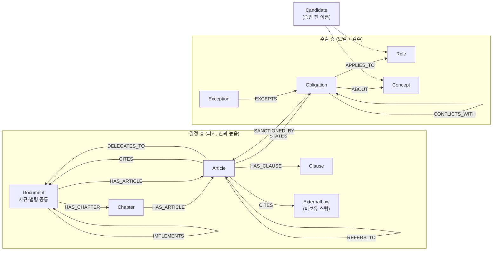

적재 전에 해결할 문제

미해결 참조 323건: 코퍼스 밖 인용이거나 조문 번호 파싱 실패입니다. 법령 수집으로 얼마나 닫혔는지 다시 계산해야 합니다.
법령 정규화: 사규의 「은행법」 같은 표기를 법제처 정식 명칭과 매칭해야 하고, 시행령·시행규칙 연결도 필요합니다.
버전: 법령은 현행본(2026-11-17)이고 사규는 ALIO 공개본이라 시점이 다릅니다. 시행일 속성을 노드에 두고 답변에 표시하는 방안이 필요합니다.
수집 못 한 3건(금융분야 AI 가이드라인 등)은 ExternalLaw의 "미보유" 상태로 남깁니다.
법령 조문이 2만 개를 넘습니다. 모두 적재하면 Aura 무료 한도를 넘을 수 있어, 사규가 인용하는 조문부터 적재하는 선택이 필요합니다.# 기초 온톨로지 설계서 (v1 초안)

> 2팀 · 2026-11-17 · 상태: **설계 초안 — 구현·시행착오·적재는 동료 담당**
> 대상 데이터: IBK 사규 148종(`data/ibk_converted/parsed/`) + 상위 법령 275건(`data/상위법령_변환/구조화/`)
> 상위 문서: [기초 설계서](MLE_2팀_기초%20설계.md) §4 (이 문서는 §4를 **법령 데이터가 들어온 뒤 기준**으로 구체화·보정한다)
> 이 문서의 수치는 2026-11-17 시점에 두 폴더의 JSON을 직접 읽어 센 값이다. 적재 후 다시 재서 비교한다(§13).

---

## 0. 이 문서의 역할과 분담

| 구분 | 내용 | 담당 |
|---|---|---|
| **설계** (이 문서) | 노드·관계·키·속성, 외부 참조 해소 규칙, 위계 통일, 적재 단계, 검증 기준, 알려진 위험 | 설계 담당 |
| **시행착오** | 소량 샘플 적재 → 질의 검증 → 모델 수정, 규칙 보정, 정규식·매칭 개선 | **동료** |
| **시행·적재** | 스크립트 구현, 제약·인덱스 생성, 전체 적재, 건수 대조·멱등 확인 | **동료** |

설계가 틀렸다고 판단되면 동료가 §15의 결정 기록표에 **무엇을 왜 바꿨는지** 적고 이 문서를 갱신한다. 설계는 가설이고, 샘플 적재 결과가 이긴다(수업 KG day32 방식).

---

## 1. 설계 원칙

1. **질문에서 출발한다.** 노드는 질문의 명사, 관계는 동사에서 뽑는다. 이 서비스가 풀 질문은 (a) 사원: "이 행동이 어느 조항에 어긋나는가", (b) 인사: "이 사안은 어떤 조항·요건·징계 규정에 해당할 수 있는가", (c) 공통: "그 조항의 근거 법령과 예외는 무엇인가"이다(역량 질문은 §14).
2. **구조와 의미를 나눈다.** 문서·조·항·참조처럼 **파서가 결정적으로 만드는 층**(신뢰 높음)과, 의무·예외·충돌처럼 **모델이 추출하는 층**(검수 필요)을 라벨·관계·적재 경로까지 분리한다. 결정 층은 바로 적재하고, 추출 층은 `staging → 검수 → 적재`를 거친다.
3. **관계로 구분하지 않은 것은 나중에 되찾을 수 없다.** 조문 참조(`REFERS_TO`), 문서 인용(`CITES`), 위임(`DELEGATES_TO`), 상하위 법령(`IMPLEMENTS`)을 하나의 `RELATED`로 합치지 않는다.
4. **키는 이름이 아니라 id.** 이름은 약칭·띄어쓰기가 섞여 있어 키로 쓸 수 없다(§8).
5. **근거를 잃지 않는다.** 추출 관계·노드에는 원문 구절(`evidence`)과 출처 조문 id를 붙인다. 근거가 없으면 만들지 않는다.
6. **없는 것은 없다고 표시한다.** 코퍼스에 없는 문서는 노드로 만들되 `resolved=false`로 표시해 "미보유 문서"라고 답할 수 있게 한다.
7. **모르면 격리한다.** 사전에 없는 이름은 `Candidate`에 두고 승인 후 승격한다.

---

## 2. 데이터 인벤토리 (실측)

### 2.1 규모

| 항목 | IBK 사규 | 상위 법령 | 합계 |
|---|---|---|---|
| 문서 | 148 | 275 | 423 |
| 편·장·절 | 727 | 2,700 | 3,427 |
| 조문(삭제 포함) | 3,532 | 25,945 | 29,477 |
| 　└ 삭제·이동 조문 | 127 | 1,832 | 1,959 |
| 항(paragraph) | 6,878 | 66,963 | 73,841 |
| 호(item) | 4,999 | 62,142 | 67,141 |
| 외부 참조(`external_refs`) | 1,012 | 29,875 | 30,887 |
| 내부 참조(`internal_refs`, 확정) | 778 | 29,872 | 30,650 |
| 미해결 참조(`unresolved_refs`) | 323 | 31,509 | 31,832 |
| 단서 후보 문장 | 759 | 7,374 | 8,133 |
| 위임 후보 문장 | 704 | 10,707 | 11,411 |

상위 법령은 위계별로 법률 105건(조문 13,419), 대통령령 100건(7,620), 시행규칙·부령 60건(3,820), 고시 7건(933), 세칙 3건(153)이다. 시점은 법령 **현행본(2026-11-17 수집)**, 사규는 **2005-01~2026-10 개정본이 섞여 있고 날짜 없는 문서가 17개**다.

### 2.2 두 데이터의 JSON 구조 — 같은 모양, 다른 점

두 폴더의 JSON은 같은 키를 쓴다: `doc`, `preamble`, `chapters`, `articles`, `addenda`, `external_refs`, `internal_refs`, `unresolved_refs`, `exception_sentences`, `delegation_candidates`, `stats`. 그래서 **적재기를 하나로 만들 수 있다.** 차이는 `doc`뿐이다.

| `doc` 필드 | 사규 | 법령 |
|---|---|---|
| `id`, `title`, `doc_type`, `date`, `action`, `source`, `file`, `format` | 있음 (`date`·`action`이 비는 문서 있음) | 있음 |
| `level`(1~5 위계) | **없음** | 있음 |
| `promulgated`, `ministry`, `law_id`, `api`, `priority`, `why` | 없음 | 있음 |

### 2.3 적재 전에 알아야 할 데이터 특성 (실측으로 확인한 것)

| # | 사실 | 설계에 주는 의미 |
|---|---|---|
| D1 | **`unresolved_refs`의 `to`는 항상 `from`과 같은 문서 접두를 가진다**(법령 31,509건, 사규 323건 모두 same-doc). "법 제88조"를 읽어도 변환기가 현재 문서에 붙여 버린 것이다 | `to`를 그대로 `REFERS_TO`로 쓰면 **엉뚱한 조문으로 연결**된다. `to` 문서 접두는 신뢰하지 않고 `context`로 대상 문서를 다시 정한다(§8.4). 법령 쪽은 `to` 조문이 같은 문서에 **없는 경우가 17,459건, 우연히 있는 경우가 14,050건**이라 후자는 **오연결 위험**이 더 크다 |
| D2 | 범위 표현("제431조부터 제434조까지")이 법령 미해결 참조의 967건에 있다 | 범위는 양 끝 사이의 존재하는 조를 펼쳐 연결하거나 `range` 속성으로 보존한다(§8.5) |
| D3 | 사규의 외부 참조 1,012건 중 대상 이름이 **사규 안에 있는 것 293건(29%)**, **법령 정식명칭과 일치 417건(41%)**(공백·가운뎃점 제거 후 완전 일치), 나머지 302건(30%) | 나머지 302건에는 **약칭**(청탁금지법, 금소법, 금융실명법 …)과 **ALIO에 없는 내규**(여신업무취급세칙 11, 업무분장규정 7, 위임전결규정 7 …)가 섞여 있다. 약칭 사전이 필요하다. 동료의 약칭 반영 측정은 코퍼스 밖 참조 718건 중 463건(64%)이 법령 문서로 연결 |
| D4 | 조 번호까지 적은 사규→법령 인용 104건 중 **97건(93%)은 대상 조문이 실제로 존재**, 7건은 없음 | 조 지정 인용은 `Article → Article` 직접 연결(§6.2). 없는 7건은 삭제·번호 변경으로 보고 점검 목록에 넣는다 |
| D5 | 시행령·시행규칙 **157건 모두 모법(시행령 이름에서 "시행령/시행규칙" 제거)이 코퍼스에 있다** | 상하위 연결(`IMPLEMENTS`)은 **이름 규칙으로 결정적**으로 만들 수 있다 |
| D6 | 사규가 인용한 법령 문서는 약 115개(조문 약 15,200개), 그 하위 법령 약 148개(약 10,300개), **조 번호로 직접 인용된 고유 조문은 83개** | 법령 전체를 같은 깊이로 다루지 않고 **단계별 적재**(§11) |
| D7 | 법령의 외부 참조 29,875건 중 **코퍼스 안 13,312건, 밖 16,563건** | 법령끼리의 인용도 `CITES`로 두되, 수집하지 않은 법령은 미보유 스텁으로 남는다. 스텁 폭증을 막기 위해 §11의 한도 규칙을 적용 |
| D8 | 법령 조문의 삭제·이동 조문 1,832개, 사규 127개 | 노드는 만들되 `deleted=true`. 삭제 조문을 가리키는 참조는 점검 대상(§14) |
| D9 | 사규 `doc_type`이 없는 문서 3개, 법령은 `level` 사용 | 위계는 별도 `authority_rank`로 통일(§7) |
| D10 | 정의 목록이 긴 조문(은행법 제2조 등)은 여러 호가 한 문장으로 묶여 단서·위임 후보 문장 경계가 거칠다 | 후보 문장은 **후보**일 뿐이다. 결정 층에 바로 `EXCEPTS`로 넣지 않는다 |
| D11 | 별표·서식은 수집하지 않았고 본문에 "별표 2와 같다"로만 남음 | 별표가 필요한 판정은 `판단 불가`로 두고 `has_annex_ref` 플래그를 남긴다 |
| D12 | 법령 `addenda`에는 **최신 부칙 1건만** 있음 | 시행일·경과조치 판단에는 쓰지 않는다 |

---

## 3. 모델 개요



**기존 설계서 §4와 달라진 점**

| 항목 | 설계서 §4 (법령 도착 전) | 이 문서 |
|---|---|---|
| 상위 법령 | `ExternalLaw` 스텁 노드 | **실제 `Document`**(`source_kind='law'`)로 적재. `ExternalLaw`는 **수집하지 못한 대상 전용 스텁**으로 축소 |
| 위계 | `level_rank` 1~5 (법률·시행령이 1) | **`authority_rank` 1~8**로 통일(법령 `level` 1~5를 그대로 살리고 사규를 6~8로 이음, §7) |
| 법령 간 관계 | 없음 | **`IMPLEMENTS`**(시행령→법률 등) 추가 |
| 조 지정 인용 | `CITES_LAW`로 스텁까지만 | 대상 조문이 있으면 **`REFERS_TO`로 조문까지** 연결 |
| 시점 | 개정 이력 범위 밖 | 모든 `Document`에 `effective_date`, 답변에 **기준일** 표시 |
| 제재 | 없음 | 인사 모드용 **`SANCTIONED_BY`** 후보 관계 추가(§10) |

---

## 4. 식별자·키 규칙

| 대상 | 규칙 | 예 |
|---|---|---|
| Document | 변환기의 `doc.id`(정식 명칭에서 공백 제거). **사규·법령 id 충돌 없음**(법령 명세서가 확인) | `은행법`, `내부통제규정` |
| Chapter | `<doc_id>#<chapter no>` (편이 있으면 편 포함) | `은행법#제5장` |
| Article | 변환기의 `articles[].id` = `<doc_id>#<조>`, 편마다 조 번호가 반복되면 `#제1편-제1조` | `은행법#제34조` |
| Clause | `<article id>#<항 번호>` (①=1) | `은행법#제34조#1` |
| ExternalLaw | `ext:<정규화한 이름>` (이름 정규화는 §8.1) | `ext:민원업무처리기준` |
| Obligation | `ob:<article id>:<순번>` | `ob:내부통제규정#제12조:1` |
| Exception | `ex:<article id>:<순번>` | |
| Role / Concept | `role:<정규화 이름>` / `con:<정규화 이름>` | `role:준법감시인` |
| 관계 멱등 키(`claim_id`) | `sha256(주어 id, 관계, 목적어 id)` | MERGE 키 |

- Clause는 **항까지만** 노드로 만든다. 호·목은 노드로 만들지 않고 `Clause.text`에 둔다(호 67,141개를 노드로 만들면 규모만 커지고 검색 단위로는 너무 작다).
- 법령 `law_id`(법제처 ID)는 **버전이 바뀌어도 유지**되므로 `Document.law_id`로 보존한다. Document 키는 `doc_id`다.

---

## 5. 노드 정의

`층` = 결정(파서) / 추출(모델) · `적재` = 단계(§11)

### 5.1 Document

| 속성 | 출처(JSON) | 필수 | 비고 |
|---|---|---|---|
| `doc_id` | `doc.id` | ✓ | UNIQUE |
| `title` | `doc.title` | ✓ | |
| `source_kind` | 폴더로 판정 | ✓ | `internal`(사규) / `law`(법령) |
| `doc_type` | `doc.doc_type` | | 사규: 규정·지침·운용기준… 법령: 법률·대통령령·부령·고시·세칙 |
| `authority_rank` | §7 규칙으로 계산 | ✓ | 1~8, 비면 점검 |
| `effective_date` | `doc.date` | | 사규는 17개가 비어 있음 → `date_missing=true` |
| `promulgated` | `doc.promulgated` | | 법령만 |
| `action` | `doc.action` | | 제정·일부개정·전부개정·타법개정, 사규는 38개가 비어 있음 |
| `ministry`, `law_id` | `doc.ministry`, `doc.law_id` | | 법령만 |
| `source`, `file` | `doc.source`, `doc.file` | ✓ | 원문 추적 |
| `aliases` | 약칭 사전(§8.2) | | 문자열 배열 |
| `core_tier` | 핵심 문서 목록 | | 의무 추출 대상 여부(§11) |
| `has_annex_ref` | 본문 "별표" 검출 | | D11 |

### 5.2 Chapter

`id`, `no`, `title`, `kind`(편·장·절·관), `part` — 출처 `chapters[]`. 장이 없는 문서는 만들지 않는다.

### 5.3 Article

| 속성 | 출처 | 필수 | 비고 |
|---|---|---|---|
| `id` | `articles[].id` | ✓ | UNIQUE |
| `doc_id` | id에서 분리 | ✓ | 조회 편의(비정규화) |
| `no`, `title` | `no`, `title` | ✓ | `title`은 빌 수 있음 |
| `text` | `text` | ✓ | 항·호·목을 합친 본문 |
| `text_tokens` | Kiwi 토큰화 | | 전문 인덱스용(적재기가 생성) |
| `deleted` | `deleted` | ✓ | true이면 검색 제외, 참조는 점검 |
| `chapter_no`, `part` | `chapter`, `part` | | |
| `embedding` | 임베딩 모델 | | 단계에 따라 생성(§11), 입력·인덱스·버전은 §12 |
| `source_kind`, `authority_rank` | Document에서 복사 | ✓ | 필터 속도용 비정규화 |

### 5.4 Clause

`id`, `no`(①), `text`, `article_id`. 출처 `articles[].paragraphs[]`. 임베딩은 선택(**항은 검색 단위, 조는 반환 단위**, 승격 조건은 §12.1·12.4).

### 5.5 ExternalLaw (미보유 스텁)

| 속성 | 비고 |
|---|---|
| `id`(`ext:…`), `name`(원문 표기), `norm_name` | UNIQUE는 `norm_name` |
| `kind` | `법령` / `감독규정·가이드라인` / `사내미공개내규` / `기타` — 분류는 [LAW_COLLECTION_LIST](LAW_COLLECTION_LIST.md)의 구분을 따른다 |
| `resolved` | **false 고정**(해소되면 Document로 승격하고 이 노드는 `RESOLVED_AS`로 연결 후 정리) |
| `cited_by_count` | 인용 횟수 — 수집 우선순위 근거 |
| `collect_status` | `미수집` / `수집불가(가이드라인)` / `비공개내규` — 법령 명세서의 "수집하지 못한 3건"이 여기에 해당 |

### 5.6 추출 층 노드

| 라벨 | 속성 | 비고 |
|---|---|---|
| `Obligation` | `id`, `modality`(MUST / MUST_NOT / MAY), `action`, `conditions[]`(요건 목록), `deadline_value`, `deadline_unit`(DAY / BUSINESS_DAY / MONTH / YEAR), `threshold_value`, `threshold_unit`, `comparator`(≥ ≤ = …), `evidence_text`, `article_id`, `confidence`, `review_status` | `evidence_text`는 **원문 그대로 복사**. 없으면 적재 금지 |
| `Exception` | `id`, `text`, `condition`, `evidence_text`, `review_status` | 단서 후보 문장 → 모델이 정제 |
| `Role` | `id`, `name`, `aliases[]` | 준법감시인, 부서장, 인사부장 … |
| `Concept` | `id`, `name`, `aliases[]`, `kind`(주제/행위/제재/기타) | 개인정보, 이해충돌, 징계 … |
| `Candidate` | `name`, `type_guess`, `source_article_id` | 사전에 없는 이름 격리 |

`conditions[]`는 인사 모드의 **요건별 충족 여부**를 위한 것이다. 조항을 "이 조건들이 모두 충족되면 해당"으로 쪼개 저장하면 사안과 대조할 수 있다.

---

## 6. 관계 정의

### 6.1 결정 층 (파서가 만든다)

| 관계 | 방향 | 생성 규칙 | 속성 |
|---|---|---|---|
| `HAS_CHAPTER` | Document→Chapter | `chapters[]` | |
| `HAS_ARTICLE` | Chapter→Article, (장이 없으면) Document→Article | `articles[].chapter` 로 연결 | |
| `HAS_CLAUSE` | Article→Clause | `paragraphs[]` | |
| `REFERS_TO` | Article→Article | ① `internal_refs`(확정) ② **조 지정 외부 인용** 중 대상 조문이 존재하는 것 ③ §8.4로 해소한 미해결 참조 | `paragraph`, `item`, `cross_doc`(bool), `resolution`(`parsed` / `named_article` / `rule_parent` / `rule_decree` / `range`), `context` |
| `CITES` | Article→Document | 외부 참조의 대상 이름이 **코퍼스 문서**(사규·법령)로 해소됨 | `target_article`(있으면), `resolution`(`exact_name` / `alias`) |
| `CITES` | Article→ExternalLaw | 해소 실패(**미보유**) | `reason` |
| `IMPLEMENTS` | Document→Document | 시행령·시행규칙 → 모법(§9.1), 이름 규칙 | `kind`(시행령/시행규칙), `confidence=high` |
| `DELEGATES_TO` | Article→Document | **문서 수준 위임** "대통령령으로 정한다" 등(§9.2). 사규의 "별도로 정한다"는 모델이 대상 문서를 정하므로 추출 층(`review_status`) | `kind`(대통령령/부령/고시/내규), `evidence`, `resolution` |
| `BASED_ON` | Document→Document\|ExternalLaw | 제1조 등의 제정 근거 | `evidence`, 규칙 + 검수 |

> `CITES_LAW`는 **`CITES`가 `ExternalLaw` 스텁을 가리키는 경우**로 흡수한다(관계 이름을 하나 줄이고 대상 라벨로 구분). 설계서 §4.3의 `CITES_LAW`를 쓰는 코드가 있으면 이름만 바꾸면 된다.

### 6.2 인용을 어떻게 나누는가

| 사규 본문 | 처리 |
|---|---|
| 「은행법」 제34조 | `Article -REFERS_TO{cross_doc:true, resolution:'named_article'}-> 은행법#제34조` **그리고** `Article -CITES-> 은행법`(문서 수준 질의용) |
| 「은행법」에 따라 | `Article -CITES-> 은행법` (조 번호 없음, 572건 = 80%) |
| 「청탁금지법」 | 약칭 사전으로 해소 후 위와 같음, 실패 시 스텁 |
| 「여신업무취급세칙」(ALIO에 없음) | `Article -CITES-> ExternalLaw{kind:'사내미공개내규'}` |

조 번호 없이 법 이름만 적은 인용(80%)은 **어느 조문인지 알 수 없다.** 이 경우 문서까지만 연결하고, 해당 조문은 질의 시 **벡터·전문 검색으로 그 문서 안에서 찾는다**(설계서 §7 검색 엔진의 책임이며, 온톨로지는 문서 필터만 제공).

### 6.3 추출 층 (모델 + 검수)

설계서 §4.3의 시그니처 표를 그대로 쓰고 두 가지를 보탠다.

| 관계 | 주어→목적어 | 판정 기준 |
|---|---|---|
| `STATES` | Article→Obligation | 조문이 의무를 **직접 기술**(해석으로 도출한 의무 제외) |
| `EXCEPTS` | Exception→Obligation | 단서가 대상 의무의 적용을 면제·완화 |
| `APPLIES_TO` | Obligation→Role | 의무를 이행할 **책임 주체** |
| `ABOUT` | Obligation→Concept | 의무가 다루는 대상·주제 |
| `CONFLICTS_WITH` | Obligation→Obligation | 같은 대상에 상충하는 값(기한·수치·허용 여부). **`authority_rank`가 다른 쌍만 후보**로 삼는다 |
| `SANCTIONED_BY` *(신규, 후보)* | Obligation→Article | 의무 위반 시 적용되는 징계·제재 조항(예: 직원상벌규정 조문). 사규 안에서 "위반 시 ~에 따라 징계"라고 **명시한 경우만** |
| `RESOLVED_AS` *(신규, 운영용)* | ExternalLaw→Document | 나중에 문서를 수집해 스텁을 해소한 기록 |

모든 추출 관계에 `evidence`(원문 구절, 수정 없이 복사), `source_doc_id`, `evidence_level`(`curated`/`reported`), `batch_id`(롤백), `claim_id`(멱등 키), `review_status`(`staged`/`approved`/`rejected`)를 붙인다.

---

## 7. 위계 통일 — `authority_rank`

설계서 §4.1의 `level_rank`(사규 접미사 기준, 법률·시행령이 한 칸)와 법령 데이터의 `level`(1~5)은 **척도가 달라서 그대로 합치면 충돌 점검이 틀린다.** 하나로 통일한다.

| authority_rank | 계층 | 출처 | 판정 방법 |
|---|---|---|---|
| 1 | 법률 | 법령 `level=1` | 그대로 |
| 2 | 대통령령(시행령) | 법령 `level=2` | 그대로 |
| 3 | 총리령·부령(시행규칙)·감사원규칙 | 법령 `level=3` | 그대로 |
| 4 | 고시·감독규정(행정규칙) | 법령 `level=4` | 그대로 (은행업감독규정 등) |
| 5 | 금융감독원 시행세칙 | 법령 `level=5` | 그대로 |
| 6 | 정관 | 사규 | 문서명 `정관` |
| 7 | 규정·업무규정·운영규정 | 사규 | `doc_type` / 파일명 접미사 |
| 8 | 세칙·지침·운용기준·기준·운영기준 | 사규 | `doc_type` / 파일명 접미사 |

- 사규 `doc_type`이 없는 3개는 **수동 부여**(설계서 §4.1의 검수 규칙과 같다).
- 충돌 후보(`CONFLICTS_WITH`)는 **숫자가 작은 쪽이 상위**라는 규칙으로 "하위가 상위보다 완화적인가"를 본다. 같은 rank끼리는 후보로 삼지 않는다(규정 간 비교는 별도 판단).
- 이전 `level_rank`와의 대응: 1(법률·시행령)→1·2, 2(감독규정)→4·5, 3(정관)→6, 4(규정)→7, 5(세칙·지침)→8.
- ⚠ 감독규정(행정규칙)이 시행규칙(부령)보다 위인지는 법적 위계 논쟁이 있을 수 있다. **판정에는 "상위 법령이 규정하는 범위에서"라는 일반 원칙만 쓰고, 4와 3의 우열이 결과를 좌우하는 경우는 `판단 불가`로 둔다**(법률 검토 필요, 멘토 확인 항목).

---

## 8. 외부 참조 해소 규칙 (동료가 구현·보정할 핵심)

### 8.1 이름 정규화

`norm(name)`: 공백·가운뎃점(`·`, `ㆍ`)·쉼표 제거, 괄호 안 부가설명(예: 「…」 뒤의 `(이하 "법")`) 제거, 따옴표 제거. 사규·법령의 `title`도 같은 함수를 거쳐 `norm_name`으로 저장한다. **이름 일치만 쓰고 부분 일치는 쓰지 않는다**(`은행법` ≠ `은행법시행령`).

### 8.2 약칭 사전

- 별도 파일 `data/ontology/aliases.csv`(열: `alias`, `canonical_title`, `source`, `confirmed`)로 관리한다. 노드로 두지 않고 `Document.aliases`·`ExternalLaw`에 반영한다.
- 출처: `data/팀_법령수집목록.txt`의 셋째 열(사규 내 표기), `data/law_collection_list.csv`의 "문서 내 표기 변형" 열, 사규 본문의 `이하 "…"` 정의(법령 본문에도 있음).
- 관측 예: `청탁금지법`·`부패방지권익위법`·`특정금융정보법`·`금융실명법`·`이해충돌방지법`·`금소법`. 약칭 하나가 둘 이상으로 풀리면 자동 연결하지 않고 `Candidate`로 둔다.
- 해소 순서: ① 사규 문서 이름 일치 → ② 법령 정식명칭 일치 → ③ 약칭 사전 → ④ 실패 시 `ExternalLaw` 스텁.

### 8.3 코퍼스 밖으로 분류하는 기준

실패한 이름은 `ExternalLaw.kind`로 나눈다.

| kind | 판별 | 처리 |
|---|---|---|
| 법령 | 이름이 `…법`, `…법률`, `…령`, `…규칙`으로 끝나고 수집 목록에 있음 | `collect_status='미수집'`(수집 대상) |
| 감독규정·가이드라인 | `…감독규정`, `…가이드라인`, `…프레임워크` | 법제처에 없는 것(3건)은 `수집불가` |
| 사내미공개내규 | `…세칙`, `…매뉴얼`, `…업무`, 위원회명 등 ALIO에 없는 내규 | `비공개내규`. 인용 횟수만 기록 |

### 8.4 미해결 참조(`unresolved_refs`) 재해소 — D1 때문에 필요

`to`의 문서 접두를 버리고 `context`의 표현으로 대상 문서를 다시 정한다.

| 표현 (`context`) | 출발 문서 | 대상 문서 | `resolution` |
|---|---|---|---|
| `법 제N조`, `같은 법 제N조`, `법 제N조제M항` | 시행령·시행규칙 | **모법**(`IMPLEMENTS` 목적지) | `rule_parent` |
| `영 제N조`, `시행령 제N조` | 시행규칙 | 같은 계열 시행령 | `rule_decree` |
| `시행령 제N조`, `대통령령으로 정하는` + 조 번호 | 법률 | 그 법률의 시행령 | `rule_decree` |
| `「○○」 제N조`(이름이 있는데 미해결) | 임의 | 이름 해소 후 해당 문서 | `named_article` |
| `법 제N조`, `청탁금지법 제N조`처럼 사규가 **문서 안에서 정의한 `법`·약칭**을 쓰고 같은 문서에 대상 조가 없음 | 사규 | 문서의 첫 `(이하 "법"이라 한다)` 정의 또는 확정 약칭이 가리키는 법령(수집본에 있을 때) | `law_def` / `alias` |
| `제N조` 만 있고 이 문서에 대상 조가 없음 | 임의 | **연결하지 않음** | 점검 목록 |

> 상태 값의 전체 목록과 답변에서의 처리, 합격 기준은 [기초 설계서 §4.7](MLE_2팀_기초%20설계.md)에 있다. 정의가 없거나 둘 이상이면 `candidate`로 격리한다. 핵심 16개 문서의 미해결 참조 16건 중 9건(이해충돌 방지 지침 7, 행동강령 2)이 이 규칙 대상이다(2026-11-18).

- 대상 문서를 정한 뒤 `문서#제N조`가 **존재하는지 확인**하고, 있으면 `REFERS_TO`, 없으면 점검 목록에 넣는다.
- `to`가 현재 문서에 우연히 존재하는 14,050건(법령)은 **`context`에 "법/영" 표현이 있으면 그 규칙을 우선**하고, 표현이 없으면 기존 `to`를 유지하되 `resolution='assumed_same_doc'`로 표시한다(확신도 낮음).
- 미해결 법령 참조 중 가장 많은 대상은 자본시장법 시행령·조세특례제한법 시행령 계열이다(각각 수천 건). 이 규칙의 **효과가 가장 큰 곳**이니 샘플 적재도 여기서 시작한다.

### 8.5 범위·나열 표현

"제431조부터 제434조까지", "제10조 및 제11조": 양 끝 번호가 모두 해당 문서에 있으면 사이의 **존재하는 조(가지 번호 포함)**를 `REFERS_TO{resolution:'range'}`로 펼친다. 길이가 20조를 넘으면 펼치지 않고 시작·끝 두 조만 연결하고 `range_from`, `range_to`를 남긴다(그래프 폭발 방지, 임계값은 시행착오로 조정).

---

## 9. 법령 데이터 고유 설계

### 9.1 상하위 법령 — `IMPLEMENTS`

시행령·시행규칙(`level` 2·3, 이름이 `시행령`/`시행규칙`으로 끝남) → `norm(이름에서 접미사 제거)`가 일치하는 법률 `Document`. **157건 모두 모법이 코퍼스에 있어 결정적으로 만들 수 있다**(D5). 시행규칙의 상위는 시행령이 있으면 시행령, 없으면 법률(`kind`로 구분).

### 9.2 위임 — 두 단계

1. **문서 수준(결정적)**: 법률 조문의 "대통령령으로 정한다" → `Article -DELEGATES_TO{kind:'대통령령'}-> (그 법률의 시행령 Document)`, "총리령·부령" → 시행규칙, "고시" → 해당 행정규칙. 위임 후보 문장(`delegation_candidates`)에서 키워드로 거른다.
2. **조문 수준(규칙 + 모델)**: 위임을 받은 시행령 조문은 본문에 `법 제N조`가 있으므로 §8.4로 `REFERS_TO{rule_parent}`가 생긴다. 이 역방향 관계를 위임의 증거로 쓴다(`DELEGATES_TO`의 `evidence`). 정확한 조문 대응이 안 되면 문서 수준에서 멈춘다.

사규의 "별도로 정한다/ ○○규정에서 정하는 바에 따른다"(704건)는 **대상 문서 판별을 모델에 맡기고 검수**한다(추출 층). 대상이 코퍼스에 없으면 스텁.

### 9.3 시점(기준일)

- 법령은 현행본, 사규는 문서마다 개정 시점이 다르다. 모든 `Document`에 `effective_date`를 두고 날짜가 없으면 `date_missing=true`.
- 판정·답변에는 **"기준: 법령 2026-11-17 현행, 사규 YYYY-MM-DD 개정본"**을 붙인다. 사규가 2019년 이전 개정본(13개)이거나 날짜 없는 문서(17개)이면 경고 문구를 붙인다.
- 개정 이력 비교(`PREVIOUS_VERSION`)는 범위 밖이다. 다만 `law_id`를 보존하므로 이후 확장이 가능하다.

### 9.4 법령끼리의 인용

법령의 외부 참조 중 코퍼스 안 13,312건은 `CITES`(조 지정이면 `REFERS_TO`)로, 밖 16,563건은 **스텁을 만들지 않는다**(§11 한도 규칙). 법령 쪽에서 새로 생기는 스텁은 사규가 인용한 법령에 한해 허용한다.

---

## 10. 서비스 요구 반영 (사원 모드 / 인사 모드)

| 서비스 요구 | 온톨로지 지원 | 상태 |
|---|---|---|
| 사원: 행동 → 근거 조문·예외·상위 법령 | `Article`, `Exception`, `EXCEPTS`, `REFERS_TO`/`CITES`→법령 조문 | 구조는 결정 층으로 가능, 예외는 추출 층 |
| 사원: 쉬운 설명 | 규정 원문만 풀어 쓴다 → 별도 노드 불필요(`Article.text`) | 가능 |
| 인사: 사안 → 조항 후보 | `Concept`(행위·주제)·`ABOUT`, 벡터·전문 검색 | 추출 품질에 의존 |
| 인사: **요건별 충족 여부** | `Obligation.conditions[]`, `Exception.condition` | 추출 층, 평가셋으로 검증 |
| 인사: **징계·절차 규정 연계** | `SANCTIONED_BY`(Obligation→징계 조문), 직원상벌규정·인사규정 조문 | **후보 관계.** 사규에 "징계 사유"가 명시된 조문(직원상벌규정 등)부터 시도 |
| 인사: 상위 법령 연결 | `CITES`/`REFERS_TO`→법령 조문 | 결정 층 |
| 근거 없음·미보유 표시 | `ExternalLaw.resolved=false`, `collect_status` | 가능 |
| 후보 표현(확정 금지) | 온톨로지 밖(응답 정책) | NFR-10 |

핵심 문서(설계서 부록 A / 기획서 부록 B)는 **의무 추출 대상(`core_tier`)** 이며 구조 적재는 전체에 한다.

---

## 11. 규모와 적재 단계

노드 수 추정(전부 적재 시): Document 423 + Chapter 3,427 + Article 29,477 + Clause 73,841 ≈ **약 10.7만 개**, 여기에 추출 층 노드(핵심 문서 약 410조문 × 의무 1~3개 ≈ 수천 개)와 스텁이 더해진다. 관계는 구조 관계(HAS_* 약 10.7만) + 참조(REFERS_TO·CITES 수만~10만 수준)로 **수십만 개 규모**다.

> ⚠ Neo4j Aura Free의 노드·관계·저장 한도는 **확인하지 않았다**(수업 자료에 없음). 알려진 값(노드 약 20만, 관계 약 40만)이 맞다면 전체를 한 번에 적재하면 **한도 근처**다. 임베딩(1024차원 × 조문 수)의 저장 부담도 같이 확인한다. **PoC 항목.**

| 단계 | 적재 대상 | 임베딩 | 의무 추출 |
|---|---|---|---|
| **T0 샘플** | 핵심 문서 2~3개 + 그 문서가 인용하는 법령 조문 | 있음 | 있음(시행착오용) |
| **T1 사규 전체** | 사규 148종: Document·Chapter·Article·Clause + 결정 층 관계 | Article만 | 핵심 16개 문서만 |
| **T2 인용 법령** | 사규가 **조 번호로 직접 인용한 법령 조문(고유 83개)** + 같은 문서의 인접 조문 + 해당 법령·시행령의 `Document`·`IMPLEMENTS` | 있음 | 인용된 83개 조문만(상위 근거로 활용) |
| **T3 나머지 법령** | 사규가 문서 수준으로만 인용한 법령(약 115개)의 Article | **없음**(전문·ID 조회용) | 없음 |
| **T4 확장** | 사규가 인용하지 않은 법령(나머지)·Clause(법령) | 선택 | 없음 |

- **스텁 한도 규칙**: 스텁은 **사규가 인용한 이름**에만 만든다. 법령 본문이 인용한 미수집 법령(16,563건)은 스텁을 만들지 않고 `Article.external_ref_count`처럼 **속성으로만** 남긴다(그래프 폭발 방지).
- 법령 Clause(항, 약 6.7만)는 T4로 미룬다. 법령은 **조문 단위로 반환**하면 충분하고, 사규 쪽은 항까지 적재한다.
- 단계마다 §14의 구조 점검·건수 대조·멱등 확인을 통과해야 다음으로 간다.

---

## 12. 임베딩 설계

> 임베딩 **모델 선정**(KURE-v1 / bge-m3 / multilingual-e5)과 질의 시 계산 위치는 기초 설계서의 ADR-1과 §10-5·13이 맡는다. 이 절은 **온톨로지 쪽에서 정해야 하는 것**(무엇을, 어떤 텍스트로, 어디에, 어떤 버전으로 넣는가)만 다룬다. 모델이 정해지기 전에도 이 절의 구조는 그대로 쓸 수 있도록 모델 이름·차원은 값으로만 둔다.

### 12.1 임베딩 대상

| 대상 | 임베딩 | 입력 | 용도 | 시점 |
|---|---|---|---|---|
| `Article` (사규) | **✓ 필수** | §12.2 | 하이브리드 검색의 벡터 쪽, 사원·인사 질의 | T1 |
| `Article` (법령, 사규가 조 번호로 인용한 것 + 인접 조문) | ✓ | §12.2 | 상위 법령 근거 검색 | T2 |
| `Article` (법령, 나머지) | **✗ 기본 없음** | — | 전문·ID 조회로 충분. 평가에서 필요하면 T4에 추가 | T3 |
| `Clause` (사규) | 선택 | 항 본문 + 조 머리말 | 긴 조문의 세부 검색. **조 임베딩의 잘림 비율이 높을 때** 기본 검색 단위로 승격(ADR-4) | T1 후반 |
| `Clause` (법령) | ✗ | — | 긴 조문만 §12.4 분할 규칙으로 청크 | T4 |
| `Document`, `Chapter`, `ExternalLaw` | ✗ | — | 제목은 전문 검색·이름 매칭으로 충분 | — |
| `Obligation` | ✓ (승인된 것만) | `evidence_text` | 인사 모드 사안→의무 매핑, 충돌 후보(같은 `Concept`을 `ABOUT`하는 의무 쌍 우선) | 추출 후 |
| `Role`, `Concept`, `Candidate` | **임시** | `name` (+별칭) | 개체 정규화 KNN 후보 생성(기초 설계서 §5). 병합 후 보존하지 않아도 된다 | 정규화 때 |

### 12.2 임베딩 입력 텍스트

조문 본문만 넣으면 법령 조문이 서로 구분되지 않는다("제3조(정의)"가 수백 개). **문서명·조 번호·제목을 접두로 붙인 `embed_text`** 를 만든다.

```
사규:  {문서 title} {조 번호} {조 제목}\n{본문}
법령:  {문서 title}({doc_type}) {조 번호} {조 제목}\n{본문}
항:    {문서 title} {조 번호} {조 제목}\n{항 번호} {항 본문}
```

- 장 제목(`Chapter.title`)을 접두에 넣을지는 **시행착오 항목**이다(검색 정확도 비교 후 결정).
- `deleted=true` 조문은 임베딩하지 않는다.
- `embed_text`는 **함수로 재생성 가능**해야 하며(저장 필수 아님), 그 SHA-256을 `embed_hash`로 노드에 둔다(§12.5).
- **질의와 문서에 같은 모델**을 쓴다. 모델이 질의·문서 접두(`query:`/`passage:` 등)를 요구하면 그 규칙을 따른다(모델별 요구는 선정 후 확인).
- 조문 본문은 **원문 그대로** 쓴다(요약·교정 금지). 제목이 없는 조문은 조 번호만 접두로 둔다.

### 12.3 길이 현황 (실측, 삭제 조문 제외)

| | 조문 수 | 중앙값 | p95 | p99 | 최대 | 1,000자 초과 | 3,000자 초과 | 5,000자 초과 |
|---|---|---|---|---|---|---|---|---|
| 사규 | 3,405 | 156자 | 715자 | 1,217자 | 3,169자 | 71 | 1 | 0 |
| 법령 | 24,113 | 289자 | 1,626자 | 3,453자 | **23,622자** | 2,935 | 327 | 92 |

사규는 대부분 짧아 조 단위 통임베딩이 자연스럽다. **법령은 길이 분포가 길게 늘어져 있어**(최대 2.3만 자) 입력 상한을 넘는 조문이 실제로 생긴다.

### 12.4 잘림·분할 규칙

모델의 입력 상한은 토큰 기준이다(KURE-v1 8,192, multilingual-e5 512 — 설계서 §6.3). 한국어 글자 수와 토큰 수의 비율은 **모델 토크나이저로 실측**한다(측정 전에는 추정하지 않는다).

1. 선정 후보 모델 각각에 대해 `embed_text`의 **잘림 비율**을 잰다(수업 day58). 비율이 1%를 넘으면(설계서 ADR-4 기준) 아래 규칙으로 넘어간다.
2. **상한을 넘는 조문**: ① 항 단위로 나누고 항마다 `Clause.embedding`을 만든다. ② 조의 `Article.embedding`은 접두 + 첫 항(또는 앞부분)으로 만들고 `embed_truncated=true`를 둔다. ③ 항 하나가 상한을 넘으면 문장 단위로 나누되 **조·항 id를 유지**한다(검색 결과는 항상 `Article`로 반환).
3. 법령의 초장문 조문(정의 조항, 별표 인용 조문 등)은 **전문·구조 질의 우선**으로 두고 임베딩은 항 단위만 만든다.
4. 분할 방식·임계값은 **시행착오 항목**이다. 결과는 결정 기록표(§15)에 적는다.

### 12.5 저장과 인덱스

| 저장소 | 무엇을 | 이유 |
|---|---|---|
| **Neo4j Aura** | `Article.embedding`(+ 선택 `Clause.embedding`, `Obligation.embedding`) | **운영 검색은 Neo4j만 쓴다**(기초 설계서 §3). 벡터·전문 인덱스와 그래프 순회를 한 곳에서 수행 |
| **Supabase pgvector** | 베이스라인용 `baseline_chunks` | "벡터 단독 RAG"와 GraphRAG를 **같은 입력·같은 모델**로 비교(ablation). 서로 다른 텍스트·모델을 쓰면 비교가 무효가 된다 |
| 파일(parquet/npy) | **모델 후보 비교 실험** | ADR-1 비교에서 후보 3개를 모두 Neo4j에 올리면 용량만 소모. 비교는 Neo4j 밖에서 하고 **선정된 모델만** 적재 |

- **인덱스**: 설계서 §4.4의 `article_vec`(cosine). 차원은 선정 모델 값에 맞춘다(기본 가정 1,024). 임베딩은 정규화해 적재한다.
- **사규·법령을 한 인덱스에 두면** 법령 약 2.4만 조문이 사규 3.4천 조문을 밀어낼 수 있다. 그래서 **보조 라벨 `InternalArticle` / `LawArticle`**(둘 다 `Article`도 가짐)을 두고 인덱스를 **둘로 나누거나**, 한 인덱스에서 `source_kind` 사전 필터가 되는지 확인한다. ⚠ Aura의 벡터 인덱스 **사전 필터 지원 여부와 버전은 확인하지 않았다**(P8).
- 사원·인사 모드의 기본 검색은 **사규 인덱스 우선, 법령은 사규 조문이 가리킨 조문(그래프 확장) 또는 보조 검색**으로 가져온다(검색 설계는 기초 설계서 §7).

### 12.6 버전 관리와 재색인

| 속성/노드 | 내용 |
|---|---|
| `Meta{key:'embedding'}` 노드 1개 | `model`, `dim`, `normalized`, `built_at`, `embed_text_version`(§12.2 규칙 버전) |
| `Article.embed_hash` | `embed_text`의 SHA-256. 본문이나 접두 규칙이 바뀐 조문만 **증분 재색인** |
| `Article.embed_truncated` | §12.4 ② |

- **모델 교체**: 새 속성(`embedding_v2`)과 새 인덱스를 **병행 구축 → 검증 → 이전 속성 삭제**한다. 같은 속성 이름에 덮어쓰면 재색인 중 검색이 깨진다.
- 임베딩은 **원본(JSON)에서 재생성 가능한 파생물**이다. 그래프를 지우고 다시 적재해도 같은 `embed_hash`가 나와야 한다(멱등 확인에 포함).

### 12.7 규모

| 단계 | 벡터 수 | 1,024차원 float32 원시 크기(벡터당 4KB) |
|---|---|---|
| T1 사규 Article | 3,405 | 약 14MB |
| T1 후반 사규 Clause(선택) | 6,878 | 약 28MB |
| T2 인용 법령 조문(고유 83 + 인접 범위에 따름) | 83개 이상 | 인접 범위 확정 후 계산 |
| 법령 전체 Article(T4에서 필요할 경우) | 24,113 | 약 99MB |

원시 크기는 계산값이고 **HNSW 인덱스 오버헤드와 Aura 저장 한도는 확인하지 않았다**(P1). 임베딩 생성 시간·메모리도 **측정 전에는 추정하지 않는다**(후보 모델 약 568M 파라미터, 설계서 §6.3).

### 12.8 개인정보·안전

- 인사 모드의 **사안 입력은 저장하지 않으므로 질의 임베딩도 저장·로그하지 않는다**(요청 처리 중 메모리에서만 쓴다).
- 사용자 장기 기억(`user_memories.embedding`)은 이 온톨로지와 **별개**이고 Supabase에서 관리한다(기초 설계서 §8).

### 12.9 이 절에서 남는 결정

| # | 항목 | 담당·방법 |
|---|---|---|
| E1 | 임베딩 모델 | 기초 설계서 ADR-1: 평가셋에서 Recall@5·잘림 비율·질문 지연으로 비교 |
| E2 | 질의 임베딩 계산 위치(Cloud Run CPU / RunPod) | 기초 설계서 §10-13, PoC |
| E3 | `embed_text` 접두 규칙(장 제목 포함 여부) | 동료 시행착오, 검색 정확도 비교 |
| E4 | 잘림 비율과 분할 임계값 | 동료, 모델 토크나이저로 측정 |
| E5 | 사규·법령 인덱스 분리 vs 사전 필터 | 동료, P8 확인 결과에 따름 |
| E6 | 법령 전체 임베딩(T4) 필요 여부 | 평가셋에서 법령 직접 검색 질문의 Recall로 판단 |
| E7 | `Obligation` 임베딩 용도(충돌 후보·사안 매핑)를 실제로 쓸지 | 추출 층 샘플 후 |

---

## 13. 현재 기준값 (적재 후 다시 재서 비교한다)

| 지표 | 현재 값 | 정의 |
|---|---|---|
| 사규→사규 문서 연결 | 293 / 1,012 (29%) | 외부 참조의 대상이 사규 이름과 일치 |
| 사규→법령 문서 연결(정식명칭) | 417 / 1,012 (41%) | 공백·가운뎃점 제거 후 일치 |
| 약칭 사전 후 법령 연결 | 463 / 718 (64%) — 동료 측정, 코퍼스 밖 참조 기준 | 분모가 다름에 주의 |
| 조 지정 인용 → 조문 존재 | 97 / 104 (93%) | |
| 문서 수준만 인용(조 번호 없음) | 약 80% | 조문 해소는 검색에 맡김 |
| 시행령·시행규칙 → 모법 | 157 / 157 | 이름 규칙 |
| 사규 미해결 참조 | 323건 | 재해소 후 줄어야 함 |
| 법령 미해결 참조 | 31,509건 | 재해소 후 줄어야 함(`assumed_same_doc` 비율도 기록) |
| 날짜 없는 사규 | 17 / 148 | 보정 대상 |

---

## 14. 검증

설계서 §4.6의 절차(샘플 적재 → 구조 점검 → 역량 질문 → 표본 검수·골드셋)를 따르고, 법령 데이터 때문에 아래를 더한다.

### 14.1 추가 역량 질문

| # | 질문 | 필요한 구조 |
|---|---|---|
| CQ11 | 이 사규 조문의 근거 법령 조문은? | `REFERS_TO{cross_doc}` |
| CQ12 | 이 법률 조문을 구체화한 시행령 조문은? | `IMPLEMENTS`, `REFERS_TO{rule_parent}` |
| CQ13 | 이 법률을 근거로 한 사규 전부는? | `CITES`/`BASED_ON` 역방향 |
| CQ14 | 이 조문의 기준 시점은? 최신 법령과 시점 차이가 큰가? | `effective_date` |
| CQ15 | (인사) 이 의무를 위반하면 적용되는 징계 조항은? | `SANCTIONED_BY` |
| CQ16 | 인용 사슬이 끊겨 "미보유"로 끝나는 지점은? | `ExternalLaw` |

CQ1~10은 설계서 §4.6을 따른다.

### 14.2 추가 구조 점검 (결과 0건이어야 한다)

```cypher
// 위계가 없는 문서
MATCH (d:Document) WHERE d.authority_rank IS NULL RETURN d.doc_id;

// 상위 법령이 사규보다 낮은 rank로 잘못 부여된 경우 (법령인데 rank > 5)
MATCH (d:Document {source_kind:'law'}) WHERE d.authority_rank > 5 RETURN d.doc_id;

// 같은 문서를 가리키는 REFERS_TO 가 자기 자신으로 가는 경우
MATCH (a:Article)-[r:REFERS_TO]->(a) RETURN a.id;

// IMPLEMENTS 방향 오류: 하위가 상위보다 rank 가 작은 경우
MATCH (c:Document)-[:IMPLEMENTS]->(p:Document) WHERE c.authority_rank <= p.authority_rank RETURN c.doc_id, p.doc_id;

// 해소되지 않은 스텁이 같은 이름의 Document 와 중복되는 경우
MATCH (x:ExternalLaw), (d:Document) WHERE x.norm_name = d.norm_name RETURN x.id, d.doc_id;
```

### 14.3 해소율 점검 (적재 보고에 포함)

`resolution` 값별 `REFERS_TO`·`CITES` 건수 표를 만들고 §13의 기준값과 비교한다. `assumed_same_doc` 비율이 높으면 §8.4 규칙을 보강한다.

---

## 15. 동료 인수인계

### 15.1 시행착오 체크리스트 (이 순서를 권장)

1. **T0 샘플**: 핵심 문서 2~3개(예: 직원상벌규정, 복무규정, 임직원행동강령)와 그 인용 법령(청탁금지법·부패방지권익위법·이해충돌방지법 + 시행령)으로 시작한다.
2. 이름 정규화·약칭 사전(§8.1~8.2)을 먼저 만들고 §13의 연결률을 재현한다. 재현이 안 되면 규칙을 고친다.
3. 결정 층 관계(HAS_*, REFERS_TO, CITES, IMPLEMENTS)를 적재하고 §14.2 점검을 통과시킨다.
4. 미해결 참조 재해소(§8.4)를 구현하고 `resolution`별 건수를 본다. **자본시장법 시행령 계열이 가장 큰 효과.**
5. CQ1~3, 11, 12를 Cypher로 짜서 실제 답이 나오는지 본다. 답이 매끄럽지 않으면 노드·관계를 고친다.
6. T1 → T2 → T3 순으로 확장하면서 Aura 한도를 모니터링한다.
7. 추출 층(의무·예외)은 샘플 문서 1개에서 **스키마·프롬프트·검수 흐름**을 먼저 확정한 뒤 핵심 16개로 넓힌다.

### 15.2 확인이 필요한 항목 (PoC)

| # | 항목 | 비고 |
|---|---|---|
| P1 | Aura Free 노드·관계·저장 한도, 임베딩 저장 가능량 | §11 |
| P2 | `IS NODE KEY`, APOC(`mergeNodes`) 사용 가능 여부 | 안 되면 `IS UNIQUE` + 적재 코드 검증 |
| P3 | 한국어 전문 인덱스(분석기 선택) | Kiwi 토큰 + 표준 분석기 |
| P4 | 임베딩 모델과 차원(1024 가정) | §12.9 E1. 모델이 바뀌면 인덱스 재생성(§12.6) |
| P5 | 법령 조문 임베딩을 어디까지 만들지 | T2·T3 경계, §12.9 E6 |
| P8 | Aura 벡터 인덱스의 사전 필터 지원·버전, HNSW 용량 오버헤드 | §12.5 |
| P6 | `ExternalLaw` 해소 후 정리 정책 | `RESOLVED_AS` 유지 여부 |
| P7 | 감독규정·시행규칙 우열(§7 ⚠) | 멘토·법률 검토 |

### 15.3 동료에게 요청하는 산출물

- `data/ontology/aliases.csv` (약칭 사전, 확정 여부 열 포함)
- 적재 스크립트와 **적재 보고**(단계별 건수, `resolution`별 건수, §13 기준값 재측정, 점검 쿼리 결과)
- **결정 기록표**(아래 형식). 이 문서와 달라진 부분은 모두 여기에 적고 이 문서를 갱신한다.

| 날짜 | 항목 | 설계(이 문서) | 실제 결정 | 이유·근거(건수 등) |
|---|---|---|---|---|
| | | | | |

---

## 16. 한계와 미확인

- **관계 이름·속성은 가설이다.** 샘플 적재 후 바뀔 수 있다.
- 약칭 사전과 `context` 기반 재해소는 **규칙으로 만든 추정**이다. 오연결을 0으로 보장하지 않으며 표본 검수가 필요하다.
- 사규 12~13%만 수치·기한이 있어 `Obligation`의 정량 필드는 일부 문서에서만 채워진다. 나머지는 서술형이라 모델 추출 품질에 좌우된다.
- 법령은 현행본뿐이라 **오래된 사규와 현행 법령의 비교는 위반처럼 보일 수 있다**(기준일 표시로 완화).
- 별표(금액표 등)는 데이터에 없다(D11).
- 이 문서는 법적 위계 해석이나 법률 자문이 아니다.
