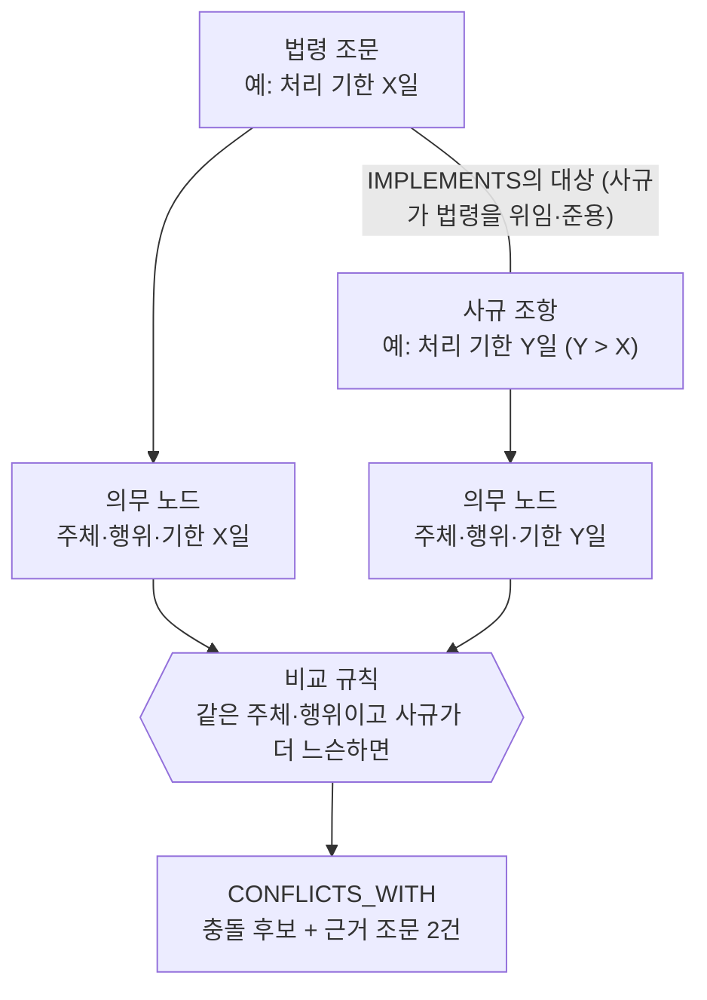
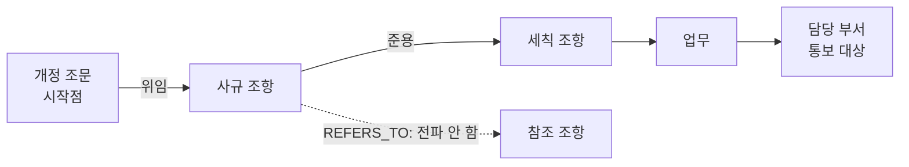
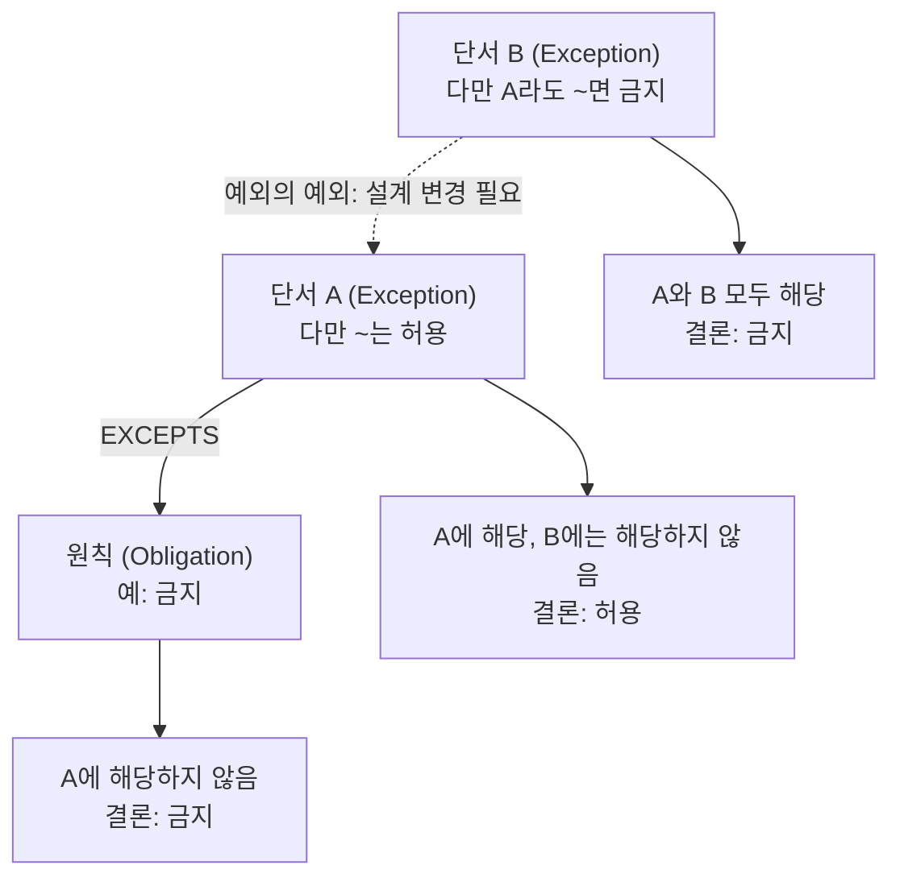
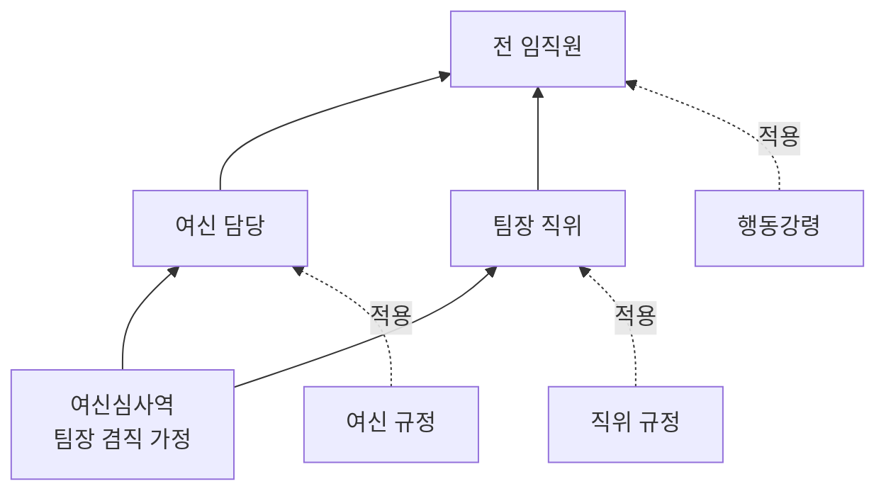
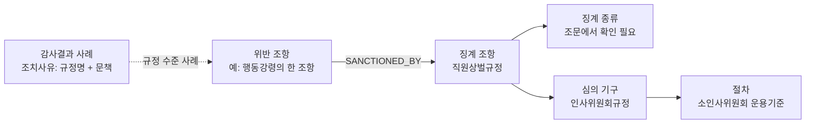
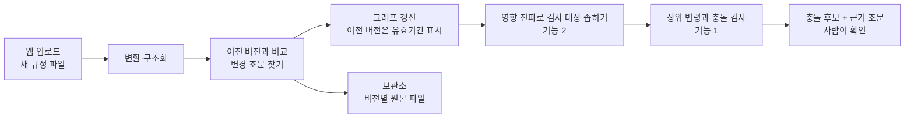

3.1 상위법 충돌 탐지3.1 상위법 충돌 탐지# 온톨로지 필요성 보강 검토 (SQL로 충분한가)

*작성일 2026-11-19 · 상태: 제안(팀 결정 전) · 근거: 멘토링 지적, ALIO 직접 확인(2026-11-19)*

## 1. 배경

멘토링에서 "이 프로젝트는 SQL로도 가능하니 온톨로지가 필요 없다"는 지적을 받았다. 이 문서는 (1) 지적이 맞는 부분과 틀린 부분을 구분하고, (2) 온톨로지의 필요를 보여 줄 추가 기능을 제안하며, (3) ALIO에서 추가로 얻을 수 있는 데이터를 확인한 결과를 기록한다.

## 2. 지적에 대한 정리

SQL의 재귀 CTE로 되는 일과 안 되는 일을 나눠야 한다.

| 질문 유형 | SQL로 가능한가 | 온톨로지가 더하는 것 |
|---|---|---|
| 조문 → 상위법 경로 따라가기 (고정·가변 깊이) | 가능 (재귀 CTE) | 우위 없음. 이 논거만으로는 방어할 수 없다 |
| 키워드·조건 조회 | 가능 | 우위 없음 |
| 관계 유형별 의미가 다른 전파 (위임은 전파, 참조는 비전파) | 가능하나 유형마다 쿼리를 따로 작성 | 관계 유형에 의미를 부여하고 규칙 하나로 처리 |
| 의무를 (주체·행위·기한·예외)로 정규화해 상위법과 비교 | 조문마다 비교 쿼리가 필요 | 타입이 있는 노드와 비교 규칙 |
| 직무·직위 계층에 따른 적용 대상 상속 | 계층과 조인이 겹쳐 쿼리가 급격히 복잡 | 계층(`⊂`)과 상속 규칙 |
| 새 관계 유형 추가 | 쿼리 N개 재작성 | 규칙 1개 추가 |

결론: "그래프라서 멀티홉이 된다"는 논거는 약하다. 온톨로지의 근거는 **규칙 추론, 의미 계층, 스키마 확장 비용** 세 가지이며, 아래 기능은 이 중 하나를 시연하도록 골랐다.

## 3. 추가 기능 후보

"SQL로도 되지 않나"에 답하려고 모은 후보다. 각 항목을 **무슨 기능인지 → 왜 온톨로지가 필요하다고 주장하는지 → SQL로는 어떻게 되는지(약점) → 우리 데이터 상황** 순으로 풀어 썼다. 1~6은 이전 검토, 7~9는 팀원이 낸 아이디어(데이터 변경·증강·추가)다.

| # | 기능 | 한 줄 | 우선순위(제안) |
|---|---|---|---|
| 1 | 상위법 충돌 탐지 | 사규의 기한·수치가 법령보다 느슨하거나 어긋나는지 점검 | P1 후보 |
| 2 | 법령 개정 영향 전파 | 개정 조문에서 영향받는 사규·업무·부서를 뽑기 | P1 후보 |
| 3 | 원칙·단서·예외 추론 | 겹친 단서가 있는 조항에서 최종 결론 내기 | 기존 설계 확장 |
| 4 | 직무 기반 적용 규정 해소 | "이 직무에 적용되는 규정 전부" | P1 후보 (근거는 1·2보다 약함) |
| 5 | 위반 → 제재 사슬 | 위반 조항에서 징계 종류·절차까지 잇기 | 데이터가 이미 있어 즉시 가능(§4) |
| 6 | 시점(as-of) 질의 | 과거 특정 시점의 규정 내용 묻기 | 보조 |
| 7 | 데이터 변경 (팀 아이디어) | 규정 파일을 웹에서 올리면 그래프가 갱신되고 버전별로 보관 | 2·6의 운영 시나리오 |
| 8 | 데이터 증강 (팀 아이디어) | AI로 유사한 규정·사례를 만들어 데이터 늘리기 | 평가용 보조 |
| 9 | 데이터 추가 (팀 아이디어) | 비슷한 금융기관의 내부규정 수집 | 후보, 가능 여부 미확인 |

도식 속 값(X일, Y일, 팀장 겸직 등)은 구조를 보이려는 **가상 예시**이며 실제 조문으로 확인한 사례가 아니다.

### 3.1 상위법 충돌 탐지 (입수 시점 검증)

- **쉬운 설명**: 법령이 "10일 이내"라고 했는데 사규가 "20일 이내"라고 하면 사규가 법보다 느슨하다. 이런 어긋남을 찾아 "충돌 후보"로 알려 준다. **기본 실행 시점은 데이터를 들일 때**다(개정된 법령을 넣을 때, 사규 개정안을 올릴 때). 현재 규정만 정적으로 훑는 방식은 보조로 둔다(§3.7).
- **작동 방식**: ① 법령 조문과 사규 조항에서 "~해야 한다" 문장을 뽑아 (누가·무엇을·언제까지·예외) 칸으로 나눠 같은 형태로 적는다(의무 노드 정규화). ② 사규가 법령을 위임·준용·인용하는 관계로 비교할 짝을 정한다. ③ "같은 주체·행위인데 사규 기한이 더 길면 충돌 후보" 같은 비교 규칙을 한 번 정해 모든 짝에 적용한다. 설계서는 `authority_rank`(위계 숫자)가 다른 쌍만 후보로 삼는다.
- **온톨로지가 필요하다는 주장**: 의무가 같은 형태의 노드여야 기계적으로 비교되고, 규칙 하나가 모든 짝에 적용된다.
- **SQL로는**: 의무 테이블을 만들면 비교 쿼리도 가능하다. 차이는 비교 대상 유형(기한·금액·허용 여부)이 늘 때 쿼리를 유형마다 더 써야 하느냐인데, 이는 §5 실험으로 확인할 주장이다.
- **데이터 상황**: 의무 추출이 가장 어렵다. 파일럿은 5~10건을 수작업으로 만들 계획이고, 자동 추출 품질은 검증되지 않았다.
- **이런 경우가 얼마나 있나 (2026-11-19 간이 집계)**: 사규 조문 중 법령을 인용하면서 기한·금액·횟수 같은 수치 표현이 있는 조문을 센 값이다. 수치 표현은 정규식(숫자 + 일·개월·년·원·%·명·배·회 등)으로 찾았고, 법령명은 코퍼스 275건과 이름으로 간이 대조했다.

  | 범위 | 조문 | 법령 인용 | 인용 + 수치 | 인용 + 수치 + 코퍼스 내 법령 |
  |---|---|---|---|---|
  | 사규 148건 | 3,405 | 526 | 86 | **45** |
  | 파일럿 17건 | 478 | 103 | 10 | **7** |

  - 마지막 열이 **비교 후보의 상한**이다. 실제 충돌은 이보다 훨씬 적다. 인용된 법령 조문과 사규 조문이 같은 사항의 수치를 다루는 경우만 비교되기 때문이다.
  - 법령 인용이 조 번호가 아니라 법령 이름 단위로만 기록돼 있어, 조문 대 조문 짝은 아직 만들지 못했다(그래서 상한).
  - 파일럿 7건은 행동강령 제26조(민법), 직원상벌규정 제13조의3·제14조(도로교통법 등), 인사규정 제14조(성폭력처벌법 등) 같은 조문이다. 상당수는 수치가 법령과 무관한 징계 기간·횟수일 수 있어 하나씩 확인하지 않았다.
  - **실제 충돌 건수는 모른다.** 은행 사규는 법령과 대조해 만들어지므로 현재 규정에는 충돌이 거의 없거나 0건일 가능성이 있다(추측이며 확인하지 않았다).
  - 따라서 이 기능은 "현재 규정에서 충돌을 많이 찾는다"가 아니라 **"새 데이터를 들일 때 기존 데이터와의 어긋남을 찾는다"**로 설명한다(§3.7의 입수 시점 검증). 탐지율은 §3.8의 충돌을 심은 평가 데이터로 잰다.

### 3.2 법령 개정 영향 전파

- **쉬운 설명**: 법령 조문이 개정되면, 그 조문을 위임·준용하는 사규 → 그 사규가 규율하는 업무 → 담당 부서까지 "다시 봐야 할 목록"으로 뽑는다.
- **작동 방식**: 선마다 의미가 다르다. **위임·준용**은 법이 바뀌면 영향이 따라가는 선이고, 단순 **참조**(`REFERS_TO`)는 그냥 언급이라 따라가지 않는다. 몇 단계(법 → 시행령 → 규정 → 세칙 …)까지 갈지는 미리 모른다(가변 깊이).
- **온톨로지가 필요하다는 주장**: 관계 유형에 의미를 붙여 두면 "이 유형은 전파한다"는 규칙 하나로 처리된다.
- **SQL로는**: 재귀 CTE(자기 자신을 반복 호출해 연결된 행을 따라가는 쿼리)로 가능하다. 관계 유형별 조건을 쿼리마다 넣어야 하는 점이 다르다.
- **데이터 상황**: 조문 간 위임·준용 간선은 있다. "업무"와 "담당 부서" 노드는 직제규정 등에서 새로 만들어야 하며 미확인이다. §3.7(데이터 변경)과 이어진다.

### 3.3 원칙·단서·예외 추론

- **쉬운 설명**: "원칙적으로 금지한다. 다만 A는 허용한다. 다만 A라도 B면 금지한다"처럼 조건이 겹친 조항에서, 특정 상황의 최종 결론을 낸다.
- **작동 방식**: 설계서에서 단서는 `Exception` 노드이고 `EXCEPTS`로 대상 의무(`Obligation`)에 걸린다. `authority_rank`는 규범의 위계 숫자(1~8, 법령이 앞이고 사규가 뒤)로, 규정끼리 부딪힐 때 우선순위의 기준이다. 이전 표의 `exceptionOf`는 설계서에 없는 이름이라 `EXCEPTS`로 바로잡았다.
- **주의**: 설계서의 `EXCEPTS`는 Exception → Obligation만 정의한다. "예외의 예외"(Exception → Exception)를 쓰려면 관계를 추가하는 설계 변경이 필요하다.
- **SQL로는**: 단서 깊이가 고정이면 조인으로, 가변이면 재귀로 된다. 우위는 불분명하다.
- **데이터 상황**: 단서·예외는 추출 층의 **후보**이며, 정의 목록이 긴 조문은 문장 경계가 거칠다(설계서 D10).

가상 예시다. 점선은 현재 설계에 없는 관계이고, 실선은 설계서에 있는 `EXCEPTS`다.

가장 안쪽 예외(B)부터 따져 올라가며 결론을 정한다. 이 순서를 규칙으로 두는 것이 온톨로지 쪽 주장이다.

### 3.4 직무 기반 적용 규정 해소

- **쉬운 설명**: "나는 어떤 규정을 지켜야 하나?"에 답한다. 규정을 직무·직위에 연결해 두고, 질문한 사람에게 적용되는 규정을 모아 준다.
- **문제**: 규정마다 적용 대상이 다르다(행동강령은 전 임직원, 임원 복무규정은 임원, 국외직원인사규정은 국외 근무자). 한 사람은 직무·직위·겸직으로 여러 신분을 가진다.
- **작동 방식**: ① 이 사람의 모든 신분을 찾는다 ② 각 신분의 상위 신분으로 올라간다(여신심사역 → 여신 담당 → 전 임직원) ③ 올라가는 길마다 붙은 규정을 모은다 ④ 중복을 제거한다.
- **온톨로지가 필요하다는 주장**: "상위 직무의 규정을 하위 직무가 물려받는다"는 상속 규칙을 한 번 정의하면 직무가 늘어도 질의를 다시 쓰지 않는다.
- **SQL로는**: 직무 테이블에 부모 컬럼을 두면 재귀 쿼리로 같은 결과가 나온다. 차이가 생긴다면 관계 유형이 늘 때 고쳐야 할 쿼리 수이며, 지금은 주장이다.
- **데이터 상황**: 시범 범위 17개 사규에 적용 대상이 갈리는 문서(임원, 국외직원, 국외현지직원)가 있다. 조항별 적용 대상 추출과 직무 계층은 아직 없고 사람이 만들어야 한다. IBK 사규가 직무 단위로 적용 대상을 명시하는 비율은 **미확인**이며, 직위 단위가 대부분이면 이 기능의 설득력은 더 낮아진다.

적용 규정 = 위쪽 경로의 규정 합집합(행동강령 + 여신 규정 + 직위 규정).

### 3.5 위반 → 제재 사슬

- **쉬운 설명**: "행동강령 제X조를 위반하면 어떻게 되나?"에 대해, 위반 조항에서 출발해 적용되는 징계 조항 → 징계 종류 → 심의 절차(인사위원회)까지 이어서 답한다. 이 규정들은 서로 다른 문서에 흩어져 있다.
- **온톨로지가 필요하다는 주장**: 흩어진 규범을 위반 유형·징계 유형 같은 개념으로 연결한다.
- **SQL로는**: 문서 간 연결 테이블을 두고 조인하면 가능하다. 우위는 작다. 설계서의 `SANCTIONED_BY`는 사규 안에서 "위반 시 ~에 따라 징계"라고 **명시한 경우만** 잇는 후보 관계다.
- **데이터 상황**: 필요한 문서 12개가 이미 수집돼 있다(§4.1). 감사결과(§4.2)가 규정 수준의 "위반 → 조치" 사례를 보강한다.
- **징계처분 결과(ALIO 8-2)로 확인한 것**: 징계종류 4가지(견책·감봉·정직·면직)는 직원상벌규정 제10조 "징계의 종류 및 기준"과 대응되고, 징계사유의 취업규칙·행동강령은 사규 148건에 있다. 그래서 "취업규칙 위반 → 징계종류" 수준의 규정 단위 연결과 건수·유형 통계는 만들 수 있다. 반면 사유가 4가지뿐이고 76%(1Q 173행 중 132행)가 "취업규칙 위반" 한 가지이며 조문 번호가 없어서, 조항 단위 "위반 → 제재" 정답으로는 쓰지 못한다. 징계종류 4가지(면직·정직·감봉·견책)는 직원상벌규정 제10조에 모두 있음을 확인했다.
- **직원상벌규정 별표 확인(2026-11-19)**: 별표는 구조화 데이터(`parsed`)에는 없고 변환 텍스트(`ibk_converted/text`)에 표가 한 줄씩 풀린 채 남아 있다(설계서 D11과 일치). 읽어 본 결과:
  - **[별표 3] 징계의 효과**: 종류(면직·정직·감봉·견책)별로 신분상 조치(면직은 파면, 정직은 정직기간 + 18월 승진제외·승급연장, 감봉은 감봉기간 + 12월, 견책은 6월), 근속연수 포함 여부, 급여상 제재가 나온다. 주 2)는 금융관련 범죄·성폭력·음주운전 등이면 승진제외·승급연장에 6개월을 가산한다고 한다. 표가 풀려 있어 급여상 제재의 칸 배치는 추정이며 원문 표와 대조하지 않았다. 제14조 제1항이 이 별표를 가리킨다.
  - **[별표 1] 징계양정기준(+ 1-2 채용 비위, 1-3 성 관련 비위, 1-4 음주운전)**: 위반 유형과 정도(극심·심함·경함)에 따라 징계종류의 범위(예: 면직~감봉)를 정한다.
  - **[별표 2] 징계양정감경기준**: 감경 전 징계가 어떻게 한 단계 내려가는지. 제13조의2는 징계 후 제재기간 중 다시 징계받으면 **가중**할 수 있다고 한다.
  - 의미: 위반 유형 + 정도 → 징계 범위(별표 1) → 감경·가중(별표 2, 제13조의2) → 효과(별표 3, 제14조, 6개월 가산)로 이어지는 **규칙 사슬**이 실제 사규 안에 있다. 단순 조인보다 규칙 추론에 가까워 기능 5의 근거를 다시 볼 여지가 있다(§3.10 5번은 아직 그대로).
  - 한계: 별표가 표로 풀려 있어 이 규칙을 쓰려면 사람이 구조화해야 한다. 자동 추출 가능성은 확인하지 않았다.

문서 이름은 §4.1의 실제 사규이지만, 어느 조항이 어느 조항으로 이어지는지는 아직 원문으로 확인하지 않은 **제안 구조**다.

### 3.6 시점(as-of) 질의

- **쉬운 설명**: "2024년 3월 기준으로 이 조항은 어떤 내용이었나"처럼 과거 시점의 규정을 묻는다.
- **작동 방식**: 개정 이력과 유효기간(시작일·종료일)을 조항과 관계에 붙인다.
- **SQL로는**: 이력 테이블로 충분히 된다. 온톨로지 우위는 작아서 보조 기능으로 둔다. 다만 §3.7의 버전 관리가 있으면 거의 공짜로 따라온다.

### 3.7 데이터 변경과 입수 시점 검증: 규정 파일 업로드, 버전 관리 (팀 아이디어)

- **쉬운 설명**: 법령이나 사규가 바뀌면 사용자가 웹에서 새 규정 파일을 올린다. 시스템이 파일을 변환하고, 이전 버전과 비교해 그래프 DB의 데이터를 바꾸고, 규정 파일을 버전별로 정리해 보관한다. 이때 **새 데이터를 들이는 순간 상위 법령과 어긋나는지 검사**한다. 기능 2(영향 전파)로 검사 대상을 좁히고 기능 1(충돌 탐지)로 비교하는, 1·2를 묶은 운영 시나리오다.
- **입수 시점 검증의 세 경우**:

  | 넣는 것 | 검사 내용 | 현실성(판단) |
  |---|---|---|
  | 개정된 법령 | 이 법령을 위임·준용하는 기존 사규가 이제 법보다 느슨해졌는가 | 가장 현실적이다. 법이 바뀌면 사규가 뒤따르는 시차가 있다 |
  | 사규 개정안(초안) | 확정 전에 상위 법령과 어긋나는지 | 쓸모가 크다. 개정 후에 찾는 것보다 개정 전에 막는 편이 낫다 |
  | 새 법령 대 그 상위 법령 | 시행령이 법률보다 넓은지 | 가장 드물 것으로 짐작한다(법제처 심사를 거침, 확인하지 않음). 앞의 둘에 집중한다 |

- **정직한 평가**: 업로드·변환·버전 보관은 DB 종류와 무관한 엔지니어링이라 SQL로도 똑같이 된다. **이것만으로는 온톨로지 근거가 되지 않는다.** 근거가 되는 부분은 갱신 뒤의 ① 영향받는 조항·업무·부서 계산(기능 2) ② 충돌 재검사(기능 1) ③ 과거 시점 질의(기능 6)다. 입수 시점 검사도 SQL로 구현할 수 있고, 온톨로지 쪽 주장은 "비교 규칙 하나가 모든 짝에 적용된다"는 것뿐이어서 §5 실험으로 확인할 대상이다.
- **시연 한계**: 시연에는 개정 전·후 두 버전이 필요하다. 실제 법령 개정 사례에서 구할 수 있는지는 **미확인**이다. 안 되면 충돌을 심은 가상 개정안(§3.8)으로 시연하게 되며, 이 경우 "실제 데이터에서 발견했다"고 말할 수 없다. 의무 추출(기한·수치를 칸으로 나누는 작업)의 품질도 검증되지 않았다.
- **함께 정해야 할 것**:
  - 개정으로 조문이 삭제·이동되면 기존 참조 간선을 다시 해소해야 한다(설계서 D1·D8).
  - 이전 버전 노드를 유효기간을 붙여 남길지, 덮어쓸지.
  - 이전 버전과 새 버전의 같은 조문을 어떻게 같다고 판정할지.
  - 업로드 권한과 검증(누가 올릴 수 있고, 잘못된 파일을 어떻게 막는지).
- **범위 부담**: MVP 밖일 가능성이 크다. 시연은 "개정 전·후 두 버전 파일 → 영향 목록"으로 줄이는 안을 제안한다. 개정 전·후 두 버전을 함께 구할 수 있는지는 **미확인**이다.

### 3.8 데이터 증강: AI로 유사 데이터 생성 (팀 아이디어)

- **쉬운 설명**: 실제 사규를 본떠 AI가 가상의 규정·위반 사례·질문을 만들어 데이터 양을 늘린다.
- **정직한 평가**: 증강 자체는 온톨로지가 필요하다는 근거가 아니다. 필요성을 **검증하는 도구**로서 가치가 있다.
- **쓸모**:
  - 충돌 탐지 평가: 충돌을 일부러 심은 가짜 규정 쌍을 만들면 정답을 알고 있으므로 탐지율을 잴 수 있다.
  - 규모 시험: 시범 범위가 17개 문서라 SQL과 차이가 안 날 가능성이 큰데, 문서 수를 늘려 차이가 생기는지 볼 수 있다.
  - 질문 증강: 정답 있는 질문 세트를 늘린다.
- **위험**: AI가 만든 규정은 실제 규정의 특성을 반영하지 못할 수 있어 "실제 성능"의 증거가 되지 못한다. 가짜 데이터가 실제와 섞이면 신뢰가 깨지므로 `synthetic` 표시로 분리해야 한다. 정답을 만든 AI와 평가하는 AI가 같으면 편향이 생긴다. "사례 본문 비저장" 정책과의 관계도 확인이 필요하다.
- **제안**: 평가용 보조로만 쓰고 실제 코퍼스와 분리한다.

### 3.9 데이터 추가: 비슷한 금융기관의 내부규정 (팀 아이디어)

- **쉬운 설명**: 비슷한 금융 공공기관의 내부규정을 같은 방식으로 수집해 IBK 규정과 나란히 비교한다. 이전 검토에서 KDB, 신용보증기금 등을 후보로만 적어 뒀고 게시 여부는 확인하지 않았다(§4.4).
- **온톨로지가 필요하다는 주장**: 기관마다 조문 구조와 용어가 다르다("임직원"과 "직원", 징계 종류의 이름 등). 같은 의미를 공통 개념(`Concept`)으로 묶어야 "같은 상위법을 각 기관이 어떻게 구현했나", "IBK에 없는 의무가 다른 기관에는 있나"를 물을 수 있다. 의미를 맞추는 문제라서 기관마다 컬럼을 새로 매핑해야 하는 SQL보다 온톨로지의 설득력이 커질 수 있는 영역이다. 다만 이것도 주장이며 검증이 필요하다.
- **확인하지 못한 것**: 다른 기관의 게시 여부·건수·형식·이용 조건. ALIO 기관별 조회로 같은 방식으로 확인할 수 있다.
- **위험**: 주제(IBK 사규 + 상위법)에서 범위가 넓어진다. 기관별 형식이 달라 정제 비용이 크다. 먼저 한 기관만 시범으로 하는 안을 제안한다.

### 3.10 기능별 온톨로지 근거 강도 (제안, 검증 전)

| # | 근거 강도 | 이유 | 확인 상태 |
|---|---|---|---|
| 1 | 약~중 (이전: 중~강에서 낮춤) | 규칙 한 번으로 모든 짝을 비교한다는 점은 유효하다. 그러나 현재 규정의 비교 후보가 상한 45건(파일럿 7건)이고 실제 충돌은 0건일 수도 있어 "현재 데이터에서 충돌을 찾는다"로는 보여 주기 어렵다. 개정 후 재검사(3.7)와 충돌을 심은 평가 데이터(3.8)가 있어야 시연된다 | 후보 수는 간이 집계(3.1), 실제 충돌 건수·의무 추출 품질은 미확인 |
| 2 | 중 (이전: 중~강에서 낮춤) | 관계 유형별 전파 의미는 유효하나, 업무·담당 부서 노드가 아직 없고, 개정 전·후 두 버전도 확보 여부가 미확인이라 시연 근거를 데이터로 받치지 못했다 | 위임·준용 간선은 있음, 노드·두 버전은 미확인 |
| 3 | 약~중 | 우위 불분명. 예외의 예외는 설계 변경 필요 | 미측정 |
| 4 | 약 | 부모 컬럼 + 재귀로도 됨. 직무 단위 규정 비율 미확인 | 미측정 |
| 5 | 약~중 (이전: 약에서 올림) | 문서 간 연결만이면 조인으로 가능하다. 그러나 직원상벌규정에 위반 유형·정도 → 징계 범위(별표 1) → 감경·가중(별표 2, 제13조의2) → 효과와 6개월 가산(별표 3, 제14조)으로 이어지는 규칙 사슬이 있어 규칙 추론 근거가 생긴다. 추가 수집도 필요 없다 | 필요 문서 12개 수집됨, 별표 1~3 내용 확인(§3.5). 표가 풀려 있어 사람이 구조화해야 하고 자동 추출은 미확인, 사슬을 SQL과 비교한 실험은 아직 없음 |
| 6 | 약 | 이력 테이블로 가능 | 미측정 |
| 7 | 2·6에 의존 | 파이프라인 자체는 DB 무관 | 두 버전 확보 미확인 |
| 8 | 근거 아님 | 검증 도구 | - |
| 9 | 중 (검증 필요) | 기관 간 의미 정렬이 SQL에서 어려울 수 있음. 데이터 확보 미확인 | 타 기관 게시·이용 조건 미확인 |

1번을 낮춘 근거는 §3.1의 간이 집계 하나뿐이다. 나머지 행은 이번에 데이터로 다시 확인하지 않았다.

현재 판단은 이렇다. 단독으로 가장 설득력 있는 기능은 없고, **1·2를 "법령 개정 → 영향 전파 → 충돌 재검사"라는 한 시나리오로 묶는 것**(3.7)이 가장 낫다. 9가 가능하면 보강한다. 4는 데이터가 받쳐 주지 않으면 빼는 쪽이 낫다. 이 강도 표는 판단이며 §5 실험 결과로 바뀔 수 있다.

## 4. ALIO 추가 데이터 확인 결과

**확인 방법**: ALIO 항목별 공시 목록(alio.go.kr/item/itemList.do)과 기관별 조회 화면이 호출하는 JSON으로 IBK기업은행(기관 ID `C0127`, 기타공공기관·금융위원회 소관)의 항목별 게시 건수를 조회했다(2026-11-19). 본문은 §4.2에서 일부를 열어 확인했다.

**기준 검증**: 항목 2(내부규정)의 게시 건수가 148건으로, 우리가 수집한 사규 수(148)와 일치한다.

| 항목 번호 | 항목 | IBK 게시 현황 | 온톨로지 활용 | 판정 |
|---|---|---|---|---|
| 38-2 | 내부·외부 감사결과 | **211건**, 2021-01 ~ 2026-11. 제목 유형: 내부감사 결과, 연간감사보고서 | 지적 → 위반 조항 → 처분 연결, 평가 정답셋 후보 | 상세 화면은 제목·기준일·첨부 HWP 1개뿐. **HWP 1건 확인**: 감사종류·기간·대상 부점(익명)·조치(문책)·조치사유("취업규칙 등 위반")가 있음(§4.2) |
| 30-1 | 이사회 회의록 | **75건**, 2021-01 ~ 2026-11 | 의결 → 규정 개정 연결 | 상세 화면은 38-2와 같은 구조. **HWP 1건 확인**: 안건 번호·제목·논의 결론만 있고, 규정 개정 안건은 없었음(§4.2) |
| 8-2 | 징계처분 결과 | 2026년 1~3분기 게시(4분기 미게시). 1Q 보고서에 2021~2025년 173행, 2Q 29행, 3Q 7행 | 위반 → 제재 사슬의 사례 | **구조 확인(2026-11-19)**: 첨부 없이 화면 표로 공시. 열은 징계처분일·징계종류·징계사유·고발여부 4개이고 개인·부점 식별 정보는 없다. 징계종류는 견책·감봉·면직·정직 4가지, 징계사유는 4가지(1Q 기준 취업규칙 위반(행동강령 포함) 132, 여신업무 불철저 35, 수신 3, 외환 3). 조문 번호 없음. CSV 209행을 `data/alio_징계처분결과_20261119/`에 저장 |
| 49-2 | 수의계약 | 2021~2026년 1분기 엑셀 게시(연도별 파일 6개) | 계약 유형 → 국가계약법·사규 요건 판정 | 게시 확인. 엑셀 열 구조 미확인 |
| 15-3 | 단체협약 정보 | 2026년 1건 | 인사 규정과의 상충 점검 | 게시 확인. 본문 미확인 |
| 47-2 / 47-3 | 감사원·주무부처 지적사항 | **게시 없음** | - | 사용 불가 |
| (위임전결 규정) | 항목 2 내부규정 148건 중 | **제목에 "전결"·"위임"이 들어간 문서 없음.** 직제규정은 있음 | 결재선 추론 | 별도 문서는 없음. 직제규정·인사규정 안에 포함됐을 가능성은 미확인 |

### 4.1 사규 148건에서 확인된 제재·감사 사슬용 문서

`직원상벌규정`, `인사위원회규정`, `소인사위원회 운용기준`, `인사규정`, `복무규정`, `내부통제 점검·조사 및 조치에 관한 세칙`, `준법제보제도 운영규정`, `감사직무규정`, `기업은행 윤리강령`, `직제규정`, `이사회규정`, `내부통제규정`.

이미 수집한 데이터만으로 "위반 → 상벌 기준 → 심의 기구(인사위원회) → 절차"를 이을 수 있다. 추가 수집이 필요 없다는 점이 기능 5의 강점이다.

### 4.2 첨부 HWP 본문 확인 (각 최신 1건, 2026-11-19)

ALIO에서 HWP 2개(48KB, 46KB)를 내려받아 기존 방식(olefile)으로 텍스트만 읽었다. 처음에는 원본을 저장소 밖 임시 폴더에 두었으나, 이후 받은 파일 전체를 `data/alio_추가수집_20261119/`로 옮겼다(커밋 전, 이용 조건 미확인).

**감사결과(2026년도 내부감사 결과)** — 구조화된 항목이 있다.

| 항목 | 내용(요지) |
|---|---|
| 감사종류 / 감사기간 | 기강감사 / '25. 7. 8. |
| 감사대상부점 | "○○지역본부" (익명 처리) |
| 감사목적 및 범위 | 제보 등에 따른 기강감사 실시 |
| 감사결과 조치사항 | 문책 |
| 조치사유 | 「취업규칙」 등 위반 |
| 통보사항·반론·비공개 | 없음 |

- **쓸 수 있는 점**: 조치사유에 위반한 **규정명**이 나온다. "위반 규정 → 조치(문책)"를 잇는 사례 데이터로 쓸 수 있고, 기능 5(위반 → 제재 사슬)와 맞닿는다.
- 대상 부점은 익명이라 사람·부서 식별 문제는 없었다.

**추가 확인: 감사결과 10건 더 (2021~2026년 연도별, 총 11건)**

| 구분 | 결과 |
|---|---|
| 양식 | 11건 중 10건이 위 표준 양식(감사종류·기간·조치·조치사유). 1건(2021-04)은 표 형태로 대상 부점별 조치와 사유("담보물 운영 및 관리 관련")를 나열하고 규정명이 없음 |
| 감사종류 | 기강·특정·상각·종합·특별·일반감사 |
| 조치 | 문책, 문책사항 등, 개선사항(등), 주의사항 |
| 조치사유에 나온 규정명 | 취업규칙, IT보안업무지침, 여신업무취급세칙(2건), 리스크관리 규정, 기업은행임직원행동강령(2건), 기업은행 윤리강령, 외국환규정, 가계대출상품취급세칙 |
| 조문 번호 | **11건 모두 없음** ("…관련 등", "…등 위반") |

우리 사규 148건과 제목으로 대조한 결과(ALIO 제목 검색):

- **있음(5종)**: 취업규칙, 리스크관리규정, 기업은행임직원행동강령, 기업은행 윤리강령, 외국환규정.
- **없음(3종)**: IT보안업무지침, 여신업무취급세칙, 가계대출상품취급세칙. 148건에 포함되지 않은 규정이다(비공개이거나 다른 항목으로 공시됐을 수 있으나 미확인).
- 이전 메모의 "취업규칙은 인사규정 등으로 추정"은 틀렸다. `취업규칙`이 148건에 직접 있다.

**판단**: 감사결과는 **규정(문서) 수준의 "위반 → 조치" 사례**로 쓸 수 있고, 대부분(10/11건) 같은 양식이라 추출도 쉽다. 반면 조문 번호가 없어 조문 단위 정답셋은 못 되고, 규정명 8종 중 3종은 우리 코퍼스 밖이라 연결 가능한 비율은 절반 남짓(5/8종, 건수 기준으로는 미집계)이다. 표본은 의도적으로 연도별로 고른 11건이며 무작위 표본이 아니다.

**이사회 회의록(제15차)**

- 구성: 회의일시·장소·출석, 안건 번호와 제목, 안건 요지, "참석자 발언 요지: 안건에 동의", 결론("원안대로 의결"). 임원 이름은 마스킹돼 있다.
- 안건 3건 중 1건은 비공개, 나머지는 펀드 출자와 자기주식 소각이었다. **규정 개정 안건은 없어서** "의결 → 규정 개정" 연결의 근거로는 이 1건이 약하다. 다른 회차에 개정 안건이 있는지는 미확인이다.
- 개별 발언이 없고 결론이 단순해서 추론 소재로는 빈약하다.

**종합(제안)**: 감사결과는 "규정 수준 위반 사례"로 P2 보조 데이터로 쓰고, 조문 수준 정답은 직접 만든 시나리오로 보완한다. 이사회 회의록은 우선순위를 낮춘다.

### 4.3 수집 여부 결정안 (감사결과·이사회 회의록)

본문은 §4.2에서 열어 봤다(감사결과 11건, 이사회 1건). 아래는 **제안**이며 팀 결정 전이다.

| 대상 | 근거 | 결정안 |
|---|---|---|
| 감사결과 211건 | 11건 중 10건이 같은 양식(감사종류·기간·조치·조치사유). 조치사유에 규정명은 나오나 조문 번호는 11건 모두 없음. 규정명 8종 중 5종만 사규 148건에 있음 | **보조(P2)로 수집.** 규정 수준 "위반 → 조치" 사례로만 쓰고 조문 수준 정답셋으로는 쓰지 않는다 |
| 이사회 회의록 75건 | 1건만 읽었고 규정 개정 안건이 없었음. 발언은 "안건에 동의", 결론은 "원안대로 의결"뿐 | **지금은 수집하지 않는다.** 다른 회차에 개정 안건이 있는지 모르므로 필요해지면 재검토 |

감사결과 수집 방식(제안):

- 211건 전부가 아니라 시범 범위 사규 17개와 규정명이 겹치는 건부터 받는다(현재 11건 중 취업규칙·행동강령·윤리강령 건이 해당).
- 상세 화면의 공시 담당자 이름·부서·전화번호는 저장하지 않는다.
- 본문은 규정명과 조치 유형만 구조화한다.
- 이 11건은 연도별로 고른 표본이라 나머지 200건의 양식·분량은 모른다. 쪽수도 한글 프로그램에서 확인하지 못했다(본문 글자 수 260~710자로 1쪽 분량으로 보임).
- 재배포·이용 조건을 확인하기 전에는 HWP 원본을 팀 저장소에 올리지 않는다.

### 4.4 이전 제안 중 철회·수정

- 이전 제안의 "임원 보수·복리후생 공시"와 "타 금융공기업 규정(KDB, 신보 등)"은 이번에 게시 여부를 확인하지 않았다. 후보로만 남긴다.
- "위임전결 규정 수집"은 별도 문서가 없으므로 **직제규정·인사규정 본문에서 결재 권한 조항을 추출하는 작업**으로 바꿔야 한다.
- "감사원·주무부처 지적사항"은 IBK에 게시가 없어 후보에서 제외한다.

### 4.5 확인하지 못한 것

- 감사결과 211건 중 **11건만** 읽었고(연도별 선별), 이사회 회의록은 1건만 읽었다(§4.2). 나머지 건의 양식과 규정명은 미확인이다. 수집은 기존 HWP5 추출(olefile)을 그대로 쓸 수 있다.
- 상세 화면에는 기관 공시 담당자의 이름·부서·전화번호가 표시된다. 수집 시 이 영역은 저장하지 않는다.
- ~~징계처분 결과가 사례 본문을 포함하는지~~ → 확인함. 사례 본문은 없고 개인·부점 식별 없는 4열 표(징계처분일·징계종류·징계사유·고발여부)다. "사례 본문 비저장" 정책과 충돌하지 않는 것으로 보이나, 정책 해석은 팀이 확인한다. 이용·재배포 조건은 아직 확인 전이다.
- 위 자료의 **재배포·이용 조건**(기존 사규와 마찬가지로 확인 전).

## 5. 검증 실험 제안: F 베이스라인

기존 A–E 비교에 **F: SQL 재귀 CTE 베이스라인**을 추가한다.

1. 질문을 유형별로 나눈다: 단순 조회 / 고정 깊이 조인 / 충돌 탐지 / 영향 전파 / 직무 해소.
2. 같은 질문 세트를 F(SQL)와 A–E에 적용해 표준 9지표로 비교한다.
3. 새 관계 유형 1개를 추가할 때의 작업량(규칙 1개 대 쿼리 N개)도 측정한다.
4. 단순 조회·고정 깊이에서 격차가 없으면 그대로 보고한다. 격차가 규칙 추론 유형에서만 나타나면 그것이 온톨로지의 근거다. 격차가 전혀 없으면 범위를 조정한다는 결정 기준도 미리 정해 둔다.

## 6. 팀이 결정할 것

1. 기능 1·2·4를 P1 후보로 올릴지(MVP 범위 재조정 필요).
2. 기능 5(위반 → 제재 사슬)를 기존 데이터로 먼저 시연할지.
3. 감사결과·이사회 회의록을 수집할지(본문 확인은 완료, 결정안은 §4.3): 감사결과는 보조(P2)로 시범 범위와 겹치는 건부터, 이사회 회의록은 제외하는 안에 동의하는지.
4. F 베이스라인을 A–E 비교에 추가할지, 그 판정 기준을 어떻게 둘지.
5. 팀 아이디어 3건의 범위: 데이터 변경(§3.7)은 "개정 전·후 두 버전 → 영향 목록" 시연으로 줄일지, 데이터 증강(§3.8)은 평가용 보조로 분리해 쓸지, 데이터 추가(§3.9)는 한 기관만 시범 확인할지.
6. 확정되면 기획 보고서(§1.1, §5.2, 부록 D)와 온톨로지 설계서에 "SQL 대비 필요성" 절을 반영.
