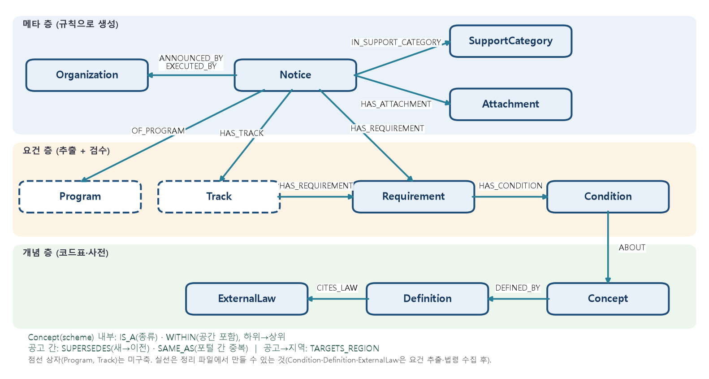
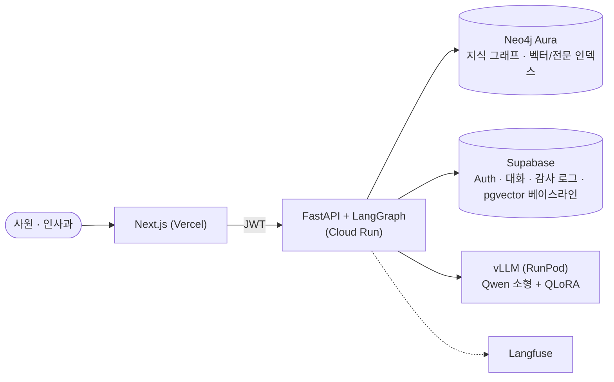

# 프로젝트 요약본 (코칭 사전 공유용)

> 엔코아 AI 캠퍼스 MLE 1기 최종 프로젝트 2팀 · 작성일 2026-11-18
> 5분 안에 읽을 수 있도록 핵심만 담았습니다. 상세는 [README](../README.md)와 각 설계서를 참고해 주세요.

## 1. 한 줄 소개

IBK기업은행 사규와 상위 국가 법령을 **지식 그래프**로 구조화해, "이 행동·사안이 어느 규정의 어느 조항에 해당하는가"를 **근거 조문과 인용·위임·예외를 따라간 추론 경로**와 함께 알려 주는 규정 준수 검토 보조 서비스. 근거가 없으면 지어내지 않고 **"근거 없음"/`판단 불가`** 로 답합니다.

- 주제: 기업 규정 준수 여부 검증을 위한 온톨로지 및 Multi-hop 추론 기반 지식 그래프 시스템
- 실제 IBK 사내 시스템이 아닌, **ALIO 공개 규정을 쓰는 교육 프로젝트**이며 징계·법적 판단을 대신하지 않습니다.

## 2. 왜 이 문제인가

- 사규는 여러 문서에 흩어져 있고, 한 조문이 다른 규정·법령을 **인용**하거나 세부를 **위임**하며 **단서(예외)** 가 붙습니다.
- 키워드·벡터 검색만으로는 조항 사이의 관계를 따라가지 못합니다.
- 틀린 규정 안내는 답하지 않는 것보다 해롭습니다 → **근거 기반 답변과 보류(판단 불가)** 가 핵심입니다.

## 3. 서비스: 같은 그래프 위의 두 모드

| | 사원 모드 | 인사 모드 |
| --- | --- | --- |
| 대상 | 신입을 비롯한 일반 사원 | 인사과 직원 |
| 목적 | 내 행동·업무가 규정에 어긋나는지 확인·예방 | 사안이 어떤 조항에 해당할 수 있는지 검토 |
| 출력 | 판정 + 근거 조문 + 예외 + 쉬운 설명 | 조항 후보 + 요건별 충족 여부 + 상위 법령 + 징계·절차 규정 |
| 접근 | 로그인 사용자 | 관리자가 지정한 인사과 역할만 |
| 저장 | 본인 대화(본인만 열람·삭제) | **사안 본문 미저장**, 조회 이력만 감사 로그 |

- 인사 모드는 **사안 기반 검토로 한정**합니다(근태·메일 연계 자동 탐지는 개인정보·근로자 감시 문제로 제외).
- 결과는 "위반 가능성이 있는 조항 후보"로 표현하고, 징계 여부·수위는 사람이 정합니다.

### 동작 예시 (설계)

- (인사) "음주운전을 한 직원에게 적용될 징계 조항과 법령은?" → 직원상벌규정 제9조·제14조를 **조항 후보**로 제시하고 인용을 따라 도로교통법 제44조까지 연결. 징계 수위가 적힌 별표는 수집하지 않아 `판단 불가`로 두고 확인 안내.
- (사원) "거래처 선물을 받아도 되나요?" → 행동강령·이해충돌방지 조항과 예외, 상위 법령을 근거와 함께 제시.
- 규정에 없는 질문 → "근거 없음".

## 4. 접근 방식

1. **온톨로지 그래프(Neo4j)** 로 사규·법령을 구조화
   - 결정 층(파서): `Document → Chapter → Article → Clause`, 참조(`REFERS_TO`), 인용(`CITES`), 상하위 법령(`IMPLEMENTS`), 위임(`DELEGATES_TO`)
   - 추출 층(모델+검수): `Obligation`(의무), `Exception`(단서), `Role`, `Concept`, 모든 관계에 원문 근거(`evidence`)
   - `authority_rank`(법률 1 … 사규 세칙·지침 8)로 상하위 위계 통일
2. **에이전트(LangGraph)**: 입력 검사 → 질의 분류 → 하이브리드 검색(벡터+전문) → 그래프 확장(≤3 hop) → 근거 평가(CRAG) → 근거로만 답 → 근거 검증 → 출력 검사
3. **자체 호스팅 소형 모델**: Qwen 소형 + QLoRA + 양자화, RunPod vLLM 서빙 (규정·질의를 외부 API로 보내지 않음)
4. **안전장치**: 역할 접근(DB·API 이중), 감사 로그, "후보" 표현 강제, 개인정보 입력 필터, NeMo Guardrails(판정 전용)

## 5. 아키텍처 (설계)

- Neo4j는 질의용 그래프(재생성 가능한 파생물), Supabase는 시스템 기록.
- pgvector는 **"벡터 단독 RAG" 베이스라인** 비교용으로만 사용 → GraphRAG 이득을 측정.

## 6. 데이터 (2026-11-17 직접 센 값)

| 항목 | 값 |
| --- | --- |
| 사규 | 148종(HWP 140, PDF 8), 조문 3,532, 항 6,878 |
| 상위 법령 | 275건(법률 105·시행령 100·시행규칙 60·고시 7·세칙 3), 조문 25,945 |
| 사규의 외부 인용 | 1,012건 — 사규 연결 29%, 법령 정식명칭 일치 41%, 나머지는 약칭·ALIO에 없는 내규 |
| 조 번호 포함 법령 인용 | 대상 조문 존재 93%(97/104) |
| 시행령·시행규칙 → 모법 | 157/157 이름 규칙으로 연결 가능 |

- 출처: ALIO(사규, 수동 다운로드), 법제처 국가법령정보센터 OPEN API(법령). 재배포 조건·HF 데이터 라이선스는 **확인 전**.

## 7. 현재 상태 (정직하게)

| 영역 | 상태 |
| --- | --- |
| 사규 수집·변환, 상위 법령 수집·변환 | ✅ 완료 |
| 기획서·기초 설계서·온톨로지 설계·KPI 초안·데이터 명세서 | ✅ 초안 |
| Neo4j Aura 접속 | ✅ 확인(DB는 **비어 있음**, APOC 사용 가능, GDS 사용 불가) |
| 온톨로지 적재·의무/예외 추출·검색·에이전트·모델 학습·웹 앱·평가 | ⬜ **구현 전** |

> **측정한 성능은 아직 없습니다.** 아래 KPI는 모두 잠정 목표입니다.

## 8. 평가 계획 (잠정 목표)

| 영역 | 지표 |
| --- | --- |
| 답변 품질 | Task Success 사원 80%·인사 70%, 근거 인용 포함률 95%, Faithfulness 0.85 |
| 검색·추론 | Recall@5 85%, 벡터 단독 대비 GraphRAG +10%p(Multi-hop), Multi-hop 성공률 70% |
| 안전 | 비인가 접근 차단 100%, 확정적 징계 표현 0건 |
| 모델 | `base` vs `qlora` vs `qlora_awq` 품질·지연·비용 비교 |
| 성능 | 첫 토큰 p95 3초, 전체 p95 15초, 오류율 2% 이하 |

- `base` 모델과 벡터 단독 검색으로 **베이스라인을 먼저 측정**한 뒤 목표를 확정. 평가셋 60문항 이상, 인사 모드는 가상 사안만 사용.

## 8-1. 멘토링 반영 요약 (2026-11-18)

| 주제 | 현재 설계 |
| --- | --- |
| MVP | P0(중간 발표): 사원 모드 end-to-end 한 줄기(선물 수수 질문 등 시연 질문 2개) → P1: 인사 모드, QLoRA·HF 공개 → P2: 리포트·충돌 탐지·통계 |
| 핵심 문서 | 사원·인사 16개(410조문) 확정. 외부 인용 176건 중 정식명칭 일치 약 73%, 약칭 사전 적용 시 약 90%. 핵심 16개가 인용한 법령은 모두 수집됨 |
| 필수 준수사항 | 인사 모드 접근 권한, 개인정보 비저장, 감사 로그, 판단 불가 처리, 징계 확정 표현 금지 — 하나라도 못 지키면 인사 모드 미공개 |
| 근거 부족·가드레일 | 사유 코드 12종 + 고정 응답. 근거 부족은 정상 결과(`근거 없음`/`판단 불가`), 막힌 경우에도 재입력·문의처·대안 안내 |
| 모델 문제 대비 | 어댑터형 모델 레지스트리, 역할별 fallback, `base` 복귀, 검색 전용 모드. 외부 API는 기본 비활성이며 인사 모드 사안은 절대 외부로 보내지 않음 |
| 배포 Plan B | 구성요소별 대체 경로(Cloud Run 컨테이너, VM·로컬 compose, 다른 GPU 공급자, 로컬 Neo4j 재적재 등)와 최후 수단 데모 모드 — **전환 실습 전** |
| 비교 실험 지표 | 모든 실험에 표준 9개(답변 정확도, Faithfulness, Evidence Coverage, 입력 토큰, Latency, GPU Cost, Unauthorized Retrieval, Embedding Reconstruction Risk, Policy Violation)를 함께 측정. 문맥 압축으로 효율이 좋아져도 근거 손실·정책 위반이 있으면 개선으로 인정하지 않음 |
| 에이전트 구성 비교 | A 메모리 없음 → B 요약 메모리 → C 근거 연결형 메모리 → D 독립 평가기 → E Self-Healing (A·C·D 우선, 인사 모드는 메모리 미사용) |
| 실무 검증 | **아직 하지 않음.** 가설은 가설로 표시 |

## 9. 일정

| 단계 | 기간 | 내용 |
| --- | --- | --- |
| 1주차 | 11.17~11.20 | 기획 |
| 2주차 | 11.23~11.27 | 온톨로지 설계 |
| 3~4주차 | | 추출·적재, PoC·중간 발표(사원 모드) |
| 5~6주차 | | 검색·추론 엔진, 인사 모드 |
| 7~8주차 | | 평가·배포 |
| 최종 발표 | 2027.01.11 | 사원·인사 모드 통합 시연 |

## 10. 우리가 가장 불안한 지점 (코칭 요청)

1. **GraphRAG가 일반 RAG보다 나은 질문 유형은 무엇이고, 어떻게 증명하나?**
2. **스택·범위가 팀 규모와 기간에 비해 과하지 않은가?** (MVP를 어디서 자를지)
3. **인사 모드를 유지해도 되나?** (책임·개인정보)
4. 소형 모델 + QLoRA가 상용 API 대비 정당화되는 조건
5. 의무·예외 추출(LLM+검수)의 실익, 골든셋·평가 방법의 신뢰도
6. 데이터 재배포·라이선스 리스크

질문 전체 목록: [COACHING_QUESTIONS.md](COACHING_QUESTIONS.md)

## 11. 더 보려면

| 문서 | 내용 |
| --- | --- |
| [README](../README.md) | 전체 개요·구조·실행 방법 |
| [기초 설계서](MLE_2팀_기초%20설계.md) | 아키텍처·데이터·AI·평가·ADR |
| [온톨로지 설계서](ONTOLOGY_DESIGN.md) | 노드·관계·식별자·참조 해소·임베딩 |
| [KPI 초안](KPI_DRAFT.md) | 지표 전체와 근거 |
| [데이터 명세서](../data/데이터_명세서.md) | 데이터 자산·품질 이슈 |
| [아키텍처(확대 보기)](architecture.html) | 다이어그램 |
