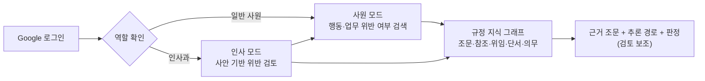

# 기획서 — 사내 규정 위반 검토 서비스 (온톨로지·Multi-hop 추론 기반)

> 2팀 · 작성일 2026-11-17 · 상태: **초안(v0.1)** — 팀 합의 전
> 근거: [기초 설계서](DESIGN.md)(아키텍처·데이터·AI 구성·요구사항), [MLE 1기 가이드 요약](PROJECT_GUIDE_SUMMARY.md)
> 이 문서는 STEP 1 산출물 **"기획서(요구사항 명세 포함)"** 이다. 기술 상세는 설계서를 따르고, 여기서는 **누구를 위해, 무엇을, 어떤 방식으로** 만드는지를 정한다.

---

## 1. 한눈에 보기

| 항목 | 내용 |
|---|---|
| 프로젝트 주제 | 기업 규정 준수 여부 검증을 위한 온톨로지 및 Multi-hop 추론 기반 지식 그래프 시스템 |
| 서비스 한 줄 | 사내 규정을 지식 그래프로 구조화해, **"이 행위·사안이 어느 규정의 어느 조항을 위반하는가"를 근거 조문과 추론 경로와 함께** 알려주는 검토 보조 서비스 |
| 서비스명 | 미정 (가칭: 사규 준수 검토 서비스) |
| 서비스 대상 | **① 신입 사원을 포함한 일반 사원 ② 인사과 직원** |
| 제공 방식 | 같은 지식 그래프 위에서 **두 가지 모드**(사원 모드 / 인사 모드)를 역할에 따라 제공하는 웹 서비스 |
| 데이터 | ALIO에 공개된 **IBK기업은행 사규 148종**(조문 3,405개) + 상위 국가 법령(동료 수집 중) |
| 성격 | **검토 보조** 도구이다. 법적 판단·징계 결정을 대신하지 않는다 |

> **데이터에 대한 전제:** 이 프로젝트는 ALIO에 공개된 사규를 사용하는 교육 프로젝트이며 **실제 IBK 사내 시스템이 아니다.** 아래의 "사내 도입" 시나리오는 가상의 도입 상황이고, 시연에는 **가상의 질문·사안**을 쓴다(실제 직원의 개인정보·사건은 다루지 않는다).

---

## 2. 배경과 문제

### 2.1 배경
- 금융권은 내부 업무용 AI를 확대하고 있고, AI 기본법·금융분야 AI 가이드라인 등 **규제도 늘고 서로 겹친다**(검색 결과 요약, 원문 미대조 — 설계서 §1). 우리 코퍼스의 사규 148종도 서로 인용하고 상위 법령을 근거로 삼는다.
- 사규는 여러 문서·계층에 흩어져 있고, **한 조문이 다른 규정·법령을 인용하거나 세부를 위임**한다. 핵심 인용 관계로 보면 사규 91개가 하나의 큰 덩어리로 얽혀 있다(설계서 §2).

### 2.2 해결하려는 문제 (가설)

| 사용자 | 문제 |
|---|---|
| 신입 사원·일반 사원 | 규정이 어디에 있는지, 내가 하려는 행동이 위반인지 **찾기 어렵고 해석이 갈린다.** 물어볼 곳도 마땅치 않다 |
| 인사과 직원 | 사안 하나가 **여러 조항·여러 문서**에 걸치고, 예외(단서)와 상위 법령, 징계 절차까지 **일일이 찾아 맞춰야 한다.** 누락 위험이 있다 |

> 위 문제는 **가설**이다. 멘토링 시간에 실무 경험자에게 확인한다(설계서 §1 검증 계획). 시장·사용자 분석 방법론은 수업에 없어 팀 자체 가설 + 멘토 검증으로 둔다.

### 2.3 목표
1. 사규를 **구조화된 지식 그래프**(문서·조문·참조·위임·단서·의무)로 만든다.
2. 질문에 **근거 조문 + 추론 경로 + 판정**(위반 가능 / 문제 없음 / 판단 불가)을 보여준다. 근거가 없으면 지어내지 않고 **"근거 없음"** 이라고 답한다.
3. 같은 엔진으로 **사원 모드와 인사 모드**를 제공한다.
4. 가이드의 필수 요건(RAGAS 평가, LoRA 전후 비교, vLLM 서빙, Guardrails, Hugging Face 공개 등)을 충족한다(설계서 부록 B).

---

## 3. 대상 사용자와 사용 방식

### 3.1 모드 비교

| | **사원 모드** | **인사 모드** |
|---|---|---|
| 대상 | 신입 사원을 비롯한 일반 사원 | 인사과 직원 |
| 목적 | **내 행동·업무가 규정에 어긋나는지** 확인하고 예방 | **사안이 어떤 조항에 해당하는지** 검토 |
| 입력 | 자연어 질문("~해도 되나요?") | 사안 설명(가명 처리 권장) + 확인하려는 질문 |
| 출력 | 판정 + 근거 조문 + 예외 + 쉬운 설명 + 문의처 안내 | 관련 조항 후보 + 요건별 충족 여부 + 상위 법령 + **징계·절차 규정 연계** + 추가 확인 사항 + 검토 리포트 |
| 말투·깊이 | 쉬운 말, 용어 풀이, 후속 질문 추천 | 조항 단위로 정확하게, 근거 원문 전체 |
| 접근 | 로그인한 모든 사용자 | **인사과 역할**이 부여된 사용자만 |
| 저장 | 대화·사용자 맥락 기억(본인만 열람·삭제) | **사안 내용은 장기 기억에 저장하지 않음**, 접근 감사 로그 기록 |

두 모드는 **같은 그래프·같은 엔진**을 쓰고, 프롬프트·화면·접근 통제·저장 정책만 다르다(설계서 §7.1, §8).

### 3.2 사원 모드

**누구:** 입사 초기라 규정에 익숙하지 않은 신입 사원과, 업무 중 규정이 헷갈리는 일반 사원.

**사용 시나리오(예시 질문)** — 화살표 뒤의 관련 규정은 **예상**이며, 실제 조항은 평가셋을 만들 때 규정 원문으로 확인한다
- "거래처에서 받은 선물을 받아도 되나요?" → 행동강령·이해충돌방지 관련 조항과 예외, 상위 법령(청탁금지법 등)
- "연차를 이런 방식으로 나눠 써도 되나요?" → 휴가규정·복무규정의 기준(일수·기한)과 예외
- "고객 정보를 업무 메신저로 보내도 되나요?" → 정보보호·개인신용정보 규정과 상위 법령
- "겸직을 하려면 어떻게 해야 하나요?" → 해당 규정과 절차

**제공 기능**
1. 자연어 질문 → **판정 + 근거 조문 카드 + 추론 경로 그래프**
2. **쉬운 설명:** 용어 풀이, "이 조문이 왜 이렇게 정해졌나" 같은 부연은 하지 않고 **규정 원문에 있는 내용만** 풀어 쓴다
3. **예외·단서 표시:** "원칙은 ~이지만 다만 ~인 경우는 허용"을 함께 보여준다
4. **되묻기:** 판정에 필요한 정보가 빠지면 추가 질문(예: "업무 관련 거래처인가요?")
5. **후속 질문과 맥락 유지:** 이전 대화를 이어서 질문, 소속·관심 주제 같은 **최소한의 사용자 맥락**만 기억(본인이 조회·삭제 가능)
6. **둘러보기:** 규정 목록·조문 탐색, 자주 묻는 상황 추천
7. **문의처 안내:** 위반이 의심되거나 판단이 어려우면 준법·인사 담당 부서에 문의하라는 안내(서비스가 신고·상담을 대신하지 않는다)

**하지 않는 것:** 개인의 징계 가능성 예측, 신고 접수, 법률 자문, 규정에 없는 내용의 해석.

### 3.3 인사 모드

**누구:** 규정 위반 여부를 검토하는 인사과 직원.

**"다른 사원의 법규 위반을 검색"의 범위 — 이 기획서의 가장 중요한 결정**

| | A. 사안 기반 검토 (**제안, 이번 범위**) | B. 직원 데이터 연계 탐지 (이번 범위 아님) |
|---|---|---|
| 방식 | 인사 담당자가 **사안을 설명**하면 시스템이 해당 조항·요건·징계 규정을 찾아준다 | 직원의 근태·메일·시스템 로그 등을 연계해 위반을 **자동 탐지·검색**한다 |
| 시스템이 보유하는 개인 정보 | **없음**(입력한 사안만 일시 처리) | 직원 개인정보·행위기록 대량 보유 |
| 필요한 데이터 | 규정 코퍼스(보유) | 직원 행위 데이터(**프로젝트에 없음**) |
| 위험 | 입력 사안에 실명 등이 섞일 수 있음 → 가명 처리 안내·저장 제한 | 개인정보·근로자 감시 문제, 오탐의 불이익이 큼 → **법무 검토 없이는 불가** |
| 판정 | 사안이 **어떤 조항에 해당할 수 있는지** 후보 제시 | 개인별 위반 의심 목록 생성 |

→ **A만 구현한다.** B는 데이터도 없고 법적·윤리적 검토가 먼저 필요해 **범위에서 제외하고 "향후 과제"로 남긴다.** 이 해석이 팀의 의도와 다르면 알려 주세요(§10).

> 위 문제의 법적 판단(개인정보 보호법, 근로자 권리 등)은 이 기획서의 범위 밖이며 **멘토·법무 검토가 필요**하다. 서비스는 인사 담당자의 **검토를 돕는 도구**이고, **징계 여부·수위의 결정은 사람과 정해진 절차(인사위원회 등)가 한다.**

**사용 시나리오(가상 사안 예시)**
- "직원이 업무 시간 중 사적 용무로 장시간 자리를 비웠다" → 복무규정 관련 조항 후보, 요건별 충족 여부, 징계 기준(직원상벌규정 등), 추가로 확인할 사실관계
- "직원이 거래처로부터 금품을 받았다는 제보가 있다" → 행동강령·이해충돌방지 조항, 상위 법령(청탁금지법 등), 제보 처리 절차(준법제보제도), 징계 절차
- "두 규정의 기준이 달라 보인다" → 규정 간 충돌·완화 비교

**제공 기능**
1. **사안 → 조항 매핑:** 사안과 관련된 조항 후보를 **근거 원문과 함께** 제시(후보일 뿐 확정이 아니다)
2. **요건별 체크리스트:** 조항의 조건·예외를 쪼개 "사안에서 확인된 것 / 확인이 더 필요한 것"으로 나눠 보여준다
3. **상위 법령·타 규정 연결:** 인용·위임 관계를 따라 근거 사슬(Multi-hop)을 보여준다. 코퍼스에 없는 문서는 "미보유"로 표시
4. **징계·절차 규정 연계:** 관련 징계 규정, 절차 규정(위원회 규정 등)을 함께 조회
5. **추가 확인 사항 목록:** 사실관계가 부족하면 `판단 불가`로 두고 무엇을 더 확인해야 하는지 알려준다(**억지로 결론내지 않는다**)
6. **검토 리포트:** 조항·근거·경로를 정리한 문서로 내보내기(선택, 시연 후순위)

**안전장치(필수):** ① 인사과 **역할 기반 접근** ② **모든 조회를 감사 로그**로 남김(누가·언제·어떤 질의, 사안 본문은 저장하지 않거나 최소화) ③ 입력 화면에 **"실명·개인정보를 입력하지 마세요(가명 처리)"** 안내와 입력 필터 ④ **장기 기억에 사안을 저장하지 않음** ⑤ 판정 문구는 "위반 **가능성**이 있는 조항 후보"로 표현하고 확정적 표현을 쓰지 않음 ⑥ 모든 결과에 "검토 보조이며 징계 결정을 대신하지 않는다" 표시.

### 3.4 역할과 권한

| 역할 | 권한 | 부여 방식 |
|---|---|---|
| 일반 사원 | 사원 모드, 본인 대화·기억 | Google 로그인 시 기본 |
| 인사과 | 사원 모드 + 인사 모드 | **관리자가 지정**(허용 목록) — 스스로 선택할 수 없다 |
| 관리자 | 인사과 지정, 추출 검수, 평가 대시보드 | 팀이 지정 |

권한은 DB의 역할 테이블과 API에서 이중으로 확인한다(설계서 §8). **Google 로그인을 쓰되 누구나 인사 모드에 들어갈 수 없다**는 점이 핵심이다.

---

## 4. 서비스 흐름

**사원 모드:** 로그인 → 질문 입력 → (필요 시 되묻기) → 판정 + 근거 카드 + 경로 그래프 → 후속 질문 / 관련 규정 둘러보기 / 문의처 안내

**인사 모드:** 로그인(인사 역할) → 사안 입력(가명 처리 안내) → 조항 후보 + 요건 체크리스트 + 상위 법령·징계 규정 → 추가 확인 사항 → (선택) 검토 리포트 내보내기

내부 처리(두 모드 공통, 설계서 §7.1): 입력 검사 → 기억 조회 → 질의 분류·조건 추출 → 하이브리드 검색 → 그래프 확장(인용·위임·단서) → 근거 충분성 판정 → 답변 생성·인용 → 근거 검증 → 출력 검사 → 저장 → 스트리밍 응답

---

## 5. 요구사항 명세

우선순위: **M**ust / **S**hould / **C**ould. 기능 요구사항 FR-01~14와 비기능 NFR-01~09는 [설계서 §14](DESIGN.md)에 정의되어 있고, 이 기획서는 **두 대상 사용자를 위해 FR-15~22, NFR-10을 추가**한다(설계서 §14에도 반영).

### 5.1 공통 (설계서 FR-01~14 요약)
조문 검색·인용(FR-01), 참조·위임·단서 추적(FR-02), 준수 판정(FR-03), 충돌 탐지(FR-04), 통계·`/insights`(FR-05), 근거·경로 시각화(FR-06), 스트리밍 응답(FR-07), Google 로그인(FR-08), 대화 저장(FR-09), 장기 기억(FR-10), 근거 없음·미보유 표시(FR-11), 추출 검수(FR-12), 평가 대시보드(FR-13), 면책 문구(FR-14).

### 5.2 두 모드를 위한 추가 요구사항

| ID | 요구사항 | 우선순위 | 모드 | 검증 |
|---|---|---|---|---|
| FR-15 | **역할 기반 접근:** 일반 사원 / 인사과 / 관리자 역할을 구분하고, 인사 모드는 인사과 역할에게만 허용한다 | M | 인사 | 비인가 접근 시도 테스트 |
| FR-16 | **사원 모드 질의:** 행동·업무 질문에 판정 + 근거 + 예외 + 쉬운 설명 + 문의처 안내를 제공한다 | M | 사원 | 사원 모드 평가셋 |
| FR-17 | **인사 모드 사안 검토:** 사안 입력에 대해 관련 조항 후보, 요건별 충족 여부, 추가 확인 사항을 제공한다 | M | 인사 | 인사 모드 평가셋(가상 사안) |
| FR-18 | **징계·절차 규정 연계:** 사안과 관련된 징계·절차 규정을 함께 조회해 제시한다 | M | 인사 | 평가셋(연계 정확도) |
| FR-19 | **감사 로그:** 인사 모드의 조회 이력(사용자·시각·질의 유형)을 기록하고 관리자가 조회한다. 사안 본문은 저장하지 않거나 최소화한다 | M | 인사 | 로그 점검 |
| FR-20 | **입력 보호:** 인사 모드 입력 화면에 가명 처리 안내를 표시하고 개인정보 형태(주민번호·계좌번호·연락처 등)를 필터링한다 | M | 인사 | 필터 테스트 |
| FR-21 | **되묻기:** 판정에 필요한 사실이 빠지면 추가 질문을 하거나 `판단 불가`와 확인 사항 목록을 제시한다 | S | 공통 | 평가셋(정보 부족 사례) |
| FR-22 | **검토 리포트 내보내기:** 인사 모드 결과를 문서로 내보낸다 | C | 인사 | 시연 |
| NFR-10 | **표현 제한:** 인사 모드 결과는 "위반 가능성이 있는 조항 후보"로 표현하고 징계 결정을 시사하지 않는다 | M | 인사 | 응답 점검, Guardrails 규칙 |

---

## 6. 서비스 범위와 핵심 문서

### 6.1 범위

| 구분 | 내용 |
|---|---|
| 포함 | 사원 모드, 인사 모드(사안 기반), 사규 148종의 구조 적재, 핵심 문서의 의무·예외 추출과 평가, 상위 법령 연계, 근거·경로 시각화 |
| 제외(향후 과제) | **직원 데이터 연계 자동 탐지**, 규정 개정 이력 비교(버전 1개만 보유), 실제 사내 시스템 연동, 신고·상담 접수, 법적 판단 |

### 6.2 핵심 문서 재검토 — 대상 사용자가 정해지면서 바뀐 점

설계서 부록 A는 **금융·내부통제** 규정(내부통제·금융소비자보호·자금세탁방지 등)을 중심으로 핵심 문서를 제안했다. 서비스 대상이 **일반 사원과 인사과**로 정해지면서 **인사·복무·윤리 규정**이 핵심이 된다. 데이터가 이 방향을 뒷받침한다.

| 지표 | 이전 제안(금융·내부통제 16개) | **이번 제안(사원·인사 16개)** |
|---|---|---|
| 유효 조문 | 502 | 410 |
| **수치·기한 포함 조문** | 12% | **20%** |
| "다만" 단서 포함 조문 | 11% | 16% |
| 인용으로 이어진 큰 덩어리(91개) 안 | 13/16 | **16/16** |

수치·기한이 많을수록 **규칙 기반 비교**(일수·기한·금액)가 가능해 모델 부담이 줄고 검증이 쉽다.

**제안 핵심 문서 16개(약 410개 조문)**

| 분류 | 문서 (조문 수) |
|---|---|
| 행동·윤리 | 기업은행임직원행동강령(68) · 기업은행 윤리강령(26) · 기업은행 이해충돌 방지 지침(24) · 부패행위 신고에 관한 지침(8) · 준법제보제도 운영규정(17) |
| 복무·인사 | 복무규정(44) · 휴가규정(14) · 인사규정(59) · 취업규칙(37) |
| **징계·절차**(인사 모드 핵심) | **직원상벌규정(25)** · 직장 내 괴롭힘 예방 및 대응지침(9) · 직장내 양성평등 및 성폭력·성희롱 예방지침(10) |
| 업무 행위 | 불건전 영업행위 방지규정(19) · 임직원에대한대출규정(19) |
| 정보 | 정보보호규정(13) · 개인·신용정보 관리 및 보호 규정(18) |

- **직원상벌규정**은 다른 규정에서 15회 인용되는(코퍼스 내 인용 상위) 규정이라 인사 모드의 중심이다. 인사규정·위원회 규정과 함께 "징계·절차 연계"(FR-18)의 근거가 된다.
- 이 문서들이 인용하는 상위 법령은 **청탁금지법, 부패방지권익위법, 이해충돌방지법**이 대표적이며 **동료분의 법령 수집 1순위 목록과 겹친다.** 성폭력범죄의 처벌 등에 관한 특례법, 한부모가족지원법, 도로교통법 등은 수집 목록에서 우선순위를 올리는 것을 검토한다([수집 목록](LAW_COLLECTION_LIST.md)).
- 이전 후보(금융소비자보호·자금세탁방지·내부통제 등)는 **2차 확장 대상**으로 둔다. 구조 적재는 148종 전체를 하며, 의무 추출·평가를 어디까지 넓힐지는 검수 가능한 분량에 따라 정한다.
- **최종 목록은 팀 검토 후 확정한다**(설계서 부록 A 갱신 예정).

---

## 7. 차별화

설계서 §1의 비교를 두 사용자 관점으로 정리한다(경쟁 항목은 **제품을 직접 확인하지 않은 가설**).

| 관점 | 키워드 검색(규정집) | 범용 생성형 AI | 일반 벡터 RAG | **본 서비스(목표)** |
|---|---|---|---|---|
| 규정 간 인용·위임·단서 추적 | ✗ | ✗ | ✗ | ○ |
| 근거 조문·경로 제시 | △ | △ | △ | ○ |
| 요건별 충족 여부(인사 모드) | ✗ | △ | ✗ | ○ |
| 근거 없으면 "근거 없음" | — | ✗ 지어낼 수 있음 | △ | ○ |
| 질의·규정 외부 반출 없음 | ○ | ✗ 외부 서비스 시 | 구성에 따라 | ○ 자체 호스팅 모델 |

차별화 한 줄: **"조문 하나가 아니라 조문들 사이의 관계(인용·위임·예외)를 따라가 근거 사슬을 보여준다."**

---

## 8. 성공 기준과 평가

| 구분 | 기준 | 방법 |
|---|---|---|
| 답변 신뢰성 | 근거 인용 포함률, Faithfulness·Answer Relevancy | RAGAS(설계서 §9). **목표치는 첫 측정 후 팀이 정한다** |
| 사원 모드 정확도 | 행동 질문의 판정(위반 가능/문제 없음/판단 불가)과 근거 조문 일치 | 사원 모드 평가셋 |
| 인사 모드 정확도 | **조항 후보 재현율·정밀도**, 징계·절차 규정 연계 정확도, `판단 불가` 적절성 | 인사 모드 평가셋(**가상 사안**) |
| 안전성 | 비인가 접근 차단율, 개인정보 필터 통과율, 확정적 표현 억제, 새어 나감 | 접근 테스트, Guardrails 레드팀 셋 |
| 에이전트 | 도구 선택 일치율·step 성공률(자체 정의) | trajectory 평가 |
| 모델 | base vs 튜닝 vs 양자화 품질·지연·비용 | 설계서 §6.5 |
| 시연 | 두 모드가 같은 서비스로 통합되어 동작 | 최종 발표 |

**평가셋 구성(초안, 문항 수는 팀이 정한다 — 설계서 권장 최소 60문항)**

| 구성 | 사원 모드 | 인사 모드 |
|---|---|---|
| 조회·행동 질문 | ✓ | — |
| 사안 → 조항 매핑(가상 사안) | — | ✓ |
| 인용·위임·단서 추적(Multi-hop) | ✓ | ✓ |
| 정보 부족(되묻기·`판단 불가`) | ✓ | ✓ |
| 근거 없는 질문·범위 밖 질문 | ✓ | ✓ |
| 후속 질문(맥락 의존) | ✓ | — |

---

## 9. 개발 단계와 일정

가이드 STEP과 설계서 WBS([설계서 §11](DESIGN.md))를 따른다. **발표 일정과 인원이 정해지지 않아 일정은 비워 둔다.**

| 발표 | 시연 범위(제안) |
|---|---|
| 중간 발표 | 온톨로지·스키마, 사규 → 트리플 적재, 하이브리드 검색 기초 + **사원 모드의 기본 질의 응답**(근거 조문 인용) |
| 최종 발표 | **사원 모드 + 인사 모드 통합**, 추론 경로 시각화, 판정, 안전장치(역할 접근·감사 로그), 평가 결과, 배포 |

- 사원 모드는 중간 발표용 기본 시연이 가능하도록 먼저 만들고, 인사 모드는 **역할 접근·감사 로그가 갖춰진 뒤** 붙인다.
- 모델 크기·GPU는 학원 예산 확정 후 정한다. 일정과 담당은 발표일·인원 확정 후 채운다.

---

## 10. 위험과 팀 결정 항목

### 10.1 위험

| 위험 | 대응 |
|---|---|
| **인사 모드의 개인정보·오남용**(특정인 감시 도구로 쓰임) | 사안 기반으로 한정, 직원 데이터 비보유, 역할 접근, 감사 로그, 사안 비저장, 가명 처리 안내(§3.3) |
| **오판이 불이익으로 이어짐**(위반 가능성 후보를 확정으로 오해) | "후보" 표현, 확정적 표현 금지(NFR-10), `판단 불가` 우선, 결정은 사람·절차, 면책 문구 |
| 일반 사원이 인사 모드에 접근 | 역할 이중 확인(DB·API), 관리자 지정, 접근 테스트 |
| 사원이 서비스를 면책으로 오용("AI가 괜찮다고 했다") | 면책 문구, 판단 불가 시 문의처 안내, 근거 조문 확인 유도 |
| 소형 모델의 판정·추출 품질 | 규칙 비교(수치·기한), 사람 검수, 근거 검증, `UNDETERMINED`(설계서 §12) |
| 사규 개정 반영 불가 | 버전 1개 보유, 답변에 규정 개정 시점 표시(설계서 §2) |
| 시연 데이터 | **가상의 질문·사안만 사용**, 실제 직원·사건 정보 배제 |

그 밖의 기술·일정 위험은 [설계서 §12](DESIGN.md)를 따른다.

### 10.2 팀 결정이 필요한 항목

| # | 질문 | 제안 |
|---|---|---|
| 1 | "다른 사원의 법규 위반 검색"을 **사안 기반 검토(A)** 로 한정해도 되는가? 직원 데이터 연계(B)를 원하는가? | **A만.** B는 데이터와 법적 검토가 없어 제외 |
| 2 | **인사과 역할**을 어떻게 지정하는가(관리자가 이메일 허용 목록으로 지정 / 별도 승인 절차) | 관리자 지정 허용 목록 |
| 3 | 인사 모드에서 **사안 본문을 저장**하는가 | 저장하지 않음, 조회 이력만 감사 로그 |
| 4 | 핵심 문서를 **사원·인사 16개**(§6.2)로 바꿔도 되는가 | 바꾼다. 금융·내부통제는 2차 확장 |
| 5 | 서비스명 | 미정 |
| 6 | 인사 모드의 검토 리포트 내보내기(FR-22) 포함 여부 | 시연 후순위(Could) |
| 7 | 법적·윤리 검토(개인정보, 근로자 권리)를 **멘토에게 확인**하는가 | 멘토링 시간에 확인 |
| 8 | 설계서의 미결 항목(모델 크기·GPU, Cloud Run 설정, 임베딩 모델 등) | [설계서 §10](DESIGN.md) |

---

## 11. 용어

| 용어 | 뜻 |
|---|---|
| 사규 | 기업 내부 규정(규정·지침·세칙·기준 등) |
| 조문 | 규정의 `제N조` 단위 |
| 단서 | "다만 ~인 경우는 제외" 같은 예외 조항 |
| 위임 | 세부 사항을 다른 규정에서 정하도록 넘기는 조항 |
| Multi-hop 추론 | 조문 → 인용된 규정 → 그 규정의 조문처럼 여러 단계를 따라가는 추론 |
| 지식 그래프 | 문서·조문·의무 등을 노드로, 인용·위임 등을 관계로 저장한 데이터 |
| 판단 불가(`UNDETERMINED`) | 근거나 사실이 부족해 결론을 내리지 않고 확인 사항을 제시하는 결과 |
| 사원 모드 / 인사 모드 | 이 서비스의 두 사용 방식(§3) |
