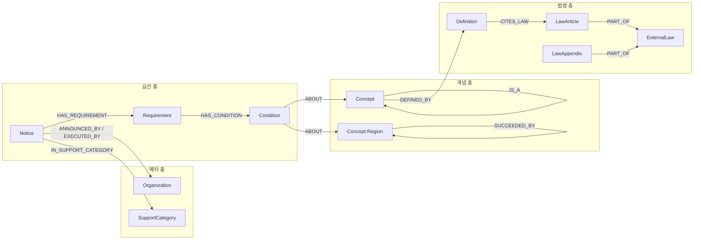

# Neo4j 그래프 스키마 정의서 (v0.1 초안)

> 2팀 "근거 it" · 지원각 · 작성 2026-11-26
> 기준: Neo4j Aura에 **실제 적재된 그래프를 읽기 전용으로 조회한 값**(2026-11-26). 설계 초안은 `docs/submission/ontology/schema.cypher`(온톨로지 설계서 v0.2 §8)이고, 둘이 다른 곳은 §3.3에 적었다.
> 강사 피드백(2026-11-26) 6개 항목은 §4(매핑)·§6(정합성)·§7(계층)·§8(추론 경로)·§9(판정)·§10(SQL 대비)에서 다룬다.

---

## 0. 요약

| 항목 | 현재 상태 |
|---|---|
| 적재 | 노드 32,605 · 관계 56,995 (2026-11-26 추가 법령 18문서·정의 17개·개념 6개 적재 후). 공고 5,116건 전량(기업마당·K-Startup), 정형 API 필드에서 만든 요건·조건 |
| 식별·중복 | 노드 10종에 유일키 제약. 키 결측 0, 중복 0, 중복 간선 0 |
| 관계 방향 | 모든 관계가 정의한 방향(하위→상위, 공고→요건→조건→개념)만 가짐. 계층 순환 0 |
| 추론 경로 | 조건 → 개념 → (IS_A) → 정의 → 조문 → 법령이 실제로 이어짐. API `/api/chat`이 요청마다 이 경로를 읽는다. 정의에 닿는 공고는 **3,143건**이고 두 갈래뿐이다: `예비창업자`(1,252건)와 `1인 창조기업`(2,903건, 겹침 1,012건). 중소기업 등 다른 정의 개념을 가리키는 조건은 0개(§8) |
| **검수** | **조건 17,366개 전부 `reviewed=false`, 정의 23개 전부 `needs_review=true`, 공고 5,116건 전부 본문 요건 `unparsed`** |
| 판정 | 3단 규칙은 구현됨. 다만 본문 요건이 검수 전이라 지금은 "신청 가능"이 **나오지 않도록 막혀 있다**(§9.2) |
| SQL 대비 | 정확도·속도 우위 없음(기존 측정). 계층·다단 질의의 **코드량은 Cypher가 줄 수 약 1/4, 토큰 수 약 1/2**(§10.2, 결과 일치 확인) |

강사 지적("실제 데이터 적재와 법령 기반 판정 규칙 검수 미완료")을 정확히 나누면 다음과 같다.
- **적재:** 정형 필드 기반 전량 적재는 끝났다. 본문·첨부에서 뽑은 요건과 공고의 법령 직접 인용(543건)은 아직 적재하지 않았다.
- **검수:** 0%다. 정의·법령 연결도 4개 개념에만 있다(§11).

---

## 1. 범위와 원칙

| 원칙 | 내용 | 근거 |
|---|---|---|
| 판정은 코드가 한다 | 그래프는 근거·경로를 제공하고, 충족 여부는 규칙 평가기가 정한다. 모델은 추출·설명만 한다 | 기초 설계서 ADR-12 |
| 모르면 UNKNOWN | 못 읽은 값, 연결 안 된 개념은 "제한 없음"으로 바꾸지 않는다 | 온톨로지 설계서 §4.3 |
| 원문 근거 | 요건·조건 관계에는 `evidence`(원문 문구)와 `source`(필드)를 붙인다 | N-05 근거 표시 |
| 법령은 원문만 | 정의 노드는 조문 원문 위치를 가리킨다. 숫자 기준을 기억으로 쓰지 않는다 | 지원사업 법령 명세서 §7 |
| 읽기 전용 서비스 | API는 `READ_ACCESS` 세션만 쓴다. 적재는 배치 도구(`tools/load_graph_neo4j.py`)만 한다 | `api/repositories/graph.py` |

---

## 2. 스키마 개요

네 층으로 나눈다. 판정에 직접 쓰는 층은 요건·개념·법령이고, 메타 층은 검색·필터용이다.



| 노드 | 건수 | 관계 | 건수 |
|---|---:|---|---:|
| Condition | 17,366 | ABOUT | 19,766 |
| Requirement | 5,900 | HAS_CONDITION | 17,366 |
| Notice | 5,116 | HAS_REQUIREMENT | 5,900 |
| Organization | 1,399 | ANNOUNCED_BY | 5,116 |
| LawArticle | 2,325 | IN_SUPPORT_CATEGORY | 5,116 |
| Concept (그중 Region 321) | 354 | PART_OF | 2,384 |
| LawAppendix | 59 | EXECUTED_BY | 947 |
| ExternalLaw | 44 | WITHIN | 284 |
| SupportCategory | 19 | MEMBER_OF | 35 |
| Definition | 23 | SUCCEEDED_BY | 35 |
| | | CITES_LAW | 23 |
| | | DEFINED_BY | 21 |
| | | IS_A | 2 |

---

## 3. 노드 정의

### 3.1 노드별 키와 속성

| 노드 | 기본 키 (형식) | 주요 속성 | 원천 |
|---|---|---|---|
| `Notice` | `notice_id` = `{출처}:{원천 ID}` 예: `KSTARTUP:179814`, `BIZINFO:PBLN_000000000128083` | `title`, `source_system`, `detail_url`, `fetched_at`, `deadline`(68%), `is_open`, `apply_status_kind`, `text_requirements`(`unparsed`/`reviewed`) | 정리층 `data/cleaned/20261124` |
| `Requirement` | `req_id` = `{notice_id}#R{n}` | `kind`(`ELIGIBILITY`), `logic`(`AND`/`OR`), `logic_basis`(`explicit`/`assumed`), `status`(`structured_only`), `extraction_method`(`rule`) | 공고 정형 필드 |
| `Condition` | `cond_id` = `{notice_id}#C-{attribute}` | `cond_type`(`ATOM`), `attribute`, `operator`, `value`(JSON 문자열), `strength`(`hard`/`soft`), `evidence_source`, `reviewed`, `ref_date_kind`, `about_pending`, `about_unmapped`, `unknown_reason` | 정형 필드 규칙 추출 |
| `Concept` | `concept_id` = `{SCHEME}:{값}` 예: `APPLICANT_TYPE:중소기업`, `CERTIFICATION:벤처기업`, `SPECIAL_GROUP:청년` | `name`, `scheme` | 용어 표준 `data/ref/term_standard_v0.1.json` |
| `Concept:Region` | `REGION:{법정동코드 10자리}`, 묶음은 `REGION_GROUP:{이름}`, 전국은 `REGION:NATIONWIDE` | `name`, `full_name`, `level`(`SIDO`/`SIGUNGU`/`GU`/`GROUP`/`NATIONWIDE`), `region_code`, `parent_region_id`, `status`(현행/폐지), `code_version` | 행정표준코드 `data/사전/지역_코드표.csv` |
| `Definition` | `def_id` = `DEF:{용어}` | `term`, `basis_note`, `article_text_hash`, `needs_review`, (조문에서 잘라 온 17개) `legal_term`, `source` | 법령 조문 원문 |
| `LawArticle` | `article_id` = `LAW:{법령일련번호}:A{조}` | `law_id`, `article_no`, `article_title`, `text`, `text_hash`, `deleted` | 법제처 OPEN API |
| `LawAppendix` | `appendix_id` = `LAW:{일련번호}:T{번호}-{가지}` | `table_no`, `table_kind`(별표/서식), `title`, `text`, `text_hash` | 법제처 OPEN API |
| `ExternalLaw` | `law_id` = `LAW:{법령일련번호}` | `name`, `doc_kind`, `effective_date`, `org`, `source_url`, `priority` | 법제처 OPEN API |
| `Organization` | `org_id` = `ORG:{해시 12자리}` | `name` | 공고 기관 필드 |
| `SupportCategory` | `category_id` = `CAT:{출처}:{해시}` | `name`, `source_system` | 공고 분류 필드 |

### 3.2 조건 속성값 분포 (판정 대상)

| attribute | 건수 | operator | ABOUT 대상 | strength |
|---|---:|---|---|---|
| `applicant_type` | 5,074 | `IN` | `APPLICANT_TYPE`·`CERTIFICATION`·`SPECIAL_GROUP` 개념 | hard·soft |
| `region` | 4,786 | `WITHIN` | `Region` | soft |
| `founder_age` | 3,822 | `BETWEEN` | 없음(숫자 구간) | soft |
| `business_age` | 3,684 | `LT` | 없음(숫자 기준) | hard |

### 3.3 설계 초안(`schema.cypher`)과 실제 적재의 차이

| 항목 | 설계 초안 | 실제 적재 | 조치 |
|---|---|---|---|
| 개념 이름 속성 | `label` | `name` | 초안을 `name`으로 고친다 |
| 노드 `Track`·`Attachment`·`Program` | 제약 정의 | 없음 | 본문 요건 적재 단계(P1)로 미룸. 제약 목록에서 "예정"으로 표시 |
| 하위 조건 `HAS_CHILD`(그룹 조건) | 정의 | 없음(모든 조건이 `ATOM`) | 본문 요건 추출 후 |
| `SUPERSEDES`(정정 공고) | 정의 | 없음 | 재수집 후 |
| 보조 인덱스(`notice_source`, `notice_open`, `concept_scheme`) | 정의 | 없음 | §5.2 제안대로 생성 |
| 공고 → 법령 직접 인용 `CITES` | 정의 | 없음(543건 보류 `data/graph/law_citations_pending.jsonl`) | 요건 노드에 붙일지 결정 후 적재 |

---

## 4. 관계 정의 (피드백 ①: 스키마 매핑)

방향 규칙: **포함하는 쪽 → 포함되는 쪽**(공고→요건→조건), **하위 → 상위**(구→시→도, 소기업→중소기업), **참조하는 쪽 → 근거**(조건→개념→정의→조문→법령).

| 관계 | 출발 → 도착 | 의미 | 속성 | 건수 | 판정에 쓰나 |
|---|---|---|---|---:|---|
| `HAS_REQUIREMENT` | Notice → Requirement | 공고가 가진 자격 요건 묶음 | `evidence`, `source` | 5,900 | 예 |
| `HAS_CONDITION` | Requirement → Condition | 요건을 이루는 원자 조건(`logic`으로 결합) | `evidence`, `source` | 17,366 | 예 |
| `ABOUT` | Condition → Concept / Region | 조건이 가리키는 개념 | `option`(원문 선택지) | 19,766 | 예 |
| `WITHIN` | Region → Region | 행정 포함(구 → 시 → 도) | `basis` | 284 | 예 |
| `MEMBER_OF` | Region → Region(GROUP) | 공고가 정의한 권역·통합 이전 지역 묶음 소속 | `basis` | 35 | 예 |
| `SUCCEEDED_BY` | Region(폐지) → Region(현행) | 행정구역 개편 승계 | `partial`, `reviewed` | 35 | 아니오(검수 전) |
| `IS_A` | Concept → Concept | 개념 상하위(소기업 → 중소기업) | `basis`, `note` | 2 | 예(정의 찾기) |
| `DEFINED_BY` | Concept → Definition | 개념의 법적 정의 | — | 21 | 근거 표시 |
| `CITES_LAW` | Definition → LawArticle | 정의가 인용한 조문 | `article_ref` | 23 | 근거 표시 |
| `PART_OF` | LawArticle / LawAppendix → ExternalLaw | 조문·별표가 속한 법령 | — | 2,384 | 근거 표시 |
| `ANNOUNCED_BY` | Notice → Organization | 공고 기관 | `source_field` | 5,116 | 아니오 |
| `EXECUTED_BY` | Notice → Organization | 수행 기관 | `source_field` | 947 | 아니오 |
| `IN_SUPPORT_CATEGORY` | Notice → SupportCategory | 지원 분야 | — | 5,116 | 아니오(검색) |

강사 피드백의 사슬 **Notice → Requirement → Condition → Concept → ExternalLaw**는 다음처럼 이어진다.
`Notice -HAS_REQUIREMENT-> Requirement -HAS_CONDITION-> Condition -ABOUT-> Concept -IS_A*0..2-> Concept -DEFINED_BY-> Definition -CITES_LAW-> LawArticle -PART_OF-> ExternalLaw`

Concept와 ExternalLaw 사이에 `Definition`·`LawArticle`을 두는 이유는 두 가지다.
- 한 법령 안에서도 정의가 조·항·호 단위로 다르다. 예: 중소기업창업 지원법 제2조 제3호 "창업기업", 제4호 "예비창업자", 제10호 "초기창업기업".
- 조문이 개정되면 영향받는 정의만 골라내야 한다(CQ-15).

---

## 5. 제약과 인덱스

### 5.1 현재 걸린 것 (Aura `SHOW CONSTRAINTS`)

```cypher
CREATE CONSTRAINT notice_id   IF NOT EXISTS FOR (n:Notice)          REQUIRE n.notice_id IS UNIQUE;
CREATE CONSTRAINT req_id      IF NOT EXISTS FOR (r:Requirement)     REQUIRE r.req_id IS UNIQUE;
CREATE CONSTRAINT cond_id     IF NOT EXISTS FOR (c:Condition)       REQUIRE c.cond_id IS UNIQUE;
CREATE CONSTRAINT concept_id  IF NOT EXISTS FOR (k:Concept)         REQUIRE k.concept_id IS UNIQUE;
CREATE CONSTRAINT def_id      IF NOT EXISTS FOR (d:Definition)      REQUIRE d.def_id IS UNIQUE;
CREATE CONSTRAINT article_id  IF NOT EXISTS FOR (a:LawArticle)      REQUIRE a.article_id IS UNIQUE;
CREATE CONSTRAINT appendix_id IF NOT EXISTS FOR (a:LawAppendix)     REQUIRE a.appendix_id IS UNIQUE;
CREATE CONSTRAINT law_id      IF NOT EXISTS FOR (l:ExternalLaw)     REQUIRE l.law_id IS UNIQUE;
CREATE CONSTRAINT org_id      IF NOT EXISTS FOR (o:Organization)    REQUIRE o.org_id IS UNIQUE;
CREATE CONSTRAINT category_id IF NOT EXISTS FOR (s:SupportCategory) REQUIRE s.category_id IS UNIQUE;
```

유일키 제약마다 RANGE 인덱스가 자동으로 생긴다. 그래서 키 조회(`{notice_id: $id}`)는 인덱스를 탄다.

### 5.2 추가 제안 (아직 만들지 않음)

| 인덱스 | 쓰는 질의 | 이유 |
|---|---|---|
| `Condition(attribute)` | 지역 조건만 거르기(§8 P1·P3) | 17,366개 중 지역 4,786개만 본다 |
| `Notice(is_open)`, `Notice(source_system)` | 모집 중 공고 필터 | 설계 초안에 있던 것 |
| `Region(level)` | 입력 폼 지역 목록 | 321개라 효과는 작다. 목록 질의 정리용 |
| `Concept(scheme)` | 개념 종류별 조회 | 설계 초안에 있던 것 |

```cypher
CREATE INDEX condition_attribute IF NOT EXISTS FOR (c:Condition) ON (c.attribute);
CREATE INDEX notice_open         IF NOT EXISTS FOR (n:Notice)    ON (n.is_open);
CREATE INDEX notice_source       IF NOT EXISTS FOR (n:Notice)    ON (n.source_system);
CREATE INDEX region_level        IF NOT EXISTS FOR (k:Region)    ON (k.level);
CREATE INDEX concept_scheme      IF NOT EXISTS FOR (k:Concept)   ON (k.scheme);
```

속성 존재·타입 제약(`IS NOT NULL`, `IS :: STRING`)은 인스턴스 등급에 따라 쓸 수 없을 수 있다. 그래서 §6.2 점검 쿼리로 대신한다.

---

## 6. 데이터 정합성 (피드백 ②)

### 6.1 규칙

| 규칙 | 내용 |
|---|---|
| 식별키 | §3.1 형식으로 **원천 ID에서 결정적으로 만든다**(무작위 ID 금지). 같은 공고를 다시 적재해도 같은 키가 나온다 |
| 중복 방지 | 적재는 `MERGE`(키 기준)로만 한다. 관계도 `MERGE (a)-[:R]->(b)`로 같은 쌍에 하나만 둔다 |
| 관계 방향 | §4 방향 규칙만 허용. 역방향 관계 타입(`HAS_SUBREGION` 등)은 만들지 않는다 |
| 속성 타입 | `value`는 JSON 문자열, 날짜는 ISO 문자열, 불리언은 boolean. 적재 스크립트가 넣기 전에 검사한다 |
| 버전 | 판이 바뀌는 원천(법령)은 원천 판 번호를 키에 넣는다(`LAW:{법령일련번호}`). 조문 원문은 `text_hash`로 변경을 잡는다 |

### 6.2 점검 결과 (2026-11-26, 0이어야 정상)

| # | 점검 | 결과 | 판정 |
|---|---|---:|---|
| V0 | 노드 10종 키 결측·중복 | 0 / 0 | 정상 |
| V1 | 서로 다른 scheme 사이 `WITHIN`·`IS_A` | 0 | 정상 |
| V2 | 계층 순환(`WITHIN`·`MEMBER_OF`·`IS_A`, 6 hop까지) | 0 | 정상 |
| V4 | 요건 없는 조건(고아 조건) | 0 | 정상 |
| V5 | 근거(`evidence`) 없는 요건·조건 관계 | 0 | 정상 |
| V8 | `WITHIN` 상위가 둘 이상인 지역 | 0 | 정상 |
| V11 | 같은 쌍의 중복 `HAS_CONDITION`·`ABOUT` | 0 / 0 | 정상 |
| V12 | 조건 없는 요건 | 0 | 정상 |
| V13 | 지역 조건이 지역이 아닌 개념을 가리킴 | 0 | 정상 |
| V14 | 법령에 안 붙은 조문 | 0 | 정상 |
| V9 | 개념형 조건(`applicant_type`)인데 `ABOUT` 없음 | **546** | 확인 필요: 모두 `일반기업` 선택지. 개념 사전에 `일반기업`이 없다 |
| V15 | 요건이 하나도 없는 공고 | **330** | 확인 필요: 모두 기업마당 모집 중 공고. 정형 필드에 판정 조건이 없는 공고 |
| V16 | 상위(`WITHIN`)가 없는 비시도 지역 | **34** | 31개는 폐지된 시군구(`SUCCEEDED_BY`로만 연결, 검수 전), 3개는 권역 묶음(정상) |
| V17 | 개념에 안 붙은 정의 | **2** | `청년창업기업`·`중장년창업기업` 정의는 있는데 대응 개념이 없다(연령 조건으로 다룸). 2026-11-26 추가 정의 17개는 모두 개념에 연결 |

점검 쿼리 원문은 `docs/submission/ontology/schema.cypher`의 V1~V10에 있고, V11~V17은 이번에 추가한다(부록 A).

---

## 7. 계층 관계의 의미와 적용 기준 (피드백 ③)

| 관계 | 의미 | 전이(A→B→C면 A→C) | 탐색 한도 | 판정 적용 기준 | 근거·검수 |
|---|---|---|---|---|---|
| `WITHIN` | 행정구역 **포함**. 구는 시에, 시는 도에 속한다 | 예 | 3 hop(일반구→시→도 + 권역) | 사용자 지역이 조건 지역 **또는 그 하위**면 지역 조건 충족. 조건 지역이 사용자 지역보다 **하위**면 UNKNOWN(그 구 안에 있는지 모름) | 행정표준코드(행안부). 코드표가 근거라 검수 불필요 |
| `MEMBER_OF` | 공고가 정의한 **권역·묶음 소속**(경상권, 통합 이전 지역) | 예(묶음까지) | `WITHIN`과 합쳐 3 hop | 공고가 "경상권"이라 쓰면 구성 시도 사용자를 충족으로 본다. **묶음의 구성은 공고마다 다를 수 있어** 근거 공고(`basis`)를 남긴다 | 공고 본문 정의. 검수 대상(현재 `reviewed=false`) |
| `IS_A` | 개념 **상하위**. 하위는 상위의 조건을 만족한다(소기업은 중소기업이다) | 예 | 2 hop | ① 사용자 유형이 조건 개념의 하위면 충족. ② 하위 개념에 정의가 없으면 상위 정의를 근거로 보여 준다 | 법령 정의(중소기업기본법 제2조 제2항). 현재 2건뿐 |
| `SUCCEEDED_BY` | 행정구역 **개편 승계**(폐지 → 현행) | 아니오 | 판정 미사용 | 옛 지역명을 쓴 공고를 새 지역에 맞출 때 쓸 예정. `partial=true`(일부만 승계)는 자동 충족 금지 | 검수 전이라 판정에 쓰지 않는다 |

적용 원칙
- **방향은 늘 하위 → 상위.** 충족 판정은 사용자 쪽에서 위로 올라가며 조건 개념을 만나는지 본다. 내려가는 방향은 UNKNOWN만 만든다.
- **세 관계를 섞어 따라가지 않는다.** 지역 판정은 `WITHIN|MEMBER_OF`만, 유형 판정·정의 찾기는 `IS_A`만 따라간다(V1 점검으로 보장).
- **hop 한도**는 실제 데이터의 최대 깊이에 1을 더한 값이다. 지역은 일반구 → 시 → 도 = 2, 권역 포함 3. 개념은 소기업 → 중소기업 = 1, 여유 1을 더해 2.

---

## 8. 추론 구조: Multi-hop 탐색 경로 (피드백 ④)

API가 실제로 쓰는 질의다(`api/repositories/graph.py`). 모두 읽기 전용이다.

**P1. 지역 계층으로 충족되는 공고 후보** (`search_candidates`, CQ-01·04·17)
```cypher
MATCH (u:Concept {concept_id: $u})-[:WITHIN|MEMBER_OF*0..3]->(:Concept)
      <-[:ABOUT]-(:Condition {attribute: 'region'})<-[:HAS_CONDITION]-(:Requirement)<-[:HAS_REQUIREMENT]-(n:Notice)
RETURN DISTINCT n.notice_id
```

**P2. 판정 근거 경로** (`trace_path`): 사용자 지역에서 조건 지역까지 가장 짧은 경로를 노드 이름 목록으로 돌려준다.
```cypher
MATCH (u:Concept {concept_id: $u})
MATCH (c:Condition)-[:ABOUT]->(t:Concept) WHERE c.cond_id IN $cids AND c.attribute = 'region'
OPTIONAL MATCH p = (u)-[:WITHIN|MEMBER_OF*0..3]->(t)
WITH c, t, p ORDER BY length(p)
WITH c, t, head(collect(p)) AS p
RETURN c.cond_id, t.concept_id, [n IN nodes(p) | {id: n.concept_id, name: n.name}] AS nodes
```

**P3. 조건 → 개념 → 정의 → 조문 → 법령** (`fetch_definition`, CQ-05): 6 hop. `IS_A`를 0~2번 거쳐 상위 개념의 정의도 찾는다.
```cypher
MATCH (n:Notice)-[:HAS_REQUIREMENT]->(:Requirement)-[:HAS_CONDITION]->(c:Condition)-[:ABOUT]->(k:Concept)
      -[:IS_A*0..2]->(k2:Concept)-[:DEFINED_BY]->(d:Definition)
WHERE n.notice_id IN $ids
OPTIONAL MATCH (d)-[:CITES_LAW]->(a:LawArticle)-[:PART_OF]->(l:ExternalLaw)
RETURN n.notice_id, c.cond_id, k.name, d.term, a.article_no, l.name, l.source_url
```

**P4. 조문이 바뀌면 영향받는 공고** (CQ-15): P3를 거꾸로 따라간다.
```cypher
MATCH (:LawArticle {article_id: $aid})<-[:CITES_LAW]-(:Definition)<-[:DEFINED_BY]-(:Concept)<-[:IS_A*0..2]-(:Concept)
      <-[:ABOUT]-(:Condition)<-[:HAS_CONDITION]-(:Requirement)<-[:HAS_REQUIREMENT]-(n:Notice)
RETURN DISTINCT n.notice_id
```

**P5. 판정 경로 서브그래프** (`GET /api/graph/path`): 공고 하나의 요건·조건·개념·정의·조문·법령과 사용자 지역 경로를 노드·간선 목록으로 돌려준다. 화면 그래프용이다.

실측 (2026-11-26)

| 경로 | 결과 | 예 |
|---|---|---|
| P1 | 지역 32곳에서 SQL 기준 구현과 결과 일치 | 강남구 → 서울특별시 공고 후보 |
| P2 | 공고 40건에서 SQL 재귀 경로와 일치 | `동대문구 → 서울특별시` (`WITHIN` 1 hop) |
| P3 | 정의에 닿는 공고 **1,252건**(2026-11-26 정의 7개 추가 후 3,143건). 공고 40건에서 SQL과 일치 | `예비창업자 → 중소기업창업 지원법 제2조` |
| P4 | 중소기업창업 지원법 제2조 → 공고 1,252건. 1인 창조기업법 제2조 → 2,903건(정의 추가 후). **중소기업기본법 제2조 → 0건** | 조문이 개정되면 이 공고들의 근거를 다시 본다 |
| P5 | KSTARTUP:179814: 노드 16(공고 1, 요건 2, 조건 5, 개념 5, 정의·조문·법령 각 1), 간선 15 | 웹 "판정 경로 그래프 보기" |

**경로는 동작하지만 데이터가 두 갈래뿐이다.** 처음 정의가 있던 개념 4개 중 조건이 실제로 가리키는 것은 `예비창업자`(조건 1,252개)뿐이었다. 2026-11-26 정의 7개를 더한 뒤 K-Startup 신청 대상 선택지의 `1인 창조기업`(조건 2,903개)이 두 번째 갈래가 됐다. `중소기업`·`창업기업`·`초기창업기업`을 가리키는 조건은 0개다. 정형 API 필드의 신청자 유형 선택지(청소년, 대학생, 일반인, 일반기업 등)에 "중소기업"이 없기 때문이다. 중소기업 요건은 본문·첨부에 있으므로, 본문 요건을 적재해야(§12 P1) 중소기업기본법 경로가 살아난다.

**PROFILE (Neo4j 5.27-aura, 같은 세션 두 번째 실행)**

| 질의 | 결과 행 | db hits | 서버 처리 | 왕복 p50 |
|---|---:|---:|---:|---:|
| P1 (동대문구) | 2,748 | 41,240 | 22ms | 178ms |
| P2 (KSTARTUP:179814 지역 조건) | 1 | 25 | 2ms | 77ms |
| P3 (KSTARTUP:179814) | 1 | 80 | 2ms | 76ms |
| P4 (LAW:281995:A2) | 1,252 | 16,325 | 11ms | 176ms |

첫 실행(캐시 전) 서버 처리는 73~105ms. 시작 노드는 모두 `NodeUniqueIndexSeek`, 가변 길이 경로는 `VarLengthExpand(Pruning,BFS)`. 고립 노드는 Concept 15개(용어 사전에는 있으나 조건·정의가 아직 없는 개념)뿐이다. 2026-11-26 정의 연결 후 5개(재창업기업·개인사업자·법인·중장년·소상공인확인).

---

## 9. 자격 판정 규칙 (피드백 ⑤)

### 9.1 조건 3값 → 공고 3단

조건마다 `SATISFIED`(충족) / `UNSATISFIED`(불충족) / `UNKNOWN`(모름)을 낸다. 공고 판정은 아래 순서로 정한다(`tools/graphrag/evaluator.py`).

| 순서 | 조건 결과 | 판정 | 화면 |
|---|---|---|---|
| 1 | `hard` 조건 중 하나라도 `UNSATISFIED` | **NOT_ELIGIBLE** | 신청 불가 |
| 2 | `soft` 조건 불충족, 또는 `UNKNOWN` 조건이 있음 | **NEEDS_CHECK** (사유: `SOFT_CONDITION_UNSATISFIED`, `UNKNOWN_CONDITION`) | 확인 필요 |
| 3 | 본문 요건이 검수되지 않음(`text_requirements ≠ reviewed`) | **NEEDS_CHECK** (사유: `REQ_UNPARSED`) | 확인 필요 |
| 4 | 위에 모두 해당 없음 | **ELIGIBLE** | 신청 가능(참고) |

조건별 규칙 예시

| 속성 | UNKNOWN이 되는 경우 |
|---|---|
| 지역 | 사용자 지역 미입력. 조건 지역이 사용자 지역보다 하위 |
| 업력 | 미입력. 기준 연수 ±0.5년 안(공고일·신청일 중 어느 날 기준인지 모름) |
| 대표자 나이 | 미입력 |
| 신청자 유형 | 미입력. 개념 사전에 없는 선택지(`일반기업`) |

### 9.2 지금 판정이 실제로 하는 일과 검증 계획

- **"신청 가능"이 나오지 않는다.** 공고 5,116건 모두 `text_requirements=unparsed`라 규칙 3에서 멈춘다. 본문·첨부 요건을 검수하기 전에 "신청 가능"을 내지 않으려고 일부러 둔 안전장치다. 그래서 지금은 사실상 **신청 불가 / 확인 필요 2단**이다.
- **요건 논리가 그래프와 평가기에서 다르게 표현된다.** 그래프는 "업력 N년 미만 **또는** 예비창업자"를 OR 요건(`#R2`, 조건 2개)으로 둔다. 평가기는 같은 내용을 업력 조건 하나 안에서 처리한다(예비창업자 허용 옵션). 결과는 같지만, 평가기를 그래프 요건 기준으로 옮길 때 OR 결합을 구현해야 한다. 해당 공고는 1,114건이다.
- **검증 방법:** 정답셋으로 조건 단위·공고 단위 일치율을 잰다.
  - 정답셋은 파일럿 10건 × 프로필 3개로 시작하고, 이후 50건 이상으로 늘린다.
  - 목표: `hard` 조건 판정 오류 0. "신청 가능" 오판(정답은 불가 또는 확인 필요) 0.
  - 확인 필요 비율도 함께 보고한다. 모두 "확인 필요"로 내면 오류는 0이 되지만 쓸모가 없기 때문이다.

---

## 10. SQL 대비 온톨로지 기반 추론의 차별성 검증 (피드백 ⑥)

### 10.1 지금까지 확인한 것 (`docs/BASELINE_SQL_그래프_비교측정결과_v0.1.md`)

| 질문 | 답 |
|---|---|
| 판정 결과가 다른가 | 다르지 않다. 지역 계층 336,600쌍에서 SQL(폐쇄 테이블·재귀 CTE)과 그래프가 기준 구현과 불일치 0 |
| 빠른가 | 아니다. 서버 처리 p50: Neo4j 9.0ms, SQL 폐쇄 테이블 0.37ms |
| 계층 사전이 필요한가 | 필요하다. 계층 없는 SQL 필터는 계층을 올라가야 충족되는 24,759쌍을 하나도 못 찾았다(재현율 0%) |

### 10.2 질의 코드량 비교 (이번에 추가)

같은 그래프를 **정규화한 관계형 테이블 11개**에 그대로 옮겼다. 노드 종류별 테이블과 관계 테이블이고, 계층 간선은 `concept_edge(child, parent, rel)` 하나에 모았다. 그 위에서 같은 질문을 SQL과 Cypher로 짰다.
- 공고→조건을 미리 펼친 테이블이나 폐쇄 테이블 같은 사전 계산은 쓰지 않았다.
- 계층 간선을 한 테이블에 모은 것은 SQL에 유리한 설계다. 관계마다 테이블을 따로 두면 SQL이 더 길어진다.
- **모든 질문에서 여러 입력의 결과가 일치하는 것을 확인한 뒤** 코드량을 셌다.

| 질문 | 입력 수 | 결과 불일치 | SQL 줄 | Cypher 줄 | SQL 토큰 | Cypher 토큰 | SQL 조인 | Cypher 관계 패턴 | SQL 재귀 CTE |
|---|---:|---:|---:|---:|---:|---:|---:|---:|---:|
| Q0 공고의 요건·조건 목록 (재귀 없음, 기준선) | 20 | 0 | 4 | 2 | 32 | 40 | 1 | 2 | 0 |
| Q1 지역 계층으로 충족되는 공고 (≤3 hop) | 32 | 0 | 12 | 3 | 101 | 59 | 4 | 4 | 1 |
| Q2 조건 → 개념 → 정의 → 조문 → 법령 | 40 | 0 | 18 | 4 | 174 | 90 | 9 | 7 | 1 |
| Q3 판정 근거 경로를 결과로 반환 | 40 | 0 | 14 | 3 | 151 | 84 | 5 | 4 | 1 |
| Q4 조문 변경 → 영향 공고 (CQ-15)¹ | 2 | 0 | 14 | 3 | 113 | 67 | 5 | 6 | 1 |
| **Q1~Q4 합계** | | **0** | **58** | **13** | **539** | **300** | **23** | **21** | **4** |

¹ 정의가 인용한 조문이 2개뿐이라 입력이 2개다(그중 중소기업기본법 제2조는 결과 0건, §8). 결과 일치의 근거로는 약하다.

읽는 법
- **재귀가 없는 질의(Q0)는 차이가 없다.** 토큰은 오히려 SQL이 적다. 단순 조회에서 그래프의 이점은 없다.
- **계층·다단 경로 질의(Q1~Q4)에서 Cypher는 줄 수 약 1/4(58 → 13), 토큰 수 약 1/2(539 → 300)이다.** 줄 수는 서식에 따라 흔들린다. Cypher는 경로 패턴을 한 줄에 길게 쓰기 때문이다. 그래서 **토큰 수(약 44% 감소)를 주 지표**로 본다.
- 차이의 원인은 두 가지다.
  - SQL은 가변 길이 경로마다 **재귀 CTE**(시작 행 + 재귀 행 + hop 한도)를 직접 짜야 한다. Cypher는 `*0..3` 한 토큰이다.
  - **경로 자체를 결과로 돌려줄 때(Q3)** SQL은 문자열을 이어 붙이며 경로를 누적해야 한다. Cypher는 `nodes(p)`를 쓴다.
- 반대로 속도는 SQL이 빠르다. 이 비교에서 SQLite는 같은 프로세스 메모리 안에서, Neo4j는 원격 Aura로 왕복했으므로 속도 비교로 쓰지 않는다.
- 재현: `python tools/graphrag/compare_query_size.py` → `data/eval/query_size_compare.json`(두 언어의 질의 원문 포함)

### 10.3 남은 검증 방안 (구체화)

| # | 가설(그래프가 나을 수 있는 곳) | 실험 | 지표 | 성공 기준(미리 정함) |
|---|---|---|---|---|
| E1 | 근거 경로 설명을 만드는 비용이 낮다 | 판정 카드의 "왜 충족/불충족인가" 출력(경로 + 정의 + 조문)을 SQL·Cypher로 각각 구현 | 질의·후처리 코드 줄 수, 결과 일치 | 결과 일치 + 코드량 30% 이상 적음 |
| E2 | 스키마 변경 비용이 낮다 | 시나리오 3개: ① 새 계층 관계 추가(업종 KSIC 상하위) ② 조건에 하위 조건(`HAS_CHILD`) 도입 ③ 정정 공고 이력(`SUPERSEDES`) | DDL·적재·질의 수정 줄 수, 손댄 파일 수 | 3개 중 2개 이상에서 수정량이 적음 |
| E3 | 법령 개정 영향 분석(CQ-15) | 조문 `text_hash`를 바꿨다고 가정하고 영향 공고 집합을 두 방식으로 구함(Q4 확장: 별표·`IS_A` 깊이 증가) | 결과 일치, 코드량, 깊이를 늘릴 때 수정량 | 결과 일치, 깊이 변경이 Cypher는 숫자 1개, SQL은 CTE 수정 |
| E4 | 깊은 계층에서도 같은 결과·감당할 수 있는 지연 | 업종 분류(KSIC 5단계)·본문 요건 그룹 조건(3단)을 적재한 뒤 Q1~Q4 반복 | p50·p95, 일치율 | 일치율 100%, 사용자 체감 지연(1초) 이내 |

E1~E3은 지금 데이터로 바로 할 수 있다. E4는 업종 코드표와 본문 요건을 적재한 뒤에 한다.

---

## 11. 법령 원천 점검 (ExternalLaw·LawArticle·Definition)

`data/지원사업_법령/`(법제처 OPEN API, 2026-11-24 수집)를 2026-11-26에 다시 점검했다.

| 점검 | 결과 |
|---|---|
| 명세서 수치와 파일 | 일치: 26문서, 조문 1,286(삭제 81), 별표·서식 40, 법령 전체 행 26 |
| 조 번호 ↔ 본문 첫머리(`제N조(의M)`) | 불일치 0 |
| 조 번호 누락(1 ~ 최대 조 사이 빈 번호) | 0 (26문서 모두) |
| 빈 본문·중복 조 | 0 / 0 |
| 조 제목이 본문에 있음 | 1,203/1,203 (제목 없는 83개는 대부분 삭제 조) |
| 현행판 여부 (국가법령정보센터 대조) | 표본 5개 모두 시행일 일치: 중소기업기본법 2026-07-01, 소상공인기본법 2026-06-03, 중소기업창업 지원법 시행령 2026-09-01, 여성기업지원법 2024-05-01, 농어업경영체법 시행령 2024-02-17 |
| 조문 원문 대조 | 소상공인기본법 제2조 본문이 사이트와 같음(따옴표 모양만 다름) |
| 그래프 적재 | `ExternalLaw` 26, `LawArticle` 1,286, `LawAppendix` 40으로 일치. 법령에 안 붙은 조문 0. 추가분 적재 후 44 · 2,325 · 59 |
| 별표 제목 HTML 엔티티 | 1건 남음(`&lt;` 등). 표시할 때 풀어 쓴다 |

**수집은 정확하다. 부족한 것은 범위와 연결이다.**

1. **정의 연결이 4개 개념뿐이고, 공고에 실제로 쓰이는 것은 `예비창업자` 하나다**(§8). → 2026-11-26 추가 법령 정의 10개와 개념 6개(마을기업·자활기업·연구소기업은 인증, 어업인·농업인·중소기업협동조합은 신청자 유형)를 더해 14개 개념이 정의에 연결됐다. 같은 날 v0.2 법령 조문으로 소상공인·중견기업·벤처기업·여성기업·사회적기업·협동조합·1인 창조기업 정의 7개를 더해 **21개 개념**이 정의에 연결됐다(아래 목록은 보강 전 기록). 정의가 없던 개념은 다음과 같았다.
   - 소상공인, 중견기업, 벤처기업, 여성기업, 사회적기업, 협동조합, 1인 창조기업
   - 장애인기업, 이노비즈, 메인비즈, 재창업기업, 청년 등
   - 이 가운데 소상공인·중견기업·벤처기업·여성기업·사회적기업·협동조합·1인 창조기업은 **정의 조문이 이미 수집돼 있어** 노드만 만들면 된다.
2. **정의 노드 2개가 개념에 안 붙어 있다.** `청년창업기업`·`중장년창업기업` 정의는 있지만 대응 개념이 없다.
3. **공고에 자주 나오는데 정의 법령이 없는 유형이 있다.** 아래는 공고 본문에서 용어를 센 값이다(법령명이 없어도 셈).

| 신청자 유형 | 언급 공고 | 정의 법령(후보, 수집 필요) |
|---|---:|---|
| 청년 | 725 | 청년기본법 제3조. 다만 공고마다 나이 기준이 달라 **공고 값이 우선**이다 |
| 장애인기업 | 76 | 장애인기업활동 촉진법 제2조 |
| 이노비즈(기술혁신형) / 메인비즈(경영혁신형) | 67 / 47 | 중소기업기술혁신 촉진법 |
| 어업인 / 농업인 | 56 / 47 | 수산업·어촌 발전 기본법 / 농업·농촌 및 식품산업 기본법 |
| 마을기업 / 자활기업 | 47 / 31 | 공고가 인용한 법령명(9건)의 현행 여부 확인 필요 / 국민기초생활 보장법 |
| 연구소기업 | 37 | 연구개발특구의 육성에 관한 특별법 |
| 중소기업협동조합 | 24 | 중소기업협동조합법 |

   → **2026-11-26 보완:** 위 9개 유형의 법령·시행령 18문서(조문 1,039개)를 `tools/law_web_collector.py`로 추가 수집했다. 이어서 공공데이터포털 법제처 API(`tools/law_api_collector.py`, 인증키는 `.env`에만 보관)로 공식 목록과 대조해 18/18 일치를 확인하고, 별표·서식 19개를 더 받았다(데이터명세서 v0.3 §2.2·§6.2). 합계 44문서, 조문 2,325개, 별표·서식 59개. 2026-11-26에 Aura에 MERGE 적재했다(노드 1,076·관계 1,058, 같은 ID 기존 노드 0, V14 = 0).

4. **수집 범위 밖 인용은 대부분 의도된 제외다.** 공고가 인용한 법령(공고×법령 2,585쌍) 중 수집 26종이 덮는 것은 27.7%다. 덮지 못한 상위 인용은 보조금 관리법, 방문판매법, 근로기준법, 관광진흥법, 개인정보 보호법 등이다. 이들은 명세서 §3.2의 제외 규칙(준수·증빙·업종 등록 맥락)에 해당하므로 **판정용 수집 누락은 아니다**.
5. `data/graph/law_chain_report.json`은 옛 법령 묶음(금융 중심 275건) 기준이다. 소상공인기본법을 "없음"으로 적는 등 **지금 수집본과 맞지 않으므로** 다시 만들거나 지운다.

---

## 12. 미완료 항목과 보완 계획

| 우선 | 항목 | 현재 | 할 일 | 완료 기준 |
|---|---|---|---|---|
| P0 | 조건 검수 | 17,366개 모두 `reviewed=false` | 정답셋 파일럿(10건 × 프로필 3) 라벨 → 조건 규칙별 오류 확인 → 규칙 단위로 `reviewed=true` | 파일럿 hard 조건 오류 0 |
| P0 | 정의 확대 (**완료 2026-11-26**) | 개념 21개 정의 연결, V17 = 2(연령형) | 수집된 조문으로 정의 7개 추가(소상공인, 중견기업, 벤처기업, 여성기업, 사회적기업, 협동조합, 1인 창조기업). 고아 정의 2개 연결 | 신청자 유형 개념 중 법령 정의가 있는 것 100% 연결 |
| P0 | 정의 검수 | 6개 모두 `needs_review=true` | 조문 원문과 대조해 사람이 확인 | `needs_review=false` |
| P1 | 본문 요건 | 공고 전부 `unparsed`. 중소기업 등 법령 정의 개념을 가리키는 조건 0개 | 본문·첨부 요건 추출 → 그룹 조건(`HAS_CHILD`) 적재 → 검수 | 검수한 공고에서 "신청 가능" 판정이 나옴. 중소기업기본법 제2조 경로(P4)가 0건을 벗어남 |
| P1 | 추가 법령 개념의 공고 연결 | 정의 10개·개념 6개 적재 완료(2026-11-26), V17 = 2. 공고 조건이 가리키는 개념은 `예비창업자`뿐 | 본문·첨부 요건에서 신청자 유형을 뽑아 `ABOUT`으로 새 개념에 연결 | 새 개념 중 1개 이상이 공고 조건과 이어짐 |
| P1 | 미매핑 개념 | `일반기업` 546건 | 용어 표준에 `일반기업` 추가 여부 결정 | V9 = 0 |
| P1 | 평가기와 그래프 요건 논리 일치 | OR 요건 1,114건 | 평가기가 `Requirement.logic`을 읽도록 변경 | 같은 입력에서 결과 동일 |
| P2 | 폐지 지역 승계 | `SUCCEEDED_BY` 35건 검수 전 | 행정구역 개편 자료로 검수 | `reviewed=true` |
| P2 | 인덱스 | §5.2 | 생성 | `SHOW INDEXES`로 확인 |

---

## 부록 A. 추가 점검 쿼리 (V11~V17)

```cypher
// V11 같은 쌍 중복 관계
MATCH (a)-[r:HAS_CONDITION|ABOUT]->(b) WITH a, b, type(r) AS t, count(*) AS n WHERE n > 1 RETURN count(*) AS dup_edges;
// V12 조건 없는 요건
MATCH (r:Requirement) WHERE NOT (r)-[:HAS_CONDITION]->() RETURN count(r) AS empty_requirements;
// V13 지역 조건이 지역 아닌 개념을 가리킴
MATCH (c:Condition {attribute: 'region'})-[:ABOUT]->(k) WHERE NOT k:Region RETURN count(c) AS bad_region_about;
// V14 법령에 안 붙은 조문
MATCH (a:LawArticle) WHERE NOT (a)-[:PART_OF]->(:ExternalLaw) RETURN count(a) AS orphan_articles;
// V15 요건 없는 공고
MATCH (n:Notice) WHERE NOT (n)-[:HAS_REQUIREMENT]->() RETURN count(n) AS notices_without_requirement;
// V16 상위 없는 비시도 지역(현행)
MATCH (a:Region) WHERE a.level IN ['SIGUNGU', 'GU'] AND a.status <> '폐지' AND NOT (a)-[:WITHIN]->() RETURN count(a) AS rootless_regions;
// V17 개념에 안 붙은 정의
MATCH (d:Definition) WHERE NOT ()-[:DEFINED_BY]->(d) RETURN count(d) AS orphan_definitions;
```

## 부록 B. 재현

| 무엇 | 명령 |
|---|---|
| 적재 | `python tools/load_graph_neo4j.py` (적재 담당자만, 쓰기) |
| 질의 코드량 비교 | `python tools/graphrag/compare_query_size.py` |
| SQL·그래프 정확도·속도 비교 | `python tools/graphrag/compare_neo4j.py` |
| API에서 경로 확인 | `GET /api/graph/path?notice_id=KSTARTUP:179814&region=REGION:1123000000` |
