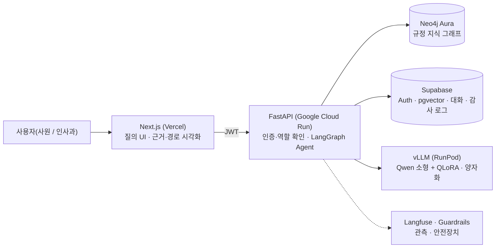

*MLE 1기 · LLM 지식 그래프 기반 AI 엔지니어링 최종 프로젝트*

# 프로젝트 기획 보고서

**목차**

1. 프로젝트 주제
2. 문제 정의
3. 시장조사 및 BM 분석
4. 시스템 구성 기획
5. 모델링 계획
6. 데이터 수집 전략
7. 역할분담(R&R)
8. 성과지표 및 Hugging Face 모델 데모 공개 계획
9. 기획서 제출 및 검토 체크리스트
10. 검토·수정 이력

| 문서 관리 항목 | 팀별 작성 내용 |
|---|---|
| 과정 / 팀 | MLE 1기 / 2팀 |
| 프로젝트명 | 사규 준수 검토 서비스(가칭) / Regulation Compliance Review Service (가칭) |
| 산출물 단계 / 제출 주차 | 기획 / 1주차 (2026.11.17.~11.20.) |
| 제출 일자 / 문서 버전 | 2026.11.17. (초안) / v0.1 |
| GitHub 경로 / 문서 저장 위치 | https://github.com/encore-ai-campus/mle-01-final-team2 / docs/ |
| 작성 팀원 / 팀장 / 검토자 | [이름 및 역할] / [팀장] / [지도강사] |
| 검토 상태 | ■ 작성 중  □ 내부 검토  □ 수정 요청  □ 제출 완료 |

## 문서 작성 원칙

이 문서는 기초 설계서(docs/MLE_2팀_기초 설계.md)와 서비스 기획 초안(docs/PROJECT_PLAN.md)을 양식에 맞게 정리한 것입니다. [ ]로 남은 항목은 팀 확정(인원·일정·모델 크기·GPU 등) 이후 채웁니다. 목표값과 시장 비교는 **가설·제안**이며 실측 결과나 확인된 사실이 아닙니다. ALIO에 공개된 사규를 쓰는 교육 프로젝트로, **실제 IBK 사내 시스템이 아니며** 시연에는 가상의 질문·사안만 사용합니다.

## 1. 프로젝트 주제

### 1.1 프로젝트 기본 개요

| 구분 | 작성 내용 |
|---|---|
| 프로젝트 주제 | 기업 규정 준수 여부 검증을 위한 온톨로지 및 Multi-hop 추론 기반 지식 그래프 시스템 |
| 대상 도메인 및 사용자 | 도메인: 사내 규정(IBK기업은행 사규 148종, 조문 3,405개 + 상위 국가 법령). 사용자: ① 신입 사원을 포함한 일반 사원 ② 인사과 직원. 관리자: 팀이 지정 |
| 핵심 제공 가치 | “이 행위·사안이 어느 규정의 어느 조항에 해당하는가”를 **근거 조문 + 인용·위임·예외를 따라간 추론 경로 + 판정(위반 가능 / 문제 없음 / 판단 불가)** 으로 제시. 근거가 없으면 “근거 없음”으로 답함 |
| 개발 목표 및 범위 | 필수(MVP): 사원 모드(행동·업무 질의), 인사 모드(사안 기반 검토), 사규 구조 적재, 핵심 문서 의무·예외 추출, 근거·경로 시각화, 역할 기반 접근·감사 로그. 선택: 검토 리포트 내보내기, 규정 충돌 탐지·통계. 제외: 직원 데이터 연계 자동 탐지, 규정 개정 이력 비교, 신고·상담 접수, 법적 판단 |
| 기대 효과 | 규정 탐색 시간 단축, 인용·위임·단서 누락 감소, 근거가 확인되는 답변으로 오해·오남용 예방(정량 목표는 5.2의 첫 측정 후 확정) |

### 1.2 선정 배경 및 차별성

| 항목 | 팀 작성 내용 |
|---|---|
| 주제 선정 배경 | 금융권 내부 업무용 AI 확대와 함께 규제도 늘고 겹친다. 사규는 여러 문서·계층에 흩어져 있고 한 조문이 다른 규정·법령을 인용하거나 세부를 위임한다(핵심 인용 관계로 사규 91개가 하나의 큰 덩어리로 연결됨). 키워드 검색으로는 조항 간 관계·예외를 놓치기 쉽다 |
| 기존 방식과 차이 | 키워드 검색(규정집): 인용·위임 추적 불가. 범용 생성형 AI: 근거 없이 지어낼 수 있고 외부 반출 우려. 일반 벡터 RAG: 조문 사이 관계를 따라가지 못함. 본 서비스: 지식 그래프로 관계를 따라 근거 사슬을 제시하고 자체 호스팅 모델을 사용 |
| 핵심 차별점 | ① 온톨로지 기반 규정 구조화(조문·의무·예외·위임) ② Multi-hop 추론(조문→인용 규정→상위 법령) ③ 요건별 충족 여부 점검(인사 모드) ④ 출처·경로 추적과 “근거 없음” 처리 ⑤ 같은 엔진 위에서 역할별 두 모드 제공 |
| 성공 판단 기준 | 사원·인사 평가셋(가상 사안 포함, 권장 최소 60문항)에서 판정·근거 조문 일치, 비인가 접근 차단, 개인정보 필터 통과, 최종 발표에서 두 모드가 한 서비스로 통합 시연됨 |

## 2. 문제 정의

### 2.1 AS-IS / TO-BE

| 업무 시나리오 | AS-IS 문제 | TO-BE 개선 | 검증 지표 |
|---|---|---|---|
| [시나리오 A] 사원: “거래처 선물을 받아도 되나요?” | 규정 위치를 모르고 해석이 갈린다. 물어볼 곳이 마땅치 않다 | 판정 + 근거 조문 카드 + 예외·상위 법령 + 쉬운 설명 + 문의처 안내 | 판정·근거 조문 일치율, 응답 지연 |
| [시나리오 B] 인사: “직원이 업무 중 장시간 이탈했다” | 사안이 여러 조항·문서에 걸치고 예외, 상위 법령, 징계 절차까지 일일이 맞춰야 해 누락 위험 | 관련 조항 후보 + 요건별 충족 여부 + 징계·절차 규정 연계 + 추가 확인 사항 | 조항 후보 재현율·정밀도, 연계 정확도 |
| [시나리오 C] 공통: 정보가 부족한 질문 | 억지 결론 또는 근거 없는 답변 | 되묻기 또는 `판단 불가` + 확인 사항 목록 | 판단 불가 적절성, 환각률 |

※ 위 문제는 **가설**이며 멘토링 시간에 실무 경험자에게 확인한다.

### 2.2 이해관계자·범위·제약

| 구분 | 내용 |
|---|---|
| 주요 이해관계자 | 최종 사용자(일반·신입 사원, 인사과 직원) / 관리자(인사과 지정, 추출 검수) / 데이터 제공자(ALIO 공개 사규, 법제처 법령) / 개발팀 |
| In-Scope | 사규 148종 구조 적재(Neo4j), 핵심 문서 의무·예외 추출과 평가, 하이브리드 검색·그래프 확장, 사원 모드, 인사 모드(사안 기반), 역할 접근·감사 로그, 근거·경로 시각화, Google 로그인·대화 저장 |
| Out-of-Scope | 직원 근태·메일·시스템 로그 연계 자동 탐지, 규정 개정 이력 비교(버전 1개만 보유), 실제 사내 시스템 연동, 신고·상담 접수, 징계 결정·법적 판단 |
| 제약 및 전제 | 개발기간 8주 내외. 데이터는 ALIO 공개본이며 실제 직원 정보를 쓰지 않음. 모델 크기·GPU는 학원 예산 확정 후 결정. 상위 법령은 동료가 수집 중. 학습·평가 데이터와 모델의 라이선스 확인 필요 |
| 위험 및 대응 | 인사 모드 오남용 → 사안 기반 한정·역할 접근·감사 로그·사안 비저장. 후보를 확정으로 오해 → “후보” 표현·`판단 불가` 우선·면책 문구. 소형 모델 품질 → 규칙 기반 비교(수치·기한)·사람 검수·근거 검증. 환각 → 근거 인용 강제 |

### 2.3 요구사항 요약 및 인수 조건

| ID | 기능(FR)/비기능 요구사항(NFR) | 우선순위 | 인수 조건·검증 |
|---|---|---|---|
| FR-01~02 | 조문 검색·인용, 참조·위임·단서 추적 | 필수 | 출처 조문 ID·관련 노드·관계 재현 |
| FR-03 | 준수 판정(위반 가능 / 문제 없음 / 판단 불가) | 필수 | 평가셋 판정 일치 |
| FR-06 | 근거·추론 경로 시각화 | 필수 | 경로 그래프 표시 |
| FR-08~10 | Google 로그인, 대화 저장, 장기 기억(본인만 열람·삭제) | 필수 | 로그인·저장·삭제 시연 |
| FR-15 | 역할 기반 접근(일반 사원 / 인사과 / 관리자), 인사 모드는 인사과만 | 필수 | 비인가 접근 시도 테스트 |
| FR-16 | 사원 모드: 판정 + 근거 + 예외 + 쉬운 설명 + 문의처 | 필수 | 사원 모드 평가셋 |
| FR-17~18 | 인사 모드: 조항 후보·요건별 충족 여부·추가 확인 사항, 징계·절차 규정 연계 | 필수 | 인사 모드 평가셋(가상 사안) |
| FR-19~20 | 감사 로그(사안 본문 미저장), 입력 보호(가명 안내·개인정보 필터) | 필수 | 로그 점검, 필터 테스트 |
| FR-21 | 정보 부족 시 되묻기 또는 `판단 불가` | 권장 | 정보 부족 사례 평가 |
| FR-22 | 검토 리포트 내보내기(인사 모드) | 선택 | 시연 |
| FR-04~05, 07, 11~14 | 충돌 탐지, 통계, 스트리밍, 근거 없음 표시, 추출 검수, 평가 대시보드, 면책 문구 | 권장/선택 | 설계서 §14 참조 |
| NFR-01~09 | 지연·안정성, 접근제어·로그·재현성, 보안, 비용 등 | 필수 | 설계서 §14 참조 (p95 지연 목표는 첫 측정 후 설정) |
| NFR-10 | 표현 제한: “위반 가능성이 있는 조항 후보”로 표현, 징계 결정 시사 금지 | 필수 | 응답 점검, Guardrails 규칙 |

p95(95th Percentile, 95백분위수) : 측정된 응답시간을 빠른 순서부터 정렬했을 때 약 95%의 요청이 그 값 이하의 시간에 완료된다는 의미입니다.

※ 전체 요구사항(FR-01~22, NFR-01~10)과 추적표는 설계서 §14 및 부록 B에 있다. 제외한 요구사항은 사유를 설계서에 기록한다.

## 3. 시장조사 및 BM 분석

### 3.1 시장·유사 서비스 조사

※ 아래 비교는 **제품을 직접 확인하지 않은 가설**이다. 시장·사용자 분석 방법은 수업 자료에 없어 팀 자체 가설 + 멘토 검증으로 진행하며, 근거 URL·조사일은 조사 후 채운다.

| 비교 대상 | 대상 고객/문제 | 핵심 기능 | 한계·기회 | 근거 URL/조사일 |
|---|---|---|---|---|
| 사내 규정집 검색(키워드) | 전 직원 / 규정 열람 | 문서 목록·전문 검색 | 조문 간 인용·위임·단서를 따라가지 못함 | [조사 필요] |
| 범용 생성형 AI | 누구나 / 일반 질의 | 자연어 답변 | 근거 없는 답변 가능, 내부 규정 외부 반출 우려 | [조사 필요] |
| 일반 벡터 RAG | 문서 질의응답 도입 조직 | 의미 검색 + 생성 | 조문 간 관계·예외 추적 한계 | [조사 필요] |
| 자체 제안 | 일반·신입 사원, 인사과 | 지식 그래프 + Multi-hop + 판정·경로 제시 | 관계 추출 품질이 성패를 좌우, 소형 모델 한계 | 본 문서 §5 검증 |

### 3.2 사용자 가치 및 BM 가설

| 항목 | 작성 내용 |
|---|---|
| 고객 세그먼트 | 도입 조직: 사규가 많은 금융·공공 기관(가정). 실제 사용자: 일반·신입 사원, 인사과 직원. 의사결정자: 준법·인사 부서장 |
| 가치 제안 | 규정 탐색 시간 단축, 인용·예외 누락 감소, 근거가 확인되는 답변, 신입 사원 온보딩 지원 |
| 도입·운영 형태 | 사내 구축(자체 호스팅 모델로 규정·질의 외부 반출 방지)을 가설로 함. SaaS·API 연동은 후속 검토 |
| 비용 구조 | LLM 서빙(RunPod GPU), 임베딩, Neo4j Aura, Supabase, Cloud Run, 운영 인력(추출 검수). 모델 크기·GPU는 예산 확정 후 산정 |
| 수익/효율 가설 | 교육 프로젝트로 수익 모델은 없음. 효율 가설: 규정 확인 업무 시간 절감, 오해에 따른 위반 예방 |
| 가설 검증 | 멘토링 시간 실무 경험자 인터뷰, 가상 시나리오 시연 피드백, 평가셋 기반 PoC 측정 |

## 4. 시스템 구성 기획

### 4.1 서비스 아키텍처

[시스템 구성도: 사용자 → Next.js(Vercel) → FastAPI(Cloud Run, LangGraph Agent) → Neo4j Aura / Supabase / RunPod vLLM. 인증은 Supabase Auth(Google 로그인), 보안 경계는 API 서버의 JWT·역할 확인. 상세 다이어그램은 docs/architecture.html 참조]

| 계층 | 후보 기술 | 역할 및 선택 이유 |
|---|---|---|
| 프론트엔드 | Next.js (Vercel) | 질의 UI, 근거 카드·경로 그래프 시각화, 모드별 화면 |
| 백엔드/API | FastAPI (Docker, Google Cloud Run) | 인증·역할 확인, 요청 처리, 감사 로그. 컨테이너 배포와 리비전 롤백 |
| 지식 추출 | Qwen 소형 모델(QLoRA) + 규칙 기반 파서 | 조문 구조 파싱, 의무·예외·위임·인용 Triple 추출 |
| 그래프 저장 | Neo4j Aura | Document/Article/Obligation/Exception 등 온톨로지 기반 노드·관계 |
| 검색·추론 | Vector + 전문(BM25) 하이브리드 + 그래프 확장(≤3 hops) | RRF 결합, Multi-hop 근거 사슬 구성 |
| Agent 제어 | LangGraph (Planner/Supervisor + 도구) | 질의 분류·검색·그래프 확장·비교·검증 오케스트레이션 |
| LLM 서빙 | vLLM on RunPod | 양자화 모델 서빙, 자체 호스팅으로 질의 외부 반출 방지 |
| 저장소 | Supabase (Postgres + pgvector + Auth) | 원문·추출 결과·대화·기억·감사 로그, Google 로그인 |
| 배포·운영 | Docker, GitHub Actions(CI/CD), Langfuse, NeMo Guardrails | 재현 가능한 배포, 관측·평가, 입출력 안전장치 |

### 4.2 데이터·요청 흐름

① 원천 데이터(ALIO HWP·법령) 수집 → ② 정제·조문 단위 청킹 → ③ 개체/관계 추출 → ④ Entity Resolution → ⑤ Neo4j 및 검색 인덱스 적재 → ⑥ 사용자 질의(역할 확인·입력 검사) → ⑦ 검색·그래프 탐색 → ⑧ Agent 근거 검증 → ⑨ 근거 포함 답변(스트리밍) → ⑩ 로그·평가

사원 모드: 로그인 → 질문 → (필요 시 되묻기) → 판정 + 근거 카드 + 경로 그래프 → 후속 질문·문의처 안내. 인사 모드: 로그인(인사 역할) → 사안 입력(가명 처리 안내) → 조항 후보 + 요건 체크리스트 + 상위 법령·징계 규정 → 추가 확인 사항 → (선택) 검토 리포트.

### 4.3 운영·보안 계획

| 영역 | 기획 내용 |
|---|---|
| 인증·인가 | Supabase Auth(Google 로그인). 역할: 일반 사원 / 인사과 / 관리자. 인사과 역할은 관리자가 허용 목록으로 지정하며 스스로 선택 불가. DB 역할 테이블과 API에서 이중 확인 |
| 개인정보·비밀정보 | 인사 모드 입력에 가명 처리 안내와 개인정보 형태(주민번호·계좌·연락처) 필터. 사안 본문은 장기 기억·감사 로그에 저장하지 않음. 키는 Secret Manager 등으로 관리 |
| 프롬프트/도구 안전 | 입력·출력 가드레일, 도구 권한 제한, 결과는 “위반 가능성이 있는 조항 후보”로 표현(확정·징계 시사 금지), 모든 결과에 검토 보조 표시 |
| 장애 대응 | 타임아웃·재시도·폴백, Agent 재귀 제한, 실패 로그. 근거 부족 시 `판단 불가`로 종료하고 준법·인사 담당 검토로 안내 |
| 형상·배포 | GitHub Actions: PR=CI, main=CD, 커밋 해시 태그, Cloud Run 리비전 롤백. 환경변수·시크릿 분리 |

## 5. 모델링 계획

### 5.1 지식그래프·GraphRAG 설계

| 모델링 대상 | 설계 계획 / 결정 근거 | 검증 방법 |
|---|---|---|
| 온톨로지 | Document·Chapter·Article·Clause·Obligation·Exception·Role·Concept·ExternalLaw. 관계: REFERS_TO, CITES, CITES_LAW, DELEGATES_TO, STATES, EXCEPTS, APPLIES_TO, CONFLICTS_WITH. 관계마다 근거 문장·출처 보존 | 대표 질문으로 관계 충족 확인, 제약조건 점검 |
| 지식 추출 | 1단계 규칙 기반 구조 파싱(조·항·호·인용), 2단계 소형 모델로 의무·예외·위임 추출(JSON 스키마). 핵심 문서 16개(약 410조문)부터 적용 | 표본 정답셋과 Precision/Recall, 수치·기한 규칙 대조 |
| 개체 정규화 | 규정명·별칭·역할명 병합, 후보는 사람 검수 후 확정 | 동일 개체 중복률 |
| 검색 | 벡터 + 전문 검색 RRF, 선택적 리랭커. 메타데이터 필터(문서·시행일) | Recall@k, 일반 RAG 대비 |
| Multi-hop 추론 | 조문 → 인용·위임 규정 → 상위 법령, 최대 3 hop, 종료 조건: 근거 충분 판정 | 다단계 질문 성공률 |
| Multi-Agent | Planner/Supervisor가 검색·그래프 확장·의무 비교·통계·법령 조회 도구를 선택, 검증(근거 충분성·지원 여부) 단계 포함 | Task Success Rate, 도구 선택 일치율, 실행 로그 |
| 도메인 튜닝 | Qwen 소형 모델에 Hugging Face 법령 데이터로 QLoRA(근거 ID·수치 대조·오염 점검·원문 단위 분할). 병합 후 재평가하고 양자화(AWQ/GPTQ 후보). 모델 크기·GPU는 예산 확정 후 결정 | base vs 튜닝 vs 양자화 품질·지연·비용 |

### 5.2 실험 및 평가 설계

| 평가 지표 | 목표값(팀 설정) | 측정 데이터·방법 |
|---|---|---|
| RAGAS Faithfulness | [첫 측정 후 확정] | 사원·인사 평가셋(질문/정답/근거), RAGAS 설정 고정 |
| Answer Relevancy / Context Precision·Recall | [첫 측정 후 확정] | 적용 가능한 지표 선택, 동일 질문셋 |
| Task Success Rate | [첫 측정 후 확정] | 시나리오별 성공 조건: 판정·근거 조문 일치, 조항 후보 재현율 |
| Latency (p50/p95) | [첫 측정 후 확정] | 동일 환경 반복 측정(`vllm bench serve` 포함) |
| Cost / Error Rate | [첫 측정 후 확정] | 호출량·토큰·GPU 시간, 실패 로그(Langfuse) |
| 안전성 | [첫 측정 후 확정] | 비인가 접근 차단, 개인정보 필터, 확정적 표현 억제(레드팀 셋) |
| Baseline 비교 | 일반 RAG 대비 GraphRAG, base 대비 튜닝·양자화 | 동일 질문셋·모델 조건 비교, 회귀 게이트(MLflow) |

평가셋 구성(초안): 조회·행동 질문(사원), 사안→조항 매핑(인사·가상 사안), 인용·위임·단서 추적, 정보 부족(되묻기·`판단 불가`), 근거 없는·범위 밖 질문, 후속 질문(맥락 의존). 문항 수는 팀이 정한다(권장 최소 60문항).

## 6. 데이터 수집 전략

### 6.1 데이터 확보·품질 계획

| 데이터명/형태 | 출처·라이선스 | 수집량·기간 | 전처리·품질 | 저장 위치 |
|---|---|---|---|---|
| IBK기업은행 사규 HWP | ALIO 공개(공공기관 경영정보). 이용 조건 확인 필요 | 148종, 조문 3,405개(수집 완료) | HWP5 파서로 조·항·호·인용·단서 추출, 삭제 조문·편 문서 중복 ID 처리 | data/ibk_converted/, Supabase source_files |
| 상위 국가 법령 | 법제처 국가법령정보 OpenAPI(이용 조건 확인 필요) | 동료 수집 중(우선순위 목록 274건 중 1순위 48건) | 법령 본문 조회 키 필요, 조문 단위 정규화 | 원문 저장소 + Neo4j ExternalLaw |
| 법률 학습·평가 데이터 | Hugging Face 공개 데이터셋(라이선스 개별 확인) | [선정 후 기록] | SFT 형식 변환, 근거 ID·수치 대조, 오염 점검, 원문 단위 분할 | data/DATA_SOURCES.md, 데이터 카드 |

### 6.2 수집·적재·검증 프로세스

ALIO에서 HWP 수동 다운로드 → olefile 기반 변환(텍스트·구조 JSON) → 조문 단위 청킹 → 의무·예외·위임 추출(소형 모델) → Entity Resolution → Neo4j 적재(관계마다 근거·출처 보존) → 검색 인덱스(벡터·전문) 구축. 오류는 재처리 큐로 보내고 추출 실행 이력(extraction_runs)으로 데이터 계보를 남긴다. 법령은 법제처 API로 수집해 같은 구조로 적재한다.

| 점검 항목 | 검증 기준 / 증빙 |
|---|---|
| 합법성·권한 | ALIO·법제처 이용 조건과 HF 데이터셋·모델 라이선스 확인 기록(문서화) |
| 정합성·완전성 | 필수 필드·조문 번호 연속성·중복·삭제 조문 처리, 내부 참조 미해결 목록(unresolved_refs) 점검 |
| 추출 품질 | 정답 표본 대비 Precision/Recall, 오류 유형 분류, 수치·기한 규칙 대조 |
| 그래프 적재 | 노드·관계 수, 중복, 고아 노드, 인용 닫힘(코퍼스 밖 인용은 ‘미보유’ 표시) 검증 |
| 보안·보존 | 실제 직원 정보 미사용, 사안 본문 비저장, 대화·기억은 본인만 열람·삭제, 키는 저장소에 커밋하지 않음(.gitignore) |

## 7. 역할분담(R&R)

### 7.1 팀 조직 및 책임

※ 인원·담당은 팀 확정 후 채운다. 아래는 설계서 WBS의 역할 구분 제안이다.

| 담당자 | 역할 | 주요 담당 업무 | 주요 산출물 | 백업 담당 |
|---|---|---|---|---|
| [팀장] | PM/기획 | 요구사항·WBS·통합 관리 | 기획서, 설계서 | [ ] |
| [팀원] | 데이터/지식 추출 | 수집·HWP 변환·정제, 의무·예외 추출, 법령 수집 | 변환 스크립트, 추출 검증 | [ ] |
| [팀원] | 그래프/검색 | Neo4j 스키마·적재, 하이브리드 검색, 그래프 확장 | 스키마, 검색 엔진 | [ ] |
| [팀원] | 모델/Agent/백엔드 | QLoRA·양자화·vLLM, LangGraph, API, 역할·감사 로그 | 서비스 코드, 모델 카드 | [ ] |
| [팀원] | 프론트/평가·배포 | Next.js UI, RAGAS·평가셋, CI/CD, 배포 | UI, 평가 리포트 | [ ] |

### 7.2 협업 및 일정 관리

| 관리 항목 | 팀별 기준 |
|---|---|
| GitHub 규칙 | 브랜치(feature)·PR·리뷰, main 병합 시 CI 통과. 이슈·PR 템플릿은 팀 합의 후 적용 |
| 회의·진척 공유 | [데일리/주간 스탠드업 및 기록 위치 — 팀 합의 후 기재] |
| 품질 게이트 | PR 리뷰, 테스트, 평가 회귀 게이트(MLflow), 근거 인용 점검 |
| 변경·위험 관리 | 요구사항 변경은 설계서 부록 B 추적표에 반영, 위험은 설계서 §12와 본 문서 부록 C에서 관리 |
| 주요 일정 | 1주차 기획(2026.11.17.~11.20.) → 2주차 온톨로지 → 3~4주차 추출·적재, PoC/중간발표(사원 모드 기본 질의응답) → 5~6주차 엔진·인사 모드 → 7~8주차 평가·배포 → 2027.01.11. 최종발표(두 모드 통합). 세부 일정은 발표일·인원 확정 후 채움 |

## 8. 성과지표 및 Hugging Face 모델 데모 공개 계획

본 항목은 MLE 1기 최종 프로젝트의 필수 성과지표를 기획 단계에서 정의하고, 최종 제출 시 실제 달성 여부를 증빙하기 위한 작성 양식입니다. 목표값은 팀이 설정하고 실측 결과는 평가 후 기록합니다.

### 8.1 필수 성과지표: Hugging Face 모델 데모 공개

필수 성과목표: 프로젝트 중 개발·활용한 AI 모델 또는 이를 시연하는 데모를 Hugging Face에 최소 1건 이상 공개하여 기술적 성과를 공유한다. 공개 대상과 저장소 유형(Model / Space)은 프로젝트 성격에 맞게 선택하되, 외부인이 접근하여 내용을 확인할 수 있어야 한다.

| 성과지표 ID | KPI-HF-001 |
|---|---|
| 지표명 | Hugging Face 모델·데모 공개 실적 |
| 목표 | 프로젝트당 최소 1건 이상 공개 |
| 공개 유형 | □ Model Repository  □ Space 데모  □ 둘 다 (제안: Model + Space, 팀 확정 전) |
| 공개 대상/기능 | QLoRA 어댑터 또는 양자화 모델(규정·법령 도메인 소형 모델)과 가상 질문·사안 기반 Space 데모. 실제 IBK 사규 원문·직원 정보는 공개 가능 여부를 점검한 뒤 결정 |
| 공개 URL | https://huggingface.co/[계정]/[저장소] 또는 https://huggingface.co/spaces/[계정]/[데모] |
| 검증 기준 | 공개 접근 가능 여부, README/Model Card, 실행·사용 방법, 데모 정상 작동 여부, 라이선스·데이터 공개 적합성 |
| 증빙 | 공개 URL, 공개 화면 캡처, 실행 영상 또는 테스트 로그, 공개일 |
| 담당자·기한 | [담당자] / [예정일] |
| 실적·판정 | [공개 건수]건 / □ 달성 □ 미달성 □ 미검증 |

※ 유의: 공개 가능한 모델 가중치가 없는 API 기반 프로젝트는 Hugging Face Spaces에 실제 동작하는 데모를 게시하는 방식으로 성과를 입증할 수 있습니다. 제3자 모델·데이터의 라이선스, 개인정보, API 키, 기업 비밀정보는 공개 전에 반드시 점검합니다. 특히 ALIO 사규 원문과 파생 데이터의 재배포 가능 여부를 먼저 확인합니다.

### 8.2 기술·품질 성과지표(KPI) 정의

표의 수치는 확정된 평가 기준이 아니며, 목표값은 첫 측정(베이스라인) 후 팀이 설정합니다.

| 지표 | 목표값 | 측정 방법 | 평가 데이터/도구 | 증빙 |
|---|---|---|---|---|
| Task Success Rate | [목표] | 성공 작업 수 / 전체 작업 수 × 100 | 사원·인사 평가셋 | [표·로그·URL] |
| RAGAS Faithfulness | [목표] | 응답의 근거 충실도 평가 | 평가셋 / RAGAS | [표·로그·URL] |
| RAGAS Context Recall/Precision | [목표] | 검색 문맥 재현율·정밀도 평가 | 평가셋 / RAGAS | [표·로그·URL] |
| 응답 지연시간(p50/p95) | [목표] | 질의별 총 응답시간 분포 측정 | 동일 환경 반복 / vllm bench | [표·로그·URL] |
| 오류율 | [목표] | 실패·예외 요청 수 / 전체 요청 수 × 100 | Langfuse 로그 | [표·로그·URL] |
| 비용 | [목표] | 질의당 토큰/API·인프라 비용 집계 | Langfuse, RunPod 사용량 | [표·로그·URL] |
| 지식 추출 품질 | [목표] | 개체·관계 추출 Precision/Recall/F1 | 정답 표본 | [표·로그·URL] |
| GraphRAG 개선 효과 | [목표] | 벡터 검색 단독 대비 동일 데이터셋 A/B 비교 | 동일 질문셋 | [표·로그·URL] |
| 안전성·가드레일 | [목표] | 비인가 접근·개인정보·확정적 표현 차단 테스트 | 레드팀 셋 / Guardrails | [표·로그·URL] |

### 8.3 공개·검증 및 성과 공유 일정

| 단계 | 수행 내용 | 완료 기준 | 담당/일자 |
|---|---|---|---|
| 기획 | 공개 대상 모델·데모, 라이선스·보안 검토 | 공개 범위 및 KPI 확정 | [담당/일자] |
| 개발 | 모델/Space 구성, README·사용법 작성 | 내부 실행 테스트 통과 | [담당/일자] |
| 검증 | 외부 접속·재현 테스트, 성능 측정 | URL 및 테스트 증빙 확보 | [담당/일자] |
| 최종 제출 | 성과 발표·시연·저장소 링크 제출 | 최소 1건 공개 실적 확인 | [담당/일자] |

### 8.4 최종 성과 검증 체크리스트

- □ Hugging Face 공개 URL이 제출되었는가?
- □ 최소 1건 이상 공개되었고 외부 접근이 가능한가?
- □ README/Model Card 또는 Space 설명에 목적·사용법·제약사항이 기재되었는가?
- □ 공개 자료의 라이선스·개인정보·비밀정보·API 키를 점검했는가?
- □ 데모 실행 화면과 검증 로그·캡처가 첨부되었는가?
- □ 품질 KPI 목표·실측값·평가 데이터·비교 기준이 명확한가?

## 9. 기획서 제출 및 검토 체크리스트

- □ 주제·대상 사용자·차별성·범위가 명확한가?
- □ 문제 정의와 사용자 시나리오에 근거가 있는가?
- □ 시장조사 자료에 출처·조사일이 있는가? (현재 가설 단계 — 조사 필요)
- □ 시스템 구성도에 데이터 흐름·보안 경계가 표시되었는가?
- □ 온톨로지·Neo4j·GraphRAG·Agent 적용 여부가 명시되었는가?
- □ 수집 데이터의 출처·라이선스·품질 검증 계획이 있는가?
- □ 요구사항과 평가 KPI가 검증 가능한 형태인가?
- □ 역할·일정·GitHub 경로 및 주요 위험 대응이 있는가? (역할·세부 일정은 팀 확정 필요)
- □ Hugging Face 최소 1건 공개 계획, URL·검증 기준 및 기술 KPI가 명시되었는가?

## 10. 검토·수정 이력

| 버전/일자 | 검토자 | 검토 의견 | 조치 내용 및 증빙 | 상태 |
|---|---|---|---|---|
| v0.1 / 2026.11.17. | [ ] | [ ] | 초안 작성(설계서·기획 초안을 양식에 맞춰 정리) | 작성 중 |
| v0.2 / [ ] | [ ] | [ ] | [ ] | [ ] |

## 부록

부록(선택) | 서비스 모드 비교, 핵심 문서 후보, 위험 등록부, 팀 결정 항목, 용어집, 참고 문서

### 부록 A. 두 서비스 모드 비교

|  | 사원 모드 | 인사 모드 |
|---|---|---|
| 대상 | 신입 사원을 비롯한 일반 사원 | 인사과 직원 |
| 목적 | 내 행동·업무가 규정에 어긋나는지 확인·예방 | 사안이 어떤 조항에 해당할 수 있는지 검토 |
| 입력 | 자연어 질문(“~해도 되나요?”) | 사안 설명(가명 처리 권장) + 확인할 질문 |
| 출력 | 판정 + 근거 조문 + 예외 + 쉬운 설명 + 문의처 안내 | 조항 후보 + 요건별 충족 여부 + 상위 법령 + 징계·절차 규정 + 추가 확인 사항 + 검토 리포트 |
| 접근 | 로그인한 모든 사용자 | 인사과 역할 사용자만(관리자 지정) |
| 저장 | 대화·사용자 맥락 기억(본인만 열람·삭제) | 사안 내용은 장기 기억에 저장하지 않음, 조회 이력만 감사 로그 |

“다른 사원의 법규 위반 검색”은 **사안 기반 검토(A)** 로 한정한다. 직원의 근태·메일·시스템 로그를 연계한 자동 탐지(B)는 데이터가 없고 개인정보·근로자 감시 등 법적·윤리 검토가 선행되어야 하므로 범위에서 제외하고 향후 과제로 남긴다. 서비스는 검토를 돕는 도구이며 징계 여부·수위는 사람과 정해진 절차가 결정한다.

### 부록 B. 핵심 문서 후보(사원·인사 16개, 약 410개 조문)

| 분류 | 문서(조문 수) |
|---|---|
| 행동·윤리 | 기업은행임직원행동강령(68), 기업은행 윤리강령(26), 기업은행 이해충돌 방지 지침(24), 부패행위 신고에 관한 지침(8), 준법제보제도 운영규정(17) |
| 복무·인사 | 복무규정(44), 휴가규정(14), 인사규정(59), 취업규칙(37) |
| 징계·절차(인사 모드 핵심) | 직원상벌규정(25), 직장 내 괴롭힘 예방 및 대응지침(9), 직장내 양성평등 및 성폭력·성희롱 예방지침(10) |
| 업무 행위 | 불건전 영업행위 방지규정(19), 임직원에대한대출규정(19) |
| 정보 | 정보보호규정(13), 개인·신용정보 관리 및 보호 규정(18) |

선정 근거: 수치·기한 포함 조문 비율이 20%(이전 금융·내부통제 후보 12%)로 규칙 기반 비교가 가능하고, 16개 문서가 모두 인용 관계의 큰 덩어리(91개) 안에 있다. 직원상벌규정은 코퍼스에서 15회 인용되어 인사 모드의 중심이다. 구조 적재는 148종 전체를 하고, 의무 추출·평가 범위는 검수 가능한 분량에 따라 정한다. 최종 목록은 팀 검토 후 확정한다.

### 부록 C. 위험 등록부

| 위험 | 대응 |
|---|---|
| 인사 모드의 개인정보·오남용(특정인 감시 도구화) | 사안 기반 한정, 직원 데이터 비보유, 역할 접근, 감사 로그, 사안 비저장, 가명 처리 안내 |
| 후보를 확정으로 오해해 불이익 발생 | “후보” 표현, 확정적 표현 금지(NFR-10), `판단 불가` 우선, 결정은 사람·절차, 면책 문구 |
| 일반 사원의 인사 모드 접근 | 역할 이중 확인(DB·API), 관리자 지정, 접근 테스트 |
| 사원이 서비스를 면책으로 오용 | 면책 문구, 판단 불가 시 문의처 안내, 근거 조문 확인 유도 |
| 소형 모델의 판정·추출 품질 | 규칙 비교(수치·기한), 사람 검수, 근거 검증, `UNDETERMINED` |
| 사규 개정 반영 불가 | 버전 1개 보유, 답변에 규정 시점 표시 |
| 시연 데이터 | 가상의 질문·사안만 사용, 실제 직원·사건 정보 배제 |

### 부록 D. 팀 결정이 필요한 항목

| # | 질문 | 제안 |
|---|---|---|
| 1 | “다른 사원의 법규 위반 검색”을 사안 기반 검토(A)로 한정하는가, 직원 데이터 연계(B)를 원하는가 | A만. B는 데이터·법적 검토가 없어 제외 |
| 2 | 인사과 역할 지정 방법 | 관리자 허용 목록 |
| 3 | 인사 모드에서 사안 본문을 저장하는가 | 저장하지 않음, 조회 이력만 감사 로그 |
| 4 | 핵심 문서를 사원·인사 16개(부록 B)로 변경하는가 | 변경, 금융·내부통제는 2차 확장 |
| 5 | 서비스명 | 미정 |
| 6 | 검토 리포트 내보내기(FR-22) 포함 여부 | 시연 후순위(선택) |
| 7 | 법적·윤리 검토(개인정보, 근로자 권리)를 멘토에게 확인하는가 | 멘토링 시간에 확인 |
| 8 | 모델 크기·GPU, Cloud Run 설정, 임베딩 모델 등 설계서 미결 항목 | 설계서 §10, 예산 확정 후 결정 |

### 부록 E. 용어집 및 참고 문서

| 용어 | 뜻 |
|---|---|
| 사규 / 조문 / 단서 / 위임 | 기업 내부 규정 / 규정의 `제N조` 단위 / “다만 ~인 경우는 제외” 예외 조항 / 세부를 다른 규정에서 정하도록 넘기는 조항 |
| Multi-hop 추론 | 조문 → 인용된 규정 → 그 규정의 조문처럼 여러 단계를 따라가는 추론 |
| 지식 그래프 | 문서·조문·의무 등을 노드로, 인용·위임 등을 관계로 저장한 데이터 |
| 판단 불가(UNDETERMINED) | 근거나 사실이 부족해 결론을 내리지 않고 확인 사항을 제시하는 결과 |
| 사원 모드 / 인사 모드 | 이 서비스의 두 사용 방식(부록 A) |
| 참고 문서 | docs/MLE_2팀_기초 설계.md(기초 설계서), docs/PROJECT_PLAN.md(기획 초안), docs/PROJECT_GUIDE_SUMMARY.md, docs/LAW_COLLECTION_LIST.md, data/DATA_SOURCES.md |
