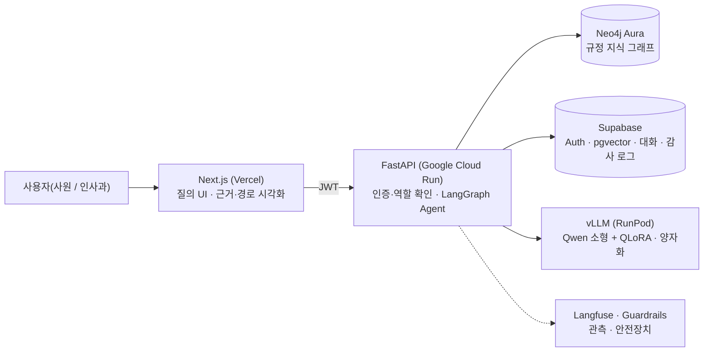

*MLE 1기 · LLM 지식 그래프 기반 AI 엔지니어링 최종 프로젝트*

# 프로젝트 기획 보고서

**목차**

1. 프로젝트 주제
2. 문제 정의
3. 시장조사 및 BM 분석
4. 시스템 구성 기획
5. 모델링 계획
6. 데이터 수집 전략
7. 역할분담(R&R)
8. 성과지표 및 Hugging Face 모델 데모 공개 계획
9. 기획서 제출 및 검토 체크리스트
10. 검토·수정 이력

| 문서 관리 항목 | 팀별 작성 내용 |
|---|---|
| 과정 / 팀 | MLE 1기 / 2팀 |
| 프로젝트명 | 사규 준수 검토 서비스(가칭) / Regulation Compliance Review Service (가칭) |
| 산출물 단계 / 제출 주차 | 기획 / 1주차 (2026.11.17.~11.20.) |
| 제출 일자 / 문서 버전 | 2026.11.17. (초안) / v0.1 → 2026.11.18. (멘토링 반영) / v0.2 → 2026.11.18. (예시 기획서 참고 보강) / v0.3 → 2026.11.18. (예시 기획서 2차 보강) / v0.4 |
| GitHub 경로 / 문서 저장 위치 | https://github.com/encore-ai-campus/mle-01-final-team2 / docs/ |
| 작성 팀원 / 팀장 / 검토자 | [이름 및 역할] / [팀장] / [지도강사] |
| 검토 상태 | ■ 작성 중 □ 내부 검토 □ 수정 요청 □ 제출 완료 |

## 문서 작성 원칙

이 문서는 기초 설계서(docs/MLE_2팀_기초 설계.md)와 서비스 기획 초안(docs/PROJECT_PLAN.md)을 양식에 맞게 정리한 것입니다. [ ]로 남은 항목은 팀 확정(인원·일정·모델 크기·GPU 등) 이후 채웁니다. 목표값과 시장 비교는 **가설·제안**이며 실측 결과나 확인된 사실이 아닙니다. ALIO에 공개된 사규를 쓰는 교육 프로젝트로, **실제 IBK 사내 시스템이 아니며** 시연에는 가상의 질문·사안만 사용합니다.

**v0.2(2026-11-18 멘토링 반영):** 멘토링에서 받은 보완 의견 중 WBS·일정을 제외한 항목을 반영했다. ① MVP 범위와 개발 우선순위(§1.3) ② 실무 검증 근거(§2.4) ③ 시장 조사 출처와 미확정 항목(§3.1, §3.3) ④ 핵심 대상 문서 확정과 상위 법령·미해결 참조 처리 기준(부록 B, 설계서 §1·§4.7) ⑤ KPI 평가 우선순위(§5.2, KPI 초안 §0.1) ⑥ 보안·윤리 필수 준수사항(§4.4). 변경 내역은 §10에 있다. 또한 팀 요청으로 근거 부족·가드레일 차단 시 응답 정책(§4.5), 모델 교체 구조와 배포 Plan B(§4.6)를 추가했다.

**v0.3(2026-11-18 예시 기획서 참고):** 경력자의 예시 기획서(프로젝트_기획서_v1.7)를 읽고, 장 구성은 원래 양식(1~10장)을 그대로 두되 예시에서 설득력을 높이는 요소를 양식의 해당 절에 넣었다. ① 문제와 대응의 대응표(§2.1) ② 범위 제외 사유(§2.2) ③ 차별성 비교표와 유사 연구·프로젝트 조사(§3.1), 포지셔닝(§3.2) ④ 설계 원칙(§4.1)과 유스케이스 흐름(§4.2) ⑤ 사용자 데이터·결과 표시 정책(§6.3) ⑥ 시연 시나리오(§7.3) ⑦ 참고 출처(부록 F). 새 장은 만들지 않았다. 내용은 기존 설계서와 실측값에서 가져왔고, 새로 정한 정책은 "제안"으로 표시했다. 검증하지 못한 항목은 확인 상태를 그대로 적었다.

**v0.4(2026-11-18 예시 기획서 2차 참고):** 양식의 장 구성(1~10장)은 그대로 두고, 예시에서 아직 넣지 않은 요소를 해당 절에 더했다. ① 서비스 한 줄 정의와 제공 항목(§1.1) ② 문제가 이어지는 흐름(§2.1) ③ 시장 규모를 제시하지 않는 이유와 타깃 범위(§3.1), BM 방향(§3.2) ④ 구현 제약(§4.3) ⑤ 모델 호출과 직접 구현 로직의 분리(§5.1), 평가 재현성 장치(§5.2) ⑥ 수집하지 않는 데이터(§6.1), 동의 구분과 결과 고지(§6.3) ⑦ 공통 수행 항목(§7.2) ⑧ 문서 간 참조(부록 E). 예시의 배점·Task 수 같은 수치는 우리 프로젝트와 무관해 가져오지 않았다.

## 1. 프로젝트 주제

### 1.1 프로젝트 기본 개요

| 구분 | 작성 내용 |
|---|---|
| 프로젝트 주제 | 기업 규정 준수 여부 검증을 위한 온톨로지 및 Multi-hop 추론 기반 지식 그래프 시스템 |
| 대상 도메인 및 사용자 | 도메인: 사내 규정(IBK기업은행 사규 148종, 조문 3,405개 + 상위 국가 법령). 사용자: ① 신입 사원을 포함한 일반 사원 ② 인사과 직원. 관리자: 팀이 지정 |
| 핵심 제공 가치 | “이 행위·사안이 어느 규정의 어느 조항에 해당하는가”를 **근거 조문 + 인용·위임·예외를 따라간 추론 경로 + 판정(위반 가능 / 문제 없음 / 판단 불가)** 으로 제시. 근거가 없으면 “근거 없음”으로 답함 |
| 개발 목표 및 범위 | 필수(MVP): 사원 모드(행동·업무 질의), 인사 모드(사안 기반 검토), 사규 구조 적재, 핵심 문서 의무·예외 추출, 근거·경로 시각화, 역할 기반 접근·감사 로그. 선택: 검토 리포트 내보내기, 규정 충돌 탐지·통계. 제외: 직원 데이터 연계 자동 탐지, 규정 개정 이력 비교, 신고·상담 접수, 법적 판단 |
| 기대 효과 | 규정 탐색 시간 단축, 인용·위임·단서 누락 감소, 근거가 확인되는 답변으로 오해·오남용 예방(정량 목표는 5.2의 첫 측정 후 확정) |
| 사용자가 받는 결과 | ① 판정(위반 가능 / 문제 없음 / 판단 불가) ② 근거 조문 카드와 원문 ③ 인용·위임·예외·상위 법령을 따라간 경로 그래프 ④ 인사 모드는 조항 후보, 요건별 충족 점검, 추가 확인 사항. 모든 결과는 검토 보조이며 최종 판단은 사람이 한다 |

**서비스 한 줄 정의.** 사규와 상위 법령을 지식 그래프로 묶어, 질문이나 사안이 **어느 규정의 어느 조항에 해당하는지를 근거 조문과 인용 경로로 보여주는** 규정 준수 검토 보조 서비스이다. 사용자가 보는 것은 하나의 질의 화면이고, 뒤에서는 검색, 그래프 확장, 근거 검증, 가드레일이 차례로 동작한다. 근거가 없으면 `근거 없음`/`판단 불가`로 답하며, 최종 판단은 사람이 한다.

| 제공 항목 | 내용 | 구분 |
|---|---|---|
| 판정 | 위반 가능 / 문제 없음 / 판단 불가(사원 모드) | 결과 |
| 근거 조문 카드 | 조문 원문, 문서·조 번호, 규정 시점 | 결과 |
| 경로 그래프 | 인용·위임·예외·상위 법령을 따라간 경로 | 결과 |
| 조항 후보·요건 점검 | 인사 모드. 요건별 충족 여부와 추가 확인 사항 | 결과 |
| 근거 없음·판단 불가 안내 | 찾아본 범위, 확인 사항, 문의처. 실패가 아니라 정상 결과로 취급 | 결과 |
| 검토 리포트 | 인사 모드 내보내기(FR-22, 선택) | 선택 결과 |
| 감사 로그·역할 변경 이력 | 인사 모드 조회 이력(본문 제외)과 역할 지정 기록. 관리자만 조회 | 운영 기록 |

### 1.2 선정 배경 및 차별성

| 항목 | 팀 작성 내용 |
|---|---|
| 주제 선정 배경 | 금융권 내부 업무용 AI 확대와 함께 규제도 늘고 겹친다. 사규는 여러 문서·계층에 흩어져 있고 한 조문이 다른 규정·법령을 인용하거나 세부를 위임한다(핵심 인용 관계로 사규 91개가 하나의 큰 덩어리로 연결됨). 키워드 검색으로는 조항 간 관계·예외를 놓치기 쉽다 |
| 기존 방식과 차이 | 키워드 검색(규정집): 인용·위임 추적 불가. 범용 생성형 AI: 근거 없이 지어낼 수 있고 외부 반출 우려. 일반 벡터 RAG: 조문 사이 관계를 따라가지 못함. 본 서비스: 지식 그래프로 관계를 따라 근거 사슬을 제시하고 자체 호스팅 모델을 사용 |
| 핵심 차별점 | ① 온톨로지 기반 규정 구조화(조문·의무·예외·위임) ② Multi-hop 추론(조문→인용 규정→상위 법령) ③ 요건별 충족 여부 점검(인사 모드) ④ 출처·경로 추적과 “근거 없음” 처리 ⑤ 같은 엔진 위에서 역할별 두 모드 제공 |
| 성공 판단 기준 | 사원·인사 평가셋(가상 사안 포함, 권장 최소 60문항)에서 판정·근거 조문 일치, 비인가 접근 차단, 개인정보 필터 통과, 최종 발표에서 두 모드가 한 서비스로 통합 시연됨 |

### 1.3 MVP 범위와 개발 우선순위

멘토링에서 "핵심 기능의 개발 우선순위와 MVP 범위를 확정해야 한다"는 의견을 받아 정리했다. **팀 합의 전 제안안**이며, 합의되면 부록 D #9에서 확정 처리한다. 설계서 §14의 필수(M/S/C)는 "최종 발표까지 필요한가"이고, 아래 P0/P1/P2는 "무엇부터 만드는가"라서 서로 다른 기준이다.

**MVP 한 줄 정의:** 사원이 행동 질문을 하면 **근거 조문과 인용 경로와 함께 판정(또는 `근거 없음`/`판단 불가`)** 을 돌려주는 end-to-end 한 줄기(수직 슬라이스). 기능을 넓게 얕게 만들지 않고, 시연 질문 2개가 끝까지 도는 것을 먼저 만든다.

- 시연 슬라이스 1(사원): "거래처에서 받은 선물을 받아도 되나요?" → 임직원행동강령·이해충돌 방지 지침 → 청탁금지법·공직자 이해충돌 방지법
- 시연 슬라이스 2(인사): "음주운전을 한 직원에게 적용될 수 있는 조항은?" → 직원상벌규정 → 도로교통법

| 단계 | 시점 | 기능(관련 FR) | 완료 기준 |
|---|---|---|---|
| **P0 (MVP)** | 중간 발표(3~4주차)까지 | ① 구조 적재: 사규 148종 + 상위 법령 275건의 결정 층(FR-01·02) ② 슬라이스 3문서(임직원행동강령·이해충돌 방지 지침·직원상벌규정)의 의무·예외 추출 + 검수 표본(FR-12) ③ 하이브리드 검색 + 그래프 확장(≤3 hop) + 근거 인용 + `근거 없음`/`판단 불가`(FR-01·02·11·21) ④ 사원 모드 판정 + 근거 카드 + 경로 시각화(FR-03·06·16) ⑤ Google 로그인, 역할 기반 접근, 감사 로그, 면책 문구(FR-08·14·15·19) ⑥ 평가 베이스라인(`base` 모델 + 벡터 단독 검색) | 시연 질문 2개가 끝까지 동작, 구조 점검 0건, 비인가 접근 테스트 100% 차단, 베이스라인 측정표 |
| **P1 (최종 필수)** | 5~6주차, 7~8주차에 마무리 | ① 인사 모드: 사안 → 조항 후보, 요건별 충족 여부, 징계·절차 규정 연계, 입력 보호(FR-17·18·20) ② 나머지 핵심 문서 13개 추출·검수 ③ QLoRA·양자화 3변형 비교와 Hugging Face 공개(KPI-HF-001) ④ Guardrails, 평가셋 60문항 이상·RAGAS, 대화 저장·스트리밍(FR-07·09), CI/CD·배포 ⑤ 에이전트 구성 비교 A·C·D(§5.2)와 모델 교체 구조(§4.6) | 두 모드가 한 서비스로 통합 시연, 모델 3변형 비교표, 공개 URL |
| **P2 (여유 시)** | 일정이 남을 때 | 검토 리포트 내보내기(FR-22), 규정 충돌 탐지(FR-04), 통계·`/insights`(FR-05), 장기 기억(FR-10), 평가 대시보드(FR-13), 에이전트 구성 E(Self-Healing)와 B(요약 메모리) 비교 | 시연 |

**줄이는 순서:** 일정이 밀리면 P2 → P1의 문서 확대(13개 → 일부) → P1의 부가 기능 순으로 줄인다. **§4.4 필수 준수사항과 P0의 평가 베이스라인은 줄이지 않는다.** 인사 모드를 최종 발표 필수로 유지할지는 팀 결정이다(부록 D #10).

## 2. 문제 정의

### 2.1 AS-IS / TO-BE

| 업무 시나리오 | AS-IS 문제 | TO-BE 개선 | 검증 지표 |
|---|---|---|---|
| [시나리오 A] 사원: “거래처 선물을 받아도 되나요?” | 규정 위치를 모르고 해석이 갈린다. 물어볼 곳이 마땅치 않다 | 판정 + 근거 조문 카드 + 예외·상위 법령 + 쉬운 설명 + 문의처 안내 | 판정·근거 조문 일치율, 응답 지연 |
| [시나리오 B] 인사: “직원이 업무 중 장시간 이탈했다” | 사안이 여러 조항·문서에 걸치고 예외, 상위 법령, 징계 절차까지 일일이 맞춰야 해 누락 위험 | 관련 조항 후보 + 요건별 충족 여부 + 징계·절차 규정 연계 + 추가 확인 사항 | 조항 후보 재현율·정밀도, 연계 정확도 |
| [시나리오 C] 공통: 정보가 부족한 질문 | 억지 결론 또는 근거 없는 답변 | 되묻기 또는 `판단 불가` + 확인 사항 목록 | 판단 불가 적절성, 환각률 |

※ 위 문제는 **가설**이며 멘토링 시간에 실무 경험자에게 확인한다.

**문제가 이어지는 흐름.** 사원은 먼저 어느 규정에 해당하는지 찾기 어렵고(탐색), 찾아도 인용·위임·단서를 따라가지 못하며(관계 추적), 범용 생성형 AI에 물으면 근거 없는 답을 받을 수 있다(근거). 인사 담당은 사안이 여러 조항에 걸쳐 누락 위험을 안고(가설), 이런 도구가 생기면 감시나 징계 확정의 근거로 오용될 위험이 새로 생긴다(오남용). 앞의 문제는 데이터로 일부 확인했고, 인사 담당의 누락 위험은 §2.4처럼 아직 가설이다. 이 흐름이 하나의 서비스 안에서 이어지므로 한 주제로 묶었다.

**문제와 대응의 대응 관계.** 위 시나리오에서 드러난 문제를 서비스가 어떻게 다루는지 한 표로 모았다. 실측값은 데이터에서 직접 센 것이고, 나머지는 설계 목표이며 아직 구현·검증 전이다.

| 문제 | 현재 상황 | 본 서비스의 대응 |
|---|---|---|
| 규정 탐색 비용 | 사규 148종에 흩어져 있어 어느 문서의 어느 조항인지 찾기 어렵다 | 벡터 + 전문 하이브리드 검색으로 근거 조문 후보를 찾아 출처 카드로 제시 |
| 관계 추적 부재 | 한 조문이 다른 규정·법령을 인용·위임하고 단서가 붙는다. 실측: 핵심 16개 문서의 외부 인용 176건, 직원상벌규정이 도로교통법을 6회 인용 | 그래프 확장(최대 3 hop)으로 인용·위임·단서를 따라가 경로로 제시 |
| 근거 없는 답변 | 범용 생성형 AI는 근거 없이 그럴듯하게 답할 수 있다 | 근거 조문 인용을 강제하고, 근거가 없으면 `근거 없음`/`판단 불가`로 답함(§4.5) |
| 사안 누락 위험(인사) | 사안이 여러 조항에 걸쳐 일일이 맞추다 누락할 수 있다(가설, 미검증) | 조항 후보와 요건별 충족 점검, 추가 확인 사항을 제시하고 결정은 사람이 함 |
| 근거 사슬 끊김 | 약칭·미보유 법령·미해결 참조로 연결이 끊긴다 | 약칭 사전과 처리 상태 기록, 끊긴 지점을 `판단 불가`와 확인 사항으로 표시(설계서 §4.7) |
| 오남용 위험 | 인사 검토 도구가 특정인 감시나 징계 확정 근거로 쓰일 수 있다 | 사안 기반으로 한정, 역할 접근, 사안 비저장, "후보" 표현 고정(§4.4 MR-01~05) |

### 2.2 이해관계자·범위·제약

| 구분 | 내용 |
|---|---|
| 주요 이해관계자 | 최종 사용자(일반·신입 사원, 인사과 직원) / 관리자(인사과 지정, 추출 검수) / 데이터 제공자(ALIO 공개 사규, 법제처 법령) / 개발팀 |
| In-Scope | 사규 148종 구조 적재(Neo4j), 핵심 문서 의무·예외 추출과 평가, 하이브리드 검색·그래프 확장, 사원 모드, 인사 모드(사안 기반), 역할 접근·감사 로그, 근거·경로 시각화, Google 로그인·대화 저장 |
| Out-of-Scope | 직원 근태·메일·시스템 로그 연계 자동 탐지, 규정 개정 이력 비교(버전 1개만 보유), 실제 사내 시스템 연동, 신고·상담 접수, 징계 결정·법적 판단 |
| 제약 및 전제 | 개발기간 8주 내외. 데이터는 ALIO 공개본이며 실제 직원 정보를 쓰지 않음. 모델 크기·GPU는 학원 예산 확정 후 결정. 상위 법령은 동료가 수집 중. 학습·평가 데이터와 모델의 라이선스 확인 필요 |
| 위험 및 대응 | 인사 모드 오남용 → 사안 기반 한정·역할 접근·감사 로그·사안 비저장. 후보를 확정으로 오해 → “후보” 표현·`판단 불가` 우선·면책 문구. 소형 모델 품질 → 규칙 기반 비교(수치·기한)·사람 검수·근거 검증. 환각 → 근거 인용 강제 |

**범위 제외 사유.** 제외한 항목은 사유와 함께 적어, 구현 중에 다시 끌려 들어오지 않게 한다.

| 제외 항목 | 사유 |
|---|---|
| 직원 근태·메일·시스템 로그 연계 자동 탐지 | 데이터가 없고 개인정보·근로자 감시 문제로 법적·윤리 검토가 먼저 필요함(부록 A) |
| 규정 개정 이력 비교 | 사규는 버전 1개만 보유하고 있음 |
| 실제 사내 시스템 연동 | ALIO 공개 사규를 쓰는 교육 프로젝트이며 실제 IBK 시스템이 아님 |
| 신고·상담 접수 | 접수 후 처리 책임과 개인정보 문제가 따르고 서비스 목적(검토 보조)과 다름 |
| 징계 결정·수위 판단, 법적 자문 | 결정은 사람과 정해진 절차의 몫이며 서비스는 조항 후보와 근거만 제시함(MR-05) |
| 징계 수위가 적힌 별표 | 수집 범위 밖이라 `판단 불가`와 확인 안내로 처리함 |
| 외부 API 모델의 기본 사용 | 규정·질의 외부 반출 방지가 차별점이며, 허용 여부는 팀 결정 사항임(부록 D #11) |

일정이 밀리면 QLoRA·양자화는 `base` 모델로 대체할 수 있다. 접근 통제, 근거 검증, `판단 불가` 처리는 어느 모델이든 유지되므로 서비스 기능 자체가 빠지지는 않는다(§1.3, §4.6).

### 2.3 요구사항 요약 및 인수 조건

| ID | 기능(FR)/비기능 요구사항(NFR) | 우선순위 | 인수 조건·검증 |
|---|---|---|---|
| FR-01~02 | 조문 검색·인용, 참조·위임·단서 추적 | 필수 | 출처 조문 ID·관련 노드·관계 재현 |
| FR-03 | 준수 판정(위반 가능 / 문제 없음 / 판단 불가) | 필수 | 평가셋 판정 일치 |
| FR-06 | 근거·추론 경로 시각화 | 필수 | 경로 그래프 표시 |
| FR-08~10 | Google 로그인, 대화 저장, 장기 기억(본인만 열람·삭제) | 필수 | 로그인·저장·삭제 시연 |
| FR-15 | 역할 기반 접근(일반 사원 / 인사과 / 관리자), 인사 모드는 인사과만 | 필수 | 비인가 접근 시도 테스트 |
| FR-16 | 사원 모드: 판정 + 근거 + 예외 + 쉬운 설명 + 문의처 | 필수 | 사원 모드 평가셋 |
| FR-17~18 | 인사 모드: 조항 후보·요건별 충족 여부·추가 확인 사항, 징계·절차 규정 연계 | 필수 | 인사 모드 평가셋(가상 사안) |
| FR-19~20 | 감사 로그(사안 본문 미저장), 입력 보호(가명 안내·개인정보 필터) | 필수 | 로그 점검, 필터 테스트 |
| FR-21 | 정보 부족 시 되묻기 또는 `판단 불가` (MR-04, 멘토링 반영으로 필수 상향) | 필수 | 정보 부족 사례 평가 |
| FR-22 | 검토 리포트 내보내기(인사 모드) | 선택 | 시연 |
| FR-23 | 응답 정책: 근거 부족·가드레일 차단·장애 시 사유 코드와 고정 응답(§4.5) | 필수 | 사유 코드별 케이스 테스트 |
| FR-04~05, 07, 11~14 | 충돌 탐지, 통계, 스트리밍, 근거 없음 표시, 추출 검수, 평가 대시보드, 면책 문구 | 권장/선택 | 설계서 §14 참조 |
| NFR-01~09 | 지연·안정성, 접근제어·로그·재현성, 보안, 비용 등 | 필수 | 설계서 §14 참조 (p95 지연 목표는 첫 측정 후 설정) |
| NFR-10 | 표현 제한: “위반 가능성이 있는 조항 후보”로 표현, 징계 결정 시사 금지 | 필수 | 응답 점검, Guardrails 규칙 |
| NFR-11 | 모델 교체 가능성: 설정으로 모델·호스트 교체, 장애 시 폴백, 외부 provider는 데이터 정책 게이트 통과 시에만(§4.6) | 필수 | 모델 장애 모의 시험, 교체 후 스모크 평가 |
| NFR-12 | 배포 대안(Plan B): 구성요소별 대체 경로와 데모 모드 준비, 리허설에서 전환 1회 실습(§4.6) | 권장 | 리허설 기록 |

p95(95th Percentile, 95백분위수) : 측정된 응답시간을 빠른 순서부터 정렬했을 때 약 95%의 요청이 그 값 이하의 시간에 완료된다는 의미입니다.

※ 전체 요구사항(FR-01~22, NFR-01~10)과 추적표는 설계서 §14 및 부록 B에 있다. 제외한 요구사항은 사유를 설계서에 기록한다.

### 2.4 실무 검증 근거와 검증 계획

멘토링에서 "실무 검증 근거"가 부족하다는 의견을 받았다. **현재 실무자 검증은 하지 않았다.** 아래는 지금 있는 근거의 수준을 구분해 적은 것이며, 근거가 없는 항목은 가설로 남긴다.

| 주장(가설) | 현재 근거 | 근거 수준 | 추가 검증 방법 | 상태 |
|---|---|---|---|---|
| 규정이 여러 문서에 걸쳐 인용·위임되어 키워드 검색으로 따라가기 어렵다 | 데이터 실측: 사규 외부 인용 1,012건, 핵심 16개 문서만 외부 인용 176건과 문서 간 인용 35건, 직원상벌규정이 도로교통법을 6회 인용 | 데이터(실측) | 대표 질문으로 벡터 단독 대비 비교(KPI G-01) | 구조는 확인됨. **그런 질문이 실제로 얼마나 자주 나오는지는 미확인** |
| 실제 사규 조문으로 시나리오를 만들 수 있다 | 직원상벌규정 제9조·제14조에서 도로교통법 제44조까지 인용이 이어지는 것을 원문에서 확인 | 데이터(실측) | 평가셋·CQ 작성 시 조문 단위로 대조 | 확인됨 |
| 인사 담당자는 사안을 조항에 맞추다 누락할 위험이 크다 | 없음 | 가설 | 실무자 질문 + 가상 사안 3건 워크스루 | **미검증** |
| 신입 사원은 규정 위치와 해석을 모른다 | 없음 | 가설 | 팀 밖 사용자 시연 피드백(인원은 팀 결정) | **미검증** |
| 틀린 규정 안내는 답하지 않는 것보다 해롭다 | 금융·규제 도메인의 일반 원칙으로 채택 | 설계 판단 | 안전 KPI(Q-07·S-04)로 측정, 멘토 확인 | 원칙으로 채택 |
| 규정·질의를 외부 서비스로 보내면 안 되어 자체 호스팅이 필요하다 | 금융권 내부망 AI 도입 보도(검색 요약, 원문 대조 전) | 2차 자료 | 원문 대조, 멘토 확인 | **원문 대조 필요** |

검증 계획: ① 멘토링 질의서([COACHING_QUESTIONS.md](COACHING_QUESTIONS.md))로 실무 관점 확인 ② 가상 시나리오 시연 후 팀 밖 사용자의 피드백 수집 ③ 골드셋을 실제 조문에서 작성하고 가능하면 인사·준법 경험자의 검수 요청. 결과는 위 표의 상태 칸에 갱신하고, 끝까지 검증하지 못한 항목은 발표에서 **가설로 표시**한다.

## 3. 시장조사 및 BM 분석

### 3.1 시장·유사 서비스 조사

※ 아래 비교는 **제품을 직접 확인하지 않은 가설**이다. 시장·사용자 분석 방법은 수업 자료에 없어 팀 자체 가설 + 멘토 검증으로 진행하며, 근거 URL·조사일은 조사 후 채운다.

| 비교 대상 | 대상 고객/문제 | 핵심 기능 | 한계·기회 | 근거 URL/조사일 |
|---|---|---|---|---|
| 사내 규정집 검색(키워드) | 전 직원 / 규정 열람 | 문서 목록·전문 검색 | 조문 간 인용·위임·단서를 따라가지 못함 | ALIO 공시 규정 열람 https://www.alio.go.kr · 2026-11-17(규정 수집 시 확인) |
| 범용 생성형 AI | 누구나 / 일반 질의 | 자연어 답변 | 근거 없는 답변 가능, 내부 규정 외부 반출 우려 | [조사 필요] |
| 일반 벡터 RAG | 문서 질의응답 도입 조직 | 의미 검색 + 생성 | 조문 간 관계·예외 추적 한계 | 외부 자료 없음. **자체 베이스라인으로 실측**(§5.2, KPI G-01) |
| 법령 검색 서비스(국가법령정보센터 등) | 법령 열람자 / 법령 검색 | 법령 검색, 생성형 AI 법령검색 추진 | 사내 규정은 대상이 아님. 법령 간 연계는 강점 | 보도: https://www.youthassembly.kr/news/966307 · 2026-11-17 · **원문 대조 전** |
| 해외 RegTech·컴플라이언스 SaaS | 금융 컴플라이언스 조직 / 규제 대응 | [조사 필요] | 국내 사규 지원 여부 미확인 | [조사 필요] |
| 자체 제안 | 일반·신입 사원, 인사과 | 지식 그래프 + Multi-hop + 판정·경로 제시 | 관계 추출 품질이 성패를 좌우, 소형 모델 한계 | 본 문서 §5 검증 |

**참고 자료(배경 동향).** 아래는 웹 검색 결과로 확인한 기사 목록이며 **원문과 대조하지 않았다.** 근거로 인용하려면 원문을 읽고 날짜·내용을 확인한 뒤 확인 상태를 갱신한다.

| 주제 | 출처(URL) | 조사일 | 확인 상태 |
|---|---|---|---|
| AI 기본법과 금융분야 AI 가이드라인 중복으로 은행권 혼선(2026-01 보도) | https://news.bizwatch.co.kr/article/finance/2026/01/23/0033 | 2026-11-17 | 원문 대조 전 |
| 환각 우려로 금융당국이 맞춤형 가이드라인 예고(2026-04 보도) | https://economist.co.kr/article/view/ecn202604140052 | 2026-11-17 | 원문 대조 전 |
| 금융권 AI 에이전트 도입 동향 | https://www.ddaily.co.kr/page/view/2025070611101943257 | 2026-11-17 | 원문 대조 전 |
| 금융 AI 에이전트 사례(삼성SDS 인사이트) | https://www.samsungsds.com/kr/insights/next-gen-financial-ai-agent-ready.html | 2026-11-17 | 원문 대조 전 |

규정 검토에 특화된 은행 도입 사례는 확인하지 못했다. 위 기사는 시장 규모나 경쟁 우위를 증명하지 않으며, 배경 설명에만 쓴다.

**차별성 비교.** 아래는 방식별 일반적인 특성과 본 서비스의 설계 목표이며, 제품을 직접 측정해 비교한 결과가 아니다. 벡터 RAG 열은 §5.2의 베이스라인을 실측한 뒤 갱신한다.

| 기능 | 키워드 규정 검색 | 범용 생성형 AI | 일반 벡터 RAG | 본 서비스(설계 목표) |
|---|---|---|---|---|
| 조문 검색·출처 표시 | 가능 | 출처가 불확실 | 가능 | 가능 |
| 인용·위임 따라가기 | 사람이 수동으로 | 불가 | 조문 사이 관계를 보유하지 않음 | 그래프 확장 최대 3 hop |
| 단서(예외) 함께 제시 | 사람이 수동으로 | 불확실 | 같은 청크에 있을 때만 | Exception 노드로 제시 |
| 상위 법령 연결 | 불가 | 기억에 의존 | 코퍼스에 있으면 검색만 | 상위 법령 275건과 연결 |
| 근거 없을 때 답변 보류 | 해당 없음 | 지어낼 수 있음 | 설정에 따라 다름 | `근거 없음`/`판단 불가` |
| 요건별 충족 점검(인사) | 없음 | 없음 | 없음 | 제공 |
| 역할별 접근·감사 로그 | 시스템에 따라 다름 | 없음 | 구현에 따라 다름 | 필수 게이트(MR-01·03) |
| 규정·질의의 외부 반출 방지 | 해당 없음 | 서비스에 따라 다름 | 구현에 따라 다름 | 자체 호스팅(외부 API 기본 비활성) |

**유사 연구·프로젝트 조사(2026-11-18).** 한국어 자료 중 유사한 것을 웹 검색으로 찾았다. 검색엔진 요약만 확인했고 원문은 대조하지 않았다.

| 자료 | 겹치는 점 | 다른 점 | 활용 계획 | 근거 URL |
|---|---|---|---|---|
| KoBLEX (EMNLP 2025) | 한국 법령 multi-hop 법률 QA 벤치마크. 83개 법령·226문항과 근거 조문 제공. 코드는 논문 각주상 `github.com/daehuikim/KoBLEX` | 사규가 없고 그래프 구축 시스템이 아님 | 평가셋 설계와 multi-hop 평가 방식 참고, 비교 후보 | https://arxiv.org/pdf/2509.01324 |
| An Ontology-Driven Graph RAG for Legal Norms | 법규를 온톨로지로 구조화한 GraphRAG | 한국어 대상인지 확인하지 못함 | 온톨로지·구조 설계 참고 | https://arxiv.org/pdf/2505.00039 |
| 법망 API, korean-law-mcp 글 | 법제처 데이터를 에이전트용으로 제공하고, 약칭·조문번호·항번호(원숫자) 파싱 문제를 다룸 | 사규가 없고 그래프·판정 기능이 아님 | 법령 수집·파싱 이슈 점검 | https://wikidocs.net/blog/@jaehong/10481/ · https://ice-ice-bear.github.io/ko/posts/2026-05-12-korean-law-mcp/ |
| 금융기관 내부 문서 기반 RAG 구축(Alchera 블로그) | 금융기관 내부 규정 문서를 RAG 데이터로 만드는 과정 | 그래프 사용 여부를 확인하지 못함 | 내부 규정 RAG 기준선 참고 | https://www.alchera.ai/resource/blog/data-financial-institution-internal-document-based-rag-data-construction |
| 합성 지식그래프 기반 GraphRAG 민감정보 Q&A 챗봇(2024) | 한국어 GraphRAG 구현 | 도메인이 법률·규정이 아니라 민감정보 | 한국어 GraphRAG 구현 참고 | https://scholar.kyobobook.co.kr/article/detail/4010070449278 |

한국어로 사규와 상위 법령을 함께 그래프로 묶어 인용·위임·단서를 따라가는 공개 사례는 이번 검색에서 확인하지 못했다. DBpia·RISS·GitHub 직접 검색과 공모전·캡스톤 사례는 보지 않았으므로 "없다"가 아니라 "확인하지 못했다"로 적는다.

**시장 규모와 타깃 범위.** 시장 규모 수치는 제시하지 않는다. 사규의 양과 도입 예산은 기관마다 달라 끌어다 쓸 총액이 없고, 근거 없는 숫자는 오히려 신뢰를 해친다. 대신 유효 대상을 정의한다. 사규를 다수 보유하고 인사·내부통제 규정을 운영하는 금융·공공 기관이며, 그 안에서 규정을 확인해야 하는 사원과 인사 담당이 사용자이다. 대상 기관의 수와 기관별 규정 수는 ALIO 공시 목록에서 집계할 수 있으나 아직 하지 않았다[조사 필요]. 이 서비스는 준법 감시나 징계 심사를 대신하는 도구가 아니므로 그런 업무의 시장 규모를 우리 시장으로 계산하지 않는다.

### 3.2 사용자 가치 및 BM 가설

| 항목 | 작성 내용 |
|---|---|
| 고객 세그먼트 | 도입 조직: 사규가 많은 금융·공공 기관(가정). 실제 사용자: 일반·신입 사원, 인사과 직원. 의사결정자: 준법·인사 부서장 |
| 가치 제안 | 규정 탐색 시간 단축, 인용·예외 누락 감소, 근거가 확인되는 답변, 신입 사원 온보딩 지원 |
| 도입·운영 형태 | 사내 구축(자체 호스팅 모델로 규정·질의 외부 반출 방지)을 가설로 함. SaaS·API 연동은 후속 검토 |
| 비용 구조 | LLM 서빙(RunPod GPU), 임베딩, Neo4j Aura, Supabase, Cloud Run, 운영 인력(추출 검수). 모델 크기·GPU는 예산 확정 후 산정 |
| 수익/효율 가설 | 교육 프로젝트로 수익 모델은 없음. 효율 가설: 규정 확인 업무 시간 절감, 오해에 따른 위반 예방 |
| 가설 검증 | 멘토링 시간 실무 경험자 인터뷰, 가상 시나리오 시연 피드백, 평가셋 기반 PoC 측정(§2.4) |

**포지셔닝.** "직원의 위반을 AI가 판정한다"로 읽히면 감시·징계 도구가 된다. 그래서 강조점을 판정이 아니라 **근거와 보류**에 둔다.

- 결과는 "위반 가능성이 있는 조항 후보"로만 표현하고, 징계 여부·수위는 사람이 정한다(MR-05).
- 근거가 없으면 `근거 없음`/`판단 불가`로 답한다. 이것을 실패가 아니라 정상 결과로 취급한다(§4.5).
- ALIO 공개 사규를 쓰는 교육 프로젝트이며 실제 IBK 사내 시스템이 아님을 화면과 문서에 밝힌다.
- 사원 모드는 "내 행동을 미리 확인한다"는 예방 용도를 앞세우고, 인사 모드는 사안 기반 검토 보조로 한정한다.

**BM 방향(가설).** 교육 프로젝트라 수익 모델은 없으며, 아래는 후속 가능성을 구분해 둔 것이다.

| 구분 | 내용 | 시점 |
|---|---|---|
| 교육 프로젝트 범위 | ALIO 공개 사규 기반 시연, Hugging Face 모델·데모 공개(KPI-HF-001) | 이번 범위 |
| 기관 내 구축형 PoC | 기관의 사규를 받아 같은 파이프라인으로 적재하고 자체 호스팅으로 운영하는 형태(가설, 수요 미검증) | 후속 검토 |
| 과금·구독·결제 | 수익 모델과 결제 기능 | 범위 제외 |

### 3.3 미확정 항목 현황

멘토링에서 "미확정 항목 보완이 필요하다"는 의견을 받아 현재 비어 있거나 가설인 항목을 한곳에 모았다. 확정 시점은 현재 일정(중간 발표 3~4주차)을 기준으로 한 제안이다.

| 항목 | 현재 상태 | 확정 방법 | 시점(제안) |
|---|---|---|---|
| MVP 범위·개발 우선순위 | 제안안(§1.3) | 팀 합의(부록 D #9) | 다음 팀 회의 |
| 핵심 대상 문서 | **확정(v1)**, 16개 | 설계서 §1, 변경은 변경 규칙에 따름 | 완료 |
| 팀원·역할(§7) | 미정 | 팀 확정 | 팀 확정 후 |
| 서비스명 | 가칭 | 팀 결정(부록 D #5) | 발표 전 |
| 모델 크기·GPU·RunPod 구동 방식 | 미정(예산에 종속) | 학원 예산 확정 + PoC | 예산 확정 후 |
| 임베딩 모델 | 후보 3종(KURE-v1·bge-m3·multilingual-e5) | 평가셋으로 비교 | 3~4주차 |
| KPI 목표값 | 전부 잠정(가설) | 베이스라인 측정 후 1회 조정(KPI 초안 §10) | 중간 발표 전 |
| 실무 검증 | 미검증(§2.4) | 멘토링·시연 피드백 | 인사 모드 구현 전 |
| 시장 비교(범용 AI·해외 RegTech) | [조사 필요] | 직접 사용 조사 + URL·조사일 기록 | 다음 문서 수정 시 |
| 배경 기사 원문 | 대조 전(§3.1) | 원문 확인 후 확인 상태 갱신 | 다음 문서 수정 시 |
| ALIO·Hugging Face 데이터 라이선스 | 확인 전 | 이용 조건 확인 | 외부 공개 전 |
| Aura 한도·벡터 pre-filter·NODE KEY | 미확인 | PoC(설계서 §10 #14) | 적재 전 |
| 인사 모드의 법적·윤리 검토 | 멘토 확인 예정 | 멘토링(부록 D #7) | 인사 모드 구현 전 |

## 4. 시스템 구성 기획

### 4.1 서비스 아키텍처

[시스템 구성도: 사용자 → Next.js(Vercel) → FastAPI(Cloud Run, LangGraph Agent) → Neo4j Aura / Supabase / RunPod vLLM. 인증은 Supabase Auth(Google 로그인), 보안 경계는 API 서버의 JWT·역할 확인. 상세 다이어그램은 docs/architecture.html 참조]

| 계층 | 후보 기술 | 역할 및 선택 이유 |
|---|---|---|
| 프론트엔드 | Next.js (Vercel) | 질의 UI, 근거 카드·경로 그래프 시각화, 모드별 화면 |
| 백엔드/API | FastAPI (Docker, Google Cloud Run) | 인증·역할 확인, 요청 처리, 감사 로그. 컨테이너 배포와 리비전 롤백 |
| 지식 추출 | Qwen 소형 모델(QLoRA) + 규칙 기반 파서 | 조문 구조 파싱, 의무·예외·위임·인용 Triple 추출 |
| 그래프 저장 | Neo4j Aura | Document/Article/Obligation/Exception 등 온톨로지 기반 노드·관계 |
| 검색·추론 | Vector + 전문(BM25) 하이브리드 + 그래프 확장(≤3 hops) | RRF 결합, Multi-hop 근거 사슬 구성 |
| Agent 제어 | LangGraph (Planner/Supervisor + 도구) | 질의 분류·검색·그래프 확장·비교·검증 오케스트레이션 |
| LLM 서빙 | vLLM on RunPod | 양자화 모델 서빙, 자체 호스팅으로 질의 외부 반출 방지 |
| 저장소 | Supabase (Postgres + pgvector + Auth) | 원문·추출 결과·대화·기억·감사 로그, Google 로그인 |
| 배포·운영 | Docker, GitHub Actions(CI/CD), Langfuse, NeMo Guardrails | 재현 가능한 배포, 관측·평가, 입출력 안전장치 |

**설계 원칙.** 구성 선택의 기준이 되는 원칙이다.

- **근거 없으면 답하지 않는다.** 틀린 규정 안내는 답하지 않는 것보다 해롭다. 근거 부족은 `근거 없음`/`판단 불가`라는 정상 결과로 돌려준다(§4.5).
- **결정은 코드, 해석은 모델.** 조·항·인용·위임 같은 구조는 규칙 기반 파서가 결정적으로 만든다. 소형 모델은 의무·예외 추출과 근거에 기댄 문장 생성만 맡고, 출력은 원문 근거와 대조해 검증한다. 모델 호출과 직접 구현 로직을 섞지 않아 재현성과 교체 가능성을 지킨다.
- **같은 그래프, 두 모드.** 사원·인사 모드는 같은 엔진과 그래프를 쓰고 역할과 출력 형식만 다르다. 인사 모드는 사안 기반 검토로 한정한다.
- **저장하지 않을 것을 먼저 정한다.** 인사 모드 사안 본문과 그 임베딩은 저장하지 않는다(MR-02).
- **모델과 호스트는 바꿀 수 있게 둔다.** 앱은 어댑터 뒤의 provider만 쓴다(§4.6).

### 4.2 데이터·요청 흐름

① 원천 데이터(ALIO HWP·법령) 수집 → ② 정제·조문 단위 청킹 → ③ 개체/관계 추출 → ④ Entity Resolution → ⑤ Neo4j 및 검색 인덱스 적재 → ⑥ 사용자 질의(역할 확인·입력 검사) → ⑦ 검색·그래프 탐색 → ⑧ Agent 근거 검증 → ⑨ 근거 포함 답변(스트리밍) → ⑩ 로그·평가

사원 모드: 로그인 → 질문 → (필요 시 되묻기) → 판정 + 근거 카드 + 경로 그래프 → 후속 질문·문의처 안내. 인사 모드: 로그인(인사 역할) → 사안 입력(가명 처리 안내) → 조항 후보 + 요건 체크리스트 + 상위 법령·징계 규정 → 추가 확인 사항 → (선택) 검토 리포트.

**유스케이스 흐름(요약).** 기본 흐름과 예외 흐름을 한 표로 정리했다. 예외의 응답은 §4.5의 사유 코드를 따른다.

| 흐름 | 단계 | 결과·기록 |
|---|---|---|
| 사원 기본 | 로그인 → 질문 입력(입력 검사) → 질의 분류 → 검색·그래프 확장 → 근거 평가 → 근거 기반 답변 → 출력 검사 | 판정 + 근거 카드 + 경로 그래프 + 문의처. 대화는 본인만 열람·삭제 |
| 인사 기본 | 인사 역할 확인 → 사안 입력(가명 안내, 개인정보 필터) → 조항 후보 탐색 → 요건별 충족 점검 → 상위 법령·징계 절차 연결 | 조항 후보 + 요건 체크리스트 + 추가 확인 사항. 사안 본문은 저장하지 않고 조회 이력만 감사 로그에 기록 |
| 관리자 | 인사과 역할 허용 목록 지정 → 추출 결과 검수 → 감사 로그 조회 | 역할 변경 이력, 검수 결과. 감사 로그는 관리자만 조회 |
| 예외 E1 근거 없음 | 검색·그래프 확장 후에도 근거를 찾지 못함 | `NO_EVIDENCE`: "근거 없음" + 찾아본 범위 + 문의처 |
| 예외 E2 사실 부족 | 판정에 필요한 사실이 빠져 있음 | `INSUFFICIENT_FACTS`: 되묻기 최대 2회, 이후 `판단 불가` + 확인 사항 |
| 예외 E3 근거 사슬 끊김 | 미보유 법령·미해결 참조에서 인용이 끊김 | `CHAIN_BROKEN`: 끊긴 지점을 표시하고 `판단 불가` |
| 예외 E4 권한 없음 | 인사 역할이 아닌 사용자가 인사 모드에 접근 | `ROLE_DENIED`: 고정 거절 문구, 시도는 감사 이벤트로 기록(본문 제외) |
| 예외 E5 개인정보 입력 | 주민번호·계좌·연락처 형태가 입력됨 | `PII_BLOCKED`: 차단하고 가명 처리 후 재입력 안내 |
| 예외 E6 확정 표현 | 출력 초안에 징계 확정·근거 밖 단정이 있음 | `OUTPUT_BLOCKED`: 제약을 강화해 1회 재생성, 다시 걸리면 안전 템플릿 |
| 예외 E7 모델 장애 | 모델 서버 응답 없음 | `SERVICE_DEGRADED`: 폴백 provider → 검색 전용 모드 → 일시 불가 안내 |

### 4.3 운영·보안 계획

| 영역 | 기획 내용 |
|---|---|
| 인증·인가 | Supabase Auth(Google 로그인). 역할: 일반 사원 / 인사과 / 관리자. 인사과 역할은 관리자가 허용 목록으로 지정하며 스스로 선택 불가. DB 역할 테이블과 API에서 이중 확인 |
| 개인정보·비밀정보 | 인사 모드 입력에 가명 처리 안내와 개인정보 형태(주민번호·계좌·연락처) 필터. 사안 본문은 장기 기억·감사 로그에 저장하지 않음. 키는 Secret Manager 등으로 관리 |
| 프롬프트/도구 안전 | 입력·출력 가드레일, 도구 권한 제한, 결과는 “위반 가능성이 있는 조항 후보”로 표현(확정·징계 시사 금지), 모든 결과에 검토 보조 표시 |
| 장애 대응 | 타임아웃·재시도·폴백, Agent 재귀 제한, 실패 로그. 근거 부족 시 `판단 불가`로 종료하고 준법·인사 담당 검토로 안내 |
| 형상·배포 | GitHub Actions: PR=CI, main=CD, 커밋 해시 태그, Cloud Run 리비전 롤백. 환경변수·시크릿 분리 |

**구현 제약(제안).** 구현 중에 흔들리지 않도록 미리 고정해 두는 조건이다.

- 그래프 확장은 최대 3 hop, 되묻기는 최대 2회로 제한해 응답 시간과 비용이 늘어나지 않게 한다.
- 근거 조문이 없는 문장은 근거 있는 답으로 표시하지 않는다.
- 거절·안전 응답은 모델이 쓰지 않고 고정 템플릿을 쓴다(§4.5).
- 인사 모드 입력은 가명 처리한 사안으로 한정하고, 개인정보 형태는 입력 단계에서 차단한다.
- 외부 API provider는 기본 비활성이며, 인사 모드 사안은 어떤 경우에도 외부로 보내지 않는다(§4.6).
- 사규는 ALIO 공개본 한 버전만 보유하므로 모든 답변에 규정 시점을 표시한다.
- 실제 직원 정보와 실제 사내 시스템은 쓰지 않는다.

### 4.4 보안·윤리 필수 준수사항

멘토링에서 보안·윤리 기준 5가지를 **필수 준수사항으로 반영**하라는 의견을 받았다. 아래 5개는 기능이 아니라 **게이트**다. 하나라도 통과하지 못하면 인사 모드를 시연·배포하지 않으며, 일정이 밀려도 줄이지 않는다. 변경은 팀 합의와 이력 기록을 거친다.

| ID | 준수사항 | 통과 조건 | 구현 방법 | 검증(KPI·요구사항) |
|---|---|---|---|---|
| MR-01 | **인사 모드 접근 권한** | 인사 모드와 감사 로그는 인사과·관리자 역할만 접근. 사용자가 역할을 스스로 고를 수 없음. DB와 API에서 이중 확인 | Supabase 역할 테이블·RLS, API가 요청마다 JWT 역할 확인, 관리자 허용 목록 | 비인가 접근 차단 100%(S-01), FR-15 |
| MR-02 | **개인정보 비저장** | 인사 모드의 사안 본문과 그 임베딩을 대화·장기 기억·감사 로그·트레이스에 저장하지 않음. 입력 화면에 가명 처리 안내, 개인정보 형태(주민번호·계좌·연락처) 필터 | 저장 경로 차단, Langfuse `mask`, 입력 정규식 필터 | 저장 위반 0건(S-06), 필터 차단률(S-03), FR-19·20, NFR-04 |
| MR-03 | **감사 로그** | 인사 모드 조회마다 사용자·시각·질의 유형을 기록(본문 제외). 관리자만 조회하고 일반 사용자가 수정·삭제할 수 없음 | `audit_logs` 테이블, RLS, 쓰기는 API만 | 기록률 100%(S-02), FR-19 |
| MR-04 | **판단 불가 처리** | 근거나 사실이 부족하거나 근거 사슬이 미보유·미해결 참조에서 끊기면 결론을 내리지 않고 `판단 불가`와 확인 사항(끊긴 지점 포함)을 제시. 억지 결론 금지 | 근거 평가(CRAG) 뒤 `판단 불가` 분기, 출력 검사 | 거절률 90%·판단 불가 적절성 80%(Q-07·Q-09), FR-11·21(FR-21을 필수로 상향) |
| MR-05 | **징계 확정 표현 금지 정책** | 인사 모드 출력은 "위반 가능성이 있는 조항 후보"로만 표현. 징계 여부·수위·사실 확정을 시사하는 표현을 쓰지 않고 모든 결과에 검토 보조 면책을 붙임 | 프롬프트 지시 + 금지 표현 사전 + 출력 가드레일(규칙, NeMo 판정) | 평가셋 전체 확정 표현 0건(S-04), NFR-10, FR-14 |

MR-05 표현 예시(제안):

| 쓰지 않는 표현 | 쓰는 표현 |
|---|---|
| "이 직원은 징계 대상입니다", "해임 사유에 해당합니다" | "직원상벌규정 제9조에 해당할 가능성이 있는 조항 후보입니다. 요건 ○○의 확인이 필요합니다" |
| "처벌을 받게 됩니다", "감봉 3개월입니다"(수위 단정) | "징계 수위는 별표에서 정하며 이 서비스가 수집하지 않아 `판단 불가`입니다. 담당 부서에서 확인하세요" |

한계: NeMo Guardrails와 자체 호스팅 Qwen의 연동, 소형 모델의 self-check 정확도, 한국어 금지 표현 탐지는 아직 검증하지 않았다(설계서 §12). 실패하면 규칙 기반 필터로 대체한다.

### 4.5 응답 정책: 근거 부족이거나 가드레일에 걸리는 질문일 때

근거가 부족하거나 질문이 가드레일에 걸릴 때의 동작을 상황별 사유 코드(`reason_code`)로 정했다. 전체 12종의 표, 처리 순서, 고정 문구 예시는 [기초 설계서 §7.3](MLE_2팀_기초%20설계.md)에 있다. 원칙은 ① 지어내지 않는다(근거 부족은 실패가 아니라 정상 결과) ② 거절·안전 응답은 모델이 쓰지 않고 **고정 템플릿**을 쓴다 ③ 막힌 경우에도 다음에 할 수 있는 행동(재입력, 문의처, 대안)을 알린다.

| 상황 | 대표 코드 | 동작 |
|---|---|---|
| 근거를 못 찾음, 사실 부족, 근거 사슬 끊김, 규정 충돌 | `NO_EVIDENCE`, `INSUFFICIENT_FACTS`, `CHAIN_BROKEN`, `CONFLICT` | "근거 없음" 또는 `판단 불가` + 찾아본 범위 + 확인 사항 + 문의처. 되묻기는 최대 2회 |
| 입력 가드레일(개인정보, 인젝션, 징계 결정 대행·특정인 감시 같은 금지 목적, 법적 자문, 범위 밖, 권한 없음) | `PII_BLOCKED`, `INJECTION_BLOCKED`, `PROHIBITED_INTENT`, `LEGAL_ADVICE`, `OUT_OF_SCOPE`, `ROLE_DENIED` | 고정 거절 문구 + 허용되는 대안 안내. 차단 규칙·임계값은 알리지 않고, 인사 모드의 시도는 감사 로그에 사건으로 기록(본문 제외) |
| 출력 가드레일(확정 표현, 근거 밖 단정) | `OUTPUT_BLOCKED` | 제약을 강화해 1회 재생성, 다시 걸리면 안전 템플릿(`판단 불가` + 조항 후보 목록). 차단된 초안은 사용자에게 보이지 않음 |
| 시스템 장애 | `SERVICE_DEGRADED` | 모델 폴백 → 검색 전용 모드(LLM 없이 조문·경로만) → 일시 불가 안내 |

정상 질문이 막히는 **오차단**은 문의 버튼으로 구제하되 `reason_code`와 시각만 저장한다(인사 모드는 본문 저장 금지). 측정은 KPI Q-07·Q-09(거절·판단 불가), S-05(오차단), S-08(정책 준수)로 한다.

### 4.6 모델 교체 구조와 배포 Plan B

**모델 교체 구조.** 모델에 문제가 생기면 코드 수정 없이 설정으로 바꿀 수 있게, 앱은 모델 이름·호스트를 모르고 **어댑터(플러그인) 뒤의 provider**만 쓴다. 역할별(`answer`, `extract`)로 primary와 fallbacks를 설정 파일에 등록하고, 헬스체크·서킷브레이커가 장애 시 다음 provider로 넘긴다. `base`·`qlora`·`qlora_awq`도 같은 방식으로 등록해 튜닝·양자화 모델이 문제를 일으키면 `base`로 즉시 복귀한다. 세부(설정 예시, 기능 프로필, 교체 절차)는 [기초 설계서 §3](MLE_2팀_기초%20설계.md)이다.

- **데이터 정책 게이트:** 외부 API provider는 **기본 비활성**이다. 켜더라도 사원 모드의 공개 규정 질의만 허용하고 **인사 모드 사안은 어떤 경우에도 외부로 보내지 않는다.** 우리 차별점(규정·질의 외부 반출 방지)과 충돌하므로 허용 여부는 팀이 결정한다(부록 D #11).
- **사전 측정:** 폴백 후보는 같은 평가셋으로 미리 재 두고, 측정하지 않은 provider는 활성화하지 않는다(KPI M-08).

**배포 Plan B.** 외부 서비스 5곳이 모두 정상이어야 시연이 되므로 구성요소별 대체 경로를 정한다. 아래는 설계안이며 **전환을 실습하지 않았다.**

| 구성요소 | Plan A | Plan B |
|---|---|---|
| 프론트 | Vercel | 같은 Next.js를 컨테이너로 Cloud Run에 배포 |
| API | Cloud Run | 같은 Docker 이미지를 VM 또는 로컬 PC에서 `docker compose`로 실행 |
| 모델 | RunPod vLLM | 다른 Pod·공급자, 더 작거나 양자화된 모델, `base` 복귀, 검색 전용 모드 |
| 그래프 DB | Neo4j Aura | 로컬 Docker Neo4j에 원본 JSON을 멱등 재적재 |
| 시스템 DB·인증 | Supabase | 로컬 Postgres(+pgvector), 시연용 간이 인증 |
| 최후 수단 | — | 데모 모드(녹화 영상 + 사전 계산 응답 캐시, "녹화·캐시 응답" 표시, 평가 점수에 쓰지 않음) |

운영 기준(제안): 장애가 5분 안에 복구되지 않으면 전환, 발표 D-3 리허설과 D-1 전환 실습 1회, 전환 시간은 리허설에서 측정해 기록(KPI P-07). 상세는 기초 설계서 §3 "배포 Plan B"와 ADR-10이다.

## 5. 모델링 계획

### 5.1 지식그래프·GraphRAG 설계

| 모델링 대상 | 설계 계획 / 결정 근거 | 검증 방법 |
|---|---|---|
| 온톨로지 | Document·Chapter·Article·Clause·Obligation·Exception·Role·Concept·ExternalLaw. 관계: REFERS_TO, CITES, CITES_LAW, DELEGATES_TO, STATES, EXCEPTS, APPLIES_TO, CONFLICTS_WITH. 관계마다 근거 문장·출처 보존 | 대표 질문으로 관계 충족 확인, 제약조건 점검 |
| 지식 추출 | 1단계 규칙 기반 구조 파싱(조·항·호·인용), 2단계 소형 모델로 의무·예외·위임 추출(JSON 스키마). 핵심 문서 16개(약 410조문)부터 적용 | 표본 정답셋과 Precision/Recall, 수치·기한 규칙 대조 |
| 개체 정규화 | 규정명·별칭·역할명 병합, 후보는 사람 검수 후 확정 | 동일 개체 중복률 |
| 검색 | 벡터 + 전문 검색 RRF, 선택적 리랭커. 메타데이터 필터(문서·시행일) | Recall@k, 일반 RAG 대비 |
| Multi-hop 추론 | 조문 → 인용·위임 규정 → 상위 법령, 최대 3 hop, 종료 조건: 근거 충분 판정 | 다단계 질문 성공률 |
| Multi-Agent | Planner/Supervisor가 검색·그래프 확장·의무 비교·통계·법령 조회 도구를 선택, 검증(근거 충분성·지원 여부) 단계 포함 | Task Success Rate, 도구 선택 일치율, 실행 로그 |
| 도메인 튜닝 | Qwen 소형 모델에 Hugging Face 법령 데이터로 QLoRA(근거 ID·수치 대조·오염 점검·원문 단위 분할). 병합 후 재평가하고 양자화(AWQ/GPTQ 후보). 모델 크기·GPU는 예산 확정 후 결정 | base vs 튜닝 vs 양자화 품질·지연·비용 |

**모델 호출과 직접 구현 로직의 분리(제안).** 모델에 맡길 일과 코드로 정할 일을 나눠 두면 재현성이 높아지고 모델을 바꿔도 구조가 흔들리지 않는다.

| 처리 대상 | 방식 | 이유 |
|---|---|---|
| 조·항·호·인용 구조 파싱 | 규칙 기반 파서 | 같은 입력에 같은 결과가 나와야 하고 그래프의 뼈대가 됨 |
| 약칭·미해결 참조 해소 | 약칭 사전과 규칙, 처리 상태 기록 | 끊긴 지점을 숨기지 않고 표시하기 위해(설계서 §4.7) |
| 수치·기한 비교 | 규칙 기반 비교 | 소형 모델이 틀리기 쉬운 영역 |
| 의무·예외·위임 추출 | 소형 모델(JSON 스키마) + 사람 검수 | 문장 해석은 모델의 강점이나 오류는 검수로 잡음 |
| 근거 후보 검색 | 벡터 + 전문 검색(RRF) | 의미 검색과 정확한 용어 일치를 함께 확보 |
| 인용·위임 따라가기 | 그래프 질의(최대 3 hop) | 경로를 재현하고 화면에 그대로 보여줄 수 있음 |
| 역할·권한 확인 | 코드(DB 역할 테이블 + API) | 모델의 의견이 아니라 사실이어야 함 |
| 판정·쉬운 설명 생성 | 소형 모델, 근거 인용 강제 | 서술 생성은 모델의 강점이며 근거 밖 단정은 출력 검사가 막음 |
| 거절·안전 응답 | 고정 템플릿 | 모델이 쓰면 표현이 흔들리고 확정 표현이 섞일 수 있음 |
| 출력 검사 | 금지 표현 사전·규칙 + NeMo Guardrails 판정 | 규칙으로 먼저 거르고 모델은 판정에만 사용 |

이 구분 덕분에 모델이 `base`·튜닝·양자화 중 무엇이든 접근 통제, 근거 검증, `판단 불가` 처리는 같은 방식으로 동작한다(§4.6).

### 5.2 실험 및 평가 설계

| 평가 지표 | 목표값(팀 설정) | 측정 데이터·방법 |
|---|---|---|
| RAGAS Faithfulness | [첫 측정 후 확정] | 사원·인사 평가셋(질문/정답/근거), RAGAS 설정 고정 |
| Answer Relevancy / Context Precision·Recall | [첫 측정 후 확정] | 적용 가능한 지표 선택, 동일 질문셋 |
| Task Success Rate | [첫 측정 후 확정] | 시나리오별 성공 조건: 판정·근거 조문 일치, 조항 후보 재현율 |
| Latency (p50/p95) | [첫 측정 후 확정] | 동일 환경 반복 측정(`vllm bench serve` 포함) |
| Cost / Error Rate | [첫 측정 후 확정] | 호출량·토큰·GPU 시간, 실패 로그(Langfuse) |
| 안전성 | [첫 측정 후 확정] | 비인가 접근 차단, 개인정보 필터, 확정적 표현 억제(레드팀 셋) |
| Baseline 비교 | 일반 RAG 대비 GraphRAG, base 대비 튜닝·양자화 | 동일 질문셋·모델 조건 비교, 회귀 게이트(MLflow) |

**평가 우선순위(멘토링 반영):** 지표가 많아 핵심 지표 중심으로 정리했다. ① **필수 게이트**(안전, 베이스라인과 무관하게 0건·100% 목표: S-01·S-02·S-04·S-06·S-07·S-09·S-10·S-11) ② **핵심 지표 12개**(Task Success Rate, 답변 정확도, 인용 조문 일치율, Faithfulness, `판단 불가` 적절성, Evidence Coverage, Recall@5, GraphRAG 개선 효과, 첫 토큰 지연 p95, GPU Cost, 입력 토큰 수, 튜닝 효과) ③ 보조·보고용 지표. 정의와 근거는 [KPI 초안 §0.1](KPI_DRAFT.md)에 있다. **모든 목표값은 `base` 모델과 벡터 단독 검색의 베이스라인을 실제로 측정한 뒤 중간 발표 전에 1회 조정해 확정한다.** 확정 전에는 보고서·발표에 "잠정"으로 표시한다.

**평가 재현성 장치(제안).** 같은 실험을 다시 돌렸을 때 결과가 크게 달라지면 비교가 무의미하므로 다음을 지킨다.

- 평가셋과 RAGAS 설정에 버전을 붙여 고정하고, 모델·검색·에이전트 구성 비교는 같은 평가셋과 같은 설정에서만 한다.
- 생성 온도를 낮게 고정하고, 같은 질문을 여러 번 돌려 결과 편차를 함께 보고한다. 온도가 낮아도 완전한 결정성이 보장되지는 않는다.
- LLM으로 하는 평가(RAGAS 등)는 평가 모델의 이름과 버전을 기록하고, 일부 표본은 사람이 다시 확인한다.
- 평가셋이 작으면(권장 최소 60문항) 작은 차이를 개선으로 해석하지 않는다.
- 학습 데이터와 평가셋이 겹치지 않도록 오염 점검을 한다(§5.1).

**기업용 GraphRAG 표준 지표 세트(9개).** 문맥 압축·모델 변형·검색 전략·에이전트 구성을 비교하는 모든 실험은 **① 답변 정확도, Faithfulness, Evidence Coverage ② 입력 토큰 수, Latency, GPU Cost ③ Unauthorized Retrieval Rate, Embedding Reconstruction Risk, Policy Violation Rate**를 함께 측정한다. 효율 지표가 좋아져도 **검색 근거가 손실되거나 보안 정책을 위반하면 시스템 신뢰성이 개선됐다고 보지 않는다.** 그래서 게이트(보안·정책)를 먼저 통과하고, 품질이 기준선 대비 허용 하락폭 이내일 때만 효율 개선을 인정한다. 규칙과 지표 정의는 [KPI 초안 §0.2](KPI_DRAFT.md)이다.

**에이전트 아키텍처 비교 실험(A~E).** 구성을 하나씩 더해 효과를 본다. 군별 정의와 추가 지표는 [KPI 초안 §4.1](KPI_DRAFT.md)이다.

| 군 | 아키텍처 | 군별 추가 지표 | 개발 단계 |
|---|---|---|---|
| A | Multi-Agent + 메모리 없음 | TSR, Latency | P0 기본 구성 |
| B | Multi-Agent + 요약 메모리 | TSR, Memory Error Rate | P1(일정 부족 시 생략) |
| C | Multi-Agent + 근거 연결형 메모리 | TSR, Evidence Traceability | P1 |
| D | C + Independent Evaluator | 오류 탐지율, 정책 위반율 | P1 |
| E | D + Self-Healing | Recovery Rate, MTTR, Cost | P2 |

인사 모드는 사안을 저장하지 않으므로(MR-02) 메모리 비교(B·C)는 **사원 모드에서만** 한다. 평가셋이 작아 5개 군의 작은 차이는 해석하기 어려우므로 A·C·D를 먼저 비교한다.

평가셋 구성(초안): 조회·행동 질문(사원), 사안→조항 매핑(인사·가상 사안), 인용·위임·단서 추적, 정보 부족(되묻기·`판단 불가`), 근거 없는·범위 밖 질문, 후속 질문(맥락 의존). 문항 수는 팀이 정한다(권장 최소 60문항).

## 6. 데이터 수집 전략

### 6.1 데이터 확보·품질 계획

| 데이터명/형태 | 출처·라이선스 | 수집량·기간 | 전처리·품질 | 저장 위치 |
|---|---|---|---|---|
| IBK기업은행 사규 HWP | ALIO 공개(공공기관 경영정보). 이용 조건 확인 필요 | 148종, 조문 3,405개(수집 완료) | HWP5 파서로 조·항·호·인용·단서 추출, 삭제 조문·편 문서 중복 ID 처리 | data/ibk_converted/, Supabase source_files |
| 상위 국가 법령 | 법제처 국가법령정보 OpenAPI(이용 조건 확인 필요) | 동료 수집 중(우선순위 목록 274건 중 1순위 48건) | 법령 본문 조회 키 필요, 조문 단위 정규화 | 원문 저장소 + Neo4j ExternalLaw |
| 법률 학습·평가 데이터 | Hugging Face 공개 데이터셋(라이선스 개별 확인) | [선정 후 기록] | SFT 형식 변환, 근거 ID·수치 대조, 오염 점검, 원문 단위 분할 | data/DATA_SOURCES.md, 데이터 카드 |

**제공되지 않거나 수집하지 않는 데이터.** 없는 데이터를 모델이 채우지 않도록 처리 방식을 미리 정한다.

| 항목 | 처리 |
|---|---|
| 징계 수위가 적힌 별표 | 수집 범위 밖. 수위를 묻는 질문은 `판단 불가`와 확인 안내로 답함 |
| 규정 개정 이력 | 버전 1개만 보유. 답변에 규정 시점을 표시 |
| 미보유 법령, 약칭, 미해결 참조 | 약칭 사전으로 해소하고, 보유하지 않은 법령은 `미보유`로 표시해 근거 사슬이 끊긴 지점을 드러냄(설계서 §4.7) |
| 실제 직원·사건 정보 | 사용하지 않음. 시연과 평가는 가상의 질문·사안만 사용 |

### 6.2 수집·적재·검증 프로세스

ALIO에서 HWP 수동 다운로드 → olefile 기반 변환(텍스트·구조 JSON) → 조문 단위 청킹 → 의무·예외·위임 추출(소형 모델) → Entity Resolution → Neo4j 적재(관계마다 근거·출처 보존) → 검색 인덱스(벡터·전문) 구축. 오류는 재처리 큐로 보내고 추출 실행 이력(extraction_runs)으로 데이터 계보를 남긴다. 법령은 법제처 API로 수집해 같은 구조로 적재한다.

| 점검 항목 | 검증 기준 / 증빙 |
|---|---|
| 합법성·권한 | ALIO·법제처 이용 조건과 HF 데이터셋·모델 라이선스 확인 기록(문서화) |
| 정합성·완전성 | 필수 필드·조문 번호 연속성·중복·삭제 조문 처리, 내부 참조 미해결 목록(unresolved_refs) 점검 |
| 추출 품질 | 정답 표본 대비 Precision/Recall, 오류 유형 분류, 수치·기한 규칙 대조 |
| 그래프 적재 | 노드·관계 수, 중복, 고아 노드, 인용 닫힘(코퍼스 밖 인용은 ‘미보유’ 표시) 검증 |
| 보안·보존 | 실제 직원 정보 미사용, 사안 본문 비저장, 대화·기억은 본인만 열람·삭제, 키는 저장소에 커밋하지 않음(.gitignore) |

### 6.3 사용자 데이터·결과 표시 정책(제안)

팀 합의 전 제안안이다. 보관 기간처럼 정하지 못한 값은 [ ]로 남긴다.

| 구분 | 정책(제안) |
|---|---|
| 수집 항목 | 로그인 계정 식별자(Google), 사원 모드 대화와 사용자 맥락, 인사 모드 조회 이력(사용자·시각·질의 유형, 본문 제외), 오차단 문의(`reason_code`·시각만) |
| 저장하지 않는 것 | 인사 모드 사안 본문과 그 임베딩, 주민번호·계좌·연락처 같은 개인정보 형태(입력 단계에서 차단), 실제 직원 정보 |
| 열람·삭제 | 사원 모드 대화·기억은 본인만 열람·삭제. 감사 로그는 관리자만 조회하며 일반 사용자는 수정·삭제할 수 없음 |
| 보관 기간 | [팀 결정] |
| 모델 학습·평가 사용 | 사용자 질의·대화를 모델 학습에 쓰지 않는다. 평가셋은 팀이 만든 가상 질문·사안만 사용 |
| 시연 | 가상의 질문·사안만 사용하고 실제 직원·사건 정보는 배제 |
| 결과 표시 원칙 | 모든 응답에 ① 검토 보조이며 최종 판단은 사람이 한다는 면책 ② 근거 조문과 규정 시점(보유 버전 1개) ③ ALIO 공개 규정을 쓰는 교육 프로젝트이며 실제 IBK 사내 시스템이 아니라는 표시를 붙인다. 인사 모드는 "조항 후보" 표현을 고정한다(MR-05) |
| 검토 리포트 표기 | 내보내기(FR-22)를 하는 경우 첫 장에 검토 보조라는 면책, 규정 시점, 가상 사안 여부를 적고 확정 표현을 쓰지 않는다 |
| 사용자 확인 책임 | 결과는 조항 후보이며 사실 확인과 징계 여부 판단은 사용자와 담당 부서의 몫이다. 서비스는 근거와 확인 사항까지만 제시한다 |
| 평가 점수의 성격 | KPI·평가 점수는 팀이 만든 평가셋 기준 측정값이며 실제 업무 정확도를 보증하지 않는다 |

**동의 구분(제안).** 필수와 선택을 나눠, 선택 항목을 거부해도 서비스는 쓸 수 있게 한다.

| 구분 | 항목 | 동의하지 않으면 |
|---|---|---|
| 필수 | 서비스 이용 안내, 개인정보 수집·이용(Google 계정 식별자, 대화 저장) | 계정과 대화를 저장할 수 없어 서비스를 이용할 수 없다 |
| 선택 | 장기 기억(사용자 맥락 저장, FR-10) | 서비스는 정상 이용된다. 맥락을 이어받는 기능만 쓸 수 없다 |

선택 동의는 언제든 철회할 수 있고, 철회하면 저장된 기억을 삭제한다. 사용자 질의를 모델 학습에 쓰지 않으므로(위 표) 학습 데이터 편입 동의는 두지 않는다. 필수 동의에 선택 항목을 묶지 않는다.

## 7. 역할분담(R&R)

### 7.1 팀 조직 및 책임

※ 인원·담당은 팀 확정 후 채운다. 아래는 설계서 WBS의 역할 구분 제안이다.

| 담당자 | 역할 | 주요 담당 업무 | 주요 산출물 | 백업 담당 |
|---|---|---|---|---|
| [팀장] | PM/기획 | 요구사항·WBS·통합 관리 | 기획서, 설계서 | [ ] |
| [팀원] | 데이터/지식 추출 | 수집·HWP 변환·정제, 의무·예외 추출, 법령 수집 | 변환 스크립트, 추출 검증 | [ ] |
| [팀원] | 그래프/검색 | Neo4j 스키마·적재, 하이브리드 검색, 그래프 확장 | 스키마, 검색 엔진 | [ ] |
| [팀원] | 모델/Agent/백엔드 | QLoRA·양자화·vLLM, LangGraph, API, 역할·감사 로그 | 서비스 코드, 모델 카드 | [ ] |
| [팀원] | 프론트/평가·배포 | Next.js UI, RAGAS·평가셋, CI/CD, 배포 | UI, 평가 리포트 | [ ] |

### 7.2 협업 및 일정 관리

| 관리 항목 | 팀별 기준 |
|---|---|
| GitHub 규칙 | 브랜치(feature)·PR·리뷰, main 병합 시 CI 통과. 이슈·PR 템플릿은 팀 합의 후 적용 |
| 회의·진척 공유 | [데일리/주간 스탠드업 및 기록 위치 — 팀 합의 후 기재] |
| 품질 게이트 | PR 리뷰, 테스트, 평가 회귀 게이트(MLflow), 근거 인용 점검 |
| 변경·위험 관리 | 요구사항 변경은 설계서 부록 B 추적표에 반영, 위험은 설계서 §12와 본 문서 부록 C에서 관리 |
| 주요 일정 | 1주차 기획(2026.11.17.~11.20.) → 2주차 온톨로지 → 3~4주차 추출·적재, PoC/중간발표(사원 모드 기본 질의응답) → 5~6주차 엔진·인사 모드 → 7~8주차 평가·배포 → 2027.01.11. 최종발표(두 모드 통합). 세부 일정은 발표일·인원 확정 후 채움 |

**공통 수행 항목(제안).** 역할과 관계없이 팀이 함께 하는 일이다.

- 시연 리허설: 막히는 장면과 복구 장면(§7.3 ③·⑤·⑦·⑧)을 모든 팀원이 설명할 수 있어야 한다.
- 면책 문구, "후보" 표현, 교육 프로젝트 표시가 모든 화면에 들어갔는지 서로 점검한다(§6.3).
- Plan B 전환 실습을 발표 전에 1회 하고 전환 시간을 기록한다(§4.6).
- 중간·최종 발표 자료를 함께 검토한다.
- 진행 상황을 주 단위로 공유하고 막힌 일은 바로 알린다.

### 7.3 시연 시나리오(제안)

최종 발표 시연 순서의 제안안이다. 성공 장면만 보이지 않고 **막히는 장면과 복구 장면**을 함께 넣어 안전장치가 실제로 동작함을 보인다. 질문과 사안은 모두 가상이다.

| 단계 | 항목 | 내용 |
|---|---|---|
| ① | 사원 로그인 | Google 로그인, 일반 사원 역할 |
| ② | 사원 질문 | "거래처에서 받은 선물을 받아도 되나요?" → 판정 + 근거 조문 카드 + 예외 + 청탁금지법·이해충돌 방지법까지의 경로 그래프 |
| ③ | 근거 없음 | 규정에 없는 질문 → `근거 없음`과 찾아본 범위, 문의처 |
| ④ | 정보 부족 | 사실이 빠진 질문 → 되묻기 후 `판단 불가`와 확인 사항 |
| ⑤ | 권한 차단 | 일반 사원이 인사 모드에 접근 → 차단(`ROLE_DENIED`) |
| ⑥ | 인사 모드 | 인사 역할로 "음주운전을 한 직원에게 적용될 수 있는 조항은?" → 직원상벌규정 조항 후보 + 요건별 충족 점검 + 도로교통법 제44조 연결 |
| ⑦ | 징계 수위 | 수위가 적힌 별표는 수집하지 않아 `판단 불가`와 확인 안내. 확정 표현을 쓰지 않는 장면 |
| ⑧ | 개인정보 입력 | 주민번호 형태를 입력 → 차단 후 가명 처리 안내 |
| ⑨ | 베이스라인 대비 | 같은 질문을 벡터 단독 검색과 GraphRAG로 비교해 근거 사슬 차이를 보임 |
| ⑩ | 감사 로그 | 관리자가 조회 이력 확인. 사안 본문이 없음을 보임 |
| ⑪ | 장애 복구(리허설 시) | 모델 서버를 막고 폴백 또는 검색 전용 모드로 전환(§4.6). 전환을 실습한 뒤에만 시연에 넣음 |

②·⑥이 핵심이고 ⑤·⑦·⑧은 안전장치를 보이는 장면이다. ⑪은 Plan B를 아직 실습하지 않았으므로 리허설에서 성공한 경우에만 넣는다.

## 8. 성과지표 및 Hugging Face 모델 데모 공개 계획

본 항목은 MLE 1기 최종 프로젝트의 필수 성과지표를 기획 단계에서 정의하고, 최종 제출 시 실제 달성 여부를 증빙하기 위한 작성 양식입니다. 목표값은 팀이 설정하고 실측 결과는 평가 후 기록합니다.

### 8.1 필수 성과지표: Hugging Face 모델 데모 공개

필수 성과목표: 프로젝트 중 개발·활용한 AI 모델 또는 이를 시연하는 데모를 Hugging Face에 최소 1건 이상 공개하여 기술적 성과를 공유한다. 공개 대상과 저장소 유형(Model / Space)은 프로젝트 성격에 맞게 선택하되, 외부인이 접근하여 내용을 확인할 수 있어야 한다.

| 성과지표 ID | KPI-HF-001 |
|---|---|
| 지표명 | Hugging Face 모델·데모 공개 실적 |
| 목표 | 프로젝트당 최소 1건 이상 공개 |
| 공개 유형 | □ Model Repository □ Space 데모 □ 둘 다 (제안: Model + Space, 팀 확정 전) |
| 공개 대상/기능 | QLoRA 어댑터 또는 양자화 모델(규정·법령 도메인 소형 모델)과 가상 질문·사안 기반 Space 데모. 실제 IBK 사규 원문·직원 정보는 공개 가능 여부를 점검한 뒤 결정 |
| 공개 URL | https://huggingface.co/[계정]/[저장소] 또는 https://huggingface.co/spaces/[계정]/[데모] |
| 검증 기준 | 공개 접근 가능 여부, README/Model Card, 실행·사용 방법, 데모 정상 작동 여부, 라이선스·데이터 공개 적합성 |
| 증빙 | 공개 URL, 공개 화면 캡처, 실행 영상 또는 테스트 로그, 공개일 |
| 담당자·기한 | [담당자] / [예정일] |
| 실적·판정 | [공개 건수]건 / □ 달성 □ 미달성 □ 미검증 |

※ 유의: 공개 가능한 모델 가중치가 없는 API 기반 프로젝트는 Hugging Face Spaces에 실제 동작하는 데모를 게시하는 방식으로 성과를 입증할 수 있습니다. 제3자 모델·데이터의 라이선스, 개인정보, API 키, 기업 비밀정보는 공개 전에 반드시 점검합니다. 특히 ALIO 사규 원문과 파생 데이터의 재배포 가능 여부를 먼저 확인합니다.

### 8.2 기술·품질 성과지표(KPI) 정의

표의 수치는 확정된 평가 기준이 아니며, 목표값은 첫 측정(베이스라인) 후 팀이 설정합니다. 핵심 지표와 우선순위는 §5.2와 KPI 초안 §0.1을 따릅니다.

| 지표 | 목표값 | 측정 방법 | 평가 데이터/도구 | 증빙 |
|---|---|---|---|---|
| Task Success Rate | [목표] | 성공 작업 수 / 전체 작업 수 × 100 | 사원·인사 평가셋 | [표·로그·URL] |
| RAGAS Faithfulness | [목표] | 응답의 근거 충실도 평가 | 평가셋 / RAGAS | [표·로그·URL] |
| RAGAS Context Recall/Precision | [목표] | 검색 문맥 재현율·정밀도 평가 | 평가셋 / RAGAS | [표·로그·URL] |
| 응답 지연시간(p50/p95) | [목표] | 질의별 총 응답시간 분포 측정 | 동일 환경 반복 / vllm bench | [표·로그·URL] |
| 오류율 | [목표] | 실패·예외 요청 수 / 전체 요청 수 × 100 | Langfuse 로그 | [표·로그·URL] |
| 비용 | [목표] | 질의당 토큰/API·인프라 비용 집계 | Langfuse, RunPod 사용량 | [표·로그·URL] |
| 지식 추출 품질 | [목표] | 개체·관계 추출 Precision/Recall/F1 | 정답 표본 | [표·로그·URL] |
| GraphRAG 개선 효과 | [목표] | 벡터 검색 단독 대비 동일 데이터셋 A/B 비교 | 동일 질문셋 | [표·로그·URL] |
| 안전성·가드레일 | [목표] | 비인가 접근·개인정보·확정적 표현 차단 테스트 | 레드팀 셋 / Guardrails | [표·로그·URL] |
| Evidence Coverage | [목표] | gold 근거 조문 중 최종 응답이 인용·표시한 비율 | 평가셋(근거 조문 id) | [표·로그·URL] |
| 입력 토큰 수 | [목표 없음, 감소율 보고] | 질의당 LLM 입력 토큰 평균·p95 | Langfuse | [표·로그·URL] |
| GPU Cost | [GPU·모델 확정 후] | (GPU 시간당 단가 × 사용 시간) ÷ 처리 요청 수 | RunPod 사용량, Langfuse | [표·로그·URL] |
| Unauthorized Retrieval Rate | 0건 | 권한 없는 요청에서 권한 밖 자료가 검색·컨텍스트에 들어간 비율 | 비인가 시나리오 셋 | [표·로그·URL] |
| Embedding Reconstruction Risk | 인사 사안 임베딩 저장 0건, 기억 임베딩 복원율은 측정 후 | 민감 임베딩 저장 건수, 임베딩 역변환 모의(PoC) | 저장소 점검, 역변환 모의 | [표·로그·URL] |
| Policy Violation Rate | 0건 | 정책 위반 응답 ÷ 전체 응답(유형별 분해) | 평가셋 + 레드팀 셋 | [표·로그·URL] |

### 8.3 공개·검증 및 성과 공유 일정

| 단계 | 수행 내용 | 완료 기준 | 담당/일자 |
|---|---|---|---|
| 기획 | 공개 대상 모델·데모, 라이선스·보안 검토 | 공개 범위 및 KPI 확정 | [담당/일자] |
| 개발 | 모델/Space 구성, README·사용법 작성 | 내부 실행 테스트 통과 | [담당/일자] |
| 검증 | 외부 접속·재현 테스트, 성능 측정 | URL 및 테스트 증빙 확보 | [담당/일자] |
| 최종 제출 | 성과 발표·시연·저장소 링크 제출 | 최소 1건 공개 실적 확인 | [담당/일자] |

### 8.4 최종 성과 검증 체크리스트

- □ Hugging Face 공개 URL이 제출되었는가?
- □ 최소 1건 이상 공개되었고 외부 접근이 가능한가?
- □ README/Model Card 또는 Space 설명에 목적·사용법·제약사항이 기재되었는가?
- □ 공개 자료의 라이선스·개인정보·비밀정보·API 키를 점검했는가?
- □ 데모 실행 화면과 검증 로그·캡처가 첨부되었는가?
- □ 품질 KPI 목표·실측값·평가 데이터·비교 기준이 명확한가?

## 9. 기획서 제출 및 검토 체크리스트

- □ 주제·대상 사용자·차별성·범위가 명확한가?
- □ 문제 정의와 사용자 시나리오에 근거가 있는가?
- □ 시장조사 자료에 출처·조사일이 있는가? (현재 가설 단계 — 조사 필요)
- □ 시스템 구성도에 데이터 흐름·보안 경계가 표시되었는가?
- □ 온톨로지·Neo4j·GraphRAG·Agent 적용 여부가 명시되었는가?
- □ 수집 데이터의 출처·라이선스·품질 검증 계획이 있는가?
- □ 요구사항과 평가 KPI가 검증 가능한 형태인가?
- □ 역할·일정·GitHub 경로 및 주요 위험 대응이 있는가? (역할·세부 일정은 팀 확정 필요)
- □ Hugging Face 최소 1건 공개 계획, URL·검증 기준 및 기술 KPI가 명시되었는가?

## 10. 검토·수정 이력

| 버전/일자 | 검토자 | 검토 의견 | 조치 내용 및 증빙 | 상태 |
|---|---|---|---|---|
| v0.1 / 2026.11.17. | [ ] | [ ] | 초안 작성(설계서·기획 초안을 양식에 맞춰 정리) | 작성 중 |
| v0.2 / 2026.11.18. | 멘토 | ① MVP 범위·우선순위 확정 필요 ② 실무 검증 근거 보완 ③ 시장 조사 출처·미확정 항목 보완 ④ 핵심 대상 문서 확정, 상위 법령 연결·미해결 참조 처리 기준 구체화 ⑤ KPI 목표는 베이스라인 측정 후 확정, 핵심 지표 중심 우선순위 ⑥ 보안·윤리 기준을 필수 준수사항으로 반영 (WBS 보완은 별도 진행) | ① §1.3 ② §2.4 ③ §3.1·§3.3 ④ 부록 B, 설계서 §1·§4.7 ⑤ §5.2, KPI 초안 §0.1 ⑥ §4.4, FR-21 필수 상향 | 반영(팀 합의 전 제안 포함) |
| v0.2 / 2026.11.18. | 팀 | 근거 부족·가드레일 차단 시 동작, 배포 Plan B, 모델 문제 시 교체 가능 구조, 기업용 GraphRAG 표준 지표 9개와 에이전트 구성 비교(A~E) 요청 | §4.5·§4.6·§5.2·§8.2, 설계서 §3·§7.3·§9, ADR-10·11, FR-23·NFR-11·12, KPI 초안 §0.2·§4.1, 부록 D #11·12 | 반영(제안) |
| v0.3 / 2026.11.18. | 팀 | 경력자 예시 기획서(프로젝트_기획서_v1.7)를 참고해 원래 양식에 맞춰 보강 요청 | §2.1 문제와 대응표, §2.2 범위 제외 사유, §3.1 차별성 비교·유사 연구 조사, §3.2 포지셔닝, §4.1 설계 원칙, §4.2 유스케이스 흐름, §6.3 데이터·표시 정책, §7.3 시연 시나리오, 부록 D #13, 부록 F | 반영(제안 포함) |
| v0.4 / 2026.11.18. | 팀 | 원래 양식의 목차만 지키고, 예시 기획서(프로젝트_기획서_v1.7)를 참고해 내용을 더 보강 요청 | §1.1 한 줄 정의·제공 항목, §2.1 문제 흐름, §3.1 시장 규모·타깃 범위, §3.2 BM 방향, §4.3 구현 제약, §5.1 모델/로직 분리, §5.2 평가 재현성, §6.1 비수집 데이터, §6.3 동의 구분·고지, §7.2 공통 수행 항목, 부록 C 위험 등록부 확장, 부록 D #14, 부록 E 문서 간 참조 | 반영(제안 포함) |
## 부록

부록(선택) | 서비스 모드 비교, 핵심 문서(확정 v1), 위험 등록부, 팀 결정 항목, 용어집, 참고 문서, 참고 출처

### 부록 A. 두 서비스 모드 비교

|  | 사원 모드 | 인사 모드 |
|---|---|---|
| 대상 | 신입 사원을 비롯한 일반 사원 | 인사과 직원 |
| 목적 | 내 행동·업무가 규정에 어긋나는지 확인·예방 | 사안이 어떤 조항에 해당할 수 있는지 검토 |
| 입력 | 자연어 질문(“~해도 되나요?”) | 사안 설명(가명 처리 권장) + 확인할 질문 |
| 출력 | 판정 + 근거 조문 + 예외 + 쉬운 설명 + 문의처 안내 | 조항 후보 + 요건별 충족 여부 + 상위 법령 + 징계·절차 규정 + 추가 확인 사항 + 검토 리포트 |
| 접근 | 로그인한 모든 사용자 | 인사과 역할 사용자만(관리자 지정) |
| 저장 | 대화·사용자 맥락 기억(본인만 열람·삭제) | 사안 내용은 장기 기억에 저장하지 않음, 조회 이력만 감사 로그 |

“다른 사원의 법규 위반 검색”은 **사안 기반 검토(A)** 로 한정한다. 직원의 근태·메일·시스템 로그를 연계한 자동 탐지(B)는 데이터가 없고 개인정보·근로자 감시 등 법적·윤리 검토가 선행되어야 하므로 범위에서 제외하고 향후 과제로 남긴다. 서비스는 검토를 돕는 도구이며 징계 여부·수위는 사람과 정해진 절차가 결정한다.

### 부록 B. 핵심 문서(확정 v1 · 사원·인사 16개, 410개 조문)

**2026-11-18 확정(v1).** 아래 16개를 의무·예외 추출과 평가의 핵심 문서로 확정한다. 문서별 연결 현황(외부 인용·상위 법령 연결·미해결 참조), 선정 기준, 교체 규칙은 [기초 설계서 §1 "핵심 대상 문서 확정"](MLE_2팀_기초%20설계.md)에 있다. 구조 적재는 148종 전체에 하고, 의무 추출은 P0에서 3개(임직원행동강령·이해충돌 방지 지침·직원상벌규정), P1에서 나머지 13개로 넓힌다(§1.3).

| 분류 | 문서(조문 수) |
|---|---|
| 행동·윤리 | 기업은행임직원행동강령(68), 기업은행 윤리강령(26), 기업은행 이해충돌 방지 지침(24), 부패행위 신고에 관한 지침(8), 준법제보제도 운영규정(17) |
| 복무·인사 | 복무규정(44), 휴가규정(14), 인사규정(59), 취업규칙(37) |
| 징계·절차(인사 모드 핵심) | 직원상벌규정(25), 직장 내 괴롭힘 예방 및 대응지침(9), 직장내 양성평등 및 성폭력·성희롱 예방지침(10) |
| 업무 행위 | 불건전 영업행위 방지규정(19), 임직원에대한대출규정(19) |
| 정보 | 정보보호규정(13), 개인·신용정보 관리 및 보호 규정(18) |

선정 근거: 수치·기한 포함 조문 비율이 20%(이전 금융·내부통제 후보 12%)로 규칙 기반 비교가 가능하고, 16개 문서가 모두 인용 관계의 큰 덩어리(91개) 안에 있다. 직원상벌규정은 코퍼스에서 15회 인용되어 인사 모드의 중심이다. 구조 적재는 148종 전체를 한다. 금융·내부통제 후보는 2차 확장 대상이다.

### 부록 C. 위험 등록부

위험마다 발생 가능성과 영향도(상·중·하), 우선순위, 예방 대응, 사고가 났을 때의 조치를 적었다. **등급은 팀이 세운 가정이며 측정한 값이 아니다.** 우선순위는 가능성과 영향도 중 하나가 `상`이고 다른 하나가 `중` 이상이면 높음, 둘 다 `하`이거나 `하`와 `중`이면 낮음, 나머지는 보통으로 했다. 사고 시 조치 열은 새로 정한 제안이다.

| 위험 | 발생 가능성 | 영향도 | 우선순위 | 예방 대응 | 사고 시 조치(제안) |
|---|---|---|---|---|---|
| 인사 모드의 개인정보·오남용(특정인 감시 도구화) | 중 | 상 | 높음 | 사안 기반 한정, 직원 데이터 비보유, 역할 접근, 감사 로그, 사안 비저장, 가명 처리 안내 | 인사 모드를 즉시 비활성화하고 감사 로그로 조회 범위를 확인한 뒤 팀과 멘토에게 보고 |
| 후보를 확정으로 오해해 불이익 발생 | 중 | 상 | 높음 | "후보" 표현, 확정적 표현 금지(NFR-10), `판단 불가` 우선, 결정은 사람·절차, 면책 문구 | 해당 응답 유형을 금지 표현 사전에 추가하고 출력 검사를 강화한 뒤 평가셋으로 재점검 |
| 일반 사원의 인사 모드 접근(권한 없는 계정으로 인사 모드 조회 성공) | 하 | 상 | 보통 | 역할 기반 접근(DB·API 이중 확인), 관리자 지정, 권한 테스트 케이스 작성 | 해당 기능을 즉시 비활성화하고 감사 로그로 영향 범위를 확인 |
| 사원이 서비스를 면책으로 오용 | 중 | 중 | 보통 | 면책 문구, 판단 불가 시 문의처 안내, 근거 조문 확인 유도 | 화면 문구를 보강하고 문의처 안내를 더 눈에 띄게 수정 |
| 소형 모델의 판정·추출 품질 | 상 | 중 | 높음 | 규칙 비교(수치·기한), 사람 검수, 근거 검증, `UNDETERMINED` | 품질이 낮은 유형은 `판단 불가`로 돌리고 `base` 모델 복귀 또는 재검수 |
| 사규 개정 반영 불가 | 중 | 하 | 낮음 | 버전 1개 보유, 답변에 규정 시점 표시 | 규정 시점 표시를 확인하고, 재수집은 범위 밖임을 안내 |
| 시연 데이터에 실제 정보 포함 | 하 | 중 | 낮음 | 가상의 질문·사안만 사용, 실제 직원·사건 정보 배제 | 해당 데이터를 즉시 삭제·교체하고 시연 자료를 재검토 |
| 약칭·미보유 법령·미해결 참조 때문에 근거 사슬이 끊김 | 상 | 중 | 높음 | 약칭 사전, `법` 정의 기반 해소, 처리 상태 기록, 끊긴 지점을 `판단 불가`와 확인 사항으로 표시(설계서 §4.7) | 미해결 참조 목록에 추가해 사전을 보강하고, 보강 전까지 `판단 불가`로 응답 |
| 핵심 문서 선정이 바뀌어 추출·평가가 흔들림 | 하 | 중 | 낮음 | 확정 v1과 교체 규칙(설계서 §1), 변경 시 이력 기록 | 교체 규칙에 따라 영향받은 추출·평가만 재실행하고 이력을 남김 |
| 실무 검증 없이 가설 위에 설계 | 상 | 중 | 높음 | §2.4에서 근거 수준을 구분 표시, 멘토링·시연 피드백으로 검증 | 발표에서 미검증 항목을 가설로 표기하고, 검증 결과에 따라 범위를 조정 |
| 모델 서버 장애·GPU 확보 실패·품질 회귀 | 중 | 상 | 높음 | 모델 어댑터와 역할별 fallback, 서킷브레이커, `base` 복귀, 검색 전용 모드(§4.6, 설계서 §3). 외부 provider는 데이터 정책 게이트 안에서만 | 폴백 provider로 전환하고, 안 되면 검색 전용 모드로 운영하며 장애 시각과 원인을 기록 |
| 외부 서비스 5곳 중 하나가 시연 중 장애 | 중 | 상 | 높음 | 구성요소별 Plan B, 리허설·전환 실습, 최후 수단 데모 모드(§4.6) | 5분 안에 복구되지 않으면 Plan B로 전환하고, 최후에는 데모 모드(녹화·캐시 표시) |
| 가드레일 오차단으로 정상 질문이 막힘 | 중 | 중 | 보통 | 고정 응답에 재입력 안내, 문의 버튼(본문 비저장), 오차단률 KPI S-05(§4.5) | 문의로 접수된 `reason_code`를 분석해 규칙·임계값을 조정하고 재평가 |

### 부록 D. 팀 결정이 필요한 항목

| # | 질문 | 제안 |
|---|---|---|
| 1 | “다른 사원의 법규 위반 검색”을 사안 기반 검토(A)로 한정하는가, 직원 데이터 연계(B)를 원하는가 | A만. B는 데이터·법적 검토가 없어 제외 |
| 2 | 인사과 역할 지정 방법 | 관리자 허용 목록 |
| 3 | 인사 모드에서 사안 본문을 저장하는가 | 저장하지 않음, 조회 이력만 감사 로그 |
| 4 | 핵심 문서를 사원·인사 16개(부록 B)로 변경하는가 | **확정(2026-11-18, v1)**, 금융·내부통제는 2차 확장 |
| 5 | 서비스명 | 미정 |
| 6 | 검토 리포트 내보내기(FR-22) 포함 여부 | 시연 후순위(선택) |
| 7 | 법적·윤리 검토(개인정보, 근로자 권리)를 멘토에게 확인하는가 | 멘토링 시간에 확인 |
| 8 | 모델 크기·GPU, Cloud Run 설정, 임베딩 모델 등 설계서 미결 항목 | 설계서 §10, 예산 확정 후 결정 |
| 9 | MVP 범위와 P0/P1/P2 우선순위(§1.3)를 확정하는가 | 제안안대로 확정. 시연 슬라이스 2개를 P0의 완료 기준으로 둠 |
| 10 | 인사 모드를 최종 발표 필수로 유지하는가, 필수 준수사항(§4.4)을 모두 통과하지 못하면 인사 모드를 빼는가 | 유지하되 MR-01~05 미통과 시 시연·배포하지 않음. 일정 압박 시 사원 모드를 우선 |
| 11 | 모델 장애 시 **외부 API 폴백**을 허용하는가(§4.6) | 기본 비활성. 허용해도 사원 모드 공개 규정 질의만, 인사 모드 불가, 화면 표시 |
| 12 | Plan B 대체 호스트(다른 GPU 공급자, VM/로컬)와 데모 캐시 범위 | 같은 Docker·vLLM 이미지를 쓰는 후보를 PoC로 확인, 데모 캐시는 시연 질문 2개부터 |
| 13 | 사용자 데이터 보관 기간·삭제 정책, 질의를 모델 학습에 쓰지 않는 원칙(§6.3) | 제안안대로 확정. 보관 기간은 팀 결정 |
| 14 | 장기 기억을 선택 동의로 분리하는가(§6.3) | 분리하고 철회 시 삭제 |

### 부록 E. 용어집 및 참고 문서

| 용어 | 뜻 |
|---|---|
| 사규 / 조문 / 단서 / 위임 | 기업 내부 규정 / 규정의 `제N조` 단위 / “다만 ~인 경우는 제외” 예외 조항 / 세부를 다른 규정에서 정하도록 넘기는 조항 |
| Multi-hop 추론 | 조문 → 인용된 규정 → 그 규정의 조문처럼 여러 단계를 따라가는 추론 |
| 지식 그래프 | 문서·조문·의무 등을 노드로, 인용·위임 등을 관계로 저장한 데이터 |
| 판단 불가(UNDETERMINED) | 근거나 사실이 부족해 결론을 내리지 않고 확인 사항을 제시하는 결과 |
| 사원 모드 / 인사 모드 | 이 서비스의 두 사용 방식(부록 A) |
| 참고 문서 | docs/MLE_2팀_기초 설계.md(기초 설계서), docs/PROJECT_PLAN.md(기획 초안), docs/PROJECT_GUIDE_SUMMARY.md, docs/LAW_COLLECTION_LIST.md, data/DATA_SOURCES.md |

**문서 간 참조.** 같은 내용을 여러 문서에 적으면 고칠 때 어긋나므로, 상세는 아래 문서를 단일 기준으로 삼고 본 문서는 요약만 담는다. 내용이 서로 다르면 해당 문서가 우선이며 본 문서를 고친다.

| 문서 | 단일 기준으로 삼는 내용 |
|---|---|
| docs/MLE_2팀_기초 설계.md | 아키텍처, 응답 정책 `reason_code` 12종, 모델 교체 구조와 Plan B, 핵심 문서 선정, 요구사항 추적표 |
| docs/ONTOLOGY_DESIGN.md, 도메인 온톨로지 설계서 | 노드·관계·제약 등 온톨로지 스키마 |
| docs/KPI_DRAFT.md | KPI 정의, 표준 9지표, 에이전트 구성 비교(A~E) || docs/PROJECT_PLAN.md | 서비스 기획 초안, 두 모드의 시나리오 |
| 본 문서 | 양식 항목별 요약, 제안·미확정 항목, 검토 이력 |

### 부록 F. 참고 출처

본문에서 인용한 외부 자료이다. 조사일은 모두 2026-11-17 또는 2026-11-18이며, 원문과 대조하기 전에는 "확인 상태"를 바꾸지 않는다.

| 구분 | 자료 | URL | 확인 상태 |
|---|---|---|---|
| 데이터 | ALIO 공공기관 경영정보 공개(사규 원천) | https://www.alio.go.kr | 수집 시 확인, 이용 조건은 확인 전 |
| 데이터 | 국가법령정보 공동활용(법제처 OpenAPI, 상위 법령 원천) | https://open.law.go.kr | 수집 완료, 이용 조건은 확인 전 |
| 동향 | AI 기본법과 금융분야 AI 가이드라인 중복으로 은행권 혼선(2026-01 보도) | https://news.bizwatch.co.kr/article/finance/2026/01/23/0033 | 원문 대조 전 |
| 동향 | 환각 우려로 금융당국이 맞춤형 가이드라인 예고(2026-04 보도) | https://economist.co.kr/article/view/ecn202604140052 | 원문 대조 전 |
| 동향 | 금융권 AI 에이전트 도입 동향 | https://www.ddaily.co.kr/page/view/2025070611101943257 | 원문 대조 전 |
| 동향 | 금융 AI 에이전트 사례(삼성SDS 인사이트) | https://www.samsungsds.com/kr/insights/next-gen-financial-ai-agent-ready.html | 원문 대조 전 |
| 유사 연구 | KoBLEX: Open Legal Question Answering with Multi-hop Reasoning | https://arxiv.org/pdf/2509.01324 | 검색 요약만 확인 |
| 유사 연구 | An Ontology-Driven Graph RAG for Legal Norms | https://arxiv.org/pdf/2505.00039 | 검색 요약만 확인 |
| 유사 사례 | 법망 API | https://wikidocs.net/blog/@jaehong/10481/ | 검색 요약만 확인 |
| 유사 사례 | korean-law-mcp 개발 글 | https://ice-ice-bear.github.io/ko/posts/2026-05-12-korean-law-mcp/ | 검색 요약만 확인 |
| 유사 사례 | 금융기관 내부 문서 기반 RAG 데이터 구축(Alchera) | https://www.alchera.ai/resource/blog/data-financial-institution-internal-document-based-rag-data-construction | 검색 요약만 확인 |
| 유사 연구 | 합성 지식그래프 기반 GraphRAG 민감정보 Q&A 챗봇 | https://scholar.kyobobook.co.kr/article/detail/4010070449278 | 검색 요약만 확인 |
| 형식 참고 | 경력자 예시 기획서 프로젝트_기획서_v1.7(로컬 파일) | 공개 URL 없음 | 구조·서술 방식만 참고, 내용은 인용하지 않음 |
