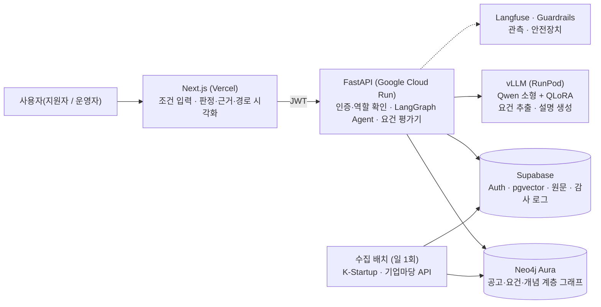

*MLE 1기 · LLM 지식 그래프 기반 AI 엔지니어링 최종 프로젝트*

# 프로젝트 기획 보고서

> **문서의 지위.** 강사 의견을 받아 주제를 정부지원사업 공고로 바꾼 기획 보고서이다(팀 합의 전 제안안, 부록 D #1). 이전 주제(사규 준수 검토)의 문서는 `docs/old/`에 보관했고, 전환 근거와 비교는 부록 G에 있다. 상세 설계는 [기초 설계서](MLE_2팀_기초%20설계.md)에 있다.

**목차**

1. 프로젝트 주제
2. 문제 정의
3. 시장조사 및 BM 분석
4. 시스템 구성 기획
5. 모델링 계획
6. 데이터 수집 전략
7. 역할분담(R&R)
8. 성과지표 및 Hugging Face 모델 데모 공개 계획
9. 기획서 제출 및 검토 체크리스트
10. 검토·수정 이력

| 문서 관리 항목 | 팀별 작성 내용 |
|---|---|
| 과정 / 팀 | MLE 1기 / 2팀(팀명: 근거 it) |
| 프로젝트명 | 지원각(정부지원사업 공고 자격 판정 서비스) / Support Program Eligibility Graph |
| 산출물 단계 / 제출 주차 | 기획(주제 전환안) / 2주차 (2026.11.23.) |
| 제출 일자 / 문서 버전 | 2026.11.25. (갱신) / v0.3 (화면설계서 v3.5·상세 WBS와 정합성 맞춤, 팀명·프로젝트명 확정) |
| GitHub 경로 / 문서 저장 위치 | https://github.com/encore-ai-campus/mle-01-final-team2 / docs/ |
| 작성 팀원 / 팀장 / 검토자 | [이름 및 역할] / [팀장] / [지도강사] |
| 검토 상태 | ■ 작성 중 □ 내부 검토 □ 수정 요청 □ 제출 완료 |

## 문서 작성 원칙

이 문서는 강사 의견을 반영해 주제를 정부지원사업 공고로 바꾼 기획안이다. 주제 전환은 팀 합의 전이다(부록 D #1). 강사 의견은 전해 들은 내용으로, 요지는 세 가지다. ① 공고문에 흩어진 여러 필요 사항(자격·제외·우대·서류·평가)을 **계층으로 나누고 합쳐서 검색**한다 ② **온톨로지가 필요한 기능은 따로 따져 본다** ③ 이 방향이 취업용 포트폴리오에 더 알맞다.

- 장 구성은 이전 주제의 기획서 양식(1~10장, 부록)을 그대로 두었다. 기술 스택·응답 정책·평가 틀은 이전 문서에서 재사용 가능한 범위를 가져왔고, 상세 설계는 [기초 설계서](MLE_2팀_기초%20설계.md)에 있다.
- 경력자 예시 기획서(프로젝트_기획서_v1.7)는 **공고 데이터 출처와 사용자 흐름 참고용**이다. 그 문서의 서비스 구조(사업계획서 생성)는 따르지 않았고 문장도 가져오지 않았다. 예시에만 적힌 사실(API 제공 필드, 인증키 확보 등)은 **직접 확인하기 전까지 `[확인 필요]`** 로 표시한다.
- 목표값·시장 비교·수치는 **가설·제안**이다. [ ]는 팀 확정 또는 수집 후 채운다.
- 이 서비스는 신청 가능 여부를 **참고용으로 판정**하며, 최종 확인은 공고 원문과 주관기관이 한다. 선정·수혜를 보장하지 않는다.

## 1. 프로젝트 주제

### 1.1 프로젝트 기본 개요

| 구분 | 작성 내용 |
|---|---|
| 프로젝트 주제 | 정부지원사업 공고 요건의 계층 온톨로지 및 Multi-hop 추론 기반 신청 자격 판정 지식 그래프 시스템 |
| 대상 도메인 및 사용자 | 도메인: 중앙부처·지자체 지원사업 공고(K-Startup, 기업마당 등)와 근거 법령(창업지원법 등). 사용자: ① 예비창업자·창업기업·소상공인(지원자) ② 공고를 큐레이션하는 운영자(관리자, 팀이 지정) |
| 핵심 제공 가치 | “내 조건으로 이 공고에 신청할 수 있는가”를 **판정(신청 가능 / 신청 불가 / 확인 필요) + 요건별 충족·미충족 근거 + 개념 계층·법령 정의를 따라간 경로 + 부족한 조건**으로 제시. 근거가 없으면 `판단 불가` |
| 개발 목표 및 범위 | 필수(MVP): 공고 수집·정규화, 요건 계층 그래프 적재, 조건 입력 → 매칭·판정·근거, 경로 시각화, Google 로그인·역할 접근. 권장(P1): 신규·정정 공고 입수 시점 검증, 공식 양식 기반 신청 문서 초안(신청서·사업계획서, FR-N20·N21), 나라장터 입찰공고 탭(FR-N22). 선택(P2): 공고 비교, 알림. 제외: 신청 대행·대리 제출, 심사 결과·선정 가능성 예측, 법적 자문 |
| 기대 효과 | 공고 탐색·자격 확인 시간 단축, 자격 미달 공고에 쓰는 시간 감소(가설), 근거를 확인할 수 있는 판정(정량 목표는 5.2의 첫 측정 후 확정) |
| 사용자가 받는 결과 | ① 공고별 판정(신청 가능 / 신청 불가 / 확인 필요) ② 요건 카드와 공고 원문 문장 ③ 요건에서 개념 계층·법령 정의까지 따라간 경로 그래프 ④ 부족 조건과 “이 값이 바뀌면 어떻게 되는가” 재판정. 모든 결과는 참고용이며 최종 확인은 공고 원문과 주관기관이 한다 |

**서비스 한 줄 정의.** 여러 포털에 흩어진 지원사업 공고의 요건을 **계층 온톨로지로 정규화해 하나의 그래프로 합치고**, 사용자의 조건을 넣으면 **어느 공고에 왜 신청할 수 있는지(또는 없는지)를 근거와 경로로 보여주는** 신청 자격 판정 서비스이다. 사용자가 보는 것은 하나의 조건 입력·결과 화면이고, 뒤에서는 수집, 요건 정규화, 그래프 확장, 규칙 평가, 근거 검증, 가드레일이 차례로 동작한다.

| 제공 항목 | 내용 | 구분 |
|---|---|---|
| 공고별 판정 | 신청 가능 / 신청 불가 / 확인 필요 | 결과 |
| 요건 카드 | 자격·제외·우대·제출서류·한도별 요건과 공고 원문 문장, 공고 출처·수집 시각 | 결과 |
| 경로 그래프 | 요건 → 개념 계층(지역·업종·신청자 유형) → 용어 정의 → 근거 법령 | 결과 |
| 부족 조건·재판정 | 불충족 요건과 확인이 필요한 값, 값을 바꿔 다시 판정 | 결과 |
| 신청 문서 초안 | 공고가 요구하는 신청서·사업계획서를 공식 양식 항목 순서로 초안 작성, 빈칸·근거 표시. 제출은 사용자가 직접(P1) | 권장 결과 |
| 판단 불가·근거 없음 안내 | 찾아본 범위, 확인 사항, 공고 원문 링크 | 결과 |
| 입찰공고 판정 | 나라장터 입찰공고를 면허·지역 조건과 입찰 마감 일시로 판정(P1) | 권장 결과 |
| 입수 시점 검증 리포트 | 운영자가 새·정정 공고를 올렸을 때 요건 변경, 정의·법령과의 불일치(권장, P1) | 권장 결과 |
| 감사 로그 | 운영자 작업(공고 업데이트, 정규화 수정) 이력. 관리자만 조회 | 운영 기록 |

### 1.2 선정 배경 및 차별성

| 항목 | 팀 작성 내용 |
|---|---|
| 주제 선정 배경 | 지원사업 공고는 부처·지자체·포털별로 따로 게시되고, 신청 요건이 본문과 첨부 문서에 서술형으로 흩어져 있다(두 포털 전수 데이터로 **부분 확인**: 기업마당 1,294건은 API 요약 평균 285자인데 첨부 공고문 텍스트는 평균 6,205자이고, K-Startup 3,819건은 제외 요건 필드가 모두 비어 있다. 아래 "전수 데이터 확인 결과"). 요건은 신청자 유형·업력·업종·지역·연령 같은 **계층을 가진 개념**과 AND/OR/제외의 **조건 논리**로 이루어져 있어, 이를 정규화해 합치면 자격 판정과 검색을 같은 그래프에서 할 수 있다는 것이 강사 의견의 취지이다 |
| 기존 방식과 차이 | 포털 검색·필터: 포털마다 따로 검색하고, 필터는 정형 필드에 한정(첨부 속 요건 반영 여부는 `[확인 필요]`). 범용 생성형 AI: 최신 공고를 모르고 판정 근거가 불확실. 일반 벡터 RAG: 조건 논리(제외·OR)와 상위 개념(서울 ⊃ 성동구)을 안정적으로 처리하지 못함. 본 서비스: 요건을 정규화한 그래프에서 규칙으로 평가하고 근거 경로를 제시 |
| 핵심 차별점 | ① 요건 정규화 온톨로지(개념 계층 + 조건 논리) ② 계층 확장·용어 정의 해소(Multi-hop: 요건 → 개념 → 정의 → 법령) ③ 3값 판정(가능 / 불가 / 확인 필요)과 부족 조건·재판정 ④ 판정 근거를 공고 원문 문장과 법령 조문까지 연결 ⑤ 신규·정정 공고 입수 시점 검증 |
| 성공 판단 기준 | 표본 공고의 요건 추출 F1과 자격 판정 일치율(골드셋 기준), “신청 가능” 오탐 0건에 가까운 안전 게이트, **SQL 필터 베이스라인 대비 이기는 질문 유형과 지는 질문 유형의 보고**, 최종 발표에서 지원자·운영자 흐름이 한 서비스로 시연됨 |

**온톨로지가 필요한가에 대한 정직한 검토.** 멘토링의 “SQL로도 가능하다”는 지적은 이 주제에서도 유효하며, 사규보다 오히려 강하다. 공고는 **속성 중심 데이터**라 필터 검색이 기본 해법이기 때문이다. 아래는 기능별로 SQL이 얼마나 대신하는지 따진 현재 판단이며, 모두 **실험 전 가설**이다(근거와 실험 방법은 [ONTOLOGY_NECESSITY.md](ONTOLOGY_NECESSITY.md)의 §3·§5에 있다).

| 기능 | SQL(+계층 테이블·코드)로 되는가 | 그래프·온톨로지가 더하는 것 | 현재 근거 강도 |
|---|---|---|---|
| 계층 확장 매칭(지역·업종·신청자 유형) | 가능(closure table, 재귀 CTE) | 거의 없음 | 약 |
| 조건 논리 평가와 부족 조건 설명 | 규칙 엔진 코드로 가능 | 조건 트리를 그래프로 두면 “어느 요건이 막았는지” 경로를 그대로 시각화 | 약~중 |
| 용어 정의 해소(공고별 표기 차이, 법령 정의 연결) | 사전 테이블로 일부 가능 | 정의 → 법령 조문 → 위임 규정을 따라가는 multi-hop. 기존 법령 수집 자산 재사용 | 중(법령 연결 데이터가 있을 때) |
| 공고 간 관계(통합공고 ⊃ 세부사업, 정정·재공고, 회차) | 가능(부모 키) | 단순 트리면 거의 없음 | 약 |
| 이종 출처 통합과 중복 게재 해소 | 가능 | 출처별 스키마를 하나의 온톨로지로 매핑하는 데이터 통합의 전형적 용도 | 약~중 |
| 입수 시점 검증(새 공고 요건과 정의·이전 버전 대조) | 코드로 가능 | 정의가 바뀌면 영향받는 공고를 그래프로 전파 | 중 |

결론: 그래프가 설명력과 확장성을 더하는 지점은 **정의 → 법령 근거의 multi-hop, 조건 트리 기반 설명, 이종 출처 통합 스키마**이다. 이 세 곳에서 SQL 베이스라인과 비교해 실제로 이기는지 측정하고, **지는 질문 유형도 숨기지 않고 보고한다.**

**사전 확인 결과(2026-11-23, [PRECHECK_공고주제_사전확인.md](old/PRECHECK_공고주제_사전확인.md)).** K-Startup 명세는 업력·연령을 구간 문자열(예: "7년미만")로 제공하므로 파싱이 되면 그 부분은 SQL로 충분할 가능성이 크다(`API__.md`는 "파싱 필요"로 적었고 실응답은 확인 전). 기업마당 공고 15건(비무작위, 한 포털·하루치)에서 법령 조문을 직접 인용한 공고는 2건, 법령·제도 이름이 나온 공고는 4건이었고, AND가 명시된 공고는 2건, 제외 조건이 분리된 공고는 1건이었다. 기준일·트랙·지정 구역처럼 **정규화 스키마가 필요한 사례**는 확인했지만, **그래프가 꼭 필요하다는 근거는 늘지 않았다.** 위 표의 근거 강도는 바꾸지 않는다.

**전수 데이터 확인 결과(2026-11-24).** 기업마당 공고 1,294건(모집 중 스냅샷)과 K-Startup 공고 API 전체 30,632건(최근 1년 3,819건 정리)을 수집해 위 15건 사전 확인을 넓혀 봤다. 수치는 정규식 근사치이며 정확도 지표가 아니다(상세: [도메인 온톨로지 설계서](%5B도메인온톨로지%5D%20MLE_도메인_온톨로지_설계서_2팀.md) §3).

| 확인 항목 | 결과 | 설계에 주는 의미 |
|---|---|---|
| 요건이 있는 곳 | 기업마당 API 자격 문구는 평균 83자(20자 미만 98건). 같은 요건 표현이 첨부 자격·제외 구간(1,142건)에서 약 2~13배 자주 나옴(업력 7%→26%, 제외 6%→71%, 법령 인용 17%→36%) | 기업마당의 요건 층 입력은 **첨부 공고문**이다. 첨부 추출이 필수 |
| 첨부 확보 | 기업마당 본문출력파일 1,294건 모두 내려받음, 텍스트 1,292건(OCR 126건), 배포용 HWP 2건 제외. **K-Startup은 API에 첨부 칸이 없고 `robots.txt`가 첨부 경로를 금지해 받지 않음** | 두 포털의 입력 품질이 달라 `NEEDS_CHECK` 비율을 출처별로 측정해야 함 |
| K-Startup 구조화 필드 | 업력·연령·지역·신청 대상이 값이 제한된 목록. 업력 옵션 7개 전부 선택(제한 없음) 35%. 지역은 시도 약칭 19종(`전국` 57%). **제외 요건 필드는 3,819건 모두 비어 있음** | 업력·연령·지역은 규칙 정규화로 충분할 가능성이 큼(SQL로도 가능). 제외·세부 자격은 본문에서 추출 |
| 지역 | 기업마당 해시태그는 전 시도가 달린 공고가 347건(27%)이라 지역 근거로 쓸 수 없음. 광주·전남 통합(`전남광주통합특별시`)이 기업마당 113건, K-Startup 20건에 나타남. "경상권" 같은 권역을 공고가 본문에서 정의 | 행정개편·권역을 처리하는 **계층 사전**이 필요. 단 같은 사전은 SQL 테이블로도 풀리므로 베이스라인 비교가 선행 |
| 법령 인용 | 기업마당 자격·제외 구간 1,142건 중 법령을 인용한 공고 416건(36%), 중소기업기본법 115건·소상공인기본법 25건. 고유 인용 545종이며 신청자 유형을 정의하는 인용은 일부일 것으로 추정(미확인) | 정의→법령 연결(P1)의 시작 범위를 중소기업기본법 등 정의 법령으로 제한 |
| 포털 간 중복·정정 | 이번 수집은 스냅샷 1회라 정정·재공고 빈도를 측정하지 못함. K-Startup 제목의 "연장"·"재공고"는 후보일 뿐 확정하지 않음 | 입수 시점 검증(기능 5)의 필요도는 **여전히 가설**. 재수집 후 판단 |

결론: 요건이 첨부에 몰려 있다는 점은 확인했지만, **그래프가 SQL보다 낫다는 근거는 이번 전수 데이터로도 늘지 않았다.** 계층 확장(지역·권역)과 정의→법령 경로만 시험 대상으로 남는다.

**온톨로지가 필요해질 수 있는 후보 기능.** 위 표가 기능 유형별 평가라면, 아래는 서비스에 넣을 수 있는 구체적인 기능 후보이다. 어느 기능도 “SQL로 불가능”하다고 주장하지 않는다. 온톨로지의 몫은 **정의 변경의 전파, 분류 체계 정렬, 판정 근거의 경로 설명**(유지보수·정합성·설명)으로 한정해 방어한다. 근거 강도는 모두 **실험 전 가설**이다.

| # | 기능 | 하는 일 | SQL 대비 온톨로지의 몫 | 근거(사전 확인 15건 + 2026-11-24 전수) | 근거 강도 | 먼저 확인할 것 |
|---|---|---|---|---|---|---|
| 1 | 법정 정의 도출 | 업종·매출·상시근로자 수 입력으로 중소기업·소기업·소상공인·창업기업 여부를 법령 기준으로 도출해 여러 공고의 규모 요건에 한꺼번에 적용 | 룩업·규칙으로도 가능. 법령 개정 시 데이터만 바꿔 영향 공고를 다시 계산하고, 판정 근거를 “공고 요건 → 정의 → 조문”으로 제시 | (15건) 규모 조건 6건, 법령 조문 직접 인용 2건(김해, 충남), 확인서 제도 1건(경북). (전수) 기업마당 자격·제외 구간 1,142건 중 법령 인용 416건(36%), 중소기업기본법 115건·소상공인기본법 25건. 법령 내용은 법제처 원문으로 확인 필요 | 중 | 인용 중 신청자 유형 **정의** 인용의 비율(정답셋으로 확인) |
| 2 | 분류 체계 정렬과 다중 소속 구역 | 공고마다 다른 업종·분야 서술을 사용자 업종과 상위·하위·관련 관계로 연결. 지역은 행정구역 외에 지정 구역(공업지역, 악취관리지역 등) 다중 소속으로 처리 | 매핑 유지와 다중 소속은 그래프가 자연스러움. **업종 확장은 임베딩 검색과 겹쳐 반드시 비교** | (15건) 업종 서술이 공고마다 다름, 지정 구역 1건(김해). (전수) 업종 표현은 K-Startup 후보 15건(0.4%)뿐이라 업종 계층은 우선순위 낮음. 권역 사례("경상권")와 광주·전남 통합은 확인(지역·권역 계층의 근거) | 약~중 | 지정 구역 데이터 확보 가능 여부, 권역·개편 사전 구축 비용 |
| 3 | 최소 변경 설명과 질문 순서 최적화 | 신청 불가 공고에서 “무엇을 최소로 바꾸면 가능한가”를 찾고, 입력이 부족하면 후보를 가장 많이 줄이는 질문부터 되묻기 | 규칙 엔진으로도 구현 가능. 근거 경로가 곧 설명이 됨. 온톨로지 필요성보다 사용자 가치·시연 효과가 큼 | 조건 트리 구조(AND 2건, 제외 1건, 기준일 3건) | 약~중 | 3값 판정과 조건 트리가 실제로 필요한 공고의 비율 |
| 4 | 지원사업 사다리와 중복·이력 제약 | 선행 사업 수혜가 후속 사업의 자격·제외가 되는 관계를 두고 “지금·다음에 받을 수 있는 사업” 경로 추천, 배타 사업은 함께 추천하지 않음 | 경로·배타 관계는 그래프가 자연스러움. 조합 선택 자체는 제약 풀이에 가까움 | 전년 선정자·제외 대상 1건(통영). **데이터가 가장 불확실** | 약~중 | 선행·중복 수혜 조건이 공고에 명시되는 빈도, 수혜 이력 입력의 개인정보 허용 여부 |
| 5 | 입수 시점 검증과 정의 변경 전파 | 정정 공고의 요건 변경 diff, 공고 정의와 법령 정의의 불일치 표시, 법령 정의 변경 시 영향 공고 탐색(사규 주제의 입수 시점 검증과 같은 구조) | 코드로도 가능. 정의→공고 영향 전파를 경로로 보여 줌 | 기준일·정의가 공고마다 달라 비교가 필요한 사례 확인 | 중 | 정정·재공고 빈도, 기능 1이 먼저 있어야 의미가 커짐 |
| 6 | 서류 의존 그래프(보조) | 제출서류의 발급처·유효기간·선후 관계로 “신청 전 준비 체크리스트” 생성 | 약함. 목록·표로도 충분 | 서류 정보는 첨부에 있어 근거 없음 | 약 | 첨부 열람이 가능한지(이용 조건) |

**구성 제안(팀 결정 전).** 중심은 **1(정의 도출) + 5(전파)** 로 잡고, **3(설명·질문 순서)** 을 사용자 가치로 붙인다. 2와 4는 데이터를 확인하기 전에는 주장하지 않는다. 모든 기능은 SQL 베이스라인과 질문 유형별로 비교하며, 유형은 “정의 의존형”(1), “정의 변경 영향형”(5), “설명형”(3)으로 나누고 지는 유형도 보고한다(§5.2).

### 1.3 MVP 범위와 개발 우선순위

**팀 합의 전 제안안**이다. 주제 전환이 확정되면 부록 D #2에서 확정한다.

**MVP 한 줄 정의:** 지원자가 조건을 입력하면 **공고별 판정과 요건별 근거·경로**를 돌려주는 end-to-end 한 줄기(수직 슬라이스). 기능을 넓게 얕게 만들지 않고, 시연 슬라이스 2개가 끝까지 도는 것을 먼저 만든다.

- 시연 슬라이스 1(지원자): “서울 성동구, 제조업, 법인, 업력 2년, 대표 만 35세” → 신청 가능한 공고 + 각 판정 + 요건 카드 + 경로(성동구 ⊂ 서울 ⊂ 전국, 업력 정의 → 법령)
- 시연 슬라이스 2(운영자): 공고 업데이트로 정정 공고가 입수되면 → 바뀐 요건과 영향받는 판정을 보여 줌(P1)

| 단계 | 시점 | 기능 | 완료 기준 |
|---|---|---|---|
| **P0 (MVP)** | 중간 발표(3~4주차)까지 | ① 공고 수집(일 1회, 한 포털부터)과 원문 적재 ② 표본 공고의 요건 정규화(규칙 + 소형 모델 + 검수 표본) ③ 개념 계층(지역·업종·신청자 유형) 적재와 계층 확장 ④ 규칙 기반 3값 판정 + 요건 카드 + 경로 시각화 ⑤ Google 로그인, 역할 접근, 면책·출처·수집 시각 표시 ⑥ 평가 베이스라인(SQL 필터, 벡터 단독 검색) | 시연 슬라이스 1이 끝까지 동작, 표본 공고 요건 정규화 검수 완료, 베이스라인 측정표 |
| **P1 (최종 필수)** | 5~6주차, 7~8주차에 마무리 | ① 두 번째 포털 통합과 중복 게재 해소 ② 용어 정의 → 법령 조문 연결 ③ 입수 시점 검증(권장, 일정이 밀리면 축소)과 운영자 화면(감사 로그) ④ 부족 조건·재판정(what-if) ⑤ QLoRA 요건 추출 모델과 Hugging Face 공개(KPI-HF-001) ⑥ Guardrails, 평가셋, CI/CD·배포 ⑦ 공식 양식 기반 신청 문서 초안(FR-N20·N21) ⑧ 나라장터 입찰공고 탭(FR-N22) | 두 흐름이 한 서비스로 통합 시연, 모델 비교표, 공개 URL |
| **P2 (여유 시)** | 일정이 남을 때 | 관심 공고 알림, 공고 비교, 요건 통계, 에이전트 구성 비교 | 시연 |

**줄이는 순서:** 일정이 밀리면 P2 → P1의 입수 시점 검증 → 두 번째 포털 순으로 줄인다. **§4.4 필수 준수사항과 P0의 SQL 베이스라인 비교는 줄이지 않는다.**

## 2. 문제 정의

### 2.1 AS-IS / TO-BE

| 업무 시나리오 | AS-IS 문제 | TO-BE 개선 | 검증 지표 |
|---|---|---|---|
| [시나리오 A] 지원자: “우리 회사가 신청할 수 있는 공고는?” | 포털을 따로 뒤지고, 요건을 공고문과 첨부에서 직접 읽어 비교해야 한다 | 조건 한 번 입력 → 공고별 판정 + 요건 카드 + 근거 문장 | 판정 일치율, 요건 추출 F1 |
| [시나리오 B] 지원자: “이 공고는 왜 안 되나요?” | 불가 사유를 알기 어렵고 무엇을 바꾸면 되는지 모른다 | 불충족 요건과 부족한 조건, 값 변경 재판정 | 사유 정확도, 재판정 일치율 |
| [시나리오 C] 운영자: 정정 공고가 올라왔다 | 어떤 요건이 바뀌었는지, 기존 판정이 영향받는지 사람이 대조해야 한다 | 요건 변경 diff + 영향받는 정의·판정 표시(입수 시점 검증) | 변경 탐지율, 오탐률 |
| [시나리오 D] 공통: 정보가 부족하거나 요건을 읽지 못한 공고 | 억지로 가능·불가를 답하거나 누락한다 | 되묻기 또는 `확인 필요`·`판단 불가` + 확인 사항 + 원문 링크 | 판단 불가 적절성, 오탐률 |

※ 위 문제는 **가설**이며 표본 분석과 실무 경험자 확인으로 검증한다(§2.4).

**문제가 이어지는 흐름.** 지원자는 먼저 어느 공고가 있는지 찾기 어렵고(탐색), 찾아도 요건을 서로 다른 표기로 읽어 비교해야 하며(정규화), 해당 여부의 근거를 확인하기 어렵고(근거), 공고가 정정되면 다시 확인해야 한다(최신성). 범용 생성형 AI에 물으면 최신 공고와 근거 없이 답할 수 있다. 이 흐름이 하나의 요건 그래프로 이어지므로 한 주제로 묶었다.

**문제와 대응의 대응 관계.** 실측값은 아직 없고 아래 대응은 모두 설계 목표이다.

| 문제 | 현재 상황 | 본 서비스의 대응 |
|---|---|---|
| 공고 탐색·통합 비용 | 포털·지자체별로 따로 게시(수집 후 건수 기록) | 일 1회 수집, 출처별 스키마를 하나의 온톨로지로 매핑 |
| 요건 표기 불일치 | 같은 개념이 공고마다 다르게 서술(표본 확인 전) | 개념 계층과 정의 노드로 정규화, 기산 규칙은 정의에 기록 |
| 조건 논리 | 자격·제외·우대가 문장에 섞여 있음 | 요건 유형과 AND/OR/NOT 조건 트리로 구조화 |
| 판정 근거 부족 | 해당 여부를 확인할 근거가 불분명 | 요건별 원문 문장 + 법령 정의까지의 경로 |
| 최신성 | 정정·재공고 후 기존 정보가 남음 | SUPERSEDES 관계로 최신 버전만 매칭, 수집 시각 표시 |
| 근거 없는 답변 | 범용 AI는 그럴듯하게 틀릴 수 있음 | 판정은 규칙 평가기가 하고 근거가 없으면 `판단 불가`(§4.5) |

### 2.2 이해관계자·범위·제약

| 구분 | 내용 |
|---|---|
| 주요 이해관계자 | 최종 사용자(예비창업자·창업기업·소상공인) / 운영자(관리자: 공고 업데이트·정규화 검수) / 데이터 제공자(K-Startup, 기업마당, 법제처) / 개발팀 |
| In-Scope | 공고 수집·정규화·그래프 적재(Neo4j), 개념 계층, 규칙 기반 3값 판정, 경로·근거 시각화, 입수 시점 검증(P1), 공식 양식 기반 신청 문서 초안(P1), 나라장터 입찰공고 탭(P1), Google 로그인·역할 접근 |
| Out-of-Scope | 프로토타입 생성, 신청 대행·대리 제출, 선정 가능성 예측, 법적 자문, 결제, 대형 국가 R&D 공고(공개 API 여부 `[확인 필요]`) |
| 제약 및 전제 | 개발기간 8주 내외. 공고는 공개 API와 허용된 범위의 첨부만 사용. 모델 크기·GPU는 예산 확정 후 결정. 이용 조건 확인 필요. **주제 전환 시 기존 산출물 일부 재작업 필요**(부록 G) |
| 위험 및 대응 | 요건 정규화 오류로 “신청 가능” 오판 → 3값 판정, 확인 필요 우선, 검수 표본, 면책. 수집 중단 → 전일 데이터 + 수집 시각 표시. 온톨로지 필요성 비판 → SQL 베이스라인 비교와 지는 유형 보고 |

**범위 제외 사유.**

| 제외 항목 | 사유 |
|---|---|
| 프로토타입 생성 | 생성 서비스 영역이며 이 주제의 핵심(요건 구조화·판정)이 아님. 신청서·사업계획서는 공식 양식 항목을 채우는 초안 보조로만 P1에 포함하고(FR-N20), 입력에 없는 사실은 만들지 않음 |
| 신청 대행·서류 제출 | 책임·개인정보 문제가 따르고 서비스 목적(자격 확인)과 다름 |
| 선정 가능성 예측 | 평가 점수 등 데이터가 없고 오해 위험이 큼 |
| 법적 자문 | 법령 정의는 근거로만 제시하고 해석은 주관기관·전문가 몫 |
| 대형 국가 R&D 공고 | 공개 API·구조화 필드 확보 가능 여부 `[확인 필요]`(타 문서는 확보 불가로 기재) |
| 외부 API 모델의 기본 사용 | 사용자 조건 외부 반출 최소화. 허용 여부는 팀 결정(부록 D #8) |

일정이 밀리면 QLoRA는 `base` 모델 + 규칙으로 대체할 수 있다. 판정은 규칙 평가기(코드)가 하므로 모델이 바뀌어도 판정 방식은 같다(§5.1).

### 2.3 요구사항 요약 및 인수 조건

새 주제용 ID는 `FR-N`(신규)으로 구분한다. 기존 FR 번호와 섞이지 않게 하기 위함이며, 전환이 확정되면 설계서 §14 추적표를 다시 만든다.

| ID | 기능(FR)/비기능 요구사항(NFR) | 우선순위 | 인수 조건·검증 |
|---|---|---|---|
| FR-N01 | 공고 일 1회 수집·적재, 원문·출처·수집 시각 보존 | 필수 | 수집 이력과 건수 조회 |
| FR-N02 | 요건 정규화: 유형(자격·제외·우대·서류·한도)과 조건 트리(속성·연산자·값·기산점) | 필수 | 정답 표본 대비 Precision/Recall |
| FR-N03 | 개념 계층(지역·업종·신청자 유형·연령 구분) 적재와 계층 확장 | 필수 | 상위 개념으로 매칭되는 사례 재현 |
| FR-N04 | 사용자 조건 입력과 규칙 기반 3값 판정(가능 / 불가 / 확인 필요) | 필수 | 골드셋 판정 일치 |
| FR-N05 | 요건 카드와 공고 원문 문장 표시, 출처·수집 시각·원문 링크 | 필수 | 표시율 100% 점검 |
| FR-N06 | 경로 시각화(요건 → 개념 → 정의 → 법령) | 필수 | 경로 그래프 표시 |
| FR-N07 | 부족 조건 표시와 값 변경 재판정 | 권장(P1) | 재판정 일치 |
| FR-N08 | 용어 정의 노드와 법령 조문 연결(업력·창업기업 등) | 권장(P1) | 연결 표본 점검 |
| FR-N09 | 정보 부족 시 되묻기(최대 2회) 또는 `확인 필요`·`판단 불가` | 필수 | 정보 부족 사례 평가 |
| FR-N10 | Google 로그인, 역할 기반 접근(사용자 / 관리자) | 필수 | 비인가 접근 테스트 |
| FR-N11 | 입수 시점 검증: 새·정정 공고의 요건 변경 diff와 영향 판정 | 권장(P1) | 변경 탐지 사례 |
| FR-N12 | 운영자 정규화 검수 화면과 감사 로그 | 권장(P1) | 로그 점검 |
| FR-N13 | 응답 정책: 근거 부족·가드레일 차단·장애 시 사유 코드와 고정 응답(§4.5) | 필수 | 사유 코드별 케이스 테스트 |
| FR-N14 | 관심 공고 알림, 공고 비교 | 선택(P2) | 시연 |
| FR-N15 | 운영자 공고 업데이트(매일 자동 수집 + 업데이트 버튼, 중복 제외)·정규화 검수 화면. 수동 공고 업로드는 두지 않음 | 권장(P1) | 화면 점검, 비인가 접근 테스트 |
| FR-N16 | 사용자 조건·대화 저장·삭제(선택 동의) | 권장 | 저장·삭제 시연, 저장 경로 점검 |
| FR-N17 | 수집 상태 모니터링(최근 수집 시각, 성공·실패, 모집 중·기간 지남·기간 확인 필요 건수) | 필수 | 수집 실패 모의, 화면 점검 |
| FR-N18 | 답변 토큰 스트리밍(SSE) | 필수 | 시연, 지연 측정 |
| FR-N19 | 대화 이력 저장 | 권장 | 시연 |
| FR-N20 | 공식 양식 기반 신청 문서 초안: 공고가 요구하는 신청서·사업계획서, 자격 게이트, 양식 항목별 초안 | 권장(P1) | 양식 항목 순서 일치, 입력에 없는 사실 생성 0건 |
| FR-N21 | 신청 문서 근거·검토·복사: 문장 근거, 제출 전 점검, 내 신청 문서 목록 | 권장(P1) | 근거 없는 수치 0건, 본인 문서만 조회 |
| FR-N22 | 나라장터 입찰공고 조회·판정: 면허·지역 조건, 입찰 마감 일시 기준 상태 | 권장(P1) | 빈 제한값이 신청 가능으로 판정되지 않음 |
| NFR-N01 | 신선도: 수집 시각 표시, 수집 지연 시 경고(`STALE_DATA`) | 필수 | 지연 모의 시험 |
| NFR-N02 | 표현 제한: 화면·응답 표기는 “신청 가능성 있음 / 확인 필요 / 신청 불가”로 고정, 선정·수혜 시사 금지 | 필수 | 응답 점검, Guardrails 규칙 |
| NFR-N03 | 개인정보 최소 수집(사업자등록번호·주민번호 비수집, 조건 값은 범주형 우선) | 필수 | 저장 점검, 입력 필터 테스트 |
| NFR-N04 | 모델 교체 가능성(필수)과 배포 Plan B(권장), 상세는 [기초 설계서](MLE_2팀_기초%20설계.md) §3 | 필수/권장 | 장애 모의, 리허설 기록 |
| NFR-N05 | 재현성: 요건 정규화·판정 결과에 모델·사전·스키마 버전 기록 | 필수 | 재실행 비교 |
| NFR-N06 | 관측성: Langfuse로 실행 흐름·비용 추적 | 필수 | 트레이스 확인 |
| NFR-N07 | 보안: 비밀 값은 서버에만, 사용자 데이터는 RLS로 격리 | 필수 | 점검표, 비인가 접근 테스트 |
| NFR-N08 | 비용: RunPod는 필요할 때만 가동 | 권장 | 사용량 기록 |
| NFR-N09 | 호환: 최신 데스크톱 브라우저 | 선택 | 수동 점검 |

※ FR-N15~N19, NFR-N06~N09는 기초 설계서 §14와 같은 ID이다. FR-N20~N22는 화면설계서 v3.5와 상세 WBS(F9, F6.6~F6.8)에서 추가한 ID이다. **MR-N5(§4.4)는 운영자 기능이 처음 열리는 P1부터 적용**하며, 그 시점에는 감사 로그 기록이 필수이다(FR-N12는 화면이 권장, 기록이 필수).

### 2.4 실무 검증 근거와 검증 계획

**현재 실무자 검증은 하지 않았다.** 근거가 없는 항목은 가설로 남긴다.

| 주장(가설) | 현재 근거 | 근거 수준 | 추가 검증 방법 | 상태 |
|---|---|---|---|---|
| 공고 요건이 서술형으로 흩어져 있어 비교가 어렵다 | 기업마당 공고 15건(2026-11-20 등록분, 비무작위)의 상세 화면에서 요건이 사업개요 서술에 있음. 구조화된 자격 필드는 화면에 없음. (2026-11-24 전수) 기업마당 1,294건은 API 자격 문구 평균 83자·첨부 본문 평균 6,205자, K-Startup 3,819건은 자격 문구 평균 104자이고 제외 요건 필드가 모두 비어 있음 | 데이터(전수, 근사치) | 정답셋 라벨링으로 요건이 실제로 서술형·분산인지 확인 | **확인(두 포털 전수)**, 요건의 정확한 형태는 정답셋에서([사전 확인](old/PRECHECK_공고주제_사전확인.md) §4) |
| 같은 개념(업력, 창업기업, 청년)이 공고마다 다른 기준으로 쓰인다 | 표본 15건에서 지역 기준이 “사업자등록 주소 / 실제 거주 / 본사·공장”으로 다르고, 기준일이 공고일·접수 마감일·전년도로 다름(3건), 연령과 출생연도 중복 표기(3건) | 데이터(소표본) | 표본 확대, 두 사람이 따로 정규화해 일치도 확인 | **부분 확인** |
| 포털 API에 신청 대상·창업 기간·연령·우대 사항 구분이 있다 | K-Startup 명세 확인: 신청 대상, 창업 기간(7년미만~예비창업자), 대상 연령(3구간), 우대 사항, 신청 대상 내용, 신청 제외 대상 내용 등. 기업마당 명세: 지원대상 1개 필드와 해시태그. (2026-11-24) 실호출 완료: 기업마당 1,294건, K-Startup 전체 30,632건. K-Startup은 업력·연령이 옵션 목록, 기업마당 `trgetNm`은 7종으로 거칠고 해시태그 지역은 27%가 전 시도라 신뢰 불가 | 데이터(실응답) | 두 포털 필드 대응표로 정리(온톨로지 설계서 §4.1) | **확인함(실응답)** |
| 첨부 문서에 요건이 더 있다 | 표본 15건 중 2건이 “자세한 내용은 공고문 참조”로 적음. 첨부는 15건 모두 있고 13건이 hwpx. (2026-11-24) 기업마당 전수: 같은 요건 표현이 첨부 자격·제외 구간에서 약 2~13배 자주 나옴(업력 7%→26%, 제외 6%→71%). K-Startup은 첨부를 받지 않아 확인 불가 | 데이터(기업마당 전수, 근사치) | K-Startup은 비교 시트 10건을 사람이 확인(상세 페이지·첨부) | **확인(기업마당)**, K-Startup 미확인 |
| 틀린 “신청 가능” 안내는 답하지 않는 것보다 해롭다 | 일반 원칙으로 채택 | 설계 판단 | 안전 KPI(오탐률)로 측정 | 원칙으로 채택 |
| 사용자는 요건 근거 경로를 보고 싶어 한다 | 없음 | 가설 | 팀 밖 사용자 시연 피드백 | **미검증** |

검증 계획: ① 표본 공고 분석(요건 유형·표기·첨부 비중) ② 멘토링 질의서로 실무 관점 확인 ③ 가상 조건 시연 후 팀 밖 사용자 피드백 ④ 골드셋을 실제 공고에서 작성하고 가능하면 창업지원 실무자 검수 요청. 결과는 표의 상태 칸에 갱신하고, 끝까지 검증하지 못한 항목은 발표에서 **가설로 표시**한다.

## 3. 시장조사 및 BM 분석

### 3.1 시장·유사 서비스 조사

※ 아래 비교는 **제품을 직접 확인하지 않은 가설**이다. 근거 URL·조사일은 조사 후 채운다.

| 비교 대상 | 대상 고객/문제 | 핵심 기능 | 한계·기회 | 근거 URL/조사일 |
|---|---|---|---|---|
| 포털 공고 검색(K-Startup, 기업마당) | 창업자·중소기업 / 공고 열람 | 키워드·분야 필터 검색 | 포털별로 따로 검색, 자격 판정은 사람이 함(첨부 요건 반영 여부 `[확인 필요]`) | 포털 직접 확인 전 |
| 지원사업 매칭·평가 서비스(예: 플랜스코어) | 창업자 / 공고 매칭, 계획서 평가 | 공고 자동 매칭, 알림 | 예시 기획서에 기재된 내용이며 **직접 확인 전**. 판정 근거 경로 제공 여부 `[조사 필요]` | https://www.planscore.kr/ · 확인 전 |
| 조건 입력형 혜택 안내(예: 정부24 보조금24) | 개인·가구 / 받을 수 있는 혜택 | 조건 입력 후 혜택 추천 | 대상이 개인·가구 중심인지 `[조사 필요]` | 확인 전 |
| 범용 생성형 AI | 누구나 / 일반 질의 | 자연어 답변 | 최신 공고 미반영, 근거 없는 판정 가능 | [조사 필요] |
| 일반 벡터 RAG | 문서 QA 도입 조직 | 의미 검색 + 생성 | 조건 논리·상위 개념 처리 한계 | **자체 베이스라인으로 실측**(§5.2) |
| 클라이원트 AI 조달 비서(CLIWANT) | 공공 입찰·조달 담당자 / 나라장터 공고 탐색과 참가 자격·배점·제출서류 확인 | 채팅으로 공고 찾기, 공고 자료 정리, 회사 정보와 자격 비교(미충족·확인 필요 표시), 제안요청서 요구사항 추출, 원문 위치 근거, PDF·HWP·HWPX 첨부 읽기, 월 20,000원 플랜(출시 글 기준) | 대상이 지원사업이 아니라 **나라장터 입찰·조달**이다. **근거 제시, "확인 필요", 최종 판단은 사람이라는 원칙이 우리 설계와 같다.** 출시 글은 2026-10-19자이고, **2026-11-18부터 서비스가 종료됐다고 팀이 전달받았으나** 출시 글에는 종료 내용이 없고 종료 사유·공지는 확인하지 못했다 | https://blog.cliwant.com/ibcaleul-jedaero-ihaehaneun-ai-keulraiweonteu-ai-jodal-biseoreul-sijaghabnida/ · 2026-11-23(출시 글 직접 읽음) |
| GovLens | (팀이 알려 준 서비스) | [기능 직접 확인 못함] | 사이트 접속이 브라우저에서 거절됐고 웹 검색에서도 내용을 확인하지 못했다. 지원사업 공고 서비스인지, 판정·근거 경로 제공 여부 모두 `[조사 필요]` | https://www.govlens.co.kr/ · 접속 확인 못함 |
| 자체 제안 | 지원자, 운영자 | 요건 온톨로지 + 규칙 판정 + 경로 | 요건 정규화 품질이 성패를 좌우 | 본 문서 §5 검증 |

**시장 조사 결과(2026-11-23).** 위 표에 두 서비스를 추가했다.

- **클라이원트 AI 조달 비서(종료):** 출시 글을 직접 읽었다. AI 채팅으로 공고와 첨부를 읽고 자격·배점·제출서류를 **원문 위치와 함께** 정리하며, 모르면 "확인 필요"로 표시하고 판단은 사람이 한다는 원칙을 밝혔다. 이는 우리 서비스의 설계 원칙과 같은 방향이다. 다만 대상이 나라장터 입찰·조달이라 **지원사업 자격 판정과 직접 겹치지는 않는다.** 팀이 전달받은 바로는 2026-11-18부터 서비스가 종료됐지만, 출시 글은 2026-10-19자라 종료 내용이 없고 **종료 사유는 확인하지 못했다.** 이 사실을 이 시장의 지속 가능성에 대한 근거로 쓰지 않는다. 사유와 이용 현황을 확인할 수 있으면 §2.4의 시장성 가설 칸에 반영한다.
- **GovLens:** 팀이 알려 준 서비스이다. 사이트를 열지 못했고 검색으로도 확인하지 못해 **기능과 대상은 미확인**이다. 우리 서비스와 겹치는지는 직접 접속해 조사한 뒤 위 표와 차별성 비교표에 반영한다.
- 두 서비스 모두 **우리 서비스가 비어 있는 시장이라는 근거로 쓰지 않는다.** 확인한 범위에서는 비슷한 원칙을 가진 AI 공고 분석 서비스가 이미 시도된 적이 있다는 사실만 확인했다.

**차별성 비교(설계 목표, 직접 측정 전).**

| 기능 | 포털 검색 | 범용 생성형 AI | 일반 벡터 RAG | 본 서비스(설계 목표) |
|---|---|---|---|---|
| 여러 출처 통합 검색 | 포털별 | 불확실 | 코퍼스에 있으면 가능 | 출처 통합 온톨로지 |
| 요건별 충족 판정 | 사람이 수동으로 | 불확실 | 조건 논리 약함 | 규칙 기반 3값 판정 |
| 상위 개념 확장(서울 ⊃ 성동구) | 필터 구현에 따라 | 불확실 | 불안정 | 계층 확장 |
| 판정 근거(원문 문장·법령 정의) | 원문 열람만 | 출처 불확실 | 청크 근거만 | 요건 → 정의 → 법령 경로 |
| 근거 없을 때 보류 | 해당 없음 | 지어낼 수 있음 | 설정에 따라 다름 | `확인 필요`/`판단 불가` |
| 정정·재공고 반영 | 포털 의존 | 없음 | 재색인 필요 | SUPERSEDES와 입수 시점 검증 |

**유사 연구·프로젝트 조사.** 이전 주제 기획서(`old/`) §3.1의 KoBLEX(한국 법령 multi-hop QA), An Ontology-Driven Graph RAG for Legal Norms는 법령 정의·근거 연결과 평가 설계 참고로 재사용한다. **공고·자격 판정에 특화된 한국어 사례는 이번에 조사하지 않았다**(`[조사 필요]`). 규칙 기반 자격 판정(rules as code) 관련 자료도 조사 후 채운다.

**시장 규모와 타깃 범위.** 시장 규모 수치는 제시하지 않는다. 공고 예산 총액은 서비스 시장 규모가 아니며(예시 기획서도 같은 구분을 둠), 끌어다 쓸 근거가 없다. 대신 타깃을 정의한다. 지원사업 공고를 확인해야 하는 예비창업자·초기 창업기업·소상공인이 사용자이고, 지원기관 담당자·컨설턴트는 운영자 후보(가설)이다. 대상 포털·공고 수는 수집 후 집계한다[조사 필요].

### 3.2 사용자 가치 및 BM 가설

| 항목 | 작성 내용 |
|---|---|
| 고객 세그먼트 | 실제 사용자: 예비창업자·창업기업·소상공인. 운영자: 지원기관 담당자·컨설턴트(가정). 도입 조직: 창업지원 기관(가정) |
| 가치 제안 | 공고 탐색·자격 확인 시간 단축, 요건 누락 감소, 근거가 확인되는 판정, 부족 조건 파악 |
| 도입·운영 형태 | 웹 서비스(교육 프로젝트). 기관용 큐레이션 도구는 후속 검토 |
| 비용 구조 | LLM 서빙(RunPod GPU), 임베딩, Neo4j Aura, Supabase, Cloud Run, 수집 배치, 정규화 검수 인력. 모델 크기·GPU는 예산 확정 후 산정 |
| 수익/효율 가설 | 교육 프로젝트로 수익 모델은 없음. 효율 가설: 자격 확인 시간 절감, 자격 미달 신청 시도 감소 |
| 가설 검증 | 표본 분석, 실무 경험자 인터뷰, 가상 조건 시연 피드백, 평가셋 PoC(§2.4) |

**포지셔닝.** “이 공고에 선정된다”로 읽히면 안 된다. 강조점을 **신청 가능 여부와 근거, 그리고 보류**에 둔다.

- 결과는 “신청 가능성이 있는 공고”와 “확인이 필요한 요건”으로 표현하고, 선정·수혜는 말하지 않는다(NFR-N02).
- 근거가 없거나 요건을 읽지 못하면 `확인 필요`·`판단 불가`로 답한다. 정상 결과로 취급한다(§4.5).
- 모든 화면에 공고 출처, 수집 시각, 원문 링크를 붙인다.

**BM 방향(가설).** 교육 프로젝트라 수익 모델은 없다.

| 구분 | 내용 | 시점 |
|---|---|---|
| 교육 프로젝트 범위 | 공개 공고 기반 시연, Hugging Face 모델·데모 공개 | 이번 범위 |
| 알림·큐레이션 | 관심 조건 등록 후 신규 공고 알림(P2) | 후속 검토 |
| 과금·구독·결제 | 수익 모델과 결제 | 범위 제외 |

### 3.3 미확정 항목 현황

| 항목 | 현재 상태 | 확정 방법 | 시점(제안) |
|---|---|---|---|
| **주제 전환 여부** | 미결정 | 팀 합의(부록 D #1) | 다음 팀 회의 |
| 공고 API 응답 필드·한도·이용 조건 | **실호출 완료(2026-11-24)**: 기업마당 1,294건, K-Startup 전체 30,632건. K-Startup 이용허락범위(무료, 제한 없음)와 기업마당 교육·비상업 사용 범위를 확인함. K-Startup은 날짜 필터가 동작하지 않아 페이지로 받아 직접 셈. 호출 한도 단위는 **미확인**, 마감 공고는 기업마당 API가 제공하지 않음 | 정기 수집(스냅샷)으로 이력 축적 | 수집 자동화 시 |
| 표본 공고 선정과 요건 분석 | 기업마당 15건 사전 분석 후, 전수 수집 데이터에서 **정답셋 후보 50건 선정**(기업마당 25·K-Startup 25, 시드 고정). 라벨링 가이드 초안 완료, **라벨은 0건** | 파일럿 10건부터 두 검수자가 라벨링, 합격선은 결과를 보기 전에 확정 | 팀 결정(G-1~G-6) 후 |
| MVP 범위·우선순위 | 제안안(§1.3) | 팀 합의(부록 D #2) | 다음 팀 회의 |
| 관련 법령 보유 여부 | 수집 완료(2026-11-25): 정의 법령 26문서, 조문 1,286개·별표 40개, 공고 인용 543건 연결 | 업종 분류(KSIC)·신산업 창업 분야 고시는 추가 확보 필요 | 판정 규칙 작성 전 |
| 팀원·역할(§7) | **팀원 3명**(백관민·송진명·오현탁). 상세 WBS 기준 배정, 모델·평가·배포 업무는 3명에게 나눔 | 팀장(PM) 지정과 백업 순환 확정 | 다음 팀 회의 |
| 서비스명·팀명 | **확정(2026-11-25): 프로젝트명 "지원각", 팀명 "근거 it"** | 팀 결정 | 완료 |
| 모델 크기·GPU·RunPod | 미정 | 학원 예산 확정 + PoC | 예산 확정 후 |
| KPI 목표값 | 전부 잠정 | 베이스라인 측정 후 1회 조정 | 중간 발표 전 |
| 시장 비교(포털·매칭 서비스) | 클라이원트(종료)는 출시 글만 읽음, GovLens는 접속 못함, 나머지 [조사 필요] | 직접 사용 조사 + URL·조사일 기록, 클라이원트 종료 사유 확인 | 다음 문서 수정 시 |
| 공고·법령·HF 데이터 이용 조건 | 확인 전 | 공공누리·이용약관 확인 | 외부 공개 전 |

## 4. 시스템 구성 기획

### 4.1 서비스 아키텍처

[시스템 구성도: 수집 배치가 공고를 Supabase(원문)와 Neo4j(정규화 그래프)에 적재. 사용자 → Next.js(Vercel) → FastAPI(Cloud Run, LangGraph Agent + 규칙 기반 요건 평가기) → Neo4j / Supabase / RunPod vLLM. 보안 경계는 API 서버의 JWT·역할 확인]

| 계층 | 후보 기술 | 역할 및 선택 이유 |
|---|---|---|
| 프론트엔드 | Next.js (Vercel) | 조건 입력, 판정 목록, 요건 카드·경로 그래프, 운영자 화면 |
| 백엔드/API | FastAPI (Docker, Google Cloud Run) | 인증·역할 확인, 요청 처리, 감사 로그. 컨테이너 배포와 롤백 |
| 수집 배치 | GitHub Actions cron 또는 Cloud Run job | 일 1회 API 수집, 실패 시 재시도와 상태 기록 |
| 지식 추출 | 규칙 기반 파서 + Qwen 소형 모델(QLoRA) | 첨부 텍스트 추출(HWPX 파서 신규, PDF·xlsx 읽기, HWP5는 나타날 때만 기존 파서), 요건 문장 분리, 조건 JSON 추출 |
| 그래프 저장 | Neo4j Aura | Notice/Requirement/Condition/Concept/Definition/ExternalLaw 등 |
| 검색·추론 | Vector + 전문 검색 + 그래프 확장 + 규칙 평가기 | 후보 공고 검색 → 조건 평가 → 근거 경로 구성 |
| Agent 제어 | LangGraph (Planner/Supervisor + 도구) | 질의 분류·검색·계층 확장·평가·검증 오케스트레이션 |
| LLM 서빙 | vLLM on RunPod | 요건 추출·설명 생성. 판정 자체는 모델이 하지 않음 |
| 저장소 | Supabase (Postgres + pgvector + Auth) | 원문, 정규화 결과, 사용자·로그 |
| 배포·운영 | Docker, GitHub Actions, Langfuse, NeMo Guardrails | 재현 가능한 배포, 관측·평가, 입출력 안전장치 |

**설계 원칙.**

- **판정은 코드, 해석은 모델.** 요건 평가(3값 논리)는 규칙 평가기가 결정적으로 수행한다. 소형 모델은 요건 추출과 근거에 기댄 설명 생성만 맡고, 출력은 원문 근거와 대조한다.
- **근거 없으면 답하지 않는다.** 틀린 “신청 가능” 안내는 답하지 않는 것보다 해롭다. `확인 필요`·`판단 불가`는 정상 결과다(§4.5).
- **원문과 출처를 항상 보인다.** 가공한 요건은 공고 원문 문장, 출처, 수집 시각과 함께 보인다.
- **저장하지 않을 것을 먼저 정한다.** 사용자 조건은 범주형 우선으로 받고 식별 정보는 받지 않는다(NFR-N03).
- **모델과 호스트는 바꿀 수 있게 둔다.** 어댑터 구조는 [기초 설계서](MLE_2팀_기초%20설계.md) §3에 있다.

### 4.2 데이터·요청 흐름

① 공고 수집(API) → ② 첨부 수집·텍스트 추출 → ③ 요건 문장 분리 → ④ 요건 정규화(조건 JSON) → ⑤ 개념 해소(지역·업종·신청자 유형) → ⑥ 정의·법령 연결 → ⑦ 검수 큐 → ⑧ Neo4j·검색 인덱스 적재(버전 보존) → ⑨ 사용자 조건 입력(입력 검사) → ⑩ 후보 검색·계층 확장 → ⑪ 규칙 평가(3값) → ⑫ 근거 검증·설명 생성 → ⑬ 판정 + 근거 카드 + 경로 → ⑭ 로그·평가

지원자: 로그인 → 조건 입력(폼) → 필요 시 되묻기 → 공고별 판정 + 요건 카드 + 경로 → 부족 조건·재판정 → 신청 문서 초안(P1) → 챗봇 질문. 운영자: 로그인(관리자) → 자동 수집·공고 업데이트(중복 제외) → 정규화 검수 → 입수 시점 검증 리포트 → 승인 후 적재.

| 흐름 | 단계 | 결과·기록 |
|---|---|---|
| 지원자 기본 | 로그인 → 조건 입력(입력 검사) → 후보 검색·계층 확장 → 규칙 평가 → 근거 검증 → 판정 표시 | 공고별 판정 + 요건 카드 + 경로 그래프 + 출처·수집 시각 |
| 운영자 기본 | 관리자 확인 → 공고 업데이트(자동 수집·중복 제외)·수집 결과 검수 → 정규화 수정 → 입수 시점 검증 → 적재 | 변경 diff, 검수 결과, 감사 로그 |
| 예외 E1 조건에 맞는 공고 없음 | 계층 확장 후에도 후보 0건 | `NO_MATCH`: 찾아본 범위와 완화 가능한 조건 안내. 조건을 임의로 넓히지 않음 |
| 예외 E2 정보 부족 | 판정에 필요한 값이 비어 있음 | `INSUFFICIENT_PROFILE`: 되묻기 최대 2회, 이후 `확인 필요` + 확인 항목 |
| 예외 E3 요건 정규화 실패 | 공고 요건을 읽지 못함 | `REQ_UNPARSED`: 해당 요건을 `확인 필요`로 두고 원문 링크 표시 |
| 예외 E4 데이터 지연 | 수집 실패·지연 | `STALE_DATA`: 최근 수집 시각 표시, 경고 |
| 예외 E5 권한 없음 | 일반 사용자가 운영자 기능 접근 | `ROLE_DENIED`: 고정 거절 문구, 시도는 감사 이벤트로 기록 |
| 예외 E6 개인정보 입력 | 사업자등록번호·주민번호 형태 입력 | `PII_BLOCKED`: 차단하고 범주 입력 안내 |
| 예외 E7 범위 밖 | 신청 대행·대리 제출·선정 가능성 예측 요청 | `OUT_OF_SCOPE`: 고정 안내와 허용되는 대안 |
| 예외 E8 확정 표현 | 출력에 선정·수혜 시사 표현 | `OUTPUT_BLOCKED`: 제약 강화 후 1회 재생성, 다시 걸리면 안전 템플릿 |
| 예외 E9 모델 장애 | 모델 서버 응답 없음 | `SERVICE_DEGRADED`: 폴백 → 규칙 판정만(설명 없이) → 일시 불가 안내 |

### 4.3 운영·보안 계획

| 영역 | 기획 내용 |
|---|---|
| 인증·인가 | Supabase Auth(Google 로그인). 역할: 사용자 / 관리자. 관리자는 허용 목록으로 지정하며 스스로 선택 불가. DB 역할 테이블과 API에서 이중 확인 |
| 개인정보·비밀정보 | 사용자 조건은 범주형 우선(업력 구간, 지역 시·군·구, 업종 대분류 등). 사업자등록번호·주민번호·연락처는 받지 않고 입력 필터로 차단. 조건 저장은 선택 동의. 키는 Secret Manager 등으로 관리 |
| 프롬프트/도구 안전 | 입력·출력 가드레일, 도구 권한 제한, 결과는 “신청 가능성이 있는 공고”로 표현, 모든 결과에 참고용 표시 |
| 수집 안전 | 이용약관·robots.txt 허용 범위 확인, 요청 간격 준수, 첨부는 허용된 경로만 |
| 장애 대응 | 타임아웃·재시도·폴백, Agent 재귀 제한, 실패 로그. 근거 부족 시 `확인 필요`로 종료하고 공고 원문 확인으로 안내 |
| 형상·배포 | GitHub Actions: PR=CI, main=CD, 커밋 해시 태그, Cloud Run 리비전 롤백 |

**구현 제약(제안).**

- 계층 확장은 최대 3 hop, 되묻기는 최대 2회로 제한한다.
- 판정은 규칙 평가기가 한다. 모델이 판정을 바꾸지 않는다.
- 근거 원문 문장이 없는 요건은 근거 있는 판정으로 표시하지 않는다.
- 거절·안전 응답은 모델이 쓰지 않고 고정 템플릿을 쓴다.
- 모든 화면에 공고 출처, 수집 시각, 원문 링크, 참고용 면책을 붙인다.
- 실제 사용자 식별 정보는 시연·평가에 쓰지 않는다.

### 4.4 보안·윤리 필수 준수사항

이전 주제의 인사 모드 게이트(MR-01~05)는 이 주제에 인사 모드가 없어 쓰지 않는다. 대신 아래 5개를 **게이트**로 제안한다. 하나라도 통과하지 못하면 시연·배포하지 않는다. **팀 합의 전 제안**이다.

| ID | 준수사항 | 통과 조건 | 구현 방법 | 검증(KPI·요구사항) |
|---|---|---|---|---|
| MR-N1 | **확정 표현 금지** | 선정·수혜·“신청하면 됩니다” 같은 확정 표현 없음. “신청 가능성이 있는 공고”와 확인 요건으로만 표현. 모든 결과에 참고용 면책 | 금지 표현 사전 + 출력 가드레일 | 평가셋 전체 확정 표현 0건, NFR-N02 |
| MR-N2 | **출처·최신성 표시** | 모든 판정에 공고 출처, 수집 시각, 원문 링크 표시. 마감·정정 반영 여부 표시 | 응답 스키마 필수 필드, 출력 검사 | 표시율 100%, FR-N05, NFR-N01 |
| MR-N3 | **개인정보 최소화** | 사업자등록번호·주민번호·연락처 비수집. 조건은 범주형 우선, 저장은 선택 동의 | 입력 정규식 필터, 저장 경로 점검 | 필터 차단률, 저장 위반 0건, NFR-N03 |
| MR-N4 | **판단 불가 처리** | 요건 정규화 실패·정보 부족·근거 사슬 끊김이면 결론을 내리지 않고 `확인 필요`·`판단 불가`와 확인 사항 제시. 억지 결론 금지 | 규칙 평가기 3값 논리, 근거 검증 분기 | “신청 가능” 오탐률, 판단 불가 적절성, FR-N09 |
| MR-N5 | **운영자 기능 통제** | 공고 업데이트 실행·정규화 수정은 관리자만. 변경은 감사 로그에 기록, 일반 사용자가 수정·삭제 불가 | Supabase 역할·RLS, API 역할 확인 | 비인가 접근 차단 100%, FR-N10·N12 |

한계: NeMo Guardrails와 자체 호스팅 Qwen의 연동, 소형 모델의 self-check 정확도는 아직 검증하지 않았다. 실패하면 규칙 기반 필터로 대체한다.

### 4.5 응답 정책: 근거 부족이거나 가드레일에 걸리는 질문일 때

원칙은 세 가지다. ① 지어내지 않는다(근거 부족은 실패가 아니라 정상 결과) ② 거절·안전 응답은 고정 템플릿 ③ 막힌 경우에도 다음 행동(조건 수정, 원문 확인, 문의처)을 알린다. 사유 코드 12종의 표, 처리 순서, 고정 문구 예시는 [기초 설계서 §7.3](MLE_2팀_기초%20설계.md)에 있다.

| 상황 | 대표 코드 | 동작 |
|---|---|---|
| 조건에 맞는 공고 없음, 정보 부족, 요건 정규화 실패, 근거 사슬 끊김 | `NO_MATCH`, `INSUFFICIENT_PROFILE`, `REQ_UNPARSED`, `CHAIN_BROKEN` | `확인 필요` 또는 `판단 불가` + 찾아본 범위 + 확인 사항 + 공고 원문 링크. 되묻기는 최대 2회 |
| 입력 가드레일(개인정보, 인젝션, 범위 밖, 권한 없음) | `PII_BLOCKED`, `INJECTION_BLOCKED`, `OUT_OF_SCOPE`, `ROLE_DENIED` | 고정 거절 문구 + 허용되는 대안. 차단 규칙·임계값은 알리지 않음 |
| 출력 가드레일(확정 표현, 근거 밖 단정) | `OUTPUT_BLOCKED` | 제약 강화 후 1회 재생성, 다시 걸리면 안전 템플릿(`확인 필요` + 요건 목록) |
| 데이터 지연·시스템 장애 | `STALE_DATA`, `SERVICE_DEGRADED` | 수집 시각 경고, 모델 폴백 → 규칙 판정만 → 일시 불가 안내 |

정상 질문이 막히는 **오차단**은 문의 버튼으로 구제하되 `reason_code`와 시각만 저장한다.

### 4.6 모델 교체 구조와 배포 Plan B

구조(어댑터 뒤의 provider, 역할별 primary·fallbacks, 헬스체크·서킷브레이커, `base` 복귀)는 [기초 설계서 §3](MLE_2팀_기초%20설계.md)에 있다. 여기에는 이 주제에서 달라지는 점만 적는다.

- **역할별 모델:** `extract`(요건 추출, 필수), `answer`(설명 생성). 판정은 모델이 아니므로 모델 장애 시에도 **규칙 판정만으로 결과를 낼 수 있다.** 이것이 기존 주제의 검색 전용 모드에 해당하는 최소 운영이다.
- **수집 배치 장애:** 전일 데이터로 동작하고 수집 시각을 표시한다(`STALE_DATA`).
- **데이터 정책 게이트:** 외부 API provider는 기본 비활성. 켜더라도 공개 공고 문장 처리에만 쓰고 사용자 조건은 보내지 않는다. 허용 여부는 팀이 결정한다(부록 D #8).
- **배포 Plan B:** 구성요소별 대체 경로와 데모 모드는 기초 설계서 §3의 표를 따른다. **전환을 실습하지 않았다.**

## 5. 모델링 계획

### 5.1 지식그래프·GraphRAG 설계

| 모델링 대상 | 설계 계획 / 결정 근거 | 검증 방법 |
|---|---|---|
| 온톨로지 | 노드: Notice(공고), Program(사업·통합공고 계층), Organization, Requirement(유형: 자격·제외·우대·서류·한도·평가), Condition(속성·연산자·값·기산점), Concept(ApplicantType·Industry·Region·SupportField·AgeGroup·SpecialGroup), Definition(용어 정의), ExternalLaw, Attachment. 관계: ANNOUNCED_BY·EXECUTED_BY(기관), OF_PROGRAM, PART_OF, SUPERSEDES(정정·재공고·회차), HAS_REQUIREMENT, HAS_CONDITION, ABOUT(Condition→Concept), IS_A / WITHIN(Concept 계층), DEFINED_BY, CITES_LAW, SAME_AS(중복 게재). 관계마다 근거 문장·출처 보존. 사용자 프로필은 세션 한정이며 그래프에 저장하지 않음 | 대표 질문으로 관계 충족 확인, 제약조건 점검 |
| 지식 추출 | 1단계 규칙 기반 첨부 텍스트 추출·요건 문장 분리, 2단계 소형 모델로 조건 JSON 추출. 표본 공고부터 적용하고 검수 큐로 사람이 확인 | 정답 표본과 Precision/Recall/F1, 기산점·수치 규칙 대조 |
| 개체 정규화 | 지역(행정구역 코드), 업종(표준 산업분류), 신청자 유형, 용어 별칭 병합. 후보는 사람 검수 후 확정 | 동일 개체 중복률, 미해소 목록 |
| 검색 | 후보 공고: 정형 조건 + 벡터 + 전문 검색(RRF). 그 뒤 계층 확장과 규칙 평가 | Recall@k, SQL·벡터 단독 대비 |
| Multi-hop 추론 | 요건 → 개념 계층(최대 3 hop) → 용어 정의 → 근거 법령. 종료 조건: 근거 충분 판정 | 다단계 질문 성공률 |
| Multi-Agent | Planner/Supervisor가 후보 검색·계층 확장·규칙 평가·법령 조회 도구 선택, 근거 검증 단계 포함 | Task Success Rate, 도구 선택 일치율 |
| 도메인 튜닝 | Qwen 소형 모델에 요건 추출(문장 → 조건 JSON) QLoRA. 학습 데이터는 사람이 검수한 표본과 합성 변형(원문 단위 분할, 평가셋 오염 점검). 병합 후 재평가·양자화. 크기·GPU는 예산 확정 후 | base vs 튜닝 vs 양자화 품질·지연·비용 |

**규칙 평가기(제안).** 요건 평가는 모델이 아니라 코드가 한다.

| 규칙 | 내용 |
|---|---|
| 계층 상속 | 사용자 값에서 Concept 상위 경로로 올라가며 조건의 Concept에 닿으면 충족(성동구 → 서울 → 전국) |
| 3값 평가 | 각 조건은 충족 / 불충족 / 미확인. 값이 없거나 요건을 읽지 못하면 미확인 |
| 요건 합성 | 자격 요건이 모두 충족이고 제외 요건에 해당하지 않으면 `신청 가능`. 하나라도 불충족이거나 제외에 해당하면 `신청 불가`. 그 외는 `확인 필요`(미확인 항목 목록 표시) |
| 우대 | 판정에 쓰지 않고 별도 표시 |
| 기준일 | 업력 등 기간 계산은 공고가 정한 기준일로 계산한다. 표본 15건 중 3건이 기준일을 명시했고 공고일·접수 마감일·전년도로 서로 달랐으므로, `Condition`에 기준일 필드를 둔다. 기산 규칙은 Definition에 기록 |
| 트랙 | 한 공고 안에서 대상별로 조건·지원 규모가 다른 경우(표본의 GPU 지원 공고: 산업계·학계·연구계)를 위해 `Notice` 아래에 트랙 단위를 둔다 |
| 지정 구역·이중 표기 | “악취관리지역인 공업지역” 같은 지정 구역은 행정구역 코드로 해소할 수 없어 `확인 필요`로 둔다. 연령과 출생연도처럼 같은 조건을 두 가지로 적은 경우는 기준일로 변환해 하나로 정규화한다 |
| 권역·행정개편 | 공고가 본문에서 정의한 권역("경상권: 부산/대구/울산/경상남북도")과 행정개편으로 사라진 명칭(광주광역시 → 전남광주통합특별시)은 별칭이 아니라 **공유 사전의 중간 묶음 개념**으로 둔다(온톨로지 설계서 H11·H12). 구성 시도·근거 공고·코드표 버전을 기록하고 사전이 없으면 `미확인` |
| 최신성 | SUPERSEDES로 대체된 공고는 매칭 대상에서 제외하고 마감된 공고는 표시 구분 |

**모델 호출과 직접 구현 로직의 분리(제안).**

| 처리 대상 | 방식 | 이유 |
|---|---|---|
| 공고 수집·정형 필드 적재 | 규칙 기반 배치 | 같은 입력에 같은 결과 |
| 첨부 텍스트 추출·문장 분리 | 규칙 기반 파서(HWPX·PDF, HWP5는 필요 시) | 재현성 |
| 요건 → 조건 JSON 추출 | 소형 모델(JSON 스키마) + 사람 검수 | 문장 해석은 모델의 강점이나 오류는 검수로 잡음 |
| 지역·업종·신청자 유형 해소 | 코드표·사전 + 규칙 | 공공 코드표로 결정 가능 |
| 정의 → 법령 연결 | 사전 + 사람 검수 | 근거 연결 정확도가 중요 |
| 자격 판정(3값) | 규칙 평가기(코드) | 모델 의견이 아니라 사실 대조여야 함 |
| 후보 공고 검색 | 정형 조건 + 벡터 + 전문 검색 | 마감·상태 조건이 유사도보다 선행 |
| 설명 생성 | 소형 모델, 근거 인용 강제 | 서술은 모델의 강점, 근거 밖 단정은 출력 검사가 막음 |
| 거절·안전 응답 | 고정 템플릿 | 표현 흔들림 방지 |
| 출력 검사 | 금지 표현 사전·규칙 + NeMo 판정 | 규칙으로 먼저 거름 |

### 5.2 실험 및 평가 설계

| 평가 지표 | 목표값(팀 설정) | 측정 데이터·방법 |
|---|---|---|
| 요건 추출 Precision/Recall/F1 | [첫 측정 후 확정] | 표본 공고 정답 라벨(조건 JSON) |
| 자격 판정 일치율 | [첫 측정 후 확정] | 가상 프로필 × 표본 공고 골드 판정 |
| “신청 가능” 오탐률(안전) | 0건에 가깝게 [첫 측정 후 확정] | 골드가 불가·확인 필요인데 가능으로 답한 비율 |
| 판단 불가 적절성 | [첫 측정 후 확정] | 정보 부족·요건 미해석 사례 |
| 계층 확장 Recall | [첫 측정 후 확정] | 상위 개념으로만 매칭되는 질문 |
| RAGAS Faithfulness / Context Precision·Recall | [첫 측정 후 확정] | 설명 생성의 근거 충실도 |
| Latency (p50/p95), Cost / Error Rate | [첫 측정 후 확정] | 동일 환경 반복, Langfuse |
| 신선도 | [첫 측정 후 확정] | 수집 성공률, 전일 데이터 비율 |
| 안전성 | [첫 측정 후 확정] | 비인가 접근, 개인정보 필터, 확정 표현(레드팀 셋) |
| Baseline 비교 | SQL 필터 / 벡터 단독 / GraphRAG, base 대비 튜닝·양자화 | 동일 질문셋·조건 비교 |

**SQL 베이스라인 비교(핵심 실험).** 온톨로지 필요성을 방어하려면 같은 질문셋을 **SQL 필터 + 계층 테이블**, **벡터 단독**, **GraphRAG(계층 확장 + 규칙 평가 + 정의·법령 경로)** 로 풀어 질문 유형별로 비교한다.

| 질문 유형 | 예 | 예상(가설) |
|---|---|---|
| 필터형 | “서울 소재 창업 3년 이내 공고” | SQL이 같거나 더 낫다 |
| 계층형 | “성동구 기업이 신청할 수 있는 지역 공고” | SQL(계층 테이블)과 비슷 |
| 정의 의존형 | “업력 기산 기준이 다른 두 공고 중 어느 쪽이 해당하나” | GraphRAG 우위 가능, 정의 데이터 품질에 의존 |
| 설명형 | “왜 불가이고 무엇이 부족한가” | 요건 경로가 있는 쪽 우위 가능 |
| 공고 관계형 | “정정된 요건과 영향받는 공고” | 단순 관계면 비슷 |

예상은 가설이며, **지는 유형은 지는 것으로 보고한다.** 우위가 정의 의존형·설명형에서만 나오면 그 범위로 주장을 좁힌다.

**평가 우선순위.** ① **필수 게이트**(MR-N1~N5: 확정 표현, 출처·최신성, 개인정보, 비인가 접근, “신청 가능” 오탐) ② 핵심 지표(요건 추출 F1, 판정 일치율, 오탐률, 판단 불가 적절성, 계층 확장 Recall, Faithfulness, 지연 p95, GPU Cost) ③ 보조·보고용 지표. **모든 목표값은 베이스라인을 실제로 측정한 뒤 중간 발표 전에 1회 조정해 확정한다.** 확정 전에는 “잠정”으로 표시한다. KPI 정의는 [KPI 초안](KPI_DRAFT.md)에 있다(이전 주제 판은 `old/KPI_DRAFT.md`). 지표 ID와 이름은 기초 설계서 §9에도 있다.

**평가 재현성 장치(제안).** 평가셋·RAGAS 설정에 버전을 붙이고, 같은 설정에서만 구성을 비교한다. 생성 온도를 낮게 고정하고 편차를 함께 보고한다. LLM 평가는 평가 모델 이름·버전을 기록하고 일부 표본은 사람이 다시 확인한다. 평가셋이 작으면(권장 최소 60문항) 작은 차이를 개선으로 해석하지 않는다. 학습 데이터와 평가셋의 겹침을 점검한다.

평가셋 구성(초안): 필터형, 계층형, 정의 의존형, 설명형, 공고 관계형, 정보 부족(되묻기·`확인 필요`), 범위 밖(신청 대행·선정 예측 요청), 개인정보 입력. 문항 수는 팀이 정한다(권장 최소 60문항).

## 6. 데이터 수집 전략

### 6.1 데이터 확보·품질 계획

| 데이터명/형태 | 출처·라이선스 | 수집량·기간 | 전처리·품질 | 저장 위치 |
|---|---|---|---|---|
| 공고 정형 데이터 | K-Startup 지원사업 공고 오픈API(공공데이터포털). 이용허락범위 제한 없음(명세) | 전체 30,632건 호출(2026-11-24). 접수 시작일 기준 최근 1년 3,819건(동료 정리본), 모집 중 155건 | 중복 제거, 상태·접수기간 정규화, 업력·연령 옵션 목록 → 숫자 조건. 정리본 수정 요청 중(마스킹 해제, 규칙 필드, 모집 중 3건) | data/kstartup/(Git 포함), Supabase 원문, Neo4j Notice |
| 공고 정형 데이터 | 기업마당 지원사업정보 API. 교육·비상업 범위로 사용 | 1,294건(모집 중 스냅샷, 2026-11-24 09:16, 완전성 확인). 마감 공고는 API가 제공하지 않아 정기 수집으로 이력 축적 | 출처별 스키마를 하나로 매핑, 신청 기간 유형 7종 분류, 지역 태그는 힌트로만 보존 | data/bizinfo/raw·parsed(Git 포함) |
| 공고 첨부(HWP/PDF) | 기업마당 본문출력파일(API 토큰으로 내려받음). **K-Startup은 API에 첨부 칸이 없고 `robots.txt`가 첨부 경로를 금지해 수집하지 않음** | 기업마당 1,294개 내려받음(473MB), 텍스트 1,292건(OCR 126건 포함). 일반 첨부 1,360개는 미수집 | HWP5·HWPX·PDF 추출기와 OCR 구현. HWP·HWPX 표 구조는 소실, OCR은 낮은 신뢰로 표시. 요건 문장 구간 후보 분리 | data/bizinfo/files·extracted(**Git 제외**, 로컬 전용) |
| 나라장터 입찰공고(P1) | 조달청 나라장터 입찰공고정보서비스(공공데이터포털). 무료, 이용허락 제한 없음 | 용역 1년치 216,797행(최신 차수 192,028건, 취소 제외 179,382건), 면허·참가 가능 지역, 모집 중 용역 첨부 14,654개 추출 | 최신 차수만 사용, 취소공고 표시, 면허 그룹(다른 그룹=OR) 정규화, 지역 별칭 사전 연결 | data/g2b/(Git 제외), 명세서 data/나라장터_데이터명세서.md |
| 상위 법령 | 법제처 OpenAPI. 법령은 저작권법 제7조상 보호 대상 아님, API 이용약관은 확인 전 | 신청자 유형 정의 법령 26문서(법률 13·시행령 13), 조문 1,286개·별표 40개 수집(2026-11-25). 공고 인용 543건과 조문 연결 | 조문 단위 정규화, 법령 전체 행과 인용 공고 ID(cited_by), 별표의 판정 기준(중소기업 규모 등) | data/지원사업_법령/(Git 포함), Neo4j ExternalLaw |
| 개념 코드표 | 행정구역 코드, 표준 산업분류, 연령·신청자 유형 사전 | 공공 코드표 `[확인 필요]` | 계층 구조 적재 | Neo4j Concept |
| 학습·평가 데이터 | 팀이 만든 요건 라벨 표본(조건 JSON), Hugging Face 공개 데이터셋(라이선스 개별 확인) | 후보 50건 선정(기업마당 25·K-Startup 25), 라벨 0건 | 원문 단위 분할, 오염 점검, 자동 추출 결과를 보지 않고 라벨링 | data/goldset/, 데이터 카드 |

**제공되지 않거나 수집하지 않는 데이터.**

| 항목 | 처리 |
|---|---|
| 공식 양식·평가 배점 | 판정에는 쓰지 않음. 신청 문서 초안(P1)에서 양식 항목·평가 기준으로만 사용. K-Startup은 자동 수집하지 않고 사용자가 올린 양식만 사용 |
| 신청자 실제 이력(수혜 이력, 사업자번호 등) | 받지 않음. 중복 수혜는 사용자가 범주로 입력한 값만 사용 |
| 대형 국가 R&D 공고(IRIS·NTIS) | 공개 API 여부 `[확인 필요]`. 확보 불가 시 범위 밖으로 표시 |
| 이미 마감·종료된 공고 | 이력 비교용으로만 보관하고 매칭 대상에서 제외 |
| 요건을 읽지 못한 공고 | 숨기지 않고 `REQ_UNPARSED`로 표시, 원문 링크 제공 |

### 6.2 수집·적재·검증 프로세스

일 1회 배치로 API를 수집해 원문과 정형 필드를 적재 → 허용된 범위에서 첨부 수집·텍스트 추출 → 요건 문장 분리 → 소형 모델 + 규칙으로 조건 JSON 추출 → 개념 해소·정의 연결 → **검수 큐**(사람이 확인) → Neo4j 적재(관계마다 근거·출처 보존, 버전 보존) → 검색 인덱스 구축. 오류는 재처리 큐로 보내고 추출 실행 이력(extraction_runs)으로 데이터 계보를 남긴다. 수집 성공·실패는 운영자 화면에 표시한다.

| 점검 항목 | 검증 기준 / 증빙 |
|---|---|
| 합법성·권한 | API·약관·robots.txt, 법령, HF 데이터셋·모델 라이선스 확인 기록(문서화) |
| 정합성·완전성 | 필수 필드(공고명·기관·접수기간), 중복 게재, 정정 공고 연결(SUPERSEDES), 미해결 개념 목록 |
| 추출 품질 | 정답 표본 대비 Precision/Recall, 오류 유형 분류, 기산점·수치 규칙 대조 |
| 그래프 적재 | 노드·관계 수, 중복, 고아 노드, 정의→법령 연결 닫힘(미보유는 표시) |
| 신선도 | 수집 성공률, 마지막 수집 시각, 지연 경고 |
| 보안·보존 | 사용자 식별 정보 미수집, 조건 저장은 선택 동의, 키는 저장소에 커밋하지 않음 |

### 6.3 사용자 데이터·결과 표시 정책(제안)

팀 합의 전 제안안이다. 정하지 못한 값은 [ ]로 남긴다.

| 구분 | 정책(제안) |
|---|---|
| 수집 항목 | 로그인 계정 식별자(Google), 조건 값(범주형, 선택 동의 시 저장), 운영자 작업 이력, 오차단 문의(`reason_code`·시각만) |
| 저장하지 않는 것 | 사업자등록번호·주민번호·연락처(입력 단계에서 차단), 실제 신청 이력 |
| 열람·삭제 | 사용자 조건·대화는 본인만 열람·삭제. 감사 로그는 관리자만 조회하며 일반 사용자는 수정·삭제 불가 |
| 보관 기간 | [팀 결정] |
| 모델 학습·평가 사용 | 사용자 질의·조건을 모델 학습에 쓰지 않는다. 평가셋은 팀이 만든 가상 프로필만 사용 |
| 시연 | 가상 조건만 사용 |
| 결과 표시 원칙 | 모든 응답에 ① 참고용이며 최종 확인은 공고 원문과 주관기관이 한다는 면책 ② 공고 출처·수집 시각·원문 링크 ③ 교육 프로젝트 표시를 붙인다 |
| 평가 점수의 성격 | KPI·평가 점수는 팀이 만든 평가셋 기준 측정값이며 실제 업무 정확도를 보증하지 않는다 |

**동의 구분(제안).**

| 구분 | 항목 | 동의하지 않으면 |
|---|---|---|
| 필수 | 서비스 이용 안내, 개인정보 수집·이용(Google 계정 식별자) | 서비스를 이용할 수 없다 |
| 선택 | 조건 저장(다음에 이어서 사용) | 서비스는 정상 이용된다. 조건을 매번 입력해야 한다 |
| 선택 | 알림 수신(P2) | 서비스는 정상 이용된다. 알림만 쓸 수 없다 |

선택 동의는 언제든 철회할 수 있고, 철회하면 저장된 조건을 삭제한다.

### 6.4 데이터 확보 가능성 평가

“확보할 수 있는가”를 데이터별로 따로 적는다. 2026-11-24 기준으로 **두 포털 공고는 실호출로 확보했고**, 법령은 신청자 유형 정의 법령 26문서를 확보했고(2026-11-25), 업종 분류·정답 라벨은 아직 확보하지 못했다.

| 데이터 | 확보 상태 | 주요 위험 | 대안 |
|---|---|---|---|
| K-Startup 공고 API | **실호출 완료(2026-11-24)**: 전체 30,632건. 무료, 이용허락 제한 없음. 응답 31개 필드(신청 대상, 업력·연령 옵션 목록, 지역, 지원 분야, 통합공고 여부 등). **`aply_excl_trgt_ctnt`(제외 대상)는 3,819건 모두 비어 있고, 첨부 칸이 없다** | 날짜 필터가 동작하지 않아 페이지로 받아 직접 세야 하고(번호순 정렬로는 최근 1년을 모두 얻지 못함), 공고 목록 HTML과 첨부 경로는 `robots.txt`가 금지. 정리본에 연락처 마스킹·모집 중 3건 누락 등 수정 요청 있음 | **API만 사용**. 첨부 필요성은 비교 시트 10건을 사람이 확인한 뒤 판단 |
| 기업마당 API | **실호출 완료**: 1,294건(모집 중 스냅샷). 응답 22개 컬럼(공고명, 소관·수행기관, 사업개요, 지원분야 대 8·중 37, 신청기간, 지원대상 7종, 해시태그, 첨부 경로) | 마감 공고를 API가 주지 않아 이력이 없음. 지원대상이 거칠고 해시태그 지역은 27%가 전 시도라 신뢰 불가. 신청 기간은 날짜 범위가 29.3%뿐 | 정기 수집으로 이력 축적, 요건은 첨부 공고문에서 추출 |
| 공고 첨부 | 기업마당 본문출력파일 1,294개 모두 내려받고 텍스트 1,292건(HWP 371, HWPX 262, PDF 606, 이미지 53건. 이 중 PDF 73건과 이미지 53건은 OCR). 배포용 HWP 2건은 복호화하지 않음, 일반 첨부 1개는 403이라 우회하지 않음. **K-Startup은 수집하지 않음** | HWP·HWPX는 표 구조 소실, OCR 오인식, 일반 첨부 1,360개 미수집, 약관·이용 조건 변경 가능성 | 후보 공고의 일반 첨부만 추가로 받아 원본을 고정. K-Startup은 사람이 소량 확인하거나 운영기관에 문의 |
| 상위 법령 | 수집 완료(2026-11-25): 기업마당·K-Startup 공고 인용 집계로 정한 정의 법령 26문서, 조문 1,286개·별표 40개. 데이터 명세서 data/지원사업_법령/데이터명세서.md | 판정 숫자가 별표에 괘선 텍스트로 있어 행 단위 변환 필요. 신산업 창업 분야 고시·업종 분류(KSIC) 미확보 | 새 공고에서 수집 안 된 정의 법령 인용이 나오면 추가 수집, 그 외 인용은 확인 필요로 처리 |
| 개념 코드표 | 행정안전부 행정표준코드 jscode20260701(시도 16·시군구 217, 2026-07 개편 반영)을 지역 코드표로 사용(이용 조건 미확인). 팀 코드표에서 시군구 12개 누락(서울 강북구, 충남 태안군 등) 확인. 지역 별칭 사전 작성(나라장터·K-Startup 표기 99.5% 연결). 업종 분류·신청자 유형 사전은 미확보 | 개편·권역 묶음 사전 구축, 약칭→코드 사전 | 지역부터 구축, 업종은 우선순위 낮음(K-Startup 후보에서 업종 표현 0.4%) |
| 요건 정답 라벨 | 후보 50건 선정, 라벨링 가이드 초안 완료, **라벨 0건** | 라벨링 시간, 두 검수자 일치도 | 파일럿 10건 → 30건. 합격선은 결과를 보기 전에 확정 |

확보 가능성 결론: **두 포털의 공고는 확보 가능함을 실호출로 확인했다.** 첨부는 기업마당만 가능하고 K-Startup은 막혀 있어 두 출처의 입력 품질이 다르다. 법령은 정의 법령부터 확보했고, 업종 분류·정답 라벨은 아직 확보하지 못했으므로 이 부분은 “가능하다”고 적지 않는다.

## 7. 역할분담(R&R)

### 7.1 팀 조직 및 책임

※ **팀원은 3명이다(백관민·송진명·오현탁).** 한 명이 줄어 4번째 몫이던 "모델/Agent·평가·배포" 행은 따로 두지 않고, 상세 WBS의 담당자 배정에 맞춰 세 사람에게 나눈다. 아래 표의 기능 화면(F1~F9)과 WBS 단계별 업무는 WBS 기준이며, 팀장(PM) 지정과 백업 짝은 **제안**이다(팀 회의에서 확정).

| 담당자 | 역할 | 주요 담당 업무 | 주요 산출물 | 백업 담당 |
|---|---|---|---|---|
| 백관민 | 인증·공고 조회 + 평가·검색 | Google 로그인·역할 접근·동의(F1), 공고 목록·상세·통합공고·정정 버전·나라장터 입찰공고 탭(F6) / 평가셋·RAGAS 지표·SQL·벡터 비교, 소형 모델 추출 프롬프트, 임베딩·하이브리드 검색, E2E·평가 회귀 게이트, 최종 URL·Hugging Face 공개·시연 영상 | 인증·공고 조회 화면, 입찰공고 탭, 평가셋·평가 리포트 | 송진명 |
| 송진명 | 조건 입력·판정 화면·운영·신청 문서·데이터 + 판정 엔진 | 조건 입력(F2), 판정 결과·요건 카드(F3), 운영자 콘솔·공고 업데이트·검수(F5), 신청 문서 초안(F9), 나라장터·법령 데이터 수집 / 규칙 3값 평가기·그래프 검색(Cypher), 성능 평가 보고서, 최종 발표 자료·소스 제출 | 화면설계서, 나라장터 수집기·명세서, 법령 데이터·명세서, 평가기 | 오현탁 |
| 오현탁 | 근거 경로·운영·예외 + 모델·Agent·배포 + PM(제안) | 추론 경로·부족 조건·정의→법령 연결(F4), 내 조건·대화 이력·수집 모니터링·재처리(F7), 예외·보안 상태(F8) / 모델·GPU·서빙 검증, LangGraph 다중 에이전트, Docker·CI/CD·배포, Hugging Face 공개 대상 선정, 최종 발표 / 요구사항·WBS·설계서 통합 관리(팀장 겸임 제안) | 근거 경로·운영 기능, 예외 처리, 서비스 코드, 모델 카드, 배포 환경, 기획서·설계서 | 백관민 |

**3인 편성의 부담과 대응(제안).** 상세 WBS의 계획 일수는 오현탁 135·백관민 114·송진명 101일로 오현탁이 가장 많다(남은 일 수 기준으로는 83·90·85일로 비슷하다). 그래서 정답셋 파일럿(수기 정규화)에서 오현탁은 **라벨을 쓰지 않고** 프로필 배정과 점검만 맡고, 라벨은 백관민·송진명이 쓴다(`docs/PILOT_수기정규화_작업안내_v0.1.md` §3). 같은 이유로 모델·배포가 한 사람에게 몰리는 시기(12월 말 배포 주간)에는 백업 짝이 Docker·시연 점검을 나눈다. 표의 백업은 순환(백관민→송진명→오현탁→백관민) 제안이며, 한 명이 빠지면 일정이 줄어들지 않고 **P1 기능을 줄이는 쪽**으로 먼저 조정한다(부록 G).

### 7.2 협업 및 일정 관리

| 관리 항목 | 팀별 기준 |
|---|---|
| GitHub 규칙 | 브랜치(feature)·PR·리뷰, main 병합 시 CI 통과 |
| 회의·진척 공유 | [데일리/주간 스탠드업 및 기록 위치 — 팀 합의 후 기재] |
| 품질 게이트 | PR 리뷰, 테스트, 평가 회귀 게이트(MLflow), 근거 인용 점검 |
| 변경·위험 관리 | 요구사항 변경은 추적표에 반영, 위험은 부록 C에서 관리 |
| 주요 일정 | 기존 일정(2주차 온톨로지 → 3~4주차 추출·적재, 중간발표 → 5~6주차 엔진 → 7~8주차 평가·배포 → 2027.01.11. 최종발표)을 유지한다고 가정. **주제 전환 시 2주차 일정이 이미 진행 중이므로 재산정이 필요하다**(부록 G) |

**공통 수행 항목(제안).** 막히는 장면과 복구 장면(§7.3 ⑤~⑦)을 모든 팀원이 설명할 수 있게 하고, 면책·출처·수집 시각 표시를 서로 점검하며, Plan B 전환 실습을 발표 전에 1회 한다. 진행 상황은 주 단위로 공유한다.

### 7.3 시연 시나리오(제안)

성공 장면만 보이지 않고 **막히는 장면과 복구 장면**을 함께 넣는다. 조건과 프로필은 모두 가상이다.

| 단계 | 항목 | 내용 |
|---|---|---|
| ① | 로그인 | Google 로그인, 일반 사용자 역할 |
| ② | 조건 입력·판정 | “서울 성동구, 제조업, 법인, 업력 2년, 대표 만 35세” → 공고별 판정(신청 가능 / 신청 불가 / 확인 필요) + 출처·수집 시각 |
| ③ | 근거 경로 | 한 공고의 요건 카드 + 원문 문장 + 경로 그래프(성동구 ⊂ 서울 ⊂ 전국, 업력 정의 → 법령 조문) |
| ④ | 부족 조건·재판정 | 신청 불가 공고에서 부족 조건 확인, 값을 바꿔 재판정 |
| ⑤ | 정보 부족 | 업종을 비운 조건 → 되묻기 후 `확인 필요`와 확인 항목 |
| ⑥ | 범위 밖·개인정보 | 신청 대행·선정 가능성 예측 요청 → `OUT_OF_SCOPE`, 사업자등록번호 형태 입력 → 차단 |
| ⑦ | 요건 해석 실패 | 정규화하지 못한 공고 → `REQ_UNPARSED`와 원문 링크. 억지로 판정하지 않는 장면 |
| ⑧ | 베이스라인 대비 | 같은 질문을 SQL 필터·벡터 단독·GraphRAG로 비교. 이기는 유형과 지는 유형을 함께 보임 |
| ⑨ | 운영자 입수 검증 | 공고 업데이트로 정정 공고 입수 → 바뀐 요건과 영향받는 판정, 감사 로그 확인 |
| ⑩ | 장애 복구(리허설 시) | 모델 서버를 막고 규칙 판정만으로 전환. 실습한 뒤에만 시연에 넣음 |

②·③이 핵심이고 ⑤~⑦은 안전장치를 보이는 장면이다. ⑧에서 지는 유형을 숨기지 않는 것이 온톨로지 필요성 논의에 대한 답이다. ⑩은 리허설에서 성공한 경우에만 넣는다.

## 8. 성과지표 및 Hugging Face 모델 데모 공개 계획

본 항목은 MLE 1기 최종 프로젝트의 필수 성과지표를 기획 단계에서 정의하고, 최종 제출 시 실제 달성 여부를 증빙하기 위한 작성 양식입니다. 목표값은 팀이 설정하고 실측 결과는 평가 후 기록합니다.

### 8.1 필수 성과지표: Hugging Face 모델 데모 공개

필수 성과목표: 프로젝트 중 개발·활용한 AI 모델 또는 이를 시연하는 데모를 Hugging Face에 최소 1건 이상 공개하여 기술적 성과를 공유한다. 공개 대상과 저장소 유형(Model / Space)은 프로젝트 성격에 맞게 선택하되, 외부인이 접근하여 내용을 확인할 수 있어야 한다.

| 성과지표 ID | KPI-HF-001 |
|---|---|
| 지표명 | Hugging Face 모델·데모 공개 실적 |
| 목표 | 프로젝트당 최소 1건 이상 공개 |
| 공개 유형 | □ Model Repository □ Space 데모 □ 둘 다 (제안: Model + Space, 팀 확정 전) |
| 공개 대상/기능 | 공고 요건 추출 QLoRA 어댑터 또는 양자화 모델과 가상 조건 기반 Space 데모. 공고 원문·정답 라벨의 공개는 재배포 조건을 확인한 뒤 결정(공공누리 유형 등) |
| 공개 URL | https://huggingface.co/[계정]/[저장소] 또는 https://huggingface.co/spaces/[계정]/[데모] |
| 검증 기준 | 공개 접근 가능 여부, README/Model Card, 실행·사용 방법, 데모 정상 작동 여부, 라이선스·데이터 공개 적합성 |
| 증빙 | 공개 URL, 공개 화면 캡처, 실행 영상 또는 테스트 로그, 공개일 |
| 담당자·기한 | [담당자] / [예정일] |
| 실적·판정 | [공개 건수]건 / □ 달성 □ 미달성 □ 미검증 |

※ 유의: 공개 가능한 모델 가중치가 없는 API 기반 프로젝트는 Hugging Face Spaces에 실제 동작하는 데모를 게시하는 방식으로 성과를 입증할 수 있습니다. 제3자 모델·데이터의 라이선스, 개인정보, API 키는 공개 전에 반드시 점검합니다. 특히 공고 원문과 파생 데이터의 재배포 가능 여부를 먼저 확인합니다.

### 8.2 기술·품질 성과지표(KPI) 정의

표의 수치는 확정된 평가 기준이 아니며, 목표값은 첫 측정(베이스라인) 후 팀이 설정합니다. 지표 ID와 정의는 [KPI 초안](KPI_DRAFT.md)을 따릅니다.

| 지표 | 목표값 | 측정 방법 | 평가 데이터/도구 | 증빙 |
|---|---|---|---|---|
| 요건 추출 F1 | [목표] | 조건 JSON의 Precision/Recall/F1 | 표본 공고 정답 라벨 | [표·로그·URL] |
| 자격 판정 일치율 | [목표] | 골드 판정과 일치한 비율 | 가상 프로필 × 공고 | [표·로그·URL] |
| “신청 가능” 오탐률 | [목표] | 골드가 불가·확인 필요인데 가능으로 답한 비율 | 평가셋 | [표·로그·URL] |
| 판단 불가 적절성 | [목표] | 정보 부족·미해석 사례에서 보류한 비율 | 평가셋 | [표·로그·URL] |
| 계층 확장 Recall | [목표] | 상위 개념으로만 매칭되는 공고의 재현율 | 평가셋 | [표·로그·URL] |
| GraphRAG vs SQL 비교 | [목표 없음, 유형별 보고] | 질문 유형별 정답률 비교 | 동일 질문셋 | [표·로그·URL] |
| RAGAS Faithfulness / Context Recall·Precision | [목표] | 설명 생성의 근거 충실도 | 평가셋 / RAGAS | [표·로그·URL] |
| 응답 지연시간(p50/p95), 오류율, 비용 | [목표] | 질의별 총 응답시간 분포, 실패율, 질의당 비용 | 동일 환경 반복 / Langfuse | [표·로그·URL] |
| 신선도 | [목표] | 수집 성공률, 마지막 수집 시각 | 수집 로그 | [표·로그·URL] |
| 안전성·가드레일 | [목표] | 비인가 접근·개인정보·확정 표현 차단 테스트 | 레드팀 셋 / Guardrails | [표·로그·URL] |
| 출처·수집 시각 표시율 | 100% | 응답 중 필수 필드 포함 비율 | 응답 점검 | [표·로그·URL] |

### 8.3 공개·검증 및 성과 공유 일정

| 단계 | 수행 내용 | 완료 기준 | 담당/일자 |
|---|---|---|---|
| 기획 | 공개 대상 모델·데모, 라이선스·보안 검토 | 공개 범위 및 KPI 확정 | [담당/일자] |
| 개발 | 모델/Space 구성, README·사용법 작성 | 내부 실행 테스트 통과 | [담당/일자] |
| 검증 | 외부 접속·재현 테스트, 성능 측정 | URL 및 테스트 증빙 확보 | [담당/일자] |
| 최종 제출 | 성과 발표·시연·저장소 링크 제출 | 최소 1건 공개 실적 확인 | [담당/일자] |

### 8.4 최종 성과 검증 체크리스트

- □ Hugging Face 공개 URL이 제출되었는가?
- □ 최소 1건 이상 공개되었고 외부 접근이 가능한가?
- □ README/Model Card 또는 Space 설명에 목적·사용법·제약사항이 기재되었는가?
- □ 공개 자료의 라이선스·개인정보·API 키를 점검했는가?
- □ 데모 실행 화면과 검증 로그·캡처가 첨부되었는가?
- □ 품질 KPI 목표·실측값·평가 데이터·비교 기준이 명확한가?

## 9. 기획서 제출 및 검토 체크리스트

- □ 주제·대상 사용자·차별성·범위가 명확한가?
- □ 문제 정의와 사용자 시나리오에 근거가 있는가? (현재 가설 단계 — 표본 분석 필요)
- □ 시장조사 자료에 출처·조사일이 있는가? (현재 가설 단계 — 조사 필요)
- □ 시스템 구성도에 데이터 흐름·보안 경계가 표시되었는가?
- □ 온톨로지·Neo4j·GraphRAG·Agent 적용 여부가 명시되었는가? (SQL 베이스라인 비교 포함)
- □ 수집 데이터의 출처·라이선스·품질 검증 계획이 있는가? (API 응답·이용 조건 확인 필요)
- □ 요구사항과 평가 KPI가 검증 가능한 형태인가?
- □ 역할·일정·GitHub 경로 및 주요 위험 대응이 있는가? (역할·세부 일정은 팀 확정 필요)
- □ Hugging Face 최소 1건 공개 계획, URL·검증 기준 및 기술 KPI가 명시되었는가?

## 10. 검토·수정 이력

| 버전/일자 | 검토자 | 검토 의견 | 조치 내용 및 증빙 | 상태 |
|---|---|---|---|---|
| v0.1 / 2026.11.23. | 강사(전달받은 의견) | 공고문의 여러 필요 사항을 계층으로 나눠 합치고 검색, 온톨로지가 필요한 기능은 따로 고민, 취업용 포트폴리오에 더 적합 | 이전 기획서 양식(1~10장)으로 새 주제 기획 보고서 작성, 기초 설계서 신규 작성. §1.2 온톨로지 필요성 검토, §6.4 데이터 확보 가능성, 부록 D·G 팀 결정 항목. 사전 확인 결과는 `old/PRECHECK_공고주제_사전확인.md` | 초안(팀 결정 전) |
| v0.2 / 2026.11.24. | (자체 갱신) | 두 포털 전수 수집 결과를 문서에 반영 | 기업마당 1,294건·K-Startup 30,632건(최근 1년 3,819건) 기준으로 §1.2 전수 확인 결과 표, §2.4 근거 상태, §3.3·§6.1·§6.4 데이터 확보 현황, §5.1 관계 이름·권역 규칙, 부록 B 정답셋 후보 50건, 부록 C 위험 3건, 부록 D #12·#13, 부록 F 확인 상태 갱신. 도메인 온톨로지 설계서 v0.2 작성(`docs/old/`에 v0.1 보관) | 초안(팀 결정 전) |
| v0.3 / 2026.11.25. | (자체 갱신) | 화면설계서 v3.5·상세 WBS와 정합성 맞춤, 팀명·프로젝트명 확정 | 팀명 근거it·프로젝트명 지원각 반영. 신청 문서 초안(FR-N20·N21)과 나라장터 입찰공고 탭(FR-N22)을 P1로 추가하고 범위·예외(E7)·시연을 맞춤. 공고 수동 업로드를 자동 수집·업데이트 버튼으로 변경(FR-N15). 역할 분담을 WBS 담당으로 채움. 법령 26문서 수집·지역 코드표 누락·나라장터 데이터 현황 반영 | 초안(팀 결정 전) |

## 부록

부록(선택) | 서비스 모드 비교, 대표 표본 공고 선정 기준, 위험 등록부, 팀 결정 항목, 용어집, 참고 출처, 주제 비교

### 부록 A. 두 서비스 모드 비교

|  | 지원자 모드 | 운영자(관리자) 모드 |
|---|---|---|
| 대상 | 예비창업자·창업기업·소상공인 | 팀이 지정한 관리자(큐레이터) |
| 목적 | 내 조건으로 신청 가능한 공고와 근거 확인 | 공고 수집 결과 검수, 요건 정규화 수정, 입수 시점 검증 |
| 입력 | 조건 폼(범주형) + 질문 | 공고 업데이트 실행·정규화 수정 |
| 출력 | 공고별 판정 + 요건 카드 + 경로 + 부족 조건 | 요건 변경 diff, 영향 판정, 수집 상태 |
| 접근 | 로그인한 모든 사용자 | 관리자 허용 목록 |
| 저장 | 조건·대화는 본인만 열람·삭제(조건 저장은 선택 동의) | 작업 이력은 감사 로그에 기록, 관리자만 조회 |

사용자의 사업자등록번호·실제 신청 이력과 연계한 자동 판정은 개인정보 문제로 범위에서 제외한다. 서비스는 자격 확인을 돕는 도구이며 최종 신청 가능 여부는 공고 원문과 주관기관이 결정한다.

### 부록 B. 대표 표본 공고 선정 기준(제안)

핵심 문서를 16개로 확정했던 기존 방식에 맞춰, 요건 정규화와 평가의 중심이 될 표본 공고를 먼저 정한다. **2026-11-24에 후보 50건(기업마당 25·K-Startup 25, 우선·예비 포함)을 시드 고정으로 선정했고(`data/goldset/candidates_v0.1.csv`), 라벨링은 시작하지 않았다.** 후보는 모든 특징을 정규식·필드로 센 힌트이며 정답이 아니다. 라벨링 방법과 일치도 지표는 [GOLDSET_라벨링_가이드_v0.1.md](GOLDSET_라벨링_가이드_v0.1.md)에 있다.

| 기준 | 내용 |
|---|---|
| 규모 | 후보 50건, 우선 30건 중 파일럿 10건부터 `[제안]`. 최종 건수는 팀 결정 |
| 출처 다양성 | 두 포털과 지자체 공고를 포함 |
| 요건 다양성 | 자격·제외·우대·서류·한도가 함께 있는 공고, 신청자 유형·업력·지역·연령 조건이 다양한 공고 |
| 첨부 | 본문만 있는 공고와 첨부에 요건이 있는 공고를 모두 포함 |
| 관계 | 통합공고·세부사업, 정정·재공고 사례를 포함 |
| 법령 연결 | 창업기업·중소기업 같은 정의 조문으로 연결되는 요건이 있는 공고 |

### 부록 C. 위험 등록부

등급은 팀이 세운 가정이며 측정한 값이 아니다. 우선순위는 가능성과 영향도 중 하나가 `상`이고 다른 하나가 `중` 이상이면 높음, 둘 다 `하`이거나 `하`와 `중`이면 낮음, 나머지는 보통으로 했다.

| 위험 | 발생 가능성 | 영향도 | 우선순위 | 예방 대응 | 사고 시 조치(제안) |
|---|---|---|---|---|---|
| 요건 정규화 오류로 “신청 가능” 오판 | 상 | 상 | 높음 | 3값 판정, 확인 필요 우선, 검수 표본, 오탐률 게이트(MR-N4), 면책 | 해당 공고를 `확인 필요`로 내리고 정답 라벨·사전 보강 후 재평가 |
| 주제 전환 일정 위험(2주차 진행 중, 데이터 재수집) | 상 | 상 | 높음 | 재사용 자산 구분(부록 G), P0를 한 포털로 축소, 전환 결정 시한을 정함 | 결정 시한 내 확정이 안 되면 기존 주제를 유지 |
| 공고 API 명세·한도·이용 조건 불명 | 하(실호출로 확인됨) | 상 | 보통 | 두 API 실호출 완료(2026-11-24). 호출 한도·약관 변경 모니터링, 마감 공고를 못 받는 한계는 정기 수집으로 보완 | 한도 초과 시 수집 간격 조정 |
| 두 출처의 입력 품질 불균형(K-Startup은 첨부가 없고 제외 요건 필드가 비어 있음) | 상 | 중 | 높음 | 출처별 `NEEDS_CHECK` 비율을 따로 측정·표시, `evidence_source` 구분 | K-Startup 판정은 "확인 필요" 비중이 높음을 화면에 표시 |
| 수집 데이터 정리 오류(마스킹·URL 변형·규칙 필드 누락·최근 1년 범위 누락) | 중 | 중 | 보통 | 정리본을 원본과 대조하는 점검 표를 두고 수정 요청, 번호순이 아닌 시작일로 범위 계산 | 정리본을 사용하지 않고 원본에서 다시 정리 |
| 온톨로지 필요성 비판(SQL로 가능) | 상 | 중 | 높음 | §1.2 솔직한 검토, SQL 베이스라인 비교, 지는 유형 보고 | 우위가 나온 유형으로 주장 범위를 좁힘 |
| 첨부 수집의 약관·robots.txt 위반 | 중 | 중 | 보통 | K-Startup 첨부·공고 페이지는 수집하지 않음(`robots.txt` 금지), 기업마당 첨부는 API 토큰 경로만 사용하고 403은 우회하지 않음, 요청 간격 | 해당 경로 수집 중단, 사람이 소량 직접 확인 |
| 수집 중단·정정 공고로 최신성 손상 | 중 | 중 | 보통 | 수집 시각 표시, SUPERSEDES, 입수 시점 검증 | 경고 표시, 해당 공고 판정을 `확인 필요`로 |
| 사용자 개인정보 입력(사업자번호 등) | 중 | 중 | 보통 | 입력 필터, 범주형 입력, 비수집(MR-N3) | 해당 입력 로그 폐기, 필터 규칙 보강 |
| 모델 서버 장애·GPU 확보 실패 | 중 | 중 | 보통 | 판정은 규칙 평가기라 모델 없이 동작, `base` 복귀, 어댑터 구조(§4.6) | 규칙 판정만으로 운영하고 장애 기록 |
| 기존 서비스와 차별 약함 | 중 | 중 | 보통 | 근거 경로·부족 조건·입수 시점 검증에 초점, 직접 비교 조사 | 발표에서 차별 주장을 측정된 범위로 한정 |
| 시연 데이터에 실제 정보 포함 | 하 | 중 | 낮음 | 가상 조건만 사용 | 즉시 교체하고 시연 자료 재검토 |

### 부록 D. 팀 결정이 필요한 항목

| # | 질문 | 제안 |
|---|---|---|
| 1 | **주제를 사규에서 지원사업 공고로 전환하는가** (또는 기존 주제 유지, 혼합) | 부록 G 비교와 시험 호출·표본 분석 결과를 보고 결정. **결정 시한을 정한다** |
| 2 | MVP 범위와 P0/P1/P2(§1.3) | 제안안대로 확정, 시연 슬라이스 2개를 P0 완료 기준으로 |
| 3 | 첫 포털과 대상 분야 | 한 포털 + 한 분야로 시작 |
| 4 | 표본 공고 규모·선정 기준(부록 B) | 후보 50건 선정 완료. 우선 30건 중 파일럿 10건부터, 합격선은 결과를 보기 전에 확정 |
| 12 | 이번 판의 데이터 범위(두 출처) | 지원사업 판정은 기업마당·K-Startup. 나라장터는 화면설계서·WBS의 입찰공고 탭(FR-N22, P1)으로 포함. 팀 확정 필요 |
| 13 | K-Startup 첨부 | 수집하지 않음(`robots.txt`). 비교 시트 10건을 사람이 확인한 결과로 필요성 판단 |
| 14 | 공식 양식 기반 신청 문서 초안(신청서·사업계획서)을 포함하는가 | P1로 포함(FR-N20·N21, 화면설계서 SCR-03, WBS F9). 입력에 없는 사실 생성 금지, 제출은 사용자가 직접. 팀 확정 필요 |
| 5 | 판정 3값 체계(가능 / 불가 / 확인 필요)와 합성 규칙 | 제안안대로 |
| 6 | 운영자(관리자) 모드를 최종 발표 필수로 두는가 | P1 필수, 일정 압박 시 입수 시점 검증을 축소 |
| 7 | 서비스명·팀명 | 확정(2026-11-25): 프로젝트명 "지원각", 팀명 "근거 it" |
| 8 | 모델 장애 시 외부 API 폴백 허용 | 기본 비활성, 허용해도 공개 공고 문장 처리에만 |
| 9 | 모델 크기·GPU·임베딩 모델 | 예산 확정 후 |
| 10 | 사용자 데이터 보관 기간·삭제 정책 | 제안안대로, 보관 기간은 팀 결정 |
| 11 | 법령 연결 범위(창업지원법 등) | 정의 조문 중심으로 시작 |

### 부록 E. 용어집 및 참고 문서

| 용어 | 뜻 |
|---|---|
| 공고 / 사업 | 지원사업 모집 안내문 / 하나 이상의 공고를 가지는 지원 프로그램(통합공고 ⊃ 세부사업) |
| 요건(자격·제외·우대) | 신청 자격을 이루는 조건 / 해당하면 신청할 수 없는 조건 / 가점·우선 조건 |
| 개념 계층 | 서울 ⊃ 성동구, 제조업 ⊃ 하위 업종처럼 상위·하위로 이어진 개념 구조 |
| 3값 판정 | 충족 / 불충족 / 미확인으로 평가해 신청 가능 / 신청 불가 / 확인 필요를 내는 방식 |
| 정의 노드 | “업력”, “창업기업” 같은 용어의 기준과 기산점을 기록한 노드(근거 법령과 연결) |
| 입수 시점 검증 | 새·정정 공고를 올릴 때 이전 버전·법령 정의와 대조해 변경을 확인하는 단계 |
| 확인 필요 / 판단 불가 | 값 부족 또는 요건 미해석으로 결론을 내리지 않고 확인 사항을 제시하는 결과 |
| 참고 문서 | docs/MLE_2팀_기초 설계.md(기초 설계서), docs/KPI_DRAFT.md(KPI 초안), docs/ONTOLOGY_NECESSITY.md(온톨로지 필요성 검토), docs/old/(이전 주제 문서: 기획 보고서, ONTOLOGY_NECESSITY.md, KPI_DRAFT.md, LAW_COLLECTION_LIST.md, PRECHECK_공고주제_사전확인.md, TEAM_주제전환_결정요약.md), data/DATA_SOURCES.md |

**문서 간 참조.** 상세 설계(아키텍처, 온톨로지 스키마, 파이프라인, 응답 정책 12종, 모델 교체 구조와 Plan B, 요구사항 추적표)는 [기초 설계서](MLE_2팀_기초%20설계.md)를 단일 기준으로 삼고, 이 문서는 요약과 제안·미확정 항목, 검토 이력을 담는다. 내용이 다르면 기초 설계서가 우선이며 이 문서를 고친다. KPI 정의는 [KPI 초안](KPI_DRAFT.md)에 있다. **도메인 온톨로지 설계서**는 [이 주제용 v0.2](%5B도메인온톨로지%5D%20MLE_도메인_온톨로지_설계서_2팀.md)(2026-11-24)가 있고, 이전 판(v0.1)과 이전 주제 판은 `docs/old/`에 있다. 수집 데이터는 [기업마당 데이터 명세서](DATA_SPEC_기업마당_v0.1.md), [나라장터 데이터 명세서](../data/g2b_monthly/데이터명세서.md), [지원사업 법령 데이터 명세서](../data/지원사업_법령/데이터명세서.md)를 본다. 화면 구성과 FR-N20~N22는 화면설계서 v3.5, 기능 담당은 상세 WBS(F1~F9)를 따른다.

### 부록 F. 참고 출처

| 구분 | 자료 | URL | 확인 상태 |
|---|---|---|---|
| 데이터 | K-Startup 지원사업 공고정보 오픈API | https://www.data.go.kr/data/15125364/openapi.do | 명세 직접 확인(2026-11-23), 실호출 완료(2026-11-24, 전체 30,632건) |
| 데이터 | 기업마당 지원사업정보 API | https://www.bizinfo.go.kr/apiDetail.do?id=bizinfoApi | 명세 직접 확인(2026-11-23), 실호출 완료(2026-11-24, 1,294건) |
| 데이터 | 기업마당 지원사업 공고 목록(표본 분석) | https://www.bizinfo.go.kr/web/lay1/bbs/S1T122C128/AS/74/list.do | 공고 15건 상세 화면 확인(2026-11-23). 이후 전수는 API로 수집 |
| 데이터 | 국가법령정보 공동활용(법제처 OpenAPI) | https://open.law.go.kr | 기존 수집, 이용 조건 확인 전 |
| 데이터 | 공공데이터포털 공고 API 목록(요청 변수 정보) | https://wikidocs.net/475735 | 검색 요약만 확인 |
| 유사 서비스 | 플랜스코어 | https://www.planscore.kr/ | 예시 기획서 인용, 직접 확인 전 |
| 유사 서비스 | 클라이원트 AI 조달 비서 출시 글(2026-10-19) | https://blog.cliwant.com/ibcaleul-jedaero-ihaehaneun-ai-keulraiweonteu-ai-jodal-biseoreul-sijaghabnida/ | 출시 글 직접 읽음(2026-11-23). 서비스 종료(2026-11-18)는 팀 전달 사항, 공식 확인 못함 |
| 유사 서비스 | GovLens | https://www.govlens.co.kr/ | 팀 전달, 접속·내용 확인 못함 |
| 유사 연구 | KoBLEX: Open Legal Question Answering with Multi-hop Reasoning | https://arxiv.org/pdf/2509.01324 | 검색 요약만 확인 |
| 유사 연구 | An Ontology-Driven Graph RAG for Legal Norms | https://arxiv.org/pdf/2505.00039 | 검색 요약만 확인 |
| 형식 참고 | 경력자 예시 기획서 프로젝트_기획서_v1.7(로컬 파일) | 공개 URL 없음 | 데이터 출처·사용자 흐름만 참고, 서비스 구조와 문장은 가져오지 않음 |

### 부록 G. 주제 비교와 전환 비용(팀 결정용, 확정 후 삭제)

**비교.** 아래는 현재 판단이며 모두 가설이다.

| 관점 | 사규 준수 검토(이전 주제) | 공고 자격 판정(현재 안) |
|---|---|---|
| 온톨로지 필요성 | 조문 간 인용·위임이 재귀적이라 그래프가 구조적으로 적합. 단 “SQL로도 가능” 지적이 있었고 정직한 평가는 약~중(old/ONTOLOGY_NECESSITY.md §3.10) | 속성 중심이라 SQL로 풀리는 부분이 더 많음. 정의 → 법령 multi-hop, 조건 트리 설명, 이종 출처 통합에서 정당화해야 함 |
| 데이터 확보·갱신 | ALIO HWP 수동 수집 완료, 버전 1개 | 공개 API는 실호출로 확보(2026-11-24, 기업마당 1,294건·K-Startup 30,632건). 기업마당은 마감 공고를 주지 않아 정기 수집이 필요하고, 정정·재공고 빈도는 스냅샷 1회라 미확인이어서 입수 시점 검증의 필요도는 여전히 가설 |
| 사용자·시연 | 사원·인사 모드, 인사 모드는 오남용 방지 게이트 부담이 큼 | 누구나 이해하기 쉬운 조건 입력 시연, 인사 모드급 윤리 게이트 부담이 작음 |
| 도메인 특화 | 금융·규제 도메인에 특화 | 범용 공공 서비스 도메인 |
| 취업 포트폴리오(강사 의견) | 금융권·준법 관련 직군에 강한 서사 | 수집 파이프라인, 정규화, 그래프, 평가를 한 서비스로 보여 주기 쉬워 일반 AI·데이터 직군에 설명하기 쉬움(지원 직군에 따라 다름) |
| 경쟁 서비스 | 공개 사례를 확인하지 못함 | 공고 검색·매칭 서비스가 이미 있음(직접 확인 전). 차별은 근거 경로와 설명, 입수 시점 검증 |
| 위험 | 일정 안정, 이미 구조 적재·설계 진행 | 일정·데이터 재작업 위험 |

**전환 시 재사용하는 것과 새로 하는 것(제안).**

| 구분 | 내용 |
|---|---|
| 재사용 | 아키텍처 스택(Next.js, FastAPI, Neo4j, Supabase, vLLM, LangGraph), HWP5 변환 코드(표본 첨부는 hwpx라 HWPX 파서는 신규 필요), 법령 수집 코드와 일부 법령, 응답 정책·모델 교체·Plan B·KPI 틀, SQL 베이스라인 실험 설계, 개인정보 비저장·가드레일 원칙 |
| 새로 하는 것 | 공고 수집 배치, 요건 온톨로지·정규화·정답 라벨, 개념 코드표 적재, 규칙 평가기, 화면(조건 입력·판정·경로), 평가셋과 KPI 재정의, 기초 설계서·온톨로지 설계서·화면설계서 재작성 |
| 폐기·보관 | 사규 148종 의무·예외 추출, 인사 모드와 MR-01~05, 사규 시연 시나리오. 이전 문서는 `docs/old/`에 보관했다 |

**결정 방법(제안).** 전환 결정 전에 ① 공고 API 시험 호출로 응답 필드·한도 확인 ② 표본 공고 10건의 요건을 손으로 정규화해 보기 ③ 위 결과로 §1.2의 근거 강도를 다시 평가하는 세 가지를 짧은 기간(예: 며칠)에 한다. 결과가 약하면 기존 주제를 유지한다.
