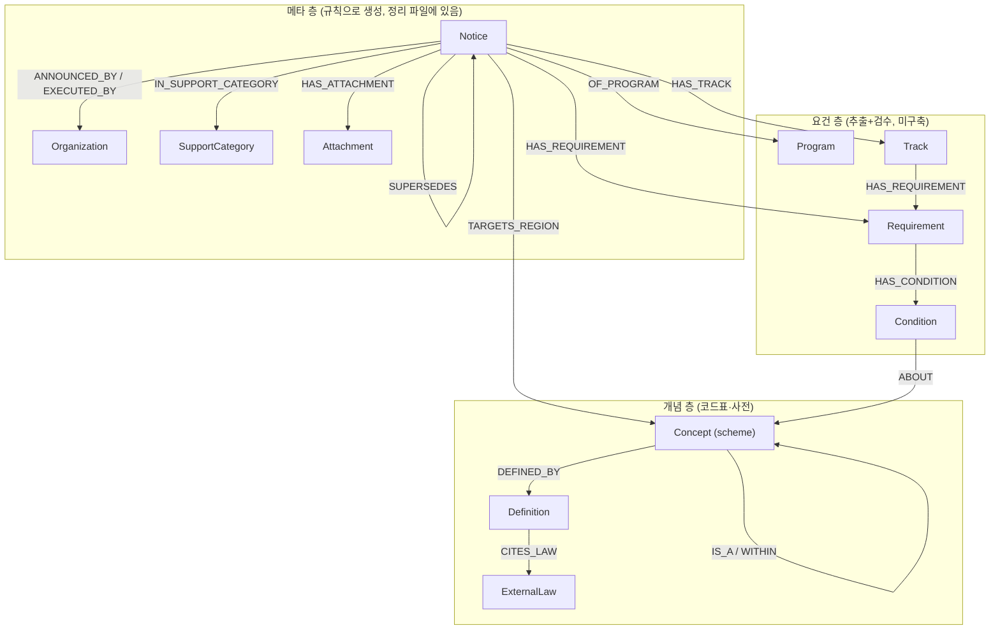

# 도메인 온톨로지 설계서

정부지원사업 공고의 요건을 계층 온톨로지로 정규화하고, Multi-hop 추론으로 신청 자격을 판정하는 지식 그래프 서비스의 도메인 온톨로지

※ 수치는 2026-11-24에 수집한 **기업마당 공고 1,294건**(공식 API 응답과 우리가 정리한 `notices.jsonl`)과 **K-Startup 공고**(API 전체 30,632건 중 접수 시작일 2025-11-24 이후 3,819건, 동료가 정리한 `kstartup_cleaned.jsonl`)를 직접 읽어 센 값입니다. 정규식으로 센 값은 **근사치**(중복·오탐 포함)이며 정확도 지표가 아닙니다. 요건·조건 정규화 예시는 본문을 손으로 읽은 **검수 전 가설**이고, 법령 기준은 원문을 확인하지 않았습니다. 가상의 사용자 입력은 "가상"으로 표시했습니다. 이전 판(v0.1, 공고 90건 표본 기준)은 `docs/old/[도메인온톨로지]_설계서_v0.1_20261123.md`에 보관했습니다.

| 관리 항목 | 팀 작성 내용 |
|---|---|
| 프로젝트/팀 | 정부지원사업 신청 자격 판정 서비스(가칭) / 2팀 |
| 작성자·검토자 | [팀원] / [강사·멘토] |
| 작성일·버전 | 2026-11-24 / v0.2 |
| 연계 일정 | 2주차 (2026.11.23.~11.27.) |
| 저장소·증빙 | https://github.com/encore-ai-campus/mle-01-final-team2 / docs/MLE_2팀_기초 설계.md §4(상세 설계), docs/DATA_SPEC_기업마당_v0.1.md, docs/GUIDE_첨부_공고문_추출_가이드_v0.1.md, docs/GOLDSET_라벨링_가이드_v0.1.md, docs/REVIEW_kstartup_cleaned_점검결과.md |
| 문서 상태 | ■ 초안 □ 검토 □ 보완 □ 승인 |

## 1. 설계 목적 및 도메인 경계

목적: 기업마당·K-Startup 두 포털에 흩어진 지원사업 공고의 **신청 요건**을 요건·조건·개념 단위로 구조화하고, 개념 사이의 상하·포함 관계(IS_A·WITHIN)와 용어 정의→법령 연결을 따라가며 "내 조건으로 이 공고에 신청할 수 있는가"를 **신청 가능 / 신청 불가 / 확인 필요**로 판정한다. 판정은 규칙 평가기(코드)가 하고 모델은 요건 추출과 설명만 맡는다. 모든 요건에는 원문 문장과 출처를 붙인다.

| 구분 | 팀 작성 | 근거·비고 |
|---|---|---|
| 도메인 | 공개 API로 얻는 정부·지자체·공공기관 지원사업 공고의 신청 자격 판정 | 교육 프로젝트이며 실제 신청·접수 시스템이 아님. 판정은 참고용 |
| 대상 사용자 | 창업자·소상공인·중소기업(조건을 입력하는 신청 희망자), 관리자(요건 추출 검수) | 기초 설계서 §1 |
| 포함 범위 | 공고 메타(기관·분야·지역·첨부·버전), 요건·조건 정규화(자격·제외·우대·서류·한도·평가), 개념 계층(지역·업종·신청자 유형 등), 트랙, 용어 정의→법령 연결(P1), 정정·재공고 관계 | 메타 층은 두 출처 전체, 요건 층은 정답셋 후보부터 시작 |
| 제외 범위 | 사업계획서 작성, 신청 대행, 선정 가능성 예측, 법적·세무 자문, 개인 식별 정보 기반 판정, **나라장터 입찰 공고(이번 판의 범위 밖, D-5)**, K-Startup 첨부 수집(사이트 `robots.txt`가 금지, D-9) | 나라장터는 동료가 별도 명세서(DS-10)를 만들었지만 구조화 자격 필드가 비어 있고 자격이 첨부에 있어 이번 요건 층에서 뺀다 |
| 핵심 데이터 | 기업마당 1,294건(모집 중 스냅샷), K-Startup 3,819건(최근 1년) 외 API 전체 30,632건, 행정구역 코드표(행정안전부 `jscode20260701`), 기업마당 본문출력파일 텍스트 1,292건 | §3 |
| 운영 제약 | 모든 결과에 공고 출처·수집 시각·원문 링크·참고용 면책 표시(MR-N1, N2), 개인 식별 정보 비저장(공공기관 담당자 연락처는 개인정보로 취급하지 않기로 결정), 첨부 원본·추출 텍스트는 로컬 전용 | 기초 설계서 §9 |

**두 층 구조.** 이 온톨로지는 두 층으로 나뉜다.

| 층 | 내용 | 생성 방법 | 그래프의 필요성 |
|---|---|---|---|
| 메타 층 | `Notice`, `Organization`, 지원 분야, 지역, 첨부, 버전 | API 구조화 필드에서 규칙으로 생성 | **근거가 되지 못한다.** SQL 테이블과 같은 모양이라 같은 질의를 SQL로 풀 수 있다 |
| 요건 층 | `Requirement`, `Condition`, `Concept` 계층, `Definition`, `ExternalLaw`, `Track` | 본문·첨부 텍스트 추출(모델+규칙)과 검수 | 가설. 개념 계층 확장과 정의→법령 연결에서 이점이 나올 수 있으나 **현재 데이터로 증명하지 못했다** |

이 구분을 문서 전체에서 유지한다. 메타 층이 잘 적재됐다는 사실이 요건 층의 필요성을 증명하지 않는다(상세: ONTOLOGY_NECESSITY.md).

**이번 개정에서 달라진 점.** 90건 표본에서 전수 데이터로 바꾸면서 세 가지가 드러났다. ① 기업마당은 API의 자격 문구가 짧고(평균 83자) 신청 자격·제외 요건·법령 인용이 **첨부 공고문**에 몰려 있어서 요건 층의 입력이 첨부 텍스트다. ② K-Startup은 구조화 필드(업력·연령·지역·신청 대상)가 값이 제한된 목록이라 규칙으로 정규화하기 쉽지만, **제외 요건 필드가 3,819건 모두 비어 있고** 첨부는 수집하지 않는다. ③ 두 출처의 입력 품질이 달라 판정에 `NEEDS_CHECK`가 나오는 비율도 달라질 것으로 보며, 이를 출처별로 따로 측정한다(§9).

## 2. 핵심 업무 질문(Competency Questions, CQ)

작성 원칙: 각 CQ는 그래프 경로, 필요 엔터티, 기대 답과 연결한다. 평가용 CQ는 학습에서 제외한다. "SQL 대비" 칸은 **SQL(재귀 쿼리 포함)로도 풀 수 있는지에 대한 현재의 판단**이며, 측정 전 가설이다(KPI N-07에서 질문 유형별로 비교한다).

| CQ ID | 업무 질문 예시 | 유형 | 필요 경로/검증 | SQL 대비 |
|---|---|---|---|---|
| CQ-01 | 서울 성동구 사업장이 신청할 수 있는 지역 요건 공고 후보는? | A | (Concept 성동구)-[:WITHIN*1..3]→(Concept)←ABOUT←Condition←…←Notice | 재귀 쿼리로 가능 |
| CQ-02 | 이 공고의 자격·제외·우대 요건과 원문 문장은? | A | Notice→HAS_REQUIREMENT→Requirement{kind, source_sentence} | 동일 |
| CQ-03 | (업력 2년, 대표 만 35세, 구미시 소재) 프로필이 이 공고에 신청 가능한가? | B | Notice→(Track)→Requirement→Condition, 3값 평가·합성 | 규칙 평가기 필요, 질의만으로는 불가 |
| CQ-04 | "광주광역시 관내" 요건에 광주 남구 사업장이 충족되는가? | C | (남구)-[:WITHIN]→(광주(구))-[:WITHIN]→(전남광주통합특별시) | 계층 데이터가 있으면 가능. 행정개편 처리가 핵심(§7) |
| CQ-05 | 이 공고의 "중소기업"은 어떤 법령 기준이며 사용자는 해당하는가? | C | Concept→DEFINED_BY→Definition→CITES_LAW→ExternalLaw | 정의·법령 데이터가 있어야 가능(미구축) |
| CQ-06 | 정의→법령 연결이 끊긴(`CHAIN_BROKEN`) 요건이 있는 공고는? | C | Definition, ExternalLaw.text_hash | 동일 |
| CQ-07 | 이 공고는 왜 신청이 안 되는가? 어떤 조건이 부족한가? | D | 평가 결과의 `UNSATISFIED`·`UNKNOWN` 조건 추적 | 평가기 필요 |
| CQ-08 | 이 공고가 정정·재공고·연장된 것인가? 이전 버전과 달라진 요건은? | E | Notice-[:SUPERSEDES*1..5]→Notice, content_hash | 동일 |
| CQ-09 | 두 포털에 중복 게재된 같은 사업은? (P1) | E | Notice-[:SAME_AS]-Notice | 동일 |
| CQ-10 | 대상(트랙)별로 조건이 다른 공고는? | A | Notice→HAS_TRACK→Track | 동일 |
| CQ-11 | 요건을 읽지 못한(`unparsed`) 공고와 첨부를 읽지 못한 공고는? | A | Requirement.status, Attachment.text_status | 동일 |
| CQ-12 | N개 중 k개 충족(`AT_LEAST`)이거나 목록이 "등"으로 열려 있는(`open_ended`) 요건의 공고는? | A | Requirement.logic, open_ended | 동일 |
| CQ-13 | 구조화 필드와 본문이 충돌하는(`source_conflict`) 공고는? | A | Condition.source_conflict | 동일 |
| CQ-14 | 기준일이 서로 다른 조건(공고일·마감일·전년도)을 가진 공고는? | A | Condition.ref_date_kind | 동일 |
| CQ-15 | 특정 법령 조항의 원문이 바뀌면 영향받는 공고는? (P1) | C | ExternalLaw.text_hash←CITES_LAW←Definition←DEFINED_BY←Concept←ABOUT←Condition | 정의·법령 데이터가 있어야 가능. 경로 길이 7로 SQL은 조인 증가 |
| CQ-16 | 사용자가 입력하지 않아 `UNKNOWN`이 되는 속성 중 무엇을 물으면 후보가 가장 줄어드나? (P1) | D | Condition.attribute 집계, 평가 결과 | 평가기 필요 |
| CQ-17 | "경상권 소재"처럼 **권역** 요건에 대구 달서구 사업장이 충족되는가? | C | (달서구)-[:WITHIN]→(대구)-[:WITHIN]→(경상권 묶음) | 권역 사전이 있으면 재귀 쿼리로 가능. 사전 구축이 핵심(§7 시나리오 4) |
| CQ-18 | 업력 옵션 목록이 "예비창업자·1·2·3·5·7·10년 미만" 전체이면 제한 없음인가, 일부면 어떻게 해석하나? | A | Condition.value(옵션 목록), 규칙 평가기 | 규칙 평가기 필요 |

표의 "동일"로 표시한 CQ가 18개 중 9개(CQ-02, 06, 08~14)다. 그래프가 필요하다는 주장이 가능한 곳은 계층 확장(CQ-01, 04, 17)과 정의→법령 경로(CQ-05, 15)이며, 이 부분이 §9의 SQL 베이스라인 비교 대상이다.

## 3. 원천 데이터 및 도메인 용어집

| 데이터 ID | 유형·출처 | 규모·품질 점검 | 권한/라이선스 |
|---|---|---|---|
| SRC-01 | 기업마당 지원사업정보 API. 수집 2026-11-24 09:16, 13쪽, 완전성 확인(받은 행 = `totCnt` = 고유 ID = 1,294, 중복 0) | **공고 1,294건**(모집 중 스냅샷, 마감 공고는 API가 제공하지 않음). 신청 기간: 날짜 범위 379건(29.3%), 예산 소진 시까지 646, 상시 143, 선착순 35, 인원 충족 시까지 54, 별도 공지·미정 35, 해석 불가 2. 지원 대상(`trgetNm`) 7종(중소기업 1,000·소상공인 177·창업벤처 78·사회적기업 25·장애인기업 7·제조업 4·여성기업 3), 지원 분야 대분류 8·중분류 37, 소관 기관 36곳(전남광주통합특별시 113건 포함). **해시태그에 전 시도가 달린 공고가 347건(27%)이라 지역 확정에 쓰지 못한다** | 이용 조건 확인(교육·비상업), 첨부는 로컬 전용 |
| SRC-02 | K-Startup 조회 서비스 API (`getAnnouncementInformation01`). 전체 `totalCount` 30,632건, 날짜 필터가 동작하지 않아 페이지로 받아 직접 센다 | 접수 시작일 기준 최근 1년(2025-11-24~) **3,819건**(동료 정리본, 모집 중 155·종료 3,664, 통합공고 854). 구조화 필드: 업력 `biz_enyy`(옵션 목록, 3,819건 모두), 연령 `biz_trgt_age`(3구간), 지역 `supt_regin`(고유 19종, `전국` 2,189건 57%), 신청 대상 `aply_trgt`(7종 조합), 지원 분야 11종. **제외 대상 `aply_excl_trgt_ctnt`는 3,819건 모두 비어 있음.** 자격 문구는 평균 106자, 20자 미만 331건. **첨부 정보가 API에 없다.** 동료 정리본에는 모집 중 공고 3건 누락과 연락처 마스킹 등 수정 요청 사항이 있다(REVIEW_kstartup_cleaned) | 이용허락범위 제한 없음(명세). 공고 페이지·첨부 경로(`/afile*/`)는 `robots.txt`가 금지해 **자동 수집하지 않는다** |
| SRC-03 | 기업마당 본문출력파일(공고문 첨부) 원본·추출 텍스트 | 1,294개 모두 내려받음(성공 1,294). 텍스트 추출 1,292건(OK 1,166 + OCR 126), 배포용 HWP 2건은 읽지 못함. 추출 글자 수 평균 6,205자(API 요약 평균 285자의 약 22배). 일반 첨부 1,360개는 내려받지 않음 | 로컬 전용, Git 제외 |
| SRC-04 | 행정구역 코드표 `jscode20260701`(행정안전부 행정표준코드) | 시도 16, 시군구 217, 전국 1 = `Region` 234개. 2026-07 개편 반영: 광주·전남이 `전남광주통합특별시`(코드 1200000000)로 통합 | 공공 데이터 |
| SRC-05 | 법령 원문(중소기업기본법 등) | **미수집.** 정의→법령 연결은 P1이며 수집 범위는 §3 아래 인용 빈도를 근거로 정함 | 법제처 API 이용 조건 확인 전 |
| SRC-06 | 수집 메타(`raw/…/manifest.json`, `parse_report.json`, `selection_report.json`) | 호출 조건·시드·건수 기록. 정답셋 후보 50건(기업마당 25, K-Startup 25, 우선·예비 포함) | 내부 파일 |

**요건 층 입력의 크기.** 아래 비율은 정규식으로 센 **근사치**다(공고별로 한 번이라도 나오면 1건으로 센다). 분모가 서로 다르다는 점에 주의한다.

| 요건 표현 | 기업마당 API 자격 문구 (1,294건) | 기업마당 첨부의 자격·제외 구간 (1,147건) | K-Startup 자격 문구 (3,819건) |
|---|---:|---:|---:|
| 업력·창업 연수 | 90건 (7%) | 291건 (25%) | 1,592건 (42%) |
| 소재·관내·거주·본사 | 642건 (50%) | 688건 (60%) | 1,221건 (32%) |
| 제외·제한·불가 | 73건 (6%) | 825건 (72%) | 163건 (4%) |
| 인증·확인서·등록 | 193건 (15%) | 487건 (42%) | 438건 (11%) |
| 「」·｢｣ 법령 인용 | 223건 (17%) | 416건 (36%) | 191건 (5%) |
| 연령(만 N세·청년) | 84건 (6%) | 132건 (12%) | 488건 (13%) |
| 매출·고용 | 131건 (10%) | 324건 (28%) | 101건 (3%) |

읽는 법: ① 기업마당은 API 자격 문구가 평균 83자(중앙값 65자, 20자 미만 98건)로 짧고, 같은 요건 표현이 **첨부에서 약 2~12배** 자주 나온다(업력 3.6배, 제외 12배, 인증 2.8배, 법령 인용 2.1배). 첨부의 자격·제외 구간은 1,147개 공고에서 잡혔고 평균 1,490자(중앙값 583자)다. ② K-Startup은 자격 문구에 업력 표현이 많지만(42%) 제외·법령 표현은 적다(4~5%). 제외 요건은 별도 필드가 비어 있어 본문에서만 찾을 수 있다. ③ **첨부 구간에는 신청 자격이 아닌 의무·서류 맥락의 인용도 섞여** 있으므로 법령 인용 36%가 모두 정의→법령 연결 대상은 아니다.

**인용 법령(기업마당 자격·제외 구간, 공고 수).** 중소기업기본법 115, 소상공인기본법 25, 보조금 관리에 관한 법률 24, 상법 20, 농어업경영체 육성 및 지원에 관한 법률 18, 중견기업 성장촉진 및 경쟁력 강화에 관한 특별법 15, 수산업법 15, 부가가치세법 13, 관광진흥법 13, 소상공인 보호 및 지원에 관한 법률 12. 고유 인용은 545종이다. 이 중 신청자 유형(중소기업·소상공인·중견기업 등)을 **정의하는** 법령만 `Definition`의 후보이고 보조금법·부가가치세법·상법처럼 준수·증빙 맥락의 인용은 후보가 아닐 가능성이 크다(미확인). 따라서 P1 법령 수집(D-8)은 중소기업기본법·소상공인기본법 등 신청자 유형 정의 법령에서 시작한다.

| 용어 | 정의 | 동의어/주의 |
|---|---|---|
| 공고(Notice) | 한 포털이 한 시점에 게시한 지원사업 공고 한 건. 새 버전은 별도 노드 | K-Startup은 `통합공고`(한 공고에 세부 사업이 여럿)가 854건 |
| 사업(Program) | 여러 공고·지자체별 공고가 속하는 상위 사업 | 같은 사업의 지자체별 공고는 근거가 파일명뿐이라 확인 필요 |
| 트랙(Track) | 대상별로 조건·지원 규모가 다른 하위 구분 | "학생창업/예비창업"(§7 시나리오 4), "농업법인은 …" |
| 요건(Requirement) | 공고가 요구하는 하나의 묶음. `kind`로 자격·제외·우대·서류·한도·평가 구분 | 판정에는 자격·제외만 쓴다 |
| 조건(Condition) | 요건을 이루는 원자 조건(속성·연산자·값) | "업력 7년 이내" = `business_age LTE 7` |
| 개념(Concept) | 코드표·사전의 값(지역·업종·신청자 유형 등). `scheme`으로 구분 | 부분 문자열 일치 금지 |
| 권역 | 여러 시도를 묶은 지역 묶음("경상권: 부산/대구/울산/경상남북도") | 공고가 본문에서 직접 정의. 중간 개념으로 사전화 |
| 정의(Definition) | 법령·제도가 정한 용어의 판정 기준 | 법령 내용은 원문 확인 후 기록 |
| 3값 판정 | 조건별 `SATISFIED`/`UNSATISFIED`/`UNKNOWN`, 공고별 `ELIGIBLE`/`NOT_ELIGIBLE`/`NEEDS_CHECK` | `UNKNOWN`을 충족으로 취급하지 않는다 |
| 업력 | 창업(설립) 후 경과 기간. 기준일이 공고일·마감일·신청일로 다양 | `ref_date_kind`로 구분 |
| 옵션 목록 | K-Startup 업력·연령처럼 허용되는 구간을 나열한 값 | 전체를 나열하면 제한 없음, 일부면 합집합(§4.3) |
| 열린 목록(`open_ended`) | 본문이 "등"으로 끝나 전체를 알 수 없는 열거 | `ELIGIBLE`을 막는다 |
| 근거 사슬 | 조건→개념→정의→법령으로 이어지는 경로 | 끊기면 `CHAIN_BROKEN` |

## 4. 온톨로지 개념 모델 및 시각화

아래 그림은 개념 모델이다. 메타 층(위)은 코드로 만들고, 요건 층(아래)은 모델 추출 후 검수를 거쳐 적재한다. 개념 계층(`Concept`)은 코드표와 사전에서 결정적으로 만든다.



### 4.1 클래스

"현재 데이터" 열은 2026-11-24 기준 정리 파일(`parsed`·`kstartup_cleaned`)에서 해당 값을 만들 수 있는지를 뜻하며, **Neo4j에는 이번 데이터가 적재되지 않았다.**

| 클래스 | 식별자(예) | 핵심 속성 | 현재 데이터·예시 |
|---|---|---|---|
| Notice | notice_id | source_system, source_id, notice_kind, title, summary, deadline_at, deadline_raw, apply_status_kind, version, is_latest, fetched_at, content_hash, raw_hash, detail_url | 기업마당 1,294건은 위 속성이 모두 있음(`BIZINFO:PBLN_000000000128083`). K-Startup은 `KSTARTUP:{pbanc_sn}` 규칙을 요청했지만 정리본에는 아직 없음(`announcement_id`만 있음) |
| Organization | org_id | name, normalized_name, source_org_code, role_title, org_kind | 기업마당 소관 36곳·수행 기관 320곳(`직접수행` 52건·`기초자치단체` 295건은 범주값이라 기관 노드가 아님). K-Startup은 직함이 붙은 기관명 정리 필요(정규식 근사 약 190건), 주관 유형(`sprv_inst`) 공공기관 1,792·민간 1,327·교육기관 509·지자체 191 |
| SupportCategory | category_id | name, level(major/medium/source_label) | 기업마당 대 8·중 37, K-Startup 11. 통합 매핑표 필요 |
| Attachment | attachment_id | file_name, file_extension, role, source_url, text_status, usable | 기업마당 2,654개(본문출력 1,294 + 일반 1,360). K-Startup은 정보 없음 |
| Tag | tag_id | name | 기업마당 해시태그. 지역 이름은 `Concept`로 연결하고 태그로 두지 않음(§5.3) |
| Region → Concept(scheme=REGION) | region_id | name, level, region_code, parent_region_id, code_source, code_version | 코드표 234개. 두 출처 모두 지역 값을 **시도 단위 약칭**으로 주므로(K-Startup 19종) 시군구 계층은 본문 추출 조건에서만 쓰인다 |
| Program | program_id | name, level | 미구축 |
| Track | track_id | name, benefit_summary, benefit_limit | 미구축. K-Startup 통합공고 854건이 후보 |
| Requirement | req_id | kind, logic(AND/OR/NONE_OF/AT_LEAST), min_count, logic_basis, source_sentence, status, extraction_run_id | 미구축. 입력은 기업마당 첨부 자격·제외 구간과 두 출처의 자격 문구 |
| Condition | cond_id | attribute, operator, value(JSON), unit, ref_date_kind, negate, source_conflict, open_ended, confidence, reviewed | 미구축. K-Startup 동료 정리본에 후보 46,176건(`needs_review` 27,945·`not_found` 18,231·확정 0) |
| Concept | concept_id | scheme, code, label, aliases, code_version | 지역만 코드표로 가능 |
| Definition | def_id | term, rule_json, basis_note | 미구축(P1) |
| ExternalLaw | law_id | name, article_no, text_hash, source_url | 미구축(P1) |

`ApplicantProfile`(사용자 입력)은 세션 한정이며 그래프에 저장하지 않는다. 미해소 값은 Supabase `review_queue`에 둔다.

**원천 필드와 클래스의 대응.** 두 출처가 같은 개념을 서로 다른 필드로 준다.

| 개념 | 기업마당 | K-Startup | 비고 |
|---|---|---|---|
| 공고 ID·제목 | `pblancId`, `pblancNm` | `pbanc_sn`, `biz_pbanc_nm` | |
| 신청 기간 | `reqstBeginEndDe`(문구 292종, 날짜 범위는 29.3%) | `pbanc_rcpt_bgng_dt`, `pbanc_rcpt_end_dt`(날짜) | 기업마당은 `apply_status_kind` 7종으로 분류 |
| 모집 상태 | (모집 중만 제공) | `rcrt_prgs_yn` | |
| 게시 기관 | `jrsdInsttNm`(소관) | `pbanc_ntrp_nm` | `ANNOUNCED_BY` |
| 수행·운영 기관 | `excInsttNm` | `biz_prch_dprt_nm`(담당 부서) | `EXECUTED_BY`. 기관 종류는 K-Startup `sprv_inst` |
| 지원 분야 | `pldirSportRealmLclasCodeNm`, `...MlsfcCodeNm` | `supt_biz_clsfc` | `SUPPORT_FIELD` |
| 지역 | 해시태그(신뢰 불가), 소관 기관 | `supt_regin` | 둘 다 시도 단위 |
| 신청 대상 | `trgetNm`(7종, 거침) | `aply_trgt`(7종 조합) | `APPLICANT_TYPE` |
| 업력 | (본문에만) | `biz_enyy`(옵션 목록) | 숫자 조건으로 정규화 |
| 연령 | (본문에만) | `biz_trgt_age`(3구간) | 숫자 조건으로 정규화 |
| 자격 문구 | `bsnsSumryCn`의 첫 ☞ 블록 → `eligibility_criteria_text` | `aply_trgt_ctnt` | 요건 추출 입력 1 |
| 제외 요건 | 본문·첨부 | `aply_excl_trgt_ctnt`(**전부 빔**) | 요건 추출 입력 |
| 지원 내용·평가 | `bsnsSumryCn`, 첨부 | `support_ctnt`, `eval_method` | |
| 첨부 | `printFileNm`, `fileNm` | 없음(API에 첨부 칸 없음) | |
| 통합공고 | (없음) | `intg_pbanc_yn` | 트랙 후보 |

### 4.2 개념 scheme과 계층 규칙

| scheme | 구조 | 계층 관계 | 현재 데이터 | 이 데이터에서 본 문제 |
|---|---|---|---|---|
| `REGION` | 트리(전국 > 시도 > 시군구) + **중간 묶음 노드 허용** | `WITHIN` | 코드표 시도 16·시군구 217·전국 1. 공고 값은 시도 약칭(K-Startup 19종, 기업마당 태그 34종) | **약칭→코드 사전 필요**(`전남광주` 20건은 아직 비어 있음). **행정개편**: 광주·전남이 `전남광주통합특별시`로 통합돼 "광주광역시 관내" 같은 과거 표기에 맞는 노드가 없다. `광주(구)` 같은 구 단위 묶음이 필요(§7). "경상권" 같은 **권역**도 같은 방식 |
| `INDUSTRY` | 표준 분류는 트리, 공고용 묶음은 DAG | `IS_A` | 없음. 동료 후보 분석에서 업종 표현은 K-Startup 15건(0.4%) | 업종 제한이 드물어 우선순위가 낮다. 공고의 "제조·가공업"은 표준 분류와 1:1이 아님 |
| `APPLICANT_TYPE` | DAG | `IS_A` | K-Startup 신청 대상 7종(청소년·대학생·일반인·대학·연구기관·일반기업·1인 창조기업), 기업마당 `trgetNm` 7종 | 기업마당 `trgetNm`에는 `제조업`처럼 **업종이 섞여** 있고(4건) 거칠어 판정에 쓰지 않는다. 판정용 값은 본문에서 추출 |
| `SUPPORT_FIELD` | 1~2단 | `IS_A` | 기업마당 대 8·중 37, K-Startup 11 | 두 포털 분류를 통일하는 매핑표 필요. K-Startup 분류명에 HTML 엔티티(`R&amp;D` 51건) |
| `SPECIAL_GROUP` | DAG | `IS_A` | 없음 | 청년·여성·시니어 등. 연령 기준은 개념이 아니라 `Condition`·`Definition`에 둔다 |
| `ZONE` | DAG | `WITHIN`(→`REGION`) | 없음 | 구역 데이터를 확보하기 전에는 `UNKNOWN` 고정 |

업력(예비창업자·1·2·3·5·7·10년 미만)과 연령(만 20세 미만 / 만 20세 이상 ~ 만 39세 이하 / 만 40세 이상)은 `Concept`가 아니라 `business_age`·`founder_age` 숫자 조건으로 정규화한다. K-Startup의 구간 값은 숫자 범위 사전으로 바꾼다. K-Startup 업력 옵션 목록의 분포는 아래와 같다.

| 옵션 개수 | 공고 수 | 해석(규칙 후보) |
|---:|---:|---|
| 7개 전부(예비창업자 + 1·2·3·5·7·10년 미만) | 1,352 (35%) | 업력 제한 없음 |
| 6개 | 999 | 일부 구간(예: 예비창업자 제외 또는 10년 제외). 허용 구간의 합집합 |
| 1~5개 | 1,468 | 허용 구간의 합집합 |

옵션 간 관계(AND/OR)와 기준일은 동료 정리본에서 `unknown_and_or`(3,230건)로 남아 있으며 위 규칙을 적용해 확정하는 것은 정규화 단계의 일이다.

계층 규칙(기초 설계서 §4.1 H1~H10 요약): 간선은 하위→상위, 상속은 위로만 최대 3 hop, 사용자 값이 조건보다 상위면 `UNKNOWN`(서로 다른 가지면 `UNSATISFIED`), scheme 사이 간선 금지(예외 `ZONE`→`REGION`), DAG는 순환 금지, 개념 매칭은 코드·정규화 이름·확정 별칭만(부분 일치 금지), 코드표에 버전·기준일을 붙인다. **점검에서 추가한 규칙 후보:** (H11) 행정구역 개편으로 사라진 명칭(광주광역시 등)은 별칭이 아니라 **구 단위 묶음 개념**으로 두고 `code_version`을 기록한다. (H12) 공고가 본문에서 직접 정의한 권역(경상권 등)은 공고별이 아니라 **공유 사전의 묶음 개념**으로 두고 구성 시도·근거 공고를 기록한다.

### 4.3 판정에 쓰는 속성·연산자·논리

| 항목 | 허용 값 | 비고 |
|---|---|---|
| `Condition.attribute` | region, zone, industry, applicant_type, business_age, founder_age, company_size, revenue, employees, certification, prior_award, registration, other + **제안:** tenure_years, career_years, capital, funding_stage, membership | 제안 5종은 팀 결정(D-4, SAMPLE D1). 이번 데이터에서 매출·고용(`revenue`, `employees`)은 K-Startup 후보 2%·0.5%, 기업마당 첨부 28% |
| `Condition.operator` | EQ, LT, LTE, GT, GTE, BETWEEN, IN, WITHIN, IS_A, EXISTS | |
| `Requirement.kind` | ELIGIBILITY, EXCLUSION, PREFERENCE, DOCUMENT, LIMIT, CRITERION | 판정은 ELIGIBILITY·EXCLUSION만 사용. 입주 후 의무는 LIMIT로 통합(제안) |
| `Requirement.logic` | AND, OR, NONE_OF, AT_LEAST(`min_count`) | 명시가 없으면 `logic_basis=assumed`이며 이 요건이 `ELIGIBLE`을 만들면 `NEEDS_CHECK`로 낮춘다 |
| `Condition.evidence_source` | API, ATTACHMENT, API+ATTACHMENT | **신설.** 출처별 근거 수준을 구분해 `NEEDS_CHECK` 비율을 출처별로 측정한다 |

3값 결합(AND/OR/NONE_OF/AT_LEAST), 트랙 합성(하나라도 `ELIGIBLE`이면 `ELIGIBLE`, 전부 `NOT_ELIGIBLE`이면 `NOT_ELIGIBLE`, 그 외 `NEEDS_CHECK`), 구조화 필드와 본문 충돌 규칙(본문 우선, `source_conflict` 기록), 목록형 값 해석(전체 구간이면 제한 없음)은 기초 설계서 §4.2를 따른다.

## 5. 관계 정의 및 카디널리티

### 5.1 이름과 방향의 규칙

이전 90건 표본을 적재했을 때 적재본과 설계서가 같은 개념에 다른 이름을 썼고 방향이 반대인 쌍이 있었다. 이번 두 출처의 정리 파일은 아직 Neo4j에 적재되지 않았으므로 **적재 전에 아래 이름으로 통일한다.**

| 의미 | 이전 적재본 | 설계서 | 결정 제안 |
|---|---|---|---|
| 공고 게시 기관 | `ANNOUNCED_BY`, `ORDERED_BY`, `EXECUTED_BY` | `PUBLISHES`(owner/operator) | `ANNOUNCED_BY`·`EXECUTED_BY`로 설계서를 수정(D-6). `ORDERED_BY`는 나라장터용이라 이번 범위에서 뺌 |
| 지역 포함 | `HAS_SUBREGION`(시도→시군구) | `WITHIN`(하위→상위) | `(시군구)-[:WITHIN]->(시도)`로 통일하고 `HAS_SUBREGION`은 쓰지 않는다(D-1). 두 방향을 함께 두면 중복 간선 |
| 공고 대상 지역 | `TARGETS_REGION` | (`ABOUT` 조건 경로) | 메타 층의 후보 필터용으로 유지. 요건 층의 `Condition-ABOUT->Concept`와 용도를 구분. 기업마당은 태그를 근거로 쓰지 않는다 |
| 분류 계층 | `SUBCATEGORY_OF`, `SUBCLASS_OF` | `IS_A` | `SUPPORT_FIELD`용 `IS_A`로 통일 |
| 대체 공고 | `SUPERSEDES`(새→이전) | `SUPERSEDES`(새→이전) | 일치 |
| 동일 기관 후보 | `SAME_AS_CANDIDATE` | (없음) | 기관용으로 설계서에 추가 |
| 노드 레이블 | `PublicNotice`, `Region` | `Notice`, `Concept{scheme:REGION}` | `Notice`로 통일, `Region`은 `Concept`의 보조 레이블(D-2) |
| 개념 ID | `KR:REGION:{코드}` | `{scheme}:{code}` | `REGION:{코드}`로 통일(D-2) |
| 공고 ID | `BIZINFO:PBLN_…`, `KSTARTUP:{번호}` | 같음 | 기업마당 정리본은 일치. K-Startup 정리본에 `notice_id`(`KSTARTUP:{pbanc_sn}`)·`fetched_at`·`version`·`content_hash`·`raw_hash` 추가 필요 |

### 5.2 관계 정의

| 관계 타입 | 시작→끝 | 의미 | 카디널리티/제약 | 층·상태 |
|---|---|---|---|---|
| ANNOUNCED_BY | Notice→Organization | 공고 게시 기관 | N:1, 모든 공고 | 메타, 규칙 생성 가능 |
| EXECUTED_BY | Notice→Organization | 수행·운영 기관 | N:1, `직접수행`·`기초자치단체`는 관계 제외(제안) | 메타, 규칙 생성 가능 |
| IN_SUPPORT_CATEGORY | Notice→SupportCategory | 지원 분야 | N:M | 메타, 규칙 생성 가능 |
| HAS_ATTACHMENT | Notice→Attachment | 첨부 메타 | 1:N | 메타, 기업마당만 |
| SUPERSEDES | Notice→Notice | 새 버전이 이전을 대체 | 1:1, 새→이전, 이전은 `is_latest=false` | 메타. 재수집 후 `content_hash` 변화로 생성. K-Startup 제목의 "연장"·"재공고"는 **후보**일 뿐 확정하지 않는다 |
| TARGETS_REGION | Notice→Concept(REGION) | 공고의 대상 지역(후보 필터) | N:M | 메타. K-Startup `supt_regin`만 근거로 쓴다 |
| WITHIN | Concept→Concept | 공간 포함(하위→상위) | N:1(REGION), N:M(ZONE·권역 묶음) | 개념, 코드표+묶음 사전 |
| IS_A | Concept→Concept | 종류 계층 | N:M(DAG), 순환 금지 | 개념, 미구축 |
| OF_PROGRAM | Notice→Program | 공고가 속한 사업 | N:1 | 요건, 미구축 |
| HAS_TRACK | Notice→Track | 대상별 하위 구분 | 1:N | 요건, 미구축 |
| HAS_REQUIREMENT | Notice \| Track→Requirement | 요건 | 1:N, `evidence` 필수 | 요건, 미구축 |
| HAS_CONDITION | Requirement→Condition | 원자 조건 | 1:N, `evidence` 필수 | 요건, 미구축 |
| ABOUT | Condition→Concept | 조건이 가리키는 개념 | N:M, 정확·확정 별칭 일치만 | 요건, 미구축 |
| DEFINED_BY | Concept→Definition | 개념의 판정 기준 | 1:N | 개념, 미구축(P1) |
| CITES_LAW | Definition→ExternalLaw | 정의의 근거 법령 | N:M, 명시된 인용만 | 개념, 미구축(P1) |
| SAME_AS | Notice→Notice | 포털 간 동시 중복 게재 | N:M, 대체 관계와 구별 | 요건, 미구축(P1) |
| SAME_AS_CANDIDATE | Organization→Organization | 동일 기관 후보(검토 대기) | N:M, `review_status` | 메타 |
| HAS_TAG | Notice→Tag | 검색 키워드 | N:M | 메타, 정리 필요 |

설계 규칙: 관계 이름은 대문자 스네이크, 방향은 하위·인용하는 쪽→상위·인용되는 쪽이다. 시간상 대체(`SUPERSEDES`)와 동시 중복(`SAME_AS`), 종류(`IS_A`)와 공간 포함(`WITHIN`), 정의(`DEFINED_BY`)와 법령 인용(`CITES_LAW`)은 하나로 뭉개지 않는다. 요건 층 관계에는 `evidence`(원문 구절, 수정 없이 복사)와 `source`(필드·첨부·위치), 모델 추출 관계에는 `extraction_run_id`·`review_status`를 붙인다. 구조 관계에는 `source_system`·`source_field`를 붙인다.

### 5.3 태그와 기관 정리 규칙

| 대상 | 규칙 |
|---|---|
| 지역 이름(시군구) | 태그가 아니라 `Concept(REGION)`으로 연결 |
| 기업마당 지역 태그 | 전 시도가 달린 공고가 347건(27%)이므로 **지역 근거로 쓰지 않고** `region_scope_hint` 힌트로만 남긴다. 지역은 본문·첨부 추출 조건으로 정한다 |
| 자격 값(`60세`, `창업7년이내`) | 태그가 아니라 요건 층 `Condition`의 후보로만 쓴다 |
| 범주값(`기초자치단체`, `직접수행`) | 노드를 만들지 않고 `org_kind`(수행기관 종류) 속성으로 둔다. 기업마당 295건·52건 |
| 기관 직함 | 이름에서 제거하고 `role_title` 속성에 보존(K-Startup 191건) |
| 복수 기관 | 기관별 노드로 분리, 오타는 원문 보존 + `normalized_name`에서 보정 |
| 연락처 | 공공기관 담당자 연락처는 마스킹하지 않는다(팀 결정). 문서·청크에 `[REDACTED_…]` 같은 대체 문자열이 남지 않게 한다 |

## 6. S-P-O 트리플과 출처 문장 매핑

근거 문장은 정리 파일의 `eligibility_criteria_text`(기업마당 API), `eligibility_text`(K-Startup), 기업마당 첨부 추출 텍스트에서 가져왔다. 정규화한 값은 **내가 읽은 가설**이며 검수 전이다. 공고 ID는 `BIZINFO:`·`KSTARTUP:` 접두 대문자 규칙을 따른다.

| ID | Subject — Predicate — Object | 근거 문장(원문) | 출처 |
|---|---|---|---|
| T-01 | `BIZINFO:PBLN_000000000119999` — HAS_REQUIREMENT → R1[E]; R1 — HAS_CONDITION → `business_age LTE 7`(ref=NOTICE_DATE) | "초격차 분야 업력 7년 이내 창업기업(공고일 기준)" | 기업마당 API 자격 문구 |
| T-02 | `KSTARTUP:179834` — HAS_TRACK → Track{학생창업, 예비창업}; 학생창업: `business_age LTE 7`, `region WITHIN 경상권`, `applicant_type EQ 대학(원)생`; 예비창업: `region WITHIN 경상권`, `founder_age LTE 39` | "(학생창업) 업력 7년 이내 경상권* 소재 대학(원)생 창업기업 / (예비창업) 대표자 소재지가 경상권*인 만 39세 이하 청년 / *경상권 : 부산/대구/울산/경상남북도" | K-Startup 자격 문구(IBK창공 UNIST캠프 공고) |
| T-03 | `BIZINFO:PBLN_000000000117956` — … → `employees GTE 10`(고용보험 피보험자), 예외 `certification EXISTS`{벤처기업, 이노비즈, 메인비즈, 사회적기업}이면 10인 미만도 가능 | "고용보험 피보험자 10인 이상 기업 / ※ 벤처기업, 이노비즈, 메인비즈, 사회적기업은 10인 미만이라도 참여 가능" | 기업마당 API 자격 문구 |
| T-04 | `BIZINFO:PBLN_000000000117491` — … → `registration EXISTS 여행업 등록`; 그 조건 — ABOUT → 법령 인용 「관광진흥법」 제4조 제1항 | "「관광진흥법」제4조 제1항에 따른 여행업 등록을 필한 여행사" | 기업마당 API 자격 문구 |
| T-05 | `BIZINFO:PBLN_000000000117985` — … → R1 `OR`{벤처기업, 이노비즈, 메인비즈 `certification EXISTS`}(`open_ended`), R2 `NONE_OF`{최근 6개월 지상파 전국권 방송광고 집행} | "벤처기업, 이노비즈, 메인비즈 등 중 하나 이상의 확인서를 보유한 기업 중 최근 6개월간 지상파 전국권 방송광고 집행이 없는 기업" | 기업마당 API 자격 문구 |
| T-06 | `BIZINFO:PBLN_000000000121231` — … → `region WITHIN 광주(구)`, `company_size IS_A 소상공인` | "광주광역시 관내 소상공인 / 중소기업확인서 상 소상공인 / 사업자등록증 상 광주광역시 소재 사업장 보유 소상공인" | 기업마당 API 자격 문구 |
| T-07 | `BIZINFO:PBLN_000000000120707` — … → R1 `OR`{(`region WITHIN 구미`, `business_age LTE 7`), 구미 본사 이전 계획}, 의무[L] 선정 후 60일 이내 이전 | "구미 소재 창업기업 중 업력 7년 이내 창업기업 (신청일 기준) / 구미(본사)로 이전 계획 기업 / 타 지역 창업기업의 경우 선정 후 60일 이내 구미 본사 이전 必" | 기업마당 API 자격 문구 |
| T-08 | `BIZINFO:PBLN_000000000116943` — … → `company_size IS_A 중소기업`; 개념 중소기업 — DEFINED_BY → Definition — CITES_LAW → 「중소기업기본법」 제2조 | "중소기업 : ｢중소기업기본법｣ 제2조의 규정에 의한 중소기업" | 기업마당 **첨부**의 신청 자격 구간 |
| T-09 | `KSTARTUP:179839` — HAS_REQUIREMENT → R1[E]; R1 — HAS_CONDITION → `business_age LT 3`(출처 `biz_enyy`), `region WITHIN REGION:4100000000`(경기도, 출처 `supt_regin`="경기") | `biz_enyy`="3년미만", `supt_regin`="경기". 본문 "입주모집 공고일 현재 경기도 내에 주된 사무소를 둔 창업 후 3년 이내의 여성기업" (본문 첫 항목은 "…경기도 내에 주소를 둔 여성 예비창업자"도 허용) | K-Startup 구조화 필드(규칙으로 생성). 업력 필드에는 `예비창업자`가 없는데 본문은 예비창업자도 받으므로 `source_conflict` 후보 |

필수 필드: triple_id(claim_id), subject_id, predicate, object_id, source_id(notice_id), source_span(evidence), extraction_method(rule/model), extraction_model, confidence, review_status(staged/approved/rejected). T-09는 구조화 필드에서 규칙으로 만드는 트리플이고 T-01~T-08은 모델 추출 + 검수 대상이다. T-08처럼 **첨부 본문에서 나오는 요건**과 T-01처럼 API 문구에서 나오는 요건을 `evidence_source`로 구분한다. 신뢰도 점수는 보조값이며 사실 검증을 대신하지 않는다.

주의: T-04의 "여행업 등록"을 `Condition`으로 만들지 `ExternalLaw` 연결로 만들지, T-05의 "등"과 AND/OR 구분, T-06·T-07의 지역 범위와 기준일은 본문만으로 확정되지 않는다. T-02의 학생창업 트랙에서 "대학(원)생"의 판단 기준(학교별 발급 서류)은 시스템이 확인할 수 없어 `UNKNOWN`이 된다. 이런 모호성이 `logic_basis=assumed`·`open_ended`·`REQ_UNPARSED` 처리의 근거이며, 확정은 두 검수자의 정규화 일치율로 확인한다(골든셋 가이드).

## 7. Multi-hop 추론 시나리오

모든 사용자 값은 **가상 입력**이며 평가는 손으로 계산했다.

### 시나리오 1. 행정개편을 넘는 지역 계층 (CQ-04)

질문: "광주 남구에 사업장이 있는 소상공인이 [광주] 소상공인 SNS·블로그 홍보지원(`BIZINFO:PBLN_000000000121231`)에 신청할 수 있나?"

경로: (남구 `REGION:1227000000`) —[:WITHIN]→ (광주(구) 묶음) —[:WITHIN]→ (전남광주통합특별시 `REGION:1200000000`). 조건 C1은 `광주광역시 관내`를 가리키지만 코드표에 `광주광역시` 노드가 없다. 코드표는 2026-07 개편으로 광주·전남을 통합했고 남구(1227000000)가 통합시 아래에 직접 있다. 따라서 **`광주(구)` 중간 묶음 개념을 사전으로 만들고 광주에 속했던 구를 그 아래에 두는 것**이 이 질문이 풀리는 전제다. 묶음에 어느 구가 속하는지는 행정 자료로 확인해야 한다(현재 확인 전). 같은 문제가 현재 데이터에도 있다. 기업마당 소관 기관 `전남광주통합특별시`가 113건, K-Startup 지역 값 `전남광주`가 20건이다.

| 조건 | 평가 | 근거 |
|---|---|---|
| C1 지역: `WITHIN 광주(구)` | `SATISFIED`(1 hop, 묶음 사전이 있을 때) / 묶음이 없으면 `UNKNOWN` | 코드표에 광주광역시 없음 |
| C2 소상공인: `company_size IS_A 소상공인` | 사용자 값 입력에 따라 | 법령 정의는 원문 확인 필요 |
| C3 "중소기업확인서 상 소상공인" | `UNKNOWN`(확인서 보유 여부 미입력) | `certification EXISTS` |
| 합성 | `NEEDS_CHECK` | 불충족 없음, 미확인 있음 |

검증 기준: 경로 존재, 묶음 사전에 검수자·근거·`code_version` 기록, 결과에 공고 원문 링크·수집 시각 표시, 근거 없으면 보류. 단순 SQL로는 "광주광역시"라는 문자열이 코드표에 없어 매칭 실패하는 지점이므로 계층 사전의 효용을 시험하기에 적합하다. 다만 이것이 그래프의 필요성을 증명하지는 않는다. 같은 사전을 SQL 테이블로 만들어도 풀리기 때문이다(베이스라인에서 확인).

### 시나리오 2. 논리 결합과 열린 목록 (CQ-03, CQ-12)

질문: "벤처기업 확인서를 보유한 기업이 방송광고비 할인지원(`BIZINFO:PBLN_000000000117985`)에 신청할 수 있나?"

정규화 초안: R1은 `certification` 3종 중 하나 이상(`OR`, "등"으로 끝나 `open_ended`), R2는 "최근 6개월간 지상파 전국권 방송광고 집행이 없는 기업"(`NONE_OF`). 사용자가 벤처기업 확인서를 보유하면 R1은 `SATISFIED`다. R2는 방송광고 집행 여부를 입력하지 않았으면 `UNKNOWN`이다. 평가기는 R1이 `open_ended`이므로 목록 밖 확인서까지 확인하지 못했음을 표시하고, 합성은 `NEEDS_CHECK`로 두며 미확인 목록에 "지상파 방송광고 집행 여부"를 올린다. 이 시나리오는 그래프 hop보다 **논리 결합과 3값 평가**가 핵심이어서 질의만으로는 풀리지 않고 평가기가 필요하다는 점(CQ-03)을 보여 준다.

### 시나리오 3. 정의→법령 경로와 끊긴 사슬 (CQ-05, CQ-06)

질문: "이 공고의 `중소기업` 기준은 무엇이고 내 사업자는 해당하나?" (`BIZINFO:PBLN_000000000116943`, T-08)

경로: (Concept 중소기업) —[:DEFINED_BY]→ (Definition) —[:CITES_LAW]→ (ExternalLaw 「중소기업기본법」 제2조). 법령 원문(`text_hash`)을 수집하지 않았으므로 현재 상태는 `law_missing`이며 조건은 `UNKNOWN`, 합성은 `NEEDS_CHECK`(사유 `CHAIN_BROKEN`)이다. 끊긴 법령 이름과 사용자가 확인할 사항을 안내한다. 법령 기준 숫자(상시근로자 수·매출 기준 등)는 기억에 의존하지 않고 원문을 확인한 뒤 `rule_json`에 옮긴다. 이 경로의 효용을 가늠하는 데이터는 있다. 기업마당 자격·제외 구간 1,147건 중 중소기업기본법 인용이 115건이다(§3). 다만 이 인용이 모두 자격 판정에 쓰이는 정의인지는 확인하지 않았다.

### 시나리오 4. 권역 묶음과 트랙, 구조화 필드와 본문의 충돌 (CQ-17, CQ-13, CQ-10)

질문: "대구 달서구에 사업장이 있고 대표자가 만 35세인 사업자등록 기업이 `KSTARTUP:179834`(IBK창공 UNIST캠프)에 신청할 수 있나?" (모든 사용자 값은 가상)

정규화 초안(T-02): 트랙 두 개. 학생창업은 업력 7년 이내 + 경상권 소재 + 대학(원)생 창업기업, 예비창업은 경상권 소재 + 만 39세 이하. "경상권"은 본문이 부산·대구·울산·경상남북도로 직접 정의한다. API 지역 필드 `supt_regin`은 `전국`인데 본문은 경상권으로 제한하므로 **구조화 필드와 본문이 충돌**한다(`source_conflict`, 본문 우선).

경로: (달서구) —[:WITHIN]→ (대구 `REGION:2700000000`) —[:WITHIN]→ (경상권 묶음 개념). 경상권 묶음은 공고가 정의한 값을 **공유 사전의 중간 개념**으로 만들어야 풀린다(H12).

| 트랙·조건 | 평가 | 근거 |
|---|---|---|
| 지역 `WITHIN 경상권` | `SATISFIED`(묶음 사전이 있을 때) / 없으면 `UNKNOWN` | 달서구 → 대구 → 경상권 |
| 학생창업: 대학(원)생 창업기업 | `UNKNOWN` | 학생 신분 확인은 학교별 발급 서류 기준이라 입력할 수 없음 |
| 학생창업: 업력 `LTE 7` | 업력 입력에 따라 | 기준일은 공고 마감일 |
| 예비창업: 예비창업자 | `UNSATISFIED` | 사용자가 사업자등록을 마친 기업 |
| 트랙 합성 | `NEEDS_CHECK` | 어느 트랙도 `ELIGIBLE`이 아니고, 학생창업이 `UNKNOWN`을 포함해 전부 `NOT_ELIGIBLE`은 아님 |

이 시나리오는 K-Startup처럼 **구조화 필드가 있어도 본문이 더 좁은 경우**가 있어서, 구조화 필드만으로 후보를 거르면 틀릴 수 있다는 점을 보여 준다. 다만 K-Startup은 첨부를 받지 않으므로 이 공고처럼 본문에 요건이 있으면 평가할 수 있지만, 본문에 없고 첨부에만 있는 요건은 확인할 수 없다(`NEEDS_CHECK`가 늘어나는 원인).

## 8. Neo4j 물리 모델 매핑 예시

개념 온톨로지와 Neo4j 속성 그래프는 같은 표현이 아니다. 아래는 구현 매핑 초안이며 **실행해 검증하지 않았다.** 현재 저장소의 `tools/load_neo4j.py`는 이 프로젝트의 공고 그래프가 아니라 별도의 IBK 내부 규정 데이터를 적재하는 코드로 보이므로(`data/old/ibk_converted`), 이 매핑과는 관련이 없다(확인 필요).

```cypher
// 제약: 적재 전에 먼저 건다
CREATE CONSTRAINT notice_id   IF NOT EXISTS FOR (n:Notice)       REQUIRE n.notice_id IS UNIQUE;
CREATE CONSTRAINT org_id      IF NOT EXISTS FOR (o:Organization) REQUIRE o.org_id IS UNIQUE;
CREATE CONSTRAINT concept_id  IF NOT EXISTS FOR (k:Concept)      REQUIRE k.concept_id IS UNIQUE;
CREATE CONSTRAINT req_id      IF NOT EXISTS FOR (r:Requirement)  REQUIRE r.req_id IS UNIQUE;
CREATE CONSTRAINT cond_id     IF NOT EXISTS FOR (c:Condition)    REQUIRE c.cond_id IS UNIQUE;

// 개념 층: 시군구 → 시도 (하위→상위)
MERGE (sido:Concept:Region {concept_id:'REGION:1100000000'})
  SET sido.scheme='REGION', sido.label='서울특별시', sido.code_version='20260701';
MERGE (gu:Concept:Region {concept_id:'REGION:1120000000'})
  SET gu.scheme='REGION', gu.label='성동구', gu.code_version='20260701';
MERGE (gu)-[:WITHIN {source_system:'MOIS_KIKcd_B'}]->(sido);

// 권역 묶음(H12): 공고가 정의한 경상권, 근거 공고와 구성 시도를 기록
MERGE (grp:Concept {concept_id:'REGION_GROUP:GYEONGSANG'})
  SET grp.scheme='REGION', grp.label='경상권', grp.kind='GROUP', grp.defined_in='KSTARTUP:179834', grp.reviewed=false;
// 구성 시도: 부산·대구·울산·경남·경북 (코드표에서 코드 확인 후 연결)
MERGE (dg:Concept:Region {concept_id:'REGION:2700000000'});
MERGE (dg)-[:WITHIN {basis:'공고 본문 정의'}]->(grp);

// 메타 층 예시
MERGE (n:Notice {notice_id:'KSTARTUP:179839'})
  SET n.source_system='KSTARTUP', n.is_latest=true, n.version=1;

// 요건 층 예시(T-01, 검수 전 가설)
MERGE (nb:Notice {notice_id:'BIZINFO:PBLN_000000000119999'})
  SET nb.source_system='BIZINFO', nb.is_latest=true, nb.version=1;
MERGE (r:Requirement {req_id:'BIZINFO:PBLN_000000000119999@v1#R1'})
  SET r.kind='ELIGIBILITY', r.logic='AND', r.logic_basis='assumed', r.status='parsed',
      r.source_sentence='초격차 분야 업력 7년 이내 창업기업(공고일 기준)';
MERGE (nb)-[:HAS_REQUIREMENT {evidence:r.source_sentence, source:'bsnsSumryCn'}]->(r);
MERGE (c:Condition {cond_id:r.req_id + '#C1'})
  SET c.attribute='business_age', c.operator='LTE', c.value='{"value":7,"unit":"YEAR"}',
      c.ref_date_kind='NOTICE_DATE', c.evidence_source='API', c.reviewed=false;
MERGE (r)-[:HAS_CONDITION {evidence:r.source_sentence, source:'bsnsSumryCn'}]->(c);

// 질의 예시: 사용자 개념에서 조건 개념까지 최대 3 hop
MATCH p = (u:Concept {concept_id:$user_concept})-[:IS_A|WITHIN*0..3]->(t:Concept {concept_id:$target})
RETURN [x IN nodes(p) | x.label] AS route, length(p) AS hops ORDER BY hops LIMIT 1;
```

Neo4j 속성은 맵을 직접 담지 못해 `Condition.value`는 JSON 문자열로 둔다. 개념을 가리키는 값은 `ABOUT` 간선이 기준이다. 권역 사이 hop은 시군구→시도→권역으로 2 hop이다.

## 9. 품질 검증·논리 일관성·변경 관리

"현재 값"은 2026-11-24에 정리 파일을 읽어 측정한 값이다. 적재(Neo4j)는 실행하지 않았다.

| 검증 ID | 검증 내용 | 인수 조건 | 현재 값·증빙 |
|---|---|---|---|
| VAL-01 | 필수 ID 누락·중복 | `notice_id` 등 NULL 0, 중복 0 | 기업마당 1,294건 중복 0. K-Startup 3,819건 중복 0이나 `notice_id` 규칙 필드가 정리본에 없음 |
| VAL-02 | 고아 노드·잘못된 참조 | 없는 대상을 가리키는 관계 0 | `[적재 후 기록]` |
| VAL-03 | 금지 관계/방향 | 시그니처 위반 0. `WITHIN`은 하위→상위 | `[적재 후 기록]`. 이전 표본 적재는 `HAS_SUBREGION`(상위→하위)으로 **미충족**이었으므로 적재 전 통일(D-1) |
| VAL-04 | 중복 엔터티·범주값 노드 | 범주값을 기관 노드로 만들지 않음 | 기업마당 `기초자치단체` 295건·`직접수행` 52건이 범주값. 노드로 만들지 않기로 함(적재 전) |
| VAL-05 | 근거 출처 연결 | 추출 관계 100% `evidence` 보유 | 요건 층 미구축. `[적재 후 기록]` |
| VAL-06 | CQ 18개 답변 가능성 | 각 CQ별 Cypher 작성·기대 답 통과(합격선은 결과를 보기 전에 정함) | `[ ]` |
| VAL-07 | 지역 정확성 | 지역이 본문·소관 기관과 일치 | 기업마당 태그는 전 시도 347건(27%)이라 **근거로 쓰지 못함**. K-Startup 지역은 약칭 19종, `전남광주` 20건 코드 미연결 |
| VAL-08 | 기준일·수집 시각 표시 | 결과에 공고 수집 시각·원문 링크 표시 | 기업마당 `fetched_at` 1,294건 존재. K-Startup 필드 추가 필요 |
| VAL-09 | 멱등성 | 같은 적재를 2회 실행해 노드·관계 건수 동일 | `[ ]` |
| VAL-10 | 개념 계층 점검 | 순환 0, scheme 간 간선 0, 중간 묶음의 근거·검수자 기록 | `[ ]` |
| VAL-11 | 정답 세트 일치율 | 두 검수자의 요건·조건 일치율 측정 | `[ ]` (후보 50건 선정 완료, 라벨 0건) |
| VAL-12 | 첨부 텍스트 확보율 | 첨부가 있는 공고의 텍스트 확보 | 기업마당 본문출력파일 1,292/1,294건(99.8%, OCR 126건 포함). K-Startup 해당 없음 |
| VAL-13 | 출처별 `NEEDS_CHECK` 비율 | 출처별로 따로 측정·보고 | `[적재 후 기록]`. K-Startup은 첨부가 없어 더 높을 것이라는 **가설** |
| VAL-14 | 원문 보존 | 정리·마스킹이 원문 값(URL·텍스트)을 바꾸지 않음 | 기업마당 정리본은 원본과 URL·제목이 같음(제목 공백 정리 11건). K-Startup 정리본은 연락처 마스킹과 URL 변형이 있음(수정 요청 중) |

품질 지표 예시: 요건·조건 추출 Precision/Recall, 개념 연결(`ABOUT`) 정확도, 판정 정확도(질문 유형별), 근거 추적률, CQ 충족률, SQL 베이스라인 대비 성능(KPI N-07). 목표값은 샘플 적재 후 팀이 정하며 **합격선은 결과를 보기 전에 정한다.**

## 10. 작성·제출 체크리스트

- ■ 도메인 범위·이해관계자·제외 범위 정의
- ■ CQ 10개 이상 및 각 질문의 그래프 경로(18개)
- ■ 데이터 출처·접근권한·품질 점검(라이선스는 `[확인 필요]` 남음)
- ■ 엔터티 클래스·식별자·속성·예시
- ■ 관계 타입·방향·카디널리티
- □ 동의어·상하위·예외·개인정보 처리 (별칭 사전·권역 사전·개편 처리 방침은 정했으나 사전은 미구축)
- ■ S-P-O 5개 이상과 출처 문장 매핑(9건, 검수 전)
- ■ Multi-hop 추론 사례 및 근거 추적(4건)
- □ 금지 관계·논리 일관성·필수 속성 검증 (적재 후)
- □ Neo4j 매핑·제약조건 (초안만, 실행 전)
- □ 온톨로지 버전·검토자·변경 이력·승인

## 11. 팀 결정이 필요한 항목

| # | 결정 | 선택지 | 제안 |
|---|---|---|---|
| D-1 | `WITHIN` 방향 | 하위→상위로 통일 / `HAS_SUBREGION` 유지 | 하위→상위로 통일(VAL-03). 적재 전에 확정 |
| D-2 | 레이블·ID 통일 | `Notice`·`Concept{scheme}`·`REGION:{코드}` / 이전 적재본 이름 | 설계서 이름으로 통일, `Region`은 보조 레이블 |
| D-3 | 광주 등 개편으로 사라진 명칭과 권역 | 중간 묶음 개념 / 별칭만 / 처리 안 함(`UNKNOWN`) | 중간 묶음 + `code_version`·근거 공고 기록(H11·H12). 구성 구는 행정 자료로 확인 후 |
| D-4 | 속성 허용 목록 확장 | 5종 추가 / `other`로 두고 판정 제외 | 추가(SAMPLE D1) |
| D-5 | 나라장터·개인 대상 공고 포함 여부 | 포함 / 제외 | 이번 판은 **두 출처만**, 둘 다 제외. 나라장터는 동료의 DS-10 명세서를 검토한 뒤 별도 결정 |
| D-6 | 관계 이름 | 적재본(`ANNOUNCED_BY` 등) / 설계서(`PUBLISHES`) | 적재본 기준으로 설계서 수정 |
| D-7 | 정답 세트 규모·검수 | 후보 50건 전체 / 일부 | 우선 후보 30건 중 파일럿 10건부터 두 검수자가 각각 라벨링. 합격선은 결과를 보기 전에 확정 |
| D-8 | 법령 수집 범위(P1) | 신청자 유형을 정의하는 법령부터 / 인용 전체(545종) | 중소기업기본법·소상공인기본법 등 정의 법령부터. 이용 조건 확인 후 |
| D-9 | K-Startup 첨부 수집 | 수집하지 않음 / 사람이 직접 소량 확인 / 운영기관 문의 | 수집하지 않음(`robots.txt` 금지). 비교 시트 10건 결과를 보고 필요성을 판단 |
| D-10 | 기업마당 일반 첨부 1,360개 다운로드 | 정답셋 후보만 / 전체 / 안 받음 | 정답셋 후보 공고의 일반 첨부만(원본 고정 후 라벨링) |
| D-11 | K-Startup 정리본 수정 | 수정 요청 반영 후 사용 / 현 상태 사용 | 연락처 마스킹 해제·원문 URL 복원·모집 중 3건 추가·규칙 필드 추가를 요청한 뒤 사용 |

## 12. 한계

- 요건·조건·정의·법령 노드는 **하나도 적재되지 않았다.** 이 문서의 요건 층 예시는 본문을 손으로 읽은 가설이다.
- 기업마당은 **모집 중 스냅샷 1회분**(2026-11-24)이다. 마감 공고를 API가 제공하지 않아 과거 이력이 없고, `SUPERSEDES`·`content_hash` 변화는 재수집 후에야 만들 수 있다.
- 기업마당 지역 태그는 판정 근거로 쓸 수 없다. 지역은 본문·첨부 추출과 소관 기관으로 정해야 한다.
- K-Startup은 첨부를 받지 않아 첨부에만 있는 요건을 볼 수 없다. 제외 요건 필드가 비어 있어 제외 조건은 본문(자격 문구의 4%)에서만 찾을 수 있다.
- K-Startup 최근 1년 3,819건은 **접수 시작일 기준**이며 게시일을 확인할 수 없다(동료의 상세 페이지 표본 24건에서도 등록일 라벨을 찾지 못함). 번호가 오래된 공고도 시작일이 최근일 수 있어 번호순으로 걸러서는 전체를 얻지 못한다.
- 법령 기준(중소기업·소상공인·여성기업 등)은 원문을 확인하지 않았다. 법령 인용 비율은 신청자 유형 정의 이외의 인용을 포함한다.
- 정규식 근사치(§3)는 오탐·중복이 있어 정확도 지표가 아니다. 첨부 텍스트는 HWP·HWPX 표 구조가 사라지고 OCR 126건은 오인식이 있을 수 있다.
- **그래프가 SQL보다 필요하다는 증거는 이번 전수 데이터로도 늘지 않았다.** 계층 확장(지역·권역)과 정의→법령 경로만 시험 대상으로 남으며 SQL 베이스라인 비교가 선행돼야 한다. 법령 인용이 첨부의 자격·제외 구간 36%에 나타난다는 사실은 정의→법령 경로의 필요 범위를 보여 줄 뿐 효용을 증명하지 않는다.

## 13. 검토·수정 이력

| 일자 | 버전 | 검토자 | 지적사항 | 조치/증빙 | 승인 |
|---|---|---|---|---|---|
| 2026-11-23 | v0.1 | [ ] | [ ] | 초안 작성(공고 90건 점검 결과와 기초 설계서 §4를 양식에 맞춰 정리) | □ |
| 2026-11-24 | v0.2 | [ ] | [ ] | 기업마당 1,294건·K-Startup 3,819건(API 30,632건 중) 전수 데이터로 재작성. 나라장터를 범위에서 제외, 요건 입력 비율 표·인용 법령 빈도·원천 필드 대응표·K-Startup 옵션 목록 분포 추가, CQ-17·18, 시나리오 4, H12(권역), `evidence_source`, VAL-12~14, D-9~11 추가. v0.1은 `docs/old/`에 보관 | □ |
| [ ] | v0.3 | [ ] | [ ] | [ ] | □ |
