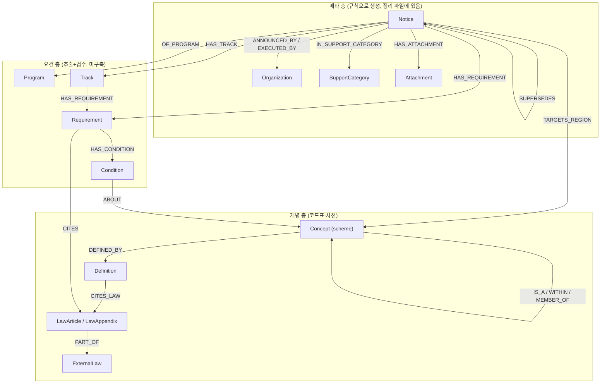
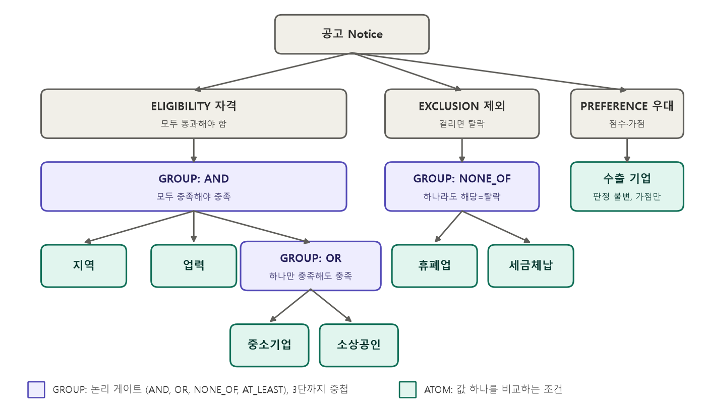

# 도메인 온톨로지 설계서

> 2026-11-25 보완: 팀 검토 의견(온톨로지 보완안 O-01~O-16)을 저장소 파일로 확인한 뒤 반영했다. 수치는 §9 끝의 집계 기준표에 입력 파일과 기준 시점을 적었다. 반영 항목은 §11 이력과 부록 A의 D-13~D-20에 있다.

정부지원사업 공고의 요건을 계층 온톨로지로 정규화하고, Multi-hop 추론으로 신청 자격을 판정하는 지식 그래프 서비스의 도메인 온톨로지

※ 수치는 2026-11-24에 수집한 **기업마당 공고 1,294건**(공식 API 응답과 우리가 정리한 `notices.jsonl`)과 **K-Startup 공고**(API 전체 30,632건 중 접수 시작일 2025-11-24 이후 3,819건 + 모집 중 3건, 우리가 원본에서 다시 정리한 정리층 `data/cleaned/20261124/notices.jsonl`)를 직접 읽어 센 값입니다. 정규식으로 센 값은 **근사치**(중복·오탐 포함)이며 정확도 지표가 아닙니다. 요건·조건 정규화 예시는 본문을 손으로 읽은 **검수 전 가설**이고, 법령 기준은 원문을 확인하지 않았습니다. 가상의 사용자 입력은 "가상"으로 표시했습니다. 이전 판(v0.1, 공고 90건 표본 기준)은 `docs/old/[도메인온톨로지]_설계서_v0.1_20261123.md`에 보관했습니다.

| 관리 항목 | 팀 작성 내용 |
|---|---|
| 프로젝트/팀 | 지원각(정부지원사업 신청 자격 판정 서비스) / 근거 it(2팀) |
| 작성자·검토자 | [팀원] / [강사·멘토] |
| 작성일·버전 | 2026-11-25 / v0.2 |
| 연계 일정 | 2주차 (2026.11.23.~11.27.) |
| 저장소·증빙 | https://github.com/encore-ai-campus/mle-01-final-team2 / docs/submission/ontology/(제출 파일 7종), docs/MLE_2팀_기초 설계.md §4(상세 설계), docs/DATA_SPEC_기업마당_v0.1.md, docs/GUIDE_첨부_공고문_추출_가이드_v0.1.md, docs/GOLDSET_라벨링_가이드_v0.1.md, docs/REVIEW_kstartup_cleaned_점검결과.md |
| 문서 상태 | ■ 초안 □ 검토 □ 보완 □ 승인 |

## 1. 설계 목적 및 도메인 경계

목적: 기업마당·K-Startup 두 포털에 흩어진 지원사업 공고의 **신청 요건**을 요건·조건·개념 단위로 구조화하고, 개념 사이의 상하·포함 관계(IS_A·WITHIN)와 용어 정의→법령 연결을 따라가며 "내 조건으로 이 공고에 신청할 수 있는가"를 **신청 가능 / 신청 불가 / 확인 필요**로 판정한다. 판정은 규칙 평가기(코드)가 하고 모델은 요건 추출과 설명만 맡는다. 모든 요건에는 원문 문장과 출처를 붙인다.

| 구분 | 팀 작성 | 근거·비고 |
|---|---|---|
| 도메인 | 공개 API로 얻는 정부·지자체·공공기관 지원사업 공고의 신청 자격 판정 | 교육 프로젝트이며 실제 신청·접수 시스템이 아님. 판정은 참고용 |
| 대상 사용자 | 창업자·소상공인·중소기업(조건을 입력하는 신청 희망자), 관리자(요건 추출 검수) | 기초 설계서 §1 |
| 포함 범위 | 공고 메타(기관·분야·지역·첨부·버전), 요건·조건 정규화(자격·제외·우대·서류·한도·평가), 개념 계층(지역·업종·신청자 유형 등), 트랙, 용어 정의→법령 연결(P1), 정정·재공고 관계 | 메타 층은 두 출처 전체, 요건 층은 정답셋 후보부터 시작 |
| 제외 범위 | 신청 대행·대리 제출(공식 양식 기반 신청 문서 초안은 기획서 v0.3에서 P1로 추가, 이 온톨로지의 판정 범위 밖), 선정 가능성 예측, 법적·세무 자문, 개인 식별 정보 기반 판정, **나라장터 입찰 공고(이번 요건 층의 범위 밖, D-5. 서비스에는 입찰공고 탭 FR-N22가 P1로 제안되어 있음)**, K-Startup 첨부 수집(사이트 `robots.txt`가 금지, D-9) | 나라장터는 동료가 별도 명세서(DS-10)를 만들었지만 구조화 자격 필드가 비어 있고 자격이 첨부에 있어 이번 요건 층에서 뺀다 |
| 핵심 데이터 | 기업마당 1,294건(모집 중 스냅샷), K-Startup 3,822건(최근 1년 3,819 + 모집 중 3) 외 API 전체 30,632건, 행정구역 코드표(행정안전부 `jscode20260701`), 기업마당 본문출력파일 텍스트 1,292건 | §3 |
| 운영 제약 | 모든 결과에 공고 출처·수집 시각·원문 링크·참고용 면책 표시(MR-N1, N2), 개인 식별 정보 비저장(공공기관 담당자 연락처는 개인정보로 취급하지 않기로 결정), 첨부 원본·추출 텍스트는 로컬 전용 | 기초 설계서 §9 |

**두 층 구조.** 이 온톨로지는 두 층으로 나뉜다.

| 층 | 내용 | 생성 방법 | 그래프의 필요성 |
|---|---|---|---|
| 메타 층 | `Notice`, `Organization`, 지원 분야, 지역, 첨부, 버전 | API 구조화 필드에서 규칙으로 생성 | **근거가 되지 못한다.** SQL 테이블과 같은 모양이라 같은 질의를 SQL로 풀 수 있다 |
| 요건 층 | `Requirement`, `Condition`, `Concept` 계층, `Definition`, `ExternalLaw`, `Track` | 본문·첨부 텍스트 추출(모델+규칙)과 검수 | 가설. 개념 계층 확장과 정의→법령 연결에서 이점이 나올 수 있으나 **현재 데이터로 증명하지 못했다** |

이 구분을 문서 전체에서 유지한다. 메타 층이 잘 적재됐다는 사실이 요건 층의 필요성을 증명하지 않는다(상세: ONTOLOGY_NECESSITY.md).

**이번 개정에서 달라진 점.** 90건 표본에서 전수 데이터로 바꾸면서 세 가지가 드러났다. ① 기업마당은 API의 자격 문구가 짧고(평균 83자) 신청 자격·제외 요건·법령 인용이 **첨부 공고문**에 몰려 있어서 요건 층의 입력이 첨부 텍스트다. ② K-Startup은 구조화 필드(업력·연령·지역·신청 대상)가 값이 제한된 목록이라 규칙으로 정규화하기 쉽지만, **제외 요건 필드가 3,819건 모두 비어 있고** 첨부는 수집하지 않는다. ③ 두 출처의 입력 품질이 달라 판정에 `NEEDS_CHECK`가 나오는 비율도 달라질 것으로 보며, 이를 출처별로 따로 측정한다(§9).

## 2. 핵심 업무 질문(Competency Questions, CQ)

작성 원칙: 각 CQ는 그래프 경로, 필요 엔터티, 기대 답과 연결한다. 평가용 CQ는 학습에서 제외한다. "SQL 대비" 칸은 **SQL(재귀 쿼리 포함)로도 풀 수 있는지에 대한 현재의 판단**이며, 측정 전 가설이다(KPI N-07에서 질문 유형별로 비교한다).

| CQ ID | 업무 질문 예시 | 유형 | 필요 경로/검증 | SQL 대비 |
|---|---|---|---|---|
| CQ-01 | 서울 성동구 사업장이 신청할 수 있는 지역 요건 공고 후보는? | A | (Concept 성동구)-[:WITHIN\|MEMBER_OF*1..3]→(Concept)←ABOUT←Condition←…←Notice | 재귀 쿼리로 가능 |
| CQ-02 | 이 공고의 자격·제외·우대 요건과 원문 문장은? | A | Notice→HAS_REQUIREMENT→Requirement{kind, source_sentence} | 동일 |
| CQ-03 | (업력 2년, 대표 만 35세, 구미시 소재) 프로필이 이 공고에 신청 가능한가? | B | Notice→(Track)→Requirement→Condition, 3값 평가·합성 | 규칙 평가기 필요, 질의만으로는 불가 |
| CQ-04 | "광주광역시 관내" 요건에 광주 남구 사업장이 충족되는가? | C | (남구)-[:MEMBER_OF]→(광주(구))-[:MEMBER_OF]→(전남광주통합특별시) | 계층 데이터가 있으면 가능. 행정개편 처리가 핵심(§7) |
| CQ-05 | 이 공고의 "중소기업"은 어떤 법령 기준이며 사용자는 해당하는가? | C | Concept→DEFINED_BY→Definition→CITES_LAW→ExternalLaw | 정의·법령 데이터가 있어야 가능(미구축) |
| CQ-06 | 정의→법령 연결이 끊긴(`CHAIN_BROKEN`) 요건이 있는 공고는? | C | Definition, ExternalLaw.text_hash | 동일 |
| CQ-07 | 이 공고는 왜 신청이 안 되는가? 어떤 조건이 부족한가? | D | 평가 결과의 `UNSATISFIED`·`UNKNOWN` 조건 추적 | 평가기 필요 |
| CQ-08 | 이 공고가 정정·재공고·연장된 것인가? 이전 버전과 달라진 요건은? | E | Notice-[:SUPERSEDES*1..5]→Notice, content_hash | 동일 |
| CQ-09 | 두 포털에 중복 게재된 같은 사업은? (P1) | E | Notice-[:SAME_AS]-Notice | 동일 |
| CQ-10 | 대상(트랙)별로 조건이 다른 공고는? | A | Notice→HAS_TRACK→Track | 동일 |
| CQ-11 | 요건을 읽지 못한(`unparsed`) 공고와 첨부를 읽지 못한 공고는? | A | Requirement.status, Attachment.text_status | 동일 |
| CQ-12 | N개 중 k개 충족(`AT_LEAST`)이거나 목록이 "등"으로 열려 있는(`open_ended`) 요건의 공고는? | A | Requirement.logic, open_ended | 동일 |
| CQ-13 | 구조화 필드와 본문이 충돌하는(`source_conflict`) 공고는? | A | Condition.source_conflict | 동일 |
| CQ-14 | 기준일이 서로 다른 조건(공고일·마감일·전년도)을 가진 공고는? | A | Condition.ref_date_kind | 동일 |
| CQ-15 | 특정 법령 조항의 원문이 바뀌면 영향받는 공고는? (P1) | C | LawArticle.text_hash←[CITES]←Requirement←…←Notice(직접 인용 2~3 hop). 정의를 거치면 ←CITES_LAW←Definition←DEFINED_BY←Concept←ABOUT←Condition | 직접 인용 경로는 조인 2~3개라 SQL로도 가능. 정의 경유 경로는 길이 7로 조인이 늘어난다 |
| CQ-16 | 사용자가 입력하지 않아 `UNKNOWN`이 되는 속성 중 무엇을 물으면 후보가 가장 줄어드나? (P1) | D | Condition.attribute 집계, 평가 결과 | 평가기 필요 |
| CQ-17 | "경상권 소재"처럼 **권역** 요건에 대구 달서구 사업장이 충족되는가? | C | (달서구)-[:WITHIN]→(대구)-[:MEMBER_OF]→(경상권 묶음) | 권역 사전이 있으면 재귀 쿼리로 가능. 사전 구축이 핵심(§7 시나리오 4) |
| CQ-18 | 업력 옵션 목록이 "예비창업자·1·2·3·5·7·10년 미만" 전체이면 제한 없음인가, 일부면 어떻게 해석하나? | A | Condition.value(옵션 목록), 규칙 평가기 | 규칙 평가기 필요 |

표의 "동일"로 표시한 CQ가 18개 중 9개(CQ-02, 06, 08~14)다. 그래프가 필요하다는 주장이 가능한 곳은 계층 확장(CQ-01, 04, 17)과 정의→법령 경로(CQ-05, 15)이며, 이 부분이 §9의 SQL 베이스라인 비교 대상이다.

## 3. 원천 데이터 및 도메인 용어집

| 데이터 ID | 유형·출처 | 규모·품질 점검 | 권한/라이선스 |
|---|---|---|---|
| SRC-01 | 기업마당 지원사업정보 API. 수집 2026-11-24 09:16, 13쪽, 완전성 확인(받은 행 = `totCnt` = 고유 ID = 1,294, 중복 0) | **공고 1,294건**(모집 중 스냅샷, 마감 공고는 API가 제공하지 않음). 신청 기간: 날짜 범위 379건(29.3%), 예산 소진 시까지 646, 상시 143, 선착순 35, 인원 충족 시까지 54, 별도 공지·미정 35, 해석 불가 2. 지원 대상(`trgetNm`) 7종(중소기업 1,000·소상공인 177·창업벤처 78·사회적기업 25·장애인기업 7·제조업 4·여성기업 3), 지원 분야 대분류 8·중분류 37, 소관 기관 36곳(전남광주통합특별시 113건 포함). **해시태그에 전 시도가 달린 공고가 347건(27%)이라 지역 확정에 쓰지 못한다** | 이용 조건 확인(교육·비상업), 첨부는 로컬 전용 |
| SRC-02 | K-Startup 조회 서비스 API (`getAnnouncementInformation01`). 전체 `totalCount` 30,632건, 날짜 필터가 동작하지 않아 페이지로 받아 직접 센다 | 접수 시작일 기준 최근 1년(2025-11-24~) **3,819건**(동료 정리본, 모집 중 155·종료 3,664, 통합공고 854). 구조화 필드: 업력 `biz_enyy`(옵션 목록, 3,819건 모두), 연령 `biz_trgt_age`(3구간), 지역 `supt_regin`(고유 19종, `전국` 2,189건 57%), 신청 대상 `aply_trgt`(7종 조합), 지원 분야 11종. **제외 대상 `aply_excl_trgt_ctnt`는 3,819건 모두 비어 있음.** 자격 문구는 평균 104자, 20자 미만 340건. **첨부 정보가 API에 없다.** 동료 정리본에는 모집 중 공고 3건 누락과 연락처 마스킹 등 수정 요청 사항이 있다(REVIEW_kstartup_cleaned) | 이용허락범위 제한 없음(명세). 공고 페이지·첨부 경로(`/afile*/`)는 `robots.txt`가 금지해 **자동 수집하지 않는다** |
| SRC-03 | 기업마당 본문출력파일(공고문 첨부) 원본·추출 텍스트 | 1,294개 모두 내려받음(성공 1,294). 텍스트 추출 1,292건(OK 1,166 + OCR 126), 배포용 HWP 2건은 읽지 못함. 추출 글자 수 평균 6,205자(API 요약 평균 285자의 약 22배). 일반 첨부 1,360개는 내려받지 않음 | 로컬 전용, Git 제외 |
| SRC-04 | 행정구역 코드표 `jscode20260701`(행정안전부 행정표준코드)와 법정동코드 전체자료 | 팀 코드표 `Region` 234개(시도 16·시군구 217·전국 1)에서 **시군구 12개가 빠져 있었다**(서울 강북·광진·금천, 인천 연수·계양·부평·미추홀·제물포·영종·서해, 충북 증평, 충남 태안). 정리 본문에 금천구 17건, 강북구 10건, 태안군 6건, 증평군 4건이 나오는데 지금은 지역 값으로 잡히지 않고 빠진다. 보완 코드표 `data/사전/지역_코드표.csv` 318행 = 팀 234 + 누락 12 + 일반구 39 + 폐지 33(ID는 `REGION:{코드}`). 2026-07 개편 반영: 광주·전남이 `전남광주통합특별시`(코드 1200000000)로 통합, 인천 중구·서구는 분할. 세종 코드는 원본 `3611000000`, 팀 `3600000000`이라 팀 값을 유지하고 원본 코드를 속성으로 둔다(D-13) | 공공 데이터 |
| SRC-05 | 법령 원문(`data/지원사업_법령/`, 2026-11-25 수집) | 법령 26종(법률 13·시행령 13), 조문 1,286개, 별표 40개. 공고가 조문을 직접 인용하는 연결 543건(공고 466건, `조문.jsonl`의 `cited_by`). 값 정규화 층 법령 이름 709종 중 수집한 법령과 이름이 같은 것은 16종(659건, 조문까지 451건)이고 `오픈이노베이션 사업`처럼 법령이 아닌 값도 섞여 있다. 정의→법령 연결과 직접 인용은 P1(Neo4j 미적재) | 법제처 API 이용 조건 확인 전 |
| SRC-06 | 수집 메타(`raw/…/manifest.json`, `parse_report.json`, `selection_report.json`) | 호출 조건·시드·건수 기록. 정답셋 후보 50건(기업마당 25, K-Startup 25, 우선·예비 포함) | 내부 파일 |

**요건 층 입력의 크기.** 아래 비율은 정규식으로 센 **근사치**다(공고별로 한 번이라도 나오면 1건으로 센다). 분모가 서로 다르다는 점에 주의한다.

| 요건 표현 | 기업마당 API 자격 문구 (1,294건) | 기업마당 첨부의 자격·제외 구간 (1,142건) | K-Startup 자격 문구 (3,819건) |
|---|---:|---:|---:|
| 업력·창업 연수 | 90건 (7%) | 292건 (26%) | 1,592건 (42%) |
| 소재·관내·거주·본사 | 642건 (50%) | 688건 (60%) | 1,221건 (32%) |
| 제외·제한·불가 | 73건 (6%) | 814건 (71%) | 163건 (4%) |
| 인증·확인서·등록 | 193건 (15%) | 487건 (43%) | 438건 (11%) |
| 「」·｢｣ 법령 인용 | 223건 (17%) | 416건 (36%) | 191건 (5%) |
| 연령(만 N세·청년) | 84건 (6%) | 132건 (12%) | 488건 (13%) |
| 매출·고용 | 131건 (10%) | 325건 (28%) | 101건 (3%) |

읽는 법: ① 기업마당은 API 자격 문구가 평균 83자(중앙값 65자, 20자 미만 98건)로 짧고, 같은 요건 표현이 **첨부에서 약 2~13배** 자주 나온다(업력 3.7배, 제외 13배, 인증 2.9배, 법령 인용 2.1배). 첨부의 자격·제외 구간은 1,142개 공고에서 잡혔고 평균 1,493자(중앙값 582자)다. ② K-Startup은 자격 문구에 업력 표현이 많지만(42%) 제외·법령 표현은 적다(4~5%). 제외 요건은 별도 필드가 비어 있어 본문에서만 찾을 수 있다. ③ **첨부 구간에는 신청 자격이 아닌 의무·서류 맥락의 인용도 섞여** 있으므로 법령 인용 36%가 모두 정의→법령 연결 대상은 아니다.

**인용 법령(기업마당 자격·제외 구간, 공고 수).** 중소기업기본법 115, 소상공인기본법 25, 보조금 관리에 관한 법률 24, 상법 20, 농어업경영체 육성 및 지원에 관한 법률 18, 중견기업 성장촉진 및 경쟁력 강화에 관한 특별법 15, 수산업법 15, 부가가치세법 13, 관광진흥법 13, 소상공인 보호 및 지원에 관한 법률 12. 고유 인용은 545종이다. 이 중 신청자 유형(중소기업·소상공인·중견기업 등)을 **정의하는** 법령만 `Definition`의 후보이고 보조금법·부가가치세법·상법처럼 준수·증빙 맥락의 인용은 후보가 아닐 가능성이 크다(미확인). 따라서 P1 법령 수집(D-8)은 중소기업기본법·소상공인기본법 등 신청자 유형 정의 법령에서 시작한다.

**도메인 분석(EDA)과 용어 표준화.** 결측·중복·요건 유형의 EDA 결과와 신청자 유형·업력·연령·지역 기준의 용어 표준화 사전은 [DOMAIN_ANALYSIS_EDA_용어표준화_v0.1.md](DOMAIN_ANALYSIS_EDA_%EC%9A%A9%EC%96%B4%ED%91%9C%EC%A4%80%ED%99%94_v0.1.md)에 있다. 이 설계서는 그 결과를 클래스·관계·조건 설계에 반영한다. 데이터 수치는 EDA 문서와 같은 집계를 쓴다.

| 용어 | 정의 | 동의어/주의 |
|---|---|---|
| 공고(Notice) | 한 포털이 한 시점에 게시한 지원사업 공고 한 건. 새 버전은 별도 노드 | K-Startup은 `통합공고`(한 공고에 세부 사업이 여럿)가 854건 |
| 사업(Program) | 여러 공고·지자체별 공고가 속하는 상위 사업 | 같은 사업의 지자체별 공고는 근거가 파일명뿐이라 확인 필요 |
| 트랙(Track) | 대상별로 조건·지원 규모가 다른 하위 구분 | "학생창업/예비창업"(§7 시나리오 4), "농업법인은 …" |
| 요건(Requirement) | 공고가 요구하는 하나의 묶음. `kind`로 자격·제외·우대·서류·한도·평가 구분 | 판정에는 자격·제외만 쓴다 |
| 조건(Condition) | 요건을 이루는 원자 조건(속성·연산자·값) | "업력 7년 이내" = `business_age LTE 7` |
| 개념(Concept) | 코드표·사전의 값(지역·업종·신청자 유형 등). `scheme`으로 구분 | 부분 문자열 일치 금지 |
| 권역 | 여러 시도를 묶은 지역 묶음("경상권: 부산/대구/울산/경상남북도") | 공고가 본문에서 직접 정의. 중간 개념으로 사전화 |
| 정의(Definition) | 법령·제도가 정한 용어의 판정 기준 | 법령 내용은 원문 확인 후 기록 |
| 3값 판정 | 조건별 `SATISFIED`/`UNSATISFIED`/`UNKNOWN`, 공고별 `ELIGIBLE`/`NOT_ELIGIBLE`/`NEEDS_CHECK` | `UNKNOWN`을 충족으로 취급하지 않는다 |
| 업력 | 창업(설립) 후 경과 기간. 기준일이 공고일·마감일·신청일로 다양 | `ref_date_kind`로 구분 |
| 옵션 목록 | K-Startup 업력·연령처럼 허용되는 구간을 나열한 값 | 전체를 나열하면 제한 없음, 일부면 합집합(§4.3) |
| 열린 목록(`open_ended`) | 본문이 "등"으로 끝나 전체를 알 수 없는 열거 | `ELIGIBLE`을 막는다 |
| 근거 사슬 | 조건→개념→정의→법령으로 이어지는 경로 | 끊기면 `CHAIN_BROKEN` |

## 4. 온톨로지 개념 모델 및 시각화

아래 그림은 개념 모델이다. 메타 층(위)은 코드로 만들고, 요건 층(아래)은 모델 추출 후 검수를 거쳐 적재한다. 개념 계층(`Concept`)은 코드표와 사전에서 결정적으로 만든다.



**인스턴스 예시.** 아래 그림은 코드표와 실제 공고 위에 데이터가 올라간 모습이다. 질문의 사용자 값은 가상이고 평가는 손으로 계산했다(§7 시나리오 1).

![인스턴스 예시: 광주 남구 사업장이 [광주] 소상공인 홍보지원 공고에 신청할 수 있는가](diagrams/ontology_instance.png)

### 4.1 클래스

"현재 데이터" 열은 2026-11-24 기준 정리층(`data/cleaned/20261124/`)과 정규화 층(`data/normalized/20261124/`)에서 해당 값을 만들 수 있는지를 뜻하며, **Neo4j에는 이번 데이터가 적재되지 않았다.**

| 클래스 | 식별자(예) | 핵심 속성 | 현재 데이터·예시 |
|---|---|---|---|
| Notice | notice_id | source_system, source_id, title, body_text, is_open, period_status, published_at, application_start, application_end, deadline_at, apply_status_kind, version, is_latest, fetched_at, content_hash, raw_hash, detail_url (정리층 필드명 기준. `notice_kind`는 정리층에 없어 뺐고, `deadline_raw`는 `apply_status_kind`와 원문 문구로 대신한다) | 기업마당 1,294건은 위 속성이 모두 있음(`BIZINFO:PBLN_000000000128083`). K-Startup 3,822건도 정리층에 `notice_id`(`KSTARTUP:{pbanc_sn}`)·`version`·`content_hash`·`raw_hash`가 있음. 단 `fetched_at`은 날짜만, `published_at`은 API가 주지 않아 비어 있음 |
| Organization | org_id | name, normalized_name, source_org_code, role_title, org_kind | 기업마당 소관 36곳·수행 기관 320곳(`직접수행` 52건·`기초자치단체` 295건은 범주값이라 기관 노드가 아님). K-Startup은 정리층에서 직함을 `role_title`로 분리함(직함 109건·공고 106건, 기관이 둘 이상인 공고 50건은 `multiple_orgs` 플래그), 주관 유형(`sprv_inst`) 공공기관 1,794·민간 1,327·교육기관 510·지자체 191 |
| SupportCategory | category_id | name, level(major/medium/source_label) | 기업마당 대 8·중 37, K-Startup 11. 통합 매핑표 필요. 그래프 생성 코드(`build.py`)는 출처별 한 단계 19개(`CAT:{출처}:…`)만 만들어 대·중분류 노드와 `IS_A`가 아직 없다 |
| Attachment | attachment_id | file_name, file_extension, role, source_url, text_status, usable | 기업마당 2,654개(본문출력 1,294 + 일반 1,360). K-Startup은 정보 없음 |
| Tag | tag_id | name | 기업마당 해시태그. 지역 이름은 `Concept`로 연결하고 태그로 두지 않음(§5.3) |
| Region → Concept(scheme=REGION) | region_id | name, level(SIDO·SIGUNGU·GU·GROUP), region_code, parent_region_id, code_source, code_version, status(존재·폐지), valid_from·valid_to(개편일 2026-07-01), source_region_code(세종처럼 원본 코드가 다른 경우) | 보완 코드표 318행(SRC-04). 두 출처 모두 지역 값을 **시도 단위 약칭**으로 주므로(K-Startup 19종) 시군구 계층은 본문 추출 조건에서만 쓰인다. 일반구(`GU`)는 `(일반구)-[:WITHIN]->(시)`로 둔다 |
| Program | program_id | name, level | 미구축 |
| Track | track_id | name, benefit_summary, benefit_limit | 미구축. K-Startup 통합공고 854건이 후보 |
| Requirement | req_id | kind, logic(AND/OR/NONE_OF/AT_LEAST), min_count, logic_basis, source_sentence, status(parsed·unparsed·structured_only), exception_kind(§4.7), extraction_run_id | 미구축. 입력은 기업마당 첨부 자격·제외 구간과 두 출처의 자격 문구. 그래프 생성 코드가 구조화 필드만으로 만든 Requirement 4,783개는 모두 `logic=AND`, `logic_basis=assumed`이므로 `status=structured_only`로 구분한다 |
| Condition | cond_id | cond_type(ATOM·GROUP), attribute, operator, value(JSON), unit, ref_date_kind, negate, source_conflict, open_ended, confidence, reviewed. GROUP은 attribute 대신 logic(AND·OR·NONE_OF·AT_LEAST), min_count를 가짐(§4.6) | 미구축. 정규화 층에 값 후보 17,211건(업력·연령·지역·기업 규모·인증·법령 인용·제외 등, 전부 `unreviewed`, 근거 문장 포함). 확정 0. 그래프 생성 코드의 Condition 노드에는 `operator`가 없고(`strength`가 있음) 값 형식도 정규화 층과 달라 §4.3의 값 스키마로 통일해야 한다 |
| Concept | concept_id | scheme, code, label, code_version, level, status, valid_from, valid_to | 지역만 코드표로 가능. 별칭(`aliases`)은 노드 속성이 아니라 그래프 밖 사전 `data/사전/지역_별칭사전.csv`(639개, 상태 OK·BUNDLE·AMBIGUOUS·NEEDS_REVIEW)에 둔다. `서구`처럼 대상이 여럿인 별칭은 그것만으로 개념을 확정하지 못하므로 후보가 여럿이면 검수 큐로 보낸다 |
| Definition | def_id | term, rule_json, basis_note | 미구축(P1) |
| ExternalLaw | law_id | name, doc_kind(법률·시행령), effective_date, source_url | 법령 단위. 수집 26종, Neo4j 미적재(P1) |
| LawArticle | article_id | law_id, article_no, article_title, text_hash, deleted | 조문 단위. 수집 1,286개. 공고 직접 인용 543건이 이 단위로 연결된다 |
| LawAppendix | appendix_id | law_id, table_no, table_kind, title, text_hash | 별표 단위(중소기업 업종별 매출 기준 등 판정 숫자 기준). 수집 40개. 정의(`Definition`)는 정의가 있는 조문이나 기준이 있는 별표를 가리킨다 |

`ApplicantProfile`(사용자 입력)은 세션 한정이며 그래프에 저장하지 않는다. 미해소 값은 Supabase `review_queue`에 둔다.

**원천 필드와 클래스의 대응.** 두 출처가 같은 개념을 서로 다른 필드로 준다.

| 개념 | 기업마당 | K-Startup | 비고 |
|---|---|---|---|
| 공고 ID·제목 | `pblancId`, `pblancNm` | `pbanc_sn`, `biz_pbanc_nm` | |
| 신청 기간 | `reqstBeginEndDe`(문구 292종, 날짜 범위는 29.3%) | `pbanc_rcpt_bgng_dt`, `pbanc_rcpt_end_dt`(날짜) | 기업마당은 `apply_status_kind` 7종으로 분류 |
| 모집 상태 | (모집 중만 제공) | `rcrt_prgs_yn` | |
| 게시 기관 | `jrsdInsttNm`(소관) | `pbanc_ntrp_nm` | `ANNOUNCED_BY` |
| 수행·운영 기관 | `excInsttNm` | `biz_prch_dprt_nm`(담당 부서) | `EXECUTED_BY`. 기관 종류는 K-Startup `sprv_inst` |
| 지원 분야 | `pldirSportRealmLclasCodeNm`, `...MlsfcCodeNm` | `supt_biz_clsfc` | `SUPPORT_FIELD` |
| 지역 | 해시태그(신뢰 불가), 소관 기관 | `supt_regin` | 둘 다 시도 단위 |
| 신청 대상 | `trgetNm`(7종, 거침) | `aply_trgt`(7종 조합) | `APPLICANT_TYPE` |
| 업력 | (본문에만) | `biz_enyy`(옵션 목록) | 숫자 조건으로 정규화 |
| 연령 | (본문에만) | `biz_trgt_age`(3구간) | 숫자 조건으로 정규화 |
| 자격 문구 | `bsnsSumryCn`의 첫 ☞ 블록 → `eligibility_criteria_text` | `aply_trgt_ctnt` | 요건 추출 입력 1 |
| 제외 요건 | 본문·첨부 | `aply_excl_trgt_ctnt`(**전부 빔**) | 요건 추출 입력 |
| 지원 내용·평가 | `bsnsSumryCn`, 첨부 | `support_ctnt`, `eval_method` | |
| 첨부 | `printFileNm`, `fileNm` | 없음(API에 첨부 칸 없음) | |
| 통합공고 | (없음) | `intg_pbanc_yn` | 트랙 후보 |

### 4.2 개념 scheme과 계층 규칙

| scheme | 구조 | 계층 관계 | 현재 데이터 | 이 데이터에서 본 문제 |
|---|---|---|---|---|
| `REGION` | 트리(전국 > 시도 > 시군구 > 일반구) + **중간 묶음 노드 허용** | 행정 계층은 `WITHIN`, 묶음·권역 소속은 `MEMBER_OF`, 개편 분할은 `SUCCEEDED_BY` | 보완 코드표 318행(SRC-04). 이전 값: 시도 16·시군구 217·전국 1. 공고 값은 시도 약칭(K-Startup 19종, 기업마당 지역 태그 18종) | **약칭→코드 사전 필요**(`전남광주` 20건은 아직 비어 있음). **행정개편**: 광주·전남이 `전남광주통합특별시`로 통합돼 "광주광역시 관내" 같은 과거 표기에 맞는 노드가 없다. `광주(구)` 같은 구 단위 묶음이 필요(§7). "경상권" 같은 **권역**도 같은 방식 |
| `INDUSTRY` | 표준 분류는 트리, 공고용 묶음은 DAG | `IS_A` | 없음. 동료 후보 분석에서 업종 표현은 K-Startup 15건(0.4%) | 업종 제한이 드물어 우선순위가 낮다. 공고의 "제조·가공업"은 표준 분류와 1:1이 아님 |
| `CERTIFICATION` | 평면 목록(필요하면 별칭) | 없음 | 정규화 층 인증 후보 2,694건이 모두 `concept_id`가 비어 있다. 구체 인증은 벤처기업 523·이노비즈 23·메인비즈 7 정도이고 `등록증` 846·`인증` 739·`확인서` 454 같은 일반 단어가 많다 | 기관이 **인증·확인서를 발급해야 성립하는 지위**(벤처기업·이노비즈·메인비즈·사회적기업·여성기업·장애인기업 확인 등)만 둔다. 일반 단어는 개념에 연결하지 않고 `other`로 둔다(§4.3 분류 원칙) |
| `APPLICANT_TYPE` | DAG | `IS_A` | K-Startup 신청 대상 7종(청소년·대학생·일반인·대학·연구기관·일반기업·1인 창조기업), 기업마당 `trgetNm` 7종 | 기업마당 `trgetNm`에는 `제조업`처럼 **업종이 섞여** 있고(4건) 거칠어 판정에 쓰지 않는다. 판정용 값은 본문에서 추출. 사회적기업·여성기업·장애인기업처럼 **발급형 지위는 `CERTIFICATION`으로 옮기고** 여기에는 규모(소기업·중기업·중소기업·중견기업·소상공인), 창업 단계(예비창업자·창업기업·초기창업기업), 사업 형태(개인사업자·법인), 개인 구분(대학생·청소년·일반인)만 남긴다. 표준 사전 24개 유형 중 소기업·중기업→중소기업만 법령 원문이 근거이고 나머지 계층은 가설(§4.4) |
| `SUPPORT_FIELD` | 1~2단 | `IS_A` | 기업마당 대 8·중 37, K-Startup 11 | 두 포털 분류를 통일하는 매핑표 필요. K-Startup 분류명에 HTML 엔티티(`R&amp;D` 51건) |
| `SPECIAL_GROUP` | DAG | `IS_A` | 없음 | 청년·여성·시니어 등. 연령 기준은 개념이 아니라 `Condition`·`Definition`에 둔다 |
| `ZONE` | DAG | `WITHIN`(→`REGION`) | 없음 | 구역 데이터를 확보하기 전에는 `UNKNOWN` 고정 |

업력(예비창업자·1·2·3·5·7·10년 미만)과 연령(만 20세 미만 / 만 20세 이상 ~ 만 39세 이하 / 만 40세 이상)은 `Concept`가 아니라 `business_age`·`founder_age` 숫자 조건으로 정규화한다. K-Startup의 구간 값은 숫자 범위 사전으로 바꾼다. K-Startup 업력 옵션 목록의 분포는 아래와 같다.

| 옵션 개수 | 공고 수 | 해석(규칙 후보) |
|---:|---:|---|
| 7개 전부(예비창업자 + 1·2·3·5·7·10년 미만) | 1,354 (35%) | **필터가 정보를 주지 않음.** 제한 없음으로 확정하지 않고 본문을 우선한다(아래 점검) |
| 6개 | 1,000 | 일부 구간(예: 예비창업자 제외 또는 10년 제외). 허용 구간의 합집합 |
| 1~5개 | 1,468 | 허용 구간의 합집합 |

옵션은 검색 필터의 체크박스라 **선택한 구간의 합집합**으로 읽는다(정규화 층 `structured_normalized`에 상한·예비창업자 허용·`all_options`를 기록). 기준일은 구조화 필드에 없고 본문에서만 알 수 있다.

**EDA로 점검한 해석의 타당성.** "전부 선택 = 제한 없음"은 대부분 맞지만 항상 맞지는 않다. 업력 옵션을 전부 고른 1,354건 중 **본문에 업력 상한이 있는 공고가 131건(9.7%)** 이라, 전부 선택을 제한 없음으로 확정하면 이 공고들을 잘못 통과시킨다. 대표자 연령은 전부 선택 2,602건 중 본문에 연령 조건이 있는 공고가 23건(0.9%)이다. 업력 필터가 정보를 주는 1,269건에서는 본문 상한과 필터 상한이 일치 1,169, 본문이 더 좁음 78, 더 넓음 22다. 그래서 규칙은 "전부 선택이면 `all_options`로 표시하고 판정에 쓰지 않으며, 본문 조건이 있으면 본문을 우선(`source_conflict` 기록)"이다(CQ-18, VAL-13).

계층 규칙(기초 설계서 §4.1 H1~H10 요약): 간선은 하위→상위, 상속은 위로만 최대 3 hop, 사용자 값이 조건보다 상위면 `UNKNOWN`(서로 다른 가지면 `UNSATISFIED`), scheme 사이 간선 금지(예외 `ZONE`→`REGION`), DAG는 순환 금지, 개념 매칭은 코드·정규화 이름·확정 별칭만(부분 일치 금지), 코드표에 버전·기준일을 붙인다. **점검에서 추가한 규칙 후보:** (H11) 행정구역 개편으로 사라진 명칭(광주광역시 등)은 별칭이 아니라 **구 단위 묶음 개념**으로 두고 `code_version`을 기록한다. (H12) 공고가 본문에서 직접 정의한 권역(경상권 등)은 공고별이 아니라 **공유 사전의 묶음 개념**으로 두고 구성 시도·근거 공고를 기록한다. (H13) **행정 계층과 묶음 소속을 다른 관계로 둔다.** 현재 그래프 생성 코드(`tools/graphrag/regions.py`)는 코드표 상위·묶음 소속·묶음의 상위를 모두 `WITHIN`으로 만들고 `basis`(`MOIS_KIKcd_B`·`GROUP_MEMBER`·`GROUP_PARENT`)로만 구분해 **상위가 둘인 노드가 32개**다(예: 부산광역시 → 전국, 부산광역시 → 경상권. 시나리오 1의 남구도 두 곳). `WITHIN`은 N:1(하위→행정 상위)만, 묶음·권역 소속은 `MEMBER_OF`(N:M, 구성 지역→묶음)로 나눈다(D-14). 계층 질의는 `[:WITHIN|MEMBER_OF*0..3]`이다. 일반구를 넣으면 `장안구 → 수원시 → 경기도 → 수도권`이 3 hop이라 한도(H2, 3)에 닿으며, 4 hop 이상은 확정하지 않고 `UNKNOWN`이다. (H14) **행정구역 분할**(2026-07 인천 중구 → 제물포구·영종구, 서구 → 서해구·검단구)은 폐지 지역을 `status=폐지`인 Region으로 두고 `(옛 구)-[:SUCCEEDED_BY {partial:true}]->(새 구)`(N:M)로 잇는다. 나라장터에 옛 이름이 29건, 기업마당 해시태그·본문에 7건 나온다. 판정에서는 옛 이름 조건을 상위(인천광역시)까지만 확인하고 `NEEDS_CHECK`로 둔다(후보 대응은 코드표의 `successor_ids`, 미검수)(D-15). 광주·전남 통합은 포함이라 `MEMBER_OF`로 풀리고 분할은 그렇지 않다.

### 4.3 판정에 쓰는 속성·연산자·논리

| 항목 | 허용 값 | 비고 |
|---|---|---|
| `Condition.attribute` | region, zone, industry, applicant_type, business_age, founder_age, company_size, revenue, employees, certification, prior_award, registration, other + **제안:** tenure_years, career_years, capital, funding_stage, membership | 제안 5종은 팀 결정(D-4, SAMPLE D1). 이번 데이터에서 매출·고용(`revenue`, `employees`)은 K-Startup 후보 2%·0.5%, 기업마당 첨부 28% |
| `Condition.operator` | EQ, LT, LTE, GT, GTE, BETWEEN, IN, WITHIN, IS_A, EXISTS | |
| `Requirement.kind` | ELIGIBILITY, EXCLUSION, PREFERENCE, DOCUMENT, LIMIT, CRITERION | 판정은 ELIGIBILITY·EXCLUSION만 사용. 입주 후 의무는 LIMIT로 통합(제안) |
| `Requirement.logic` | AND, OR, NONE_OF, AT_LEAST(`min_count`) | 명시가 없으면 `logic_basis=assumed`이며 이 요건이 `ELIGIBLE`을 만들면 `NEEDS_CHECK`로 낮춘다. **`NONE_OF`는 요건·그룹 논리에만 쓴다**(아래 부정 표현 규칙) |
| `Requirement.exception_kind` | RELAXES_ELIGIBILITY, NARROWS_ELIGIBILITY, LIFTS_EXCLUSION | 예외 문장에서 만든 요건에만. §4.7 |
| `Condition.evidence_source` | API, ATTACHMENT, API+ATTACHMENT | **신설.** 출처별 근거 수준을 구분해 `NEEDS_CHECK` 비율을 출처별로 측정한다 |

**부정 표현은 한 곳에서만 쓴다(O-05).** 지금은 세 가지(제외 요건 `EXCLUSION`, `NONE_OF`, 조건의 `negate`)가 겹쳐 이중 부정이 생길 수 있다. 정규화 층에서도 `operator=NONE_OF`가 `exclusion` 1,881건·`eligibility` 1,466건 등 3,347건(전부 값이 `{"text_only": true}`, 원자 조건으로 풀지 못한 문장 후보)으로 나오는데, 이 값은 요건 논리 `NONE_OF`와 이름만 같고 뜻이 다르다. 정리하면 다음과 같다(D-17).

1. `EXCLUSION` 요건의 조건은 **제외 대상의 상태를 그대로** 쓴다(예: `tax_delinquent EXISTS`). 부정을 조건 안에 다시 넣지 않는다.
2. 요건 **안의 논리는 보존하고 먼저 계산**한 뒤 요건 결과를 뒤집어 판정에 쓴다(`NONE_OF` = 하위 결과 중 하나라도 SATISFIED이면 UNSATISFIED). "다음 중 하나에 해당하면 제외"는 `NONE_OF{A, B}`이고, "A이면서 B인 기업 제외"는 **`NONE_OF{GROUP AND(A, B)}`**다. 두 문장은 결과가 다르므로 AND를 OR로 바꾸지 않는다.
3. `NONE_OF`는 `Requirement.logic`·`GROUP.logic`에서만 쓰고 원자 조건의 연산자로는 쓰지 않는다. 정규화 층의 `operator=NONE_OF` 후보는 **`TEXT_ONLY`로 이름을 바꾸고**(`evidence_text` 보존) 일괄 치환하지 않는다. 원문 문장을 확인해 원자 조건과 요건 논리로 다시 구성하고, 해석하지 못한 후보는 조건 결과를 `UNKNOWN`으로 두고 `REQ_UNPARSED`로 표시해 검수 큐로 보낸다. `ELIGIBILITY` + `NONE_OF`(1,466건)에도 같은 규칙을 적용한다.
4. `negate`는 두 곳에만 쓴다: ELIGIBILITY 안의 "~이 아닌 자" 한 문장, 그리고 예외 해제 조건의 "정상 이행 중이 아닌" 같은 단일 조건(§4.7 LIFTS_EXCLUSION). 제외 대상의 상태 자체에는 쓰지 않는다.
5. 문장에 AND/OR가 드러나지 않으면 `logic_basis=assumed`로 두고 그 요건이 판정을 바꾸면 `NEEDS_CHECK`로 낮춘다.

**개념형 속성의 연산자와 개념(scheme) 대응(O-06).** 조건이 가리키는 개념 종류에 맞는 연산자만 허용한다. 대응은 §4.5의 attribute와 operator 표에 있다. `applicant_type IS_A 대학(원)생`처럼 개념을 `EQ`로 비교하면 계층 확장을 못 하므로 `IS_A`·`IN`을 쓴다. 정규화 층은 소상공인 1,072·사회적기업 132·여성기업 79·장애인기업 21을 `company_size IS_A`로 넣어 두었는데, 분류 원칙에 따라 소상공인은 `company_size`(APPLICANT_TYPE), 사회적기업·여성기업·장애인기업은 `certification`(CERTIFICATION)으로 옮긴다. **분류 원칙:** 기관이 인증·확인서를 발급해야 성립하는 지위는 `CERTIFICATION` 하나로만 둔다(`certification EXISTS CERTIFICATION:사회적기업`). 소상공인은 "소상공인 확인서"가 있지만 소상공인기본법으로 판정하는 규모 개념이라 `company_size`에 두고, 공고가 확인서를 요구할 때만 `certification EXISTS CERTIFICATION:소상공인확인`을 따로 쓴다. 사회적기업·협동조합이 "조건부로 중소기업에 포함"되는 것은 `IS_A`가 아니라 `Definition.rule_json`의 조건으로 쓴다.

**기준일(O-08).** 업력·연령 조건(정규화 층 2,255건)에 `ref_date_kind`(언제 기준인가)와 `ref_start_kind`(언제부터 세는가)를 필드로 둔다. 지금 정규화 층 값에는 이 키가 없다(값 키는 `label`·`text_only`·`law`·`article`·`value`·`unit`뿐). 문장에 기준일 표현이 없으면 `UNSPECIFIED`로 두고, 판정에서 `UNSPECIFIED`는 경계값에서 `NEEDS_CHECK`로 낮춘다.

**조건 값 형식을 세 단계에서 같게 한다(O-11).** 같은 조건을 단계마다 다른 모양으로 담으면 평가기가 기대하는 값과 어긋난다.

| 속성 | 값 정규화 층 | 그래프 생성·평가기(`cleaned.py`) | 통일할 형식 |
|---|---|---|---|
| 업력 | `LT`, `{"value":10,"unit":"YEAR"}` | operator 없음, `{"max_years":10,"pre_founder_allowed":true,"all_options":false,"options":[…]}` | `operator`+`{"value":N,"unit":"YEAR"}` |
| 대표자 연령 | `LTE`, `{"value":39,"unit":"YEAR"}` | `{"ranges":[[20,40],…]}` | 같음(구간은 `BETWEEN`) |
| 신청자 유형 | `company_size IS_A {"label":"중소기업"}` | `applicant_type`, `{"options":[…]}` | `IS_A`·`IN`과 `ABOUT` 간선 |
| 지역 | `WITHIN {"label":"대전"}`(개념 ID 별도) | `{"concept_id":"REGION:3000000000"}` | `WITHIN`과 `ABOUT` 간선, 값은 `label`+`concept_id` |

"N년 미만"(`LT`)과 "N년 이내"(`LTE`)를 같은 `max_years`에 담으면 정확히 N년인 경우 결과가 달라지므로 연산자를 보존한다. K-Startup 옵션 목록도 같은 스키마로 바꾼다("3년미만" → `LT {"value":3,"unit":"YEAR"}`). **예비창업자 허용은 업력 조건과 OR로 묶는다.** 옵션이 "예비창업자, 1·2·3년미만"이면 업력 요건은 `OR(applicant_type IN {예비창업자}, business_age LT 3)`을 하나의 요건(`logic=OR`)으로 만들고 공고의 다른 필수 요건과는 공고 단위에서 AND로 합친다. 예비창업자를 별도 조건으로만 추가하면 기본값 AND에 묶여 "예비창업자이면서 업력 3년 미만"이 되어 틀린다. 옵션에 예비창업자가 없으면 `business_age LT N` 하나만 둔다. 옵션 7개 전부(예비창업자 + 10년미만까지)는 필터 체크박스를 모두 고른 것일 수 있으므로(§4.2) 조건을 만들지 않는 것이 아니라 **`UNKNOWN` 조건으로 처리**하고(`all_options`), 본문에 업력 조건이 있으면 본문을 우선한다. 같은 프로필·공고로 정규화 층 조건과 그래프 조건을 각각 평가해 결과가 같은지 비교하는 시험을 둔다(VAL-19).

**트랙과 공통 요건의 합성(O-14).** `HAS_REQUIREMENT`는 공고와 트랙 양쪽에서 나온다. **공고에 직접 붙은 공통 요건은 모든 트랙에 AND로 적용**하고, 각 트랙의 추가 요건을 평가한 뒤 트랙 합성(하나라도 `ELIGIBLE`이면 `ELIGIBLE`)을 한다. 트랙이 없으면 공통 요건만 평가한다.

3값 결합(AND/OR/NONE_OF/AT_LEAST), 트랙 합성(하나라도 `ELIGIBLE`이면 `ELIGIBLE`, 전부 `NOT_ELIGIBLE`이면 `NOT_ELIGIBLE`, 그 외 `NEEDS_CHECK`), 구조화 필드와 본문 충돌 규칙(본문 우선, `source_conflict` 기록), 목록형 값 해석(전체 구간이면 제한 없음)은 기초 설계서 §4.2를 따른다.

### 4.4 용어 표준화 요약

표현이 서로 다른 같은 개념을 하나의 표준 용어로 모으는 규칙이다(상세와 빈도는 EDA 문서 §4). 법령이 정의한 용어는 **로컬 법령 원문을 그대로** 인용하고, 원문이 없는 법령의 용어는 정의를 비운다.

| 표준 항목 | 표준 값 | 근거·비고 |
|---|---|---|
| 업력 기산점 `ref_start_kind` | 표준 `BUSINESS_START_DATE`(사업 개시일) | 창업지원법 제2조 제3호 원문: 창업기업은 "사업을 개시한 날부터 7년이 지나지 아니한 기업". 공고는 창업·설립·사업개시·사업자등록 표현을 섞어 쓴다(공고 수 861·104·80·58) |
| 연산자 | `LTE`(이내·이하), `LT`(미만·지나지 아니한), `GTE`(이상), `GT`(초과) | "N년 이내"(1,306건)와 "N년 미만"(484건)은 경계 값에서 결과가 달라 하나로 합치지 않는다 |
| 기준일 `ref_date_kind` | `NOTICE_DATE`, `DEADLINE`, `APPLICATION_DATE`, `PREV_YEAR`, `AGREEMENT_DATE` | 공고일 기준 680건, 신청일·접수일 기준 425건, 전년도 151건, 마감일 기준 116건, 협약(선정)일 기준 10건 |
| 지역 기준 `region_basis` | `BUSINESS_LOCATION`, `JURISDICTION`, `RESIDENCE`, `HEADQUARTERS`, `REGISTERED_ADDRESS` | 소재 1,521건, 사업장 620건, 본사 584건, 주소 306건, 거주 282건, 관내 255건. **이 이름은 "무엇을 기준으로 지역을 판단하는가"만 뜻한다.** 정리·정규화 층의 `region_basis`(`supt_regin` 3,822건, `jurisdiction_org_sido` 964건, 없음 330건)는 "지역 값을 가져온 필드"라서 `region_source`로 이름을 바꿔 구분한다(D-16). v1 정규화(`region.basis`)도 같은 값을 쓰므로 함께 고친다 |
| 대표자 연령 | `founder_age`(만 나이), K-Startup 구간 → [0,20)·[20,40)·[40,∞) | 창업지원법: 청년창업기업은 대표자 39세 이하, 중장년창업기업은 40세 이상 |
| 신청자 유형 | 표준 사전 24개(`data/ref/term_standard_v0.1.json`) | 법령 원문 정의 6개: 중소기업·창업기업·예비창업자·초기창업기업·청년창업기업·중장년창업기업. 소상공인·중견기업·사회적기업·여성기업·장애인기업은 원문 없음 |
| 계층(`IS_A`) | 소기업·중기업 → 중소기업(중소기업기본법 제2조 제2항 원문). 사회적기업·협동조합은 조건부 포함이라 `IS_A`가 아님. 소상공인 계층은 가설 | 나머지는 `proposed` |
| 원천 값 | 기업마당 `trgetNm`의 `제조업`은 업종이라 `INDUSTRY`로 보내고 `창업벤처`는 복합 값이라 판정에 쓰지 않음 | K-Startup `일반기업`은 중소기업과 동일시하지 않음 |
| 지원분야 | 기업마당 대분류 8개 기준으로 K-Startup 11개를 통합 매핑(제안) | 낮은 신뢰 6개는 팀 검토 필요 |

`Condition`에는 위에 맞춰 `ref_start_kind`(업력), `region_basis`(지역), `business_form`(개인사업자·법인)을 값(JSON)에 기록한다.

### 4.5 클래스 계층과 속성 제약

Neo4j는 속성 그래프라 하위 클래스를 별도 레이블로 늘리지 않고 **한 레이블 + 구분 속성**(`kind`, `scheme`, `cond_type`, `org_kind`)으로 나눈다. 레이블이 늘면 제약·질의가 레이블마다 복제되기 때문이다. 예외로 지역은 `Concept`의 보조 레이블 `Region`을 둔다(D-2).

```text
Thing
├─ Notice (공고)                 source_system: BIZINFO | KSTARTUP
├─ Organization (기관)           org_kind: 공공기관 | 민간 | 교육기관 | 지자체
├─ SupportCategory (지원 분야)   level: major | medium | source_label
├─ Attachment (첨부)             role: PRINT_BODY | ATTACHMENT
├─ Program ─ Track (사업 ─ 대상별 트랙)
├─ Requirement (요건)            kind: ELIGIBILITY | EXCLUSION | PREFERENCE | DOCUMENT | LIMIT | CRITERION
│   └─ Condition (조건)          cond_type: ATOM(원자) | GROUP(하위 조건을 묶음, 3단까지)
├─ Concept (개념)                scheme: REGION | INDUSTRY | APPLICANT_TYPE | CERTIFICATION | SUPPORT_FIELD | SPECIAL_GROUP | ZONE
│                                 REGION 안에서 level: NATION > SIDO > SIGUNGU > GU(일반구), 중간 묶음 GROUP
├─ Definition (정의)             → 개념의 판정 기준(rule_json)
└─ ExternalLaw (법령)            ─ PART_OF ─ LawArticle (조문), LawAppendix (별표)
```

**속성 제약.** 아래 값 목록은 평가기와 점검 도구(`tools/graphrag/label_eval.py`, `tools/goldset_check.py`)가 쓰는 값과 같다.

| 클래스 | 필수 속성 | 값 제약 | 고유·참조 제약 |
|---|---|---|---|
| Notice | notice_id, source_system, title, version, is_latest | notice_id는 `BIZINFO:PBLN_` + 15자리 숫자 또는 `KSTARTUP:` + 숫자. source_system은 2종. version은 1 이상 정수 | notice_id 유일. `is_latest=true`는 같은 사업 묶음에서 1개 |
| Requirement | req_id, kind, logic, logic_basis, status | kind 6종, logic 4종, logic_basis는 explicit 또는 assumed, status는 parsed 또는 unparsed. **AT_LEAST이면 min_count(1 이상, 하위 조건 수 이하) 필수.** 자격·제외 요건은 source_sentence 필수 | req_id 유일. 공고 또는 트랙에 속함(고아 금지) |
| Condition(ATOM) | cond_id, attribute, operator, value | attribute 13종(+제안 5종), operator 10종, **attribute와 operator 조합은 아래 표를 따름.** 업력·연령·매출·고용은 ref_date_kind 필수 | cond_id 유일. 요건 또는 그룹에 속함 |
| Condition(GROUP) | cond_id, logic | logic 4종, 하위 조건 1개 이상, 그룹 중첩 3단 이하 | 하위 조건은 `HAS_CHILD`로만 연결 |
| Concept | concept_id, scheme, label | scheme 7종(CERTIFICATION 추가). concept_id는 `{scheme}:{코드}` 또는 묶음 `{scheme}_GROUP:{이름}`. REGION은 level·status 필수 | concept_id 유일. scheme이 다른 개념 사이 간선 금지(예외 ZONE→REGION), 순환 금지. 행정 `WITHIN` 상위는 1개 |
| Definition | def_id, term, rule_json | rule_json은 법령 원문을 확인한 뒤에만 채움 | CITES_LAW 대상이 없으면 `CHAIN_BROKEN` |
| ExternalLaw | law_id, name | 법령 단위(조문·별표는 `LawArticle`·`LawAppendix`) | law_id 유일 |
| LawArticle·LawAppendix | article_id 또는 appendix_id, law_id, text_hash | `PART_OF`로 `ExternalLaw`에 속함 | 각 id 유일. 원문 해시가 없으면 정의가 유효하지 않음 |

**attribute와 operator의 허용 조합.** 이 조합 밖이면 조건을 만들지 않고 `other`로 두며 판정에서 `UNKNOWN`으로 처리한다.

| attribute | 허용 operator | value 형태 | ABOUT 대상 scheme | 기준일 | 비고 |
|---|---|---|---|---|---|
| business_age, founder_age, revenue, employees | LT, LTE, GT, GTE, EQ, BETWEEN | `{"value":7,"unit":"YEAR"}` 또는 `{"min":,"max":,"min_inclusive":,"max_inclusive":}` | 없음 | **필수**(`ref_date_kind`, 업력은 `ref_start_kind`도. 문장에 없으면 `UNSPECIFIED`) | "이내·이하"는 LTE, "미만"은 LT(§4.4). `unit` 필수 |
| region, zone | WITHIN, IN, EQ | `{"label":"구미","concept_id":"REGION:…"}` | REGION(zone은 ZONE) | 아니오 | `ABOUT` 필수. `region_basis`(소재·본사·거주 등) 권장 |
| applicant_type | IS_A, IN | `{"label":…}` 또는 `{"labels":[…]}` | APPLICANT_TYPE | 아니오 | 창업 단계·사업 형태·개인 구분. **`EQ` 금지**(계층 확장 불가). 발급형 지위는 넣지 않음 |
| company_size | IS_A | `{"label":…}` | APPLICANT_TYPE(소기업·중기업·중소기업·중견기업·소상공인) | 아니오 | 규모 개념만. 법령·제도 용어는 `needs_definition=true`, 정의는 쓰지 않음 |
| industry | IS_A, IN | `{"label":…}` 또는 `{"labels":[…]}` | INDUSTRY | 아니오 | 업종 계층 사전이 없어 일치만 충족(§4.6 한계) |
| certification | EXISTS | `{"label":"벤처기업 확인서"}` | CERTIFICATION | 아니오 | 사회적기업·벤처기업·여성기업·장애인기업 등 발급형 지위. 목록이 "등"으로 열려 있으면 요건에 `open_ended=true` |
| registration, prior_award | EXISTS | `{"label":…}` | 없음 | 아니오 | 목록이 "등"으로 열려 있으면 `open_ended=true` |
| other | EQ | `{"label":…}`, note 필수 | 없음 | 아니오 | 판정에서 항상 `UNKNOWN` |

법령 인용(정규화 층 `law_reference` 2,572건)은 조건 속성이 아니라 `CITES` 관계로 옮긴다(§5.2). 그 인용이 정한 자격(예: 중소기업)은 위 속성의 조건으로 따로 남긴다. 이 조합 밖이면 조건을 만들지 않고 `other`로 두며 판정에서 `UNKNOWN`으로 처리한다.

**구현 상태.** 점검 도구는 허용 값, `min_count`, 기준일, `cond_id` 중복, 그룹 논리·깊이, 근거 문장 일치를 검사한다(단위 시험 포함). attribute와 operator, ABOUT 대상 scheme의 허용 조합 검사는 아직 도구에 없고 이 표가 설계 규칙이다. Neo4j의 속성 존재·값 목록 제약은 Enterprise 기능이라 팀 Aura 인스턴스 등급에서 되는지 **아직 확인하지 못했다**. 그래서 유일성 제약만 `schema.cypher`에 둔다(13개: Program·SupportCategory·LawArticle·LawAppendix 추가), 필수 속성(Condition의 `operator`, 요건 관계의 `evidence`)과 관계 방향은 적재 코드와 점검 쿼리(§5.4)로 확인한다(D-21).

### 4.6 자격·제외·우대의 복합 조건 트리

한 공고의 요건은 평평한 목록이 아니라 **트리**다. "A이고 B이거나 C", "업종에 따라 종업원 기준이 다름", "대상별 트랙" 같은 구조를 담으려고 조건에 그룹을 둔다.

```text
Notice (루트)
├─ Track* (선택: 대상별 하위 구분, 하나라도 ELIGIBLE이면 공고가 ELIGIBLE)
│   └─ Requirement  kind = ELIGIBILITY | EXCLUSION | PREFERENCE | DOCUMENT | LIMIT | CRITERION
│        └─ Condition  logic(요건) = AND | OR | NONE_OF | AT_LEAST(k)
│             ├─ ATOM   attribute·operator·value, 기준일, 근거 문장
│             └─ GROUP  logic = AND | OR | NONE_OF | AT_LEAST(k)  ── 하위 Condition(ATOM 또는 GROUP), 3단까지
└─ Requirement (트랙이 없으면 공고에 바로 붙음)
```



**세 종류 요건의 역할.** 판정에 쓰는 것은 자격과 제외뿐이다.

| kind | 정규화 방법 | 판정에서의 역할 |
|---|---|---|
| ELIGIBILITY(자격) | 요건 logic으로 조건을 묶음. 서로 다른 자격 요건끼리는 AND | **모두 충족해야 함.** 하나라도 확정 불충족이면 `NOT_ELIGIBLE` |
| EXCLUSION(제외) | 조건은 제외 대상의 상태를 그대로 쓰고 logic을 `NONE_OF`로 정규화: 조건 중 하나라도 **해당하면 불충족**. "A이면서 B" 제외는 AND 그룹을 `NONE_OF` 아래에 둔다(§4.3 부정 표현 규칙) | 요건이 충족(해당 사항 없음)이어야 통과. 해당이 확인되면 `NOT_ELIGIBLE`, 해당 여부를 알 수 없으면 `UNKNOWN` |
| PREFERENCE(우대) | 자격과 같은 방식으로 조건을 만들되 판정에서 분리 | **판정(overall)을 바꾸지 않는다.** 결과 화면에 "우대 해당 여부"를 3값으로 따로 보여 줌 |
| DOCUMENT·LIMIT·CRITERION | 표시용 | 판정에 쓰지 않음(서류·선정 후 의무·평가 기준) |

**평가 순서.** ① 트랙이 있으면 트랙별로 따로 평가한다. ② 트랙 안에서 말단 조건(ATOM)을 3값으로 평가한다(§7 규칙표). ③ 그룹을 아래에서 위로 합친다(그룹 logic). ④ 요건을 합친다: 공고에 직접 붙은 공통 요건은 모든 트랙에 적용하고, 자격 요건은 AND, 제외 요건은 `NONE_OF`가 이미 반영된 결과를 AND로 합친다. ⑤ 강등 규칙(`assumed` 논리, `open_ended`, `unparsed`, `needs_definition`이 있는 정의 용어)을 적용해 `ELIGIBLE`을 `NEEDS_CHECK`로 낮춘다. ⑥ 트랙이 둘 이상이면 하나라도 `ELIGIBLE`이면 `ELIGIBLE`, 전부 `NOT_ELIGIBLE`이면 `NOT_ELIGIBLE`, 그 외 `NEEDS_CHECK`. ⑦ 우대 요건은 따로 평가해 참고로만 붙인다.

**예시 1. 구미 스타트업 제작센터(`BIZINFO:PBLN_000000000120707`, T-07).** 자격 요건 R1이 `OR`이고 첫 가지가 지역과 업력을 `AND`로 묶는 그룹이다. 정규화는 본문을 읽은 **검수 전 가설**이다.

```text
R1 ELIGIBILITY  logic=OR
├─ G1 GROUP  logic=AND
│   ├─ C1 region        WITHIN  구미
│   └─ C2 business_age  LTE     7년 (기준일: 신청일, ref_date_kind=OTHER)
└─ C3 other            EQ      "구미(본사)로 이전 계획"   ← 판정에서 항상 UNKNOWN
R2 LIMIT   "선정 후 60일 이내 구미 본사 이전"            ← 판정에 쓰지 않음
```

평가기(`tools/graphrag/label_eval.py`)로 계산한 결과다(가상 프로필).

| 가상 프로필 | C1 | C2 | G1 | C3 | 공고 판정 | 설명 |
|---|---|---|---|---|---|---|
| 경북 구미시, 업력 5년 | 충족 | 충족 | 충족 | 미확인 | `ELIGIBLE` | OR는 한 가지만 충족해도 충족. 이전 계획을 몰라도 확정 |
| 경북 구미시, 업력 8년 | 충족 | 불충족 | 불충족 | 미확인 | `NEEDS_CHECK` | 첫 가지는 불충족이지만 이전 계획 여부를 모르므로 불충족으로 확정하지 않음 |
| 서울 성동구, 업력 2년 | 불충족 | 충족 | 불충족 | 미확인 | `NEEDS_CHECK` | 타 지역은 이전 계획이 있으면 신청할 수 있어 사용자에게 물어야 함 |
| 경북(시도만 입력), 업력 5년 | 미확인 | 충족 | 미확인 | 미확인 | `NEEDS_CHECK` | 입력 지역이 조건 지역보다 상위이면 `UNKNOWN`(H3) |

**예시 2. 김해시 소상공인 육성자금(`BIZINFO:PBLN_000000000126517`).** 업종에 따라 종업원 기준이 달라지는 조건부 구조를 그룹으로 표현한다. 정규화는 가설이다. R3 우대는 **예시를 위해 추가한 가상 요건**이다(실제 공고의 우대 요건이 아님).

```text
R1 ELIGIBILITY  logic=AND
├─ C1 region        WITHIN  김해시 (사업장)
├─ C2 company_size  IS_A    소상공인   needs_definition
└─ G1 GROUP  logic=OR                              ← 업종별 종업원 기준
    ├─ G2 GROUP  logic=AND
    │   ├─ C3 industry   IN   {광업, 제조업, 건설업, 운수업}
    │   └─ C4 employees  LT   10
    └─ G3 GROUP  logic=AND
        ├─ C5 industry   IN   {광업, 제조업, 건설업, 운수업}   negate  ← 그 외 업종
        └─ C6 employees  LT   5
R2 EXCLUSION    logic=NONE_OF  { C7 휴·폐업, C8 지방세 체납 }
R3 PREFERENCE   (가상) C9 founder_age LTE 39
```

| 가상 프로필 | R1 | R2(제외) | R3(우대) | 공고 판정 | 설명 |
|---|---|---|---|---|---|
| 경남 김해시, 제조업, 직원 8명, 소상공인, 만 39세 | 충족 | 미확인 | 충족 | `NEEDS_CHECK` | 휴·폐업·체납을 입력하지 않았고 "소상공인"은 정의 확인이 필요(`NEEDS_DEFINITION`) |
| 서울 성동구, 제조업, 직원 8명 | 불충족 | 미확인 | 불충족 | `NOT_ELIGIBLE` | 지역 하나만 불충족이어도 확정 |
| 경남 김해시, 제조업, 직원 12명 | 불충족 | 미확인 | 미확인 | `NOT_ELIGIBLE` | 제조업은 10인 미만이어야 함. 그룹 G1이 불충족 |
| 경남 김해시, 도소매업, 직원 3명 | 미확인 | 미확인 | 불충족 | `NEEDS_CHECK` | 업종 사전이 없어 "그 외 업종"을 확정하지 못함(아래 한계) |

두 번째 행의 우대 불충족, 첫 행의 우대 충족은 공고 판정을 바꾸지 않았다. 이 표는 평가기가 계산한 값이며 평가기 단위 시험(32건)에 같은 구조의 시험이 들어 있다.

**한계와 결정.** ① 그룹 중첩은 3단까지만 허용한다. 공고 문장의 논리가 깊어질수록 사람이 일치시키기 어려워(정답셋 일치율 문제) 얕게 제한하고, 넘으면 `UNKNOWN`과 점검 오류로 처리한다. ② 업종은 포함 관계 사전이 없어 일치하면 충족, 불일치는 `UNKNOWN`이다. 업종 계층은 미구축(§4.2). ③ 자연어에서 AND/OR가 분명하지 않으면 `logic_basis=assumed`로 표시하고 그 요건이 `ELIGIBLE`을 만들면 `NEEDS_CHECK`로 낮춘다. ④ 우대를 판정에서 분리한 것은 설계 결정이다(팀 확인 필요, D-12). ⑤ 그룹(`GROUP`)과 `HAS_CHILD`는 이 개정에서 새로 넣은 구조로 Neo4j에 적재해 보지 않았다.

### 4.7 예외 조건의 방향

공고의 "단, ~는 예외", "~라도 가능", "(단, ~ 제외)"는 방향에 따라 판정이 반대가 된다. 자격을 넓히는 예외를 제외로 처리하면 벤처기업이 오히려 제외되고, 제외를 풀어 주는 예외를 자격 축소로 처리하면 회생 중인 기업이 제외된다. 예외 문장은 세 방향 중 하나로 분류한다. 새 관계는 만들지 않고 요건 논리(AND·OR)와 `EXCLUSION` 요건, `negate`로 표현하며 요건에 `exception_kind`를 기록한다(D-20).

| 방향 | `exception_kind` | 공고 원문 예(정리 층 청크) | 뜻 | 표현 |
|---|---|---|---|---|
| 자격을 넓힘 | `RELAXES_ELIGIBILITY` | "고용보험 피보험자 10인 이상 기업 ※ 벤처기업, 이노비즈, 메인비즈, 사회적기업은 10인 미만이라도 참여 가능"(T-03) | 기본 자격을 못 채워도 예외에 해당하면 자격 충족 | ELIGIBILITY 요건을 OR로: `OR(employees GTE 10, certification EXISTS {벤처기업, 이노비즈, 메인비즈, 사회적기업})` |
| 자격을 좁힘 | `NARROWS_ELIGIBILITY` | "직접 생산한 수산물을 직거래하는 어업인, 어업법인… (단, 수협 제외)" | 자격 대상 중 일부를 뺌 | 자격 요건 안에 두지 않고 `EXCLUSION` 요건으로 분리: `NONE_OF{applicant_type IS_A 수협}` |
| 제외를 풀어 줌 | `LIFTS_EXCLUSION` | "…파산·회생절차·개인회생절차의 개시 신청이 이루어진 경우 ※ 단, 법원의 인가를 받은 회생계획 또는 변제계획에 따른 채무변제를 정상적으로 이행하고 있는 경우 예외" | 제외 대상이어도 예외에 해당하면 제외되지 않음 | `EXCLUSION` 요건 `NONE_OF{ GROUP AND(회생절차 개시 EXISTS, 정상 이행 EXISTS negate) }` |

**3값 판정.** 예외 여부를 모르면 판정을 확정하지 않는다. 아래 표는 위 표현을 평가기로 계산한 결과와 같다(시험 `TestExceptionDirections`).

| 방향 | 기본 조건 | 예외 | 결과 |
|---|---|---|---|
| 자격을 넓힘 | 충족 | (상관없음) | 충족 |
| 자격을 넓힘 | 불충족 | 충족 | 충족 |
| 자격을 넓힘 | 불충족 | 미확인 | 미확인 → `NEEDS_CHECK` |
| 자격을 넓힘 | 불충족 | 불충족 | 불충족 |
| 제외를 풀어 줌 | 제외 대상 아님 | (상관없음) | 제외되지 않음 |
| 제외를 풀어 줌 | 제외 대상 | 예외 해당 | 제외되지 않음 |
| 제외를 풀어 줌 | 제외 대상 | 예외 여부 미확인 | 미확인 → `NEEDS_CHECK` |
| 제외를 풀어 줌 | 제외 대상 | 예외 해당 안 됨 | 제외(`NOT_ELIGIBLE`) |

자격을 좁히는 예외는 분리한 `EXCLUSION` 요건의 판정 규칙(요건 결과가 SATISFIED면 `NOT_ELIGIBLE`, UNKNOWN이면 `NEEDS_CHECK`)을 그대로 따른다.

**규칙.** ① 예외 문장은 세 방향 중 하나로 분류하고 근거 문장(`source_sentence`)과 `exception_kind`를 함께 남긴다. ② 방향을 판단하지 못한 예외는 `logic_basis=assumed`로 두고 그 예외가 판정을 바꾸면 `NEEDS_CHECK`로 낮춘다. ③ "※ 단, 65세 이상자는 국민연금 가입 제외 대상"처럼 자격과 관계없는 설명 문장도 같은 표현을 쓰므로 문장 패턴만으로 예외를 만들지 않고 요건 추출 검수에서 확인한다. ④ 제외 요건 안의 AND·OR 보존과 `negate` 사용 범위는 §4.3 부정 표현 규칙을 따른다. 이 문장 유형이 실제로 많다는 점은 정리 층에서 확인했다(자격 구간에서 "미만이라도"·"(단, … 제외)" 유형 222개 청크, 회생계획 예외 문장 53개 청크).

## 5. 관계 정의 및 카디널리티

### 5.1 이름과 방향의 규칙

이전 90건 표본을 적재했을 때 적재본과 설계서가 같은 개념에 다른 이름을 썼고 방향이 반대인 쌍이 있었다. 이번 두 출처의 정리 파일은 아직 Neo4j에 적재되지 않았으므로 **적재 전에 아래 이름으로 통일한다.**

| 의미 | 이전 적재본 | 설계서 | 결정 제안 |
|---|---|---|---|
| 공고 게시 기관 | `ANNOUNCED_BY`, `ORDERED_BY`, `EXECUTED_BY` | `PUBLISHES`(owner/operator) | `ANNOUNCED_BY`·`EXECUTED_BY`로 설계서를 수정(D-6). `ORDERED_BY`는 나라장터용이라 이번 범위에서 뺌 |
| 지역 포함 | `HAS_SUBREGION`(시도→시군구) | `WITHIN`(하위→상위) | `(시군구)-[:WITHIN]->(시도)`로 통일하고 `HAS_SUBREGION`은 쓰지 않는다(D-1). 두 방향을 함께 두면 중복 간선 |
| 공고 대상 지역 | `TARGETS_REGION` | (`ABOUT` 조건 경로) | 메타 층의 후보 필터용으로 유지. 요건 층의 `Condition-ABOUT->Concept`와 용도를 구분. 기업마당은 태그를 근거로 쓰지 않는다 |
| 분류 계층 | `SUBCATEGORY_OF`, `SUBCLASS_OF` | `IS_A` | `SUPPORT_FIELD`용 `IS_A`로 통일 |
| 대체 공고 | `SUPERSEDES`(새→이전) | `SUPERSEDES`(새→이전) | 일치 |
| 동일 기관 후보 | `SAME_AS_CANDIDATE` | (없음) | 기관용으로 설계서에 추가 |
| 대칭 관계 저장 | (없음) | (없음) | `SAME_AS`, `SAME_AS_CANDIDATE`는 **ID가 작은 쪽→큰 쪽으로 하나만 저장**하고 질의는 방향 없이 한다. 정하지 않으면 A→B와 B→A가 함께 생긴다 |
| 노드 레이블 | `PublicNotice`, `Region` | `Notice`, `Concept{scheme:REGION}` | `Notice`로 통일, `Region`은 `Concept`의 보조 레이블(D-2) |
| 개념 ID | `KR:REGION:{코드}` | `{scheme}:{code}` | `REGION:{코드}`로 통일(D-2) |
| 공고 ID | `BIZINFO:PBLN_…`, `KSTARTUP:{번호}` | 같음 | 정리층에서 두 출처 모두 일치(`notice_id`, `version`, `content_hash`, `raw_hash`). `fetched_at` 형식은 기업마당 일시·K-Startup 날짜로 다름 |

### 5.2 관계 정의

| 관계 타입 | 시작→끝 | 의미 | 카디널리티/제약 | 층·상태 |
|---|---|---|---|---|
| ANNOUNCED_BY | Notice→Organization | 공고 게시 기관 | 대부분 N:1, 모든 공고. **K-Startup 50건은 기관이 둘 이상이라 분리하면 N:M**(정리층 `multiple_orgs`) | 메타, 규칙 생성 가능 |
| EXECUTED_BY | Notice→Organization | 수행·운영 기관 | N:1, `직접수행`·`기초자치단체`는 관계 제외(제안) | 메타, 규칙 생성 가능 |
| IN_SUPPORT_CATEGORY | Notice→SupportCategory | 지원 분야 | N:M 허용. 현재 데이터는 두 출처 모두 공고당 대분류 1개 | 메타, 규칙 생성 가능 |
| HAS_ATTACHMENT | Notice→Attachment | 첨부 메타 | 1:N | 메타, 기업마당만 |
| SUPERSEDES | Notice→Notice | 새 버전이 이전을 대체 | 1:1, 새→이전, 이전은 `is_latest=false` | 메타. 재수집 후 `content_hash` 변화로 생성. K-Startup 제목의 "연장"·"재공고"는 **후보**일 뿐 확정하지 않는다 |
| TARGETS_REGION | Notice→Concept(REGION) | 공고의 대상 지역(후보 필터) | N:M | 메타. K-Startup `supt_regin`만 근거로 쓴다 |
| WITHIN | Concept→Concept | 행정 포함(하위→상위, 일반구→시→시도→전국) | N:1(REGION 행정 상위 1개), ZONE→REGION | 개념, 코드표 |
| MEMBER_OF | Concept→Concept | 묶음·권역 소속(구성 지역→묶음, 묶음→더 큰 묶음) | N:M. 근거 공고·`reviewed` 기록 | 개념, 묶음 사전(D-14) |
| SUCCEEDED_BY | Concept→Concept | 행정구역 분할·통합의 후계(옛 지역→새 지역) | N:M, `partial` 속성. 판정은 상위까지만 확인하고 `NEEDS_CHECK` | 개념, 코드표 `successor_ids`(D-15) |
| IS_A | Concept→Concept | 종류 계층 | N:M(DAG), 순환 금지 | 개념, 미구축 |
| OF_PROGRAM | Notice→Program | 공고가 속한 사업 | N:1 | 요건, 미구축 |
| HAS_TRACK | Notice→Track | 대상별 하위 구분 | 1:N | 요건, 미구축 |
| HAS_REQUIREMENT | Notice \| Track→Requirement | 요건 | 1:N, `evidence` 필수. 공고에 직접 붙은 요건은 모든 트랙에 AND로 적용(§4.3) | 요건, 미구축 |
| CITES | Requirement→LawArticle \| ExternalLaw | 요건이 법령을 **직접 인용**한 사실 | N:M, `evidence` 필수. 인용된 자격은 조건으로 따로 남김(§4.3). 준수·증빙 맥락의 인용은 `CITES`만 두고 조건을 만들지 않음 | 요건, 미구축(P1). 공고→조문 인용 543건(466건) |
| HAS_CONDITION | Requirement→Condition | 원자 조건 | 1:N, `evidence` 필수 | 요건, 미구축 |
| HAS_CHILD | Condition→Condition | 그룹 조건의 하위 조건(§4.6) | 1:N, `cond_type=GROUP`에서만, 요건 아래 그룹 3단까지, `evidence` 필수 | 요건, 미구축 |
| ABOUT | Condition→Concept | 조건이 가리키는 개념 | N:M, 정확·확정 별칭 일치만 | 요건, 미구축 |
| DEFINED_BY | Concept→Definition | 개념의 판정 기준 | 1:N | 개념, 미구축(P1) |
| CITES_LAW | Definition→LawArticle \| LawAppendix | 정의의 근거 조문·별표 | N:M, 명시된 인용만 | 개념, 미구축(P1) |
| PART_OF | LawArticle \| LawAppendix→ExternalLaw | 조문·별표가 속한 법령 | N:1 | 개념, 미구축(P1) |
| SAME_AS | Notice→Notice | 포털 간 동시 중복 게재 | N:M, 대체 관계와 구별. 대칭이라 ID가 작은 쪽→큰 쪽으로 하나만 저장(§5.1) | 요건, 미구축(P1) |
| SAME_AS_CANDIDATE | Organization→Organization | 동일 기관 후보(검토 대기) | N:M, `review_status`. 대칭이라 한 방향만 저장(§5.1) | 메타 |
| HAS_TAG | Notice→Tag | 검색 키워드 | N:M | 메타, 정리 필요 |

설계 규칙: 관계 이름은 대문자 스네이크, 방향은 하위·인용하는 쪽→상위·인용되는 쪽이다. 시간상 대체(`SUPERSEDES`)와 동시 중복(`SAME_AS`), 종류(`IS_A`)와 공간 포함(`WITHIN`), 정의(`DEFINED_BY`)와 법령 인용(`CITES_LAW`)은 하나로 뭉개지 않는다. 요건 층 관계에는 `evidence`(원문 구절, 수정 없이 복사)와 `source`(필드·첨부·위치), 모델 추출 관계에는 `extraction_run_id`·`review_status`를 붙인다. 구조 관계에는 `source_system`·`source_field`를 붙인다.

**유효기간.** 시간에 따라 변하는 값은 시작·끝을 기록해 판정 기준일(`today`)에서 유효한 것만 쓴다(양식의 `valid_from`/`valid_to`에 해당).

| 대상 | 유효기간 필드 | 현재 데이터 |
|---|---|---|
| 공고 | `application_start`~`application_end`(마감 `deadline_at`), 날짜가 없는 유형은 `apply_status_kind` | 기업마당 마감일 날짜 29.3%(379건), K-Startup 3,822건 모두 날짜 있음 |
| 공고 버전 | `fetched_at`, `version`, `is_latest`(`SUPERSEDES`는 새 버전 `fetched_at`부터) | 스냅샷 1회라 버전은 모두 1 |
| 개념 코드표·묶음 사전 | `code_version`(예: 20260701), 묶음은 `reviewed`·근거 공고 | 코드표는 2026-07 개편 반영, 묶음 3개는 검수 전 |
| 정의·법령 | 법령 시행일·개정일, `text_hash` | 로컬 법령 원문에 개정 표기가 있으나 `Definition` 노드에는 아직 반영하지 않음 |
| 사용자 프로필 | 세션 한정(저장 안 함) | 해당 없음 |

마감된 공고, 판정 기준일에 효력이 없는 정의, 코드표 버전이 다른 개념은 판정에 쓰지 않고 `UNKNOWN`으로 둔다(VAL-07).

### 5.3 태그와 기관 정리 규칙

| 대상 | 규칙 |
|---|---|
| 지역 이름(시군구) | 태그가 아니라 `Concept(REGION)`으로 연결 |
| 기업마당 지역 태그 | 전 시도가 달린 공고가 347건(27%)이므로 **지역 근거로 쓰지 않고** `region_scope_hint` 힌트로만 남긴다. 지역은 본문·첨부 추출 조건으로 정한다 |
| 자격 값(`60세`, `창업7년이내`) | 태그가 아니라 요건 층 `Condition`의 후보로만 쓴다 |
| 범주값(`기초자치단체`, `직접수행`) | 노드를 만들지 않고 `org_kind`(수행기관 종류) 속성으로 둔다. 기업마당 295건·52건 |
| 기관 직함 | 이름에서 제거하고 `role_title` 속성에 보존(K-Startup 109건, 공고 106건) |
| 복수 기관 | 기관별 노드로 분리, 오타는 원문 보존 + `normalized_name`에서 보정 |
| 연락처 | 공공기관 담당자 연락처는 마스킹하지 않는다(팀 결정). 문서·청크에 `[REDACTED_…]` 같은 대체 문자열이 남지 않게 한다 |

### 5.4 관계 시그니처와 금지 관계

관계마다 허용되는 (시작, 끝) 쌍은 5.2의 표가 정한다. 아래는 **금지 관계**와 적재 후에 0이어야 하는 점검 쿼리다(VAL-03·05·10·16·18·20). 아직 적재하지 않았으므로 실행하지 않았다.

| ID | 금지 사항 | 이유 | 기대 결과 |
|---|---|---|---|
| V1 | scheme이 다른 개념 사이의 `IS_A`·`WITHIN`(예외 ZONE→REGION) | 지역과 업종이 섞이면 3 hop 상속이 엉뚱한 개념에 닿는다 | 0 |
| V2 | `IS_A`·`WITHIN`의 순환 | 상속이 끝나지 않는다 | 0 |
| V3 | `HAS_SUBREGION` 같은 상위→하위 방향 관계 | `WITHIN`(하위→상위)과 함께 두면 중복 간선(D-1) | 0 |
| V4 | 요건·그룹에 속하지 않은 조건(고아) | 어떤 판정에도 쓰이지 않고 근거가 끊김 | 0 |
| V5 | `evidence`가 없는 `HAS_REQUIREMENT`·`HAS_CONDITION`·`HAS_CHILD` | 근거 없는 요건은 서비스하지 않는다 | 0 |
| V6 | 그룹 중첩 3단 초과 | 평가기·검수 일치율 한계(§4.6) | 0 |
| V7 | `SUPERSEDES`가 자기 자신이거나 구→신 방향 | 최신 버전만 판정에 쓴다 | 0 |
| V8 | 행정 `WITHIN` 상위가 둘 이상인 REGION 노드 | `WITHIN`을 N:1로 지키려면 권역 소속은 `MEMBER_OF`여야 한다(O-03, 지금은 32개) | 0 |
| V9 | `ABOUT`이 없는 개념형 조건(region·applicant_type·company_size·industry·certification) 또는 속성과 scheme이 맞지 않는 `ABOUT` | 개념형 값을 문자열로만 두면 계층 확장이 안 된다(O-06) | 0 |
| V10 | 대칭 관계 `SAME_AS`·`SAME_AS_CANDIDATE`가 양방향으로 저장됨 | 중복 간선(O-14) | 0 |

```cypher
// 점검 쿼리: 모두 0이어야 한다 (적재 후 실행)
// V1 scheme 사이 간선
MATCH (a:Concept)-[r:IS_A|WITHIN]->(b:Concept)
WHERE a.scheme <> b.scheme AND NOT (a.scheme = 'ZONE' AND b.scheme = 'REGION')
RETURN count(r) AS cross_scheme;
// V2 순환
MATCH p = (a:Concept)-[:IS_A|WITHIN*1..6]->(a) RETURN count(p) AS cycles;
// V3 금지된 방향
MATCH ()-[r:HAS_SUBREGION]->() RETURN count(r) AS banned_direction;
// V4 고아 조건
MATCH (c:Condition) WHERE NOT ( ()-[:HAS_CONDITION]->(c) OR ()-[:HAS_CHILD]->(c) ) RETURN count(c) AS orphan_conditions;
// V5 근거 없는 간선
MATCH ()-[r:HAS_REQUIREMENT|HAS_CONDITION|HAS_CHILD]->() WHERE r.evidence IS NULL RETURN count(r) AS no_evidence;
// V6 그룹 중첩 3단 초과 (요건 아래 HAS_CHILD 사슬이 4 이상)
MATCH p = (:Requirement)-[:HAS_CONDITION]->(:Condition)-[:HAS_CHILD*4..]->(:Condition) RETURN count(p) AS too_deep;
// V7 SUPERSEDES 방향(새 버전이 이전 버전을 대체: 새.version > 이전.version)
MATCH (n:Notice)-[:SUPERSEDES]->(o:Notice) WHERE n = o OR n.version <= o.version RETURN count(*) AS bad_supersedes;
// V8 행정 WITHIN 상위가 둘 이상
MATCH (a:Concept {scheme:'REGION'})-[r:WITHIN]->(b:Concept) WITH a, count(r) AS parents WHERE parents > 1 RETURN count(a) AS multi_parent;
// V9 ABOUT 없는 개념형 조건
MATCH (c:Condition {cond_type:'ATOM'}) WHERE c.attribute IN ['region','applicant_type','company_size','industry','certification'] AND NOT (c)-[:ABOUT]->(:Concept) RETURN count(c) AS no_about;
// V10 대칭 관계 양방향
MATCH (a:Notice)-[:SAME_AS]->(b:Notice), (b)-[:SAME_AS]->(a) RETURN count(*) AS both_directions;
```

## 6. S-P-O 트리플과 출처 문장 매핑

근거 문장은 정리 파일의 `eligibility_criteria_text`(기업마당 API), `eligibility_text`(K-Startup), 기업마당 첨부 추출 텍스트에서 가져왔다. 정규화한 값은 **내가 읽은 가설**이며 검수 전이다. 공고 ID는 `BIZINFO:`·`KSTARTUP:` 접두 대문자 규칙을 따른다.

| ID | Subject — Predicate — Object | 근거 문장(원문) | 출처 |
|---|---|---|---|
| T-01 | `BIZINFO:PBLN_000000000119999` — HAS_REQUIREMENT → R1[E]; R1 — HAS_CONDITION → `business_age LTE 7`(ref=NOTICE_DATE) | "초격차 분야 업력 7년 이내 창업기업(공고일 기준)" | 기업마당 API 자격 문구 |
| T-02 | `KSTARTUP:179834` — HAS_TRACK → Track{학생창업, 예비창업}; 학생창업: `business_age LTE 7`, `region WITHIN 경상권`, `applicant_type IS_A 대학(원)생`; 예비창업: `region WITHIN 경상권`, `founder_age LTE 39` | "(학생창업) 업력 7년 이내 경상권* 소재 대학(원)생 창업기업 / (예비창업) 대표자 소재지가 경상권*인 만 39세 이하 청년 / *경상권 : 부산/대구/울산/경상남북도" | K-Startup 자격 문구(IBK창공 UNIST캠프 공고) |
| T-03 | `BIZINFO:PBLN_000000000117956` — … → `employees GTE 10`(고용보험 피보험자), 예외 `certification EXISTS`{벤처기업, 이노비즈, 메인비즈, 사회적기업}이면 10인 미만도 가능 | "고용보험 피보험자 10인 이상 기업 / ※ 벤처기업, 이노비즈, 메인비즈, 사회적기업은 10인 미만이라도 참여 가능" | 기업마당 API 자격 문구 |
| T-04 | `BIZINFO:PBLN_000000000117491` — … → `registration EXISTS 여행업 등록`; 그 조건 — ABOUT → 법령 인용 「관광진흥법」 제4조 제1항 | "「관광진흥법」제4조 제1항에 따른 여행업 등록을 필한 여행사" | 기업마당 API 자격 문구 |
| T-05 | `BIZINFO:PBLN_000000000117985` — … → R1 `OR`{벤처기업, 이노비즈, 메인비즈 `certification EXISTS`}(`open_ended`), R2 `NONE_OF`{최근 6개월 지상파 전국권 방송광고 집행} | "벤처기업, 이노비즈, 메인비즈 등 중 하나 이상의 확인서를 보유한 기업 중 최근 6개월간 지상파 전국권 방송광고 집행이 없는 기업" | 기업마당 API 자격 문구 |
| T-06 | `BIZINFO:PBLN_000000000121231` — … → `region WITHIN 광주(구)`, `company_size IS_A 소상공인` | "광주광역시 관내 소상공인 / 중소기업확인서 상 소상공인 / 사업자등록증 상 광주광역시 소재 사업장 보유 소상공인" | 기업마당 API 자격 문구 |
| T-07 | `BIZINFO:PBLN_000000000120707` — … → R1 `OR`{(`region WITHIN 구미`, `business_age LTE 7`), 구미 본사 이전 계획}, 의무[L] 선정 후 60일 이내 이전 | "구미 소재 창업기업 중 업력 7년 이내 창업기업 (신청일 기준) / 구미(본사)로 이전 계획 기업 / 타 지역 창업기업의 경우 선정 후 60일 이내 구미 본사 이전 必" | 기업마당 API 자격 문구 |
| T-08 | `BIZINFO:PBLN_000000000116943` — … → `company_size IS_A 중소기업`; 개념 중소기업 — DEFINED_BY → Definition — CITES_LAW → 「중소기업기본법」 제2조 | "중소기업 : ｢중소기업기본법｣ 제2조의 규정에 의한 중소기업" | 기업마당 **첨부**의 신청 자격 구간 |
| T-09 | `KSTARTUP:179839` — HAS_REQUIREMENT → R1[E]; R1 — HAS_CONDITION → `business_age LT 3`(출처 `biz_enyy`), `region WITHIN REGION:4100000000`(경기도, 출처 `supt_regin`="경기") | `biz_enyy`="3년미만", `supt_regin`="경기". 본문 "입주모집 공고일 현재 경기도 내에 주된 사무소를 둔 창업 후 3년 이내의 여성기업" (본문 첫 항목은 "…경기도 내에 주소를 둔 여성 예비창업자"도 허용) | K-Startup 구조화 필드(규칙으로 생성). 업력 필드에는 `예비창업자`가 없는데 본문은 예비창업자도 받으므로 `source_conflict` 후보 |

필수 필드: triple_id(claim_id), subject_id, predicate, object_id, source_id(notice_id), source_span(evidence), extraction_method(rule/model), extraction_model, confidence, review_status(staged/approved/rejected). T-09는 구조화 필드에서 규칙으로 만드는 트리플이고 T-01~T-08은 모델 추출 + 검수 대상이다. T-08처럼 **첨부 본문에서 나오는 요건**과 T-01처럼 API 문구에서 나오는 요건을 `evidence_source`로 구분한다. 신뢰도 점수는 보조값이며 사실 검증을 대신하지 않는다.

주의: T-04의 "여행업 등록"을 `Condition`으로 만들지 `ExternalLaw` 연결로 만들지, T-05의 "등"과 AND/OR 구분, T-06·T-07의 지역 범위와 기준일은 본문만으로 확정되지 않는다. T-02의 학생창업 트랙에서 "대학(원)생"의 판단 기준(학교별 발급 서류)은 시스템이 확인할 수 없어 `UNKNOWN`이 된다. 이런 모호성이 `logic_basis=assumed`·`open_ended`·`REQ_UNPARSED` 처리의 근거이며, 확정은 두 검수자의 정규화 일치율로 확인한다(골든셋 가이드).

## 7. Multi-hop 추론 시나리오

모든 사용자 값은 **가상 입력**이다. 아래 시나리오의 평가는 손으로 계산했고, 4.6의 조건 트리 예시와 이 절의 규칙표는 평가기(`tools/graphrag/label_eval.py`)로 계산한 값이다(단위 시험 32건 통과, 정답 라벨과의 비교는 아직 없음).

### 판정 규칙 (3값)

판정값은 조건·요건 단위로 `SATISFIED`(충족) / `UNSATISFIED`(불충족) / `UNKNOWN`(알 수 없음), 공고 단위로 `ELIGIBLE`(신청 가능) / `NOT_ELIGIBLE`(신청 불가) / `NEEDS_CHECK`(확인 필요)다. **`UNKNOWN`과 `NEEDS_CHECK`는 오류가 아니라 정답**이며, 모르는 것을 충족이나 불충족으로 채우지 않는다.


**(1) 조건 단위.**

| 조건 | 규칙 | 예 |
|---|---|---|
| 필요한 프로필 값이 입력되지 않음 | `UNKNOWN` | 업력을 입력하지 않으면 업력 조건은 모두 `UNKNOWN` |
| 숫자 비교(업력·연령·매출·고용) | 값을 그대로 비교한다. 경계에서 `LT`와 `LTE`가 갈린다 | 업력 정확히 3년: "3년 미만" 불충족, "3년 이내" 충족 |
| 기준일이 불명확한 임계값 근처 | 서비스 평가기는 기준일(공고일·마감일·신청일)을 모르면 임계값 ±0.5년을 `UNKNOWN`으로 둔다 | 업력 7년 이내 조건에 6.8년이면 마감 시점에 넘을 수 있음 |
| 예비창업자의 업력 조건 | `UNKNOWN`(사업자등록 전이라 업력이 없음) | 예비창업자에게 "업력 7년 이내"는 판정하지 않음 |
| 지역: 같은 가지·하위 | `SATISFIED` | 남구 → 광주(구) → 전남광주통합특별시 |
| 지역: 서로 다른 가지 | `UNSATISFIED` | 성동구 입력, 조건 구미 |
| 지역: 입력이 조건보다 상위 | `UNKNOWN`(H3) | 경북만 입력, 조건 구미시 |
| 기업 규모·유형 | 소기업·중기업은 중소기업에 속함(중소기업기본법 제2조 제2항 원문). 중견과 중소는 서로 다름. **소상공인과 소기업 같은 관계는 원문이 없어 `UNKNOWN`** | 소기업 입력, 조건 중소기업 → `SATISFIED` |
| 정의가 필요한 용어(`needs_definition`) | 충족이어도 요건에 `NEEDS_DEFINITION` 표시 → 강등 규칙으로 이어짐 | "소상공인" |
| 인증·등록 | 입력한 인증 목록에 있으면 `SATISFIED`, 목록이 입력됐는데 없으면 `UNSATISFIED`, 목록 미입력이면 `UNKNOWN` | 벤처기업 확인서 보유 |
| 업종 | 일치하면 `SATISFIED`. 불일치는 포함 관계 사전이 없어 `UNKNOWN` | 도소매업 입력, 조건 제조업 |
| `other`·해석 불가 | `UNKNOWN` | "본사 이전 계획" |
| 부정(`negate`) | `SATISFIED`↔`UNSATISFIED`를 뒤집고 `UNKNOWN`은 그대로 | "그 외 업종" |

**(2) 요건 단위(하위 결과를 합침).** S는 충족, U는 불충족, K는 미확인의 개수다.

| logic | 충족 | 불충족 | 그 외 |
|---|---|---|---|
| AND | 전부 충족 | U가 하나라도 있음 | `UNKNOWN` |
| OR | S가 하나라도 있음 | 전부 불충족 | `UNKNOWN` |
| NONE_OF(제외) | 전부 불충족(해당 사항 없음) | S가 하나라도 있음(해당) | `UNKNOWN` |
| AT_LEAST(k) | S가 k 이상 | S + K가 k 미만 | `UNKNOWN` |

**(3) 공고 단위(요건과 트랙을 합침).**

| 규칙 | 내용 |
|---|---|
| 자격·제외 요건만 판정에 쓴다 | 우대·서류·한도·평가는 표시용 |
| 확정 불충족이 우선 | 자격 요건이나 제외 요건 중 하나라도 `UNSATISFIED`이면 `NOT_ELIGIBLE` |
| 전부 충족이면 `ELIGIBLE` | 단, 아래 강등 사유가 있으면 `NEEDS_CHECK` |
| 강등 사유 | `logic_basis=assumed`(논리가 문장에 명시되지 않음), `status=unparsed`(자격 요건을 읽지 못함), `open_ended`(목록이 "등"으로 열려 있음), `NEEDS_DEFINITION`(정의 확인이 필요한 용어). 강등은 `ELIGIBLE`만 `NEEDS_CHECK`로 낮추고 `NOT_ELIGIBLE`은 바꾸지 않는다. 단 `open_ended` 요건의 불충족은 목록 밖 항목을 확인하지 못했으므로 `UNKNOWN`으로 바꾼다 |
| 그 외 | `NEEDS_CHECK` |
| 트랙 | 트랙별로 위 규칙을 적용한 뒤 하나라도 `ELIGIBLE`이면 `ELIGIBLE`, 전부 `NOT_ELIGIBLE`이면 `NOT_ELIGIBLE`, 그 외 `NEEDS_CHECK` |

모든 판정은 사유 코드(`ASSUMED_LOGIC`, `REQ_UNPARSED`, `OPEN_ENDED`, `PROFILE_MISSING_ATTR`, `NEEDS_DEFINITION`, `SOURCE_CONFLICT`, `BOUNDARY_UNCLEAR`, `TRACK_SPLIT`)와 공고 원문 문장·링크를 함께 낸다. 규칙은 코드(평가기)가 적용하고 모델은 요건 추출과 설명만 맡는다.

### Multi-hop 경로 카탈로그

경로마다 hop 한도와 판정에 미치는 영향, 근거 출력을 정한다. 한도를 넘거나 근거가 끊기면 확정하지 않고 `UNKNOWN`·`NEEDS_CHECK`로 둔다.

| 경로 | 패턴 | hop 한도 | 판정 영향·중단 규칙 | 시나리오·CQ | SQL로 풀 때 |
|---|---|---|---|---|---|
| P-1 지역 포함 | (사용자 지역)-[WITHIN\|MEMBER_OF*0..3]→(조건 지역) | 3(일반구→시→시도→권역·전국) | 닿으면 충족, 서로 다른 가지면 불충족, 사용자 값이 상위면 `UNKNOWN` | 시나리오 1·4, CQ-01·04·17 | 재귀 쿼리 또는 폐쇄 테이블 1회 조인. 구현·실측함(A2) |
| P-2 종류 포함 | (사용자 유형)-[IS_A*0..3]→(조건 유형) | 3 | 확정 계층은 소기업·중기업→중소기업뿐. 나머지는 `UNKNOWN` | CQ-03 | 폐쇄 테이블 |
| P-3 정의→법령 | (조건)-[ABOUT]→(개념)-[DEFINED_BY]→(정의)-[CITES_LAW]→(법령) | 3 | 법령 원문이 없으면 `CHAIN_BROKEN` → `NEEDS_CHECK`. 숫자 기준은 원문 확인 전에 쓰지 않음 | 시나리오 3, CQ-05·06 | 4개 테이블 조인. 데이터가 없어 시험 못 함 |
| P-4 요건 트리 | (공고)-[HAS_TRACK*0..1]→(트랙)-[HAS_REQUIREMENT]→(요건)-[HAS_CONDITION]→(조건)-[HAS_CHILD*0..2]→(하위 조건) | 최대 5 | 아래에서 위로 합성(4.6). 그룹 3단 초과는 `UNKNOWN` | 시나리오 2·4, CQ-02·03·07·10 | 인접 목록 + 재귀. 가능 |
| P-5 공고 대체 | (새 공고)-[SUPERSEDES*1..5]→(이전 공고) | 5 | 최신 버전만 판정. 이전 버전은 이력 | CQ-08 | 자기 조인 |
| P-6 영향 전파 | (조문)←[CITES_LAW]←(정의)←[DEFINED_BY]←(개념)←[ABOUT]←(조건)←…←(공고) | 5~7 | 조문 `text_hash`가 바뀌면 영향받는 공고를 재평가 대상으로 표시 | CQ-15 | 조인 5개 이상. 재현이 어려운 쪽 |
| P-7 직접 인용 | (조문)←[CITES]←(요건)←[HAS_REQUIREMENT]←(공고) | 2~3 | 법령이 바뀌면 인용한 공고를 찾는다. 자격 조건 자체는 평가 경로에서 따로 평가 | CQ-15 | 조인 2~3개로 SQL도 가능 |

```cypher
// P-4 요건 트리 한 번에 읽기: 공고 → (트랙) → 요건 → 조건 → 하위 조건
MATCH (n:Notice {notice_id: $id})-[:HAS_TRACK*0..1]->(x)-[:HAS_REQUIREMENT]->(r:Requirement)-[:HAS_CONDITION]->(c:Condition)
OPTIONAL MATCH (c)-[:HAS_CHILD*1..3]->(d:Condition)
RETURN x, r, c, collect(d) AS children;
```


### 시나리오 1. 행정개편을 넘는 지역 계층 (CQ-04)

질문: "광주 남구에 사업장이 있는 소상공인이 [광주] 소상공인 SNS·블로그 홍보지원(`BIZINFO:PBLN_000000000121231`)에 신청할 수 있나?"

경로: (남구 `REGION:1227000000`) —[:MEMBER_OF]→ (광주(구) 묶음) —[:MEMBER_OF]→ (전남광주통합특별시 `REGION:1200000000`). 조건 C1은 `광주광역시 관내`를 가리키지만 코드표에 `광주광역시` 노드가 없다. 코드표는 2026-07 개편으로 광주·전남을 통합했고 남구(1227000000)가 통합시 아래에 직접 있다. 따라서 **`광주(구)` 중간 묶음 개념을 사전으로 만들고 광주에 속했던 구를 그 아래에 두는 것**이 이 질문이 풀리는 전제다. 묶음에 어느 구가 속하는지는 행정 자료로 확인해야 한다(현재 확인 전). 같은 문제가 현재 데이터에도 있다. 기업마당 소관 기관 `전남광주통합특별시`가 113건, K-Startup 지역 값 `전남광주`가 20건이다.

| 조건 | 평가 | 근거 |
|---|---|---|
| C1 지역: `WITHIN 광주(구)` | `SATISFIED`(1 hop, 묶음 사전이 있을 때) / 묶음이 없으면 `UNKNOWN` | 코드표에 광주광역시 없음 |
| C2 소상공인: `company_size IS_A 소상공인` | 사용자 값 입력에 따라 | 법령 정의는 원문 확인 필요 |
| C3 "중소기업확인서 상 소상공인" | `UNKNOWN`(확인서 보유 여부 미입력) | `certification EXISTS` |
| 합성 | `NEEDS_CHECK` | 불충족 없음, 미확인 있음 |

검증 기준: 경로 존재, 묶음 사전에 검수자·근거·`code_version` 기록, 결과에 공고 원문 링크·수집 시각 표시, 근거 없으면 보류. 단순 SQL로는 "광주광역시"라는 문자열이 코드표에 없어 매칭 실패하는 지점이므로 계층 사전의 효용을 시험하기에 적합하다. 다만 이것이 그래프의 필요성을 증명하지는 않는다. 같은 사전을 SQL 테이블로 만들어도 풀리기 때문이다(베이스라인에서 확인).

### 시나리오 2. 논리 결합과 열린 목록 (CQ-03, CQ-12)

질문: "벤처기업 확인서를 보유한 기업이 방송광고비 할인지원(`BIZINFO:PBLN_000000000117985`)에 신청할 수 있나?"

정규화 초안: R1은 `certification` 3종 중 하나 이상(`OR`, "등"으로 끝나 `open_ended`), R2는 "최근 6개월간 지상파 전국권 방송광고 집행이 없는 기업"(`NONE_OF`). 사용자가 벤처기업 확인서를 보유하면 R1은 `SATISFIED`다. R2는 방송광고 집행 여부를 입력하지 않았으면 `UNKNOWN`이다. 평가기는 R1이 `open_ended`이므로 목록 밖 확인서까지 확인하지 못했음을 표시하고, 합성은 `NEEDS_CHECK`로 두며 미확인 목록에 "지상파 방송광고 집행 여부"를 올린다. 이 시나리오는 그래프 hop보다 **논리 결합과 3값 평가**가 핵심이어서 질의만으로는 풀리지 않고 평가기가 필요하다는 점(CQ-03)을 보여 준다.

검증 기준: 조건별 3값이 규칙대로 합성되고(OR 한 개 충족 + `NONE_OF` 미확인 → `NEEDS_CHECK`), `open_ended` 요건은 `ELIGIBLE`을 막으며, 미확인 목록에 "지상파 방송광고 집행 여부"가 표시되고, 각 판정에 공고 원문 문장과 링크가 붙는다.

### 시나리오 3. 정의→법령 경로와 끊긴 사슬 (CQ-05, CQ-06)

질문: "이 공고의 `중소기업` 기준은 무엇이고 내 사업자는 해당하나?" (`BIZINFO:PBLN_000000000116943`, T-08)

경로: (Concept 중소기업) —[:DEFINED_BY]→ (Definition) —[:CITES_LAW]→ (ExternalLaw 「중소기업기본법」 제2조). 법령 원문(`text_hash`)을 수집하지 않았으므로 현재 상태는 `law_missing`이며 조건은 `UNKNOWN`, 합성은 `NEEDS_CHECK`(사유 `CHAIN_BROKEN`)이다. 끊긴 법령 이름과 사용자가 확인할 사항을 안내한다. 법령 기준 숫자(상시근로자 수·매출 기준 등)는 기억에 의존하지 않고 원문을 확인한 뒤 `rule_json`에 옮긴다. 이 경로의 효용을 가늠하는 데이터는 있다. 기업마당 자격·제외 구간 1,142건 중 중소기업기본법 인용이 115건이다(§3). 다만 이 인용이 모두 자격 판정에 쓰이는 정의인지는 확인하지 않았다.

검증 기준: 정의 사슬의 각 간선에 근거(공고 문장·법령 조문 원문)가 있고, 법령 원문이 없으면 `CHAIN_BROKEN`으로 `NEEDS_CHECK`를 내며, 법령 기준 숫자는 원문을 확인하기 전에는 기록하지 않는다.

### 시나리오 4. 권역 묶음과 트랙, 구조화 필드와 본문의 충돌 (CQ-17, CQ-13, CQ-10)

질문: "대구 달서구에 사업장이 있고 대표자가 만 35세인 사업자등록 기업이 `KSTARTUP:179834`(IBK창공 UNIST캠프)에 신청할 수 있나?" (모든 사용자 값은 가상)

정규화 초안(T-02): 트랙 두 개. 학생창업은 업력 7년 이내 + 경상권 소재 + 대학(원)생 창업기업, 예비창업은 경상권 소재 + 만 39세 이하. "경상권"은 본문이 부산·대구·울산·경상남북도로 직접 정의한다. API 지역 필드 `supt_regin`은 `전국`인데 본문은 경상권으로 제한하므로 **구조화 필드와 본문이 충돌**한다(`source_conflict`, 본문 우선).

경로: (달서구) —[:WITHIN]→ (대구 `REGION:2700000000`) —[:MEMBER_OF]→ (경상권 묶음 개념). 경상권 묶음은 공고가 정의한 값을 **공유 사전의 중간 개념**으로 만들어야 풀린다(H12).

| 트랙·조건 | 평가 | 근거 |
|---|---|---|
| 지역 `WITHIN 경상권` | `SATISFIED`(묶음 사전이 있을 때) / 없으면 `UNKNOWN` | 달서구 → 대구 → 경상권 |
| 학생창업: 대학(원)생 창업기업 | `UNKNOWN` | 학생 신분 확인은 학교별 발급 서류 기준이라 입력할 수 없음 |
| 학생창업: 업력 `LTE 7` | 업력 입력에 따라 | 기준일은 공고 마감일 |
| 예비창업: 예비창업자 | `UNSATISFIED` | 사용자가 사업자등록을 마친 기업 |
| 트랙 합성 | `NEEDS_CHECK` | 어느 트랙도 `ELIGIBLE`이 아니고, 학생창업이 `UNKNOWN`을 포함해 전부 `NOT_ELIGIBLE`은 아님 |

이 시나리오는 K-Startup처럼 **구조화 필드가 있어도 본문이 더 좁은 경우**가 있어서, 구조화 필드만으로 후보를 거르면 틀릴 수 있다는 점을 보여 준다. 다만 K-Startup은 첨부를 받지 않으므로 이 공고처럼 본문에 요건이 있으면 평가할 수 있지만, 본문에 없고 첨부에만 있는 요건은 확인할 수 없다(`NEEDS_CHECK`가 늘어나는 원인).

검증 기준: 권역 묶음 사전에 구성 시도·근거 공고·검수자가 기록돼 있고, 구조화 필드와 본문이 충돌하면 본문을 우선하고 `source_conflict`를 남기며, 트랙별 평가 뒤 트랙 합성 규칙을 적용하고, 학생 신분처럼 확인할 수 없는 조건은 `UNKNOWN`으로 둔다.

### SQL 대비 온톨로지 활용의 필요성과 차별성

**먼저 결론.** 현재까지의 근거로는 **"그래프 DB가 SQL보다 필요하다"고 말할 수 없다.** 구조 조건에서 SQL(폐쇄 테이블)이 그래프 평가기와 같은 결과를 냈다. 이 문서가 주장하는 것은 아래 표의 두 가지뿐이며, 둘 다 측정으로 확인하기 전이다.

**근거 1. 질문(CQ) 18개를 SQL로 풀 수 있는지 분류했다.**

| 분류 | CQ | 개수 | 의미 |
|---|---|---|---|
| SQL과 동일 | 02, 06, 08, 09, 10, 11, 12, 13, 14 | 9 | 메타·요건 필드 조회. 온톨로지가 필요한 이유가 없음 |
| 계층 사전이 있으면 SQL도 가능 | 01, 04, 17 | 3 | 재귀 쿼리나 폐쇄 테이블로 풀림. 핵심은 **사전(행정개편·권역)** 이지 그래프가 아님 |
| 정의·법령 데이터가 있어야 가능 | 05, 15 | 2 | 데이터가 없어 지금은 어느 쪽도 못 풂. 경로가 길어 SQL은 조인이 늘어남 |
| 평가기가 필요 | 03, 07, 16, 18 | 4 | 저장소와 무관하게 규칙 평가기가 해야 하는 일 |

**근거 2. 구조 판정을 실제로 비교했다**(가상 프로필 300개 × 모집 중 공고 1,452건).

| 항목 | 결과 | 읽는 법 |
|---|---|---|
| 판정 일치 | 지역 조건 3값 불일치 0 / 336,600, `NOT_ELIGIBLE` 집합 불일치 0 | 구조 조건에서는 SQL(A2)이 그래프 평가기(C)와 같은 결과를 냄. **그래프의 우위 근거가 아님** |
| 평가 시간 | C 약 7.7초, A2(SQL) 약 0.75초 | 이 규모에서는 SQL이 빠름. C에는 경로 계산이 포함됨 |

**그러면 온톨로지는 무엇을 위한 것인가.** 아래는 주장 목록이며 상태를 함께 적는다.

| 주장 | 근거 | 상태 |
|---|---|---|
| 그래프 DB가 SQL보다 빠르거나 정확하다 | 위 실측은 반대 | **주장하지 않음** |
| 개념 계층(지역·권역·행정개편, 신청자 유형)을 **하나의 모델**로 관리한다 | 같은 `WITHIN`·`MEMBER_OF`·`IS_A` 규칙을 지역·권역·구역·신청자 유형에 재사용. 행정개편(광주→전남광주통합특별시)과 권역(경상권)은 공고마다 새로 만들지 않고 공유 사전(H11·H12)으로 둠 | 모델링 이점은 설명 가능. **SQL로도 구현 가능**하므로 질의 이점은 N-04로 측정 |
| 용어 정의 → 법령 → 영향 공고까지 **끊김 없이 추적** | 첨부 자격·제외 구간 1,142건 중 법령 인용 36%, 중소기업기본법 115건 | 데이터 미구축. 시험 대상(P1) |
| 모든 판정에 경로와 원문 문장을 붙인다(설명) | 요건 층 간선에 `evidence` 필수 | 설계 규칙. SQL 컬럼으로도 가능해 **차별성은 아님** |
| 판정은 저장소가 아니라 **평가기**가 한다 | 3값 규칙을 코드로 구현·시험(32건) | 그래프·SQL 어느 쪽을 써도 필요 |

**검증 방법과 결과를 보기 전에 정해 둘 해석.** 비교 대상은 A(SQL 필터), A2(SQL+폐쇄 테이블), B(벡터 RAG + LLM 판정, 미구현), C(그래프 + 평가기)이며 질문 유형별로 따로 본다(KPI N-07, 측정 방법은 `docs/BASELINE_SQL_벡터RAG_측정방법_KPI산정근거_v0.1.md`).

| 결과 | 해석 | 설계에 미치는 영향 |
|---|---|---|
| 계층·정의 유형에서 C가 A2보다 낫다 | 그 유형에 한해 그래프 활용을 정당화 | 해당 경로(P-1, P-3)를 그래프로 유지 |
| C와 A2가 모든 유형에서 같다 | "차이 없음"으로 보고한다. 온톨로지는 **모델링·합의 도구**로 남고 저장소는 SQL로도 충분 | 그래프 DB 적재 범위를 줄이고 개념 사전·조건 트리 모델은 유지 |
| C가 A2보다 낮다 | 그래프 구현의 문제인지 데이터 문제인지 분해 | 원인 확인 전에는 우위·열세를 주장하지 않음 |

합격선과 목표값은 결과를 보기 전에 팀이 정한다(우위 목표는 두지 않음). 정답셋 라벨이 아직 없어 정확도 비교는 하지 못했다.

## 8. Neo4j 물리 모델 매핑 예시

개념 온톨로지와 Neo4j 속성 그래프는 같은 표현이 아니다. 아래는 구현 매핑 초안이며 **실행해 검증하지 않았다.** 현재 저장소의 `tools/load_neo4j.py`는 이 프로젝트의 공고 그래프가 아니라 별도의 IBK 내부 규정 데이터를 적재하는 코드로 보이므로(`data/old/ibk_converted`), 이 매핑과는 관련이 없다(확인 필요).

```cypher
// 제약: 적재 전에 먼저 건다
CREATE CONSTRAINT notice_id   IF NOT EXISTS FOR (n:Notice)       REQUIRE n.notice_id IS UNIQUE;
CREATE CONSTRAINT org_id      IF NOT EXISTS FOR (o:Organization) REQUIRE o.org_id IS UNIQUE;
CREATE CONSTRAINT concept_id  IF NOT EXISTS FOR (k:Concept)      REQUIRE k.concept_id IS UNIQUE;
CREATE CONSTRAINT req_id      IF NOT EXISTS FOR (r:Requirement)  REQUIRE r.req_id IS UNIQUE;
CREATE CONSTRAINT cond_id     IF NOT EXISTS FOR (c:Condition)    REQUIRE c.cond_id IS UNIQUE;
CREATE CONSTRAINT def_id      IF NOT EXISTS FOR (d:Definition)   REQUIRE d.def_id IS UNIQUE;
CREATE CONSTRAINT law_id      IF NOT EXISTS FOR (l:ExternalLaw)  REQUIRE l.law_id IS UNIQUE;
CREATE CONSTRAINT track_id    IF NOT EXISTS FOR (t:Track)        REQUIRE t.track_id IS UNIQUE;
CREATE CONSTRAINT attach_id   IF NOT EXISTS FOR (a:Attachment)   REQUIRE a.attachment_id IS UNIQUE;
CREATE CONSTRAINT program_id  IF NOT EXISTS FOR (p:Program)      REQUIRE p.program_id IS UNIQUE;
CREATE CONSTRAINT category_id IF NOT EXISTS FOR (s:SupportCategory) REQUIRE s.category_id IS UNIQUE;
CREATE CONSTRAINT article_id  IF NOT EXISTS FOR (a:LawArticle)   REQUIRE a.article_id IS UNIQUE;
CREATE CONSTRAINT appendix_id IF NOT EXISTS FOR (a:LawAppendix)  REQUIRE a.appendix_id IS UNIQUE;
// 속성 존재·값 목록 제약(예: Requirement.kind IN [...])은 인스턴스 종류에 따라 걸 수 없을 수 있어 §5.4 점검 쿼리로 대신한다

// 개념 층: 시군구 → 시도 (하위→상위)
MERGE (sido:Concept:Region {concept_id:'REGION:1100000000'})
  SET sido.scheme='REGION', sido.label='서울특별시', sido.code_version='20260701';
MERGE (gu:Concept:Region {concept_id:'REGION:1120000000'})
  SET gu.scheme='REGION', gu.label='성동구', gu.code_version='20260701';
MERGE (gu)-[:WITHIN {source_system:'MOIS_KIKcd_B'}]->(sido);

// 권역 묶음(H12): 공고가 정의한 경상권, 근거 공고와 구성 시도를 기록
MERGE (grp:Concept {concept_id:'REGION_GROUP:GYEONGSANG'})
  SET grp.scheme='REGION', grp.label='경상권', grp.kind='GROUP', grp.defined_in='KSTARTUP:179834', grp.reviewed=false;
// 구성 시도: 부산·대구·울산·경남·경북 (코드표에서 코드 확인 후 연결)
MERGE (dg:Concept:Region {concept_id:'REGION:2700000000'});
MERGE (dg)-[:MEMBER_OF {basis:'공고 본문 정의'}]->(grp);

// 메타 층 예시
MERGE (n:Notice {notice_id:'KSTARTUP:179839'})
  SET n.source_system='KSTARTUP', n.is_latest=true, n.version=1;

// 요건 층 예시(T-01, 검수 전 가설)
MERGE (nb:Notice {notice_id:'BIZINFO:PBLN_000000000119999'})
  SET nb.source_system='BIZINFO', nb.is_latest=true, nb.version=1;
MERGE (r:Requirement {req_id:'BIZINFO:PBLN_000000000119999@v1#R1'})
  SET r.kind='ELIGIBILITY', r.logic='AND', r.logic_basis='assumed', r.status='parsed',
      r.source_sentence='초격차 분야 업력 7년 이내 창업기업(공고일 기준)';
MERGE (nb)-[:HAS_REQUIREMENT {evidence:r.source_sentence, source:'bsnsSumryCn'}]->(r);
MERGE (c:Condition {cond_id:r.req_id + '#C1'})
  SET c.attribute='business_age', c.operator='LTE', c.value='{"value":7,"unit":"YEAR"}',
      c.ref_date_kind='NOTICE_DATE', c.evidence_source='API', c.reviewed=false;
MERGE (r)-[:HAS_CONDITION {evidence:r.source_sentence, source:'bsnsSumryCn'}]->(c);

// 그룹 조건 예시(§4.6 예시 1, 검수 전 가설): R1 = OR{ G1 = AND{지역, 업력}, 본사 이전 계획 }
MERGE (nk:Notice {notice_id:'BIZINFO:PBLN_000000000120707'})
  SET nk.source_system='BIZINFO', nk.is_latest=true, nk.version=1;
MERGE (rk:Requirement {req_id:'BIZINFO:PBLN_000000000120707@v1#R1'})
  SET rk.kind='ELIGIBILITY', rk.logic='OR', rk.logic_basis='explicit', rk.status='parsed';
MERGE (nk)-[:HAS_REQUIREMENT {evidence:'구미 소재 창업기업 중 업력 7년 이내 창업기업 (신청일 기준) / 구미(본사)로 이전 계획 기업', source:'bsnsSumryCn'}]->(rk);
MERGE (g1:Condition {cond_id:rk.req_id + '#G1'}) SET g1.cond_type='GROUP', g1.logic='AND';
MERGE (rk)-[:HAS_CONDITION {evidence:'구미 소재 창업기업 중 업력 7년 이내 창업기업 (신청일 기준)', source:'bsnsSumryCn'}]->(g1);
MERGE (c1:Condition {cond_id:rk.req_id + '#C1'}) SET c1.cond_type='ATOM', c1.attribute='region', c1.operator='WITHIN', c1.value='{"label":"구미"}';
MERGE (g1)-[:HAS_CHILD {evidence:'구미 소재', source:'bsnsSumryCn'}]->(c1);
MERGE (c2:Condition {cond_id:rk.req_id + '#C2'}) SET c2.cond_type='ATOM', c2.attribute='business_age', c2.operator='LTE', c2.value='{"value":7,"unit":"YEAR"}', c2.ref_date_kind='OTHER';
MERGE (g1)-[:HAS_CHILD {evidence:'업력 7년 이내 창업기업 (신청일 기준)', source:'bsnsSumryCn'}]->(c2);

// 질의 예시: 사용자 개념에서 조건 개념까지 최대 3 hop
MATCH p = (u:Concept {concept_id:$user_concept})-[:IS_A|WITHIN*0..3]->(t:Concept {concept_id:$target})
RETURN [x IN nodes(p) | x.label] AS route, length(p) AS hops ORDER BY hops LIMIT 1;
```

Neo4j 속성은 맵을 직접 담지 못해 `Condition.value`는 JSON 문자열로 둔다. 개념을 가리키는 값은 `ABOUT` 간선이 기준이다. 권역 사이 hop은 시군구→시도(`WITHIN`)→권역(`MEMBER_OF`)으로 2 hop이다.

## 9. 품질 검증·논리 일관성·변경 관리

"현재 값"은 2026-11-24에 정리 파일을 읽어 측정한 값이다. 적재(Neo4j)는 실행하지 않았다.

| 검증 ID | 검증 내용 | 인수 조건 | 현재 값·증빙 |
|---|---|---|---|
| VAL-01 | 필수 ID 누락·중복 | `notice_id` 등 NULL 0, 중복 0 | 정리층 5,116건(기업마당 1,294 + K-Startup 3,822) `notice_id` 중복 0, 청크 ID 중복 0, 고아 청크 0 |
| VAL-02 | 고아 노드·잘못된 참조 | 없는 대상을 가리키는 관계 0 | `[적재 후 기록]` |
| VAL-03 | 금지 관계/방향 | 시그니처 위반 0. `WITHIN`은 하위→상위 | `[적재 후 기록]`. 이전 표본 적재는 `HAS_SUBREGION`(상위→하위)으로 **미충족**이었으므로 적재 전 통일(D-1) |
| VAL-04 | 중복 엔터티·범주값 노드 | 범주값을 기관 노드로 만들지 않음 | 기업마당 `기초자치단체` 295건·`직접수행` 52건이 범주값. 노드로 만들지 않기로 함(적재 전) |
| VAL-05 | 근거 출처 연결 | 추출 관계 100% `evidence` 보유 | 요건 층 미구축. `[적재 후 기록]` |
| VAL-06 | CQ 18개 답변 가능성 | 각 CQ별 Cypher 작성·기대 답 통과(합격선은 결과를 보기 전에 정함) | `[ ]` |
| VAL-07 | 권한·유효기간 검증 | 마감된 공고·효력 없는 정의·다른 버전의 코드표를 판정에 쓰지 않고 결과에 기준일을 표시한다. 공개 공고 서비스라 문서별 접근권한은 없고 개인 식별 정보는 저장하지 않는다 | 그래프 RAG 평가기가 기준일(2026-11-24)로 모집 중만 평가(모집 중인데 마감 지남 0건). 법령 시행일·정의 유효기간은 `[적재 후 기록]` |
| VAL-08 | 기준일·수집 시각 표시 | 결과에 공고 수집 시각·원문 링크 표시 | 기업마당 `fetched_at` 1,294건 존재. K-Startup 필드 추가 필요 |
| VAL-09 | 멱등성 | 같은 적재를 2회 실행해 노드·관계 건수 동일 | `[ ]` |
| VAL-10 | 개념 계층 점검 | 순환 0, scheme 간 간선 0, 중간 묶음의 근거·검수자 기록 | `[ ]` |
| VAL-11 | 정답 세트 일치율 | 두 검수자의 요건·조건 일치율 측정 | `[ ]` (후보 50건 선정 완료, 라벨 0건) |
| VAL-12 | 첨부 텍스트 확보율 | 첨부가 있는 공고의 텍스트 확보 | 기업마당 본문출력파일 1,292/1,294건(99.8%, OCR 126건 포함). K-Startup 해당 없음 |
| VAL-13 | 출처별 `NEEDS_CHECK` 비율 | 출처별로 따로 측정·보고 | `[적재 후 기록]`. K-Startup은 첨부가 없어 더 높을 것이라는 **가설** |
| VAL-14 | 원문 보존 | 정리·마스킹이 원문 값(URL·텍스트)을 바꾸지 않음 | 정리층은 되돌릴 수 있는 정리만 하고 `title_raw`를 보존(제목 공백 정리 기업마당 20건·K-Startup 382건). K-Startup 원문 대조 30,576개 필드 중 불일치 0 |
| VAL-15 | 지역 정확성 | 지역이 본문·소관 기관과 일치 | 기업마당 태그는 전 시도 347건(27%)이라 **근거로 쓰지 못함**. K-Startup 지역은 지역 별칭 사전(`지역_별칭사전.csv`) 기준 3,819건이 모두 OK·BUNDLE로 연결된다. 팀 코드표에서 시군구 12개가 빠져 있었다(SRC-04) |
| VAL-16 | 조건 트리·판정 규칙 일관성 | §5.4 점검 쿼리 V4~V6이 0, 그룹 3단 이하, AT_LEAST의 `min_count` 필수 | 점검 도구와 평가기 단위 시험 32건 통과(`tools/test_goldset_check.py`). 쿼리는 `[적재 후 기록]` |
| VAL-18 | 행정 계층 N:1 | 행정 `WITHIN` 상위가 둘 이상인 REGION 노드 0(V8) | 그래프 생성 코드 기준 32개(`MEMBER_OF` 분리 전). 분리 후 `[적재 후 기록]` |
| VAL-19 | 조건 값 형식 일치 | 같은 프로필·공고를 정규화 층 조건과 그래프 조건으로 각각 평가해 결과가 같음 | `[ ]` (값 스키마 통일 전, §4.3) |
| VAL-20 | 개념형 조건 연결 | `ABOUT` 없는 개념형 조건 0(V9) | 정규화 층 인증 후보 2,694건이 모두 `concept_id` 없음. `[적재 후 기록]` |
| VAL-17 | 규칙 평가기와 사람 판정 일치 | 파일럿 라벨 B와 평가기의 공고·조건 단위 일치를 측정하고 어긋난 곳을 규칙 버그·가이드 모호·라벨 오류로 분류 | `[ ]` (라벨 0건) |

품질 지표 예시: 요건·조건 추출 Precision/Recall, 개념 연결(`ABOUT`) 정확도, 판정 정확도(질문 유형별), 근거 추적률, CQ 충족률, SQL 베이스라인 대비 성능(KPI N-07). 목표값은 샘플 적재 후 팀이 정하며 **합격선은 결과를 보기 전에 정한다.**

## 10. 작성·제출 체크리스트

- ■ 도메인 범위·이해관계자·제외 범위 정의
- ■ CQ 10개 이상 및 각 질문의 그래프 경로(18개)
- ■ 데이터 출처·라이선스·접근권한·EDA(라이선스는 `[확인 필요]` 남음, EDA는 DOMAIN_ANALYSIS 문서)
- ■ 엔터티 클래스·식별자·속성·예시
- ■ 관계 타입·방향·카디널리티·유효기간
- □ 동의어·상하위·예외·개인정보 처리 (별칭 사전·권역 사전·개편 처리 방침은 정했으나 사전은 미구축)
- ■ S-P-O 5개 이상과 출처 문장 매핑(9건, 검수 전)
- ■ Multi-hop 추론 사례 및 근거 추적(4건)
- □ 금지 관계·논리 일관성·필수 속성 검증 (금지 관계·점검 쿼리·조건 트리 규칙은 설계함, 적재 후 실행)
- □ Neo4j 매핑·제약조건 및 다음 산출물 연계 (초안과 `schema.cypher`만, 실행 전)
- □ 온톨로지 버전·검토자·변경 이력·승인

## 11. 검토·수정 이력

| 일자 | 버전 | 검토자 | 지적사항 | 조치/증빙 | 승인 |
|---|---|---|---|---|---|
| 2026-11-23 | v0.1 | [ ] | [ ] | 초안 작성(공고 90건 점검 결과와 기초 설계서 §4를 양식에 맞춰 정리) | □ |
| 2026-11-24 | v0.2 | [ ] | [ ] | (오후) EDA·용어 표준화 문서 연결, §4.4 용어 표준화 요약 추가, K-Startup 자격 문구 수치를 정리 층 기준(104자, 340건)으로 갱신. 기업마당 1,294건·K-Startup 3,819건(API 30,632건 중) 전수 데이터로 재작성. 나라장터를 범위에서 제외, 요건 입력 비율 표·인용 법령 빈도·원천 필드 대응표·K-Startup 옵션 목록 분포 추가, CQ-17·18, 시나리오 4, H12(권역), `evidence_source`, VAL-12~14, D-9~11 추가. v0.1은 `docs/old/`에 보관 | □ |
| 2026-11-25 | v0.2 | 강사 가이드(2026-11-25) | ② 클래스 계층·속성·제약조건·관계 방향 점검, ③ 자격·제외·우대의 복합 조건 트리 설계, ④ 3값 판정 규칙과 Multi-hop 경로 구체화, ⑤ SQL 대비 필요성·차별성 점검 | §4.5(클래스 계층·속성 제약·허용 조합), §4.6(조건 트리, 그룹 `GROUP`·`HAS_CHILD` 신설, 예시 2건을 평가기로 계산), §5.4(금지 관계와 점검 쿼리), §7(3값 규칙표, 경로 카탈로그 P-1~P-6, SQL 대비 필요성·차별성), VAL-16·17, D-12 추가. 평가기에 중첩 그룹·우대 분리를 구현하고 단위 시험 32건. K-Startup 입력을 정리층으로 변경 | □ |
| 2026-11-25 | v0.2 | 팀 검토(온톨로지 보완안 O-01~O-16) | 지역 코드표 누락·일반구, 행정 분할, 행정 계층과 묶음 소속 혼용, `region_basis` 이중 의미, 부정 표현 중복, 개념형 속성의 연산자·scheme, 인증 scheme, 기준일, 법령 클래스 단위와 직접 인용, 조건 값 형식 불일치, 속성명 불일치, 제약 범위, 대칭 관계·공통 요건, 수치 갱신, 예외 방향 | 보완안의 수치를 저장소 파일로 대조해 확인한 뒤 반영: SRC-04·05, §4.1(속성명·법령 3분리), §4.2(CERTIFICATION, H13·H14), §4.3(부정 표현 규칙·scheme 대응·기준일·값 스키마·공통 요건), §4.5(허용 조합 표), §4.7(예외 방향, 평가기 시험), §5.1·5.2(`MEMBER_OF`·`SUCCEEDED_BY`·`CITES`·`PART_OF`), §5.4(V8~V10), VAL-18~20, D-13~D-21. 보완안과 달리 `NONE_OF`는 폐기하지 않고 요건·그룹 논리에만 두며 정규화 층 operator를 `TEXT_ONLY`로 바꾼다(D-17) | □ |
| [ ] | v0.3 | [ ] | [ ] | [ ] | □ |

제출 파일: `ontology_design.docx`, `ontology_diagram.png`, `ontology_instance.png`, `entities.csv`, `relationships.csv`, `cq_tests.xlsx`, `schema.cypher`, `evidence_manifest.csv` (저장소 `docs/submission/ontology/`).

## 부록 A. 팀 결정이 필요한 항목

| # | 결정 | 선택지 | 제안 |
|---|---|---|---|
| D-1 | `WITHIN` 방향 | 하위→상위로 통일 / `HAS_SUBREGION` 유지 | 하위→상위로 통일(VAL-03). 적재 전에 확정 |
| D-2 | 레이블·ID 통일 | `Notice`·`Concept{scheme}`·`REGION:{코드}` / 이전 적재본 이름 | 설계서 이름으로 통일, `Region`은 보조 레이블 |
| D-3 | 광주 등 개편으로 사라진 명칭과 권역 | 중간 묶음 개념 / 별칭만 / 처리 안 함(`UNKNOWN`) | 중간 묶음 + `code_version`·근거 공고 기록(H11·H12). 구성 구는 행정 자료로 확인 후 |
| D-4 | 속성 허용 목록 확장 | 5종 추가 / `other`로 두고 판정 제외 | 추가(SAMPLE D1) |
| D-5 | 나라장터·개인 대상 공고 포함 여부 | 포함 / 제외 | 이번 판은 **두 출처만**, 둘 다 제외. 나라장터는 기획서 v0.3·화면설계서 v3.5·상세 WBS가 입찰공고 탭(FR-N22, P1)으로 제안하므로, 입찰 요건(면허·지역·마감)을 어느 모델로 담을지는 팀 확정 뒤 별도 설계 |
| D-6 | 관계 이름 | 적재본(`ANNOUNCED_BY` 등) / 설계서(`PUBLISHES`) | 적재본 기준으로 설계서 수정 |
| D-7 | 정답 세트 규모·검수 | 후보 50건 전체 / 일부 | 우선 후보 30건 중 파일럿 10건부터 두 검수자가 각각 라벨링. 합격선은 결과를 보기 전에 확정 |
| D-8 | 법령 수집 범위(P1) | 신청자 유형을 정의하는 법령부터 / 인용 전체(545종) | 중소기업기본법·소상공인기본법 등 정의 법령부터. 이용 조건 확인 후 |
| D-9 | K-Startup 첨부 수집 | 수집하지 않음 / 사람이 직접 소량 확인 / 운영기관 문의 | 수집하지 않음(`robots.txt` 금지). 비교 시트 10건 결과를 보고 필요성을 판단 |
| D-10 | 기업마당 일반 첨부 1,360개 다운로드 | 정답셋 후보만 / 전체 / 안 받음 | 정답셋 후보 공고의 일반 첨부만(원본 고정 후 라벨링) |
| D-11 | K-Startup 정리본 | 동료 정리본 수정 후 사용 / 우리가 원본에서 다시 정리 | **결정됨(2026-11-25):** 전체 API 원본에서 정리층을 다시 만들어 사용. 동료 `kstartup_*` 산출물은 비교용 |
| D-13 | 팀 지역 코드표 | 234개 유지 / 318행으로 교체 | 318행 교체(SRC-04). 세종은 팀 코드 유지 + 원본 코드 속성 |
| D-14 | 묶음 소속 관계 | `WITHIN` 유지(`basis`로 구분) / `MEMBER_OF` 분리 | 분리(§4.2 H13). 행정 `WITHIN`을 N:1로 지킨다 |
| D-15 | 행정구역 분할 | 처리 안 함 / `SUCCEEDED_BY` 추가 | 추가(§4.2 H14) |
| D-16 | `region_basis` 이름 | 정리 층 뜻 유지 / 판단 기준으로 통일하고 `region_source` 신설 | 판단 기준으로 통일. 정리·정규화 층 필드를 `region_source`로 바꾸고 v1 정규화도 함께 수정 |
| D-17 | 부정 표현 | 세 가지 허용 / 하나로 고정(`NONE_OF` 폐기) / 요건·그룹 논리로만 `NONE_OF`를 쓰고 정규화 층 operator를 `TEXT_ONLY`로 | 마지막 안. 평가기와 시험을 바꾸지 않고 뜻 충돌만 없앤다(§4.3) |
| D-18 | 법령 클래스 | `ExternalLaw` 하나 / 법령·조문·별표 분리 | 분리, 요건→조문 직접 인용 `CITES` 추가(§4.1·§5.2) |
| D-19 | 인증 scheme과 발급형 지위 | APPLICANT_TYPE에 포함 / CERTIFICATION 신설 | 신설. 사회적기업·벤처기업·여성기업·장애인기업은 CERTIFICATION으로만 둔다(§4.2·§4.3) |
| D-20 | 예외 조건 표현 | 예시로만 둠 / 세 방향 분류와 `exception_kind` | 세 방향 분류(§4.7) |
| D-21 | Neo4j 필수 속성 검증 방식 | DB 속성 존재 제약 / 적재 코드·점검 쿼리 | Enterprise 기능 가능 여부 확인 전까지 적재 코드·점검 쿼리(§5.4). 고유 제약만 `schema.cypher` |
| D-12 | 우대 요건의 판정 반영 | 판정에서 분리(표시만) / 가점으로 점수화 / 제외 | 판정에서 분리하고 3값 결과만 따로 표시(§4.6). 점수화는 선정 가능성 예측이라 제외 범위 |

## 부록 B. 한계

- 요건·조건·정의·법령 노드는 **하나도 적재되지 않았다.** 이 문서의 요건 층 예시는 본문을 손으로 읽은 가설이다.
- 기업마당은 **모집 중 스냅샷 1회분**(2026-11-24)이다. 마감 공고를 API가 제공하지 않아 과거 이력이 없고, `SUPERSEDES`·`content_hash` 변화는 재수집 후에야 만들 수 있다.
- 기업마당 지역 태그는 판정 근거로 쓸 수 없다. 지역은 본문·첨부 추출과 소관 기관으로 정해야 한다.
- K-Startup은 첨부를 받지 않아 첨부에만 있는 요건을 볼 수 없다. 제외 요건 필드가 비어 있어 제외 조건은 본문(자격 문구의 4%)에서만 찾을 수 있다.
- K-Startup 최근 1년 3,819건은 **접수 시작일 기준**이며 게시일을 확인할 수 없다(동료의 상세 페이지 표본 24건에서도 등록일 라벨을 찾지 못함). 번호가 오래된 공고도 시작일이 최근일 수 있어 번호순으로 걸러서는 전체를 얻지 못한다.
- 법령 원문은 신청자 유형 정의 법령 26종을 수집했지만(2026-11-25) 판정 숫자가 별표의 괘선 텍스트로 있어 행 단위 변환 전이고, 소상공인·여성기업·장애인기업 등 일부 기준은 원문 확인 전이다. 법령 인용 비율은 신청자 유형 정의 이외의 인용을 포함한다.
- 정규식 근사치(§3)는 오탐·중복이 있어 정확도 지표가 아니다. 첨부 텍스트는 HWP·HWPX 표 구조가 사라지고 OCR 126건은 오인식이 있을 수 있다.
- **그래프가 SQL보다 필요하다는 증거는 이번 전수 데이터로도 늘지 않았다.** 계층 확장(지역·권역)과 정의→법령 경로만 시험 대상으로 남으며 SQL 베이스라인 비교가 선행돼야 한다. 법령 인용이 첨부의 자격·제외 구간 36%에 나타난다는 사실은 정의→법령 경로의 필요 범위를 보여 줄 뿐 효용을 증명하지 않는다.
