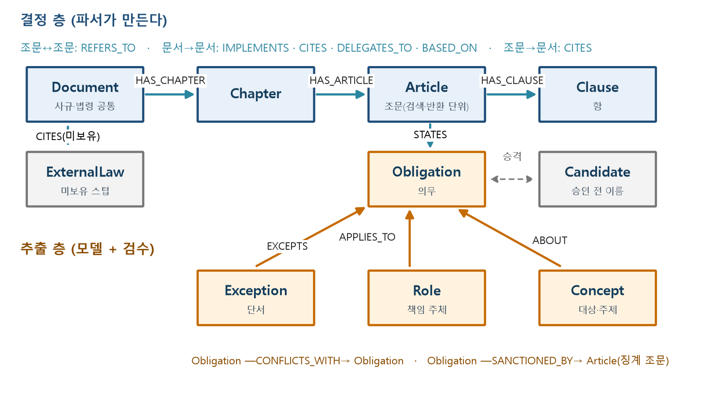
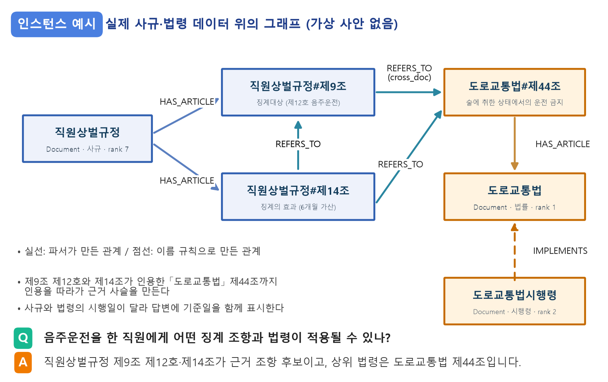

# 도메인 온톨로지 설계서

IBK기업은행 사규와 상위 국가 법령을 잇는 규정 준수 검토 서비스의 도메인 온톨로지

※ 수치와 사례는 data/ 폴더의 실제 데이터를 직접 읽어 계산·인용한 값입니다. 가상 사안은 쓰지 않았습니다. 클래스·관계는 샘플 적재 후 바뀔 수 있는 설계 가설이며, 시행착오·적재는 동료가 담당합니다.

| 관리 항목 | 팀 작성 내용 |
|---|---|
| 프로젝트/팀 | 사규 준수 검토 서비스(가칭) / 2팀 |
| 작성자·검토자 | [팀원] / [강사·멘토] |
| 작성일·버전 | 2026-11-17 / v0.1 |
| 연계 일정 | 2주차 (2026.11.23.~11.27.) |
| 저장소·증빙 | https://github.com/encore-ai-campus/mle-01-final-team2 / docs/ONTOLOGY_DESIGN.md(상세 설계), docs/diagrams/, data/상위법령_변환/, sample_data/ |
| 문서 상태 | ■ 초안  □ 검토  □ 보완  □ 승인 |

## 1. 설계 목적 및 도메인 경계

목적: 기업 규정(사규)과 그 상위 법령을 문서·조문·참조·위임·단서·의무 단위의 지식그래프로 구조화하여, 근거 조문과 인용 경로가 있는 질의응답과 다단계(Multi-hop) 관계 추론을 지원한다. 사원 모드(행동이 규정에 어긋나는지)와 인사 모드(사안이 어떤 조항에 해당할 수 있는지)가 같은 온톨로지를 쓴다.

| 구분 | 팀 작성 | 근거·비고 |
|---|---|---|
| 도메인 | IBK기업은행 사규(ALIO 공개 148종)와 그 상위 국가 법령(275건)의 규정 준수 검토 | ALIO 공개 데이터를 쓰는 교육 프로젝트이며 실제 IBK 시스템이 아님 |
| 대상 사용자 | 일반·신입 사원(사원 모드), 인사과 직원(인사 모드), 관리자(인사 역할 지정·추출 검수) | 기획서 §3 |
| 포함 범위 | 문서·장·조·항 구조, 조문 참조·문서 인용·위임·단서, 시행령→법률 상하위, 의무·예외·주체·주제 추출(핵심 16개 문서), 징계·절차 규정 연계, 기준일 | 구조는 148종 전체, 의미 추출은 핵심 문서부터 |
| 제외 범위 | 직원 데이터 연계 자동 탐지, 개정 이력 비교, 별표(금액표 등) 수치 판정, 법적 판단·징계 결정, 실제 신고·결재 실행 | 별표는 수집하지 않음 |
| 핵심 데이터 | 사규 148종(조문 3,532), 상위 법령 275건(조문 25,945), 법령 인용 집계·약칭 목록 | §3 참조 |
| 운영 제약 | 인사 모드는 역할 접근·감사 로그·사안 비저장, 답변에 사규·법령 기준일 표시, 시행 예정 법령 4건 경고, 임베딩·Aura 한도 미확인 | 상세 설계서 §10, §12 |

## 2. 핵심 업무 질문(Competency Questions, CQ)

작성 원칙: 각 CQ는 그래프 경로·필요 엔터티·검증 가능한 기대 답변과 연결한다. CQ-15·16은 인사 모드용이며 평가용 CQ는 학습에서 제외한다.

| CQ ID | 업무 질문 예시 | 필요 경로/검증 |
|---|---|---|
| CQ-01 | 이 조문이 인용하는 규정·법령은? | Article→[REFERS_TO\|CITES]→Article/Document |
| CQ-02 | 이 조문의 세부를 정하는 세칙(위임 대상)은? | Article→DELEGATES_TO→Document |
| CQ-03 | 단서(예외)가 있는 조문과 그 예외 내용은? | Article→STATES→Obligation←EXCEPTS←Exception |
| CQ-04 | 이 법령을 근거로 만든 사규는? | Document←[BASED_ON\|CITES]←Article/Document |
| CQ-05 | 같은 주제의 의무 중 가장 엄격한 것은? | Obligation→ABOUT→Concept, 기한·수치 비교 |
| CQ-06 | 특정 역할(예: 인사부장)이 지는 의무 전체는? | Role←APPLIES_TO←Obligation |
| CQ-07 | 사규의 기한이 상위 규정보다 완화된 의무는? | Obligation-CONFLICTS_WITH-Obligation, authority_rank 비교 |
| CQ-08 | 가장 많이 인용되는 문서·조문은? | REFERS_TO·CITES 중심성(GDS 또는 NetworkX) |
| CQ-09 | 인용 사슬이 코퍼스 밖에서 끊기는(미보유) 지점은? | ExternalLaw{resolved=false}, 근거 없음 감지 |
| CQ-10 | 삭제된 조문을 아직 참조하는 조문은? | Article{deleted}←REFERS_TO←Article |
| CQ-11 | 사규 조문의 근거가 되는 법령 조문은? | Article-REFERS_TO{cross_doc}→Article(법령) |
| CQ-12 | 이 법률 조문을 구체화한 시행령 조문은? | Document-IMPLEMENTS→Document, REFERS_TO{rule_parent} |
| CQ-13 | 이 법률을 근거로 한 사규 전부는? | 법령 Document←CITES←Article←HAS_ARTICLE←사규 Document |
| CQ-14 | 이 조문의 기준 시점은? 최신 법령과 시점 차이가 큰가? | Document.effective_date, date_missing |
| CQ-15 | (인사) 이 의무를 위반하면 적용되는 징계 조항은? | Obligation→SANCTIONED_BY→Article(징계 조문) |
| CQ-16 | (인사) 이 사안이 해당할 수 있는 조항 후보와 충족해야 할 요건은? | Concept←ABOUT←Obligation{conditions[]}, 검색 + 그래프 확장 |

## 3. 원천 데이터 및 도메인 용어집

| 데이터 ID | 유형·출처 | 품질 점검 | 권한/라이선스 |
|---|---|---|---|
| SRC-01 | IBK 사규 148종(HWP 140, PDF 8), ALIO 공개. 조 3,532(삭제 127), 항 6,878 | 개정일 형식 불일치(YYYY-MM 22건, 없음 17건), 미해결 참조 323건, 코퍼스 밖 인용 다수 | ALIO 공개본, 재배포 전 이용 조건 확인 |
| SRC-02 | 상위 법령 275건(법률 105, 시행령 100, 시행규칙·부령 60, 고시 7, 세칙 3), 법제처 OPEN API 현행본. 조 25,945(삭제 1,832) | 시행일이 수집일 이후인 문서 4건, 별표 미수집, 미해결 참조 31,509건(재해소 필요) | 저작권법 제7조상 보호 대상 아님, API 약관은 공개 전 확인 |
| SRC-03 | 법령 수집 목록·인용 집계(팀_법령수집목록.txt, 상위법령_인용집계.csv, law_collection_list.csv) | 약칭·띄어쓰기 변형 반영 여부 | 내부 작업 파일 |
| SRC-04 | 수집 불가 3건: 금융분야 AI 가이드라인, AI 위험관리 프레임워크, 공공기관 임원 사고책임 강화 가이드라인 | 소관 기관에서 직접 수집 전까지 ExternalLaw 미보유 | 공개 가이드라인, 라이선스 확인 |
| SRC-05 | Hugging Face 법률 학습·평가 데이터(선정 후) | 라이선스, 평가 데이터 오염 점검 | data/DATA_SOURCES.md |

| 용어 | 정의 | 동의어/주의 |
|---|---|---|
| 사규 | 기업 내부 규정(규정·지침·세칙·운용기준 등) | 법령과 구별(source_kind) |
| 조문(Article) | 규정의 `제N조` 단위. 검색·반환 단위 | 삭제·이동 조문은 deleted=true |
| 단서(Exception) | “다만 ~인 경우는 제외” 같은 예외 조항 | 후보 문장은 경계가 거칠어 모델 정제 필요 |
| 위임 | 세부 사항을 다른 규정이나 시행령에서 정하도록 넘기는 조항 | 단순 인용(CITES)과 구별 |
| 인용 | 조문 참조(REFERS_TO)와 문서 인용(CITES) | 「법」·「영」 약칭은 모법·시행령으로 재해소 |
| 의무(Obligation) | 조문이 규정한 해야 할 일·하지 말아야 할 일(MUST·MUST_NOT·MAY) | 해석으로 도출한 의무는 제외 |
| 위계(authority_rank) | 법률 1 … 사규 세칙·지침 8의 단일 척도 | 법령 level과 사규 level_rank를 통일한 값 |
| 미보유(ExternalLaw) | 코퍼스에 없는 인용 대상 스텁 | 답변에 “미보유 문서”로 표시 |
| 기준일 | 문서의 시행·개정 시점 | 법령은 수집일 현행본, 사규는 개정본이 섞임 |

EDA 요약(설계서 §2): 유효 조문 3,405개 중 수치·기한 포함 644개(18%), “다만” 단서 포함 608개(17%). 문서 간 고유 인용 쌍 155개, 91개 문서가 하나의 연결 덩어리이고 인용·피인용이 없는 고립 문서가 45개다. 법령 쪽 조문 길이는 중앙값 289자에 최대 23,622자로 길이가 크게 퍼져 있다.

## 4. 온톨로지 개념 모델 및 시각화

아래 그래프는 개념 모델과 실제 데이터 위의 인스턴스 예시입니다. 실제 노드·관계와 방향은 샘플 적재 후 팀과 도메인 전문가 검토로 확정합니다. 결정 층은 파서가 만들고, 추출 층은 모델 추출 후 검수를 거쳐 적재합니다.





| 클래스 | 식별자(예) | 핵심 속성 | 예시 |
|---|---|---|---|
| Document | doc_id | title, source_kind, doc_type, authority_rank, effective_date, law_id, aliases | 직원상벌규정, 도로교통법 |
| Chapter | id | no, title, kind(편·장·절) | 은행법#제5장 |
| Article | id | no, title, text, deleted, source_kind, authority_rank, embedding | 직원상벌규정#제9조 |
| Clause | id | no, text, article_id | 직원상벌규정#제14조#1 |
| ExternalLaw | id (ext:…) | name, norm_name, kind, resolved=false, collect_status, cited_by_count | ext:민원업무처리기준 |
| Obligation | id (ob:…) | modality, action, conditions[], deadline, threshold, evidence_text, review_status | ob:직원상벌규정#제2조:1 |
| Exception | id (ex:…) | text, condition, evidence_text | ex:직원상벌규정#제2조:1 |
| Role / Concept | id (role:… / con:…) | name, aliases[] (Concept는 kind) | role:인사부장, con:음주운전 |
| Candidate | name | type_guess, source_article_id (승인 전 격리) | — |

## 5. 관계 정의 및 카디널리티

| 관계 타입 | 시작→끝 | 의미 | 카디널리티/제약 |
|---|---|---|---|
| HAS_CHAPTER | Document→Chapter | 문서의 장 구성 | 1:N, 결정 층 |
| HAS_ARTICLE | Chapter→Article (장 없으면 Document→Article) | 장·문서에 속한 조문 | N:1, 결정 층 |
| HAS_CLAUSE | Article→Clause | 조문의 항 | 1:N, 호·목은 노드 아님 |
| REFERS_TO | Article→Article | 조문 참조(문서 내·문서 간) | N:M, resolution·cross_doc, 삭제 조문 참조 점검 |
| CITES | Article→Document \| ExternalLaw | 문서 수준 인용, 코퍼스 밖은 스텁 | N:M, target_article, 근거 필수 |
| IMPLEMENTS | Document→Document | 시행령·시행규칙이 모법을 구체화 | N:1, 이름 규칙(157/157 확인) |
| DELEGATES_TO | Article→Document | 세부를 다른 문서에 위임 | N:M, kind·evidence, 사규 위임은 검수 |
| BASED_ON | Document→Document \| ExternalLaw | 제정 근거 | N:M, evidence |
| STATES | Article→Obligation | 조문이 직접 기술한 의무 | 1:N, evidence_text 필수 |
| EXCEPTS | Exception→Obligation | 단서가 의무를 면제·완화 | N:1 |
| APPLIES_TO | Obligation→Role | 이행 책임 주체 | N:M |
| ABOUT | Obligation→Concept | 의무의 대상·주제 | N:M |
| CONFLICTS_WITH | Obligation→Obligation | 같은 대상에 상충하는 값 | N:M, authority_rank가 다른 쌍만 |
| SANCTIONED_BY | Obligation→Article | 위반 시 징계·제재 조항(후보) | N:M, 사규에 명시된 경우만 |
| RESOLVED_AS | ExternalLaw→Document | 스텁이 문서로 해소된 기록(운영용) | 1:1 |

설계 규칙: 관계 방향은 일관되게 유지하고(하위·인용하는 쪽 → 상위·인용되는 쪽), 시점은 Document.effective_date로 표시한다(valid_from/valid_to는 개정 이력 비교가 범위 밖이라 두지 않는다). 동의어·약칭은 Document.aliases와 data/ontology/aliases.csv에 보관한다. 추출 관계에는 evidence·source_doc_id·evidence_level·batch_id·claim_id·review_status를 붙인다.

## 6. S-P-O 트리플과 출처 문장 매핑

| ID | Subject — Predicate — Object | 근거 문장(원문) | 출처 |
|---|---|---|---|
| T-01 | 직원상벌규정#제9조 — REFERS_TO — 도로교통법#제44조 | “「도로교통법」제44조 제1항을 위반한 음주운전 행위자” | 직원상벌규정 제9조 제12호 |
| T-02 | 직원상벌규정#제14조 — REFERS_TO — 도로교통법#제44조 | “「도로교통법」제44조 제1항을 위반한 음주운전 또는 같은 조 제2항을 위반한 음주측정 불응행위” | 직원상벌규정 제14조 ① |
| T-03 | 직원상벌규정#제14조 — REFERS_TO — 직원상벌규정#제9조 | “제9조제10호에 해당하여 징계처분을 받은 자는” | 직원상벌규정 제14조 ③ |
| T-04 | 직원상벌규정#제9조 — CITES — 성폭력범죄의처벌등에관한특례법 | “「성폭력범죄의처벌등에관한특례법」에 따른 성폭력 행위자” | 직원상벌규정 제9조 제8호 |
| T-05 | 도로교통법시행령 — IMPLEMENTS — 도로교통법 | (이름 규칙: 문서 제목에서 “시행령” 제거 후 일치) | 법령 doc.title |
| T-06 | ex:직원상벌규정#제2조:1 — EXCEPTS — ob:직원상벌규정#제2조:1 | “다만, 포상중 종합근무평정에 가점평정하지 않는 은행장표창과 격려상 및 부점장포상은 인사위원회의 의결을 거치지 아니한다.”(의무: “직원의 상벌은 인사위원회의 의결을 거쳐 은행장이 결정한다.”) | 직원상벌규정 제2조 (예시, staged) |

필수 필드: triple_id(claim_id), subject_id, predicate, object_id, source_id(source_doc_id), source_span(evidence), extraction_method(parser/rule/model), extraction_model, confidence, review_status(staged/approved/rejected). T-01~T-05는 파서·이름 규칙으로 만드는 결정 층이고 T-06은 모델 추출 + 검수 대상의 예시다. 신뢰도 점수는 자동 추출의 보조값이며 사실 검증을 대신하지 않는다.

## 7. Multi-hop 추론 시나리오

질문 예시: “음주운전을 한 직원에게 어떤 징계 조항과 법령이 적용될 수 있나?” (인사 모드, 가상의 사안이 아닌 규정 질의)

경로: (직원상벌규정#제9조 제12호) —[:REFERS_TO]→ (도로교통법#제44조) ← 도로교통법시행령 [:IMPLEMENTS]. 징계의 효과는 (직원상벌규정#제14조) —[:REFERS_TO]→ (직원상벌규정#제9조)로 따라간다. 답변은 “근거 조항 후보”로 제시하고 각 조문의 개정 시점을 함께 보여야 한다.

검증 기준: 관계 경로 존재, 각 간선의 근거 추적 가능, 기준일 표시(직원상벌규정 2023-12 개정본, 도로교통법 시행일 2027-04-14 — 수집일 이후 시행 예정 조항을 포함할 수 있음), 사용자 권한 충족(인사 모드), 근거 없으면 보류. 징계 수위는 [별표 3]에 있고 별표는 수집하지 않았으므로 구체 수위는 `판단 불가`로 두고 별표 확인을 안내한다.

## 8. Neo4j 물리 모델 매핑 예시

개념 온톨로지와 Neo4j 속성 그래프는 같은 표현이 아니다. 아래는 구현 매핑 초안이며 실행해 검증하지 않았다(적재·검증은 동료가 수행). 전체 규칙은 docs/ONTOLOGY_DESIGN.md를 따른다.

```cypher
// 제약: 적재 전에 먼저 건다
CREATE CONSTRAINT doc_id     IF NOT EXISTS FOR (d:Document)    REQUIRE d.doc_id IS UNIQUE;
CREATE CONSTRAINT article_id IF NOT EXISTS FOR (a:Article)     REQUIRE a.id IS UNIQUE;
CREATE CONSTRAINT law_norm   IF NOT EXISTS FOR (l:ExternalLaw) REQUIRE l.norm_name IS UNIQUE;

// 구조 층 예시: 사규 조문이 법령 조문을 인용
MERGE (d1:Document {doc_id:'직원상벌규정'})
  SET d1.title='직원상벌규정', d1.source_kind='internal', d1.authority_rank=7, d1.effective_date='2023-12';
MERGE (d2:Document {doc_id:'도로교통법'})
  SET d2.title='도로교통법', d2.source_kind='law', d2.authority_rank=1, d2.effective_date='2027-04-14';
MERGE (a1:Article {id:'직원상벌규정#제9조'}) SET a1.no='제9조', a1.title='징계대상', a1.deleted=false;
MERGE (a2:Article {id:'도로교통법#제44조'})  SET a2.no='제44조', a2.title='술에 취한 상태에서의 운전 금지', a2.deleted=false;
MERGE (d1)-[:HAS_ARTICLE]->(a1);
MERGE (d2)-[:HAS_ARTICLE]->(a2);
MERGE (a1)-[r:REFERS_TO]->(a2)
  SET r.cross_doc=true, r.resolution='named_article', r.source_doc_id='직원상벌규정';
MERGE (a1)-[:CITES {target_article:'제44조', resolution:'exact_name'}]->(d2);

// 질의 예시: 인용 사슬 최대 3홉
MATCH p = (a:Article {id:'직원상벌규정#제14조'})-[:REFERS_TO*1..3]->(t:Article)
RETURN p;
```

## 9. 품질 검증·논리 일관성·변경 관리

| 검증 ID | 검증 내용 | 인수 조건 | 결과/증빙 |
|---|---|---|---|
| VAL-01 | 필수 ID 누락 | 필수 식별자(doc_id, id, authority_rank) NULL 0건 | [적재 후 기록] |
| VAL-02 | 고아 노드·잘못된 참조 | 어느 문서에도 속하지 않는 조문 0건, 삭제 조문을 가리키는 참조는 점검 목록으로 관리 | [ ] |
| VAL-03 | 금지 관계/방향 | 시그니처 위반 0건, IMPLEMENTS 방향 오류 0건, 자기 참조 0건 | [ ] |
| VAL-04 | 중복 엔터티·동의어 | ExternalLaw와 Document 이름 중복 0건, 다중 해소 약칭은 Candidate 격리 | [ ] |
| VAL-05 | 근거 출처 연결 | 추출 관계 100% evidence 보유(없으면 적재 금지) | [ ] |
| VAL-06 | CQ 16개 답변 가능성 | 각 CQ별 Cypher 작성, 기대 답 통과(합격 기준은 결과를 보기 전에 팀이 정함) | [ ] |
| VAL-07 | 인용 해소율 | 아래 기준값 재현·개선, 미해결 재해소 후 assumed_same_doc 비율 기록 | [ ] |
| VAL-08 | 기준일·권한 | 답변에 기준일 표시, 시행 예정 법령 4건 경고, 인사 모드 비인가 접근 차단 | [ ] |
| VAL-09 | 멱등성 | 같은 적재를 2회 실행해 노드·관계 건수와 embed_hash 동일 | [ ] |
| VAL-10 | 임베딩 잘림 | 후보 모델별 잘림 비율 측정, 1% 초과 시 항 단위 분할 | [ ] |

품질 지표 예시: Entity Precision/Recall, Relation Precision/Recall, 출처 추적률, CQ 충족률, 인용 해소율. 목표값은 샘플 적재 후 팀이 확정한다. 현재 기준값(2026-11-17 실측): 사규→사규 문서 연결 293/1,012(29%), 사규→법령 정식명칭 일치 417/1,012(41%), 조 번호 지정 인용 대상 존재 97/104(93%), 시행령·시행규칙→모법 이름 규칙 157/157, 사규 미해결 참조 323건, 법령 미해결 참조 31,509건.

## 10. 작성·제출 체크리스트

- □ 도메인 범위·이해관계자·제외 범위 정의
- □ CQ 10개 이상 및 각 질문의 그래프 경로
- □ 데이터 출처·라이선스·접근권한·EDA
- □ 엔터티 클래스·식별자·속성·예시
- □ 관계 타입·방향·카디널리티·유효기간
- □ 동의어·상하위·예외·개인정보 처리
- □ S-P-O 5개 이상과 출처 문장 매핑
- □ Multi-hop 추론 사례 및 근거 추적
- □ 금지 관계·논리 일관성·필수 속성 검증
- □ Neo4j 매핑·제약조건 및 다음 산출물 연계
- □ 온톨로지 버전·검토자·변경 이력·승인

## 11. 검토·수정 이력

| 일자 | 버전 | 검토자 | 지적사항 | 조치/증빙 | 승인 |
|---|---|---|---|---|---|
| 2026-11-17 | v0.1 | [ ] | [ ] | 초안 작성(docs/ONTOLOGY_DESIGN.md를 양식에 맞춰 정리) | □ |
| [ ] | v0.2 | [ ] | [ ] | [ ] | □ |

제출 파일 예시: ontology_design.docx(본 문서), docs/diagrams/ontology_concept.png, docs/diagrams/ontology_instance.png, docs/ONTOLOGY_DESIGN.md. entities.csv·relationships.csv·cq_tests.xlsx·schema.cypher·evidence_manifest.csv는 동료의 시행착오·적재 단계에서 생성한다.
