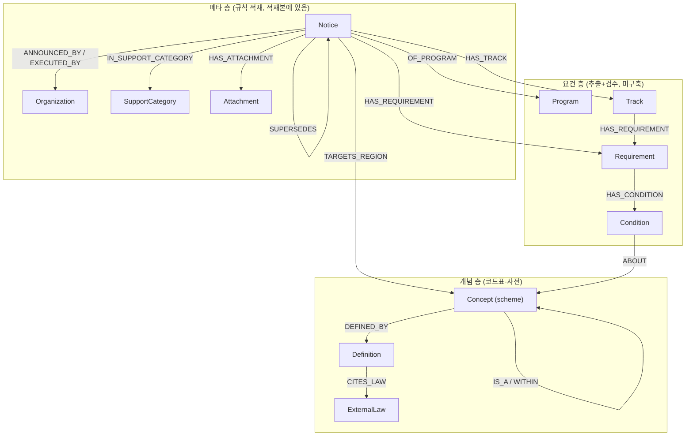

# 도메인 온톨로지 설계서

정부지원사업 공고의 요건을 계층 온톨로지로 정규화하고, Multi-hop 추론으로 신청 자격을 판정하는 지식 그래프 서비스의 도메인 온톨로지

※ 수치는 동료가 변환한 공고 90건(`neo4j_import.json`, `supabase_public_notice_chunks.json`)을 직접 읽어 센 값입니다. 요건·조건 정규화 예시는 본문을 손으로 읽은 **검수 전 가설**이며, 법령 기준은 원문을 확인하지 않았습니다. 클래스·관계는 샘플 적재 후 바뀔 수 있는 설계 가설입니다. 가상의 사용자 입력은 "가상"으로 표시했습니다.

| 관리 항목 | 팀 작성 내용 |
|---|---|
| 프로젝트/팀 | 정부지원사업 신청 자격 판정 서비스(가칭) / 2팀 |
| 작성자·검토자 | [팀원] / [강사·멘토] |
| 작성일·버전 | 2026-11-23 / v0.1 |
| 연계 일정 | 2주차 (2026.11.23.~11.27.) |
| 저장소·증빙 | https://github.com/encore-ai-campus/mle-01-final-team2 / docs/plan/MLE_2팀_기초 설계.md §4(상세 설계), docs/SAMPLE_그래프관계_분석.md, docs/REVIEW_적재데이터_v2_점검결과.md |
| 문서 상태 | ■ 초안 □ 검토 □ 보완 □ 승인 |

## 1. 설계 목적 및 도메인 경계

목적: 기업마당·K-Startup 등 여러 포털에 흩어진 지원사업 공고의 **신청 요건**을 요건·조건·개념 단위로 구조화하고, 개념 사이의 상하·포함 관계(IS_A·WITHIN)와 용어 정의→법령 연결을 따라가며 "내 조건으로 이 공고에 신청할 수 있는가"를 **신청 가능 / 신청 불가 / 확인 필요**로 판정한다. 판정은 규칙 평가기(코드)가 하고 모델은 요건 추출과 설명만 맡는다. 모든 요건에는 원문 문장과 출처를 붙인다.

| 구분 | 팀 작성 | 근거·비고 |
|---|---|---|
| 도메인 | 공개 API로 얻는 정부·지자체·공공기관 지원사업 공고의 신청 자격 판정 | 교육 프로젝트이며 실제 신청·접수 시스템이 아님. 판정은 참고용 |
| 대상 사용자 | 창업자·소상공인·중소기업(조건을 입력하는 신청 희망자), 관리자(요건 추출 검수) | 기초 설계서 §1 |
| 포함 범위 | 공고 메타(기관·분야·지역·첨부·버전), 요건·조건 정규화(자격·제외·우대·서류·한도·평가), 개념 계층(지역·업종·신청자 유형 등), 트랙, 용어 정의→법령 연결(P1), 정정·재공고 관계 | 메타 층은 90건 전체, 요건 층은 기업마당·K-Startup 60건에서 시작 |
| 제외 범위 | 사업계획서 작성, 신청 대행, 선정 가능성 예측, 법적·세무 자문, 개인 식별 정보 기반 판정, 나라장터 입찰 공고의 자격 판정, 첨부 본문 추출(이용 조건 확인 전) | 나라장터 자격은 첨부에 있음(SAMPLE F13). 구조화 자격 필드가 비어 있어 요건 층에서 뺀다 |
| 핵심 데이터 | 공고 90건(기업마당 30, K-Startup 30, 나라장터 30), 행정구역 코드표(행정안전부 `jscode20260701`), 관계 1,100건 | §3 |
| 운영 제약 | 모든 결과에 공고 출처·수집 시각·원문 링크·참고용 면책 표시(MR-N1, N2), 개인 식별 정보 비저장, 이용 조건 확인 전 첨부 다운로드 금지 | 기초 설계서 §9 |

**두 층 구조.** 이 온톨로지는 두 층으로 나뉜다.

| 층 | 내용 | 생성 방법 | 그래프의 필요성 |
|---|---|---|---|
| 메타 층 | `Notice`, `Organization`, 지원 분야, 지역, 첨부, 버전 | API 구조화 필드에서 규칙으로 생성 | **근거가 되지 못한다.** SQL 테이블과 같은 모양이라 같은 질의를 SQL로 풀 수 있다 |
| 요건 층 | `Requirement`, `Condition`, `Concept` 계층, `Definition`, `ExternalLaw`, `Track` | 본문 텍스트 추출(모델+규칙)과 검수 | 가설. 개념 계층 확장과 정의→법령 연결에서 이점이 나올 수 있으나 **현재 표본으로 증명하지 못했다** |

이 구분을 문서 전체에서 유지한다. 메타 층이 잘 적재됐다는 사실이 요건 층의 필요성을 증명하지 않는다(상세: ONTOLOGY_NECESSITY.md).

## 2. 핵심 업무 질문(Competency Questions, CQ)

작성 원칙: 각 CQ는 그래프 경로, 필요 엔터티, 기대 답과 연결한다. 평가용 CQ는 학습에서 제외한다. "SQL 대비" 칸은 **SQL(재귀 쿼리 포함)로도 풀 수 있는지에 대한 현재의 판단**이며, 측정 전 가설이다(KPI N-07에서 질문 유형별로 비교한다).

| CQ ID | 업무 질문 예시 | 유형 | 필요 경로/검증 | SQL 대비 |
|---|---|---|---|---|
| CQ-01 | 서울 성동구 사업장이 신청할 수 있는 지역 요건 공고 후보는? | A | (Concept 성동구)-[:WITHIN*1..3]→(Concept)←ABOUT←Condition←…←Notice | 재귀 쿼리로 가능 |
| CQ-02 | 이 공고의 자격·제외·우대 요건과 원문 문장은? | A | Notice→HAS_REQUIREMENT→Requirement{kind, source_sentence} | 동일 |
| CQ-03 | (업력 2년, 대표 만 35세, 구미시 소재) 프로필이 이 공고에 신청 가능한가? | B | Notice→(Track)→Requirement→Condition, 3값 평가·합성 | 규칙 평가기 필요, 질의만으로는 불가 |
| CQ-04 | "광주광역시 관내" 요건에 광주 남구 사업장이 충족되는가? | C | (남구)-[:WITHIN]→(광주(구))-[:WITHIN]→(전남광주통합특별시) | 계층 데이터가 있으면 가능. 행정개편 처리가 핵심(§7) |
| CQ-05 | 이 공고의 "중소기업"은 어떤 법령 기준이며 사용자는 해당하는가? | C | Concept→DEFINED_BY→Definition→CITES_LAW→ExternalLaw | 정의·법령 데이터가 있어야 가능(미구축) |
| CQ-06 | 정의→법령 연결이 끊긴(`CHAIN_BROKEN`) 요건이 있는 공고는? | C | Definition, ExternalLaw.text_hash | 동일 |
| CQ-07 | 이 공고는 왜 신청이 안 되는가? 어떤 조건이 부족한가? | D | 평가 결과의 `UNSATISFIED`·`UNKNOWN` 조건 추적 | 평가기 필요 |
| CQ-08 | 이 공고가 정정·재공고된 것인가? 이전 버전과 달라진 요건은? | E | Notice-[:SUPERSEDES*1..5]→Notice, content_hash | 동일 |
| CQ-09 | 두 포털에 중복 게재된 같은 사업은? (P1) | E | Notice-[:SAME_AS]-Notice | 동일 |
| CQ-10 | 대상(트랙)별로 조건이 다른 공고는? | A | Notice→HAS_TRACK→Track | 동일 |
| CQ-11 | 요건을 읽지 못한(`unparsed`) 공고와 첨부를 읽지 못한 공고는? | A | Requirement.status, Attachment.text_status | 동일 |
| CQ-12 | N개 중 k개 충족(`AT_LEAST`)이거나 목록이 "등"으로 열려 있는(`open_ended`) 요건의 공고는? | A | Requirement.logic, open_ended | 동일 |
| CQ-13 | 구조화 필드와 본문이 충돌하는(`source_conflict`) 공고는? | A | Condition.source_conflict | 동일 |
| CQ-14 | 기준일이 서로 다른 조건(공고일·마감일·전년도)을 가진 공고는? | A | Condition.ref_date_kind | 동일 |
| CQ-15 | 특정 법령 조항의 원문이 바뀌면 영향받는 공고는? (P1) | C | ExternalLaw.text_hash←CITES_LAW←Definition←DEFINED_BY←Concept←ABOUT←Condition | 정의·법령 데이터가 있어야 가능. 경로 길이 7로 SQL은 조인 증가 |
| CQ-16 | 사용자가 입력하지 않아 `UNKNOWN`이 되는 속성 중 무엇을 물으면 후보가 가장 줄어드나? (P1) | D | Condition.attribute 집계, 평가 결과 | 평가기 필요 |

표의 "동일"로 표시한 CQ가 16개 중 9개(CQ-02, 06, 08~14)다. 그래프가 필요하다는 주장이 가능한 곳은 계층 확장(CQ-01, 04)과 정의→법령 경로(CQ-05, 15)이며, 이 부분이 §9의 SQL 베이스라인 비교 대상이다.

## 3. 원천 데이터 및 도메인 용어집

| 데이터 ID | 유형·출처 | 규모·품질 점검 | 권한/라이선스 |
|---|---|---|---|
| SRC-01 | 기업마당 지원사업정보 API (`bizinfo_30.json`, 원본 `bizinfo_30_raw.json`) | 30건(등록일 3구간 10건씩 층화 무작위). 자격 문구는 `bsnsSumryCn`의 첫 `☞` 항목, 대상명 `trgetNm`은 중소기업 21·창업벤처 6·소상공인 3으로 거칠다. 마감 날짜 11건, 상시·예산 소진 등 19건. **지역 30건이 모두 `전국`으로 연결돼 오류**(REVIEW v2 §3-1) | 이용허락 확인 필요 |
| SRC-02 | K-Startup 조회 서비스 API (`kstartup_30.json`) | 30건. 업력(`biz_enyy`: 예비창업자·1~10년미만)·연령(`biz_trgt_age` 3구간)·지역(`supt_regin`)이 값이 제한된 필드로 제공. 후보가 10,000건에서 잘린 표본(manifest) | 이용허락범위 제한 없음(명세) |
| SRC-03 | 나라장터 입찰공고 API (`g2b_30.json`) | 30건, 최근 일주일 1~6페이지(층화 없음). 구조화 자격 필드 공란, 자격은 첨부에 있음. 요건 층 제외 | 공공데이터포털 |
| SRC-04 | 행정구역 코드표 `jscode20260701`(행정안전부 행정표준코드) | 시도 16, 시군구 217, 전국 1 = `Region` 234개. 2026-07 개편 반영: 광주·전남이 `전남광주통합특별시`(코드 1200000000)로 통합 | 공공 데이터 |
| SRC-05 | 법령 원문(중소기업기본법 등) | **미수집.** 정의→법령 연결은 P1이며 표본 공고가 인용한 법령부터 수집 | 법제처 API 이용 조건 확인 전 |
| SRC-06 | 수집 메타(`sample_manifest.json`, `PUBLIC_NOTICE_GRAPH_RULES.md`) | 호출 조건·시드·구간별 후보 수 기록 | 내부 파일 |

**적재본 점검 요약**(상세는 REVIEW_적재데이터_v2_점검결과.md): 공고 90건의 `notice_id`·`raw_hash`가 두 파일에서 일치하고, 관계 1,100건에 없는 대상 참조와 중복이 0건이다. 남은 문제는 기업마당 지역 오분류, `직접수행` 기관 노드, 태그 오염, 직함 미제거, 첨부 `@` 결합이다.

**요건 층 입력의 크기.** 기업마당·K-Startup 60건의 자격 문구(`eligibility_criteria_text`)는 평균 64자이고 20자 미만이 11건이다. 문구에 나타나는 표현을 정규식으로 센 **근사치**(중복 가능, 오탐 포함)는 업력·창업 연수 표현 16건, 소재·관내·거주·본사 등 지역 표현 17건, 제외·제한 표현 8건, 인증·확인서·등록 표현 10건, 「」 법령 인용 4건이다. 즉 자격 요건이 짧은 문장에 몰려 있고, 법령을 직접 인용한 공고는 적다. 이 수치는 정규화 난이도와 정의→법령 연결의 필요 범위를 가늠하는 용도이며 정확도 지표가 아니다.

| 용어 | 정의 | 동의어/주의 |
|---|---|---|
| 공고(Notice) | 한 포털이 한 시점에 게시한 지원사업 공고 한 건. 새 버전은 별도 노드 | 나라장터는 차수까지 ID에 포함 |
| 사업(Program) | 여러 공고·지자체별 공고가 속하는 상위 사업 | 남해·창녕 청년어촌정착처럼 같은 사업의 지자체별 공고(근거가 파일명뿐이라 확인 필요) |
| 트랙(Track) | 대상별로 조건·지원 규모가 다른 하위 구분 | "농업법인은 …" 같은 대상별 추가 조건 |
| 요건(Requirement) | 공고가 요구하는 하나의 묶음. `kind`로 자격·제외·우대·서류·한도·평가 구분 | 판정에는 자격·제외만 쓴다 |
| 조건(Condition) | 요건을 이루는 원자 조건(속성·연산자·값) | "업력 7년 이내" = `business_age LTE 7` |
| 개념(Concept) | 코드표·사전의 값(지역·업종·신청자 유형 등). `scheme`으로 구분 | 부분 문자열 일치 금지 |
| 정의(Definition) | 법령·제도가 정한 용어의 판정 기준 | 법령 내용은 원문 확인 후 기록 |
| 3값 판정 | 조건별 `SATISFIED`/`UNSATISFIED`/`UNKNOWN`, 공고별 `ELIGIBLE`/`NOT_ELIGIBLE`/`NEEDS_CHECK` | `UNKNOWN`을 충족으로 취급하지 않는다 |
| 업력 | 창업(설립) 후 경과 기간. 기준일이 공고일·마감일·신청일로 다양 | `ref_date_kind`로 구분 |
| 열린 목록(`open_ended`) | 본문이 "등"으로 끝나 전체를 알 수 없는 열거 | `ELIGIBLE`을 막는다 |
| 근거 사슬 | 조건→개념→정의→법령으로 이어지는 경로 | 끊기면 `CHAIN_BROKEN` |

## 4. 온톨로지 개념 모델 및 시각화

아래 그림은 개념 모델이다. 메타 층(위)은 코드로 적재되고, 요건 층(아래)은 모델 추출 후 검수를 거쳐 적재한다. 개념 계층(`Concept`)은 코드표와 사전에서 결정적으로 만든다.



### 4.1 클래스

| 클래스 | 식별자(예) | 핵심 속성 | 상태·예시 |
|---|---|---|---|
| Notice | notice_id | source_system, source_id, notice_kind, title, summary, deadline_at, deadline_raw, version, is_latest, fetched_at, content_hash, raw_hash, detail_url | **적재됨**(90건). `BIZINFO:PBLN_000000000117491`, `KSTARTUP:171677`, `G2B:R26BK01834504:001`. 적재본의 레이블은 `PublicNotice`(§5.1 결정 필요) |
| Organization | org_id | name, normalized_name, source_org_code, role_title(미반영), org_kind(제안) | **적재됨**(111). `직접수행`·직함 포함 이름 정리 필요 |
| SupportCategory | category_id | name, level(major/medium/source_label) | **적재됨**(35). 기업마당 대 8·중 16, K-Startup 11 |
| Attachment | attachment_id | file_name, file_extension, source_field, source_url, usable(제안), text_status(제안) | **적재됨**(185). 기업마당 `@` 결합 9건 정리 필요 |
| Tag | tag_id | name | **적재됨**(227). 정리 대상(§5.3) |
| Region → Concept(scheme=REGION) | region_id | name, level, region_code, parent_region_id, code_source, code_version | **적재됨**(234). 개념 계층과 합치는 방안은 §5.1 |
| Program | program_id | name, level | 미구축 |
| Track | track_id | name, benefit_summary, benefit_limit | 미구축 |
| Requirement | req_id | kind, logic(AND/OR/NONE_OF/AT_LEAST), min_count, logic_basis, source_sentence, status, extraction_run_id | 미구축. 입력은 `eligibility_criteria_text` 등 |
| Condition | cond_id | attribute, operator, value(JSON), unit, ref_date_kind, negate, source_conflict, open_ended, confidence, reviewed | 미구축 |
| Concept | concept_id | scheme, code, label, aliases, code_version | 지역만 적재 |
| Definition | def_id | term, rule_json, basis_note | 미구축(P1) |
| ExternalLaw | law_id | name, article_no, text_hash, source_url | 미구축(P1) |

`ApplicantProfile`(사용자 입력)은 세션 한정이며 그래프에 저장하지 않는다. 미해소 값은 Supabase `review_queue`에 둔다.

### 4.2 개념 scheme과 계층 규칙

| scheme | 구조 | 계층 관계 | 현재 데이터 | 이 표본에서 본 문제 |
|---|---|---|---|---|
| `REGION` | 트리(전국 > 시도 > 시군구) + **중간 묶음 노드 허용** | `WITHIN` | 시도 16·시군구 217·전국 1 적재 | **행정개편**: 광주·전남이 `전남광주통합특별시` 하나로 통합돼 "광주광역시 관내" 같은 과거 표기에 맞는 노드가 없다. `광주(구)`처럼 구 단위 묶음을 중간 개념으로 두는 안이 필요(§7). "경상권" 같은 권역 정의도 같은 방식 |
| `INDUSTRY` | 표준 분류는 트리, 공고용 묶음은 DAG | `IS_A` | 없음 | 공고의 "제조·가공업", "관광업 등록 여행사"는 표준 분류와 1:1이 아니다 |
| `APPLICANT_TYPE` | DAG | `IS_A` | 없음. K-Startup 신청 대상 값(대학생·일반인·일반기업·1인 창조기업·대학·연구기관·청소년) 7종과 업력 값의 "예비창업자"는 확인 | 기업마당 `trgetNm`(중소기업·창업벤처·소상공인)은 거칠어 판정에 쓰지 않는다 |
| `SUPPORT_FIELD` | 1~2단 | `IS_A` | 기업마당 대분류 8·중분류 16, K-Startup 11 | 두 포털의 분류를 통일하는 매핑표 필요 |
| `SPECIAL_GROUP` | DAG | `IS_A` | 없음 | 청년·여성·시니어 등. 연령 기준은 개념이 아니라 `Condition`·`Definition`에 둔다 |
| `ZONE` | DAG | `WITHIN`(→`REGION`) | 없음 | 구역 데이터를 확보하기 전에는 `UNKNOWN` 고정 |

업력(예비창업자·1·2·3·5·7·10년 미만)과 연령(만 20세 미만 / 만 20세 이상 ~ 만 39세 이하 / 만 40세 이상)은 `Concept`가 아니라 `business_age`·`founder_age` 숫자 조건으로 정규화한다. K-Startup의 구간 값은 숫자 범위 사전으로 바꾼다.

계층 규칙(기초 설계서 §4.1 H1~H10 요약): 간선은 하위→상위, 상속은 위로만 최대 3 hop, 사용자 값이 조건보다 상위면 `UNKNOWN`(서로 다른 가지면 `UNSATISFIED`), scheme 사이 간선 금지(예외 `ZONE`→`REGION`), DAG는 순환 금지, 개념 매칭은 코드·정규화 이름·확정 별칭만(부분 일치 금지), 코드표에 버전·기준일을 붙인다. **이번 점검에서 추가한 규칙 후보:** (H11) 행정구역 개편으로 사라진 명칭(광주광역시 등)은 별칭이 아니라 **구 단위 묶음 개념**으로 두고 `code_version`을 기록한다.

### 4.3 판정에 쓰는 속성·연산자·논리

| 항목 | 허용 값 | 비고 |
|---|---|---|
| `Condition.attribute` | region, zone, industry, applicant_type, business_age, founder_age, company_size, revenue, employees, certification, prior_award, registration, other + **제안:** tenure_years, career_years, capital, funding_stage, membership | 제안 5종은 팀 결정(D-4, SAMPLE D1) |
| `Condition.operator` | EQ, LT, LTE, GT, GTE, BETWEEN, IN, WITHIN, IS_A, EXISTS | |
| `Requirement.kind` | ELIGIBILITY, EXCLUSION, PREFERENCE, DOCUMENT, LIMIT, CRITERION | 판정은 ELIGIBILITY·EXCLUSION만 사용. 입주 후 의무는 LIMIT로 통합(제안) |
| `Requirement.logic` | AND, OR, NONE_OF, AT_LEAST(`min_count`) | 명시가 없으면 `logic_basis=assumed`이며 이 요건이 `ELIGIBLE`을 만들면 `NEEDS_CHECK`로 낮춘다 |

3값 결합(AND/OR/NONE_OF/AT_LEAST), 트랙 합성(하나라도 `ELIGIBLE`이면 `ELIGIBLE`, 전부 `NOT_ELIGIBLE`이면 `NOT_ELIGIBLE`, 그 외 `NEEDS_CHECK`), 구조화 필드와 본문 충돌 규칙(본문 우선, `source_conflict` 기록), 목록형 값 해석(전체 구간이면 제한 없음)은 기초 설계서 §4.2를 따른다.

## 5. 관계 정의 및 카디널리티

### 5.1 적재본의 관계와 설계서 이름의 대응

적재본과 설계서가 같은 개념에 다른 이름을 쓴다. **방향이 반대인 쌍이 있어** 판정 규칙(하위→상위 상속)과 직접 충돌한다.

| 의미 | 적재본(1,100건 중) | 설계서(기초 설계서 §4.3) | 차이·제안 |
|---|---|---|---|
| 공고 게시 기관 | `ANNOUNCED_BY` 90, `ORDERED_BY` 30, `EXECUTED_BY` 28 | `PUBLISHES`(owner/operator) | 적재본 이름이 더 구체적이므로 **적재본 기준으로 설계서 수정**(제안) |
| 지역 포함 | `HAS_SUBREGION` 217 (**시도→시군구**) | `WITHIN` (**하위→상위**) | **방향이 반대.** 적재를 `(시군구)-[:WITHIN]->(시도)`로 바꾸고 `HAS_SUBREGION`은 폐기(제안). 두 방향을 함께 두면 중복 간선 |
| 공고 대상 지역 | `TARGETS_REGION` 61 | (`ABOUT` 조건 경로) | 메타 층의 후보 필터용으로 유지. 요건 층의 `Condition-ABOUT->Concept`와 용도를 구분 |
| 분류 계층 | `SUBCATEGORY_OF` 16, `SUBCLASS_OF` 93 | `IS_A` | scheme이 다른 두 분류는 `SUPPORT_FIELD`용 `IS_A`로 통일 가능. 물품분류는 요건 층에서 쓰지 않아 유지해도 무방 |
| 대체 공고 | `SUPERSEDES` 1 (**새→이전**: 001차→000차) | `SUPERSEDES` (새→이전) | 일치 |
| 동일 기관 후보 | `SAME_AS_CANDIDATE` 1 (검토 대기) | (없음, 공고 `SAME_AS`만) | 기관용으로 설계서에 추가 |
| 노드 레이블 | `PublicNotice`, `Region` | `Notice`, `Concept{scheme:REGION}` | `Notice`로 통일하고 `Region`은 `Concept`의 보조 레이블로 병기(제안, §8) |
| 개념 ID | `KR:REGION:{코드}`, `KR:NATIONWIDE` | `{scheme}:{code}` | `KR:` 접두를 빼 `REGION:{코드}`로 통일(제안) |

### 5.2 관계 정의

| 관계 타입 | 시작→끝 | 의미 | 카디널리티/제약 | 층·상태 |
|---|---|---|---|---|
| ANNOUNCED_BY | Notice→Organization | 공고 게시 기관 | N:1, 모든 공고 | 메타, 적재됨 |
| ORDERED_BY | Notice→Organization | 나라장터 수요기관 | N:1 | 메타, 적재됨 |
| EXECUTED_BY | Notice→Organization | 기업마당 수행기관 | N:1, `직접수행`은 관계 제외(제안) | 메타, 적재됨 |
| IN_SUPPORT_CATEGORY | Notice→SupportCategory | 지원 분야 | N:M | 메타, 적재됨 |
| HAS_ATTACHMENT | Notice→Attachment | 첨부 메타 | 1:N | 메타, 적재됨 |
| SUPERSEDES | Notice→Notice | 새 버전이 이전을 대체 | 1:1, 새→이전, 이전은 `is_latest=false` | 메타, 적재됨(나라장터 차수) |
| TARGETS_REGION | Notice→Concept(REGION) | 공고의 대상 지역(후보 필터) | N:M, 기업마당은 재검증 필요 | 메타, 적재됨(오류 있음) |
| WITHIN | Concept→Concept | 공간 포함(하위→상위) | N:1(REGION), N:M(ZONE) | 개념, 방향 변경 필요 |
| IS_A | Concept→Concept | 종류 계층 | N:M(DAG), 순환 금지 | 개념, 미구축 |
| OF_PROGRAM | Notice→Program | 공고가 속한 사업 | N:1 | 요건, 미구축 |
| HAS_TRACK | Notice→Track | 대상별 하위 구분 | 1:N | 요건, 미구축 |
| HAS_REQUIREMENT | Notice \| Track→Requirement | 요건 | 1:N, `evidence` 필수 | 요건, 미구축 |
| HAS_CONDITION | Requirement→Condition | 원자 조건 | 1:N, `evidence` 필수 | 요건, 미구축 |
| ABOUT | Condition→Concept | 조건이 가리키는 개념 | N:M, 정확·확정 별칭 일치만 | 요건, 미구축 |
| DEFINED_BY | Concept→Definition | 개념의 판정 기준 | 1:N | 개념, 미구축(P1) |
| CITES_LAW | Definition→ExternalLaw | 정의의 근거 법령 | N:M, 명시된 인용만 | 개념, 미구축(P1) |
| SAME_AS | Notice→Notice | 포털 간 동시 중복 게재 | N:M, 대체 관계와 구별 | 요건, 미구축(P1) |
| SAME_AS_CANDIDATE | Organization→Organization | 동일 기관 후보(검토 대기) | N:M, `review_status` | 메타, 적재됨 |
| HAS_TAG | Notice→Tag | 검색 키워드 | N:M | 메타, 적재됨(정리 필요) |

설계 규칙: 관계 이름은 대문자 스네이크, 방향은 하위·인용하는 쪽→상위·인용되는 쪽이다. 시간상 대체(`SUPERSEDES`)와 동시 중복(`SAME_AS`), 종류(`IS_A`)와 공간 포함(`WITHIN`), 정의(`DEFINED_BY`)와 법령 인용(`CITES_LAW`)은 하나로 뭉개지 않는다. 요건 층 관계에는 `evidence`(원문 구절, 수정 없이 복사)와 `source`(필드·첨부·위치), 모델 추출 관계에는 `extraction_run_id`·`review_status`를 붙인다. 구조 관계에는 `source_system`·`source_field`를 붙인다(적재본 규칙과 같다).

### 5.3 태그와 기관 정리 규칙

메타 층 정리 요청은 REVIEW v2 §3과 동일하다. 온톨로지 관점의 결정만 적는다.

| 대상 | 규칙 |
|---|---|
| 지역 이름(시군구) | 태그가 아니라 `Concept(REGION)`으로 연결. `과천시`, `완주군`, `구미시` 등 |
| 자격 값(`60세`, `창업7년이내`) | 태그가 아니라 요건 층 `Condition`의 후보로만 쓴다 |
| 범주값(`기초자치단체`, `직접수행`) | 노드를 만들지 않고 `org_kind` 속성으로 둔다 |
| 기관 직함 | 이름에서 제거하고 `role_title` 속성에 보존 |
| 복수 기관 | 기관별 노드로 분리, 오타는 원문 보존 + `normalized_name`에서 보정 |

## 6. S-P-O 트리플과 출처 문장 매핑

근거 문장은 적재본 `eligibility_criteria_text`에서 가져왔다. 정규화한 값은 **내가 읽은 가설**이며 검수 전이다. 공고 ID는 `BIZINFO:`·`KSTARTUP:` 접두 대문자 규칙을 따른다.

| ID | Subject — Predicate — Object | 근거 문장(원문) | 출처 |
|---|---|---|---|
| T-01 | `BIZINFO:PBLN_000000000119999` — HAS_REQUIREMENT → R1[E]; R1 — HAS_CONDITION → `business_age LTE 7`(ref=NOTICE_DATE) | "초격차 분야 업력 7년 이내 창업기업(공고일 기준)" | 인천창조경제혁신센터 창업-BuS 공고 |
| T-02 | `KSTARTUP:171677` — HAS_REQUIREMENT → R1[E]; R1 — HAS_CONDITION → `business_age LT 7`(ref=NOTICE_DATE), `founder_age LTE 39` | "공고일 기준 설립 후 7년 미만의 기 창업자 및 예비창업자 (대표자 만 39세 이하)" | 명지전문대학 MJC창업센터 공고 |
| T-03 | `BIZINFO:PBLN_000000000117956` — … → `employees GTE 10`(고용보험 피보험자) | "고용보험 피보험자 10인 이상 기업" | 기업마당 117956 |
| T-04 | `BIZINFO:PBLN_000000000117491` — … → `registration EXISTS 여행업 등록`; 그 조건 — ABOUT → 법령 인용 「관광진흥법」 제4조 제1항 | "「관광진흥법」제4조 제1항에 따른 여행업 등록을 필한 여행사" | 완주군 단체관광객 유치 공고 |
| T-05 | `BIZINFO:PBLN_000000000117985` — … → R1 `OR`{벤처기업, 이노비즈, 메인비즈 `certification EXISTS`}(`open_ended`), R2 `NONE_OF`{최근 6개월 지상파 전국권 방송광고 집행} | "벤처기업, 이노비즈, 메인비즈 등 중 하나 이상의 확인서를 보유한 기업 중 최근 6개월간 지상파 전국권 방송광고 집행이 없는 기업" | 방송광고비 할인지원 공고 |
| T-06 | `BIZINFO:PBLN_000000000121231` — … → `region WITHIN 광주(구)`, `company_size IS_A 소상공인` | "광주광역시 관내 소상공인 / 중소기업확인서 상 소상공인 / 사업자등록증 상 광주광역시 소재 사업장 보유 소상공인" | [광주] 소상공인 SNS·블로그 홍보지원 공고 |
| T-07 | `BIZINFO:PBLN_000000000120707` — … → R1 `OR`{(`region WITHIN 구미`, `business_age LTE 7`), 구미 본사 이전 계획}, 의무[L] 선정 후 60일 이내 이전 | "구미 소재 창업기업 중 업력 7년 이내 창업기업 (신청일 기준) / 구미(본사)로 이전 계획 기업 / 타 지역 창업기업의 경우 선정 후 60일 이내 구미 본사 이전 必" | 구미시 스타트업 제작센터 공고 |
| T-08 | `G2B:R26BK01834504:001` — SUPERSEDES → `G2B:R26BK01834504:000` | (구조 규칙: 같은 공고번호의 차수 증가) | 나라장터 `bidNtceOrd` |

필수 필드: triple_id(claim_id), subject_id, predicate, object_id, source_id(notice_id), source_span(evidence), extraction_method(rule/model), extraction_model, confidence, review_status(staged/approved/rejected). T-08은 구조 규칙으로 만드는 메타 층이고 T-01~T-07은 모델 추출 + 검수 대상이다. 신뢰도 점수는 보조값이며 사실 검증을 대신하지 않는다.

주의: T-04의 "여행업 등록"을 `Condition`으로 만들지 `ExternalLaw` 연결로 만들지, T-05의 "등"과 AND/OR 구분, T-06·T-07의 지역 범위와 기준일은 본문만으로 확정되지 않는다. 이런 모호성이 `logic_basis=assumed`·`open_ended`·`REQ_UNPARSED` 처리의 근거이며, 확정은 두 검수자의 정규화 일치율로 확인한다(SAMPLE D5).

## 7. Multi-hop 추론 시나리오

모든 사용자 값은 **가상 입력**이며 평가는 손으로 계산했다.

### 시나리오 1. 행정개편을 넘는 지역 계층 (CQ-04)

질문: "광주 남구에 사업장이 있는 소상공인이 [광주] 소상공인 SNS·블로그 홍보지원(`BIZINFO:PBLN_000000000121231`)에 신청할 수 있나?"

경로: (남구 `REGION:1227000000`) —[:WITHIN]→ (광주(구) 묶음) —[:WITHIN]→ (전남광주통합특별시 `REGION:1200000000`). 조건 C1은 `광주광역시 관내`를 가리키지만 코드표에 `광주광역시` 노드가 없다. 코드표는 2026-07 개편으로 광주·전남을 통합했고 남구(1227000000)가 통합시 아래에 직접 있다. 따라서 **`광주(구)` 중간 묶음 개념을 사전으로 만들고 광주에 속했던 구를 그 아래에 두는 것**이 이 질문이 풀리는 전제다. 묶음에 어느 구가 속하는지는 행정 자료로 확인해야 한다(현재 확인 전).

| 조건 | 평가 | 근거 |
|---|---|---|
| C1 지역: `WITHIN 광주(구)` | `SATISFIED`(1 hop, 묶음 사전이 있을 때) / 묶음이 없으면 `UNKNOWN` | 코드표에 광주광역시 없음 |
| C2 소상공인: `company_size IS_A 소상공인` | 사용자 값 입력에 따라 | 법령 정의는 원문 확인 필요 |
| C3 "중소기업확인서 상 소상공인" | `UNKNOWN`(확인서 보유 여부 미입력) | `certification EXISTS` |
| 합성 | `NEEDS_CHECK` | 불충족 없음, 미확인 있음 |

검증 기준: 경로 존재, 묶음 사전에 검수자·근거·`code_version` 기록, 결과에 공고 원문 링크·수집 시각 표시, 근거 없으면 보류. 단순 SQL로는 "광주광역시"라는 문자열이 코드표에 없어 매칭 실패하는 지점이므로 계층 사전의 효용을 시험하기에 적합하다. 다만 이것이 그래프의 필요성을 증명하지는 않는다. 같은 사전을 SQL 테이블로 만들어도 풀리기 때문이다(베이스라인에서 확인).

### 시나리오 2. 논리 결합과 열린 목록 (CQ-03, CQ-12)

질문: "벤처기업 확인서를 보유한 기업이 방송광고비 할인지원(`BIZINFO:PBLN_000000000117985`)에 신청할 수 있나?"

정규화 초안: R1은 `certification` 3종 중 하나 이상(`OR`, "등"으로 끝나 `open_ended`), R2는 "최근 6개월간 지상파 전국권 방송광고 집행이 없는 기업"(`NONE_OF`). 사용자가 벤처기업 확인서를 보유하면 R1은 `SATISFIED`다. R2는 방송광고 집행 여부를 입력하지 않았으면 `UNKNOWN`이다. 평가기는 R1이 `open_ended`이므로 목록 밖 확인서까지 확인하지 못했음을 표시하고, 합성은 `NEEDS_CHECK`로 두며 미확인 목록에 "지상파 방송광고 집행 여부"를 올린다. 이 시나리오는 그래프 hop보다 **논리 결합과 3값 평가**가 핵심이어서 질의만으로는 풀리지 않고 평가기가 필요하다는 점(CQ-03)을 보여 준다.

### 시나리오 3. 정의→법령 경로와 끊긴 사슬 (CQ-05, CQ-06)

질문: "이 공고의 `소상공인` 기준은 무엇이고 내 사업자는 해당하나?"

경로: (Concept 소상공인) —[:DEFINED_BY]→ (Definition) —[:CITES_LAW]→ (ExternalLaw). 법령 원문(`text_hash`)을 수집하지 않았으므로 현재 상태는 `law_missing`이며 조건은 `UNKNOWN`, 합성은 `NEEDS_CHECK`(사유 `CHAIN_BROKEN`)이다. 끊긴 법령 이름과 사용자가 확인할 사항을 안내한다. 법령 기준 숫자(상시근로자 수·매출 기준 등)는 기억에 의존하지 않고 원문을 확인한 뒤 `rule_json`에 옮긴다.

## 8. Neo4j 물리 모델 매핑 예시

개념 온톨로지와 Neo4j 속성 그래프는 같은 표현이 아니다. 아래는 구현 매핑 초안이며 **실행해 검증하지 않았다.**

```cypher
// 제약: 적재 전에 먼저 건다
CREATE CONSTRAINT notice_id   IF NOT EXISTS FOR (n:Notice)       REQUIRE n.notice_id IS UNIQUE;
CREATE CONSTRAINT org_id      IF NOT EXISTS FOR (o:Organization) REQUIRE o.org_id IS UNIQUE;
CREATE CONSTRAINT concept_id  IF NOT EXISTS FOR (k:Concept)      REQUIRE k.concept_id IS UNIQUE;
CREATE CONSTRAINT req_id      IF NOT EXISTS FOR (r:Requirement)  REQUIRE r.req_id IS UNIQUE;
CREATE CONSTRAINT cond_id     IF NOT EXISTS FOR (c:Condition)    REQUIRE c.cond_id IS UNIQUE;

// 개념 층: 시군구 → 시도 (하위→상위), 적재본의 HAS_SUBREGION(시도→시군구)을 뒤집어 적재
MERGE (sido:Concept:Region {concept_id:'REGION:1100000000'})
  SET sido.scheme='REGION', sido.label='서울특별시', sido.code_version='20260701';
MERGE (gu:Concept:Region {concept_id:'REGION:1120000000'})
  SET gu.scheme='REGION', gu.label='성동구', gu.code_version='20260701';
MERGE (gu)-[:WITHIN {source_system:'MOIS_KIKcd_B'}]->(sido);

// 메타 층 예시
MERGE (n:Notice {notice_id:'BIZINFO:PBLN_000000000119999'})
  SET n.source_system='BIZINFO', n.is_latest=true, n.version=1;

// 요건 층 예시(T-01, 검수 전 가설)
MERGE (r:Requirement {req_id:'BIZINFO:PBLN_000000000119999@v1#R1'})
  SET r.kind='ELIGIBILITY', r.logic='AND', r.logic_basis='assumed', r.status='parsed',
      r.source_sentence='초격차 분야 업력 7년 이내 창업기업(공고일 기준)';
MERGE (n)-[:HAS_REQUIREMENT {evidence:r.source_sentence, source:'bsnsSumryCn'}]->(r);
MERGE (c:Condition {cond_id:r.req_id + '#C1'})
  SET c.attribute='business_age', c.operator='LTE', c.value='{"value":7,"unit":"YEAR"}',
      c.ref_date_kind='NOTICE_DATE', c.reviewed=false;
MERGE (r)-[:HAS_CONDITION {evidence:r.source_sentence, source:'bsnsSumryCn'}]->(c);

// 질의 예시: 사용자 개념에서 조건 개념까지 최대 3 hop
MATCH p = (u:Concept {concept_id:$user_concept})-[:IS_A|WITHIN*0..3]->(t:Concept {concept_id:$target})
RETURN [x IN nodes(p) | x.label] AS route, length(p) AS hops ORDER BY hops LIMIT 1;
```

Neo4j 속성은 맵을 직접 담지 못해 `Condition.value`는 JSON 문자열로 둔다. 개념을 가리키는 값은 `ABOUT` 간선이 기준이다.

## 9. 품질 검증·논리 일관성·변경 관리

"현재 값"은 2026-11-23에 적재본 파일을 읽어 측정한 값이다. 적재(Neo4j)는 실행하지 않았다.

| 검증 ID | 검증 내용 | 인수 조건 | 현재 값·증빙 |
|---|---|---|---|
| VAL-01 | 필수 ID 누락·중복 | `notice_id`·`org_id` 등 NULL 0, 중복 0 | 공고 90건 중복 0(파일 기준) |
| VAL-02 | 고아 노드·잘못된 참조 | 없는 대상을 가리키는 관계 0 | 관계 1,100건 중 0건 |
| VAL-03 | 금지 관계/방향 | 시그니처 위반 0. `WITHIN`은 하위→상위 | **미충족**: 적재본이 `HAS_SUBREGION`(상위→하위)을 쓴다 |
| VAL-04 | 중복 엔터티·범주값 노드 | 범주값을 기관 노드로 만들지 않음 | **미충족**: `직접수행` 기관 노드, 직함 포함 이름 |
| VAL-05 | 근거 출처 연결 | 추출 관계 100% `evidence` 보유 | 요건 층 미구축, `[적재 후 기록]` |
| VAL-06 | CQ 16개 답변 가능성 | 각 CQ별 Cypher 작성·기대 답 통과(합격선은 결과를 보기 전에 정함) | `[ ]` |
| VAL-07 | 지역 정확성 | 기업마당 지역이 본문·`jrsdInsttNm`과 일치 | **미충족**: 기업마당 30건이 모두 `전국`(REVIEW v2 §3-1) |
| VAL-08 | 기준일·수집 시각 표시 | 결과에 공고 수집 시각·원문 링크 표시 | `fetched_at` 90건 존재 |
| VAL-09 | 멱등성 | 같은 적재를 2회 실행해 노드·관계 건수 동일 | `[ ]` |
| VAL-10 | 개념 계층 점검 | 순환 0, scheme 간 간선 0, 중간 묶음의 근거·검수자 기록 | `[ ]` |
| VAL-11 | 정답 세트 일치율 | 두 검수자의 요건·조건 일치율 측정 | `[ ]` (SAMPLE D5) |

품질 지표 예시: 요건·조건 추출 Precision/Recall, 개념 연결(`ABOUT`) 정확도, 판정 정확도(질문 유형별), 근거 추적률, CQ 충족률, SQL 베이스라인 대비 성능(KPI N-07). 목표값은 샘플 적재 후 팀이 정하며 **합격선은 결과를 보기 전에 정한다.**

## 10. 작성·제출 체크리스트

- ■ 도메인 범위·이해관계자·제외 범위 정의
- ■ CQ 10개 이상 및 각 질문의 그래프 경로
- ■ 데이터 출처·접근권한·품질 점검(라이선스는 `[확인 필요]` 남음)
- ■ 엔터티 클래스·식별자·속성·예시
- ■ 관계 타입·방향·카디널리티
- □ 동의어·상하위·예외·개인정보 처리 (별칭 사전과 개편 처리 방침은 정했으나 사전은 미구축)
- ■ S-P-O 5개 이상과 출처 문장 매핑(7건, 검수 전)
- ■ Multi-hop 추론 사례 및 근거 추적
- □ 금지 관계·논리 일관성·필수 속성 검증 (VAL-03, 04, 07 미충족, 나머지 적재 후)
- □ Neo4j 매핑·제약조건 (초안만, 실행 전)
- □ 온톨로지 버전·검토자·변경 이력·승인

## 11. 팀 결정이 필요한 항목

| # | 결정 | 선택지 | 제안 |
|---|---|---|---|
| D-1 | `WITHIN` 방향 | 적재를 하위→상위로 변경 / 적재본 `HAS_SUBREGION` 유지 | 적재를 변경(VAL-03). 동료에게 요청 |
| D-2 | 레이블·ID 통일 | `Notice`·`Concept{scheme}`·`REGION:{코드}` / 적재본 `PublicNotice`·`Region`·`KR:REGION:…` | 설계서 이름으로 통일, `Region`은 보조 레이블 |
| D-3 | 광주 등 개편으로 사라진 명칭 | 중간 묶음 개념(`광주(구)`) / 별칭만 / 처리 안 함(`UNKNOWN`) | 중간 묶음 + `code_version` 기록. 구성 구는 행정 자료로 확인 후 |
| D-4 | 속성 허용 목록 확장 | 5종 추가 / `other`로 두고 판정 제외 | 추가(SAMPLE D1) |
| D-5 | 개인 대상·나라장터 포함 여부 | 포함 / 제외 | 둘 다 제외(SAMPLE D2, D4) |
| D-6 | 관계 이름 | 적재본(`ANNOUNCED_BY` 등) / 설계서(`PUBLISHES`) | 적재본 기준으로 설계서 수정 |
| D-7 | 정답 세트 규모·검수 | 기업마당·K-Startup 60건 전체 / 일부 | 60건 중 층화 30건을 두 검수자가 각각 정규화(SAMPLE D5, 건수는 결과를 보기 전에 확정) |
| D-8 | 법령 수집 범위(P1) | 표본 공고가 인용한 법령부터 / 전체 | 인용한 법령부터. 이용 조건 확인 후 |

## 12. 한계

- 요건·조건·정의·법령 노드는 **하나도 적재되지 않았다.** 이 문서의 요건 층 예시는 본문을 손으로 읽은 가설이다.
- 기업마당 지역은 현재 오분류라 `TARGETS_REGION`을 판정 근거로 쓸 수 없다(원본 확인 후).
- 표본은 기업마당·K-Startup 각 30건이며 K-Startup 후보가 10,000건에서 잘려 모집단을 대표하지 않는다. 비율 주장에 쓰지 않는다.
- 법령 기준(중소기업·소상공인·여성기업 등)은 원문을 확인하지 않았다.
- 정규식 근사치(§3)는 오탐·중복이 있어 정확도 지표가 아니다.
- 그래프가 SQL보다 필요하다는 증거는 이 표본으로 늘지 않았다. 계층 확장과 정의→법령 경로만 시험 대상으로 남으며 SQL 베이스라인 비교가 선행돼야 한다.

## 13. 검토·수정 이력

| 일자 | 버전 | 검토자 | 지적사항 | 조치/증빙 | 승인 |
|---|---|---|---|---|---|
| 2026-11-23 | v0.1 | [ ] | [ ] | 초안 작성(공고 90건 점검 결과와 기초 설계서 §4를 양식에 맞춰 정리) | □ |
| [ ] | v0.2 | [ ] | [ ] | [ ] | □ |
