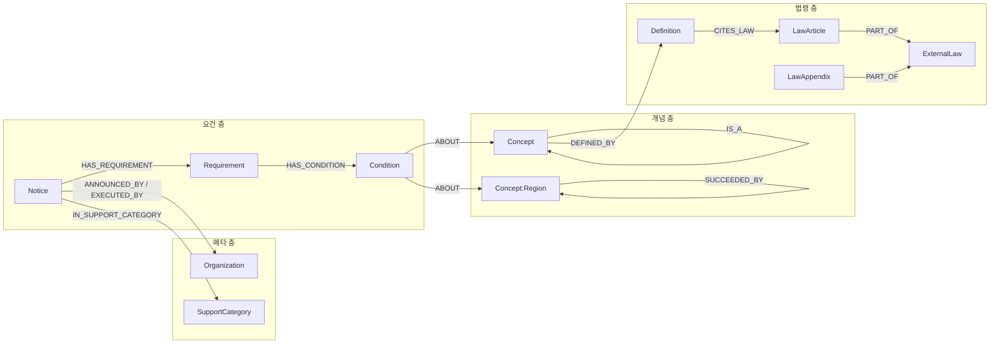

# Neo4j 그래프 스키마 정의서 (v0.1 초안)

> 2팀 "근거 it" · 지원각 · 작성 2026-11-26
> 기준: Neo4j Aura에 **실제 적재된 그래프를 읽기 전용으로 조회한 값**(2026-11-26). 설계 초안은 `docs/submission/ontology/schema.cypher`(온톨로지 설계서 v0.2 §8)이고, 둘이 다른 곳은 §3.3에 적었다.
> 강사 피드백(2026-11-26) 6개 항목은 §4(매핑)·§6(정합성)·§7(계층)·§8(추론 경로)·§9(판정)·§10(SQL 대비)에서 다룬다.
> 강사 피드백(2026-11-27, 정합성 체크 5개 항목)은 §13에서, 같은 날 뒷면(데이터 품질·성능 평가·산출물 증빙·가이드 3개)은 §14에서 다룬다. 관계 제약 점검 V20~V25는 2026-11-27에 Aura를 읽기 전용으로 조회한 값이다.

---

## 0. 요약

| 항목 | 현재 상태 |
|---|---|
| 적재 | 노드 30,678 · 관계 57,631 (2026-11-27 판정 규칙 결정 반영 후, 저장소 빌드와 같음. 점검 기록 §14.3). 공고 5,116건 전량(기업마당·K-Startup), 정형 API 필드에서 만든 요건·조건 |
| 식별·중복 | 노드 10종에 유일키 제약. 키 결측 0, 중복 0, 중복 간선 0 |
| 관계 방향 | 모든 관계가 정의한 방향(하위→상위, 공고→요건→조건→개념)만 가짐. 계층 순환 0 |
| 추론 경로 | 조건 → 개념 → (IS_A) → 정의 → 조문 → 법령이 실제로 이어짐. API `/api/chat`이 요청마다 이 경로를 읽는다. 정의에 닿는 공고는 **3,143건**이고 두 갈래뿐이다: `예비창업자`(1,252건)와 `1인 창조기업`(2,903건, 겹침 1,012건). 중소기업 등 다른 정의 개념을 가리키는 조건은 0개(§8) |
| **검수** | **조건 16,402개 전부 `reviewed=false`, 본문 조건 후보 17,253건 전부 미검수(§14.1), 공고 5,116건 전부 본문 요건 `unparsed`.** 정의 23개 중 22개는 검수 확인(2026-11-27) |
| 저장소와 Aura | 팀 결정 C-6(기업마당 기관 시도 964건을 조건에서 뺌)이 Aura에 아직 반영 전이다. 저장소 빌드는 조건 16,402개(§14.3) |
| 판정 | 3단 규칙은 구현됨. 다만 본문 요건이 검수 전이라 지금은 "신청 가능"이 **나오지 않도록 막혀 있다**(§9.2) |
| SQL 대비 | 정확도·속도 우위 없음(기존 측정). 계층·다단 질의의 **코드량은 Cypher가 줄 수 약 1/4, 토큰 수 약 1/2**(§10.2, 결과 일치 확인) |

강사 지적("실제 데이터 적재와 법령 기반 판정 규칙 검수 미완료")을 정확히 나누면 다음과 같다.
- **적재:** 정형 필드 기반 전량 적재는 끝났다. 본문·첨부에서 뽑은 요건과 공고의 법령 직접 인용(543건)은 아직 적재하지 않았다.
- **검수:** 조건은 0%다(구조화 16,402, 본문 후보 17,253). 법령 정의는 22/23 검수했고, 정의 → 조문·별표 경로는 25개다(§11, §13.4). 구현·적재·검수 상태는 §14.5에 나눠 적었다.

---

## 1. 범위와 원칙

| 원칙 | 내용 | 근거 |
|---|---|---|
| 판정은 코드가 한다 | 그래프는 근거·경로를 제공하고, 충족 여부는 규칙 평가기가 정한다. 모델은 추출·설명만 한다 | 기초 설계서 ADR-12 |
| 모르면 UNKNOWN | 못 읽은 값, 연결 안 된 개념은 "제한 없음"으로 바꾸지 않는다 | 온톨로지 설계서 §4.3 |
| 원문 근거 | 요건·조건 관계에는 `evidence`(원문 문구)와 `source`(필드)를 붙인다 | N-05 근거 표시 |
| 법령은 원문만 | 정의 노드는 조문 원문 위치를 가리킨다. 숫자 기준을 기억으로 쓰지 않는다 | 지원사업 법령 명세서 §7 |
| 읽기 전용 서비스 | API는 `READ_ACCESS` 세션만 쓴다. 적재는 배치 도구(`tools/sync_graph_neo4j.py`)만 한다 | `api/repositories/graph.py` |

---

## 2. 스키마 개요

네 층으로 나눈다. 판정에 직접 쓰는 층은 요건·개념·법령이고, 메타 층은 검색·필터용이다.



| 노드 | 건수 | 관계 | 건수 |
|---|---:|---|---:|
| Condition | 16,402 | ABOUT | 22,326 |
| Requirement | 4,936 | HAS_CONDITION | 16,402 |
| Notice | 5,116 | HAS_REQUIREMENT | 4,936 |
| Organization | 1,399 | ANNOUNCED_BY | 5,116 |
| LawArticle | 2,325 | IN_SUPPORT_CATEGORY | 5,116 |
| Concept (그중 Region 321) | 355 | PART_OF | 2,384 |
| LawAppendix | 59 | EXECUTED_BY | 947 |
| ExternalLaw | 44 | WITHIN | 284 |
| SupportCategory | 19 | MEMBER_OF | 35 |
| Definition | 23 | SUCCEEDED_BY | 35 |
| | | CITES_LAW | 23 |
| | | DEFINED_BY | 21 |
| | | IS_A | 2 |

---

## 3. 노드 정의

### 3.1 노드별 키와 속성

| 노드 | 기본 키 (형식) | 주요 속성 | 원천 |
|---|---|---|---|
| `Notice` | `notice_id` = `{출처}:{원천 ID}` 예: `KSTARTUP:179814`, `BIZINFO:PBLN_000000000128083` | `title`, `source_system`, `detail_url`, `fetched_at`, `deadline`(68%), `is_open`, `apply_status_kind`, `text_requirements`(`unparsed`/`partially_reviewed`/`reviewed`) | 정리층 `data/cleaned/20261124` |
| `Requirement` | 정형: `req_id` = `{notice_id}#R{n}`. 검수: `{notice_id}#G{n}` | `kind`(`ELIGIBILITY`), `logic`(`AND`/`OR`, 검수 요건은 `NOT`·`UNRESOLVED`·`ATOM`도), `logic_basis`(`explicit`/`assumed`), `status`(`structured_only`/`reviewed_excerpt`), `extraction_method`(`rule`/`human_review`). 검수 요건만: `logic_tree`(JSON 문자열), `review_split`, `reviewed_at` | 공고 정형 필드, 검수 정답(§3.4) |
| `Condition` | 정형: `cond_id` = `{notice_id}#C-{attribute}`. 검수: 정답 ID `GOLD:{24자}` | `cond_type`(`ATOM`), `attribute`, `operator`, `value`(JSON 문자열), `strength`(`hard`/`soft`), `evidence_source`(`API`/`NOTICE_TEXT`), `reviewed`, `ref_date_kind`, `about_pending`, `about_unmapped`, `unknown_reason`(`all_options`/`no_evaluation_rule`). 검수 조건만: `negate`(제외 조건) | 정형 필드 규칙 추출, 검수 정답(§3.4) |
| `Concept` | `concept_id` = `{SCHEME}:{값}` 예: `APPLICANT_TYPE:중소기업`, `CERTIFICATION:벤처기업`, `SPECIAL_GROUP:청년` | `name`, `scheme` | 용어 표준 `data/ref/term_standard_v0.1.json` |
| `Concept:Region` | `REGION:{법정동코드 10자리}`, 묶음은 `REGION_GROUP:{이름}`, 전국은 `REGION:NATIONWIDE` | `name`, `full_name`, `level`(`SIDO`/`SIGUNGU`/`GU`/`GROUP`/`NATIONWIDE`), `region_code`, `parent_region_id`, `status`(현행/폐지), `code_version` | 행정표준코드 `data/사전/지역_코드표.csv` |
| `Definition` | `def_id` = `DEF:{용어}` | `term`, `basis_note`, `article_text_hash`, `needs_review`, (조문에서 잘라 온 17개) `legal_term`, `source` | 법령 조문 원문 |
| `LawArticle` | `article_id` = `LAW:{법령일련번호}:A{조}` | `law_id`, `article_no`, `article_title`, `text`, `text_hash`, `deleted` | 법제처 OPEN API |
| `LawAppendix` | `appendix_id` = `LAW:{일련번호}:T{번호}-{가지}` | `table_no`, `table_kind`(별표/서식), `title`, `text`, `text_hash` | 법제처 OPEN API |
| `ExternalLaw` | `law_id` = `LAW:{법령일련번호}` | `name`, `doc_kind`, `effective_date`, `org`, `source_url`, `priority` | 법제처 OPEN API |
| `Organization` | `org_id` = `ORG:{해시 12자리}` | `name` | 공고 기관 필드 |
| `SupportCategory` | `category_id` = `CAT:{출처}:{해시}` | `name`, `source_system` | 공고 분류 필드 |

### 3.2 조건 속성값 분포 (판정 대상)

| attribute | 건수 | operator | ABOUT 대상 | strength |
|---|---:|---|---|---|
| `applicant_type` | 5,074 | `IN` | `APPLICANT_TYPE`·`CERTIFICATION`·`SPECIAL_GROUP` 개념 | hard·soft |
| `region` | 3,822 | `WITHIN` | `Region` | soft |
| `founder_age` | 3,822 | `BETWEEN` | 없음(숫자 구간) | soft |
| `business_age` | 3,684 | `LT` 2,330 · `ANY` 1,354(C-2: 전부 선택 = 제한 없음) | 없음(숫자 기준) | hard |

### 3.3 설계 초안(`schema.cypher`)과 실제 적재의 차이

| 항목 | 설계 초안 | 실제 적재 | 조치 |
|---|---|---|---|
| 개념 이름 속성 | `label` | `name` | 초안을 `name`으로 고친다 |
| 노드 `Track`·`Attachment`·`Program` | 제약 정의 | 없음 | 본문 요건 적재 단계(P1)로 미룸. 제약 목록에서 "예정"으로 표시 |
| 하위 조건 `HAS_CHILD`(그룹 조건) | 정의 | 없음(모든 조건이 `ATOM`) | 본문 요건 추출 후 |
| `SUPERSEDES`(정정 공고) | 정의 | 없음 | 재수집 후 |
| 보조 인덱스(`notice_source`, `notice_open`, `concept_scheme`) | 정의 | 없음 | §5.2 제안대로 생성 |
| 공고 → 법령 직접 인용 `CITES` | 정의 | 없음(543건 보류 `data/graph/law_citations_pending.jsonl`) | 요건 노드에 붙일지 결정 후 적재 |

### 3.4 검수 요건 (본문 발췌, 2026-11-26 추가)

사람이 검수한 조건 정답(2-4 정답셋, `data/goldsets/conditions/v1/…/reviewed_condition_gold.jsonl`·`reviewed_logic_gold.jsonl`)을 `tools/graphrag/gold_bridge.py`가 요건·조건으로 바꿔 내보낸다(`build.py export`). **Aura에는 아직 0건이다**(검수 반영 0건).

| 항목 | 규칙 |
|---|---|
| 옮기는 조건 | 조건별 `review_status=VERIFIED`이고 `condition_type`이 `ELIGIBILITY`·`EXCLUSION`인 것. 우대(`PREFERENCE`)·미분류(`UNCLASSIFIED`)는 옮기지 않는다 |
| 속성 | `BUSINESS_AGE` → `business_age`, `REPRESENTATIVE_AGE` → `founder_age`(숫자 비교), `BUSINESS_LOCATION` → `region`(지역 개념으로 해소, `ABOUT` 간선). 그 밖의 필드는 소문자 이름으로 두고 `unknown_reason=no_evaluation_rule`(평가기 UNKNOWN) |
| 제외 조건 | `negate=true`. 해당하면(SATISFIED) 요건 불충족 |
| 요건 논리 | 검수된 논리 트리를 `logic_tree`에 그대로 두고 `logic_basis=explicit`. 논리 검수가 없거나 트리에 없는 조건은 AND 한 요건(`assumed`) |
| 강도 | 모두 `soft`. 불충족이어도 NOT_ELIGIBLE이 아니다(팀 검토 D-2) |
| 공고 상태 | 검수가 자격 문구 발췌라 `text_requirements=partially_reviewed`. 평가기는 계속 `REQ_UNPARSED`를 붙인다(팀 검토 D-1) |
| 범위 | 개발용(development) 정답만. 평가용 20건은 넣지 않는다(팀 검토 D-3) |

팀 검토 항목 D-1~D-5는 `docs/RULES_판정_정규화_검토목록_v0.1.md` §4에 있다.

---

## 4. 관계 정의 (피드백 ①: 스키마 매핑)

방향 규칙: **포함하는 쪽 → 포함되는 쪽**(공고→요건→조건), **하위 → 상위**(구→시→도, 소기업→중소기업), **참조하는 쪽 → 근거**(조건→개념→정의→조문→법령).

| 관계 | 출발 → 도착 | 의미 | 속성 | 건수 | 판정에 쓰나 |
|---|---|---|---|---:|---|
| `HAS_REQUIREMENT` | Notice → Requirement | 공고가 가진 자격 요건 묶음(정형 필드, 검수 정답) | `evidence`, `source` | 4,936 | 예 |
| `HAS_CONDITION` | Requirement → Condition | 요건을 이루는 원자 조건(`logic`으로 결합) | `evidence`, `source` | 16,402 | 예 |
| `ABOUT` | Condition → Concept / Region | 조건이 가리키는 개념 | `option`(원문 선택지) | 22,326 | 예 |
| `WITHIN` | Region → Region | 행정 포함(구 → 시 → 도) | `basis` | 284 | 예 |
| `MEMBER_OF` | Region → Region(GROUP) | 공고가 정의한 권역·통합 이전 지역 묶음 소속 | `basis` | 35 | 예 |
| `SUCCEEDED_BY` | Region(폐지) → Region(현행) | 행정구역 개편 승계 | `partial`, `reviewed` | 35 | 아니오(검수 전) |
| `IS_A` | Concept → Concept | 개념 상하위(소기업 → 중소기업) | `basis`, `note` | 2 | 예(정의 찾기) |
| `DEFINED_BY` | Concept → Definition | 개념의 법적 정의 | — | 21 | 근거 표시 |
| `CITES_LAW` | Definition → LawArticle | 정의가 인용한 조문 | `article_ref` | 23 | 근거 표시 |
| `PART_OF` | LawArticle / LawAppendix → ExternalLaw | 조문·별표가 속한 법령 | — | 2,384 | 근거 표시 |
| `ANNOUNCED_BY` | Notice → Organization | 공고 기관 | `source_field` | 5,116 | 아니오 |
| `EXECUTED_BY` | Notice → Organization | 수행 기관 | `source_field` | 947 | 아니오 |
| `IN_SUPPORT_CATEGORY` | Notice → SupportCategory | 지원 분야 | — | 5,116 | 아니오(검색) |

강사 피드백의 사슬 **Notice → Requirement → Condition → Concept → ExternalLaw**는 다음처럼 이어진다.
`Notice -HAS_REQUIREMENT-> Requirement -HAS_CONDITION-> Condition -ABOUT-> Concept -IS_A*0..2-> Concept -DEFINED_BY-> Definition -CITES_LAW-> LawArticle -PART_OF-> ExternalLaw`

Concept와 ExternalLaw 사이에 `Definition`·`LawArticle`을 두는 이유는 두 가지다.
- 한 법령 안에서도 정의가 조·항·호 단위로 다르다. 예: 중소기업창업 지원법 제2조 제3호 "창업기업", 제4호 "예비창업자", 제10호 "초기창업기업".
- 조문이 개정되면 영향받는 정의만 골라내야 한다(CQ-15).

---

## 5. 제약과 인덱스

### 5.1 현재 걸린 것 (Aura `SHOW CONSTRAINTS`)

```cypher
CREATE CONSTRAINT notice_id   IF NOT EXISTS FOR (n:Notice)          REQUIRE n.notice_id IS UNIQUE;
CREATE CONSTRAINT req_id      IF NOT EXISTS FOR (r:Requirement)     REQUIRE r.req_id IS UNIQUE;
CREATE CONSTRAINT cond_id     IF NOT EXISTS FOR (c:Condition)       REQUIRE c.cond_id IS UNIQUE;
CREATE CONSTRAINT concept_id  IF NOT EXISTS FOR (k:Concept)         REQUIRE k.concept_id IS UNIQUE;
CREATE CONSTRAINT def_id      IF NOT EXISTS FOR (d:Definition)      REQUIRE d.def_id IS UNIQUE;
CREATE CONSTRAINT article_id  IF NOT EXISTS FOR (a:LawArticle)      REQUIRE a.article_id IS UNIQUE;
CREATE CONSTRAINT appendix_id IF NOT EXISTS FOR (a:LawAppendix)     REQUIRE a.appendix_id IS UNIQUE;
CREATE CONSTRAINT law_id      IF NOT EXISTS FOR (l:ExternalLaw)     REQUIRE l.law_id IS UNIQUE;
CREATE CONSTRAINT org_id      IF NOT EXISTS FOR (o:Organization)    REQUIRE o.org_id IS UNIQUE;
CREATE CONSTRAINT category_id IF NOT EXISTS FOR (s:SupportCategory) REQUIRE s.category_id IS UNIQUE;
```

유일키 제약마다 RANGE 인덱스가 자동으로 생긴다. 그래서 키 조회(`{notice_id: $id}`)는 인덱스를 탄다.

### 5.2 추가 제안 (아직 만들지 않음)

| 인덱스 | 쓰는 질의 | 이유 |
|---|---|---|
| `Condition(attribute)` | 지역 조건만 거르기(§8 P1·P3) | 16,402개 중 지역 3,822개만 본다 |
| `Notice(is_open)`, `Notice(source_system)` | 모집 중 공고 필터 | 설계 초안에 있던 것 |
| `Region(level)` | 입력 폼 지역 목록 | 321개라 효과는 작다. 목록 질의 정리용 |
| `Concept(scheme)` | 개념 종류별 조회 | 설계 초안에 있던 것 |

```cypher
CREATE INDEX condition_attribute IF NOT EXISTS FOR (c:Condition) ON (c.attribute);
CREATE INDEX notice_open         IF NOT EXISTS FOR (n:Notice)    ON (n.is_open);
CREATE INDEX notice_source       IF NOT EXISTS FOR (n:Notice)    ON (n.source_system);
CREATE INDEX region_level        IF NOT EXISTS FOR (k:Region)    ON (k.level);
CREATE INDEX concept_scheme      IF NOT EXISTS FOR (k:Concept)   ON (k.scheme);
```

속성 존재·타입 제약(`IS NOT NULL`, `IS :: STRING`)은 인스턴스 등급에 따라 쓸 수 없을 수 있다. 그래서 §6.2 점검 쿼리로 대신한다.

---

## 6. 데이터 정합성 (피드백 ②)

### 6.1 규칙

| 규칙 | 내용 |
|---|---|
| 식별키 | §3.1 형식으로 **원천 ID에서 결정적으로 만든다**(무작위 ID 금지). 같은 공고를 다시 적재해도 같은 키가 나온다 |
| 중복 방지 | 적재는 `MERGE`(키 기준)로만 한다. 관계도 `MERGE (a)-[:R]->(b)`로 같은 쌍에 하나만 둔다 |
| 관계 방향 | §4 방향 규칙만 허용. 역방향 관계 타입(`HAS_SUBREGION` 등)은 만들지 않는다 |
| 속성 타입 | `value`는 JSON 문자열, 날짜는 ISO 문자열, 불리언은 boolean. 적재 스크립트가 넣기 전에 검사한다 |
| 버전 | 판이 바뀌는 원천(법령)은 원천 판 번호를 키에 넣는다(`LAW:{법령일련번호}`). 조문 원문은 `text_hash`로 변경을 잡는다 |

### 6.2 점검 결과 (2026-11-26, 0이어야 정상)

| # | 점검 | 결과 | 판정 |
|---|---|---:|---|
| V0 | 노드 10종 키 결측·중복 | 0 / 0 | 정상 |
| V1 | 서로 다른 scheme 사이 `WITHIN`·`IS_A` | 0 | 정상 |
| V2 | 계층 순환(`WITHIN`·`MEMBER_OF`·`IS_A`, 6 hop까지) | 0 | 정상 |
| V4 | 요건 없는 조건(고아 조건) | 0 | 정상 |
| V5 | 근거(`evidence`) 없는 요건·조건 관계 | 0 | 정상 |
| V8 | `WITHIN` 상위가 둘 이상인 지역 | 0 | 정상 |
| V11 | 같은 쌍의 중복 `HAS_CONDITION`·`ABOUT` | 0 / 0 | 정상 |
| V12 | 조건 없는 요건 | 0 | 정상 |
| V13 | 지역 조건이 지역이 아닌 개념을 가리킴 | 0 | 정상 |
| V14 | 법령에 안 붙은 조문 | 0 | 정상 |
| V9 | 개념형 조건(`applicant_type`)인데 `ABOUT` 없음 | **0** | 해결(2026-11-27): `일반기업` 개념을 추가해 546건을 이었다. 이제 0이어야 하는 점검이다 |
| V15 | 요건이 하나도 없는 공고 | **1,294** | 확인함: 기업마당 공고 중 정형 필드에 판정 조건이 없는 330건 + C-6으로 소관 기관 시도 조건만 있던 964건 |
| V16 | 상위(`WITHIN`)가 없는 비시도 지역 | **34** | 31개는 폐지된 시군구(`SUCCEEDED_BY`로만 연결, 검수 전), 3개는 권역 묶음(정상). 현행 시군구·구만 보면 0 |
| V17 | 개념에 안 붙은 정의 | **2** | `청년창업기업`·`중장년창업기업` 정의는 있는데 대응 개념이 없다(연령 조건으로 다룸). 2026-11-26 추가 정의 17개는 모두 개념에 연결 |

점검 쿼리 원문은 `docs/submission/ontology/schema.cypher`의 V1~V10에 있고, V11~V17은 이번에 추가한다(부록 A). 전부 `python tools/check_graph_neo4j.py`로 한 번에 돌린다(읽기 전용).

---

## 7. 계층 관계의 의미와 적용 기준 (피드백 ③)

| 관계 | 의미 | 전이(A→B→C면 A→C) | 탐색 한도 | 판정 적용 기준 | 근거·검수 |
|---|---|---|---|---|---|
| `WITHIN` | 행정구역 **포함**. 구는 시에, 시는 도에 속한다 | 예 | 3 hop(일반구→시→도 + 권역) | 사용자 지역이 조건 지역 **또는 그 하위**면 지역 조건 충족. 조건 지역이 사용자 지역보다 **하위**면 UNKNOWN(그 구 안에 있는지 모름) | 행정표준코드(행안부). 코드표가 근거라 검수 불필요 |
| `MEMBER_OF` | 공고가 정의한 **권역·묶음 소속**(경상권, 통합 이전 지역) | 예(묶음까지) | `WITHIN`과 합쳐 3 hop | 공고가 "경상권"이라 쓰면 구성 시도 사용자를 충족으로 본다. **묶음의 구성은 공고마다 다를 수 있어** 근거 공고(`basis`)를 남긴다 | 공고 본문 정의. 검수 대상(현재 `reviewed=false`) |
| `IS_A` | 개념 **상하위**. 하위는 상위의 조건을 만족한다(소기업은 중소기업이다) | 예 | 2 hop | ① 사용자 유형이 조건 개념의 하위면 충족. ② 하위 개념에 정의가 없으면 상위 정의를 근거로 보여 준다 | 법령 정의(중소기업기본법 제2조 제2항). 현재 2건뿐 |
| `SUCCEEDED_BY` | 행정구역 **개편 승계**(폐지 → 현행) | 아니오 | 판정 미사용 | 옛 지역명을 쓴 공고를 새 지역에 맞출 때 쓸 예정. `partial=true`(일부만 승계)는 자동 충족 금지 | 검수 전이라 판정에 쓰지 않는다 |

적용 원칙
- **방향은 늘 하위 → 상위.** 충족 판정은 사용자 쪽에서 위로 올라가며 조건 개념을 만나는지 본다. 내려가는 방향은 UNKNOWN만 만든다.
- **세 관계를 섞어 따라가지 않는다.** 지역 판정은 `WITHIN|MEMBER_OF`만, 유형 판정·정의 찾기는 `IS_A`만 따라간다(V1 점검으로 보장).
- **hop 한도**는 실제 데이터의 최대 깊이에 1을 더한 값이다. 지역은 일반구 → 시 → 도 = 2, 권역 포함 3. 개념은 소기업 → 중소기업 = 1, 여유 1을 더해 2.

---

## 8. 추론 구조: Multi-hop 탐색 경로 (피드백 ④)

API가 실제로 쓰는 질의다(`api/repositories/graph.py`). 모두 읽기 전용이다.

**P1. 지역 계층으로 충족되는 공고 후보** (`search_candidates`, CQ-01·04·17)
```cypher
MATCH (u:Concept {concept_id: $u})-[:WITHIN|MEMBER_OF*0..3]->(:Concept)
      <-[:ABOUT]-(:Condition {attribute: 'region'})<-[:HAS_CONDITION]-(:Requirement)<-[:HAS_REQUIREMENT]-(n:Notice)
RETURN DISTINCT n.notice_id
```

**P2. 판정 근거 경로** (`trace_path`): 사용자 지역에서 조건 지역까지 가장 짧은 경로를 노드 이름 목록으로 돌려준다.
```cypher
MATCH (u:Concept {concept_id: $u})
MATCH (c:Condition)-[:ABOUT]->(t:Concept) WHERE c.cond_id IN $cids AND c.attribute = 'region'
OPTIONAL MATCH p = (u)-[:WITHIN|MEMBER_OF*0..3]->(t)
WITH c, t, p ORDER BY length(p)
WITH c, t, head(collect(p)) AS p
RETURN c.cond_id, t.concept_id, [n IN nodes(p) | {id: n.concept_id, name: n.name}] AS nodes
```

**P3. 조건 → 개념 → 정의 → 조문 → 법령** (`fetch_definition`, CQ-05): 6 hop. `IS_A`를 0~2번 거쳐 상위 개념의 정의도 찾는다.
```cypher
MATCH (n:Notice)-[:HAS_REQUIREMENT]->(:Requirement)-[:HAS_CONDITION]->(c:Condition)-[:ABOUT]->(k:Concept)
      -[:IS_A*0..2]->(k2:Concept)-[:DEFINED_BY]->(d:Definition)
WHERE n.notice_id IN $ids
OPTIONAL MATCH (d)-[:CITES_LAW]->(a:LawArticle)-[:PART_OF]->(l:ExternalLaw)
RETURN n.notice_id, c.cond_id, k.name, d.term, a.article_no, l.name, l.source_url
```

**P4. 조문이 바뀌면 영향받는 공고** (CQ-15): P3를 거꾸로 따라간다.
```cypher
MATCH (:LawArticle {article_id: $aid})<-[:CITES_LAW]-(:Definition)<-[:DEFINED_BY]-(:Concept)<-[:IS_A*0..2]-(:Concept)
      <-[:ABOUT]-(:Condition)<-[:HAS_CONDITION]-(:Requirement)<-[:HAS_REQUIREMENT]-(n:Notice)
RETURN DISTINCT n.notice_id
```

**P5. 판정 경로 서브그래프** (`GET /api/graph/path`): 공고 하나의 요건·조건·개념·정의·조문·법령과 사용자 지역 경로를 노드·간선 목록으로 돌려준다. 화면 그래프용이다.

실측 (2026-11-26)

| 경로 | 결과 | 예 |
|---|---|---|
| P1 | 지역 32곳에서 SQL 기준 구현과 결과 일치 | 강남구 → 서울특별시 공고 후보 |
| P2 | 공고 40건에서 SQL 재귀 경로와 일치 | `동대문구 → 서울특별시` (`WITHIN` 1 hop) |
| P3 | 정의에 닿는 공고 **1,252건**(2026-11-26 정의 7개 추가 후 3,143건). 공고 40건에서 SQL과 일치 | `예비창업자 → 중소기업창업 지원법 제2조` |
| P4 | 중소기업창업 지원법 제2조 → 공고 1,252건. 1인 창조기업법 제2조 → 2,903건(정의 추가 후). **중소기업기본법 제2조 → 0건** | 조문이 개정되면 이 공고들의 근거를 다시 본다 |
| P5 | KSTARTUP:179814: 노드 16(공고 1, 요건 2, 조건 5, 개념 5, 정의·조문·법령 각 1), 간선 15 | 웹 "판정 경로 그래프 보기" |

**경로는 동작하지만 데이터가 두 갈래뿐이다.** 처음 정의가 있던 개념 4개 중 조건이 실제로 가리키는 것은 `예비창업자`(조건 1,252개)뿐이었다. 2026-11-26 정의 7개를 더한 뒤 K-Startup 신청 대상 선택지의 `1인 창조기업`(조건 2,903개)이 두 번째 갈래가 됐다. `중소기업`·`창업기업`·`초기창업기업`을 가리키는 조건은 0개다. 정형 API 필드의 신청자 유형 선택지(청소년, 대학생, 일반인, 일반기업 등)에 "중소기업"이 없기 때문이다. 중소기업 요건은 본문·첨부에 있으므로, 본문 요건을 적재해야(§12 P1) 중소기업기본법 경로가 살아난다.

**PROFILE (Neo4j 5.27-aura, 같은 세션 두 번째 실행)**

| 질의 | 결과 행 | db hits | 서버 처리 | 왕복 p50 |
|---|---:|---:|---:|---:|
| P1 (동대문구) | 2,748 | 41,240 | 22ms | 178ms |
| P2 (KSTARTUP:179814 지역 조건) | 1 | 25 | 2ms | 77ms |
| P3 (KSTARTUP:179814) | 1 | 80 | 2ms | 76ms |
| P4 (LAW:281995:A2) | 1,252 | 16,325 | 11ms | 176ms |

첫 실행(캐시 전) 서버 처리는 73~105ms. 시작 노드는 모두 `NodeUniqueIndexSeek`, 가변 길이 경로는 `VarLengthExpand(Pruning,BFS)`. 고립 노드는 Concept 15개(용어 사전에는 있으나 조건·정의가 아직 없는 개념)뿐이다. 2026-11-26 정의 연결 후 5개(재창업기업·개인사업자·법인·중장년·소상공인확인).

---

## 9. 자격 판정 규칙 (피드백 ⑤)

### 9.1 조건 3값 → 공고 3단

조건마다 `SATISFIED`(충족) / `UNSATISFIED`(불충족) / `UNKNOWN`(모름)을 낸다. 공고 판정은 아래 순서로 정한다(`tools/graphrag/evaluator.py`).

| 순서 | 조건 결과 | 판정 | 화면 |
|---|---|---|---|
| 1 | `hard` 조건(또는 hard 조건이 든 OR·검수 요건) 중 하나라도 `UNSATISFIED` | **NOT_ELIGIBLE** | 신청 불가 |
| 2 | `soft` 조건 불충족, 또는 `UNKNOWN` 조건이 있음 | **NEEDS_CHECK** (사유: `SOFT_CONDITION_UNSATISFIED`, `UNKNOWN_CONDITION`) | 확인 필요 |
| 3 | 본문 요건이 공고 전체로 검수되지 않음(`text_requirements ≠ reviewed`, 발췌 검수 `partially_reviewed` 포함) | **NEEDS_CHECK** (사유: `REQ_UNPARSED`) | 확인 필요 |
| 4 | 위에 모두 해당 없음 | **ELIGIBLE** | 신청 가능(참고) |

조건별 규칙 예시

| 속성 | UNKNOWN이 되는 경우 |
|---|---|
| 지역 | 사용자 지역 미입력. 조건 지역이 사용자 지역보다 하위 |
| 업력 | 미입력. 기준 연수 ±0.5년 안(공고일·신청일 중 어느 날 기준인지 모름) |
| 대표자 나이 | 미입력 |
| 신청자 유형 | 미입력. 개념 사전에 없는 선택지(`일반기업`) |

### 9.2 지금 판정이 실제로 하는 일과 검증 계획

- **"신청 가능"이 나오지 않는다.** 공고 5,116건 모두 `text_requirements=unparsed`라 규칙 3에서 멈춘다. 본문·첨부 요건을 검수하기 전에 "신청 가능"을 내지 않으려고 일부러 둔 안전장치다. 그래서 지금은 사실상 **신청 불가 / 확인 필요 2단**이다.
- **요건 논리는 그래프와 평가기가 같다(2026-11-26).** 그래프는 "업력 N년 미만 **또는** 예비창업자"를 OR 요건(`#R2`, 조건 2개)으로 둔다(1,114건). 평가기도 같은 묶음 함수(`condition_schema.requirement_groups`)로 요건을 만들고, 요건마다 `logic`(AND/OR)으로 3값을 합친다. 내보내기와 평가기가 한 함수를 쓰므로 요건 수(AND 4,786·OR 1,114)와 조건 수(17,366)가 Aura와 같다. 바꾸기 전후 판정은 프로필 1,920개 × 공고 5,116건(9,822,720건)에서 모두 같았다. 예비창업자 여부를 입력하지 않고 업력만 입력한 프로필은 사업자가 있는 것으로 본다(바꾸기 전 평가기와 같은 해석).
- **검수 요건도 같은 틀로 판정한다(2026-11-26).** 검수 요건(§3.4)은 `logic_tree`를 3값으로 계산하고(`AND`·`OR`는 요건 논리와 같고, `NOT`은 뒤집고, `UNRESOLVED`는 UNKNOWN) 요건 결과를 공고 판정에 넣는다. 검수 조건은 soft라 규칙 2로 가고, 발췌 검수라 규칙 3에서 멈춘다. 검수 반영이 0건이라 지금 판정은 바뀌지 않는다.
- **검증 방법:** 정답셋으로 조건 단위·공고 단위 일치율을 잰다.
  - 정답셋은 파일럿 10건 × 프로필 3개로 시작하고, 이후 50건 이상으로 늘린다.
  - 목표: `hard` 조건 판정 오류 0. "신청 가능" 오판(정답은 불가 또는 확인 필요) 0.
  - 확인 필요 비율도 함께 보고한다. 모두 "확인 필요"로 내면 오류는 0이 되지만 쓸모가 없기 때문이다.

---

## 10. SQL 대비 온톨로지 기반 추론의 차별성 검증 (피드백 ⑥)

### 10.1 지금까지 확인한 것 (`docs/ontology/BASELINE_SQL_그래프_비교측정결과_v0.1.md`)

| 질문 | 답 |
|---|---|
| 판정 결과가 다른가 | 다르지 않다. 지역 계층 47,400쌍(11-27, 11-25에는 336,600쌍)에서 SQL(폐쇄 테이블·재귀 CTE)과 그래프가 기준 구현과 불일치 0 |
| 빠른가 | 아니다. 같은 기기 p50: Neo4j 서버 처리 10ms·왕복 19ms, SQL 폐쇄 테이블 0.20ms. 원격 Aura 왕복 164ms는 대부분 네트워크 |
| 계층 사전이 필요한가 | 필요하다. 계층 없는 SQL 필터는 계층을 올라가야 충족되는 1,883쌍을 하나도 못 찾았다(재현율 0%) |

### 10.2 질의 코드량 비교 (이번에 추가)

같은 그래프를 **정규화한 관계형 테이블 11개**에 그대로 옮겼다. 노드 종류별 테이블과 관계 테이블이고, 계층 간선은 `concept_edge(child, parent, rel)` 하나에 모았다. 그 위에서 같은 질문을 SQL과 Cypher로 짰다.
- 공고→조건을 미리 펼친 테이블이나 폐쇄 테이블 같은 사전 계산은 쓰지 않았다.
- 계층 간선을 한 테이블에 모은 것은 SQL에 유리한 설계다. 관계마다 테이블을 따로 두면 SQL이 더 길어진다.
- **모든 질문에서 여러 입력의 결과가 일치하는 것을 확인한 뒤** 코드량을 셌다.

| 질문 | 입력 수 | 결과 불일치 | SQL 줄 | Cypher 줄 | SQL 토큰 | Cypher 토큰 | SQL 조인 | Cypher 관계 패턴 | SQL 재귀 CTE |
|---|---:|---:|---:|---:|---:|---:|---:|---:|---:|
| Q0 공고의 요건·조건 목록 (재귀 없음, 기준선) | 20 | 0 | 4 | 2 | 32 | 40 | 1 | 2 | 0 |
| Q1 지역 계층으로 충족되는 공고 (≤3 hop) | 32 | 0 | 12 | 3 | 101 | 59 | 4 | 4 | 1 |
| Q2 조건 → 개념 → 정의 → 조문 → 법령 | 40 | 0 | 18 | 4 | 174 | 90 | 9 | 7 | 1 |
| Q3 판정 근거 경로를 결과로 반환 | 40 | 0 | 14 | 3 | 151 | 84 | 5 | 4 | 1 |
| Q4 조문 변경 → 영향 공고 (CQ-15)¹ | 2 | 0 | 14 | 3 | 113 | 67 | 5 | 6 | 1 |
| **Q1~Q4 합계** | | **0** | **58** | **13** | **539** | **300** | **23** | **21** | **4** |

¹ 정의가 인용한 조문이 2개뿐이라 입력이 2개다(그중 중소기업기본법 제2조는 결과 0건, §8). 결과 일치의 근거로는 약하다.

읽는 법
- **재귀가 없는 질의(Q0)는 차이가 없다.** 토큰은 오히려 SQL이 적다. 단순 조회에서 그래프의 이점은 없다.
- **계층·다단 경로 질의(Q1~Q4)에서 Cypher는 줄 수 약 1/4(58 → 13), 토큰 수 약 1/2(539 → 300)이다.** 줄 수는 서식에 따라 흔들린다. Cypher는 경로 패턴을 한 줄에 길게 쓰기 때문이다. 그래서 **토큰 수(약 44% 감소)를 주 지표**로 본다.
- 차이의 원인은 두 가지다.
  - SQL은 가변 길이 경로마다 **재귀 CTE**(시작 행 + 재귀 행 + hop 한도)를 직접 짜야 한다. Cypher는 `*0..3` 한 토큰이다.
  - **경로 자체를 결과로 돌려줄 때(Q3)** SQL은 문자열을 이어 붙이며 경로를 누적해야 한다. Cypher는 `nodes(p)`를 쓴다.
- 반대로 속도는 SQL이 빠르다. 이 비교에서 SQLite는 같은 프로세스 메모리 안에서, Neo4j는 원격 Aura로 왕복했으므로 속도 비교로 쓰지 않는다.
- 재현: `python tools/graphrag/compare_query_size.py` → `data/eval/query_size_compare.json`(두 언어의 질의 원문 포함)

### 10.3 남은 검증 방안 (구체화)

| # | 가설(그래프가 나을 수 있는 곳) | 실험 | 지표 | 성공 기준(미리 정함) |
|---|---|---|---|---|
| E1 | 근거 경로 설명을 만드는 비용이 낮다 | 판정 카드의 "왜 충족/불충족인가" 출력(경로 + 정의 + 조문)을 SQL·Cypher로 각각 구현 | 질의·후처리 코드 줄 수, 결과 일치 | 결과 일치 + 코드량 30% 이상 적음 |
| E2 | 스키마 변경 비용이 낮다 | 시나리오 3개: ① 새 계층 관계 추가(업종 KSIC 상하위) ② 조건에 하위 조건(`HAS_CHILD`) 도입 ③ 정정 공고 이력(`SUPERSEDES`) | DDL·적재·질의 수정 줄 수, 손댄 파일 수 | 3개 중 2개 이상에서 수정량이 적음 |
| E3 | 법령 개정 영향 분석(CQ-15) | 조문 `text_hash`를 바꿨다고 가정하고 영향 공고 집합을 두 방식으로 구함(Q4 확장: 별표·`IS_A` 깊이 증가) | 결과 일치, 코드량, 깊이를 늘릴 때 수정량 | 결과 일치, 깊이 변경이 Cypher는 숫자 1개, SQL은 CTE 수정 |
| E4 | 깊은 계층에서도 같은 결과·감당할 수 있는 지연 | 업종 분류(KSIC 5단계)·본문 요건 그룹 조건(3단)을 적재한 뒤 Q1~Q4 반복 | p50·p95, 일치율 | 일치율 100%, 사용자 체감 지연(1초) 이내 |

E1~E3은 지금 데이터로 바로 할 수 있다. E4는 업종 코드표와 본문 요건을 적재한 뒤에 한다.

**E1·E3 결과 (2026-11-27).** 자세한 내용은 비교 측정 결과 7절에 있다. 코드는 `tools/graphrag/compare_path_impact.py`, 원자료는 `data/eval/compare_path_impact.json`이다.

| # | 결과 | 기준 |
|---|---|---|
| E1 | 모집 중 공고 98건의 판정 근거 카드(지역 경로 + 정의 + 조문·별표)가 SQL 두 설계와 Cypher 모두 같다(불일치 0). 코드는 Cypher가 7줄·토큰 189개, 강한 SQL(조문·별표 통합 테이블)은 39줄·342개, 종류별 테이블 SQL은 46줄·433개다 | **달성**(강한 SQL 대비 토큰 45% 적음) |
| E3 | 조문·별표 21개 각각에 대해 영향받는 공고 집합이 같다(불일치 0). 별표를 추가할 때 종류별 SQL은 +4줄, 통합 SQL은 0줄, Cypher는 +2/−1줄을 고쳤다. `IS_A` 깊이를 늘릴 때는 세 질의 모두 숫자 하나만 바뀌었다 | **미달**(깊이 변경은 SQL도 숫자 1개) |

---

## 11. 법령 원천 점검 (ExternalLaw·LawArticle·Definition)

`data/지원사업_법령/`(법제처 OPEN API, 2026-11-24 수집)를 2026-11-26에 다시 점검했다.

| 점검 | 결과 |
|---|---|
| 명세서 수치와 파일 | 일치: 26문서, 조문 1,286(삭제 81), 별표·서식 40, 법령 전체 행 26 |
| 조 번호 ↔ 본문 첫머리(`제N조(의M)`) | 불일치 0 |
| 조 번호 누락(1 ~ 최대 조 사이 빈 번호) | 0 (26문서 모두) |
| 빈 본문·중복 조 | 0 / 0 |
| 조 제목이 본문에 있음 | 1,203/1,203 (제목 없는 83개는 대부분 삭제 조) |
| 현행판 여부 (국가법령정보센터 대조) | 표본 5개 모두 시행일 일치: 중소기업기본법 2026-07-01, 소상공인기본법 2026-06-03, 중소기업창업 지원법 시행령 2026-09-01, 여성기업지원법 2024-05-01, 농어업경영체법 시행령 2024-02-17 |
| 조문 원문 대조 | 소상공인기본법 제2조 본문이 사이트와 같음(따옴표 모양만 다름) |
| 그래프 적재 | `ExternalLaw` 26, `LawArticle` 1,286, `LawAppendix` 40으로 일치. 법령에 안 붙은 조문 0. 추가분 적재 후 44 · 2,325 · 59 |
| 별표 제목 HTML 엔티티 | 1건 남음(`&lt;` 등). 표시할 때 풀어 쓴다 |

**수집은 정확하다. 부족한 것은 범위와 연결이다.**

1. **정의 연결이 4개 개념뿐이고, 공고에 실제로 쓰이는 것은 `예비창업자` 하나다**(§8). → 2026-11-26 추가 법령 정의 10개와 개념 6개(마을기업·자활기업·연구소기업은 인증, 어업인·농업인·중소기업협동조합은 신청자 유형)를 더해 14개 개념이 정의에 연결됐다. 같은 날 v0.2 법령 조문으로 소상공인·중견기업·벤처기업·여성기업·사회적기업·협동조합·1인 창조기업 정의 7개를 더해 **21개 개념**이 정의에 연결됐다(아래 목록은 보강 전 기록). 정의가 없던 개념은 다음과 같았다.
   - 소상공인, 중견기업, 벤처기업, 여성기업, 사회적기업, 협동조합, 1인 창조기업
   - 장애인기업, 이노비즈, 메인비즈, 재창업기업, 청년 등
   - 이 가운데 소상공인·중견기업·벤처기업·여성기업·사회적기업·협동조합·1인 창조기업은 **정의 조문이 이미 수집돼 있어** 노드만 만들면 된다.
2. **정의 노드 2개가 개념에 안 붙어 있다.** `청년창업기업`·`중장년창업기업` 정의는 있지만 대응 개념이 없다.
3. **공고에 자주 나오는데 정의 법령이 없는 유형이 있다.** 아래는 공고 본문에서 용어를 센 값이다(법령명이 없어도 셈).

| 신청자 유형 | 언급 공고 | 정의 법령(후보, 수집 필요) |
|---|---:|---|
| 청년 | 725 | 청년기본법 제3조. 다만 공고마다 나이 기준이 달라 **공고 값이 우선**이다 |
| 장애인기업 | 76 | 장애인기업활동 촉진법 제2조 |
| 이노비즈(기술혁신형) / 메인비즈(경영혁신형) | 67 / 47 | 중소기업기술혁신 촉진법 |
| 어업인 / 농업인 | 56 / 47 | 수산업·어촌 발전 기본법 / 농업·농촌 및 식품산업 기본법 |
| 마을기업 / 자활기업 | 47 / 31 | 공고가 인용한 법령명(9건)의 현행 여부 확인 필요 / 국민기초생활 보장법 |
| 연구소기업 | 37 | 연구개발특구의 육성에 관한 특별법 |
| 중소기업협동조합 | 24 | 중소기업협동조합법 |

   → **2026-11-26 보완:** 위 9개 유형의 법령·시행령 18문서(조문 1,039개)를 `tools/law_web_collector.py`로 추가 수집했다. 이어서 공공데이터포털 법제처 API(`tools/law_api_collector.py`, 인증키는 `.env`에만 보관)로 공식 목록과 대조해 18/18 일치를 확인하고, 별표·서식 19개를 더 받았다(데이터명세서 v0.3 §2.2·§6.2). 합계 44문서, 조문 2,325개, 별표·서식 59개. 2026-11-26에 Aura에 MERGE 적재했다(노드 1,076·관계 1,058, 같은 ID 기존 노드 0, V14 = 0).

4. **수집 범위 밖 인용은 대부분 의도된 제외다.** 공고가 인용한 법령(공고×법령 2,585쌍) 중 수집 26종이 덮는 것은 27.7%다. 덮지 못한 상위 인용은 보조금 관리법, 방문판매법, 근로기준법, 관광진흥법, 개인정보 보호법 등이다. 이들은 명세서 §3.2의 제외 규칙(준수·증빙·업종 등록 맥락)에 해당하므로 **판정용 수집 누락은 아니다**.
5. `data/graph/law_chain_report.json`은 옛 법령 묶음(금융 중심 275건) 기준이다. 소상공인기본법을 "없음"으로 적는 등 **지금 수집본과 맞지 않으므로** 다시 만들거나 지운다.

---

## 12. 미완료 항목과 보완 계획

| 우선 | 항목 | 현재 | 할 일 | 완료 기준 |
|---|---|---|---|---|
| P0 | 조건 검수 | 16,402개 모두 `reviewed=false` | 정답셋 파일럿(10건 × 프로필 3) 라벨 → 조건 규칙별 오류 확인 → 규칙 단위로 `reviewed=true` | 파일럿 hard 조건 오류 0 |
| P0 | 정의 확대 (**완료 2026-11-26**) | 개념 21개 정의 연결, V17 = 2(연령형) | 수집된 조문으로 정의 7개 추가(소상공인, 중견기업, 벤처기업, 여성기업, 사회적기업, 협동조합, 1인 창조기업). 고아 정의 2개 연결 | 신청자 유형 개념 중 법령 정의가 있는 것 100% 연결 |
| P0 | 정의 검수 (**완료 2026-11-27**) | 22개 `needs_review=false`, 1개 미기재(`data/ref/definition_review_v0.1.json`) | 미기재 1개 원문 확인 | `needs_review=false` 23 |
| P1 | 본문 요건 | 공고 전부 `unparsed`. 중소기업 등 법령 정의 개념을 가리키는 조건 0개 | 검수 정답 → 요건 연결은 구현(§3.4). 남은 일: 검수 패킷 50건 검수, 공고 단위 "자격 조건 전체 확인" 항목(D-1) 결정, 검수 요건 Aura 적재 | 검수한 공고에서 "신청 가능" 판정이 나옴. 중소기업기본법 제2조 경로(P4)가 0건을 벗어남 |
| P1 | 추가 법령 개념의 공고 연결 | 정의 10개·개념 6개 적재 완료(2026-11-26), V17 = 2. 공고 조건이 가리키는 개념은 `예비창업자`뿐 | 본문·첨부 요건에서 신청자 유형을 뽑아 `ABOUT`으로 새 개념에 연결 | 새 개념 중 1개 이상이 공고 조건과 이어짐 |
| P1 | 미매핑 개념 | 완료(2026-11-27) | `일반기업` 개념 추가, Aura 반영 | V9 = 0 (달성) |
| P1 | 평가기와 그래프 요건 논리 일치 (**완료 2026-11-26**) | 평가기가 요건 단위로 AND/OR를 합친다 | 본문 요건의 그룹 조건(`HAS_CHILD`, NONE_OF·AT_LEAST)도 같은 방식으로 확장 | 전후 판정 9,822,720건 동일 |
| P1 | 신규 데이터 갱신 | 수집·정리층이 스냅숏 1회. 기준일 고정, 차이 계산·`SUPERSEDES` 없음, 마감 공고가 Aura에 남음 | 설계 `docs/DESIGN_신규데이터_파이프라인과_상위법령_v0.1.md` §3: 실행 폴더 + `LATEST`, 차이 계산(`NEW·CHANGED·UNCHANGED·CLOSED·DISAPPEARED`), 바뀐 공고만 재추출, Notice `version·status`, 요건 `SUPERSEDES`, `--select delta` 부분 적재 | 같은 원천 2회 실행 시 전부 UNCHANGED, V18·V19 = 0 |
| P1 | 상위 법령 계층 | 법률 22·시행령 22, 상하위 관계·위임 연결 없음, 시행규칙·고시 0 | 설계 `docs/DESIGN_신규데이터_파이프라인과_상위법령_v0.1.md` §4: `law_kind`·`law_master_id`, `ENFORCES`(시행령 제1조 22개 모두 상위 법률명 있음), `DELEGATES_TO`(시행령 조문 76%가 "법 제N조" 참조), `CITES_LAW role`, 고시 수집 | 시행령 22개 모두 `ENFORCES`, 중소기업 규칙 근거가 그래프 조문과 해시 일치 |
| P2 | 법령 개정 반영 | 현행본만 보유, 판 사이 관계 없음, 부칙 버림 | 설계 `docs/DESIGN_신규데이터_파이프라인과_상위법령_v0.1.md` §4.4·§4.5: 월 1회 일련번호 비교, 판별 노드 + `SUPERSEDES`, 영향 정의 `needs_review` 되돌림, 기준일 판 선택·`law_version_unavailable` | VAL-07 충족 |
| P1 | Aura에 팀 결정 반영(2026-11-27) | 완료. 저장소와 Aura 노드 30,678·관계 57,631로 같음(§14.3) | `sync_graph_neo4j.py` 비교 → 승인 → `--apply --prune`, 점검 알려진 값 갱신 | 달성 |
| P1 | 판정기 통합(2026-11-27 추가) | 서비스 `evaluator.py`는 AND·OR만, 정답셋 `label_eval.py`는 NONE_OF·AT_LEAST·3단 트리까지 | `evaluator.py`가 `label_eval.combine`을 쓰게 하고 두 판정기 결과가 같은지 시험 | 정답셋 50쌍에서 두 판정기 결과 같음 |
| P1 | 정의 → 별표 연결 (**완료 2026-11-27**) | `CITES_LAW`(정의 → 별표) 4건 적재, V25 = 4 | 중소기업 [별표 1] 연결 여부 검수, 별표 본문을 판정 규칙으로 바꿀지 결정 | V25 = 4 이상 |
| P2 | 폐지 지역 승계 | `SUCCEEDED_BY` 35건 검수 전 | 행정구역 개편 자료로 검수 | `reviewed=true` |
| P2 | 인덱스 | §5.2 | 생성 | `SHOW INDEXES`로 확인 |

---

## 13. 강사 피드백(2026-11-27) 대응: 정합성 체크 5항목

| # | 강사 체크 항목 | 상태 | 이 절 |
|---|---|---|---|
| ① | 메타·요건·개념 층의 노드와 관계 매핑 | 매핑 완료. 층을 건너는 관계는 `HAS_REQUIREMENT`·`ABOUT`·`DEFINED_BY` 세 개 | §13.1 |
| ② | `IS_A`·`WITHIN`·`MEMBER_OF`·`SUCCEEDED_BY`의 방향과 제약 | 관계별 제약 점검 6개 추가(V20~V25), Aura 위반 0 | §13.2 |
| ③ | `AND`·`OR`·`NONE_OF`·`AT_LEAST` 논리와 조건 트리 | 저장 구조·3값 진리표 확정. **Aura에는 AND·OR만 있고 그룹 조건 0건**, 서비스 판정기는 NONE_OF·AT_LEAST 미지원 | §13.3 |
| ④ | 조건 → 개념 → 정의 → 법령·조문·**별표** 경로 | 조문까지는 연결(21경로). **별표는 정의와 연결 0** → 기존 `CITES_LAW`로 4건 **적재 완료**(경로 21 → 25) | §13.4 |
| ⑤ | 신청 가능·불가·확인 필요 3값 판정 정확성 | 정답셋 파일럿 50쌍에서 규칙 판정과 사람 판정 일치 **0.90**, "신청 가능" 오판 0. 판사 모델과 사람 판정 일치 0.96 | §13.5 |

### 13.1 층별 노드·관계 매핑 (①)

강사 체크의 세 층(메타·요건·개념)에 맞춰 §2의 네 층을 다시 묶었다. 법령 층은 개념 계층의 **근거**로 개념 계층 아래에 둔다.

| 층 | 노드(건수) | 층 안 관계 | 다른 층으로 가는 관계 | 판정에 쓰나 |
|---|---|---|---|---|
| 메타 층 | Notice 5,116 · Organization 1,399 · SupportCategory 19 | Notice → Organization `ANNOUNCED_BY` 5,116 · `EXECUTED_BY` 947, Notice → SupportCategory `IN_SUPPORT_CATEGORY` 5,116 | Notice → Requirement `HAS_REQUIREMENT` 4,936 | 공고만 판정의 시작점. 기관·분야는 검색·필터 |
| 요건 층 | Requirement 4,936 · Condition 16,402 | `HAS_CONDITION` 16,402 · `HAS_CHILD` 0(그룹 조건, §13.3) | Condition → Concept·Region `ABOUT` 22,326 | 예 |
| 개념 계층 | Concept 355(그중 Region 321) | `IS_A` 2 · `WITHIN` 284 · `MEMBER_OF` 35 · `SUCCEEDED_BY` 35 | Concept → Definition `DEFINED_BY` 21 | 예 |
| └ 법령 근거 | Definition 23 · LawArticle 2,325 · LawAppendix 59 · ExternalLaw 44 | `CITES_LAW` 27(조문 23 · 별표 4, §13.4) · `PART_OF` 2,384 | 없음(끝) | 근거 표시 |

층을 건너는 관계는 **메타 → 요건(`HAS_REQUIREMENT`)**, **요건 → 개념(`ABOUT`)**, **개념 → 법령 근거(`DEFINED_BY`)** 세 개다(온톨로지 설계서 §1 개념 모델 그림과 같은 배치). 메타 층에서는 공고(`Notice`)만 판정 경로의 시작점이고, 기관·분야는 판정 경로에 들어오지 않으므로 틀려도 판정은 바뀌지 않는다.

### 13.2 계층 관계의 방향과 제약 (②)

강사 메모에서 `AT_LEAST`는 계층 관계에서 지워 ③(복합 조건)으로 옮겨졌다. 여기서는 네 계층 관계만 다룬다.

| 관계 | 출발 → 도착 | 방향 뜻 | 전이 | 자기 관계 | 순환 | 개수 제약 | 판정 사용 | 점검(2026-11-27 Aura) |
|---|---|---|---|---|---|---|---|---|
| `IS_A` | Concept → Concept(지역 아님, 같은 scheme) | 하위 → 상위(소기업 → 중소기업) | 예, 2 hop | 금지 | 금지 | 상위 여럿 허용 | 유형 충족·정의 찾기 | V1 0 · V2 0 · V20 0 · V21 0 |
| `WITHIN` | Region·Zone → Region | 하위 행정구역 → 상위(구 → 시 → 도) | 예, 3 hop | 금지 | 금지 | **행정 상위는 하나**(V8) | 지역 충족 | V1 0 · V2 0 · V8 0 · V20 0 · V21 0 |
| `MEMBER_OF` | Region → 묶음(GROUP), 묶음 → 상위 Region | 구성원 → 묶음(경상권, 통합 이전 지역) | 예(`WITHIN`과 합쳐 3 hop) | 금지 | 금지 | 양쪽 중 한쪽은 GROUP | 지역 충족(근거 공고 `basis`) | V2 0 · V20 0 · V21 0 · **V22 0** |
| `SUCCEEDED_BY` | Region(폐지) → Region(현행) | 옛 지역 → 승계 지역 | 아니오 | 금지 | 금지 | 출발은 `status='폐지'`만 | **안 씀**(검수 전, `partial`은 자동 충족 금지) | V20 0 · V21 0 · **V23 0 · V24 0** |

- 이번에 추가한 점검은 다음 여섯 개다. 모두 `tools/check_graph_neo4j.py`에 넣었다(읽기 전용).
  - V20: 끝점 종류
  - V21: 자기 관계
  - V22: MEMBER_OF는 한쪽이 묶음
  - V23: 승계 순환
  - V24: 승계 출발은 폐지 지역
  - V25: 정의 → 위임 별표 `CITES_LAW`(§13.4). 적재 전 0, 적재 뒤 4
- V22를 처음에 "도착이 묶음"으로 걸었더니 3건이 나왔다. `전남(구)`·`광주(구)` → `전남광주통합특별시`, `경상권` → `전국`처럼 **묶음이 상위 지역에 속하는 관계**였다. 설계상 맞는 쓰임이라 규칙을 "양쪽 중 한쪽은 묶음"으로 고쳤다.
- 관계 종류를 섞어 따라가지 않는다(§7). 지역 판정은 `WITHIN|MEMBER_OF`만, 유형 판정은 `IS_A`만 쓴다. `SUCCEEDED_BY`는 판정 경로에 넣지 않는다.
- Neo4j는 관계 끝점의 레이블이나 순환을 제약으로 걸 수 없다. 그래서 적재 뒤 점검 쿼리로 막는다. 점검 값이 0이 아니면 `check_graph_neo4j.py`가 실패를 낸다.

### 13.3 복합 조건: 논리와 조건 트리 (③)

**저장 구조**

```text
Requirement {kind, logic ∈ AND|OR|NONE_OF|AT_LEAST, min_count, logic_basis ∈ explicit|assumed, open_ended}
  -HAS_CONDITION-> Condition(원자: attribute, operator, value)
  -HAS_CONDITION-> Condition(그룹: logic, min_count) -HAS_CHILD-> Condition ...   (요건 아래 3단까지, V6)
```

- 원자 조건과 그룹 조건은 같은 `Condition` 레이블을 쓴다. 그룹은 `logic`을 가지고, `HAS_CHILD`로 아래 조건을 가진다.
- 제외 요건(`kind=EXCLUSION`)은 `NONE_OF`로 쓴다. "다음에 하나라도 해당하면 제외"라는 뜻이다.
- `AT_LEAST`는 `min_count`가 필수다(예: "다음 3개 중 2개 이상").

**3값 진리표**(`tools/graphrag/label_eval.py`의 `combine`. S = 충족 수, U = 불충족 수, K = 모름 수, n = 전체)

| 논리 | SATISFIED | UNSATISFIED | 그 밖(UNKNOWN) |
|---|---|---|---|
| `AND` | S = n | U ≥ 1 | 불충족 없이 모름이 있음 |
| `OR` | S ≥ 1 | U = n | 충족 없이 모름이 있음 |
| `NONE_OF` | U = n(아무것에도 해당 안 함) | S ≥ 1(하나라도 해당) | 해당 없이 모름이 있음 |
| `AT_LEAST k` | S ≥ k | S + K < k | 그 밖 |

요건 단위 추가 규칙(정답셋 가이드 §4.4, 2026-11-27 평가기 수정 반영)
- `logic_basis=assumed`(원문이 AND/OR를 말하지 않음)인 요건이 충족을 만들면 공고 판정은 **확인 필요**(`ASSUMED_LOGIC`)다.
- `open_ended`("등")는 **열린 목록만** 넓힌다.
  - AND 요건에서 지역·업력·연령·매출·직원 수 같은 닫힌 조건이 불충족이면 불충족을 확정한다.
  - 제외(`NONE_OF`)에 해당해도 불충족을 확정한다.
  - 열린 목록만 있으면 불충족을 모름으로 바꾼다.
- 예비창업자는 업력이 없다. 하한 조건(1년 이상)은 불충족, 상한 조건(7년 이내)은 모름이다.

**조건 트리 예(정답셋 파일럿)**

```text
KSTARTUP:174935 R1 ELIGIBILITY AND (assumed, open_ended)
├─ G1 OR ─ region WITHIN 강원 | region WITHIN 경북 | region WITHIN 대구      ← 본문 "동북권(강원, 경북, 대구)"
└─ applicant_type ...
BIZINFO:127745 R9 EXCLUSION NONE_OF (open_ended)
└─ industry IS_A 특수목적의상 업체                                            ← "아동복, 부품·소재, 웨딩웨어, 한복 등"
```

**현재 상태와 차이**

| 항목 | Aura(서비스) | 정답셋 라벨(파일럿 10건) |
|---|---|---|
| 요건 논리 | AND 3,822 · OR 1,114 | AND 9 · OR 1 · NONE_OF 7 · AT_LEAST 0 |
| 그룹 조건(`HAS_CHILD`) | 0 | 7개(OR 6 · AND 1), 최대 1단 |
| 판정기 | `tools/graphrag/evaluator.py`: AND·OR(검수 트리는 NOT·UNRESOLVED) | `tools/graphrag/label_eval.py`: AND·OR·NONE_OF·AT_LEAST, 3단 트리 |

- **판정기가 둘이다.** 강사 체크의 네 논리를 모두 처리하는 쪽은 정답셋용 `label_eval.py`뿐이다. 서비스용 `evaluator.py`는 정형 필드만 다뤄서 AND·OR로 충분했다. 하지만 본문 요건(제외, 몇 개 이상)을 적재하면 모자란다.
- **보완 계획(§12 P1):**
  - `evaluator.py`가 요건과 그룹을 합칠 때 `label_eval.combine`을 그대로 쓰게 바꾼다.
  - 같은 입력에서 두 판정기의 결과가 같은지 시험으로 확인한다.
  - 본문 요건을 적재할 때 `HAS_CHILD`와 `min_count`를 함께 넣는다.

### 13.4 법령 연결 경로: 조문과 별표 (④)

```text
Condition -ABOUT-> Concept -IS_A*0..2-> Concept -DEFINED_BY-> Definition -CITES_LAW------> LawArticle  -PART_OF-> ExternalLaw
                                                                        └-CITES_LAW-----> LawAppendix -PART_OF-> ExternalLaw   (위임 별표, 2026-11-27 추가)
```

- 2026-11-27 보완 전에는 조문 경로만 이어져 있었다. 개념 → 정의 → 조문 → 법령 경로가 21개였고, **별표는 정의와 이어져 있지 않았다**(V25 = 0). 별표 59개는 `PART_OF`로 법령에만 붙어 있었다.
- **보완 후(Aura 적재 완료):** 위임 별표 4건을 이었다. 개념 → 정의 → 조문·별표 → 법령 경로는 **25개**, V25 = 4다. 조문·별표를 인용하지 않은 정의는 0개다(D1).
- 그런데 법령 정의 검수(2026-11-27)에서 판정에 별표가 필요한 정의가 나왔다. 업종 제외와 규모 기준이 조문이 아니라 별표에 있기 때문이다.

| 정의 | 필요한 별표 | 그래프의 별표 노드 | 근거 |
|---|---|---|---|
| 1인 창조기업 | 1인 창조기업 육성에 관한 법률 시행령 [별표 1] 1인 창조기업 범위에서 제외되는 업종 | `LAW:280537:T0001-00` | 검수 시트 |
| 벤처기업 | 벤처기업육성에 관한 특별법 시행령 [별표 1] 벤처기업에 포함되지 않는 업종 | `LAW:287501:T0001-00` | 검수 시트 |
| 소상공인 | 중소기업기본법 시행령 [별표 3] 주된 업종별 평균매출액등의 소기업 규모 기준 | `LAW:281337:T0003-00` | 검수 시트 |
| 장애인기업 | 중소기업기본법 시행령 [별표 3] (위와 같음) | `LAW:281337:T0003-00` | 검수 시트 |
| 중소기업(후보) | 중소기업기본법 시행령 [별표 1] 주된 업종별 평균매출액등의 중소기업 규모 기준 | `LAW:281337:T0001-00` | 시행령 제3조 제1항 제1호 가목. 검수 시트에 별표가 따로 적혀 있지 않아 확인이 필요하다 |

- **관계 타입은 새로 만들지 않는다.** 적재 도구의 관계 시그니처가 이미 `CITES_LAW`를 Definition → LawArticle과 Definition → LawAppendix 둘 다 허용한다. 그래서 같은 `CITES_LAW`에 `role: 'delegated_appendix'`와 `article_ref`(예: `중소기업기본법 시행령 [별표 3]`)를 붙인다. 조문 인용과 별표 인용은 끝점 레이블로 나뉜다.
- **만드는 곳:** `tools/graphrag/concepts_laws.py`가 법령 정의 검수 결과(`data/ref/definition_review_v0.1.json`)에서 '확인'된 정의의 `delegated_basis`를 읽는다. 거기서 `[별표 N]`을 찾아 수집한 별표 노드와 잇는다. 그래서 전체를 다시 적재해도 이 관계가 남는다. 중소기업(별표 1)은 검수 시트에 별표가 적혀 있지 않아 만들지 않았다.
- **dry-run(2026-11-27, Aura 읽기 전용):**
  - 정의 4개만 골라 비교했다. 새 관계는 4, 노드 속성 변화는 0이었다.
  - 법령 층 전체(노드 2,451 · 관계 2,432)로도 비교했다. 새 관계 4개 말고는 바뀌는 것이 없었다.
  - 내보내기 `manifest.json`도 `CITES_LAW`만 23 → 27로 바뀌었다.
- **적재(2026-11-27, 승인 후):** 관계 56,995 → 56,999(+4), `CITES_LAW` 23 → 27. 적재 뒤 `check_graph_neo4j.py`는 정상이었다(V25 = 4, 경로 25, V20~V24 = 0). 기록은 `docs/LOAD_Neo4j_적재기록_v0.1.md`에 있다.
- 별표 본문(업종 목록, 매출 기준 표)을 판정 규칙으로 바꾸는 일은 따로 한다. 지금은 **근거 표시**까지만 하고, 업종 제외는 확인 필요로 둔다.

### 13.5 3값 판정 정확성 (⑤)

**측정(정답셋 파일럿, 2026-11-27)**
- 대상은 공고 10건 × 배정 프로필 5개 = 50쌍이다.
- 라벨 A(요건 정규화, 송진명)를 `label_eval.py`로 판정한 결과를 라벨 B(사람 독립 판정, 백관민)와 비교했다. 정답은 사람 판정이다.

| 단계 | 일치 | 바뀐 것 |
|---|---:|---|
| 받은 그대로 | 41/50 = 0.82 | — |
| 라벨 오류 수정 후 | 42/50 = 0.84 | 라벨 A 4건, 라벨 B 21곳(`data/goldset/adjudication.csv`) |
| 평가기 버그 2개 수정, 라벨 1건 수정 후 | **45/50 = 0.90** | "등"(열린 목록)이 닫힌 조건 불충족을 덮던 문제, 예비창업자 업력 하한, 연 나이(`YEAR_AGE`) |

혼동표(사람 → 규칙, 최종)

| 사람 \ 규칙 | 신청 가능 | 신청 불가 | 확인 필요 |
|---|---:|---:|---:|
| 신청 가능(2) | 0 | 0 | 2 |
| 신청 불가(19) | 0 | 17 | 2 |
| 확인 필요(29) | 0 | 1 | 28 |

- **"신청 가능" 오판은 0이다.** 규칙이 신청 가능을 낸 쌍이 없다. 사람이 신청 가능이라 한 2쌍도 규칙은 확인 필요로 냈다(안전한 쪽). 프로필에 성별이 없고, 신청 대상·업종 사전이 없어서다.
- **"신청 불가" 오판은 1건이다(171725 PX-1).**
  - 업력 3년 미만 제한이 API에만 있고, 본문은 "여성 예비(기) 창업자"라 기창업자에게도 제한이 있는지 불분명하다. 사람은 이를 확인 필요로 판정했다.
  - API와 본문이 다를 때 확인 필요로 낮추는 규칙이 없어서 생긴 오판이다(가이드 v0.2에서 결정).
- **확인 필요 비율:** 규칙 32/50(64%), 사람 29/50(58%). 확인 필요를 남발하지 않는지 함께 본다.
- 남은 5건의 원인은 데이터 한계 4건(프로필에 신청자 유형·성별 없음, 업종 사전 없음)과 가이드 모호 1건이다. 규칙 버그는 남지 않았다.

**판사 모델과 비교(2026-11-27)**

`tools/goldset_judge_llm.py`로 gpt-6-luna가 사람 라벨을 보지 않고 같은 10건의 라벨 A·B를 따로 만들었다(`data/goldset/labels/model_luna/`). 모델 라벨은 정답이 아니다. 사람 라벨이 얼마나 일관된지, 어디가 어려운지 보는 기준선이다.

| 비교 | 결과 |
|---|---|
| 판정(라벨 B): 사람(백관민) vs 모델 | **48/50 = 0.96, κ = 0.924** |
| 요건 정규화(라벨 A): 사람(송진명) vs 모델 | 요건 F1 0.281, 조건 엄격 일치 0.087, 느슨한 일치 0.174 |
| 모델 라벨 A를 규칙으로 판정 vs 사람 판정 | 44/50 = 0.88 |

- **판정은 사람과 모델이 거의 같다.** 어긋난 2쌍(171725 PX-1, 174935 PX-1)은 모두 API와 본문이 다른 공고다. 사람은 확인 필요, 모델은 신청 불가로 판정했다. 규칙의 유일한 "신청 불가" 오판도 같은 유형이다. 그래서 **API·본문 상충(`SOURCE_CONFLICT`)이 있으면 확인 필요로 낮추는 규칙**을 가이드 v0.2의 첫 결정 항목으로 둔다.
- **요건 정규화는 크게 갈린다.** 사람과 모델이 요건을 나누는 단위와 조건을 쓰는 방식이 다르다. 그런데도 규칙 판정 결과는 0.90과 0.88로 비슷하다. 정규화 모양이 달라도 판정은 비슷하게 나온다는 뜻이다. 그러니 라벨 A의 일치는 조건 문자열이 아니라 판정 결과로 재는 편이 맞다.
- 모델 라벨 20건 중 1건은 원문 기호를 바꿔 옮겨(`□` → `❍`) 검사에서 걸렸다. 원문 기호로 고쳤다.

**한계와 다음 측정**
- 라벨러 한 명의 A와 다른 한 명의 B를 엇갈려 맞춘 결과다. 라벨러 2명이 같은 공고의 A·B를 모두 작성해 비교한 사람 사이 일치율은 아직 없다. 지금은 판사 모델을 세 번째 라벨러로 둔 비교로 대신한다.
- 서비스 판정기 `evaluator.py`로는 아직 재지 않았다. 판정기를 하나로 맞춘 뒤(§13.3) 같은 50쌍으로 다시 잰다.
  - 서비스 판정기는 업력이 기준 ±0.5년 안이면 모름으로 둔다. 사람은 업력이 경계에 딱 걸린 경우를 불충족으로 확정했다(P6, PX-172947-1). 이 차이도 그때 정한다.
- 목표(§9.2)는 hard 조건 판정 오류 0, "신청 가능" 오판 0이다. 공고를 50건 이상으로 늘려 다시 잰다.

---

## 14. 강사 피드백(2026-11-27 뒷면) 대응: 데이터 품질·성능 평가·산출물 증빙

| # | 강사 항목 | 지금 상태 | 이 절 |
|---|---|---|---|
| ⑥ | 미검수 조건 후보 17,253건 검수와 정규화 기준 | 후보 17,253건 모두 `UNREVIEWED`. 정규화 기준은 문서 5개로 정해 두었다. 검수 정답은 공고 30건 | §14.1 |
| ⑦ | 정답셋 구축, SQL 대비 Multi-hop 추론의 차별성 | 정답셋 파일럿 50쌍 0.90(§13.5). SQL 대비는 결과 일치·코드량, 근거 경로 설명(E1 달성)·법령 개정 영향(E3 미달, 차이 거의 없음)까지 | §14.2 |
| ⑧ | 스키마 정의서·Cypher·적재 결과의 실행 증빙 | 점검 실행 기록을 저장소에 남겼다. 저장소 빌드와 Aura는 2026-11-27 동기화로 속성까지 같다 | §14.3 |
| 가이드 1 | 온톨로지 설계서의 개념계층·복합 조건·법령 연결이 Neo4j 스키마에 일관되게 반영 | 개념계층은 일치. 복합 조건은 설계만, 법령 연결은 조문·별표까지 일치 | §14.4 |
| 가이드 2 | 미검수 요건·법령 판정 규칙을 구현 완료와 구분 | 항목마다 구현·적재·검수를 따로 적었다 | §14.5 |
| 가이드 3 | 실제 데이터 기반 추론 검증과 정답셋 평가 | 실제 그래프로 판정한 정답셋 평가는 아직 없다 | §14.6 |

### 14.1 데이터 품질: 조건 후보 17,253건 (⑥)

**두 숫자가 다르다.** 16,402와 17,253은 서로 다른 단계의 조건이다.

| | Aura 조건 16,402개 | 조건 후보 17,253건 |
|---|---|---|
| 어디서 | K-Startup·기업마당 **구조화 API 필드**(지역·연령·업력·신청 대상) | 공고 **본문·첨부 문장**에서 규칙으로 뽑은 값 후보 |
| 파일 | `data/graph/nodes.jsonl` → Aura | `data/condition_inputs/v2/20261126/candidate_refs.jsonl` |
| 적재 | 적재함(2026-11-24) | 적재 안 함(`decision_eligible=false`) |
| 검수 | `reviewed=false` 16,402 | `UNREVIEWED` 17,253 |
| 판정에 쓰나 | 쓴다(hard/soft 규칙). 본문이 미검수라 "신청 가능"은 막힘(§9.2) | 안 쓴다 |

후보 17,253건의 구성(2026-11-27 집계)

| 나눔 | 건수 |
|---|---|
| 종류 | 자격 14,210 · 제외 3,043 |
| 속성 | 기업 규모 3,660 · 제외 문장(`TEXT_ONLY`) 3,347 · 인증 2,926 · 법령 인용 2,572 · 지역 2,493 · 업력 1,857 · 대표자 연령 398 |
| 공고 | 3,629건(추출 대상 5,116건 중) |
| 이전 판과 차이 | v1 17,211건 → v2 17,253건. 사회적기업·여성기업·장애인기업 231건이 기업 규모에서 인증으로 옮겨지고 지역 42건이 늘었다(`docs/CONDITION_CANDIDATE_INPUT_HISTORY_RECOVERY_20261126.md`) |

**검수 진척**
- 사람 검수 정답(v1.1, 개발용)은 공고 30건이다(`data/goldsets/conditions/v1.1/20261126/final30/`, 모두 `VERIFIED`). 이 30건이 덮는 후보는 233건(1.4%)이다.
- 평가용 20건은 블라인드로 두고 검수하지 않았다.
- 정답셋 파일럿(라벨 A·B) 10건은 요건 정규화와 판정을 사람이 직접 쓴 것이다(§13.5).

**정규화 기준(이미 정한 것)**

| 기준 | 문서 |
|---|---|
| 조건 의미(속성·연산자·값·기준일·부정) | `docs/CONDITION_GOLDSET_V11_SEMANTICS.md` |
| 검수 절차와 판단 기준 | `docs/CONDITION_GOLDSET_REVIEW_GUIDE_V1.md` |
| 요건 정규화·프로필 판정 라벨 | `docs/GOLDSET_라벨링_가이드_v0.1.md` |
| 판정 규칙 해석(팀 결정 대상) | `docs/RULES_판정_정규화_검토목록_v0.1.md`, `docs/MEETING_판정규칙_결정시트_2026-11-27.md` |
| 부정 표현 한 곳(`NONE_OF`는 요건·그룹 논리에만) | 온톨로지 설계서 §4.3 |

**검수 계획**
1. 전량을 사람이 보지 않는다. 속성별로 규칙 단위 검수를 한다.
   - 규칙 하나에서 표본 20건을 뽑아 사람이 맞는지 본다.
   - 오류가 0이면 그 규칙의 후보 전체를 `reviewed=true`로 올린다. 오류가 있으면 규칙을 고친 뒤 다시 뽑는다.
2. 순서는 판정에 쓰는 속성부터다. 업력·연령·지역(4,748건) → 기업 규모·인증(6,586건) → 법령 인용(2,572건, 정의 연결용) → 제외 문장(3,347건, 원자 조건으로 다시 구성해야 해서 가장 늦다).
3. 완료 기준: 판정에 쓰는 속성의 규칙별 표본 오류 0, 정답셋 공고 50건 이상.

### 14.2 성능 평가: 정답셋과 SQL 대비 차별성 (⑦)

| 무엇 | 결과 | 근거 |
|---|---|---|
| 정답셋 판정 정확성 | 50쌍에서 사람 판정과 일치 0.90, "신청 가능" 오판 0 | §13.5 |
| 판정 결과가 SQL과 다른가 | 다르지 않다. 지역 계층 47,400쌍 불일치 0 | §10.1 |
| 속도 | SQL이 빠르다(같은 기기 p50: Neo4j 서버 10ms·왕복 19ms, SQL 0.20ms) | §10.1 |
| 계층이 필요한가 | 계층 없는 SQL 필터는 계층을 올라가야 충족되는 1,883쌍을 하나도 못 찾았다 | §10.1 |
| 질의 코드량 | 계층·다단 질의에서 Cypher가 줄 수 약 1/4, 토큰 약 1/2. 결과 일치 | §10.2 |

**정리하면** 그래프의 차별성은 정확도나 속도가 아니다. 계층과 여러 단계 경로를 짧게 쓰고, 경로 자체를 근거로 돌려줄 수 있다는 점이다. 이 주장은 질의 코드량과 근거 경로 설명 실험(E1, 같은 카드를 내는 코드가 강한 SQL보다 토큰 45% 적음)으로 뒷받침된다. 법령 개정 영향(E3)에서는 SQL과 차이가 거의 없었다.

남은 실험(§10.3)과 순서
- **E1 근거 경로 설명**(달성)과 **E3 법령 개정 영향**(미달)은 2026-11-27에 했다. 결과는 §10.3 아래 표에 있다.
- E2(스키마 변경 비용)를 다음에 한다.
- E4(깊은 계층 지연)는 업종 분류와 본문 요건을 적재한 뒤에 한다.

### 14.3 산출물 실행 증빙 (⑧)

**점검 실행 기록:** `docs/ontology/evidence/check_graph_neo4j_20261127.txt`

| 항목 | 값 |
|---|---|
| 실행 | 2026-11-27 16:05 KST, `python tools/check_graph_neo4j.py --check-definitions`(읽기 전용) |
| 규모 | 노드 30,678 · 관계 57,631 (판정 규칙 결정 반영 후) |
| 점검 쿼리 | V0~V25, D1·D2 모두 기대값과 같음. 결과 "정상" |
| 정의 원문 해시 | 불일치 0 |
| 개념 → 정의 → 조문·별표 → 법령 경로 | 25 |
| 정의 검수 | `needs_review=false` 22, 미기재 1 |
| 조건·공고 | 조건 `reviewed=false` 16,402. 공고 `text_requirements=unparsed` 5,116 |

산출물과 증빙의 대응

| 산출물 | 실행 증빙 |
|---|---|
| 스키마 정의서의 숫자(§0, §6.2, §13.2, §14.3) | 위 점검 기록 |
| Cypher 점검 쿼리(부록 A) | 같은 쿼리를 `tools/check_graph_neo4j.py`가 실행. 기록에 쿼리별 결과 |
| 적재 결과 | `docs/LOAD_Neo4j_적재기록_v0.1.md`(적재마다 dry-run 비교와 적재 후 점검) |
| 판정 정확성 | `python tools/goldset_check.py rules`(정답셋 라벨은 로컬 전용) |
| SQL 대비 | `data/eval/compare_sql_graph_20261127_aura.json`, `data/eval/compare_sql_graph_20261127_local.json`(11-25: `compare_sql_graph_20261125.json`), `data/eval/query_size_compare.json` |

**저장소 빌드와 Aura의 불일치 → 해소(2026-11-27).** 아래 표는 반영 전 값이다.

| | 저장소 빌드 `data/graph/manifest.json`(2026-11-27) | Aura(반영 전) |
|---|---:|---:|
| Requirement | 4,936 | 5,900 |
| Condition | 16,402 | 17,366 |
| 지역 조건(`region WITHIN`) | 3,822 | 4,786 |

- 원인은 팀 결정 C-6(2026-11-27 회의)이다. 기업마당 소관 기관 시도 964건을 자격 조건에서 빼고 검색 필터(`search_region_id`)로만 두기로 했다. 
- 판정은 바뀌지 않는다. 회의 결정 영향 측정에서 공고 판정 변화가 0이었다(`data/eval/meeting_decision_impact.json`).
- 팀 승인 후 `tools/sync_graph_neo4j.py --apply --prune`으로 반영했다(2026-11-27). 요건·조건 964개씩과 붙은 관계 2,892개를 지우고 `일반기업` 개념과 ABOUT 3,524개를 더했다. 반영 뒤 노드 30,678·관계 57,631로 저장소와 같고, 점검은 정상이다(V9 546 → 0, V15 330 → 1,294). 기록: `docs/ontology/evidence/sync_graph_neo4j_20261127_apply.txt`, `check_graph_neo4j_20261127_after_sync.txt`.

### 14.4 온톨로지 설계서와 Neo4j 스키마의 일관성 (가이드 1)

온톨로지 설계서(`docs/ontology/[도메인온톨로지] MLE_도메인_온톨로지_설계서_2팀.md`)와 Aura를 맞춰 본 결과다.

| 구조 | 설계서 | Neo4j(Aura) | 일관성 |
|---|---|---|---|
| 개념계층: 행정 계층 | `WITHIN` N:1, 하위 → 상위(§4.2 H13) | `WITHIN` 284. 상위 둘 이상 0(V8) | 일치 |
| 개념계층: 묶음·권역 | `MEMBER_OF` N:M(D-14) | `MEMBER_OF` 35. 한쪽은 묶음(V22 = 0) | 일치 |
| 개념계층: 행정구역 분할 | `SUCCEEDED_BY {partial}`, 폐지 → 현행(H14) | `SUCCEEDED_BY` 35. 출발은 모두 폐지(V24 = 0) | 일치. 검수 전이라 판정 미사용 |
| 개념계층: 유형 상하위 | `IS_A`, scheme 안에서만 | `IS_A` 2(예비창업자 계열). scheme 사이 0(V1) | 일치. 업종·기업 규모 계층은 설계에도 미구축 |
| 복합 조건: 요건 논리 | `AND`·`OR`·`NONE_OF`·`AT_LEAST(min_count)`(§4.6) | `AND` 3,822 · `OR` 1,114. `NONE_OF`·`AT_LEAST` 0 | **설계만 있음.** 구조화 필드에는 두 논리가 없다. 본문 요건 적재 때 생긴다 |
| 복합 조건: 그룹 조건 | `GROUP` + `HAS_CHILD`, 3단까지 | 0 | **설계만 있음.** 점검(V6 3단 초과)은 준비됨. 정답셋 판정기는 3단 트리를 계산한다(§13.3) |
| 복합 조건: 판정 | 3값 결합 4종 | 서비스 판정기 AND·OR, 정답셋 판정기 4종 | **불일치.** 판정기 통합(§12 P1) |
| 법령 연결: 정의 → 조문 | `CITES_LAW` Definition → LawArticle | 23 | 일치 |
| 법령 연결: 정의 → 별표 | `CITES_LAW` Definition → LawAppendix | 4(V25) | 일치(2026-11-27 적재) |
| 법령 연결: 조문·별표 → 법령 | `PART_OF` | 2,384. 고아 0(V14) | 일치 |
| 법령 연결: 공고 → 조문 직접 인용 | 543건(SRC-05), P1 | 0 | **미적재.** 후보 `data/graph/law_citations_pending.jsonl` |
| 트랙 | `Track` 노드 | 0 | **설계만 있음**(§3.3) |

설계서 쪽에 남은 옛 서술도 있다. 설계서를 다음에 고칠 때 함께 바꾼다.
- §5.2 `CITES_LAW`·`PART_OF` "미구축(P1)" → 적재됨.
- §3 SRC-05·§4.1 별표 40개 → Aura 59개(2026-11-26 법령 추가 후).
- §5.4 V8 "지금은 32개" → 0(`MEMBER_OF` 분리 후).

### 14.5 구현·적재·검수 상태 구분 (가이드 2)

"구현"은 코드와 시험이 있다는 뜻이다. "적재"는 Aura에 있다는 뜻이고, "검수"는 사람이 원문과 대조해 확인했다는 뜻이다. 셋을 섞어 "완료"라고 쓰지 않는다.

| 항목 | 구현 | 적재(Aura) | 검수 | 판정에 쓰나 |
|---|---|---|---|---|
| 구조화 필드 요건·조건 | 완료 | 완료(16,402) | **0** | 쓴다. "신청 가능"은 막힘 |
| 본문 조건 후보 | 추출 완료(17,253) | 없음 | **0**(정답 30건 별도) | 안 쓴다 |
| 검수 요건(정답 → 요건) | 완료(`gold_bridge.py`) | 0 | 개발용 30건 | 적재 전 |
| 지역 계층(`WITHIN`·`MEMBER_OF`) | 완료 | 완료 | 코드표 기준 | 쓴다 |
| 행정구역 승계(`SUCCEEDED_BY`) | 완료 | 완료(35) | **0** | 안 쓴다 |
| 법령 정의 | 완료 | 완료(23) | 22 확인, 1 미기재 | 근거 표시에만 |
| 정의 → 별표 | 완료 | 완료(4) | 4 확인 | 근거 표시에만 |
| 별표 숫자 기준(중소기업 매출 등)의 판정 규칙 | 규칙 초안(`definition_rules.json`) | 미적재(sme-rule 승인 대기) | **0** | 안 쓴다 |
| 공고의 법령 직접 인용 | 후보 추출 | 0 | **0** | 안 쓴다 |
| `NONE_OF`·`AT_LEAST`·그룹 조건 판정 | 정답셋 판정기만 | 0 | 정답셋 파일럿 | 서비스 판정기 미지원 |
| 팀 결정 C-1~C-6 반영 | 완료(코드·시험) | **미반영**(§14.3) | 팀 결정 | 저장소 판정에만 |

### 14.6 실제 데이터 기반 추론 검증 (가이드 3)

지금까지 한 것
- **실제 그래프 경로:** Aura에서 개념 → 정의 → 조문·별표 → 법령 경로 25개를 확인했다. API `/api/chat`·`/api/graph/path`가 요청마다 이 경로를 읽는다(§8).
- **실제 데이터 판정 회귀:** 프로필 1,920개 × 공고 5,116건(9,822,720건)에서 판정 전후 비교(§9.2). 회의 결정 반영은 모집 중 공고 1,452건 × 프로필 300개에서 비교했다.
- **정답셋 평가:** 파일럿 50쌍. 다만 사람이 쓴 라벨 A를 정답셋 판정기로 계산한 결과다. Aura에서 읽은 요건으로 판정한 것이 아니다.

아직 없는 것과 할 일

| 할 일 | 방법 | 완료 기준 |
|---|---|---|
| 그래프에서 읽은 요건으로 정답셋 평가 | 정답셋 공고 10건의 요건을 Aura에서 읽어 서비스 판정기로 판정 → 사람 판정과 비교 | §13.5와 같은 표가 나옴 |
| 판정기 통합 후 재측정 | `evaluator.py`가 `label_eval.combine`을 씀 | 두 판정기 결과 50쌍 같음 |
| 검수 요건 적재 후 재측정 | 검수 정답 30건을 Aura에 적재(승인 후) → 해당 공고에서 판정 | "신청 가능"이 나오는 공고가 생기고 오판 0 |
| 정답셋 확대 | 공고 50건 이상, 라벨러 2명이 같은 공고의 A·B 모두 작성 | 사람 사이 일치율 보고 |

---

## 부록 A. 추가 점검 쿼리 (V11~V17, V20~V25)

```cypher
// V11 같은 쌍 중복 관계
MATCH (a)-[r:HAS_CONDITION|ABOUT]->(b) WITH a, b, type(r) AS t, count(*) AS n WHERE n > 1 RETURN count(*) AS dup_edges;
// V12 조건 없는 요건
MATCH (r:Requirement) WHERE NOT (r)-[:HAS_CONDITION]->() RETURN count(r) AS empty_requirements;
// V13 지역 조건이 지역 아닌 개념을 가리킴
MATCH (c:Condition {attribute: 'region'})-[:ABOUT]->(k) WHERE NOT k:Region RETURN count(c) AS bad_region_about;
// V14 법령에 안 붙은 조문
MATCH (a:LawArticle) WHERE NOT (a)-[:PART_OF]->(:ExternalLaw) RETURN count(a) AS orphan_articles;
// V15 요건 없는 공고
MATCH (n:Notice) WHERE NOT (n)-[:HAS_REQUIREMENT]->() RETURN count(n) AS notices_without_requirement;
// V16 상위 없는 비시도 지역(폐지·권역 포함 34). 현행 시군구·구만 보는 쿼리는 tools/check_graph_neo4j.py의 V16(0이어야 함)
MATCH (a:Region) WHERE NOT a.level IN ['SIDO', 'NATIONWIDE'] AND NOT (a)-[:WITHIN]->() RETURN count(a) AS rootless_regions;
// V17 개념에 안 붙은 정의
MATCH (d:Definition) WHERE NOT ()-[:DEFINED_BY]->(d) RETURN count(d) AS orphan_definitions;
// V20~V25 계층 관계 제약(2026-11-27, §13.2)
MATCH (a)-[r:WITHIN|MEMBER_OF|SUCCEEDED_BY|IS_A]->(b) WHERE (type(r) = 'WITHIN' AND NOT (a.scheme IN ['REGION','ZONE'] AND b.scheme = 'REGION')) OR (type(r) IN ['MEMBER_OF','SUCCEEDED_BY'] AND NOT (a.scheme = 'REGION' AND b.scheme = 'REGION')) OR (type(r) = 'IS_A' AND (a:Region OR b:Region OR NOT a:Concept OR NOT b:Concept)) RETURN count(r) AS bad_endpoints;
MATCH (a)-[r:WITHIN|MEMBER_OF|SUCCEEDED_BY|IS_A]->(a) RETURN count(r) AS self_loops;
MATCH (a)-[r:MEMBER_OF]->(g) WHERE coalesce(a.level, '') <> 'GROUP' AND coalesce(g.level, '') <> 'GROUP' RETURN count(r) AS member_of_without_group;
MATCH p = (a)-[:SUCCEEDED_BY*1..6]->(a) RETURN count(p) AS succession_cycles;
MATCH (a)-[r:SUCCEEDED_BY]->() WHERE coalesce(a.status, '') <> '폐지' RETURN count(r) AS succession_from_current;
MATCH (:Definition)-[r:CITES_LAW]->(:LawAppendix) RETURN count(r) AS definition_appendix_links;
```

## 부록 B. 재현

| 무엇 | 명령 |
|---|---|
| 비교(읽기 전용) | `python tools/sync_graph_neo4j.py [--scope meta\|laws\|requirements] [--with-rules]` |
| 적재·동기화 | `python tools/sync_graph_neo4j.py --apply [--prune] --confirm-host <호스트>` (적재 담당자만, 쓰기) |
| 점검(읽기 전용) | `python tools/check_graph_neo4j.py` (2026-11-27 실행 기록: `docs/ontology/evidence/check_graph_neo4j_20261127.txt`) |
| 질의 코드량 비교 | `python tools/graphrag/compare_query_size.py` |
| SQL·그래프 정확도·속도 비교 | `python tools/graphrag/compare_neo4j.py` |
| API에서 경로 확인 | `GET /api/graph/path?notice_id=KSTARTUP:179814&region=REGION:1123000000` |
