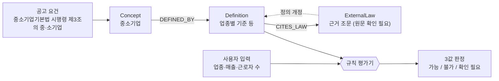
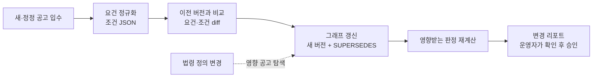

# 온톨로지 필요성 보강 검토 (SQL로 충분한가) — 공고 자격 판정 주제

*작성일 2026-11-23 · 상태: 제안(팀 결정 전) · 근거: 멘토링 지적, 강사 의견(전달), 사전 확인(2026-11-23), 동료 작성 `PUBLIC_NOTICE_GRAPH_RULES.md`(저장소 밖 Downloads 폴더), `API__.md`*
*이전 주제(사규)의 같은 문서는 2026-11-26 정리 때 삭제했다(git 기록에 남아 있음).*

## 0. 한 장 요약 (발표용)

**한 문장.** 공고를 모아 저장하고 필터로 찾는 일은 SQL로 충분하다. 온톨로지가 맡는 일은 **공고 요건의 의미(법정 정의, 개념 계층, 조건 논리)를 기계가 판정하고 그 근거를 경로로 설명하게 하는 층**이다.

**필요성의 세 축.** 아래는 "SQL로 불가능하다"가 아니라 "SQL로 하면 비용과 설명력이 달라진다"는 주장이며, 모두 **실험으로 확인할 가설**이다(§5).

| 축 | 온톨로지가 하는 일 | SQL만 쓰면 어려워지는 점 | 사전 확인 근거(표본 15건) |
|---|---|---|---|
| **① 정의가 바뀌면 판정이 따라 바뀐다** | "중소기업", "창업기업" 같은 법정 용어를 `Definition`→`ExternalLaw`로 연결해 두고, 요건은 정의를 가리키게 한다. 정의가 개정되면 영향받는 공고를 경로로 찾아 다시 판정한다 | 정의를 쓰는 공고마다 조건식이 복사돼 있어 개정 때 쿼리·데이터를 일일이 고쳐야 한다. 왜 그렇게 판정했는지 법령까지 이어서 보여 주기 어렵다 | 규모 조건 6건 중 법령 조문 직접 인용 2건, 확인서 제도 1건. 법령·제도 이름이 나온 공고 4건 |
| **② 요건의 의미 계층과 논리를 한 규칙으로 처리한다** | 지역(성동구 → 서울 → 전국), 업종, 신청자 유형을 계층으로 두고 AND/OR/제외·기준일을 가진 조건 트리를 규칙 평가기가 3값(가능/불가/확인 필요)으로 계산한다 | 계층마다 조인·재귀를 따로 쓰고 조건식마다 컬럼을 늘려야 한다. 새 조건 유형이 생기면 쿼리 N개를 고친다 | 지역 조건이 본문에 명시된 공고 9건, 기준일 명시 3건, AND 명시 2건, 제외 조건 분리 1건. 기준 표기가 공고마다 달랐음 |
| **③ 판정의 근거를 경로로 설명한다** | 불가·확인 필요 판정에서 어느 요건이, 어느 개념·정의 때문에 막았는지, 무엇을 바꾸면 되는지 경로로 보인다 | 판정 값만 나오고 이유는 별도 코드로 다시 만들어야 한다 | "공고문 참조"로 요건을 못 읽는 공고 2건은 `확인 필요`로 정직하게 보류해야 함 |

**정직한 현재 상태.** 사전 확인으로는 **그래프가 꼭 필요하다는 근거가 늘지 않았다.** 업력·연령은 K-Startup이 구간 문자열로 주므로 파싱이 되면 SQL로 충분할 가능성이 크고(`API__.md`는 "파싱 필요"로 적었고 실응답은 확인 전), 법령을 직접 인용한 공고는 15건 중 2건이었다. 위 세 축은 **주장이 서는 지점**이지 입증된 결과가 아니다. 그래서 이 문서는 필요성을 강조하되, 근거 강도를 숨기지 않고 SQL과 질문 유형별로 비교하는 실험(§5)에서 이기는 유형과 지는 유형을 함께 보고하는 것을 답으로 삼는다.

## 1. 배경

멘토링에서 "이 프로젝트는 SQL로도 가능하니 온톨로지가 필요 없다"는 지적을 받았다(이전 주제 기준). 팀은 강사 의견(공고문의 필요 사항을 계층으로 나눠 합쳐 검색하고, 온톨로지가 필요한 기능은 따로 따져 본다)을 받아 주제를 정부지원사업 공고 자격 판정으로 바꾸는 안을 문서화했다. 이 문서는 (1) 지적이 맞는 부분과 틀린 부분을 구분하고, (2) 새 주제에서 온톨로지의 필요를 보일 기능을 제안하며, (3) 사전 확인으로 얻은 근거와 그 한계를 기록한다.

## 2. 지적에 대한 정리

이 주제에는 **두 층**이 있다. 두 층을 나누지 않으면 논의가 흐려진다.

- **공고 메타 층:** 공고, 기관, 지원분야, 태그, 신청 기간 같은 **속성 데이터**. 동료가 쓴 `PUBLIC_NOTICE_GRAPH_RULES.md`가 이 층의 노드·ID·적재 규칙을 정했다(§4.3). 이 층은 관계형 테이블로 똑같이 만들 수 있어 **온톨로지의 근거가 되지 못한다.**
- **요건 층:** 공고 요건을 조건·개념·정의·법령으로 정규화하고 규칙으로 판정하는 층. 온톨로지의 근거는 여기서 나와야 한다.

| 질문 유형 | SQL로 가능한가 | 온톨로지가 더하는 것 |
|---|---|---|
| 마감·분야·지역으로 공고 찾기, 기관별 조회 | 가능 | 우위 없음 |
| 업력·연령 구간 필터(구간 문자열을 파싱한 뒤) | 가능 | 우위 없음. 이 논거만으로는 방어할 수 없다 |
| 상위 지역·업종 포함(성동구 → 서울 → 전국) | 가능(계층 테이블, 재귀 CTE) | 우위 작음 |
| AND/OR/제외·기준일이 붙은 조건 평가 | 가능(규칙 엔진 코드, 조건 테이블) | 조건 트리를 그래프로 두면 "어느 요건이 막았는지"가 경로로 나옴 |
| 법정 정의가 필요한 요건(중소기업 등) | 룩업 표와 규칙으로 일부 가능 | 정의 → 법령 조문 → 위임 규정을 따라가는 추적, 정의 개정 시 영향 공고 계산 |
| 출처가 다른 공고의 통합, 정정·재공고·중복 게재 | 가능하나 출처마다 매핑 유지 | 출처별 스키마를 하나의 개념으로 매핑하는 데이터 통합의 전형적 용도 |
| 새 요건 속성이나 관계 유형 추가 | 컬럼·쿼리 N개 재작성 | 규칙 1개 추가(주장) |

결론: "그래프라서 검색이 된다"는 논거는 약하다. 이 주제에서 온톨로지의 근거는 **규칙 추론, 법정 정의의 연결, 설명 가능성, 스키마 확장 비용** 네 가지이며, 아래 기능은 이 중 하나를 시연하도록 골랐다.

## 3. 온톨로지가 필요해질 수 있는 기능 후보

각 항목을 **무슨 기능인지 → 어떻게 작동하는지 → 왜 온톨로지가 필요하다고 주장하는지 → SQL로는 어떻게 되는지(약점) → 데이터 상황** 순으로 풀어 썼다. 1~6은 서비스 기능이고, 7~9는 팀 아이디어(데이터 입수·증강·추가)를 이 주제에 맞춰 정리한 것이다.

| # | 기능 | 한 줄 | 우선순위(제안) |
|---|---|---|---|
| 1 | 법정 정의 도출 | 업종·매출·근로자 수로 중소기업·소상공인 여부를 법령 기준으로 도출해 여러 공고에 적용 | P1, **중심 후보** |
| 2 | 분류 체계 정렬·다중 소속 구역 | 공고마다 다른 업종 서술과 지정 구역을 개념으로 정렬 | 데이터 확인 후 |
| 3 | 최소 변경 설명·질문 순서 | "무엇을 바꾸면 가능한가", 후보를 가장 줄이는 질문 | P1, 사용자 가치 |
| 4 | 지원사업 사다리·중복 제약 | 선행 수혜가 후속 자격이 되는 관계로 다음 사업 추천 | 근거 약함 |
| 5 | 입수 시점 검증·정의 변경 전파 | 정정 공고 요건 diff, 법령 정의 변경 시 영향 공고 탐색 | P1, **중심 후보** |
| 6 | 서류 의존 그래프(보조) | 제출서류 선후 관계로 준비 체크리스트 | 보조 |
| 7 | 데이터 입수·갱신 (팀 아이디어) | 일 1회 수집, 정정·재공고를 버전으로 보관 | 5의 운영 기반 |
| 8 | 데이터 증강 (팀 아이디어) | 정정·가상 프로필·공고 변형을 만들어 평가에 씀 | 평가용 보조 |
| 9 | 데이터 추가 (팀 아이디어) | 두 번째 포털 통합, 나라장터 입찰 포함 여부 | 후보, 범위 결정 필요 |

사례의 사용자 값(성동구, 구미시 등)은 **가상 입력**이다. 공고 사례는 사전 확인 표본에서 가져온 것이며 요건 정규화 결과는 **손으로 한 예시**이지 시스템이 낸 결과가 아니다.

### 3.1 법정 정의 도출 (중소기업·소기업·소상공인·창업기업)

- **쉬운 설명**: 공고가 "중소기업"을 요구하면, 사용자가 업종·매출·상시근로자 수를 한 번 입력하는 것으로 **법령이 정한 기준에 따라** 중소기업인지 도출한다. 이 판정을 정의를 쓰는 모든 공고에 한꺼번에 적용한다.
- **작동 방식**: ① 요건의 조건이 `Concept`(예: 중소기업)를 가리킨다 ② 개념은 `DEFINED_BY`로 `Definition`에 연결되고 ③ 정의는 `CITES_LAW`로 `ExternalLaw`(근거 법령 조문)에 이어진다 ④ 규칙 평가기가 정의의 규칙(업종별 기준 등)에 사용자 값을 넣어 3값으로 계산한다. 정의의 구체적 기준은 **법제처 원문 확인 필요**하다.
- **온톨로지가 필요하다는 주장**: 정의를 한 곳에 두고 요건이 그것을 가리키므로, 개정되면 `Definition` 한 곳을 고치고 영향받는 공고를 경로로 찾아 다시 판정한다. 판정 설명이 "요건 → 정의 → 법령 조문"으로 나온다.
- **SQL로는**: 업종별 기준 룩업 표와 규칙 코드로 같은 판정이 된다. 차이는 개정 때 영향 공고를 찾고 설명을 만드는 비용이며, 지금은 **주장**이다.
- **데이터 상황 (표본 15건)**: 규모 조건이 6건이다. 김해 공고는 「중소기업기본법 시행령」 제3조제1항과 「대기환경보전법 시행령」 제13조를 직접 인용했고, 충남 공고는 「중소기업기본법」 제2조를 인용했다. 경북 공고는 "중소기업 확인서 발급 가능"이라는 제도 문구였다. **법령 조문을 직접 인용한 공고는 15건 중 2건**이라 소수 표본이다. 법령 원문을 우리가 수집했는지(기존 법령 275건에 포함됐는지)는 **미확인**이다.

### 3.2 분류 체계 정렬과 다중 소속 구역

- **쉬운 설명**: 공고마다 업종 서술이 다르다(수산업, 소방산업, 콘텐츠, 환경, 제조·가공업). 사용자의 업종·기술 분야를 이 서술들과 상위·하위·관련 관계로 이어 준다. 지역은 행정구역 외에 **지정 구역**(공업지역, 악취관리지역 등)에 동시에 속할 수 있다.
- **온톨로지가 필요하다는 주장**: 서로 다른 분류 체계를 개념으로 정렬하는 것은 온톨로지의 전형적 용도다. 다중 소속은 트리가 아니라 그래프(DAG)로 두는 편이 자연스럽다.
- **SQL로는**: 계층 테이블과 매핑 표로 가능하다. 업종 확장은 **임베딩 검색과 겹치므로** 반드시 비교한다.
- **데이터 상황**: 김해 공고의 "악취관리지역인 공업지역" 같은 지정 구역은 행정구역 코드로 해소되지 않는다. 구역 목록과 소속 데이터를 구할 수 있는지는 **미확인**이다(기초 설계서 H10: 확보 전에는 `UNKNOWN` 고정).

### 3.3 최소 변경 설명과 질문 순서

- **쉬운 설명**: 신청 불가 공고에서 "무엇을 최소로 바꾸면 가능한가"를 보이고, 정보가 부족하면 후보를 가장 많이 줄이는 질문부터 되묻는다.
- **작동 방식**: 3값 판정과 조건 트리 위에서, 불충족 조건 중 바꿀 수 있는 것을 찾고(what-if) 미확인 조건을 후보 수 감소량으로 정렬한다. 규칙 평가기와 개념 계층이 있어야 "상위 개념이면 하위 조건을 못 채운다(`UNKNOWN`)" 같은 구분이 된다.
- **온톨로지가 필요하다는 주장**: 근거 경로가 곧 설명이 된다. 판정을 낸 요건·개념이 그대로 부족 조건 목록이 된다.
- **SQL로는**: 규칙 엔진 코드로 같은 설명을 만들 수 있다. 온톨로지 필요성보다 **사용자 가치와 시연 효과**가 큰 기능이다.
- **데이터 상황**: 표본에서 AND가 명시된 공고는 2건, 제외 조건이 분리된 공고는 1건이었고 대부분은 조건을 나열할 뿐이었다. 조건 트리가 실제로 필요한 공고의 비율은 **미확인**이다.

### 3.4 지원사업 사다리·중복 제약

- **쉬운 설명**: 선행 사업 수혜가 후속 사업의 자격·제외 조건이 되는 관계를 두고 "지금 받을 수 있는 사업, 다음에 받을 수 있는 사업"을 추천한다. 서로 배타적인 사업은 함께 추천하지 않는다.
- **정직한 평가**: 표본에서 전년 선정자·제외 대상이 나온 공고는 **1건(통영)** 뿐이다. 선행·중복 조건이 공고에 명시되는 빈도, 수혜 이력 입력을 개인정보 정책이 허용하는지, 조합 선택은 제약 풀이에 가깝다는 점이 모두 미확인이다. 데이터가 가장 불확실한 기능이라 **확인 전에는 주장하지 않는다.**

### 3.5 입수 시점 검증과 정의 변경 전파

- **쉬운 설명**: 정정 공고가 올라오면 이전 버전과 비교해 어떤 요건이 바뀌었는지, 기존 판정이 영향받는지 보여 준다. 법령 정의가 바뀌면 그 정의를 쓰는 공고를 찾아 다시 판정한다. 이전 주제의 "입수 시점 검증"(새 데이터를 들일 때 기존 데이터와의 어긋남을 찾는다)과 같은 구조다.
- **입수 시점 검증의 세 경우**:

  | 넣는 것 | 검사 내용 | 현실성(판단) |
  |---|---|---|
  | 정정·재공고 | 요건·조건의 변경 diff, 기존 판정에 미치는 영향 | 정정·재공고 빈도가 **미확인**이라 가설 |
  | 개정된 법령 정의 | 그 정의를 쓰는 공고의 판정이 달라지는가 | 3.1이 선행돼야 의미가 있음 |
  | 새 포털·새 공고 일괄 | 요건 수 급변, `unparsed` 증가 같은 이상 징후 | 수집 파이프라인의 품질 점검으로 현실적 |

- **정직한 평가**: 업로드·변환·버전 보관은 DB 종류와 무관한 엔지니어링이라 SQL로도 똑같이 된다. **이것만으로는 온톨로지 근거가 되지 않는다.** 근거는 정의 → 공고 영향 전파와 판정 재계산이며, 이것도 SQL로 구현할 수 있고 온톨로지 쪽 주장은 "규칙 하나가 모든 공고에 적용된다"는 것뿐이어서 §5 실험으로 확인한다.
- **동료 규칙 문서와의 관계**: 동료 규칙은 공고를 `notice_id`로 `MERGE`해 덮어쓴다(나라장터는 차수로 분리). 정정 공고의 요건 diff를 하려면 이전 버전을 남겨야 하므로 **버전 보존 방식을 맞춰야 한다**(§4.3, §6).
- **시연 한계**: 정정 전·후 두 버전의 실제 공고를 구할 수 있는지는 **미확인**이다. 안 되면 정정을 심은 가상 변형(§3.8)으로 시연하게 되며, 이 경우 "실제 데이터에서 발견했다"고 말할 수 없다.

### 3.6 서류 의존 그래프 (보조)

- **쉬운 설명**: 제출서류의 발급처·유효기간·선후 관계를 이어 "신청 전 준비 체크리스트"를 만든다.
- **정직한 평가**: 서류 정보는 첨부에 있어 **이번 사전 확인으로는 근거를 얻지 못했다.** 목록·표로도 충분해 온톨로지 근거로는 약하다. 첨부 열람이 가능한지(이용 조건)부터 확인해야 한다.

### 3.7 데이터 입수·갱신: 일 1회 수집과 버전 관리 (팀 아이디어)

- **쉬운 설명**: 공개 API에서 매일 공고를 받아 정규화하고, 정정되면 새 버전을 만들어 이전 버전과 함께 보관한다. 사라진 공고는 삭제하지 않고 마지막으로 본 시각으로 관리한다(동료 규칙 문서의 `is_active`/`last_seen_at` 정책과 같다).
- **정직한 평가**: 이것은 **DB 종류와 무관한 엔지니어링**이다. 온톨로지의 근거가 아니라 3.5의 운영 기반이다.

### 3.8 데이터 증강: 평가용 변형 (팀 아이디어)

- **쉬운 설명**: 실제 공고를 본떠 정정·재공고 변형, 가상 사용자 프로필, 요건이 다른 합성 공고를 만들어 평가 데이터를 늘린다.
- **정직한 평가**: 증강 자체는 온톨로지가 필요하다는 근거가 아니라 **필요성을 검증하는 도구**다. 정정을 일부러 심으면 변경 탐지율을 잴 수 있고, 가상 프로필 × 공고로 판정 정답셋을 늘릴 수 있다.
- **위험**: AI가 만든 공고는 실제의 서술 방식을 반영하지 못할 수 있어 "실제 성능"의 증거가 되지 못한다. 합성 데이터는 `synthetic` 표시로 실제와 분리하고, 정답을 만든 AI와 평가하는 AI를 같게 두지 않는다.

### 3.9 데이터 추가: 두 번째 포털과 나라장터 (팀 아이디어)

- **쉬운 설명**: K-Startup과 기업마당을 하나의 그래프로 합치고, 나라장터 입찰공고까지 넣을지 정한다.
- **온톨로지가 필요하다는 주장**: 포털마다 필드와 분류가 다르다. 같은 의미를 공통 개념으로 묶어야 중복 게재를 해소하고 출처를 가로지르는 질의가 된다. 동료 규칙 문서는 두 원천을 `PublicNotice` 한 라벨로 모으되 출처별 ID와 의미를 보존하는 방식을 정했다(§4.3).
- **나라장터는 범위가 다르다.** 입찰은 요건 구조가 달라(면허·실적·인증, 배점) 이 서비스의 자격 판정과 직접 겹치지 않는다. 같은 영역을 시도한 AI 조달 서비스(클라이원트)는 종료됐다고 팀이 전달받았다(출시 글만 읽음, 사유 미확인). **입찰을 포함할지는 팀 결정**이다(§6).
- **위험**: 범위가 넓어지고 포털마다 정제 비용이 든다. 한 포털로 P0를 시작하고 두 번째 포털을 P1로 두는 안을 제안한다.

### 3.10 기능별 온톨로지 근거 강도 (제안, 검증 전)

| # | 근거 강도 | 이유 | 확인 상태 |
|---|---|---|---|
| 1 | 중 | 정의 한 곳 수정과 영향 공고 재판정, 법령까지의 경로 설명이라는 주장이 서고 표본에서 법령 인용이 나왔다. 그러나 직접 인용은 15건 중 2건이고 룩업 표로도 판정은 된다 | 표본 15건 집계 확인, 법령 원문 보유·정의 규칙은 미확인 |
| 2 | 약~중 | 분류 체계 정렬과 다중 소속은 그래프가 자연스럽지만 임베딩 검색과 겹친다. 지정 구역 데이터가 미확인 | 지정 구역 사례 1건, 데이터 미확인 |
| 3 | 약~중 | 규칙 엔진으로도 된다. 설명·질문 순서의 사용자 가치가 크다 | 조건 트리 필요 공고 비율 미확인 |
| 4 | 약~중 | 잠재 가치는 크나 근거가 표본 1건뿐이고 이력 입력의 개인정보 문제가 있다 | 선행·중복 조건 빈도 미확인 |
| 5 | 중 | 정의 변경 전파와 판정 재계산이 3.1과 함께일 때 의미가 크다. 정정 빈도와 두 버전 확보가 미확인이라 시연 근거가 약하다 | 정정·재공고 빈도 미확인 |
| 6 | 약 | 목록으로 충분 | 첨부 열람 미확인 |
| 7 | 근거 아님 | 파이프라인은 DB 무관 | - |
| 8 | 근거 아님 | 검증 도구 | - |
| 9 | 약~중 | 이종 출처 통합 주장. 두 번째 포털 데이터와 중복 게재 비율이 미확인 | 두 포털의 중복 게재 비율 미확인 |

현재 판단은 이렇다. 단독으로 가장 설득력 있는 기능은 없고, **1(정의 도출)과 5(전파)를 "정의가 바뀌면 영향받는 공고를 다시 판정한다"는 한 시나리오로 묶고 3(설명)을 사용자 가치로 붙이는 것**이 가장 낫다. 2와 4는 데이터를 확인하기 전에는 주장하지 않는다. 이 강도 표는 판단이며 §5 실험 결과로 바뀔 수 있다.

## 4. 사전 확인으로 확인한 것

### 4.1 확인 방법과 결과

공개 페이지만 읽었고 **인증키를 발급하거나 API를 호출하지 않았다.** 상세는 [old/PRECHECK_공고주제_사전확인.md](../old/PRECHECK_공고주제_사전확인.md)에 있다.

| 확인 대상 | 결과 | 온톨로지에 주는 의미 |
|---|---|---|
| K-Startup 조회 서비스 명세 | 무료, 이용허락 제한 없음. 업력·연령·신청 대상이 구간 문자열로 제공되고 신청 대상 내용·제외 대상 내용은 서술 필드 | 구간 값은 파싱되면 SQL로 충분(약). 그래프의 몫은 서술 요건과 정의 |
| 기업마당 API 명세 | 구조화된 자격 필드는 지원대상(`trgetNm`) 하나이고 지역은 해시태그 | 세부 요건은 사업개요 서술과 첨부에 있어 **정규화 스키마가 필요** |
| robots.txt | K-Startup은 공고 목록 HTML과 첨부 경로를 차단 | 수집은 API만. 첨부 요건은 접근이 제한됨 |
| 표본 공고 15건(기업마당 2026-11-20 등록분) | 아래 표 | 근거는 소수. 정규화 스키마가 필요한 사례는 확인 |

**표본 15건 집계** (비무작위, 한 포털의 하루치, 창업 분야 3건)

| 관찰 | 건수 | 의미 |
|---|---|---|
| 지역 조건이 요건 본문에 명시 | 9 | 지역은 거의 항상 요건. 기준(등록 주소, 실제 거주, 본사·공장)이 서로 다름 |
| 규모 조건(중소기업 등) | 6 | 그중 법령 조문 직접 인용 2, 확인서 제도 1 |
| 법령·제도 이름이 나온 공고 | 4 | 정의 → 법령 연결(기능 1)의 사례 |
| AND(“모두 충족”) 명시 / 제외 조건 분리 | 2 / 1 | 대부분은 조건을 나열할 뿐 논리가 불명확 |
| 기준일 명시 | 3 | 공고일·접수 마감일·전년도로 제각각 |
| "자세한 내용은 공고문 참조" | 2 | `확인 필요`로 보류해야 하는 공고 |
| 첨부 있음 | 15 | hwpx 13건, pdf 5건, xlsx 2건(한 공고에 여러 형식). HWP5는 없음 |

### 4.2 이 데이터가 말해 주는 것

- **그래프가 꼭 필요하다는 근거는 늘지 않았다.** 업력·연령·지역 같은 정형 조건은 SQL로 충분할 가능성이 크고, 법령 직접 인용은 소수다.
- 다만 **정규화 스키마가 필요한 사례**(기준일, 트랙, 지정 구역, 연령과 출생연도의 이중 표기)는 실제로 나왔다. 이는 요건 층을 데이터 모델로 다뤄야 한다는 근거이지, 그 모델이 그래프여야 한다는 근거는 아니다.
- 따라서 필요성은 **"정의 연결과 설명"(기능 1·3·5)** 에 걸고, 나머지는 데이터를 확인한 뒤에 주장한다.

### 4.3 동료 규칙 문서(`PUBLIC_NOTICE_GRAPH_RULES.md`)로 확인한 것

- 동료가 **기업마당과 나라장터 샘플 5건씩**(`api_samples/bizinfo_5.json`, `g2b_5.json`)으로 공고 메타 그래프의 노드·ID·관계·적재 규칙을 정했다. 우리가 못 본 **실응답 샘플**이 있다는 점이 가장 큰 가치다(K-Startup 샘플은 없다).
- 이 문서는 **공고 메타 층**이다. 요건·개념 계층·정의·판정 층은 없고 지원대상은 `eligibility_text` 문자열로만 보존한다. "샘플에 없는 사실은 추론하지 않고 `ELIGIBLE_FOR` 같은 판정 관계는 만들지 않는다"는 원칙은 우리 설계(판정은 규칙 평가기, 그래프에 저장하지 않음)와 같다.
- **합쳐야 할 차이:** ① 버전 보존(덮어쓰기 대 버전별 노드와 `SUPERSEDES`) ② 공고 ID 표기와 `@v` 접미 ③ 기관 관계(`ANNOUNCED_BY`/`EXECUTED_BY` 대 `PUBLISHES` role) ④ 분류 키(이름 정규화 대 분야 코드) ⑤ 해시태그를 분류가 아닌 보조 검색어로 보는 규칙과 우리의 시도 태그 → 지역 연결 ⑥ 신청 기간 형식(`YYYY-MM-DD` 대 명세의 `YYYYMMDD`). **샘플 파일을 받아 확인한 뒤 맞춘다.**

### 4.4 시장·유사 서비스

- 클라이원트 AI 조달 비서(나라장터 입찰·조달 대상)는 근거 제시·"확인 필요"·사람이 판단한다는 원칙이 우리와 같았다. 2026-11-18 종료는 팀 전달 사항이며 공식 확인과 사유는 못 했다. GovLens는 접속하지 못해 미확인이다(기획 보고서 §3.1).
- 이 사실을 **온톨로지 필요성의 근거로 쓰지 않는다.**

### 4.5 확인하지 못한 것

- **API 실응답**(인증키 미발급), 총 공고 건수, 호출 한도 단위, 이용약관, 첨부 열람 조건.
- 표본이 작고 치우쳐 있다(15건). 창업 분야 무작위 30건 이상의 요건 분석과 두 사람이 따로 정규화한 일치도가 아직 없다.
- **법령 원문과 정의 규칙**(중소기업 규모 기준 등)은 기억에 의존했으므로 원문 확인 전이다. 기존 수집 법령 275건에 창업·중소기업 관련 법령이 있는지도 미확인이다.
- 정정·재공고 빈도, 두 포털의 중복 게재 비율, 선행·중복 수혜 조건의 빈도.

## 5. 검증 실험 제안: SQL 베이스라인

기초 설계서 §9의 비교 실험을 이 문서의 질문 유형에 맞춰 다시 적는다. **어느 방식도 미리 이긴다고 쓰지 않는다.**

| 방식 | 구성 |
|---|---|
| 베이스라인 A: SQL 필터 | Supabase(Postgres) 정규화 컬럼 + 단순 조건문. 요건 문장을 컬럼으로 못 풀면 `확인 필요` |
| 베이스라인 A2: SQL + 계층 매핑 | 같은 요건 정규화 결과 + `parent_code` 계층 테이블(재귀 쿼리). **"개념 계층 자체"의 효과와 "정규화"의 효과를 분리**하기 위한 공정성 조건 |
| 베이스라인 B: 벡터 단독 | 임베딩 검색 + 모델 설명. 규칙 평가기 없음 |
| 제안: GraphRAG | 개념 계층 확장 + 규칙 평가기 + 경로 |

1. 질문을 유형별로 나눈다: **필터형 / 계층형 / 정의 의존형 / 설명형 / 공고 관계형**(기초 설계서 §9와 같다).
2. 같은 평가셋·같은 공고 스냅샷에 A·A2·B·제안을 적용해 N-02(판정 일치율), N-03("신청 가능" 오탐률), N-04(계층 확장 Recall), 지연, 입력 토큰, 구축 비용으로 비교한다([KPI 초안](KPI_DRAFT.md) N-07).
3. **확장 비용을 잰다:** 새 요건 속성이나 관계 유형 1개를 추가할 때의 작업량(규칙 1개 대 쿼리·컬럼 N개)과 정의 1개를 개정했을 때 영향 공고를 다시 판정하는 작업량을 기록한다.
4. A2가 제안과 같은 결과를 내면 그 사실을 그대로 보고한다. 단순 필터·계층에서 격차가 없으면 그대로 보고한다. **격차가 정의 의존형·설명형·공고 관계형에서만 나타나면 그것이 온톨로지의 근거**이고 주장 범위를 그 유형으로 좁힌다.
5. **격차가 전혀 없으면** 범위를 줄이거나(정의 → 법령 연결에 집중) 주제를 재검토한다(기획 보고서 부록 D #1). 판단 기준과 시점은 **결과를 보기 전에** 팀이 정한다 `[ ]`.

실험 결과는 §3.10의 근거 강도 표를 갱신하는 데 쓴다.

## 6. 팀이 결정할 것

1. **중심 기능**을 1(정의 도출)+5(전파)로 하고 3(설명)을 붙이는 안에 동의하는지. 2와 4는 데이터 확인 전에 주장하지 않는 안에 동의하는지.
2. **SQL 베이스라인 실험**(A·A2·B)을 P0에 넣고 판정 기준을 미리 정하는지(§5).
3. **정의 데이터의 범위:** 법령 원문을 어디까지 확보하고(창업지원법·중소기업기본법 등) 어느 정의부터 `Definition`으로 적재하는지.
4. **동료 규칙 문서를 흡수하는 방식:** 버전 보존, ID 표기, 기관 관계, 분류 키를 맞추고 `api_samples`를 받아 실응답을 확인하는지.
5. **나라장터 입찰을 범위에 넣을지**(요건 구조가 달라 별도 모델이 필요).
6. **팀 아이디어 3건의 범위:** 데이터 입수·갱신(§3.7)은 5의 운영 기반으로 두고, 증강(§3.8)은 평가용 보조로 분리해 쓰며, 추가(§3.9)는 한 포털로 시작하는지.
7. 확정되면 기획 보고서(§1.2, §5.2, 부록 D)와 기초 설계서(§9)에 "SQL 대비 필요성" 절을 반영하고, 도메인 온톨로지 설계서(새 주제용, 미작성)의 근거로 쓴다.
